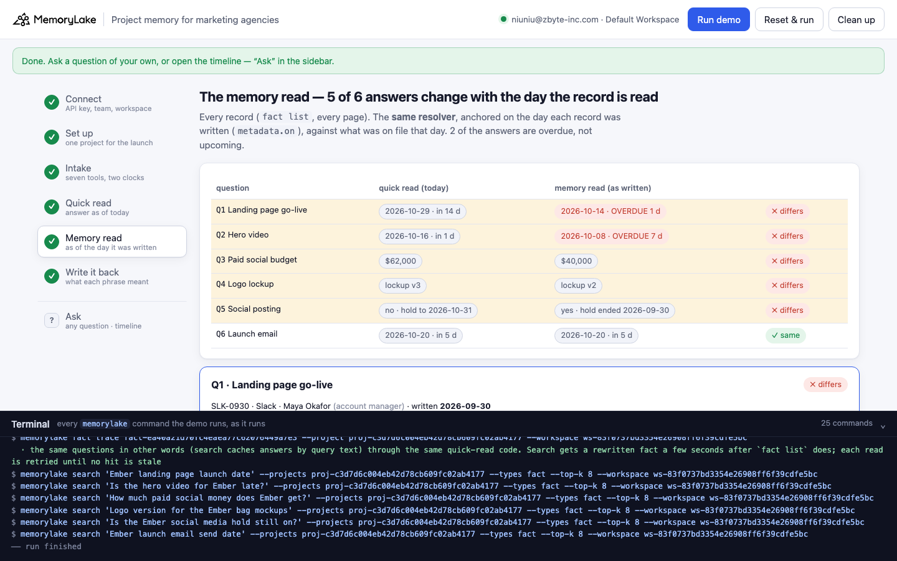
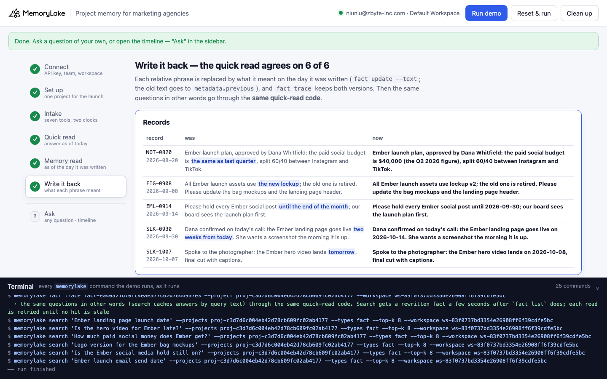

# Project memory for marketing agencies

A runnable version of the MemoryLake use case
[*Give Marketing Agencies Project Management Memory That Holds Across Every Team Role*](https://www.memorylake.ai/en/usecase/project-management-memory-for-marketing-agencies),
built entirely on the [`memorylake` CLI](https://github.com/memorylake-ai/memorylake-cli).

**Watch it run:** [CLI, 2:30](https://github.com/memorylake-ai/memorylake-usecases/releases/download/agency-project-memory-v1/agency-project-memory-cli-demo.mp4) · [Web, 3:40](https://github.com/memorylake-ai/memorylake-usecases/releases/download/agency-project-memory-v1/agency-project-memory-web-demo.mp4)
([release](https://github.com/memorylake-ai/memorylake-usecases/releases/tag/agency-project-memory-v1); GitHub serves them as downloads).

**The problem.** Agency project memory is mostly what people wrote in their own tools on the day: "Dana confirmed:
the landing page goes live two weeks from today", "the hero video lands tomorrow", "budget is the same as last
quarter", "use the new lockup", "hold every post until the end of the month". All true when written. Put into one
project memory, they get read weeks later by someone else's assistant, and every one of those phrases gets resolved
against the day it is **read**. The landing page is "in 14 days" when it was due yesterday. The only date on the record
itself is `created_at`, the day it was synced into memory; the day it was written lives in the source tool.

**What this demo shows.** Harbor & Pine (a fictional agency) runs the Ember launch for Fieldstone Coffee Roasters (a
fictional client) out of one MemoryLake project: 20 records from 7 tools (Slack, Asana, Notion, Figma, Docs, the
client's email, the finance sheet), each pinned word for word with its tool, author, role and **the day it was
written** in metadata. Today, 2026-10-15, Priya Raman takes over the account and preps the Thursday status call:

| Question | The record (written) | Quick read: resolved today | Memory read: resolved as written | |
|---|---|---|---|---|
| Q1 When does the landing page go live? | Slack, Maya · 09-30 · *two weeks from today* | 2026-10-29, in 14 days | **2026-10-14, overdue 1 day**; Asana 10-13: blocked, waiting on the hero video | ✗ |
| Q2 When does the hero video arrive? | Slack, Kofi · 10-07 · *tomorrow* | 2026-10-16, in 1 day | **2026-10-08, overdue 7 days**; nothing on file says it arrived | ✗ |
| Q3 Paid social budget? | Notion, Maya · 08-20 · *the same as last quarter* | $62,000 (Q3) | **$40,000 (Q2)**; Q3 closed on 10-02 | ✗ |
| Q4 Which lockup on the launch assets? | Figma, Ines · 09-08 · *the new lockup* | lockup v3, the December-only holiday variant | **lockup v2**, the newest on 09-08 | ✗ |
| Q5 Can we post on social this week? | Email, Dana · 09-14 · *until the end of the month* | no, on hold until 10-31 | **yes**, the hold ended 09-30 | ✗ |
| Q6 When does the launch email go out? (control) | Asana, Leo · 10-06 · *on 2026-10-20* | 2026-10-20, in 5 days | 2026-10-20, in 5 days | ✓ |

Search is not the problem: it puts the right record at #1 for all six questions, every run. Nothing in memory is
wrong, and no later record overturned anything. Both reads run **the same resolver**; the only difference is the
anchor. The quick read anchors on today. The memory read anchors on each record's own `metadata.on`, and looks up what
the phrase refers to (last quarter's spend, the newest lockup) among the records already on file that day. The launch
email is the control: its record says the date outright, and both reads agree.

Step 6 writes each resolution back where the next read will see it: the phrase is replaced in place by what it meant
("goes live on 2026-10-14", "$40,000 (the Q2 2026 figure)"), with the old text in `metadata.previous`. `fact trace`
keeps both versions. The same questions, asked in other words, then go through the **same quick-read code**, and it
agrees 6 of 6.

```
setup ──────── proj create
intake ─────── fact add --project <p> '<record>' …   (20 records, one call)  + fact update --metadata {tool, by, role, on, topic, kind …}
               fact list --projects <p> --query '<relative phrase>'   (one per phrase: which records mean different things on different days)
quick read ─── search '<question>' --projects <p> --types fact --top-k 8
               → best-ranked record that states the plan on the topic → resolve its relative phrase against today
memory read ── fact list --projects <p>   (every record, every page)
               → the plan on the topic → the same resolver, anchored on metadata.on, against what was on file that day
               → past due? the latest status record on the topic
write back ─── fact update <record> --text '<phrase replaced by what it meant>' --metadata {…, previous, resolved_from, resolved_on}
               fact trace <record>  → ADD, UPDATE (old text kept) → quick read again (other wording)
```

No conversations and no extraction: every record is pinned word for word, and both reads are plain code over what the
CLI returns. No model decides anything.

## Prerequisites

- **Python 3.9+** (standard library only, nothing to `pip install`)
- **The `memorylake` CLI** on your `PATH`:
  ```bash
  curl -fsSL https://raw.githubusercontent.com/memorylake-ai/memorylake-cli/main/scripts/install.sh | sh
  ```
- **A MemoryLake API key.** Sign up at [app.memorylake.ai](https://app.memorylake.ai), open **API Keys**, create one. A free
  personal account is enough: nothing here needs an agent or a model call.

## Run it

```bash
git clone https://github.com/memorylake-ai/memorylake-usecases.git
cd memorylake-usecases/agency-project-memory
export MEMORYLAKE_API_KEY=sk-...           # China region: also export MEMORYLAKE_BASE_URL=https://app.memorylake.cn/openapi/memorylake
python3 demo.py
```

About a minute and a half the first time (one project, 20 facts, each with its metadata), a bit over a minute on a
re-run. Every run replays Priya's first status call: records an earlier run rewrote are put back word for word from
`metadata.previous` first. With the key set, the demo logs into an isolated CLI profile under `./.memorylake-demo/` and
never touches your own `~/.memorylake`. Everything it creates has a `custom_id` starting with `mlu-apm-`.

Then list every relative phrase, or ask a question of your own:

```bash
python3 demo.py timeline
python3 demo.py ask "Which lockup goes on the Ember bag labels?" --topic lockup
python3 demo.py ask "Is the Ember landing page late?" --topic golive   # topics: golive, video, budget, lockup, social, email
python3 demo.py cleanup                    # deletes the project and every fact on it
```

`timeline` reads every record and resolves each phrase twice (after a run, the records are rewritten, so it reads
their `metadata.previous`):

```
  record    written     by              phrase                       meant        reads today as
  --------------------------------------------------------------------------------------------
  NOT-0820  2026-08-20  Maya Okafor     the same as last quarter     $40,000      $62,000         (rewritten)
  FIG-0908  2026-09-08  Ines Moreau     the new lockup               lockup v2    lockup v3       (rewritten)
  EML-0914  2026-09-14  Dana Whitfield  until the end of the month   2026-09-30   2026-10-31      (rewritten)
  SLK-0930  2026-09-30  Maya Okafor     two weeks from today         2026-10-14   2026-10-29      (rewritten)
  SLK-1007  2026-10-07  Kofi Mensah     tomorrow                     2026-10-08   2026-10-16      (rewritten)

  · 5 of 5 read differently today than the day they were written
```

## Or run it in the browser

```bash
python3 web/server.py                # opens http://127.0.0.1:8765
```

Paste the key, connect, run. The page drives the same functions as `demo.py` and streams every `memorylake` command into a
terminal drawer as it runs: the `fact list --query` census and the two dates on each relative record; the quick read
of each question with its top 8; the memory read as a comparison table and one card per question (the phrase
highlighted, resolved both ways); and the write-back with `fact trace`. **Ask** takes any question and its topic, and
opens the timeline.





## What happens, step by step

### Steps 2–3: one project, seven tools, two clocks

One project, one `fact add` call with all 20 records word for word, then `fact update --metadata` on each (`fact add`
takes no metadata):

```
$ memorylake fact update fact-97dd… --project proj-fe96… --metadata '{"key": "apm:SLK-0930", "record": "SLK-0930", "tool": "slack", "by": "Maya Okafor", "role": "account manager", "on": "2026-09-30", "topic": "golive", "kind": "plan"}'
  · … and 19 more `fact update --metadata` the same way
    Slack     3   SLK-0918 · SLK-0930 · SLK-1007
    Asana     5   ASN-405 · ASN-398 · ASN-430 · ASN-415 · ASN-412
    Notion    2   NOT-0812 · NOT-0820
    Figma     4   BRD-V2 · FIG-0908 · FIG-0922 · BRD-V3
    Docs      2   DOC-0915 · DOC-1009
    Email     2   EML-0914 · EML-1002
    Finance   2   FIN-Q2 · FIN-Q3
```

Then the whole project is asked for each relative phrase. `fact list --query` is an exact, case-insensitive substring
match over every record (every page), so the census is complete, unlike a top-k search:

```
$ memorylake fact list --projects proj-fe96… --query 'two weeks from today' --page-size 50
  · … and 4 more `fact list --query` the same way

    “two weeks from today”         1  SLK-0930
    “tomorrow”                     1  SLK-1007
    “the same as last quarter”     1  NOT-0820
    “the new lockup”               1  FIG-0908
    “until the end of the month”   1  EML-0914

  Two dates on each of them — the day it was written (metadata.on, from the tool) and the day it reached MemoryLake (created_at):
    NOT-0820  written 2026-08-20 by Maya Okafor    created_at 2026-10-14T18:23Z  “Ember launch plan, approved by Dana Whitfield: the paid soc…”
    FIG-0908  written 2026-09-08 by Ines Moreau    created_at 2026-10-14T18:23Z  “All Ember launch assets use the new lockup; the old one is …”
    EML-0914  written 2026-09-14 by Dana Whitfield created_at 2026-10-14T18:23Z  “Please hold every Ember social post until the end of the mo…”
    SLK-0930  written 2026-09-30 by Maya Okafor    created_at 2026-10-14T18:23Z  “Dana confirmed on today's call: the Ember landing page goes…”
    SLK-1007  written 2026-10-07 by Kofi Mensah    created_at 2026-10-14T18:23Z  “Spoke to the photographer: the Ember hero video lands tomor…”
```

`created_at` is whenever you run the demo; in a real sync it is the day the connector copied the record. Either way it
is not the day the person wrote it.

### Step 4: the quick read

`search` the question, take the best-ranked record that states the plan on that topic, resolve its relative phrase
against today:

```
  Q1 “When does the Ember landing page go live?”
  search · top 8:
      #1   SLK-0930  Slack    2026-09-30  Dana confirmed on today's call: the Ember landing page goes live two weeks …   ← the record
      #2   SLK-1007  Slack    2026-10-07  Spoke to the photographer: the Ember hero video lands tomorrow, final cut w…
      #3   ASN-412   Asana    2026-10-13  Task 'Ember landing page: go live' is blocked, waiting on the hero video fo…
      …
  · SLK-0930: hit created_at 2026-10-14T18:23Z — when it was synced, not the day Maya wrote it
  · read today: “two weeks from today” read on 2026-10-15 → 2026-10-29
  → quick read: 2026-10-29 — in 14 days
```

The Asana task that says the page is blocked is right there at #3. The quick read has no reason to look at it: a
launch 14 days out isn't late yet.

### Step 5: the memory read

Every record (`fact list`, every page). The same resolver, anchored on the day the record was written, looking up only
what was on file that day:

```
  Q3 Paid social budget
    NOT-0820 · Notion · Maya Okafor (account manager) · written 2026-08-20
    “Ember launch plan, approved by Dana Whitfield: the paid social budget is the same as last quarter, split 60/40 between Instagram and TikTok.”
  · quick read, today      : “the same as last quarter” read on 2026-10-15 → $62,000
  · memory read, as written: “the same as last quarter” read on 2026-08-20 → $40,000
  → quick read:  $62,000 — FIN-Q3: “Fieldstone paid social spend, Q3 2026 (closed): $62,000, including the summer cold brew p…”
  → memory read: $40,000 — FIN-Q2: “Fieldstone paid social spend, Q2 2026 (closed): $40,000.”  ✗ differs

       question               quick read (today)            memory read (as written)
  --------------------------------------------------------------------------------------------
  Q1   Landing page go-live   2026-10-29 · in 14 d          2026-10-14 · OVERDUE 1 d      ✗ differs
  Q2   Hero video             2026-10-16 · in 1 d           2026-10-08 · OVERDUE 7 d      ✗ differs
  Q3   Paid social budget     $62,000                       $40,000                       ✗ differs
  Q4   Logo lockup            lockup v3                     lockup v2                     ✗ differs
  Q5   Social posting         no · hold to 2026-10-31       yes · hold ended 2026-09-30   ✗ differs
  Q6   Launch email           2026-10-20 · in 5 d           2026-10-20 · in 5 d           ✓ same

  → 5 of 6 answers change with the day the record is read; 2 of them are overdue, not upcoming (Q1, Q2)
```

For a date in the past, both reads check the latest status record on the topic; only the memory read ever gets
there. Q1 and Q2 are the same story twice: the page waits on the video, and the video was due a week ago.

### Step 6: write it back

Each relative phrase is replaced in place by what it meant on the day it was written (`fact update --text`; the old
text goes to `metadata.previous`, with the phrase and the anchor):

```
    SLK-0930 was “Dana confirmed on today's call: the Ember landing page goes live two weeks from today. She wants a screenshot the morning it is up.”
             now “Dana confirmed on today's call: the Ember landing page goes live on 2026-10-14. She wants a screenshot the morning it is up.”

    FIG-0908 was “All Ember launch assets use the new lockup; the old one is retired. Please update the bag mockups and the landing page header.”
             now “All Ember launch assets use lockup v2; the old one is retired. Please update the bag mockups and the landing page header.”

  fact trace NOT-0820 (newest first):
    UPDATE  MANUAL  2026-10-14T18:24:36  Ember launch plan, approved by Dana Whitfield: the paid social budget is $40,000 (the Q2 …
    ADD     MANUAL  2026-10-14T18:23:45  Ember launch plan, approved by Dana Whitfield: the paid social budget is the same as last…
```

Then the same questions in other words (`search` caches answers by query text, so a repeated question can return what
it returned before the rewrite):

```
  Q1'  “Ember landing page launch date” → SLK-0930 (#1)
    quick read:  2026-10-14 — OVERDUE by 1 day; latest: ASN-412 (2026-10-13) “Task 'Ember landing page: go live' is blocked, waiting on the hero vi…”
    memory read: 2026-10-14 — OVERDUE by 1 day; latest: ASN-412 (2026-10-13) “Task 'Ember landing page: go live' is blocked, waiting on the hero vi…”  ✓ same
  …
  → the quick read now agrees on 6 of 6: the records say what they meant, not when they were said
```

## Measured

| What | Result |
|---|---|
| The record each question needs is search's #1 | 6 / 6 questions, every run (and 6 / 6 for the reworded follow-ups) |
| Quick read vs memory read: Q1–Q5 ✗, Q6 ✓ | 7 / 7 runs (4 from scratch including both recordings, 2 re-runs, 1 re-run in the browser) |
| After write-back: quick read agrees | 6 / 6, every run, first try; 0 answers from the search cache |
| Time | 83–96 s from scratch, 69–76 s re-run |

## Wiring it into your own agency

- **Keep the day it was written.** When a connector copies a Slack message, a Figma comment or an email into memory,
  store the source timestamp in metadata. `created_at` is the copy, not the message.
- **Resolve on the way in, or anchor on the way out.** "Two weeks from today" can be turned into a date when it is
  written down (step 6 does it after the fact), or every reader resolves it against the record's own date, never its
  own clock. The phrases are easy to find: `fact list --query` over the project is exact and complete.
- **"Last quarter" and "the new one" refer to other records.** Resolve them against what was on file on that day
  (the Q2 spend, the v2 lockup), not against the newest record you have now.

## If something goes wrong

- **`the memorylake CLI is not on PATH`**: install it (above) or `export MEMORYLAKE_BIN=/path/to/memorylake`.
- **Search results differ on your run**: ranking can move between runs. Step 4 prints exactly what came back; the
  memory read does not use search at all.
- **"nothing on … in search's top 8"**: the plan record fell out of the top 8 for that wording. The memory read is
  unaffected; name the thing the way the records do ("landing page", "hero video", "lockup").
- **"search answered from its cache"**: `search` can serve a repeated question from a cache made by an earlier run;
  the line names the hits whose fact ids are not in `fact list` now.
- **Something half-created after an interrupted run**: `python3 demo.py --reset`, or `python3 demo.py cleanup`.

## Files

```
agency-project-memory/
├── demo.py              # the CLI runner (every step is a plain `memorylake` command, echoed)
├── data/story.json      # 20 records from 7 tools (5 with a relative phrase), 6 questions + 6 rewordings (fictional, plain ASCII)
├── web/server.py        # local web companion: same functions, Server-Sent Events
├── web/static/          # no-build front end
└── out/runs.jsonl       # one line per run (git-ignored)
```
