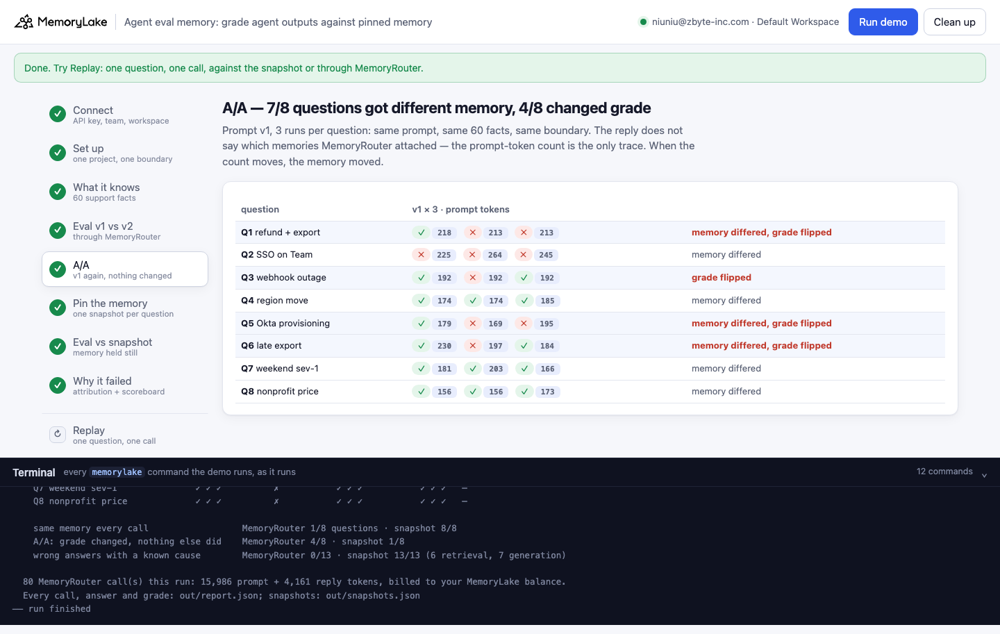
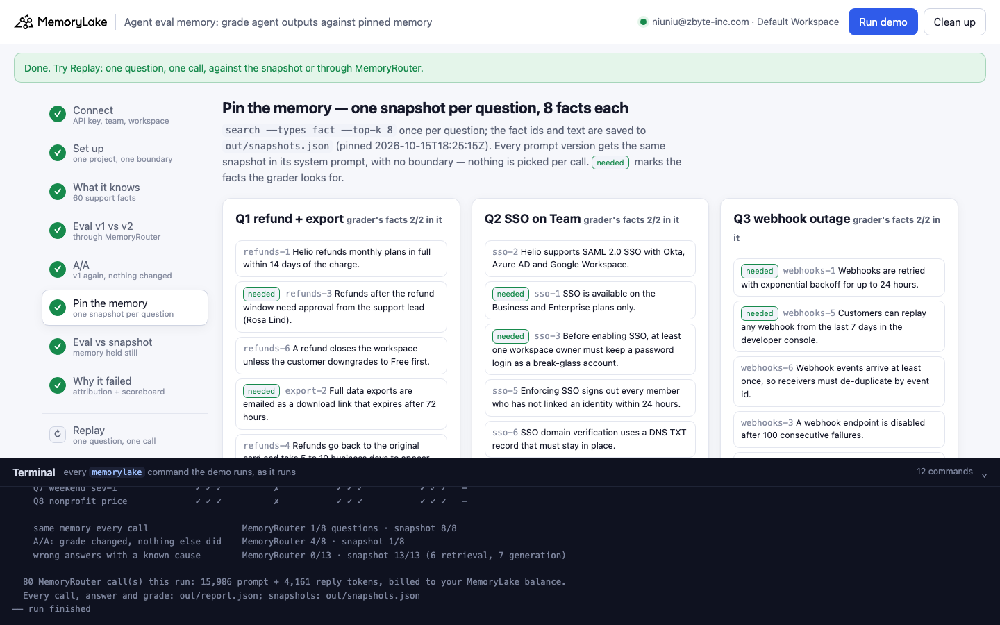
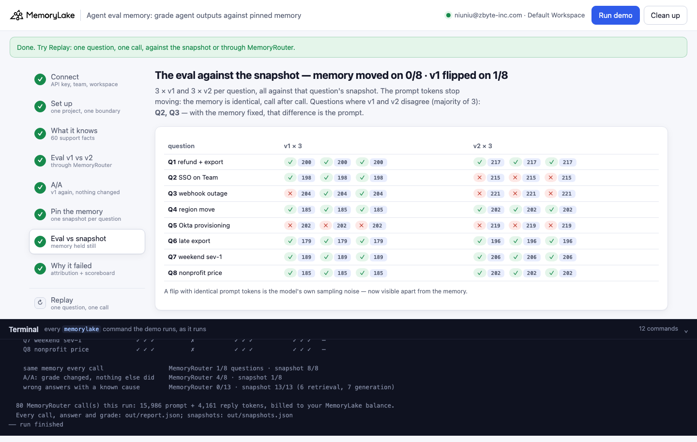
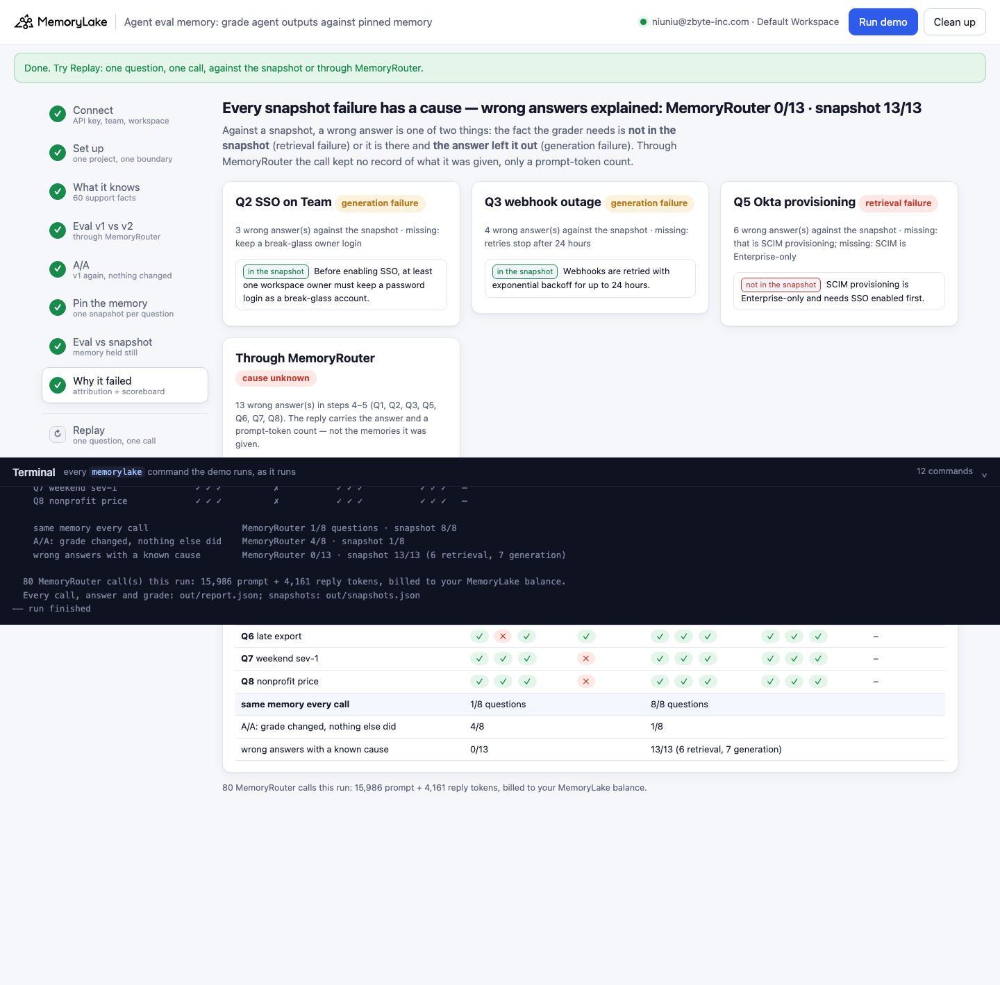

# Agent eval memory: grade agent outputs against pinned memory

A runnable version of the MemoryLake use case
[*Evaluate Agent Outputs With Full Visibility Into the Memory That Drove Them*](https://www.memorylake.ai/en/usecase/memory-aware-evaluation-for-agent-outputs),
built entirely on the [`memorylake` CLI](https://github.com/memorylake-ai/memorylake-cli) (v20261015 or later).

**Watch it run:** videos are being recorded.

**The problem.** You change your agent's prompt and run the eval set. Three answers changed grade. Was it the
prompt? When the agent reads its memory through a retrieval layer, the memory each call gets is picked per call,
and the reply does not say which memories it was given. Ask the same question twice with nothing changed and the
attached memory can differ, so the grade can differ. An eval that cannot tell a memory change from a prompt change
cannot tell you what to fix, and when an answer is wrong it cannot tell you whether the memory or the model failed.

**What this demo shows.** Helio (a fictional invoicing SaaS) runs a support assistant on MemoryRouter: 60 support
facts in one project, one boundary, `router chat --boundary` (`gpt-4o-mini`, temperature 0). The team grades it on
8 questions, each with the facts a right answer must state, and wants to know whether prompt v2 beats v1.

| | Through MemoryRouter (`--boundary`) | Against a pinned snapshot |
|---|---|---|
| Same question, same prompt, 3 calls: memory the same every time (9 runs) | **15 / 72** question-runs | **72 / 72** |
| Grade changed with nothing changed (A/A) | **27 / 72** | **4 / 72** (identical memory: the model's own noise) |
| Verdict on v1 → v2 | different every run: *"v2 broke Q7, Q8, fixed Q2, Q5"*, *"broke Q2, Q7, Q8, fixed Q1, Q3, Q5"*, … — Q2 called **fixed** in 2 runs, broken in 1 | **v2 breaks Q2** in 9 of 9 runs (and Q3 in 2) |
| Wrong answers with a known cause | **0 / 92** — the call kept no record of what it was given | **113 / 113**: 54 retrieval (Q5's fact never retrieved), 59 generation (fact there, answer left it out) |

The fix is what the use-case page calls *evaluation against pinned memory snapshots*: retrieve once per question
(`search --types fact --top-k 8`), save the fact ids and text, and run every prompt version against that same
snapshot (`router chat --body`, the memory in the system prompt, no boundary). The memory stops moving, so a
difference between v1 and v2 is the prompt; and every wrong answer gets a cause, because you can look in the
snapshot for the fact the grader needed: **not there** is a retrieval failure, **there but left out** is a
generation failure.

Model replies and what MemoryRouter attaches vary from run to run, so every call is graded and printed as it
comes out, and [Measured](#measured) below reports totals over all runs, not the best one.

## Prerequisites

- Python 3.9+ (standard library only)
- The `memorylake` CLI **v20261015 or later** (`memorylake router` arrived in that release):
  ```bash
  curl -fsSL https://raw.githubusercontent.com/memorylake-ai/memorylake-cli/main/scripts/install.sh | sh
  memorylake version
  ```
- A MemoryLake API key ([app.memorylake.ai](https://app.memorylake.ai) → API Keys).
- **Router calls are billed to your MemoryLake balance** (`memorylake billing balance`). One run makes 80 calls on
  `gpt-4o-mini`, about 16,000 prompt + 4,500 reply tokens; the run prints the total. If the balance is empty, the
  router calls print the refusal and are skipped; the memory steps still run.

## Run it

```bash
git clone https://github.com/memorylake-ai/memorylake-usecases.git
cd memorylake-usecases/agent-eval-memory
export MEMORYLAKE_API_KEY=sk-...
python3 demo.py                          # the whole story, about 3 minutes
python3 demo.py snapshot Q5              # one question's pinned memory, its grader, and whether memory still matches
python3 demo.py replay Q2 --prompt v2    # one call against the snapshot, graded
python3 demo.py replay Q2 --router       # the same question through MemoryRouter, as in production
python3 demo.py cleanup                  # delete everything the demo created
```

The key is used to log into an isolated CLI profile under `.memorylake-demo/` (git-ignored); your own
`~/.memorylake` is never touched. For the China endpoint also set
`MEMORYLAKE_BASE_URL=https://app.memorylake.cn/openapi/memorylake`. Every run starts over, and everything it
creates is prefixed `mlu-aev-`.

## Or run it in the browser

```bash
python3 web/server.py                # opens http://127.0.0.1:8765
```

Paste the API key, press **Run the demo**, and follow the steps on the left while the terminal drawer shows every
`memorylake` command as it runs. **Replay** makes one graded call for any question and prompt, against the
snapshot or through MemoryRouter. **Clean up** removes everything.

| Step 5: A/A, nothing changed | Step 6: one snapshot per question |
|---|---|
|  |  |
| **Step 7: the eval against the snapshot** | **Step 8: why each answer failed** |
|  |  |

## What happens, step by step

All output below is from one real run (long command lines shortened with `…`).

### Steps 2–3: one project, one boundary, 60 facts

```
  · an earlier run left Helio's memory behind; starting over
$ memorylake proj create --name 'Helio support knowledge' --custom-id mlu-aev-kb --description 'What Helio'"'"'s support assistant knows. Demo data …
$ memorylake boundary create --name 'Helio support assistant' --custom-id mlu-aev-assistant --projects proj-1875c0e2111045b4978f9984bb12c610 --work …
  · the support assistant's boundary bnd-39a991e8a78d48f6bf821ace74824c3c covers the project: every production call is `router chat … --boundary` and MemoryRouter picks what to attach
```

```
$ memorylake fact add --project proj-1875c0e2111045b4978f9984bb12c610 'Helio bills monthly plans on the 1st of each month in UTC.' 'Annual Helio pl …
$ memorylake fact list --page-size 200 --projects proj-1875c0e2111045b4978f9984bb12c610 --workspace ws-83f0737bd3354e26908ff6f39cdfe5bc
  · 60 support facts, 10 topics × 6: billing, refunds, sso, export, api, webhooks, plans, retention, regions, support

  A few of them:
    - Helio refunds monthly plans in full within 14 days of the charge.
    - Refunds after the refund window need approval from the support lead (Rosa Lind).
    - SSO is available on the Business and Enterprise plans only.
    - Webhooks are retried with exponential backoff for up to 24 hours.
```

### Step 4: the eval as wired in production

One call per question and prompt, through the assistant's boundary. The number after each mark is the call's
`usage.prompt_tokens`; v2 adds 17 tokens of system prompt, everything else is memory.

```
  · `router chat --boundary` (gpt-4o-mini, temperature 0); each answer is graded against the facts it must state
$ memorylake router chat 'A Team customer on a monthly plan asks for a refund 20 days after the charge, and wants a copy of their data first. What  …
  · every other call is the same command; v2 differs only in the system prompt (out/body-v2.json)
    Q1 refund + export   v1 ✓ (217)   v2 ✓ (263)
    Q2 SSO on Team       v1 ✗ (192)   v2 ✓ (242)   ← v2 fixed it
    Q3 webhook outage    v1 ✓ (192)   v2 ✓ (209)
    Q4 region move       v1 ✓ (174)   v2 ✓ (222)
    Q5 Okta provisioning v1 ✗ (185)   v2 ✓ (202)   ← v2 fixed it
    Q6 late export       v1 ✓ (181)   v2 ✓ (214)
    Q7 weekend sev-1     v1 ✓ (200)   v2 ✗ (188)   ← v2 broke it
    Q8 nonprofit price   v1 ✓ (156)   v2 ✗ (173)   ← v2 broke it

    v1 6/8 · v2 6/8 — read naively: v2 broke Q7, Q8 and fixed Q2, Q5
```

Read naively, v2 broke two answers and fixed two. Keep that verdict in mind.

### Step 5: A/A — the same eval again, nothing changed

```
$ memorylake router chat 'A Team customer on a monthly plan asks for a refund 20 days after the charge, and wants a copy of their data first. What  …
    Q1 refund + export   v1 ×3: ✓ ✓ ✗   prompt tokens 217 · 246 · 246   ← memory differed, grade flipped
    Q2 SSO on Team       v1 ×3: ✗ ✗ ✗   prompt tokens 192 · 215 · 231   ← memory differed
    Q3 webhook outage    v1 ×3: ✓ ✓ ✓   prompt tokens 192 · 192 · 192
    Q4 region move       v1 ×3: ✓ ✓ ✓   prompt tokens 174 · 162 · 174   ← memory differed
    Q5 Okta provisioning v1 ×3: ✗ ✗ ✗   prompt tokens 185 · 172 · 172   ← memory differed
    Q6 late export       v1 ×3: ✓ ✓ ✓   prompt tokens 181 · 197 · 197   ← memory differed
    Q7 weekend sev-1     v1 ×3: ✓ ✓ ✓   prompt tokens 200 · 184 · 184   ← memory differed
    Q8 nonprofit price   v1 ×3: ✓ ✓ ✓   prompt tokens 156 · 156 · 156

    nothing changed between these 3 runs — same prompt, same 60 facts, same boundary:
    6/8 questions got a different amount of memory (prompt tokens), 1/8 changed grade
  · the reply does not say which memories MemoryRouter attached; `usage.prompt_tokens` minus the same call without a boundary is the only trace
```

Q2 and Q5 failed three times out of three with v1, but on different amounts of memory each time. Was it the
memory or the model? The reply cannot say.

### Step 6: pin the memory

```
$ memorylake search 'A Team customer on a monthly plan asks for a refund 20 days after the charge, and wants a copy of their data first. What do we …

  Q1 snapshot (8 facts, ids and text saved to out/snapshots.json):
    fact-6224660b…  [refunds-1] Helio refunds monthly plans in full within 14 days of the charge.
    fact-5ad43683…  [refunds-3] Refunds after the refund window need approval from the support lead (Rosa Lind).
    fact-efe30cba…  [refunds-6] A refund closes the workspace unless the customer downgrades to Free first.
    fact-11d6fcf8…  [export-2] Full data exports are emailed as a download link that expires after 72 hours.
    fact-8eaf9e37…  [refunds-4] Refunds go back to the original card and take 5 to 10 business days to appear.
    fact-afecd01a…  [retention-3] Backups are kept for 35 days and cannot be restored per customer.
    fact-6b6a40bd…  [plans-2] The Team plan costs 12 dollars per seat per month billed monthly.
    fact-63dbd92c…  [refunds-5] Partial refunds for unused seats are not offered on monthly plans.

    Q1 refund + export   8 facts · the grader's facts 2/2 in it
    Q2 SSO on Team       8 facts · the grader's facts 2/2 in it
    Q3 webhook outage    8 facts · the grader's facts 2/2 in it
    Q4 region move       8 facts · the grader's facts 1/1 in it
    Q5 Okta provisioning 8 facts · the grader's facts 0/1 in it   ← missing sso-4
    Q6 late export       8 facts · the grader's facts 1/1 in it
    Q7 weekend sev-1     8 facts · the grader's facts 1/1 in it
    Q8 nonprofit price   8 facts · the grader's facts 2/2 in it
  · each prompt version gets the same snapshot in its system prompt (out/body-pin-<prompt>-<question>.json); no boundary, so nothing is picked per call
```

Q5's snapshot already explains its failures before any model call: the fact a right answer needs (*"SCIM
provisioning is Enterprise-only …"*) is not among the 8 facts retrieved for *"create and remove user accounts
automatically"*.

### Step 7: the eval against the snapshot

```
$ memorylake router chat 'A Team customer on a monthly plan asks for a refund 20 days after the charge, and wants a copy of their data first. What  …
  · 3 × v1 and 3 × v2 per question, all against that question's snapshot
    Q1 refund + export   v1 ✓ ✓ ✓ (200 · 200 · 200)   v2 ✓ ✓ ✓ (217 · 217 · 217)
    Q2 SSO on Team       v1 ✓ ✓ ✓ (198 · 198 · 198)   v2 ✗ ✗ ✗ (215 · 215 · 215)
    Q3 webhook outage    v1 ✓ ✓ ✓ (205 · 205 · 205)   v2 ✗ ✗ ✓ (222 · 222 · 222)   ← v2 flipped
    Q4 region move       v1 ✓ ✓ ✓ (184 · 184 · 184)   v2 ✓ ✓ ✓ (201 · 201 · 201)
    Q5 Okta provisioning v1 ✗ ✗ ✗ (202 · 202 · 202)   v2 ✗ ✗ ✗ (219 · 219 · 219)
    Q6 late export       v1 ✓ ✓ ✓ (179 · 179 · 179)   v2 ✓ ✓ ✓ (196 · 196 · 196)
    Q7 weekend sev-1     v1 ✓ ✓ ✓ (189 · 189 · 189)   v2 ✓ ✓ ✓ (206 · 206 · 206)
    Q8 nonprofit price   v1 ✓ ✓ ✓ (185 · 185 · 185)   v2 ✓ ✓ ✓ (202 · 202 · 202)

    memory moved on 0/8 questions (prompt tokens) · v1 changed grade on 0/8 across its 3 runs
    v1 21/24 · v2 16/24; questions where v1 and v2 disagree (majority of 3): Q2, Q3 — with the memory fixed, that is the prompt
    step 4 (through MemoryRouter) read: v2 broke Q7, Q8, fixed Q2, Q5  ·  against the snapshot: v1 and v2 differ on Q2, Q3
```

Every prompt-token count is constant per question and prompt: the memory is the same, call after call. The verdict
is different from step 4: **v2 breaks Q2** (it drops the break-glass step), three times out of three — the very
question step 4 said v2 *fixed*.

### Step 8: why each answer failed

```
    Q2 SSO on Team       snapshot: 3 wrong answer(s) → generation failure
         [sso-3] Before enabling SSO, at least one workspace owner must keep a password login as a break-glass account.  (in the snapshot, the answer left it out)
    Q3 webhook outage    snapshot: 2 wrong answer(s) → generation failure
         [webhooks-1] Webhooks are retried with exponential backoff for up to 24 hours.  (in the snapshot, the answer left it out)
    Q5 Okta provisioning snapshot: 6 wrong answer(s) → retrieval failure
         [sso-4] SCIM provisioning is Enterprise-only and needs SSO enabled first.  (not in the snapshot)
    MemoryRouter wiring: 9 wrong answer(s) across steps 4–5 → cause unknown: the call kept no record of what it was given, only a prompt-token count (Q1, Q2, Q5, Q7, Q8)
                            Router v1 ×3  Router v2  snapshot v1 ×3  snapshot v2 ×3   cause
    Q1 refund + export             ✓ ✓ ✗          ✓           ✓ ✓ ✓           ✓ ✓ ✓   –
    Q2 SSO on Team                 ✗ ✗ ✗          ✓           ✓ ✓ ✓           ✗ ✗ ✗   generation
    Q3 webhook outage              ✓ ✓ ✓          ✓           ✓ ✓ ✓           ✗ ✗ ✓   generation
    Q4 region move                 ✓ ✓ ✓          ✓           ✓ ✓ ✓           ✓ ✓ ✓   –
    Q5 Okta provisioning           ✗ ✗ ✗          ✓           ✗ ✗ ✗           ✗ ✗ ✗   retrieval
    Q6 late export                 ✓ ✓ ✓          ✓           ✓ ✓ ✓           ✓ ✓ ✓   –
    Q7 weekend sev-1               ✓ ✓ ✓          ✗           ✓ ✓ ✓           ✓ ✓ ✓   –
    Q8 nonprofit price             ✓ ✓ ✓          ✗           ✓ ✓ ✓           ✓ ✓ ✓   –

    same memory every call                  MemoryRouter 2/8 questions · snapshot 8/8
    A/A: grade changed, nothing else did    MemoryRouter 1/8 · snapshot 0/8
    wrong answers with a known cause        MemoryRouter 0/9 · snapshot 11/11 (6 retrieval, 5 generation)

  80 MemoryRouter call(s) this run: 15,946 prompt + 4,519 reply tokens, billed to your MemoryLake balance.
  Every call, answer and grade: out/report.json; snapshots: out/snapshots.json
```

### The read-only subcommands

```
$ memorylake fact list --page-size 200 --projects proj-1875c0e2111045b4978f9984bb12c610 --workspace ws-83f0737bd3354e26908ff6f39cdfe5bc

  Q5: A Business customer's IT team asks whether Helio can create and remove user accounts automatically from Okta. Can it?
  pinned 2026-10-15T18:39:22Z, 8 facts:
    fact-63ec7faa…  [sso-2] Helio supports SAML 2.0 SSO with Okta, Azure AD and Google Workspace.
    fact-cef3ec98…  [plans-1] Helio has four plans: Free, Team, Business and Enterprise.
    fact-56604a7c…  [webhooks-5] Customers can replay any webhook from the last 7 days in the developer console.
    fact-fff11c53…  [api-1] The Helio API allows 60 requests per minute on the Team plan.
    fact-1cd41806…  [webhooks-2] Every webhook carries an X-Helio-Signature header signed with HMAC-SHA256.
    fact-36f2e281…  [retention-1] Helio keeps audit logs for 1 year on Business and 7 years on Enterprise.
    fact-094f51ad…  [support-3] Enterprise customers have 24/7 support for severity-1 incidents.
    fact-946340d1…  [support-1] Helio support hours are 08:00 to 20:00 UTC on weekdays.
  a right answer must state: that is SCIM provisioning; SCIM is Enterprise-only
  still in memory word for word: 8/8
```

```
$ memorylake router chat 'A Team customer wants to switch on SSO with Okta tomorrow. What do we tell them?' --model gpt-4o-mini --max-tokens 220 -- …

  Q2 v2 against the snapshot: ✗   prompt tokens 215   missing: keep a break-glass owner login
    SSO is only available on the Business and Enterprise plans, so the Team customer will need to
    upgrade their plan to access this feature. Once they upgrade, they can proceed with the SSO
    setup.
```

```
$ memorylake router chat 'A Team customer wants to switch on SSO with Okta tomorrow. What do we tell them?' --model gpt-4o-mini --max-tokens 220 -- …

  Q2 v1 through MemoryRouter (--boundary): ✓   prompt tokens 209
    You can proceed to enable SSO with Okta, but please ensure that at least one workspace owner
    retains a password login as a break-glass account. Keep in mind that enforcing SSO will sign out
    any members who haven't linked their identity within 24 hours. If you need SCIM provisioning,
    remember that it requires SSO to be enabled first and is only available on the Enterprise plan.
```

`replay` defaults to prompt v1; `--router` sends the same question through the boundary, as in production
(the same Q2 that fails against the snapshot with v2 passes here with v1: compare like with like).


## Measured

Every fresh run with the final questions, prompts and grading while building this demo (1 browser check,
6 parallel copies, the run above and the one before it): 9 runs, 72 question-runs per column.

| | Router v1 (×3 per run) | Router v2 | Snapshot v1 (×3) | Snapshot v2 (×3) |
|---|---|---|---|---|
| Q1 refund + export | 17 / 27 | 7 / 9 | 27 / 27 | 27 / 27 |
| Q2 SSO on Team | 2 / 27 | 2 / 9 | 27 / 27 | **0 / 27** |
| Q3 webhook outage | 24 / 27 | 9 / 9 | 14 / 27 | 9 / 27 |
| Q4 region move | 27 / 27 | 9 / 9 | 27 / 27 | 27 / 27 |
| Q5 Okta provisioning | 9 / 27 | 9 / 9 | 0 / 27 | 0 / 27 |
| Q6 late export | 25 / 27 | 8 / 9 | 27 / 27 | 26 / 27 |
| Q7 weekend sev-1 | 17 / 27 | 3 / 9 | 27 / 27 | 27 / 27 |
| Q8 nonprofit price | 27 / 27 | **1 / 9** | 27 / 27 | 27 / 27 |

- **A/A through MemoryRouter**: in 57 of 72 question-runs the three identical v1 calls got different amounts of
  memory (prompt tokens); 27 of 72 changed grade. Against the snapshot: 0 and 4 (the 4 at identical prompt tokens,
  so the model's own sampling noise; `seed` and temperature 0 are set and do not remove it).
- **The v1 → v2 verdict**: through MemoryRouter, one run each as an eval would do it, the list of "broke / fixed"
  questions was different in every run. Against the snapshot, every run named Q2 (v2's *"start with the one thing"*
  drops the break-glass step: 0 / 27), and 2 runs also Q3.
- **Attribution**: Q5's SCIM fact was missing from all 9 snapshots (retrieval failure, 54 answers); MemoryRouter
  attached it sometimes (Router v1 9 / 27), which is exactly what you could not see from the eval. Q2 and Q3 are
  generation failures: the fact was in the snapshot and the answer left it out.
- **What the snapshot does not catch — Q8**: through MemoryRouter the memory for Q8 held still (156 / 173 prompt
  tokens every time), and v2 answered *"$14.40 per seat"* instead of the $144 total in 8 of 9 runs; against the
  snapshot v2 got $144 27 / 27. A snapshot pins *which* facts the model sees, not how MemoryRouter frames them, so a
  prompt change that only misbehaves with the production framing needs a repeated check through the production
  wiring too. That is why the demo keeps both columns.
- Q2 also shows the two columns disagreeing the other way: with v1, Router 2 / 27 and snapshot 27 / 27 — the
  snapshot's 8 facts include *"SSO is available on the Business and Enterprise plans only"*, and whatever
  MemoryRouter attached usually did not lead the model to say it. Which memories those were, the reply does not say.
- Before these runs, a probe with the same 60 facts: a single-topic question (*"API rate limit on the Team plan"*)
  got 136 prompt tokens 8 times out of 8; a two-topic refund + export question got 6 different sizes in 8 calls
  (183 … 246) and was answered *"we cannot refund"* in 2 of them. Single-topic questions move least, so the eval set
  is mostly two-topic support questions, the kind real agents get.
- One model (`gpt-4o-mini`) was measured. Graders are regular expressions per required fact, printed with every
  failure so you can disagree with them.

## Use it in your own app

- Record what each eval call was given. Through a boundary you cannot (the reply has no list of attached
  memories); with your own retrieval you can: `search --projects <p> --types fact --top-k <k>` returns fact ids and
  text, and the snapshot is just that list saved next to the eval set.
- Run every prompt or model variant against the same snapshot, and run it more than once: with the memory fixed,
  what is left is the prompt's effect plus the model's own sampling noise, and repeats show how big that noise is.
- For each failure, look up the grader's facts in the snapshot. Missing → fix retrieval (the query, `--top-k`, or
  how the fact is worded: Q5's SCIM fact never ranks for *"create and remove user accounts automatically"*).
  Present → fix the prompt or the model.
- Keep one check through the production wiring too, repeated: a snapshot pins *which* facts the model sees, not how
  MemoryRouter frames them (see Q8 under [Measured](#measured)).
- Re-pin when memory changes on purpose; `python3 demo.py snapshot Qn` shows whether every pinned fact is still in
  memory word for word (`fact list`), and a replay keeps using the pinned text either way.

## Troubleshooting

- **`this memorylake CLI has no router command`**: upgrade the CLI (install line above).
- **MemoryRouter refused the call for lack of balance**: top up in the console; `memorylake billing balance` shows it.
- **`no snapshot yet`**: `snapshot` and `replay` read `out/snapshots.json`, written by a full run (and removed by `cleanup`).
- **A run was interrupted**: run again; it deletes what the previous run left and starts over.
- **`fact(s) are still … after deleting`**: deletes are retried and re-checked; run `python3 demo.py cleanup` again.

## Files

| File | What it is |
|---|---|
| `demo.py` | The demo: CLI wrapper, setup, the eval through MemoryRouter, the A/A, snapshots, the eval against them, attribution, subcommands, cleanup |
| `data/helio.json` | The 60 support facts, the two prompts, the 8 questions with what a right answer must (and must not) say |
| `web/server.py`, `web/static/` | Browser companion (standard library server, no build step) |
| `out/` | Request bodies, `snapshots.json`, and `report.json` with every call, reply, prompt-token count and grade (git-ignored) |
