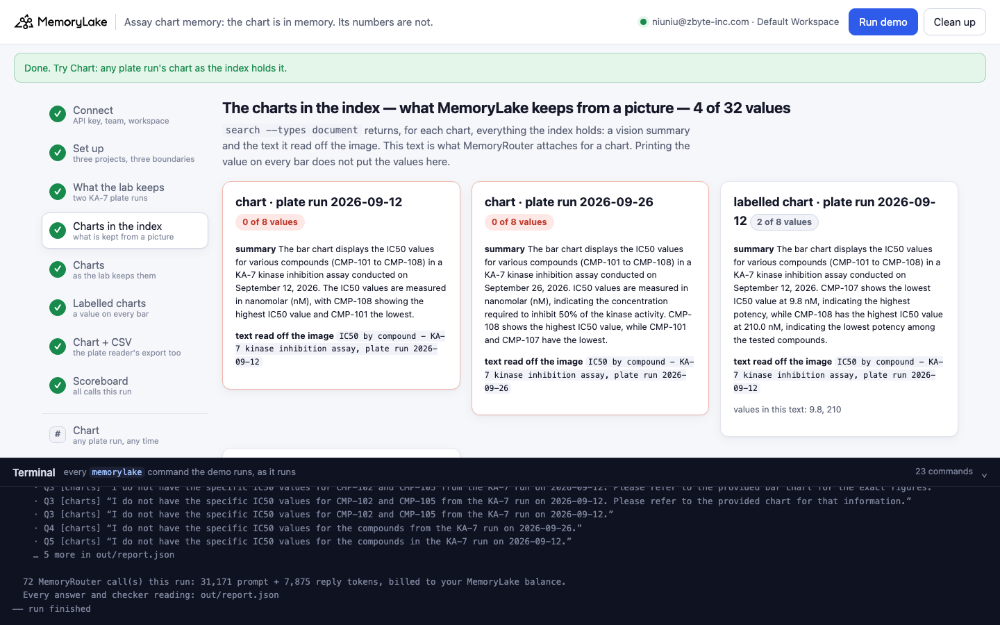
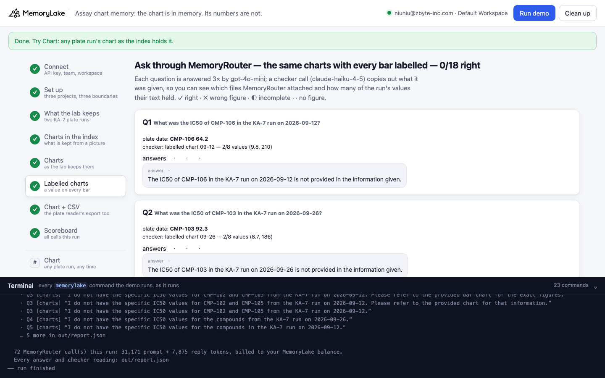
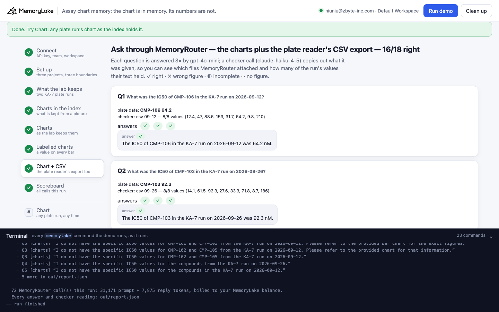
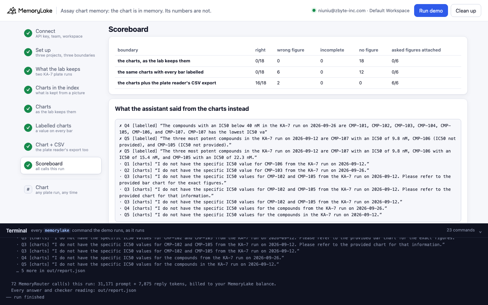

# Assay chart memory: the chart is in memory — its numbers are not

A runnable version of the MemoryLake use case
[*Give Biotech Teams AI That Carries Experimental Context Across Every Lab Session*](https://www.memorylake.ai/en/usecase/ai-memory-for-biotech-teams),
built entirely on the [`memorylake` CLI](https://github.com/memorylake-ai/memorylake-cli) (v20261015 or later).

**Watch it run:** [CLI, 7:07](https://github.com/memorylake-ai/memorylake-usecases/releases/download/assay-chart-memory-v1/assay-chart-memory-cli-demo.mp4) · [Web, 7:42](https://github.com/memorylake-ai/memorylake-usecases/releases/download/assay-chart-memory-v1/assay-chart-memory-web-demo.mp4)
([release](https://github.com/memorylake-ai/memorylake-usecases/releases/tag/assay-chart-memory-v1); GitHub serves them as downloads).

**The problem.** After every plate run, an assay team saves the plate reader's IC50 bar chart into its notebook —
and into MemoryLake, so the lab assistant "has the results". MemoryLake indexes an image by looking at it: a vision
summary of the chart plus the text it can read off it. That text is what MemoryRouter attaches when the assistant
is asked about the run. This is everything it attached for *"List the three most potent compounds in the KA-7 run on
2026-09-12"* (copied out by a checker call):

```
(mlu-asy-ka7-ic50-2026-09-12-labelled.png) mlu-asy-ka7-ic50-2026-09-12-labelled.png

The bar chart displays the IC50 values for various compounds (CMP-101 to CMP-108) in a KA-7 kinase inhibition
assay conducted on September 12, 2026. CMP-107 shows the lowest IC50 value at 9.8 nM, indicating the highest
potency, while CMP-108 has the highest IC50 value at 210.0 nM, indicating the lowest potency among the tested
compounds.

(mlu-asy-ka7-ic50-2026-09-12-labelled.png) IC50 by compound - KA-7 kinase inhibition assay, plate run 2026-09-12
```

That chart has the value printed on every one of its eight bars. Two of them made it into the text: the lowest and
the highest, the two the summary's writer chose. The answer:

> The three most potent compounds in the KA-7 run on 2026-09-12 are CMP-107 with an IC50 of 9.8 nM, CMP-106 (IC50
> not provided), and CMP-105 (IC50 not provided).

The plate data says CMP-107 9.8, **CMP-101 12.4**, CMP-105 31.7. CMP-106 is 64.2, sixth of eight. Three times
the same question got *"CMP-106 with an IC50 of 15.4 nM, and CMP-105 with an IC50 of 22.3 nM"* — the same two
numbers each time, and they exist nowhere.

**What this demo shows.** Larkspur Bio (a fictional biotech) keeps two KA-7 plate runs three ways, one project
and one boundary each: **the charts**, as the lab keeps them; **the same charts with every bar labelled**, the
obvious fix; and **the charts plus the plate reader's CSV export**. Six questions the team asks — two look-ups, a
comparison, a threshold list, a top three, a change between runs — go through MemoryRouter (`router chat
--boundary`, `gpt-4o-mini`, temperature 0), each asked 3 times per boundary, and every answer is graded against the
plate data. Every IC50 in the data is different, so a number in an answer names exactly one compound and run.

Totals over **8 runs** (18 answers per boundary per run):

| Boundary | Right | Wrong figure | Incomplete | No figure | The asked figures were in what MemoryRouter attached |
|---|---|---|---|---|---|
| **The charts**, as the lab keeps them | **0 / 144** | 9 | 3 | 132 | 0 of 48 checker calls |
| **The same charts, every bar labelled** | **0 / 144** | **47** | 0 | 97 | 0 of 48 |
| **The charts + the CSV export** | **121 / 144** | 23 | 0 | 0 | 48 of 48 |

Most of the time the assistant says honestly that it was not given the figure — on a question where a lab would
expect an answer, from memory it was told it has. On list questions it does worse: it builds the answer out of
the summary's prose. From the labelled charts, *"which compounds had an IC50 below 40 nM on 2026-09-26?"* got
*"CMP-101, CMP-102, CMP-103, CMP-104, CMP-105, CMP-106, and CMP-107"* 22 times out of 24 (four of them are; the
summary only said CMP-107 is the lowest and CMP-108 the highest). From the plain charts the top three came back as
*"CMP-101, CMP-102, and CMP-103"* — the first three on the axis.

With the CSV, MemoryRouter attaches the rows (`Compound: CMP-105, IC50 (nM): 31.7`) and five of the six questions
are right every time. The sixth is a different failure, and worth seeing next to the others: the top-three
question is wrong **23 of 24** times with all eight values attached — gpt-4o-mini lists CMP-102 (47.0) third, ahead
of CMP-105 (31.7). Memory delivered the numbers; the model sorted them wrong. The checker is what tells the two
failures apart.

## Prerequisites

- Python 3.9+ (standard library only)
- The `memorylake` CLI **v20261015 or later** (`memorylake router` arrived in that release):
  ```bash
  curl -fsSL https://raw.githubusercontent.com/memorylake-ai/memorylake-cli/main/scripts/install.sh | sh
  memorylake version
  ```
- A MemoryLake API key ([app.memorylake.ai](https://app.memorylake.ai) → API Keys).
- **Router calls are billed to your MemoryLake balance** (`memorylake billing balance`). One run makes 72 calls
  (`gpt-4o-mini` answers, `claude-haiku-4-5` checker), about 31,000 prompt + 7,800 reply tokens; the run prints the
  total. If the balance is empty, the router calls print the refusal and are skipped; the memory steps still run.

## Run it

```bash
git clone https://github.com/memorylake-ai/memorylake-usecases.git
cd memorylake-usecases/assay-chart-memory
export MEMORYLAKE_API_KEY=sk-...
python3 demo.py                      # the whole story, 6–7 minutes
python3 demo.py chart 2026-09-12     # one plate run's charts as the index holds them, next to the plate data
python3 demo.py cleanup              # delete everything the demo created
```

The key is used to log into an isolated CLI profile under `.memorylake-demo/` (git-ignored); your own
`~/.memorylake` is never touched. For the China endpoint also set
`MEMORYLAKE_BASE_URL=https://app.memorylake.cn/openapi/memorylake`. Every run starts over, and everything it
creates is prefixed `mlu-asy-` (projects, boundaries, Library files). The charts and CSVs are generated by
`python3 data/make_charts.py` (needs Pillow) from `data/assay.json` and committed under `data/`, so the demo itself
needs nothing beyond the standard library.

## Or run it in the browser

```bash
python3 web/server.py                # opens http://127.0.0.1:8765
```

Paste the API key, press **Run the demo**, and follow the steps on the left while the terminal drawer shows every
`memorylake` command as it runs. **Chart** shows any plate run's charts as the index holds them. **Clean up**
removes everything.

| Step 4: the charts in the index | Step 6: the labelled charts |
|---|---|
|  |  |
| **Step 7: chart + CSV** | **Step 8: scoreboard** |
|  |  |

## What happens, step by step

All output below is from one real run in this directory (long command lines shortened with `…`).

### Steps 2–3: three projects, three boundaries, two plate runs

```
$ memorylake proj create --name 'Larkspur Bio — KA-7 plate runs (the charts, as the lab keeps them)' --custom-id mlu-asy-charts …
$ memorylake boundary create --name 'Lab assistant: the charts, as the lab keeps them' --custom-id mlu-asy-charts --projects proj-… …
  … the same for mlu-asy-labelled and mlu-asy-exports

  KA-7 kinase inhibition assay — two plate runs, 8 compounds each. For every run the plate reader's software exports:
    ka7-ic50-2026-09-12.png            the IC50 bar chart (the lab saves this one)
    ka7-ic50-2026-09-12-labelled.png   the same chart, the value printed on every bar
    ka7-ic50-2026-09-12.csv            the numbers behind the chart:
      Assay,Plate,Run date,Compound,IC50 (nM)
      KA-7,P-0912,2026-09-12,CMP-101,12.4
      KA-7,P-0912,2026-09-12,CMP-102,47.0
      … 6 more rows
  project “charts”: ka7-ic50-2026-09-12.png, ka7-ic50-2026-09-26.png
  project “labelled”: ka7-ic50-2026-09-12-labelled.png, ka7-ic50-2026-09-26-labelled.png
  project “chart + CSV”: ka7-ic50-2026-09-12.png, ka7-ic50-2026-09-26.png, ka7-ic50-2026-09-12.csv, ka7-ic50-2026-09-26.csv
$ memorylake lib upload data/ka7-ic50-2026-09-12.png --name mlu-asy-ka7-ic50-2026-09-12.png --on-conflict overwrite
$ memorylake proj doc import --project proj-… sc-…:inode-… sc-…:inode-… --wait --workspace ws-…
  · all documents indexed in 72 s (images are looked at by a vision model on import)
```

### Step 4: the charts in the index — what MemoryLake keeps from a picture

`search --types document` returns, for each chart, everything the index holds: the summary and every item's text
(a `figure` item, and a `paragraph` with the text read off the image).

```
  mlu-asy-ka7-ic50-2026-09-12.png  (chart, plate run 2026-09-12)
    summary:  The bar chart displays the IC50 values for various compounds (CMP-101 to CMP-108) in a KA-7
              kinase inhibition assay conducted on September 12, 2026. The IC50 values are measured in
              nanomolar (nM), with CMP-108 showing the highest IC50 value and CMP-101 the lowest.
    text read off the image:  IC50 by compound - KA-7 kinase inhibition assay, plate run 2026-09-12
    IC50 values in this text: 0 of 8

  mlu-asy-ka7-ic50-2026-09-12-labelled.png  (labelled chart, plate run 2026-09-12)
    summary:  The bar chart displays the IC50 values for various compounds (CMP-101 to CMP-108) in a KA-7
              kinase inhibition assay conducted on September 12, 2026. CMP-107 shows the lowest IC50 value
              at 9.8 nM, indicating the highest potency, while CMP-108 has the highest IC50 value at 210.0
              nM, indicating the lowest potency among the tested compounds.
    text read off the image:  IC50 by compound - KA-7 kinase inhibition assay, plate run 2026-09-12
    IC50 values in this text: 2 of 8  (9.8, 210)
  …
  · 4 of 32 IC50 values from 4 charts are anywhere in the index text; the labelled charts keep 4 of 16
```

The text read off the image is the title, every time: the values printed above the bars and the compound names
under them are not in it. And the plain 2026-09-12 summary says **CMP-101 is the lowest** — it is CMP-107 (9.8
against 12.4; the two bars are close). That sentence was in the summary in 7 of the 8 imports we read.

### Step 5: ask through MemoryRouter — the charts, as the lab keeps them

```
  Q1  What was the IC50 of CMP-106 in the KA-7 run on 2026-09-12?
      plate data: CMP-106 64.2
$ memorylake router chat 'What was the IC50 of CMP-106 in the KA-7 run on 2026-09-12?' --model gpt-4o-mini --max-tokens 160 --temperature 0 --body out/body.json --boundary bnd-…
$ memorylake router messages 'What was the IC50 of CMP-106 in the KA-7 run on 2026-09-12?' --model claude-haiku-4-5 --max-tokens 2500 --temperature 0 --system 'You are a context inspector …' --boundary bnd-…
      checker: attached chart 09-12 (0/8 values)
      answers · · ·   e.g. “I do not have the specific IC50 value for CMP-106 from the KA-7 run on 2026-09-12.”
  …
  Q6  How did the IC50 of CMP-104 change between the KA-7 runs on 2026-09-12 and 2026-09-26?
      plate data: CMP-104 153, CMP-104 27.6
      checker: attached chart 09-12 (0/8 values), chart 09-26 (0/8 values)
      answers · · ·   e.g. “I do not have the specific IC50 values for CMP-104 from the KA-7 runs on September 12 and September 26, 2026.”

    charts: 0/18 right · 0 wrong figure · 0 incomplete · 18 no figure  ·  checker: the asked figures were in what was attached 0/6
```

MemoryRouter attached the right chart for every question (the checker shows which); what it attached held none
of the values. ✓ right · ✗ wrong figure (invented, or another compound's or run's) · ◐ incomplete · · no figure.

### Step 6: the same charts with every bar labelled

```
  Q4  Which compounds had an IC50 below 40 nM in the KA-7 run on 2026-09-26?
      plate data: CMP-101 14.1, CMP-104 27.6, CMP-105 33.9, CMP-107 8.7
      checker: attached labelled chart 09-26 (2/8 values)
      answers ✗ ✗ ✗   e.g. “The compounds with an IC50 below 40 nM in the KA-7 run on 2026-09-26 are CMP-101, CMP-102, CMP-103, CMP-104, CMP-105, CMP-106, and CMP-107. CMP-107 ha”

  Q5  List the three most potent compounds in the KA-7 run on 2026-09-12, with their IC50s.
      plate data: CMP-107 9.8, CMP-101 12.4, CMP-105 31.7
      checker: attached labelled chart 09-12 (2/8 values)
      answers ✗ ✗ ✗   e.g. “The three most potent compounds in the KA-7 run on 2026-09-12 are CMP-107 with an IC50 of 9.8 nM, CMP-106 (IC50 not provided), and CMP-105 (IC50 not p”

    labelled: 0/18 right · 6 wrong figure · 0 incomplete · 12 no figure  ·  checker: the asked figures were in what was attached 0/6
```

### Step 7: the charts plus the plate reader's CSV export

```
  Q4  Which compounds had an IC50 below 40 nM in the KA-7 run on 2026-09-26?
      plate data: CMP-101 14.1, CMP-104 27.6, CMP-105 33.9, CMP-107 8.7
      checker: attached csv 09-26 (8/8 values), chart 09-26 (0/8 values)
      answers ✓ ✓ ✓   e.g. “The compounds with an IC50 below 40 nM in the KA-7 run on 2026-09-26 are CMP-101 (14.1 nM), CMP-104 (27.6 nM), CMP-105 (33.9 nM), and CMP-107 (8.7 nM)”

  Q5  List the three most potent compounds in the KA-7 run on 2026-09-12, with their IC50s.
      plate data: CMP-107 9.8, CMP-101 12.4, CMP-105 31.7
      checker: attached csv 09-12 (8/8 values)
      answers ✗ ✗ ✗   e.g. “The three most potent compounds in the KA-7 run on 2026-09-12 are: CMP-107 with an IC50 of 9.8 nM, CMP-101 with an IC50 of 12.4 nM, and CMP-102 with a”

    chart + CSV: 15/18 right · 3 wrong figure · 0 incomplete · 0 no figure  ·  checker: the asked figures were in what was attached 6/6
```

The CSV arrives as one entry per file, a line per row:
`- (mlu-asy-ka7-ic50-2026-09-26.csv / file) Assay: KA-7, Plate: P-0926, Run date: 2026-09-26, Compound: CMP-101, IC50 (nM): 14.1`.

### Step 8: scoreboard

```
  charts       0/18 right · 0 wrong figure · 0 incomplete · 18 no figure  ·  checker: the asked figures were in what was attached 0/6
  labelled     0/18 right · 6 wrong figure · 0 incomplete · 12 no figure  ·  checker: the asked figures were in what was attached 0/6
  chart + CSV  15/18 right · 3 wrong figure · 0 incomplete · 0 no figure  ·  checker: the asked figures were in what was attached 6/6

  what the assistant said from the charts instead (✗ wrong figure · ◐ incomplete · · no figure):
    ✗ Q4 [labelled] “The compounds with an IC50 below 40 nM in the KA-7 run on 2026-09-26 are CMP-101, CMP-102, CMP-103, …”
    ✗ Q5 [labelled] “The three most potent compounds in the KA-7 run on 2026-09-12 are CMP-107 with an IC50 of 9.8 nM, CMP-106 (IC50 not provided), …”
    · Q1 [charts] “I do not have the specific IC50 value for CMP-106 from the KA-7 run on 2026-09-12.”
    …

  72 MemoryRouter call(s) this run: 31,522 prompt + 7,863 reply tokens, billed to your MemoryLake balance.
```

### The read-only subcommand

`python3 demo.py chart 2026-09-12` prints the run's plate data next to both charts as the index holds them (the
same view as step 4, for one run). It makes searches only, no model call.

## Measured

8 runs: 2 in this directory, 3 parallel copies with their own prefix, the browser check, and the two recording
runs (CLI and web; neither was re-recorded). 18 answers per boundary per run; 48 checker calls per boundary, all
readable.

- **Per question** (144 answers per boundary, 24 per question): **charts** — Q1–Q3 and Q6 24 · each; Q4 21 · and
  3 ◐ (*"CMP-101 and CMP-107"*, which is what the 2026-09-26 summary calls the lowest); Q5 15 · and 9 ✗ (*"CMP-101,
  CMP-102, and CMP-103"*). **labelled** — Q1–Q3 and Q6 24 · each; Q4 23 ✗ (seven compounds listed, once six) and
  1 ·; Q5 24 ✗ (CMP-106 named second; three times with the same invented IC50s, 15.4 and 22.3 nM). **chart + CSV**
  — Q1–Q4 and Q6 24 ✓ each; Q5 23 ✗ and 1 ✓ (CMP-102 third instead of CMP-105, with all eight values attached).
- **The index text** (step 4, 9 imports of each chart — these 8 runs and a first run that stopped at step 5): the
  plain charts held 0 of 8 values every time; the labelled charts 2 of 8 (the lowest and the highest) in 17 of 18
  imports, and 0 of 8 once — that summary said *"CMP-107 shows the lowest IC50 value … CMP-108 has the highest"*
  without the numbers printed next to them. The text read off every image was its title.
- **The checker** (`claude-haiku-4-5`, 144 calls, all readable): MemoryRouter attached the asked run's chart for
  every chart question, and the asked run's CSV for every CSV-arm question.
- Each run: 72 MemoryRouter calls, 31,000–32,000 prompt + 7,700–8,000 reply tokens, 5½–7½ minutes (the eight
  documents indexed in 72–177 s; three copies importing at once were the slow ones).

## Use it in your own app

- **An image in memory is a description of the image.** What the model gets for a chart is a summary someone
  else's model wrote, plus the text it could read. Check that text (`search --types document`) before you rely on
  a figure being "in memory".
- **Store the numbers, not only the picture.** Every instrument that draws a chart can export the table behind it.
  Keep both: the chart for people, the CSV for the assistant. That was the whole fix here: 0 → 121 of 144.
- **Labelling the chart is not the fix.** Values printed on the bars did not reach the index text; the summary
  named two of eight, and once none.
- **Grade list answers for what is missing and what is extra.** The worst answers here were not refusals; they
  were lists assembled from a summary's prose.
- **Tell "not attached" from "attached and still wrong".** The checker shows the CSV was attached for the
  top-three question every time; the remaining errors are the model's, and a different fix (sort in code, or
  ask for the sorted list) applies.

## Troubleshooting

- **`this memorylake CLI has no router command`**: upgrade the CLI (install line above).
- **MemoryRouter refused the call for lack of balance**: top up in the console; `memorylake billing balance` shows it.
- **`missing … run python3 data/make_charts.py`**: regenerate the files after editing `data/assay.json` (needs Pillow).
- **`search did not return the charts yet`**: indexing finished but search has not caught up; run again in a minute.
- **`checker: declined to copy (wrote NONE)`**: the checker model sometimes refuses to reproduce attached memory;
  that question's attachment is reported as unknown, not as "nothing attached".
- **A run was interrupted**: run again; it deletes what the previous run left and starts over.

## Files

| File | What it is |
|---|---|
| `demo.py` | The demo: CLI wrapper, setup, uploads and imports, the index view, MemoryRouter calls and the checker, grading against the plate data, subcommands, cleanup |
| `data/assay.json` | The two plate runs, the three ways of keeping them, the six questions, the assistant's system prompt and the checker instruction |
| `data/make_charts.py`, `data/*.png`, `data/*.csv` | Draws each run's IC50 chart (plain and labelled) and writes the CSV export (needs Pillow; the outputs are committed) |
| `web/server.py`, `web/static/` | Browser companion (standard library server, no build step) |
| `out/` | The request body and `report.json` with every answer, grade and checker reading (git-ignored) |
