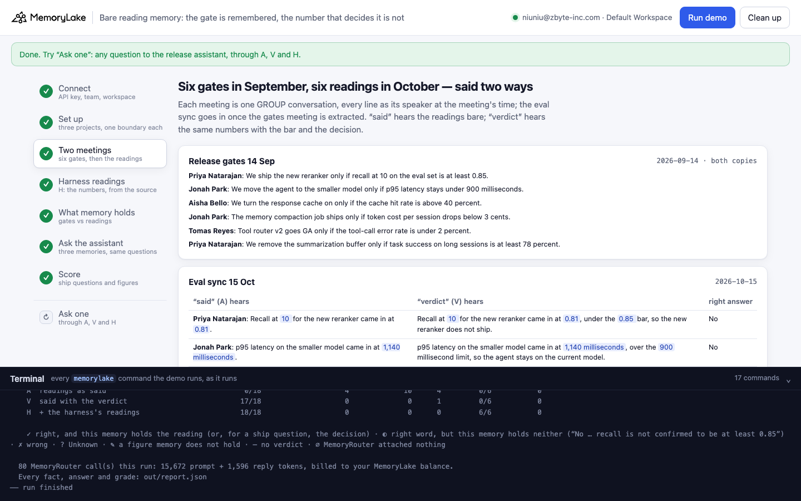
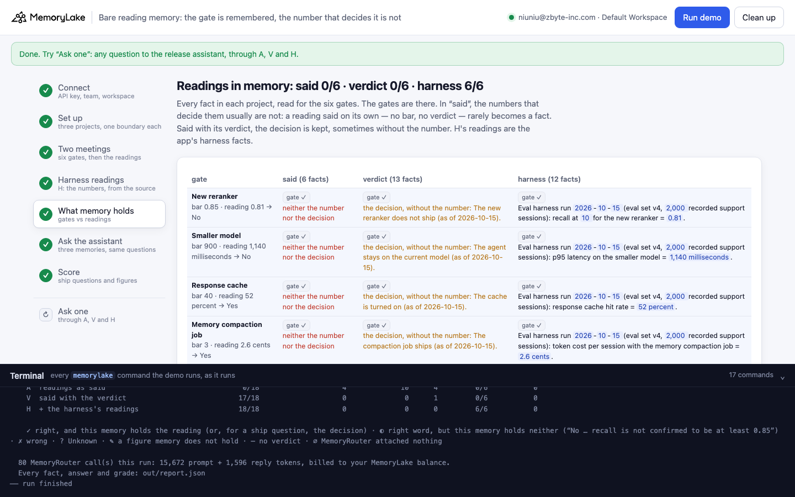
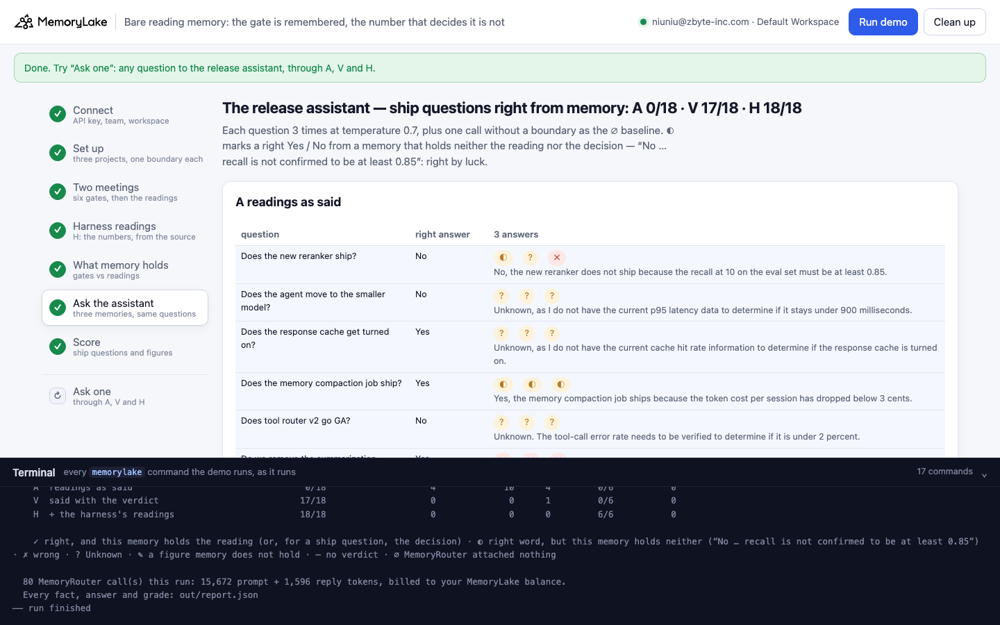
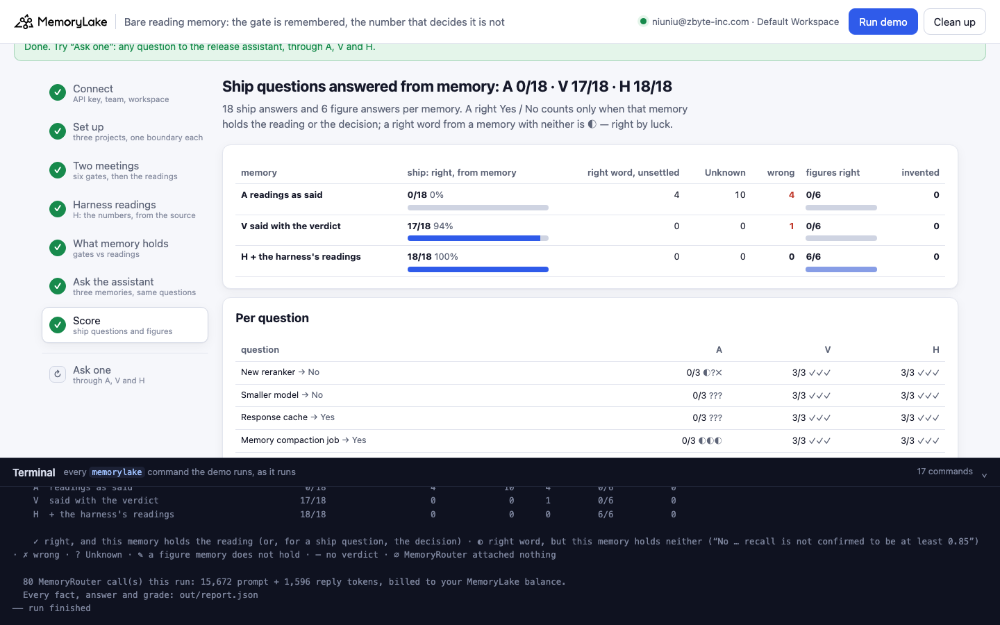
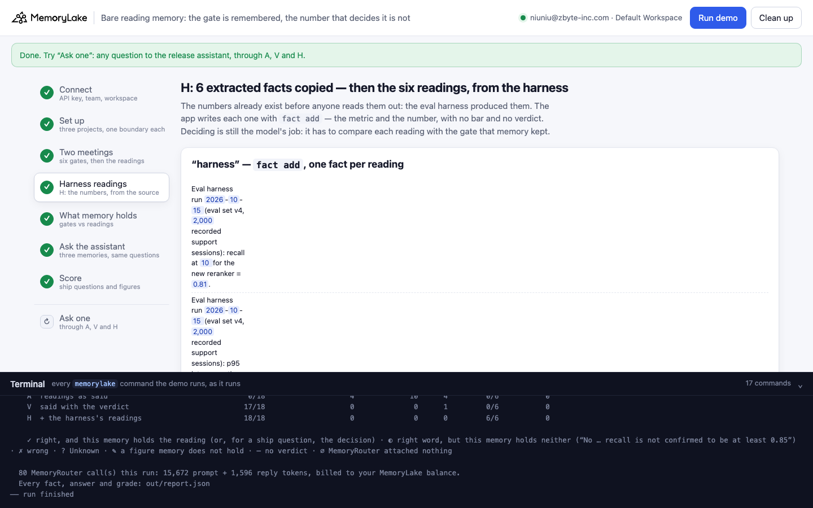
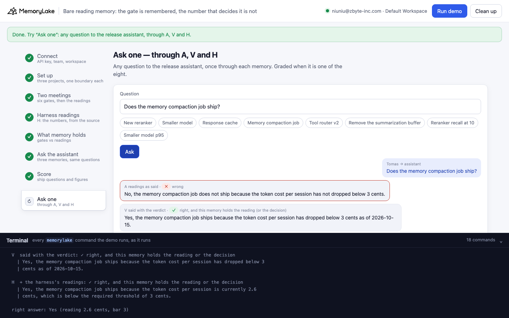

# Bare reading memory: the gate is remembered, the number that decides it is not

A runnable version of the MemoryLake use case
[*Why Summarization Buffers Lose the Details Agents Need*](https://www.memorylake.ai/en/usecase/why-summarization-buffers-lose-critical-agent-context),
built entirely on the [`memorylake` CLI](https://github.com/memorylake-ai/memorylake-cli) (v20261015 or later).

**Watch it run:** videos are being recorded (CLI and Web); links follow.

**The problem.** An AI agent team sets release gates in one meeting and reads out the eval results in a later one.
The results are said the way people say them, as a number:

```
14 Sep, release gates:  "We ship the new reranker only if recall at 10 on the eval set is at least 0.85."
15 Oct, eval sync:      "Recall at 10 for the new reranker came in at 0.81."
what memory holds:      "The new reranker ships only if recall at 10 on the eval set is at least 0.85. (as of 2026-09-14)"
                        (nothing about 0.81)
asked on 2026-10-17:    "Does the memory compaction job ship?"   (gate: below 3 cents; the eval sync said 2.6 cents)
the release assistant:  "No, the memory compaction job does not ship because the token cost per session has not dropped below 3 cents."
```

MemoryLake's extraction kept every gate and, in most runs, none of the six readings: a sentence that only carries a
number, with no bar and no verdict, rarely becomes a fact. The assistant then has the rule without the result. It
says "Unknown", or turns the missing reading into a failed one: the compaction job passed its gate, and the
assistant says it did not.

**What this demo shows.** The same two meetings, three memories, read through MemoryRouter:

| | memory | what the release assistant reads |
|---|---|---|
| **A** | the meetings, readings as said | the gates; the readings only if extraction kept them |
| **V** | the same meetings, each reading said with its verdict ("…, under the 0.85 bar, so the new reranker does not ship") | the gates and the decisions, sometimes without the numbers |
| **H** | A's extracted facts copied word for word, plus the six readings written by the app straight from the eval harness (`fact add`) | the gates and the numbers; the model still has to compare them |

Six ship questions ("Does the new reranker ship?", Yes / No / Unknown) and two figure questions ("What did recall at
10 come in at?"), three answers each per memory, on `gpt-4o-mini` at temperature 0.7.


## Prerequisites

- Python 3.9+ (standard library only)
- The `memorylake` CLI **v20261015 or later** (`memorylake router` arrived in that release):
  ```bash
  curl -fsSL https://raw.githubusercontent.com/memorylake-ai/memorylake-cli/main/scripts/install.sh | sh
  memorylake version
  ```
- A MemoryLake API key ([app.memorylake.ai](https://app.memorylake.ai) → API Keys).
- **Router calls are billed to your MemoryLake balance** (`memorylake billing balance`). One run makes 80 calls on
  `gpt-4o-mini`, about 16,000 prompt + 1,700 reply tokens; the run prints the total. If the balance is empty, the
  router calls print the refusal and are skipped; the memory steps still run.

## Run it

```bash
git clone https://github.com/memorylake-ai/memorylake-usecases.git
cd memorylake-usecases/bare-reading-memory
export MEMORYLAKE_API_KEY=sk-...
python3 demo.py                     # the whole story, about 4 minutes
python3 demo.py memory              # per gate and memory: is the gate there, is the reading, is the decision
python3 demo.py ask "Does the memory compaction job ship?"
python3 demo.py cleanup             # delete everything the demo created
```

The key is used to log into an isolated CLI profile under `.memorylake-demo/` (git-ignored); your own
`~/.memorylake` is never touched. For the China endpoint, also set
`MEMORYLAKE_BASE_URL=https://app.memorylake.cn/openapi/memorylake`. Every run starts over. Everything it creates is
prefixed `mlu-brm-`. `cleanup` keeps the run's `out/report.json`, moving it to `out/runs/`.

## Or run it in the browser

```bash
python3 web/server.py                # opens http://127.0.0.1:8765
```

Paste the API key and press **Run the demo**. Follow the steps on the left; the terminal drawer shows every
`memorylake` command as it runs. **Ask one** sends any question through A, V and H and grades it if it is one of the
eight. **Clean up** removes everything.

| Step 3: two meetings, the readings said two ways | Step 5: what memory holds |
|---|---|
|  |  |
| **Step 6: the assistant's answers** | **Step 7: the score** |
|  |  |
| **Step 4: the harness readings (H)** | **Ask one** |
|  |  |

## What happens, step by step

The output below is from one real run (the "fourth run" in [Measured](#measured)), trimmed.

### Step 2: three projects, eight actors, one boundary each

`said` and `verdict` each get the two meetings with their own four people, so a fact that lands on a speaker can be
traced to its copy. `harness` gets no meetings. One boundary per project is what the assistant reads.

All three projects have the same plain name (`Quillfold team meetings · A/V/H`). That matters: the project's name is
context for extraction (see [What else we measured](#what-else-we-measured)).

### Step 3: two meetings, six gates, then the eval sync said two ways

```
    Mon 14 Sep 2026  “Release gates 14 Sep” — both copies hear the same six gates:
        Priya Natarajan: We ship the new reranker only if recall at 10 on the eval set is at least 0.85.
        Jonah Park: We move the agent to the smaller model only if p95 latency stays under 900 milliseconds.
        Aisha Bello: We turn the response cache on only if the cache hit rate is above 40 percent.
        Jonah Park: The memory compaction job ships only if token cost per session drops below 3 cents.
        Tomas Reyes: Tool router v2 goes GA only if the tool-call error rate is under 2 percent.
        Priya Natarajan: We remove the summarization buffer only if task success on long sessions is at least 78 percent.

    Thu 15 Oct 2026  “Eval sync 15 Oct” — the six readings, said two ways:
        said     Priya Natarajan: Recall at 10 for the new reranker came in at 0.81.
        verdict  Priya Natarajan: Recall at 10 for the new reranker came in at 0.81, under the 0.85 bar, so the new reranker does not ship.
        …
```

Each meeting is one GROUP conversation (`conv create --kind GROUP`), every line appended as its speaker at the
meeting's time (`conv msg append --actor … --timestamp …`); the eval sync goes in once the gates meeting is extracted
(`conv cook-status`). Three readings pass their gate and three do not.

### Step 4: H, the readings from the source

```
$ memorylake fact add 'The new reranker ships only if recall at 10 on the eval set is at least 0.85. (as of 2026-09-14)' … --project proj-…
$ memorylake fact add 'Eval harness run 2026-10-15 (eval set v4, 2,000 recorded support sessions): recall at 10 for the new reranker = 0.81.' … --project proj-…
    H · “harness” — the readings, written by the app from the eval harness:
      · Eval harness run 2026-10-15 (eval set v4, 2,000 recorded support sessions): recall at 10 for the new reranker = 0.81.
      · … p95 latency on the smaller model = 1,140 milliseconds.
      · … response cache hit rate = 52 percent.
      · … token cost per session with the memory compaction job = 2.6 cents.
      · … tool-call error rate on tool router v2 = 3.7 percent.
      · … task success on long sessions without the summarization buffer = 81 percent.
```

The numbers existed before anyone read them out; the harness produced them. H copies what extraction kept in
`said` (`fact list` → `fact add`) and adds one fact per reading. No bar, no verdict: deciding is still the model's job.

### Step 5: what memory holds

```
    Memory compaction job — gate: 3 · reading 2.6 cents → Yes
      said gate ✓ reading ✗ (neither the number nor the decision is in memory)
      verdict gate ✓ reading ✗ “The compaction job ships. (as of 2026-10-15) [the decision, without the number]”
      harness gate ✓ reading ✓ “Eval harness run 2026-10-15 (eval set v4, 2,000 recorded support sessions): token cost
      per session with the memory compaction job = 2.6 cents.”

    said       6 facts · gates 6/6 · readings 0/6 · decisions 0/6
    verdict   10 facts · gates 4/6 · readings 2/6 · decisions 6/6
    harness   12 facts · gates 6/6 · readings 6/6 · decisions 0/6   (the readings here are the app's six harness facts)
```

`said` holds the six gates and nothing from the eval sync. `verdict` holds all six decisions, but the decision facts
often drop the number ("The compaction job ships."). The census reads each project with `fact list --projects` and
also the speakers' actors (a reading there would be outside the boundary).

### Step 6: ask the release assistant

```
  A  readings as said
    Smaller model                     ? ? ?    Unknown, as I do not have the current p95 latency data to determine if the…
    Memory compaction job             ✗ ✗ ✗    No, the memory compaction job does not ship because the token cost per ses…
    Remove the summarization buffer   ✗ ✗ ?    No, the summarization buffer should not be removed because task success on…
  H  + the harness's readings
    Memory compaction job             ✓ ✓ ✓    Yes, the memory compaction job ships because the token cost per session is…
```

Each question goes once without `--boundary` (the ∅ baseline: a boundary call with exactly as many prompt tokens had
nothing attached) and then three times through `router chat --boundary`. Grades: ✓ right, and this memory holds the
reading (or, for a ship question, the decision) · ◐ right word, but memory holds neither ("Yes, the response cache
gets turned on if the cache hit rate is above 40 percent") · ✗ wrong · ? Unknown · ✎ a figure memory does not hold ·
∅ nothing attached, not graded.

### Step 7: the score

```
                                       ship: right, from memory   right word, unsettled  Unknown  wrong  figure right  invented
    A  readings as said                                 0/18                    2             11      5         0/6           0
    V  said with the verdict                           18/18                    0              0      0         6/6           0
    H  + the harness's readings                        18/18                    0              0      0         6/6           0
```

## Measured

Totals over all runs follow once the recordings are in.

## What else we measured

Before the demo, probes on the same lines (separate projects, the speakers' actors read too; 2026-10-17):

- **Position in the meeting does not matter.** The reading "The bulk edit beta error rate came in at 2.4 percent."
  was dropped as the second line of a meeting, as the first, alone, and as its own batch (0/2 each); the same
  sentence ending "…, above the 1 percent bar, so bulk edit does not go GA." was kept 2/2.
- **The project's name is context for extraction.** The same two meetings, only the project name changed:
  "Quillfold agent evals" kept the readings in 13 of 24 cases, "Quillfold team meetings" in 9 of 42, a name like
  "probe v3s Z1" in 0 of 18. A name that also said "readings" kept them almost always — which is why every project in
  this demo has the same plain name. Changing the project's description did nothing measurable (0/12).
- **With a comparison but no verdict** ("…, under the 0.85 bar."), 6 of 12 readings were kept; with the verdict,
  12 of 12.
- **Extraction is all-or-nothing per meeting more often than not**: when bare readings were kept, usually all six
  were.

## Use it in your own agent

- **Write numbers from their source.** If a harness, a dashboard or a job produced the number, `fact add` it from
  there, with what it measures, the run and the date. Do not rely on a meeting transcript to carry it into memory.
- **A gate without its reading is worse than nothing.** The assistant reads "ships only if … below 3 cents", finds
  no reading, and some of the time says the gate was missed.
- **If people must say it, say the verdict.** "…, so the reranker does not ship" is kept; "came in at 0.81" mostly
  is not. The verdict can still lose its number, so figure questions need the source.
- **Check the census, not the transcript.** `fact list --projects` after each meeting shows what memory actually
  kept; a reading that is not there cannot be retrieved by anything.

## Troubleshooting

- **`this memorylake CLI has no router command`**: upgrade the CLI (install line above).
- **MemoryRouter refused the call for lack of balance**: top up in the console; `memorylake billing balance` shows it.
- **`still extracting after 420 s`**: once in a while a meeting takes longer; the demo carries on and grades what
  memory holds at that point.
- **A kept the readings this time**: extraction varies; in some runs it keeps all six bare readings, and A then
  answers like H. That is why the table above adds up several runs rather than quote one.
- **`the demo memory does not exist yet`**: `memory` and `ask` need a full run first (and `cleanup` removes it).
- **A run was interrupted**: run again; it deletes what the previous run left and starts over.

## Files

| File | What it is |
|---|---|
| `demo.py` | The demo: CLI wrapper, setup, the meetings (`ingest_copy()`), the harness branch (`write_harness()`), the census (`census()`, `decided()`), Router questions, the grader (`grade()`), `memory`, `ask`, cleanup (facts before actors) |
| `data/evals.json` | People, the two meetings, the six gates (gate line, bare reading, reading with verdict, value, bar, right answer, census patterns), the two figure questions, the system prompt |
| `web/server.py`, `web/static/` | Browser companion (standard library server, no build step) |
| `out/` | `report.json` with every fact, answer and grade; `out/runs/` keeps earlier runs' reports (git-ignored) |
