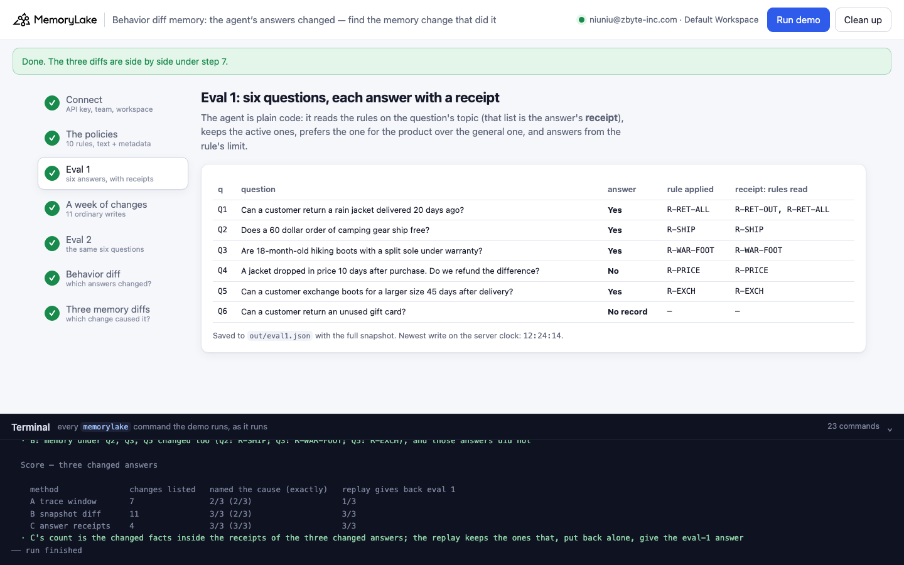
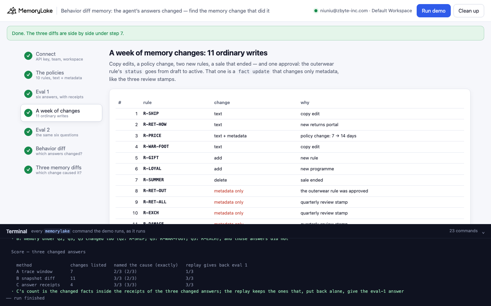
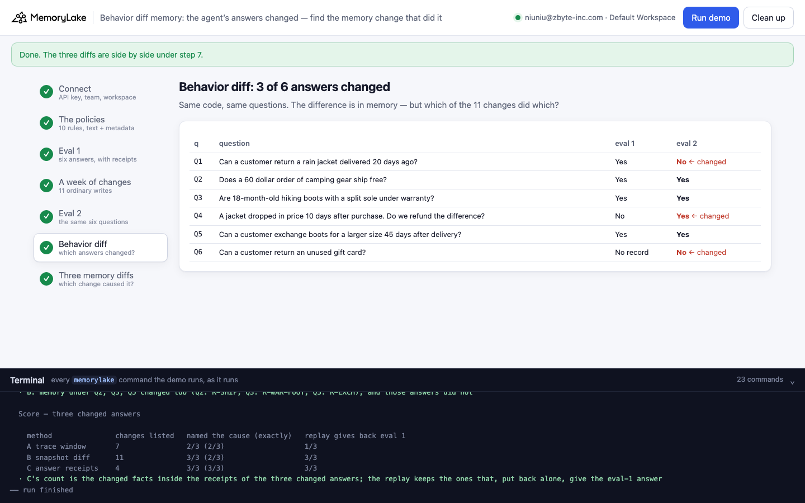
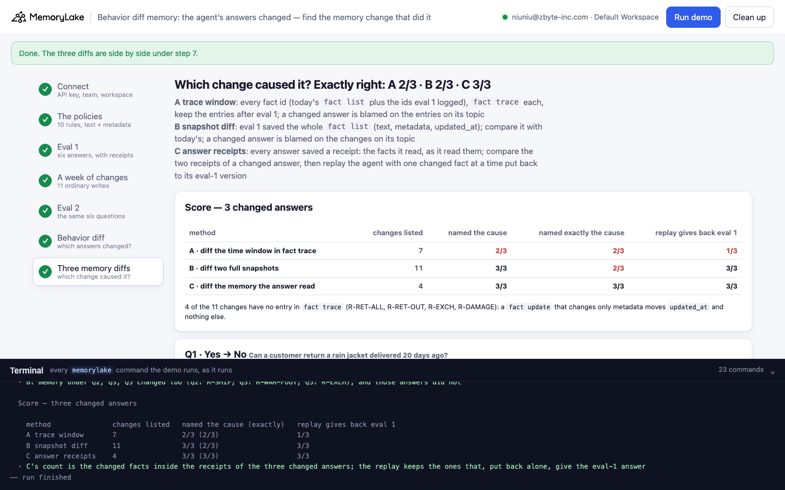

# Behavior diff memory: the agent's answers changed — which memory change did it?

A runnable version of the MemoryLake use case
[*Find Why Agent Behavior Changed by Diffing the Memory That Drove It*](https://www.memorylake.ai/en/usecase/memory-diff-for-agent-behavior-analysis),
built entirely on the [`memorylake` CLI](https://github.com/memorylake-ai/memorylake-cli) (v20261015 or later).

**Watch it run:** WATCH_LINE

**The problem.** The use case page puts it plainly: the model didn't change, the prompts didn't change, the answers
did — "something in memory shifted". The natural way to find out what is to diff memory between the two runs. How
you diff decides whether you find the cause:

- **Diff the time window in `fact trace`.** Every text version, add and forget has a timestamped entry, so "what
  changed since eval 1" looks like one query per fact. It lists 7 changes. For the return question it blames the one
  entry on the returns topic: a reworded "how to start a return" note. Wrong: that note cannot change a yes/no.
  The real cause, a draft rule set to `active`, was a **`fact update` that changed only metadata, and those do not
  appear in `fact trace`**. Put the blamed note back and the agent still says No.
- **Diff two full snapshots.** If eval 1 saved the whole `fact list` (text, metadata, `updated_at`), the cause is in
  the diff, together with 10 other changes. On the returns topic it names three facts: the cause, a review stamp and
  the reworded note.
- **Diff the memory the answer read, then replay.** If every answer saves a receipt (the facts it read, as it read
  them), a changed answer has two receipts to compare: 2 facts differ. Replay the agent with each one put back to its
  eval-1 version: only one of them gives back the old answer. That one is the cause.

**What this demo shows.** Sallowfen Outfitters (fictional) runs a support agent on project memory, one fact per
policy: a text people read, and metadata the agent's code reads (`topic`, `kind`, `status`, `applies_to`, `op`,
`value`). The agent is plain code: for a question it reads the rules on that topic, keeps the active ones, prefers
the rule for the product over the general one, and answers from the rule's limit.

| time | what happens |
|---|---|
| eval 1 | six questions; each answer is saved with a receipt, and the whole `fact list` is saved too |
| the week | 11 ordinary writes: 4 text edits (one also changes a limit: price protection 7 → 14 days), 2 new rules (gift cards, loyalty), 1 deletion (the summer sale), and 4 metadata-only updates: the outerwear return rule goes from `draft` to `active` (14 days instead of 30 for jackets), and three review stamps |
| eval 2 | the same six questions: three answers changed |

| question | eval 1 | eval 2 | why (by construction) |
|---|---|---|---|
| Q1 Can a customer return a rain jacket delivered 20 days ago? | Yes | **No** | the outerwear rule was approved (metadata only) |
| Q4 A jacket dropped in price 10 days after purchase. Do we refund the difference? | No | **Yes** | price protection went from 7 to 14 days (text and metadata) |
| Q6 Can a customer return an unused gift card? | No record | **No** | a gift-card rule was added |

The "week" runs in a few seconds: every time shown is the server's own clock, and eval 1's moment is the newest
`updated_at` in its snapshot. The demo checks that the trace window holds exactly the week's text-level writes before
it compares anything. No model calls: nothing is billed.

## Prerequisites

- **Python 3.9+** (standard library only).
- **The `memorylake` CLI, v20261015 or later** (`memorylake version`):
  ```bash
  curl -fsSL https://raw.githubusercontent.com/memorylake-ai/memorylake-cli/main/scripts/install.sh | sh
  ```
- **A MemoryLake API key**: sign up at [app.memorylake.ai](https://app.memorylake.ai), open **API Keys**, create one.
  Everything the demo uses (projects, facts, metadata, `fact trace`) is part of the free plan.

## Run it

```bash
git clone https://github.com/memorylake-ai/memorylake-usecases.git
cd memorylake-usecases/behavior-diff-memory
export MEMORYLAKE_API_KEY=sk-...        # logs into an isolated profile under .memorylake-demo/, never touches ~/.memorylake
python3 demo.py                         # about 40 seconds
python3 demo.py receipt Q1              # one question's two receipts side by side, with the trace of each fact it read
python3 demo.py cleanup                 # deletes everything the demo created
```

China region: also `export MEMORYLAKE_BASE_URL=https://app.memorylake.cn/openapi/memorylake`. To use a specific
workspace: `export MEMORYLAKE_WORKSPACE=ws-…` (default: the team's default workspace). Without `MEMORYLAKE_API_KEY`
the demo uses your existing `memorylake auth login` session.

Every object the demo creates has a `custom_id` starting with `mlu-bdm-`. Each run starts over: it deletes what a
previous run left behind first (`--reset` is accepted and does the same).

## Or run it in the browser

```bash
python3 web/server.py                   # opens http://127.0.0.1:8765
```

Paste the API key, press **Run demo**, and follow the steps: the policies, eval 1 with its receipts, the week of
changes, eval 2, the behavior diff, and the three memory diffs with the score. The terminal drawer at the bottom shows
every `memorylake` command as it runs. The server is standard library only and binds to localhost; the key stays in
that process and in `.memorylake-demo/`.

| | |
|---|---|
|  |  |
|  |  |

## What happens, step by step

Output below is from one real run (the third terminal run; ids shortened where marked with …).

### Step 3: eval 1

The agent reads `fact list` once and answers six questions. Each answer is saved with its receipt: the rules on the
question's topic, with their text, metadata and `updated_at`, as read.

```
$ memorylake fact list --projects proj-0b505d… --page-size 200 --workspace ws-…

    q    answer      rule applied   question
    Q1   Yes         R-RET-ALL      Can a customer return a rain jacket delivered 20 days ago?
    Q2   Yes         R-SHIP         Does a 60 dollar order of camping gear ship free?
    Q3   Yes         R-WAR-FOOT     Are 18-month-old hiking boots with a split sole under warranty?
    Q4   No          R-PRICE        A jacket dropped in price 10 days after purchase. Do we refund the difference?
    Q5   Yes         R-EXCH         Can a customer exchange boots for a larger size 45 days after delivery?
    Q6   No record   —              Can a customer return an unused gift card?
```

Q1 read two rules: the general 30-day rule and the outerwear 14-day rule, which is still a `draft`, so the general
rule applies.

### Step 4: the week

The approval is one call. It changes only metadata:

```
$ memorylake fact update fact-feb397… --metadata '{"applies_to": "outerwear", "key": "R-RET-OUT", "kind": "rule", "op": "max", "status": "active", "topic": "returns", "unit": "days", "value": 14}' --project proj-0b505d… --workspace ws-…
     8. R-RET-OUT   metadata only    the outerwear rule was approved
```

### Steps 6 and 7: what changed, and why

Eval 2 gives No, Yes and No where eval 1 gave Yes, No and No record. The three diffs:

```
  A · fact trace, entries after eval 1 (12:21:02): 7
    12:21:06  UPDATE  R-SHIP      shipping          Shipping: free US shipping on any order of 50 dollars or more.
    12:21:07  UPDATE  R-RET-HOW   returns           Returns are started at sallowfen.example/returns with the order number; the email address is retired.
    12:21:08  UPDATE  R-PRICE     price_protection  Price protection: if the price drops within 14 days of purchase, we refund the difference.
    12:21:08  UPDATE  R-WAR-FOOT  warranty          Warranty, footwear: boots and shoes have a 24-month warranty against manufacturing defects.
    12:21:09  ADD     R-GIFT      gift_cards        Gift cards: gift cards cannot be returned or refunded.
    12:21:10  ADD     R-LOYAL     loyalty           Loyalty: members earn 1 point per dollar; 100 points is a 5 dollar credit.
    12:21:11  FORGET  R-SUMMER    promotions        Summer sale: 20 percent off all tents until 31 August.

  B · snapshot diff, eval 1 vs eval 2: 11 facts changed
    R-RET-ALL   returns           metadata reviewed: None → 2026-10-12
    R-RET-OUT   returns           metadata status: draft → active
    R-RET-HOW   returns           text
    R-SHIP      shipping          text
    R-WAR-FOOT  warranty          text
    R-PRICE     price_protection  text; metadata value: 7 → 14
    R-EXCH      exchanges         metadata reviewed: None → 2026-10-12
    R-DAMAGE    damaged           metadata reviewed: None → 2026-10-12
    R-SUMMER    promotions        deleted
    R-GIFT      gift_cards        added
    R-LOYAL     loyalty           added
  · 4 of these 11 have no entry in `fact trace`: R-RET-ALL, R-RET-OUT, R-EXCH, R-DAMAGE (metadata-only updates; only updated_at moved)

  Q1  Yes → No   Can a customer return a rain jacket delivered 20 days ago?
    A trace window     names R-RET-HOW                          replay with them put back: No         ✗
    B snapshot diff    names R-RET-ALL, R-RET-HOW, R-RET-OUT    replay with them put back: Yes        ◐
    C answer receipts  names R-RET-OUT                          replay with them put back: Yes        ✓
      C replays one fact at a time: R-RET-ALL → no change, R-RET-OUT → Yes ✓

  Q4  No → Yes   A jacket dropped in price 10 days after purchase. Do we refund the difference?
    A trace window     names R-PRICE                            replay with them put back: Yes        ◐  (right fact; the trace has its old text, not its old metadata, so the replay cannot put it back)
    B snapshot diff    names R-PRICE                            replay with them put back: No         ✓
    C answer receipts  names R-PRICE                            replay with them put back: No         ✓
      C replays one fact at a time: R-PRICE → No ✓

  Q6  No record → No   Can a customer return an unused gift card?
    A trace window     names R-GIFT                             replay with them put back: No record  ✓
    B snapshot diff    names R-GIFT                             replay with them put back: No record  ✓
    C answer receipts  names R-GIFT                             replay with them put back: No record  ✓
      C replays one fact at a time: R-GIFT → No record ✓
  · ✓ named exactly the cause and the replay gives back the eval-1 answer · ◐ the cause is among the named, or named but the replay cannot put it back · ✗ the cause is not named
  · A: memory under Q2, Q3 changed too (Q2: R-SHIP; Q3: R-WAR-FOOT), and those answers did not
  · B: memory under Q2, Q3, Q5 changed too (Q2: R-SHIP; Q3: R-WAR-FOOT; Q5: R-EXCH), and those answers did not

  Score — three changed answers

    method               changes listed   named the cause (exactly)   replay gives back eval 1
    A trace window       7                2/3 (2/3)                   1/3
    B snapshot diff      11               3/3 (2/3)                   3/3
    C answer receipts    4                3/3 (3/3)                   3/3
  · C's count is the changed facts inside the receipts of the three changed answers; the replay keeps the ones that, put back alone, give the eval-1 answer
```

"Replay" runs the same agent code on today's memory with the named facts put back to their eval-1 versions (or
removed, if eval 1 did not have them). Nothing is written back; the eval-1 versions come from the saved snapshot.
For A the replay can only put back text, because a trace entry carries text and no metadata: that is why A names the
right fact for Q4 and still cannot show that it was the cause.

`python3 demo.py receipt Q1` shows the two receipts and each fact's trace (from the second terminal run):

```
  Q1  Can a customer return a rain jacket delivered 20 days ago?
  eval 1: Yes (applied R-RET-ALL)   eval 2: No (applied R-RET-OUT)

  R-RET-OUT  (changed)
    eval 1: Returns, outerwear: jackets and shells can be returned within 14 days of delivery.
            metadata {"applies_to": "outerwear", "key": "R-RET-OUT", "kind": "rule", "op": "max", "status": "draft", "topic": "returns", "unit": "days", "value": 14}   updated_at 12:20:19
    eval 2: Returns, outerwear: jackets and shells can be returned within 14 days of delivery.
            metadata {"applies_to": "outerwear", "key": "R-RET-OUT", "kind": "rule", "op": "max", "status": "active", "topic": "returns", "unit": "days", "value": 14}   updated_at 12:20:33
    fact trace: ADD 12:20:18

  R-RET-ALL  (changed)
    eval 1: Returns: unworn items can be returned within 30 days of delivery for a full refund.
            metadata {"applies_to": "all", "key": "R-RET-ALL", "kind": "rule", "op": "max", "status": "active", "topic": "returns", "unit": "days", "value": 30}   updated_at 12:20:17
    eval 2: Returns: unworn items can be returned within 30 days of delivery for a full refund.
            metadata {"applies_to": "all", "key": "R-RET-ALL", "kind": "rule", "op": "max", "reviewed": "2026-10-12", "status": "active", "topic": "returns", "unit": "days", "value": 30}   updated_at 12:20:34
    fact trace: ADD 12:20:16
```

Both facts changed; neither has a trace entry after its `ADD`. Only `updated_at` moved.

## Measured

MEASURED

## Use it in your own agents

- **Save a receipt with every answer.** The ids, text, metadata and `updated_at` of the facts the answer read, as
  read. It is a few hundred bytes, and it turns "what changed in memory" (11 things here) into "what changed in the
  memory this answer used" (2).
- **`fact trace` is the history of the text.** It has `ADD`, `UPDATE` (with `old_fact`) and `FORGET`, on the server's
  clock. A `fact update` that changes only metadata is not in it and only moves `updated_at`. If your code decides
  from metadata (status flags, limits, approvals), keep your own snapshots, or change the text in the same call.
- **Prove the cause with a replay.** A change on the right topic is a suspect, not a cause. Put each suspect back to
  its old version, run the same code, and keep the ones that give back the old answer.
- **Topic-level blame over-reports.** Both full diffs flag changes under questions whose answers did not move (a copy
  edit under Q2, a review stamp under Q5). Memory changing is not behavior changing.
- **Use the server clock for windows.** Take the window start from the newest `updated_at` in your snapshot, not from
  your own machine's time.

## Troubleshooting

- **`no fact trace with full history`** — the CLI is older than v20261015; reinstall with the `install.sh` line above.
- **`the trace window holds …, expected …`** — the trace entries and eval 1's snapshot disagree on time; run again,
  and please open an issue with `out/eval1.json` if it repeats.
- **Leftovers after an interrupted run** — `python3 demo.py cleanup`.

## Files

| file | what it is |
|---|---|
| `demo.py` | the whole demo: CLI wrapper, the agent, the two evals, the week, the three diffs and the replay, cleanup |
| `data/story.json` | the policies, the week's changes, the six questions and the three diff methods |
| `web/server.py`, `web/static/` | the browser companion (standard library server, no build step) |
| `out/world.json`, `out/eval1.json`, `out/eval2.json`, `out/report.json` | the ids, each eval's answers, receipts and full snapshot, and the score (`cleanup` moves them to `out/runs/`) |
