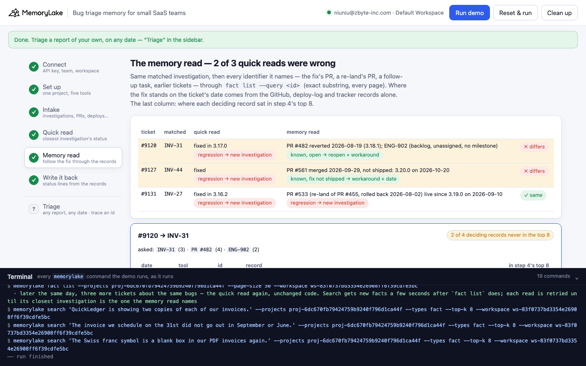
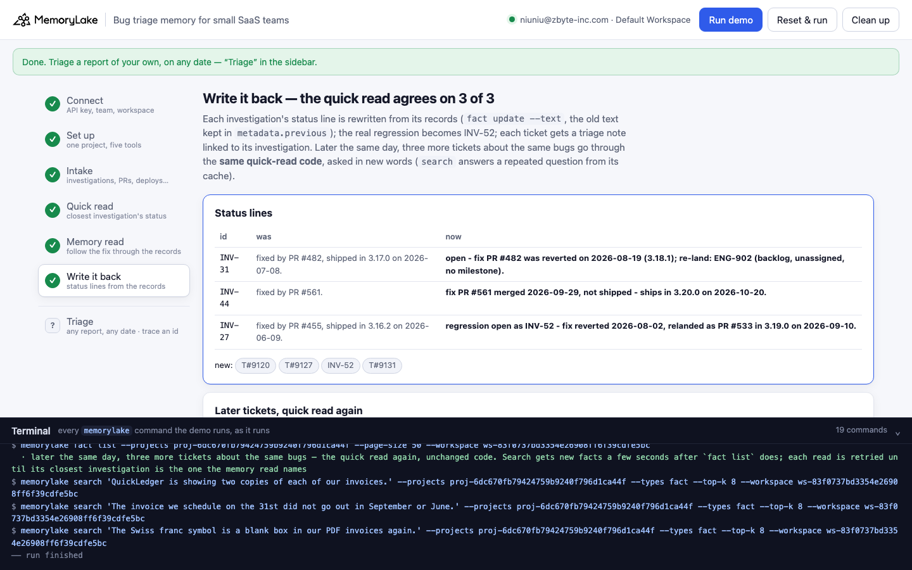

# Bug triage memory for small SaaS teams

A runnable version of the MemoryLake use case
[*Give Small SaaS Teams Bug Triage Memory That Stops Re-Investigating the Same Issues*](https://www.memorylake.ai/en/usecase/bug-triage-memory-for-small-saas-teams),
built entirely on the [`memorylake` CLI](https://github.com/memorylake-ai/memorylake-cli).

**Watch it run:** [CLI, 3:14](https://github.com/memorylake-ai/memorylake-usecases/releases/download/bug-triage-memory-v1/bug-triage-memory-cli-demo.mp4) · [Web, 4:28](https://github.com/memorylake-ai/memorylake-usecases/releases/download/bug-triage-memory-v1/bug-triage-memory-web-demo.mp4)
([release](https://github.com/memorylake-ai/memorylake-usecases/releases/tag/bug-triage-memory-v1); GitHub serves them as downloads).

**The problem.** "The fix from three months ago lives in a closed Linear ticket nobody re-reads." Worse: the closed
ticket says *fixed*, and it stays saying fixed after the fix is rolled back, or while the fix is merged but not
released. The records that say so are in other tools (the deploy log, the release plan, a follow-up task), filed under
a PR number, not under the customer's symptom. A triage assistant that "retrieves similar prior investigations first"
finds the right investigation and believes its status line. A known bug looks like a regression, and someone opens a
new investigation.

**What this demo shows.** Tallyfold (a fictional invoicing SaaS, six engineers) keeps every tool's records in one
MemoryLake project: 7 Linear investigations and 2 tasks, 12 GitHub merges, 12 deploy-log entries (deploys, rollbacks, a
scheduled release), 4 Sentry alerts, 9 helpdesk tickets. Every investigation's status line says "fixed". Today,
2026-10-14, three new tickets come in:

| Ticket | Closest investigation (search #1) | Quick read: its status line | Memory read: its fix, through the records | |
|---|---|---|---|---|
| #9120 every invoice twice in QuickLedger | INV-31 | fixed in 3.17.0 → **regression, new investigation** | PR #482 **rolled back** 2026-08-19 (3.18.1); re-land ENG-902 in backlog → **known, open**: reopen, send the workaround | ✗ |
| #9127 retainer on the 31st never sent | INV-44 | fixed → **regression, new investigation** | PR #561 merged 2026-09-29, **not shipped**: 3.20.0 on 2026-10-20 → **known**: workaround + ship date | ✗ |
| #9131 CHF sign is a box on PDFs (control) | INV-27 | fixed in 3.16.2 → regression | PR #455 rolled back 2026-08-02, **relanded** as PR #533, live since 3.19.0 on 2026-09-10 → **a real regression** | ✓ |

Search is not the problem: it puts the right investigation at #1 for all three, every run. The status line is. The
memory read follows identifiers instead of meaning, with `fact list --query "PR #482"` (an exact substring match over
the whole project, every page) and then whatever those records name in turn: a re-land's PR, a follow-up task. It lays
the fix's life out by date (merged → deployed → rolled back → relanded or scheduled) and reads where it stood on the
ticket's date.

Search's top 8 does hold *some* of these records, and that is the trap. For #9120 the real rollback is there (#3–#4),
right next to an **unrelated** QuickLedger rollback (PR #541), while the original deploy and the backlog task are not.
For #9131 the deploy that decides the case, 3.19.0 with the re-land, never comes back. A top-8 list doesn't tell you
which record belongs to this fix or in what order things happened.

Then step 6 writes the records' answer where the next triage will read it. Each investigation's status line is
rewritten (`fact update --text`, with the old text kept in `metadata.previous`), the real regression becomes INV-52,
and each ticket gets a triage note. Later that day, three more tickets about the same bugs go through the **same
quick-read code** and agree with the records, 3 of 3.

```
setup ──────── proj create
intake ─────── fact add --project <p> '<record>' …   (46 records, one call)  + fact update --metadata {tool, kind, by, on}
quick read ─── search '<ticket>' --projects <p> --types fact --top-k 8  → closest investigation → its "Status:" line
memory read ── fact list --projects <p> --query 'INV-31' / 'PR #482' / 'ENG-902' …   (exact substring, every page)
               → merged · deployed · rolled back · relanded · scheduled, by date, as of the ticket's date
write back ─── fact update <inv> --text '<status from the records>' --metadata {…, previous: '<old text>'}
               fact add 'INV-52 Regression of INV-27 …' + one triage note per ticket → quick read again (new wording)
```

No conversations and no extraction: every record is pinned word for word, and both reads are plain code over what the
CLI returns. No model decides anything.

## Prerequisites

- **Python 3.9+** (standard library only, nothing to `pip install`)
- **The `memorylake` CLI** on your `PATH`:
  ```bash
  curl -fsSL https://raw.githubusercontent.com/memorylake-ai/memorylake-cli/main/scripts/install.sh | sh
  ```
- **A MemoryLake API key.** Sign up at [app.memorylake.ai](https://app.memorylake.ai), open **API Keys**, create one. A free
  personal account is enough: nothing here needs an agent or a model call.

## Run it

```bash
git clone https://github.com/memorylake-ai/memorylake-usecases.git
cd memorylake-usecases/bug-triage-memory
export MEMORYLAKE_API_KEY=sk-...           # China region: also export MEMORYLAKE_BASE_URL=https://app.memorylake.cn/openapi/memorylake
python3 demo.py
```

About 1 minute 45 the first time (one project, 46 facts, each with its metadata), a little over a minute on a re-run.
Every run replays the morning of triage day: what an earlier run wrote back is undone first (its new facts deleted, the
status lines put back word for word from `metadata.previous`). With the key set, the demo logs into an isolated CLI
profile under `./.memorylake-demo/` and never touches your own `~/.memorylake`. Everything it creates has a
`custom_id` starting with `mlu-btm-`.

Then try it on your own words, on any date, or trace an identifier through every tool:

```bash
python3 demo.py triage "Customers get two copies of every invoice in QuickLedger"
python3 demo.py triage "Customers get two copies of every invoice in QuickLedger" --on 2026-07-20   # the fix was live then
python3 demo.py trace "PR #455"
python3 demo.py cleanup                    # deletes the project and every fact on it
```

## Or run it in the browser

```bash
python3 web/server.py                # opens http://127.0.0.1:8765
```

Paste the key, connect, run. The page drives the same functions as `demo.py` and streams every `memorylake` command into a
terminal drawer as it runs: the records by tool, the quick read of each ticket with its top 8, the memory read as a
timeline (with where each deciding record sat in the top 8, or that it never came back), and the write-back. **Triage**
takes any report and any date, and traces any identifier.





## What happens, step by step

### Steps 2–3: one project, five tools, one fact per record

```
$ memorylake proj create --name 'Tallyfold bug triage memory' --custom-id mlu-btm-triage --description '…'
$ memorylake fact add --project proj-… 'INV-12 Password reset emails land in spam …' 'INV-27 PDF invoices show a box …' …
$ memorylake fact update fact-… --project proj-… --metadata '{"key": "btm:INV-12", "record": "INV-12", "tool": "linear", "kind": "investigation", "by": "Dev Okoro", "on": "2026-04-21"}'
  · … and 45 more `fact update --metadata` the same way

    Linear       9  2 task · 7 investigation
    GitHub      12  12 merged
    deploy log  12  1 scheduled · 8 deploy · 3 rollback
    Sentry       4  4 alert
    helpdesk     9  9 ticket

  the investigations, as Linear has them (each one's own status line):
    INV-27  PDF invoices show a box instead of the currency sign for …  Status: fixed by PR #455, shipped in 3.16.2 on 2026…
    INV-31  Duplicate invoices in the QuickLedger sync: each invoice …  Status: fixed by PR #482, shipped in 3.17.0 on 2026…
    INV-44  Recurring invoices scheduled for the 31st are skipped in …  Status: fixed by PR #561.
    …
```

`fact add` takes many texts in one call and returns their ids in order; it takes no metadata, so each fact gets a
`fact update --metadata` right after.

### Step 4: the quick read

```
$ memorylake search 'Since last week every invoice we send appears two times in our QuickLedger books.' --projects proj-… --types fact --top-k 8

  #9120 Harbor & Pine Dental (2026-10-13): “Since last week every invoice we send appears two times in our QuickLedger books.”
  search · top 8:
      #1   INV-31   Linear     INV-31 Duplicate invoices in the QuickLedger sync: each invoice appears twice in …   ← closest investigation
      #2   G482     GitHub     PR #482 merged 2026-07-03: the delivery worker attaches an idempotency key to eve…
      #3   R3192    deploy log Rollback 2026-09-18: release 3.19.2 reverts PR #541 - the retries flooded the Qui…
      #4   R3181    deploy log Rollback 2026-08-19: release 3.18.1 reverts PR #482 - delivery worker p95 latency…
      #5   #8812    helpdesk   Ticket #8812 Brightwell Bakery: each new invoice shows up twice in QuickLedger. L…
      …
  → INV-31: “Status: fixed by PR #482, shipped in 3.17.0 on 2026-07-08.”
  → quick read: fixed in 3.17.0 → treat as a regression: open a new investigation
```

The investigation's text is read from `fact list` by the hit's fact id, not from the hit itself: `search` can answer a
repeated question from a cache of older text.

### Step 5: the memory read

```
$ memorylake fact list --projects proj-… --query INV-31 --page-size 50

  #9120 → INV-31   asked: INV-31 (3), PR #482 (4), ENG-902 (2)
      2026-07-03  GitHub     G482    PR #482 merged 2026-07-03: the delivery worker attaches an idempotency key to every…
      2026-07-08  deploy log R3170   Release 3.17.0 deployed 2026-07-08 (includes PR #470, PR #482).
      2026-08-19  deploy log R3181   Rollback 2026-08-19: release 3.18.1 reverts PR #482 - delivery worker p95 latency r…
      2026-08-19  Linear     ENG-902 ENG-902 Re-land the delivery idempotency key with a cached lookup. State: backlog, …
      earlier reports: #8812 Brightwell Bakery (2026-06-28), #8840 Lumen Yoga (2026-07-09)
  → memory read: PR #482 reverted 2026-08-19 (3.18.1); ENG-902 (backlog, unassigned, no milestone) → known, open → reopen + workaround
  → the records that decide it, in step 4's top 8: G482 #2, R3170 —, R3181 #4, ENG-902 —  (2 of 4 never came back)
  …
  #9131 → INV-27   asked: INV-27 (2), PR #455 (5), PR #533 (2)
      2026-06-05  GitHub     G455    PR #455 merged 2026-06-05: the PDF renderer bundles Noto Sans for its glyph table (…
      2026-06-09  deploy log R3162   Release 3.16.2 deployed 2026-06-09 (includes PR #455).
      2026-08-02  deploy log R3173   Rollback 2026-08-02: release 3.17.3 reverts PR #455 - the PDF lambda bundle went ov…
      2026-09-08  GitHub     G533    PR #533 merged 2026-09-08: relands PR #455 with a subset font (420 KB).
      2026-09-10  deploy log R3190   Release 3.19.0 deployed 2026-09-10 (includes PR #533).
  → memory read: PR #533 (re-land of PR #455, rolled back 2026-08-02) live since 3.19.0 on 2026-09-10 → regression → new investigation
  → the records that decide it, in step 4's top 8: G455 #2, R3162 —, R3173 #3, G533 —, R3190 —  (3 of 5 never came back)

  ticket  matched  quick read (status line)               memory read (records)
  ----------------------------------------------------------------------------------------------------------------
  #9120   INV-31   fixed in 3.17.0 → regression           PR #482 reverted 2026-08-19 (3.18.1); ENG-902 (backlo… ✗ differs
  #9127   INV-44   fixed → regression                     PR #561 merged 2026-09-29, not shipped: 3.20.0 on 202… ✗ differs
  #9131   INV-27   fixed in 3.16.2 → regression           PR #533 (re-land of PR #455, rolled back 2026-08-02) … ✓ same

  → 2 of 3 quick reads would open a new investigation for a bug the team already knows
```

The rules are a few lines of code (`pr_state()` in `demo.py`). A fix is live on day D if its latest deploy on or before D
is later than its latest rollback. A rolled-back fix counts again only through a re-land PR that is itself live. Merged
plus scheduled means "not shipped". Identifiers are matched whole (`PR #48` must not match `PR #482`; `--query` is a
plain substring). Deploy lines list other PRs too, and those are not followed. The walk only follows what merges,
rollbacks and tasks name.

### Step 6: write it back

```
  status lines now:
    INV-31  was “fixed by PR #482, shipped in 3.17.0 on 2026-07-08.”
            now “open - fix PR #482 was reverted on 2026-08-19 (3.18.1); re-land: ENG-902 (backlog, unassigned, no milestone).”
    INV-44  was “fixed by PR #561.”
            now “fix PR #561 merged 2026-09-29, not shipped - ships in 3.20.0 on 2026-10-20.”
    INV-27  was “fixed by PR #455, shipped in 3.16.2 on 2026-06-09.”
            now “regression open as INV-52 - fix reverted 2026-08-02, relanded as PR #533 in 3.19.0 on 2026-09-10.”
  new: T#9120, T#9127, INV-52, T#9131

  #9133 “QuickLedger is showing two copies of each of our invoices.”
    closest investigation INV-31 (#1) · quick read: open - fix PR #482 was reverted on 2026… → open · memory read: open  ✓ same
  #9134 “The invoice we schedule on the 31st did not go out in September or June.”
    closest investigation INV-44 (#1) · quick read: fix not shipped (3.20.0 on 2026-10-20) → pending · memory read: pending  ✓ same
  #9135 “The Swiss franc symbol is a blank box in our PDF invoices again.”
    closest investigation INV-52 (#1) · quick read: under investigation → investigating · memory read: investigating  ✓ same

  → the quick read now agrees with the records on 3 of 3: the status line it trusts is the one the records wrote
```

The later tickets are worded differently on purpose. `search` caches results by query text, so asking the morning's
exact question again can return the morning's answer. New facts reach `fact list` at once and `search` a few seconds
later, so each read is retried (every 4 s, up to 8 times) until its closest investigation is the one the memory read
names. The run prints the try number when it needed more than one.

## Measured

| What | Result |
|---|---|
| Closest investigation = the right one (INV-31, INV-44, INV-27), search #1 | 3 / 3 tickets, every run |
| Quick read vs memory read: #9120 ✗, #9127 ✗, #9131 ✓ | 6 / 6 runs (4 from scratch including both recordings, 2 re-runs) |
| Deciding records never in the quick read's top 8 | #9120: 2 of 4 (R3170, ENG-902) · #9127: 1 of 2 (R3200) · #9131: 3 of 5 (R3162, G533, R3190), every run; the ranks of the ones that do come back move |
| After write-back: quick read agrees with the records | 3 / 3, every run, first try |
| Time | 101–137 s from scratch (incl. `--reset`), 66–70 s re-run |

## Wiring it into your own triage

- **Pin every tool's records into one project** as they happen: investigations, merges, deploys and rollbacks, release
  plans, follow-up tasks, tickets. Keep their identifiers in the text (`PR #482`, `ENG-902`, release numbers). They are
  the join keys.
- **Retrieve by meaning, decide by identifier.** Use `search` to find the closest prior investigation; then
  `fact list --query <id>` for everything that names its fix, page by page, and decide from dates, not from rank.
- **Write the answer back into the investigation**, where the next reader looks. Keep the old status in metadata, and
  link every new ticket to its investigation so the history of a bug stays in one place.
- When a rollback ships, the rollback record should name the PR it reverts and the task that re-lands it. That one
  sentence is what lets the next triage find it.

## If something goes wrong

- **`the memorylake CLI is not on PATH`**: install it (above) or `export MEMORYLAKE_BIN=/path/to/memorylake`.
- **Search results differ on your run**: ranking moves between runs. Step 4 prints exactly what came back; the memory read
  does not depend on search beyond picking the investigation.
- **"search answered from its cache"**: step 4 asks the same questions every run, and `search` can serve a repeated
  question from a cache made by an earlier run; the note names the hits whose fact ids are not in `fact list` now.
- **A later ticket shows "try 8" and the wrong investigation**: the search index was slower than 30 s; run
  `python3 demo.py` again.
- **Something half-created after an interrupted run**: `python3 demo.py --reset`, or `python3 demo.py cleanup`.

## Files

```
bug-triage-memory/
├── demo.py              # the CLI runner (every step is a plain `memorylake` command, echoed)
├── data/story.json      # 46 records from five tools, 3 tickets + 3 later ones (fictional, plain ASCII)
├── web/server.py        # local web companion: same functions, Server-Sent Events
├── web/static/          # no-build front end
└── out/runs.jsonl       # one line per run (git-ignored)
```
