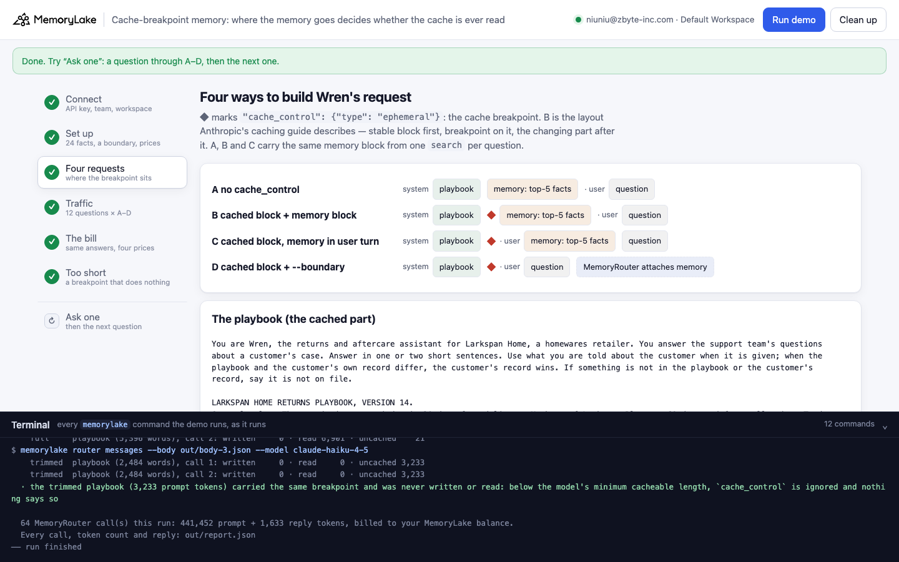
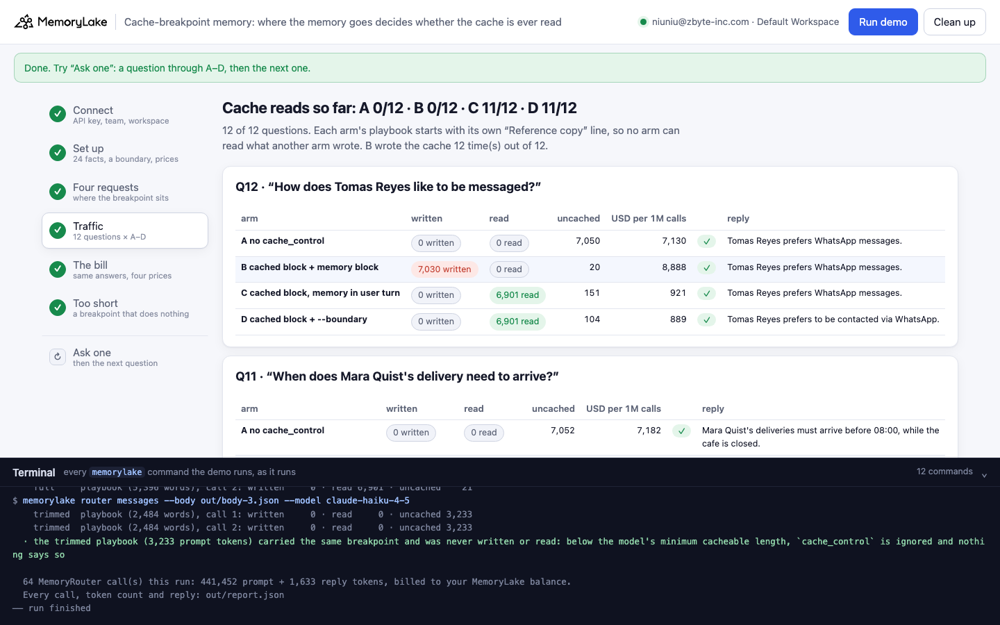
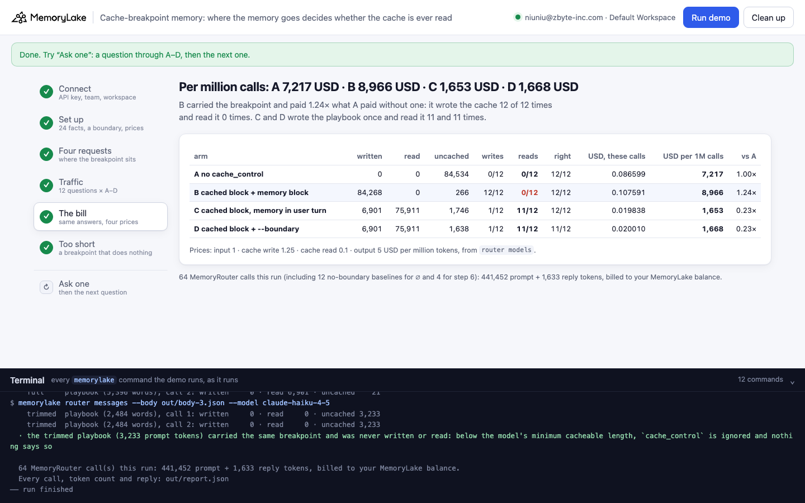
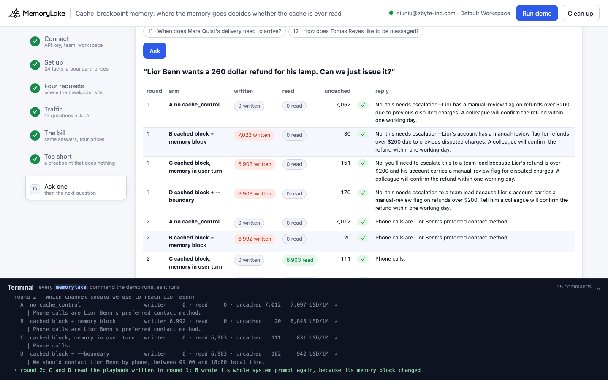

# Cache-breakpoint memory: where the memory goes decides whether the cache is ever read

A runnable version of the MemoryLake use case
[*Give Claude API Apps Persistent Context Beyond the 200k Window*](https://www.memorylake.ai/en/usecase/persistent-context-for-claude-api-apps),
built entirely on the [`memorylake` CLI](https://github.com/memorylake-ai/memorylake-cli) (v20261015 or later).

**Watch it run:** CLI video: recording · [Web, 4:59](https://github.com/memorylake-ai/memorylake-usecases/releases/download/cache-breakpoint-memory-v1/cache-breakpoint-memory-web-demo.mp4)
([release](https://github.com/memorylake-ai/memorylake-usecases/releases/tag/cache-breakpoint-memory-v1); GitHub serves them as downloads). Both recordings are counted in the Measured table below.

**The problem.** A Claude API app sends a long, stable system prompt with every request, so it marks it with a
prompt-caching breakpoint (`"cache_control": {"type": "ephemeral"}`): the first request writes that prefix to the
cache at 1.25× the input price, later requests read it at 0.1×. The app also adds what it remembers about the
customer, which changes with every request. Anthropic's caching guide puts the changing part *after* the breakpoint.
Sent through MemoryRouter (`memorylake router messages`), a memory block placed after the breakpoint **as a second
system block** is written to the cache together with the playbook on every request, and nothing is ever read:

```
Q2/12  "Dev Patel is returning a chair. Should the refund go to his card or to store credit?"
  A  written     0 · read     0 · uncached 7,032   7,177 USD/1M  ✓  Dev Patel wants refunds as store credit, not to his
  B  written 7,004 · read     0 · uncached    28   8,928 USD/1M  ✓  Dev Patel wants refunds as store credit, not to his
  C  written     0 · read 6,901 · uncached   133     978 USD/1M  ✓  Dev Patel's refund should go to store credit, as he'
  D  written     0 · read 6,901 · uncached   130     975 USD/1M  ✓  Store credit—Dev has requested that refunds go to st
```

Larkspan Home (a fictional homewares retailer) runs a returns assistant, Wren, on `claude-haiku-4-5`. Every request
carries the same returns playbook (5,396 words, about 6,900 tokens) and what Wren remembers about the customer. Over
4 full runs (48 requests per arm), **B wrote the cache on every request and read it on none
(48 of 48 written, 0 read)** and cost **1.24× what A cost with no breakpoint at all**. The same
memory block moved into the user turn (C), or attached by MemoryRouter (D), let the playbook be written once per run
and read on every later request: C and D cost **0.23×** and **0.23×** A. A, B and C sent the same memory block
and were right on every question.

## What it shows

- **Anthropic's cache readout passes straight through MemoryRouter.** `memorylake router messages` returns the
  provider's own `usage.cache_creation_input_tokens` (written), `cache_read_input_tokens` (read) and `input_tokens`
  (the rest). The demo prints all three for every call and prices them with `memorylake router models`
  (`input`, `details.cache_write_5m`, `details.cache_read`, `output`).
- **A second system block after the breakpoint is cached with it.** B is the layout the guide describes. Through
  MemoryRouter, the write covers the memory block too (`cache_creation_input_tokens` ≈ playbook + memory,
  `input_tokens` 19–30), so a new memory block means a new cache entry. We checked this with a raw HTTP request to
  MemoryRouter's Anthropic endpoint, without the CLI, and got the same result: the server does it, not the CLI.
- **Moving the memory out of the system prompt fixes it.** C puts the same `search` result at the top of the user
  turn; D lets MemoryRouter attach memory (`--boundary`). MemoryRouter's own memory lands after the breakpoint and
  never disturbs it.
- **A breakpoint can do nothing at all, silently.** Step 6 sends a trimmed playbook (2,484 words, about 3,200 tokens)
  with the same breakpoint, twice. Written 0, read 0, both times: it is below the model's minimum cacheable length,
  and no error or warning tells you so.

## Prerequisites

- Python 3.9+ (standard library only)
- The `memorylake` CLI, v20261015 or later (`memorylake router` arrived in that release):
  `curl -fsSL https://raw.githubusercontent.com/memorylake-ai/memorylake-cli/main/scripts/install.sh | sh`
- A MemoryLake API key ([app.memorylake.ai](https://app.memorylake.ai) → API Keys)
- MemoryRouter calls are billed to your MemoryLake balance: 64 calls on `claude-haiku-4-5` per run, about 0.25 USD

## Run it

```bash
git clone https://github.com/memorylake-ai/memorylake-usecases.git
cd memorylake-usecases/cache-breakpoint-memory
export MEMORYLAKE_API_KEY=sk-...
python3 demo.py            # about 2.5 minutes
python3 demo.py ask 4      # one question through A–D, then the customer's next question
python3 demo.py facts      # what the project remembers, per customer
python3 demo.py cleanup    # delete everything the demo created
```

With a key set, the demo logs into an isolated CLI profile under `.memorylake-demo/` and never touches
`~/.memorylake`. Without one, it uses your existing `memorylake auth login` session. On the China endpoint, also
`export MEMORYLAKE_BASE_URL=https://app.memorylake.cn/openapi/memorylake`. Everything it creates has a custom id
starting with `mlu-cbp-`. Every run starts over, so `--reset` is accepted but changes nothing.

## Or run it in the browser

```bash
python3 web/server.py        # opens http://127.0.0.1:8765
```

Paste the key, press **Run demo**, and follow the same six steps: the four requests side by side, every question's
written / read / uncached tokens, the bill, the trimmed playbook, and **Ask one**. A terminal drawer shows every
`memorylake` command as it runs.

| | |
|---|---|
|  |  |
|  |  |

## What happens, step by step

### Step 2: memory, one boundary, the price list

Six customers, four facts each, pinned verbatim into one project with `memorylake fact add` (Orla prefers SMS, Dev is
a Larkspan Plus member who wants store credit, Lior's account carries a manual-review flag…). One boundary over the
project is what arm D's MemoryRouter calls read. `memorylake router models` gives the price list:

```
    claude-haiku-4-5: input 1 · cache write (5 min) 1.25 · cache read 0.1 · output 5 USD per million tokens
  · a prompt token written to the cache costs 1.25× a plain one; read back from it, 0.10×
```

### Step 3: four ways to build the request

```
    A  no cache_control                    system = [playbook, 5396 words] [memory: top-5 facts]      user = question
    B  cached block + memory block         system = [playbook, 5396 words ◆] [memory: top-5 facts]    user = question
    C  cached block, memory in user turn   system = [playbook, 5396 words ◆]      user = [memory: top-5 facts] + question
    D  cached block + --boundary           system = [playbook, 5396 words ◆]      user = question   … MemoryRouter attaches memory
```

◆ is the breakpoint. Each request is a whole Anthropic Messages body, sent with
`memorylake router messages --body out/body-N.json --model claude-haiku-4-5` (D adds `--boundary`). One
`memorylake search --types fact --top-k 5` per question feeds A, B and C, so their memory block is identical.

Each run gets a random id, and each arm's playbook starts with `Reference copy <run>-<arm>.`, so no arm reads a cache
entry another arm, or an earlier run, wrote.

### Step 4: traffic

Twelve questions, two per customer, each through A–D. Every reply's usage, priced per million calls:

```
  Q1/12  "How should we contact Orla Byrne about her sofa delivery?"
    A  written     0 · read     0 · uncached 7,056   7,341 USD/1M  ✓  Contact Orla by SMS, as that's her preferred channel
    B  written 7,034 · read     0 · uncached    22   9,100 USD/1M  ✓  Contact Orla by SMS, as that's her preferred channel
    C  written 6,901 · read     0 · uncached   157   8,893 USD/1M  ✓  We should contact Orla Byrne by SMS, as that's her p
    D  written 6,901 · read     0 · uncached   172   8,883 USD/1M  ✓  Contact Orla by SMS, as that's her preferred channel
```

On the first question every cached arm writes. From the second on, C and D read the 6,901-token playbook. B writes
playbook + memory again (7,004, 7,027, 7,024 …), because each question retrieved a different memory block.

### Step 5: the bill

```
                                            written     read  uncached  writes  reads  right  USD, these calls  USD per 1M calls
    A  no cache_control                           0        0    84,520   0/12   0/12   12/12          0.086590             7,216
    B  cached block + memory block           84,254        0       266  12/12   0/12   12/12          0.107499             8,958
    C  cached block, memory in user turn      6,901   75,911     1,732   1/12  11/12   12/12          0.019754             1,646
    D  cached block + --boundary              6,901   75,911     1,645   1/12  11/12   10/12          0.019747             1,646
  · B paid 1.24× what A paid for the same 12 requests: it wrote the cache 12 time(s) and read it 0 time(s)
  · C paid 0.23× A: wrote the playbook 1 time(s), read it 11 time(s)
  · D paid 0.23× A: wrote the playbook 1 time(s), read it 11 time(s)
```

D's two misses in this run (Q6, Q11) have nothing to do with caching: MemoryRouter attached 139–144 tokens of memory
and the model still said the delivery address / delivery time was not on file. Which facts it attached is not in the
reply. A–C got `search` top-5 and answered both. Across all runs D missed 6 of 48, always Q6
and/or Q11.

### Step 6: a breakpoint that does nothing

```
    full     playbook (5,396 words), call 1: written 6,901 · read     0 · uncached    21
    full     playbook (5,396 words), call 2: written     0 · read 6,901 · uncached    21
    trimmed  playbook (2,484 words), call 1: written     0 · read     0 · uncached 3,233
    trimmed  playbook (2,484 words), call 2: written     0 · read     0 · uncached 3,233
  · the trimmed playbook (3,233 prompt tokens) carried the same breakpoint and was never written or read: below the model's minimum cacheable length, `cache_control` is ignored and nothing says so
```

### `ask`: one question, then the customer's next one

`python3 demo.py ask 4` sends question 4 through A–D with a fresh run id, then the same customer's other question.
Round 2 shows the difference in two lines: C and D read the playbook that round 1 wrote; B writes its whole system
prompt again, because its memory block changed.

```
  round 2  "Which channel should we use to reach Lior Benn?"
    B  cached block + memory block         written 6,990 · read     0 · uncached    20   8,842 USD/1M  ✓
    C  cached block, memory in user turn   written     0 · read 6,901 · uncached   111     831 USD/1M  ✓
```

## Measured

| run | A USD | B USD | C USD | D USD | B written / read | C read | D read | right A · B · C · D | trimmed playbook written / read |
|---|---|---|---|---|---|---|---|---|---|
| CLI 1 (first run) | 0.0866 | 0.1075 | 0.0198 | 0.0197 | 12/12 · 0/12 | 11/12 | 11/12 | 12 · 12 · 12 · 10 | 0 / 0 |
| CLI 2 | 0.0864 | 0.1076 | 0.0199 | 0.0199 | 12/12 · 0/12 | 11/12 | 11/12 | 12 · 12 · 12 · 11 | 0 / 0 |
| CLI 3 (`--reset`) | 0.0865 | 0.1075 | 0.0197 | 0.0201 | 12/12 · 0/12 | 11/12 | 11/12 | 12 · 12 · 12 · 10 | 0 / 0 |
| Web (browser check = Web recording) | 0.0866 | 0.1076 | 0.0198 | 0.0200 | 12/12 · 0/12 | 11/12 | 11/12 | 12 · 12 · 12 · 11 | 0 / 0 |
| **all 4** | 0.3460 | 0.4302 | 0.0792 | 0.0798 | 48/48 · 0/48 | 44/48 | 44/48 | 48 · 48 · 48 · 42 | |

Per million calls: A 7,208 · B 8,962 · C 1,650 · D 1,662 USD (claude-haiku-4-5 prices from `router models`). B's uncached input stayed at 19–30 tokens per request: the memory block was always inside the cache write. C and D read on every request except the first of each run. The trimmed playbook was written or read 0 times in every run.

## Use it in your own app

- Keep everything that changes per request **out of the system prompt** when you call through MemoryRouter: put
  retrieved memory at the top of the user turn, or let `--boundary` attach it. Then the system prompt is one stable
  block and the breakpoint on it is read on every later request.
- Check the readout, not the layout: after the second request, `cache_read_input_tokens` should be close to the size
  of your stable prefix. If `cache_creation_input_tokens` is large on every request, the cache is being written, not
  read, and you pay 1.25× for it.
- If both readouts stay at 0, your prefix is below the model's minimum cacheable length; caching is off and
  nothing tells you.
- The 5-minute cache costs 1.25× to write; `router models` also lists `cache_write_1h` (2× input) for traffic with
  longer gaps.

## Troubleshooting

- **`402` / insufficient balance**: MemoryRouter calls are billed to your MemoryLake balance. The memory steps still
  run, and the model calls are skipped with a note.
- **B reads its cache in your run**: B can only read when its whole system prompt, memory block included, repeats an
  earlier request; the demo marks such lines "whole system prompt repeats an earlier question". If B reads on new
  memory blocks, MemoryRouter now keeps your block boundaries — the bill in step 5 will show it.
- **`no workspace given`**: set `MEMORYLAKE_WORKSPACE=ws-…`, or run `memorylake workspace use`.
- Costs in the tables are computed from the account's own `router models` prices; they are not read from your
  invoice. `usage` records arrive late and in batches.

## Files

- `demo.py` — the whole demo (CLI wrapper, the four request bodies, the bill, `ask`, `facts`, `cleanup`)
- `data/larkspan.json` — the playbook (full and trimmed), six customers' facts, twelve questions
- `web/server.py`, `web/static/` — the browser companion (standard library HTTP + Server-Sent Events)
- `out/report.json` — every call of the last run: tokens written / read / uncached, reply, cost; earlier runs are
  kept in `out/runs/`
