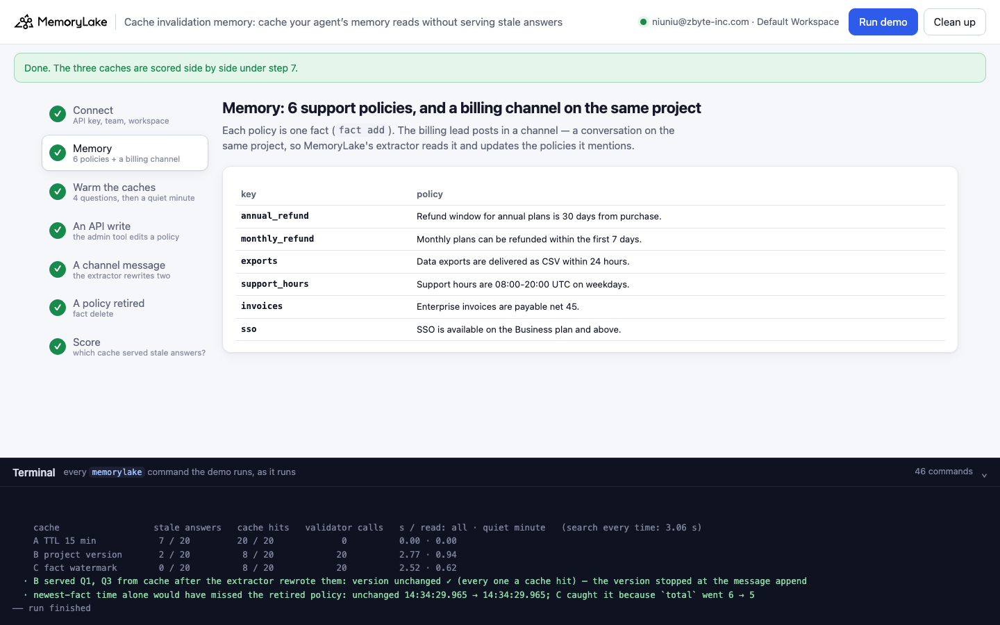
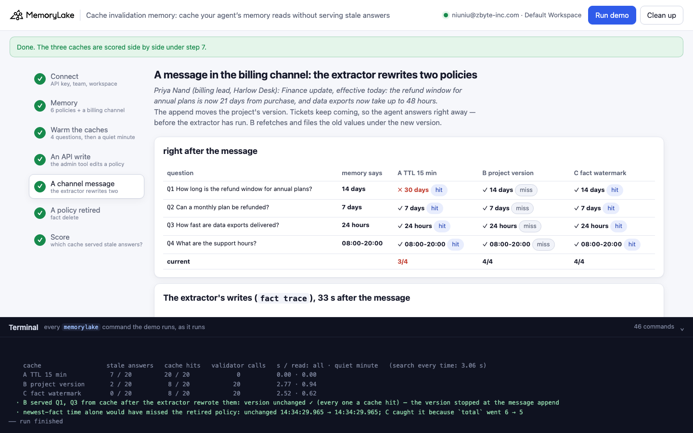
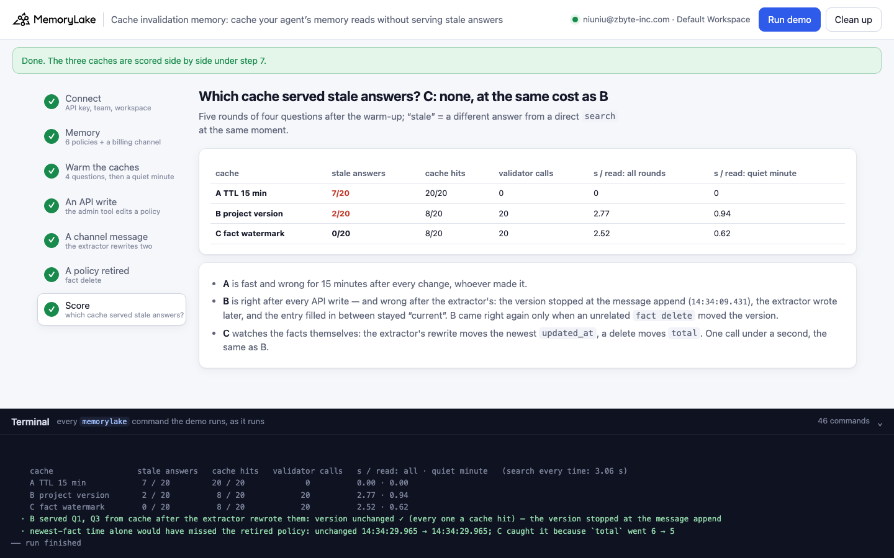

# Cache invalidation memory: cache your agent's memory reads — the project version never sees the extractor's writes

A runnable version of the MemoryLake use case
[*Cache Agent Memory Hot-Paths Without Risking Correctness*](https://www.memorylake.ai/en/usecase/memory-caching-strategies-for-agent-apps),
built entirely on the [`memorylake` CLI](https://github.com/memorylake-ai/memorylake-cli) (v20261015 or later).

**Watch it run:** videos are being recorded.

**The problem.** An agent answers the same few questions all day, and each answer is a memory `search` (about 3 s
here). So you cache the answers. The question is when a cached answer stops being true:

- **A TTL** (keyed by the question) is fast and wrong for its whole lifetime after every change — 7 of 20 answers
  stale in this demo.
- **Check the project's version** before each read (`proj get` → `updated_at`, under a second). It looks right: the
  version moves on every API write — `fact add`, `fact update` (text or metadata only), `fact delete`, and a message
  append. **It does not move when MemoryLake's extractor rewrites a fact from a conversation.** That rewrite lands
  15–25 s after the message. The append bumps the version first, the agent answers the next ticket right
  away, refetches the old value (extraction has not landed yet) and files it under the new version. Then the
  extractor rewrites the fact, the version stays put, and the cache serves the old answer as current: *version
  unchanged ✓*. 2 of 20 answers stale, every one a cache hit — and only an unrelated later write cleared them.
- **Check the facts' watermark** before each read (`fact list --page-size 1`: the newest fact's `updated_at`, plus
  `total`). `fact list` is ordered by `updated_at`, so the extractor's rewrite moves it; `total` catches a delete,
  which leaves the newest fact where it was. Same cost as the version check, 0 of 20 stale.

**What this demo shows.** Harlow Desk (fictional) runs a support agent on project memory: six policies, one fact
each. The agent is plain code: an answer is the first `search` hit that names the question's subject. Four
questions (annual refund window, monthly refunds, data export time, support hours) go through each cache and, at
the same moment, straight to `search` — the ground truth. Then the policies change three ways:

| step | what happens |
|---|---|
| 2 | 6 policies → project memory (`fact add`); the billing lead's channel is a conversation on the same project |
| 3 | warm the caches (all miss), then a quiet minute with nothing written (all hit, all current) |
| 4 | the admin tool edits a policy: `fact update` 30 → 14 days. A is behind; B and C refetch |
| 5 | the billing lead posts "the refund window is now 21 days, exports take up to 48 hours". The agent answers right away; the extractor rewrites both facts 15–25 s later. B serves 14 days / 24 hours with its version unchanged ✓; C is current |
| 6 | a policy is retired: `fact delete`. The newest fact's time does not move; `total` does |
| 7 | score: stale answers, cache hits, validator calls, seconds per read |

No model calls: nothing is billed to your MemoryLake balance.

## Prerequisites

- **Python 3.9+** (standard library only).
- **The `memorylake` CLI, v20261015 or later** (`memorylake version`):
  ```bash
  curl -fsSL https://raw.githubusercontent.com/memorylake-ai/memorylake-cli/main/scripts/install.sh | sh
  ```
- **A MemoryLake API key**: sign up at [app.memorylake.ai](https://app.memorylake.ai), open **API Keys**, create one.
  Everything the demo uses (projects, facts, conversations, search) is part of the free plan.

## Run it

```bash
git clone https://github.com/memorylake-ai/memorylake-usecases.git
cd memorylake-usecases/cache-invalidation-memory
export MEMORYLAKE_API_KEY=sk-...        # logs into an isolated profile under .memorylake-demo/, never touches ~/.memorylake
python3 demo.py                         # about 90 seconds (most of it is waiting for the extractor)
python3 demo.py versions                # the project version, the fact watermark, and who wrote each fact last
python3 demo.py cleanup                 # deletes everything the demo created
```

China region: also `export MEMORYLAKE_BASE_URL=https://app.memorylake.cn/openapi/memorylake`. To use a specific
workspace: `export MEMORYLAKE_WORKSPACE=ws-…` (default: the team's default workspace). Without `MEMORYLAKE_API_KEY`
the demo uses your existing `memorylake auth login` session.

Every object the demo creates has a `custom_id` starting with `mlu-civ-`. Each run starts over: it deletes what a
previous run left behind first (`--reset` is accepted and does the same).

## Or run it in the browser

```bash
python3 web/server.py                   # opens http://127.0.0.1:8765
```

Paste the API key, press **Run demo**, and follow the steps: the policies, the warm-up and the quiet minute, the
admin edit, the channel message with the extractor's writes, the retirement, and the score. The terminal drawer at
the bottom shows every `memorylake` command as it runs. The server is standard library only and binds to
localhost; the key stays in that process and in `.memorylake-demo/`.

| | |
|---|---|
|  |  |
|  | |

## What happens, step by step

Output below is from one real run (the second terminal run, over the first run's leftovers; ids shortened).

### Step 2: memory

```
$ memorylake proj create --name 'Harlow Desk support policies' --custom-id mlu-civ-policies --workspace ws-…
$ memorylake fact add 'Refund window for annual plans is 30 days from purchase.' 'Monthly plans can be refunded within the first 7 days.' … --project proj-… --workspace ws-…
$ memorylake actor create --custom-id mlu-civ-priya --display-name 'Priya Nand' --description 'Billing lead, Harlow Desk. Demo data.' --tags demo
$ memorylake conv create --custom-id mlu-civ-channel --project proj-… --actors actor-… --kind DIRECT --name billing-policy channel --workspace ws-…

    key              policy
    annual_refund    Refund window for annual plans is 30 days from purchase.
    monthly_refund   Monthly plans can be refunded within the first 7 days.
    exports          Data exports are delivered as CSV within 24 hours.
    support_hours    Support hours are 08:00-20:00 UTC on weekdays.
    invoices         Enterprise invoices are payable net 45.
    sso              SSO is available on the Business plan and above.
```

### Step 3: warm the caches, then a quiet minute

Each read goes: validator (B `proj get`, C `fact list --page-size 1`) → entry still valid? → use it; otherwise
`search` and fill. The quiet round is what caching is for: every cache hits, B and C at under a second a read
against ~3 s for a search.

```
    question               memory says   A TTL 15 min           B project version      C fact watermark
    annual refund window   30 days       ✓ 30 days   hit        ✓ 30 days   hit        ✓ 30 days   hit
    monthly refunds        7 days        ✓ 7 days    hit        ✓ 7 days    hit        ✓ 7 days    hit
    data export time       24 hours      ✓ 24 hours  hit        ✓ 24 hours  hit        ✓ 24 hours  hit
    support hours          08:00-20:00   ✓ 08:00-20:00 hit      ✓ 08:00-20:00 hit      ✓ 08:00-20:00 hit
```

### Step 4: an API write

```
$ memorylake fact update fact-… --text 'Refund window for annual plans is 14 days from purchase.' --project proj-… --workspace ws-…

    annual refund window   14 days       ✗ 30 days   hit        ✓ 14 days   miss       ✓ 14 days   miss
```

### Step 5: a message in the billing channel

```
$ memorylake conv msg append conv-… --actor actor-… --custom-id finance-update --timestamp 2026-10-18T14:28:16Z --text 'Priya Nand (billing lead, Harlow Desk): Finance update, effective today: the refund window for annual plans is now 21 days from purchase, and data exports now take up to 48 hours.' --workspace ws-…

    project version before the message 14:28:07.451 → after the append 14:28:16.805  (moved: B will refetch)
  · tickets keep coming: the agent answers the four questions right away, before the extractor has run

    annual refund window   14 days       ✗ 30 days   hit        ✓ 14 days   miss       ✓ 14 days   hit
    data export time       24 hours      ✓ 24 hours  hit        ✓ 24 hours  miss       ✓ 24 hours  hit

    the extractor wrote 2 fact(s), 38 s after the append (from `fact trace`):
      UPDATE  COOK    14:28:41.901  exports        24 hours → 48 hours
      UPDATE  COOK    14:28:41.893  annual_refund  14 days → 21 days
    project version now 14:28:16.805 — unchanged since the append, 25 s before the extractor wrote

    question               memory says   A TTL 15 min           B project version      C fact watermark
    annual refund window   21 days       ✗ 30 days   hit        ✗ 14 days   hit        ✓ 21 days   miss
    monthly refunds        7 days        ✓ 7 days    hit        ✓ 7 days    hit        ✓ 7 days    miss
    data export time       48 hours      ✗ 24 hours  hit        ✗ 24 hours  hit        ✓ 48 hours  miss
    support hours          08:00-20:00   ✓ 08:00-20:00 hit      ✓ 08:00-20:00 hit      ✓ 08:00-20:00 miss
    B, annual refund window: entry filled at version 14:28:16.805, version now 14:28:16.805 ✓ → served “Refund window for annual plans is 14 days from purchase.” — memory says “As of 2026-10-18, the refund window for Harlow Desk annual plans is 21 days from purchase (previously the refund window for annual plans was 14 days from purchase).”
```

The extractor updated both facts in place (same ids, `source_kind: COOK` in `fact trace`). Those writes moved the
facts' `updated_at` — and nothing else: `proj get` still reads the time of the append.

### Step 6: a policy is retired

```
$ memorylake fact delete fact-… --project proj-… --workspace ws-…

    annual refund window   21 days       ✗ 30 days   hit        ✓ 21 days   miss       ✓ 21 days   miss
    monthly refunds        no record     ✗ 7 days    hit        ✓ no record miss       ✓ no record miss
  · newest-fact time alone would have missed the retired policy: unchanged 14:28:41.899 → 14:28:41.899; C caught it because `total` went 6 → 5
```

The delete moves the project version, so B is current again — healed by a write that had nothing to do with the
refund window.

### Step 7: score

```
    cache                  stale answers   cache hits   validator calls   s / read: all · quiet minute   (search every time: 3.01 s)
    A TTL 15 min            7 / 20         20 / 20             0          0.00 · 0.00
    B project version       2 / 20          8 / 20            20          2.89 · 0.82
    C fact watermark        0 / 20          8 / 20            20          2.55 · 0.69
  · B served Q1, Q3 from cache after the extractor rewrote them: version unchanged ✓ (every one a cache hit) — the version stopped at the message append
```

"Stale" means a different answer from a direct `search` at the same moment.

### `python3 demo.py versions`

```
  project version (proj get → updated_at):       14:30:49.820
  fact watermark  (newest updated_at | total):   14:30:27.721 | 5

  key              updated_at     last write               text
  exports          14:30:27.721   UPDATE by the extractor  Data exports take up to 48 hours (as of 2026-10-18, previously delivered
  annual_refund    14:30:27.714   UPDATE by the extractor  The refund window for annual plans is 21 days from purchase (as of 2026-
  sso              14:29:43.350   ADD by an API call       SSO is available on the Business plan and above.
  …
  in the last run: the project version stopped at the message append, 14:30:07.403; the extractor wrote 2 fact(s) at 14:30:27.724 and it read 14:30:07.403 after that
```

## Measured

4 runs so far: three terminal runs (the second over the first's leftovers, the third with `--reset`) and the browser
run recorded for the Web video. The first run had no quiet round yet (16 reads after the warm-up instead of 20).
Every number comes from the saved reports (`out/runs/`); all 4 gave the same stale answers in the same rounds.

| over 4 runs | A TTL 15 min | B project version | C fact watermark |
|---|---|---|---|
| stale answers | 28 of 76 | 8 of 76 | 0 of 76 |
| stale answers served as cache hits | 28 | 8 | 0 |
| validator calls | 0 | 76 | 76 |

| over 4 runs | |
|---|---|
| the extractor rewrote both policies in place (`UPDATE`, `COOK`) | 4 of 4, 15–25 s after the append (`fact trace` time) |
| the project version moved with the extractor's writes | 0 of 4 |
| the newest fact's `updated_at` moved with them | 4 of 4 |
| the delete moved the newest fact's `updated_at` / `total` | 0 of 4 / 4 of 4 |

The answers depend on the extractor: in another run it could merge the change differently, write it as a new fact,
or take longer than the 240 s the demo waits (it then says *deferred*). The verdicts are always measured against a
direct `search` at the same moment, never assumed.

## Use it in your own agents

- **Validate against the data you read, not the container.** The project's `updated_at` tracks API writes to the
  project. MemoryLake's extractor writes facts on its own schedule; watch the facts: `fact list --page-size 1` gives
  the newest `updated_at` (the list is ordered by it) and `total` in one call.
- **Watch `total` too.** A delete leaves the newest fact where it was.
- **An invalidation signal can arrive before the write it announces.** A message append moves the version
  immediately; the facts it leads to arrive 15–25 s later. Anything you fill in that window is filed under a version
  that is already "new".
- **Scope the watermark to what the answer reads.** If answers also read actor memory, take the watermark of that
  scope as well (`fact list --actors …`).
- **A TTL is a guess about how often memory changes.** Here every change, whoever made it, stayed wrong for the
  whole TTL.

## Troubleshooting

- **`this memorylake CLI has no fact trace with full history`** — the CLI is older than v20261015; reinstall with the
  `install.sh` line above.
- **`the API-write rounds disagree with the story`** — after the admin edit only A should be behind, and after the
  delete only A should be wrong about monthly refunds; please open an issue with the files in `out/`.
- **"deferred"** — the extractor wrote nothing within 240 s; run again. The rounds after it show what the caches did
  with no extraction.
- **Leftovers after an interrupted run** — `python3 demo.py cleanup`.

## Files

| file | what it is |
|---|---|
| `demo.py` | the whole demo: CLI wrapper, the agent's answer, the three caches and their validators, the rounds, score, cleanup |
| `data/story.json` | the policies, the four questions, the admin edit, the channel message, the retirement and the three caches |
| `web/server.py`, `web/static/` | the browser companion (standard library server, no build step) |
| `out/world.json`, `out/report.json` | the ids, and every round's answers, the extractor's writes, the version readings and the score (`cleanup` moves them to `out/runs/`) |
