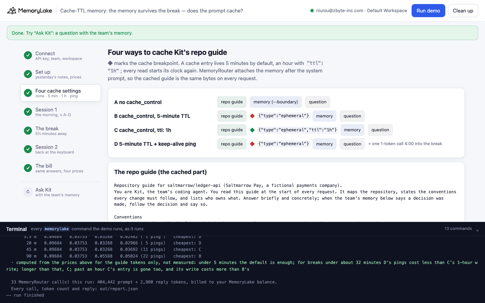
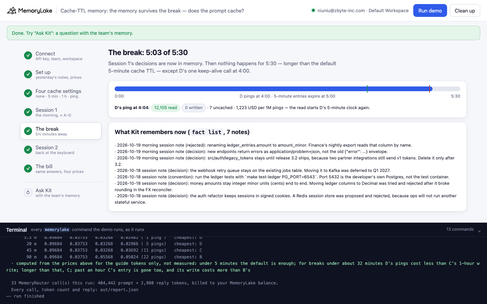
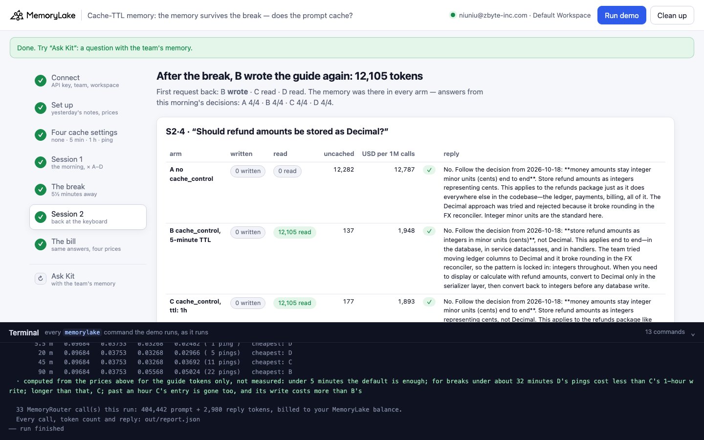
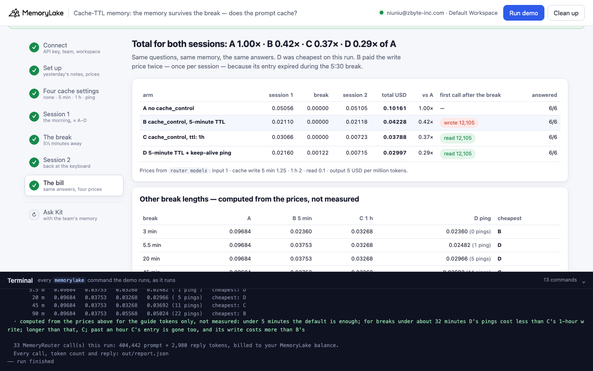

# Cache-TTL memory: the agent's memory survives the coffee break; its prompt cache, by default, does not

A runnable version of the MemoryLake use case
[*Give Coding Agents Memory That Survives Every Session Boundary*](https://www.memorylake.ai/en/usecase/persistent-memory-for-ai-coding-agents),
built entirely on the [`memorylake` CLI](https://github.com/memorylake-ai/memorylake-cli) (v20261015 or later).

**Watch it run:** recording in progress.

**The problem.** A coding agent sends the same long repository guide (repo map, conventions, owners) with every
request, so it marks it with an Anthropic prompt-caching breakpoint (`"cache_control": {"type": "ephemeral"}`):
the first request writes the guide to the cache at 1.25× the input price, later requests read it at 0.1×. Its memory
(what the team decided in past sessions) comes from MemoryLake through MemoryRouter, and that memory is there in the
next session no matter how long the developer was away. The cache is not. A cache entry lives **5 minutes** by
default. The developer steps away for 5½ minutes, comes back, and the first request writes the whole guide again at
the write price:

```
  S2·1/4  "Can I delete src/auth/legacy_tokens as part of this afternoon's cleanup?"
    A  written      0 · read      0 · uncached 12,251  12,706 USD/1M  ✓  No, not yet. The decision from your morning se
    B  written 12,103 · read      0 · uncached   148  15,732 USD/1M  ✓  No, not yet. The decision from your morning se  ← written again: the entry expired (5:43 since this arm's last call)
    C  written      0 · read 12,103 · uncached   148   1,673 USD/1M  ✓  No, not yet. The decision from your morning se  ← read: the entry outlived the break (5:36 since this arm's last call)
    D  written      0 · read 12,103 · uncached   148   1,673 USD/1M  ✓  No, not yet. The decision from your morning se  ← read: the entry outlived the break (1:40 since this arm's last call)
```

Saltmarrow Pay (a fictional payments company) runs a coding agent, Kit, on `claude-haiku-4-5`. Its repository guide
is 6,133 words, about 12,100 tokens. Noor works a 4-request session, steps away for 5½ minutes (a real wait, not
simulated), and asks 4 more questions. Every request goes through four cache settings at once:

| arm | cache setting |
|---|---|
| A | no `cache_control` |
| B | `{"type": "ephemeral"}`: the default 5-minute TTL |
| C | `{"type": "ephemeral", "ttl": "1h"}`: written at 2× input, lives an hour |
| D | the default 5 minutes, plus one 1-token call 4 minutes into the break |

Over 4 full runs, **B's first request after the break wrote the whole guide again in 4 of 4 runs**, while **C and D read it (4 and 4 of 4)**. Over both sessions B cost **0.42×** what A cost with no cache at all, C **0.37×** and D **0.29×**. The answers came from memory in every arm: A, B, C and D got 24, 24, 24 and 24 of 24 judged answers right.

## What it shows

- **MemoryRouter passes the cache TTL through, and reports it.** `memorylake router messages --body` forwards
  `"ttl": "1h"` to Anthropic. Every reply splits what was written into
  `usage.cache_creation.ephemeral_5m_input_tokens` and `ephemeral_1h_input_tokens`, next to
  `cache_read_input_tokens`. `memorylake router models` prices each part: `cache_write_5m`, `cache_write_1h`,
  `cache_read`.
- **Within a session every setting works, and the failure starts after the break.** B, C and D read the guide from
  the second request on. After 5½ idle minutes B's entry is gone, so the first request back writes 12,103 tokens at
  the write price. Nothing reports an error. Only the readout shows it.
- **A read restarts the clock.** D's single ping at 4:00 reads the guide (0.1×) and keeps the 5-minute entry alive
  through the rest of the break. C pays 2× once and reads across any break shorter than an hour.
- **The memory doesn't depend on any of this.** Session 2's questions are answered from decisions written at the
  end of session 1 (`fact add`, then MemoryRouter `--boundary`). All four arms give the same answers, and only the
  bill differs.

## Prerequisites

- Python 3.9+ (standard library only)
- The `memorylake` CLI, v20261015 or later (`memorylake router` arrived in that release):
  `curl -fsSL https://raw.githubusercontent.com/memorylake-ai/memorylake-cli/main/scripts/install.sh | sh`
- A MemoryLake API key ([app.memorylake.ai](https://app.memorylake.ai) → API Keys)
- MemoryRouter calls are billed to your MemoryLake balance: 33 calls on `claude-haiku-4-5` per run, about 0.21 USD

## Run it

```bash
git clone https://github.com/memorylake-ai/memorylake-usecases.git
cd memorylake-usecases/cache-ttl-memory
export MEMORYLAKE_API_KEY=sk-...
python3 demo.py            # about 7 minutes, 5½ of them the break
python3 demo.py facts      # what Kit remembers about the repository
python3 demo.py ask "Can I store sessions in Redis for the auth refactor?"
python3 demo.py cleanup    # delete everything the demo created
```

With a key set, the demo logs into an isolated CLI profile under `.memorylake-demo/` and never touches
`~/.memorylake`. Without one, it uses your existing `memorylake auth login` session. On the China endpoint, also
`export MEMORYLAKE_BASE_URL=https://app.memorylake.cn/openapi/memorylake`. Everything it creates has a custom id
starting with `mlu-ctm-`. Every run starts over, so `--reset` is accepted but changes nothing.

## Or run it in the browser

```bash
python3 web/server.py        # opens http://127.0.0.1:8765
```

Paste the key, press **Run demo**, and follow the same seven steps: the four cache settings, session 1, the break
(a progress bar with D's ping and the 5-minute mark), session 2, the bill, and **Ask Kit**. A terminal drawer shows
every `memorylake` command as it runs.

| | |
|---|---|
|  |  |
|  |  |

## What happens, step by step

### Step 2: yesterday's session notes, one boundary, the price list

Four of Kit's decisions from yesterday are pinned verbatim into one project with `memorylake fact add` (sessions stay
in signed cookies, a Redis session store was rejected; money stays in integer cents; tests run with
`make test-ledger PG_PORT=6543`; the webhook retry queue stays on the jobs table). One boundary covers the project.
Every request in every arm passes it to MemoryRouter. `memorylake router models` gives the price list:

```
    claude-haiku-4-5 (USD per million tokens): input 1 · cache write, 5 min 1.25 · cache write, 1 h 2 · cache read 0.1 · output 5
  · a guide token written to the cache costs 1.25× a plain one with the default 5-minute TTL, 2.00× with ttl 1h; every read after that, 0.10×
```

### Step 3: four ways to cache the guide

```
    A  no cache_control                  system = [repo guide, 6,133 words]                 + memory from --boundary
    B  cache_control, 5-minute TTL       system = [repo guide ◆ {"type": "ephemeral"}]           + memory from --boundary
    C  cache_control, ttl: 1h            system = [repo guide ◆ {"type": "ephemeral", "ttl": "1h"}] + memory from --boundary
    D  5-minute TTL + keep-alive ping    same as B, plus one 1-token call 4 min into the break
```

Each request is a whole Anthropic Messages body, sent with
`memorylake router messages --body out/body-N.json --model claude-haiku-4-5 --boundary <id>`. MemoryRouter attaches
the memory after the system prompt, so the cached guide is the same bytes on every request. Each run gets a random
id, and each arm's guide starts with `Reference copy <run>-<arm>.`, so no arm reads what another arm, or an earlier
run, wrote.

### Step 4: session 1

```
  S1·1/4  "Starting the auth refactor today. Where should sessions live?"
    A  written      0 · read      0 · uncached 12,235  12,835 USD/1M  ✓  Sessions stay in signed cookies. That decision
    B  written 12,103 · read      0 · uncached   132  15,861 USD/1M  ✓  Sessions stay in signed cookies. That decision
    C  written 12,103 · read      0 · uncached   132  24,938 USD/1M  ✓  Sessions stay in signed cookies. That decision
    D  written 12,103 · read      0 · uncached   132  15,861 USD/1M  ✓  Sessions stay in signed cookies. That decision

  S1·2/4  "Which command runs the ledger tests in this repo?"
    A  written      0 · read      0 · uncached 12,243  12,568 USD/1M  ✓  Based on the guide and your session note, run
    B  written      0 · read 12,103 · uncached   140   1,685 USD/1M  ✓  Based on the repository guide and your session
    C  written      0 · read 12,103 · uncached   140   1,820 USD/1M  ✓  Based on the Makefile entry point listed in th
    D  written      0 · read 12,103 · uncached   140   1,845 USD/1M  ✓  According to the Makefile entry point listed i
```

C's first write costs the most (the 1-hour price). From the second request on, B, C and D all read the guide. The
last two requests are Noor's decisions for the session log (keep `src/auth/legacy_tokens` until release 3.2, return
`application/problem+json` errors, don't rename `ledger_entries.amount`).

### Step 5: the break

Session 1's decisions go into memory, then nothing happens until every arm has been idle 5:30, except D's ping:

```
$ memorylake fact add '2026-10-19 morning session note (decision): src/auth/legacy_tokens stays until release 3.2 ships, …' … --project proj-…
  · 3 decisions from this morning's session written to memory — the next session will need them
  · the project now holds 7 session notes; MemoryRouter will find them after the break
  · Noor steps away. Session 2 starts when every arm has been idle 5:30; D pings its cache at 4:00
$ memorylake router messages --body out/body-5.json --model claude-haiku-4-5
    D  keep-alive ping at 4:03: written 0 · read 12,103 · uncached 7  (1,222 USD per 1M pings)
```

### Step 6: session 2

The first request back is the one at the top of this page: B writes the guide again, C and D read it. The remaining
three requests read in every cached arm. All four arms answer from the decisions written during the break:

```
  S2·3/4  "While I'm in the ledger, should I rename ledger_entries.amount to amount_minor?"
    A  written      0 · read      0 · uncached 12,292  12,862 USD/1M  ✓  No. Don't rename it. Finance's nightly export
    B  written      0 · read 12,103 · uncached   189   1,834 USD/1M  ✓  No. Don't rename it. Finance's nightly export
```

### Step 7: the bill

```
                                          session 1    break  session 2  total USD   vs A  S2 first call           right
    A  no cache_control                     0.05069  0.00000    0.05095    0.10164  1.00×  —                      6/6
    B  cache_control, 5-minute TTL          0.02140  0.00000    0.02121    0.04261  0.42×  WRITE 12,103           6/6
    C  cache_control, ttl: 1h               0.03038  0.00000    0.00713    0.03750  0.37×  read 12,103            6/6
    D  5-minute TTL + keep-alive ping       0.02104  0.00122    0.00734    0.02960  0.29×  read 12,103            6/6
  · B's 5-minute entry expired during the 5:30 break: session 2 opened by writing the whole guide again (12,103 tokens at the write price)
  · C paid the 1-hour write price once (2.00× input) and read the guide across the break
  · D's one ping (12,103 tokens read, 1,222 USD per 1M) started the 5-minute clock again, so the entry was still there when session 2 began
```

B's session 2 cost as much as its session 1: each session opened with a write. The table after it is computed
from the price list, not measured. It shows the same traffic pattern with other break lengths:

```
       break         A   B 5 min     C 1 h    D ping            USD for the guide over 4 requests, the break, 4 requests (12,103 tokens)
         3 m   0.09682   0.02360   0.03268   0.02360 ( 0 pings)   cheapest: B
       5.5 m   0.09682   0.03752   0.03268   0.02481 ( 1 ping )   cheapest: D
        20 m   0.09682   0.03752   0.03268   0.02965 ( 5 pings)   cheapest: D
        45 m   0.09682   0.03752   0.03268   0.03691 (11 pings)   cheapest: C
        90 m   0.09682   0.03752   0.05567   0.05023 (22 pings)   cheapest: B
```

Under 5 minutes the default TTL is enough. For breaks under about 32 minutes, D's pings cost less than C's 1-hour
write. For longer breaks, C wins. Past an hour, C's entry expires too, and its write costs more than B's.

### `ask`: one question to Kit

`python3 demo.py ask "…"` sends one question with the team's memory (`--boundary`) and the guide cached for an hour.
The first ask writes the guide, and a second ask within the hour reads it:

```
    written 12,101 · read 0 · uncached 132  (24,704 USD per 1M calls)
    | No. That decision was made in the auth refactor: sessions stay in signed cookies. Redis was
    | proposed and rejected because ops won't run another stateful service. …
```

## Measured

| run | A USD | B USD | C USD | D USD | B, first call after the break | C | D | B idle | right A · B · C · D |
|---|---|---|---|---|---|---|---|---|---|
| CLI 1 (first run) | 0.1016 | 0.0426 | 0.0375 | 0.0296 | written 12,103 | read | read (ping read 12,103) | 5:43 | 6 · 6 · 6 · 6 of 6 |
| CLI 2 | 0.1014 | 0.0425 | 0.0370 | 0.0296 | written 12,103 | read | read (ping read 12,103) | 5:43 | 6 · 6 · 6 · 6 of 6 |
| CLI 3 (`--reset`) | 0.1017 | 0.0424 | 0.0373 | 0.0302 | written 12,106 | read | read (ping read 12,106) | 5:46 | 6 · 6 · 6 · 6 of 6 |
| Web (browser check = Web recording) | 0.1016 | 0.0423 | 0.0379 | 0.0300 | written 12,105 | read | read (ping read 12,105) | 5:43 | 6 · 6 · 6 · 6 of 6 |
| **all 4** | 0.4064 | 0.1698 | 0.1497 | 0.1193 | written 4/4 | read 4/4 | read 4/4 | | 24 · 24 · 24 · 24 of 24 |

B's idle time between its last session-1 call and its first session-2 call was 5:43–5:46 in every run. D's ping read the whole guide each time. Costs use the claude-haiku-4-5 prices from `router models`, for every token of every call (guide, memory, question, reply). The two session-log requests in session 1 are not judged.

## Use it in your own agent

- **Match the TTL to the gaps in your traffic, not to the length of a session.** An interactive agent idles between
  sessions, and a CI agent idles between pushes. If the gap is usually longer than 5 minutes, the default TTL means
  every session opens with a full write at 1.25×.
- **Read the readout on the first request of a session.** `cache_read_input_tokens` close to your prefix size means
  the cache survived. A large `cache_creation_input_tokens` there means it expired.
- **`"ttl": "1h"` costs 2× once.** It pays for itself the first time a gap between 5 and 60 minutes would otherwise
  force a rewrite. A cheap read (any request, even `max_tokens: 1`) also restarts the clock, but every ping costs a
  read of the whole prefix.
- **Keep the memory out of the cached prefix.** Let MemoryRouter attach it (`--boundary`) or put it in the user
  turn. Then the prefix is the same bytes in every session, which is what makes the long TTL worth paying for.

## Troubleshooting

- **`402` / insufficient balance**: MemoryRouter calls are billed to your MemoryLake balance. The memory steps still
  run, and the model calls are skipped with a note.
- **B reads after the break in your run**: the demo waits until every arm has been idle 5:30. If B still reads,
  the provider kept the entry longer than its documented TTL. The bill in step 7 says so instead of claiming an
  expiry.
- **The demo takes about 7 minutes**: 5½ of them are the break. That is what is being measured. It cannot be shortened
  without hiding the expiry.
- **`no workspace given`**: set `MEMORYLAKE_WORKSPACE=ws-…`, or run `memorylake workspace use`.
- Costs are computed from the account's own `router models` prices. They are not read from your invoice, and
  `usage` records arrive late and in batches.

## Files

- `demo.py`: the whole demo (CLI wrapper, the four request bodies, the break, the bill, `ask`, `facts`, `cleanup`)
- `data/saltmarrow.json`: the repository guide, the session notes, both sessions' requests
- `web/server.py`, `web/static/`: the browser companion (standard library HTTP + Server-Sent Events)
- `out/report.json`: every call of the last run, with tokens written (5 min / 1 h) / read / uncached, reply and
  cost. Earlier runs are kept in `out/runs/`.
