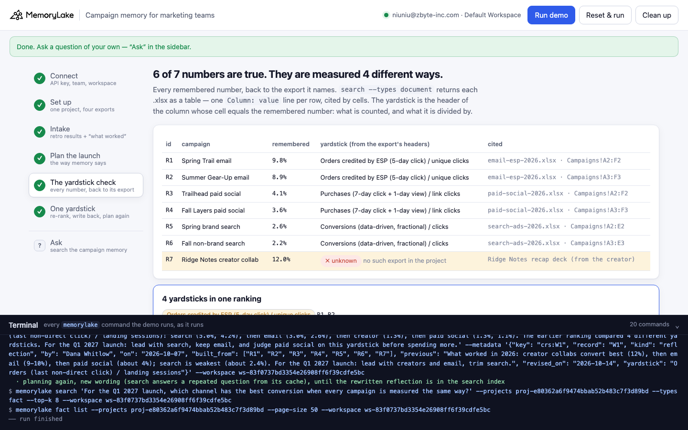
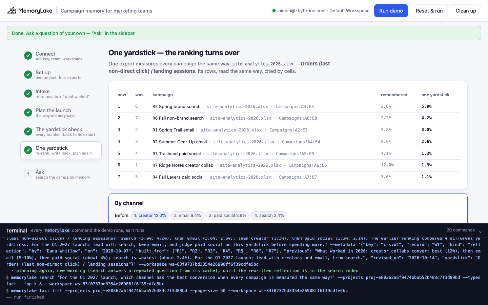

# Campaign memory for marketing teams

A runnable version of the MemoryLake use case
[*Give Marketing Teams Campaign Memory That Holds Every Brief, Asset, and Result*](https://www.memorylake.ai/en/usecase/campaign-memory-for-marketing-teams),
built entirely on the [`memorylake` CLI](https://github.com/memorylake-ai/memorylake-cli).

**Watch it run:** [CLI, 3:08](https://github.com/memorylake-ai/memorylake-usecases/releases/download/campaign-results-memory-v1/campaign-results-memory-cli-demo.mp4) · [Web, 4:00](https://github.com/memorylake-ai/memorylake-usecases/releases/download/campaign-results-memory-v1/campaign-results-memory-web-demo.mp4)
([release](https://github.com/memorylake-ai/memorylake-usecases/releases/tag/campaign-results-memory-v1); GitHub serves them as downloads).

**The problem.** A small marketing team runs campaigns in four tools. After each one, someone writes the result down in
the retro: "9.8% conversion", "4.1% conversion", "2.6% conversion". The numbers are right. But each tool counts
conversion its own way: what it counts as an order, how long after a click or a view, and what it divides by. A month
later the team's "what worked" memory ranks those numbers side by side, and the next launch is planned on it.

**What this demo shows.** Larkspur Outdoor (a fictional outdoor brand, four marketers) keeps one MemoryLake project as its
campaign memory: the campaign exports from each tool (.xlsx), seven results as the team wrote them in the retros, and a
"what worked" reflection built from those seven. Today, October 14, Dana plans the Q1 2027 launch from that memory.

| | creator | email | paid social | search | The Q1 brief |
|---|---|---|---|---|---|
| **What memory says** (the retro numbers) | 12.0% | 9.4% | 3.8% | 2.4% | lead with creators and email, trim search |
| **One yardstick** (site analytics: orders, last non-direct click / landing sessions) | 1.3% | 2.8% | 1.2% | **4.6%** | lead with search and email, trim paid social |

The ranking turns over, and no number in memory was wrong:

1. **The yardstick check.** Each remembered number is traced back to the export it names. `search --types document`
   returns an .xlsx as a table: one `Column: value` line per row, and the cells it covers. The column whose cell
   equals the remembered number is found, and **its header is the number's yardstick**: what is counted and what it is
   divided by. 6 of 7 numbers equal a cell word for word, and they use 3 different yardsticks. The seventh (the
   creator's 12%, from the creator's own recap) has no export in the project, so its yardstick is unknown.
2. **One yardstick.** One export measures every campaign the same way (site analytics). Its rows, cited by cells,
   re-rank all seven campaigns. Then it is all written back: each retro result gets its yardstick as a label, each
   campaign gets its number on the common yardstick, and the reflection is rewritten in place. Planning again, the
   brief compares only numbers labelled with the same yardstick.

```
setup ───────── proj create · lib upload ×4 · proj doc import --wait        (one export per tool)
intake ──────── fact add --project <p> '<retro result>' … '<what worked>'  + fact update --metadata {campaign, channel, by, on, source}
plan ────────── search '<which channel converted best?>' --types fact      → the numbers in the hits, ranked → the brief
yardsticks ──── search '<…>' --types document → table rows (cells) → the column equal to the remembered number → its header
one yardstick ─ the common export's rows → re-rank → fact update --metadata {yardstick} · fact add (one per campaign)
                · fact update --text (the reflection, old text in metadata) → plan again (new wording) + fact list
```

No conversations and no extraction: every result is pinned word for word, and the checks are plain code over search's
table rows, `fact list` and metadata.

## Prerequisites

- **Python 3.9+** (standard library only, nothing to `pip install`)
- **The `memorylake` CLI** on your `PATH`:
  ```bash
  curl -fsSL https://raw.githubusercontent.com/memorylake-ai/memorylake-cli/main/scripts/install.sh | sh
  ```
- **A MemoryLake API key.** Sign up at [app.memorylake.ai](https://app.memorylake.ai), open **API Keys**, create one. A free
  personal account is enough: nothing here needs an agent or a model call.

## Run it

```bash
git clone https://github.com/memorylake-ai/memorylake-usecases.git
cd memorylake-usecases/campaign-results-memory
export MEMORYLAKE_API_KEY=sk-...           # China region: also export MEMORYLAKE_BASE_URL=https://app.memorylake.cn/openapi/memorylake
python3 demo.py
```

About two minutes the first time (the four exports take about 45 s to import), under a minute on a re-run. Every run
replays planning day: what an earlier run wrote back in step 6 is undone first. With the key set, the demo logs into an
isolated CLI profile under `./.memorylake-demo/` and never touches your own `~/.memorylake`. Everything it creates has a
`custom_id` (or Library file name) starting with `mlu-crs-`.

```bash
python3 demo.py yardsticks                              # the yardstick check, now
python3 demo.py ask "Which channel converts best?"      # search's top 8 facts, each with its kind and yardstick
python3 demo.py --reset                                 # delete everything the demo created, then replay
python3 demo.py cleanup                                 # delete everything the demo created
```

## Or run it in the browser

```bash
python3 web/server.py                # opens http://127.0.0.1:8765
```

Paste the key, connect, run. The page drives the same functions as `demo.py` and streams every `memorylake` command into
a terminal drawer as it runs: the project and its exports, the team's memory, the plan, the yardstick check, and the
re-rank. **Ask** takes any question and re-runs the yardstick check.





## What happens, step by step

Output below is from a real run (ids shortened).

### Steps 2–3 — one project, one export per tool; the retro results and the reflection

```
    project  Campaign memory: Larkspur Outdoor                    proj-…0dce5a35
    export   email-esp-2026.xlsx          email platform (ESP)       okay    doc-…
    export   paid-social-2026.xlsx        paid social ads manager    okay    doc-…
    export   search-ads-2026.xlsx         search ads console         okay    doc-…
    export   site-analytics-2026.xlsx     site analytics             okay    doc-…
```

The exports are in [`data/sources/`](data/sources/) (written by `data/make_sources.py`). Each tool writes its yardstick
into its column headers, for example `Orders credited by ESP (5-day click)` and `Orders / unique clicks (%)`.

One `fact add` for the eight records (it takes many texts at once), then `fact update --metadata` on each (`fact add`
takes no metadata):

```
$ memorylake fact update fact-…6a16 --project proj-…0dce5a35 --metadata '{"key": "crs:R1", "record": "R1", "kind": "result", "campaign": "Spring Trail email", "channel": "email", "by": "Omar Reyes", "on": "2026-03-24", "source": "email-esp-2026.xlsx"}'

  Larkspur Outdoor campaign memory — 8 records:
    R1  Omar Reyes, 2026-03-24   Spring Trail email (March 2026): 9.8% conversion. Best number we have ever had on a launch.
    R2  Omar Reyes, 2026-06-16   Summer Gear-Up email (June 2026): 8.9% conversion, close to Spring Trail. Email keeps deliverin…
    R3  Priya Nand, 2026-07-07   Trailhead paid social (June 2026): 4.1% conversion on 13,000 link clicks.
    R4  Priya Nand, 2026-10-05   Fall Layers paid social (September 2026): 3.6% conversion, a little under Trailhead.
    R5  Priya Nand, 2026-04-08   Spring brand search (March 2026): 2.6% conversion. Search is our weakest converter.
    R6  Priya Nand, 2026-10-06   Fall non-brand search (September 2026): 2.2% conversion. Weak again.
    R7  Leo Marsh, 2026-09-02    Ridge Notes creator collab (August 2026): 12% conversion per the creator's recap. Our best conv…
    W1  Dana Whitlow, 2026-10-07 What worked in 2026: creator collabs convert best (12%), then email (9-10%), then paid social (…
```

### Step 4 — plan the Q1 launch the way memory says

```
$ memorylake search 'Which channels converted best in our 2026 campaigns, and what should lead the Q1 launch?' --projects proj-…0dce5a35 --types fact --top-k 8

      #1   W1  What worked in 2026: creator collabs convert best (12%), then email (9-10%), then paid social (about 4%…
      #2   R1  Spring Trail email (March 2026): 9.8% conversion. Best number we have ever had on a launch.
      #3   R7  Ridge Notes creator collab (August 2026): 12% conversion per the creator's recap. Our best converter th…
      …
  the numbers in those hits, highest first (7 results):
      1. R7  Ridge Notes creator collab   creator      12.0%
      2. R1  Spring Trail email           email        9.8%
      3. R2  Summer Gear-Up email         email        8.9%
      4. R3  Trailhead paid social        paid social  4.1%
      5. R4  Fall Layers paid social      paid social  3.6%
      6. R5  Spring brand search          search       2.6%
      7. R6  Fall non-brand search        search       2.2%
  by channel: creator 12.0% · email 9.4% · paid social 3.8% · search 2.4%

  → the Q1 brief, as memory has it: LEAD WITH CREATOR AND EMAIL, TRIM SEARCH
```

### Step 5 — the yardstick check

```
$ memorylake search 'campaign conversion rate orders clicks sessions' --projects proj-…0dce5a35 --types document --top-k 5

    id  campaign                     remembered  yardstick (from the export headers)                      cited
    R1  Spring Trail email                 9.8%  Orders credited by ESP (5-day click) / unique clicks     email-esp-2026.xlsx · Campaigns!A2:F2
    R2  Summer Gear-Up email               8.9%  Orders credited by ESP (5-day click) / unique clicks     email-esp-2026.xlsx · Campaigns!A3:F3
    R3  Trailhead paid social              4.1%  Purchases (7-day click + 1-day view) / link clicks       paid-social-2026.xlsx · Campaigns!A2:F2
    R4  Fall Layers paid social            3.6%  Purchases (7-day click + 1-day view) / link clicks       paid-social-2026.xlsx · Campaigns!A3:F3
    R5  Spring brand search                2.6%  Conversions (data-driven, fractional) / clicks           search-ads-2026.xlsx · Campaigns!A2:E2
    R6  Fall non-brand search              2.2%  Conversions (data-driven, fractional) / clicks           search-ads-2026.xlsx · Campaigns!A3:E3
    R7  Ridge Notes creator collab        12.0%  ✗ unknown — no such export in the project                source: Ridge Notes recap deck (from the creato…

  → 6 of 7 numbers equal a cell in their export, word for word — every one of them is true.
  → and they are measured 4 different ways:
      R1, R2   Orders credited by ESP (5-day click) / unique clicks
      R3, R4   Purchases (7-day click + 1-day view) / link clicks
      R5, R6   Conversions (data-driven, fractional) / clicks
      R7       unknown
```

How a row is read: an .xlsx search hit is a `table` item whose chunk is the whole table, one line per row
(`Campaign: Spring Trail email, Sent on: 2026-03-10, …, Orders / unique clicks (%): 9.8`), with the cells it covers
(`range` = `A2:F3`): line *i* is row *start + i*. The column names, in sheet order, are in
`highlight.inner_tables[].columns`; a line is split only where a known column name follows, so a header with a comma in
it (`Conversions (data-driven, fractional)`) stays whole. Numbers compare as numbers: MemoryLake prints `3.0` as `3`.

### Step 6 — one yardstick: re-rank, write it back, plan again

```
  yardstick: Orders (last non-direct click) / landing sessions  (site-analytics-2026.xlsx)

    now  was  id  campaign                     remembered  one yardstick   cited
    1    6    R5  Spring brand search                2.6%           5.0%   site-analytics-2026.xlsx · Campaigns!A3:E3
    2    7    R6  Fall non-brand search              2.2%           4.2%   site-analytics-2026.xlsx · Campaigns!A8:E8
    3    2    R1  Spring Trail email                 9.8%           3.0%   site-analytics-2026.xlsx · Campaigns!A2:E2
    4    3    R2  Summer Gear-Up email               8.9%           2.6%   site-analytics-2026.xlsx · Campaigns!A4:E4
    5    4    R3  Trailhead paid social              4.1%           1.3%   site-analytics-2026.xlsx · Campaigns!A5:E5
    6    1    R7  Ridge Notes creator collab        12.0%           1.3%   site-analytics-2026.xlsx · Campaigns!A6:E6
    7    5    R4  Fall Layers paid social            3.6%           1.1%   site-analytics-2026.xlsx · Campaigns!A7:E7

  by channel, before → after:
      search          2.4% → 4.6%
      email           9.4% → 2.8%
      creator        12.0% → 1.3%
      paid social     3.8% → 1.2%
  → the Q1 brief on one yardstick: LEAD WITH SEARCH AND EMAIL, TRIM PAID SOCIAL   (was: lead with creator and email, trim search)
```

Then it is written back. Each retro result keeps its text and gains a `yardstick` label; each campaign gets one new fact
with its number on the common yardstick; the reflection is rewritten in place, same fact id, its old text kept in
`metadata.previous`:

```
$ memorylake fact update fact-…6a16 --project proj-…0dce5a35 --metadata '{"key": "crs:R1", …, "source": "email-esp-2026.xlsx", "yardstick": "Orders credited by ESP (5-day click) / unique clicks", "yardstick_cite": "email-esp-2026.xlsx · Campaigns!A2:F2"}'
$ memorylake fact add --project proj-…0dce5a35 'Spring brand search (search): 5.0% on the common yardstick, site analytics: orders (last non-direct click) / landing sessions.' …
$ memorylake fact update fact-…54b8 --project proj-…0dce5a35 --text 'What worked in 2026, every campaign measured the same way (orders (last non-direct click) / landing sessions): search (5.0%, 4.2%), then email (3.0%, 2.6%), then creator (1.3%), then paid social (1.3%, 1.1%). The earlier ranking compared 4 different yardsticks. …' --metadata '{…, "previous": "What worked in 2026: creator collabs convert best (12%), …"}'

  “For the Q1 2027 launch, which channel has the best conversion when every campaign is measured the same way?” · top 8:
      #1   W1  What worked in 2026, every campaign measured the same way (orders (last non-direct click) / landing ses…
      #2   S5  Spring brand search (search): 5.0% on the common yardstick, site analytics: orders (last non-direct cli…
      #3   R1  Spring Trail email (March 2026): 9.8% conversion. Best number we have ever had on a launch.
      #4   S6  Fall non-brand search (search): 4.2% on the common yardstick, site analytics: orders (last non-direct c…
      #5   R2  Summer Gear-Up email (June 2026): 8.9% conversion, close to Spring Trail. Email keeps delivering.
      #6   S1  Spring Trail email (email): 3.0% on the common yardstick, site analytics: orders (last non-direct click…
      #7   R7  Ridge Notes creator collab (August 2026): 12% conversion per the creator's recap. Our best converter th…
      #8   S2  Summer Gear-Up email (email): 2.6% on the common yardstick, site analytics: orders (last non-direct cli…

  comparable (labelled “Orders (last non-direct click) / landing sessions”): S5, S6, S1, S2
  not compared (labelled with another yardstick): R1 (Orders credited by ESP (5-day click) / …), R2 (Orders credited by ESP (5-day click) / …), R7 (unknown)
  → every number on that yardstick (`fact list`): search 4.6% · email 2.8% · creator 1.3% · paid social 1.2%
  → the Q1 brief: LEAD WITH SEARCH AND EMAIL, TRIM PAID SOCIAL
```

Note the hits at #3, #5 and #7: the old retro numbers are still there, and still rank high. They are true, and the team
may want them. Search ranks by relevance and does not read labels, so what keeps them out of the brief is the
`yardstick` label written back in step 6 and checked at read time. The ranking itself counts every fact on that
yardstick (`fact list`), not search's top 8.

The question after the write-back is worded differently on purpose: `search` can answer a repeated question from a cache
made before the write. Step 6 asks again (every 4 s, up to 8 times) until the rewritten reflection is in the search
index, and prints how many tries it took.

## Measured

| What | Result |
|---|---|
| Step 4: all 7 results and the reflection in the top 8, the reflection at #1; the brief "lead with creator and email, trim search" | 6 / 6 runs (3 from scratch, 3 re-runs, two of them from the web page) |
| Step 5: 6 of 7 numbers traced to a cell, 4 yardsticks, R7 unknown | 6 / 6 |
| Step 6: the same re-rank (search 5.0 / 4.2 first, R4 last); the brief "lead with search and email, trim paid social" | 6 / 6 |
| Step 6: rewritten reflection in the top 8 on the first try | 6 / 6 |
| Time | 104–122 s from scratch, 42–50 s re-run |

## Wiring it into your own campaigns

- **Keep each tool's export next to the number.** A number without its export is a number without a yardstick. Pin the
  result as your team wrote it, and record which report it came from (`source` in `metadata`).
- **Label every number with its yardstick before you rank anything.** In this demo the yardstick is read off the export's
  own headers, so nobody has to type it. If your exports don't say, write it down at the retro: what counts as a
  conversion, the attribution window, the denominator.
- **Rank only within one yardstick.** Pick one source that measures every channel the same way (site analytics,
  a warehouse table) and re-read every campaign from it. Results with an unknown yardstick stay out of the ranking.
- **Rewrite the "what worked" memory, don't append to it.** `fact update --text` keeps the fact id; the old text goes in
  `metadata.previous` so you can still see what the team used to believe.

## If something goes wrong

- **`the memorylake CLI is not on PATH`**: install it (above) or `export MEMORYLAKE_BIN=/path/to/memorylake`.
- **Step 5 says a table line count does not match its range**: the demo refuses to cite rows it cannot place. Run
  `python3 demo.py yardsticks` again; if it persists, `python3 demo.py --reset`.
- **Search results differ on your run**: ranking can move between runs. Steps 4 and 6 print exactly what came back; the
  rankings in step 5 and 6 come from the exports and from `fact list`, not from search order.
- **"search answered from its cache"**: step 4 asks the same question every run, and `search` can serve a repeated
  question from a cache; the note names the hits whose text differs from what `fact list` holds now.
- **Something half-created after an interrupted run**: `python3 demo.py --reset`, or `python3 demo.py cleanup`.

## Files

```
campaign-results-memory/
├── demo.py                 # the CLI runner (every step is a plain `memorylake` command, echoed)
├── data/story.json         # the brand, 7 retro results, the reflection, the questions (fictional, plain ASCII)
├── data/make_sources.py    # writes the four exports (standard library)
├── data/sources/*.xlsx     # email platform, paid social, search ads, site analytics
├── web/server.py           # local web companion: same functions, Server-Sent Events
├── web/static/             # no-build front end
└── out/runs.jsonl          # one line per run (git-ignored)
```
