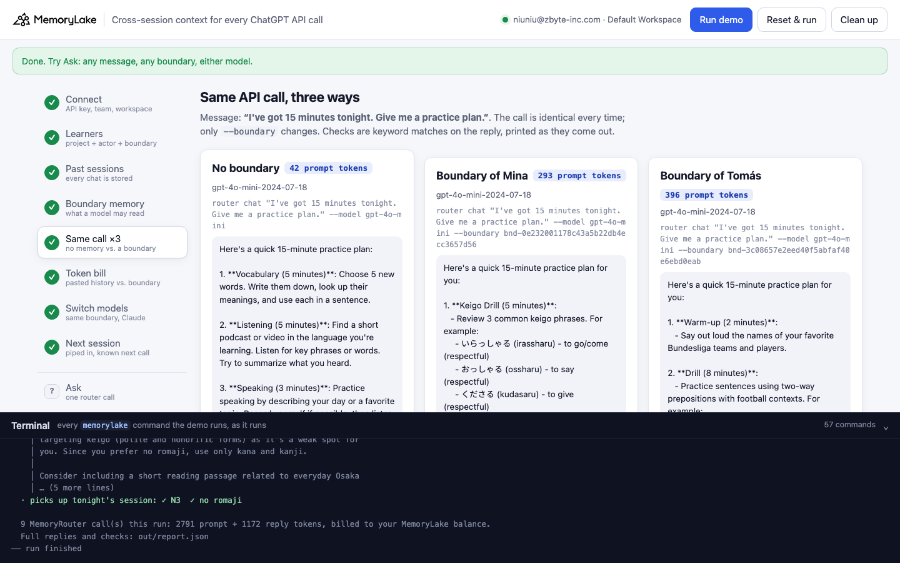
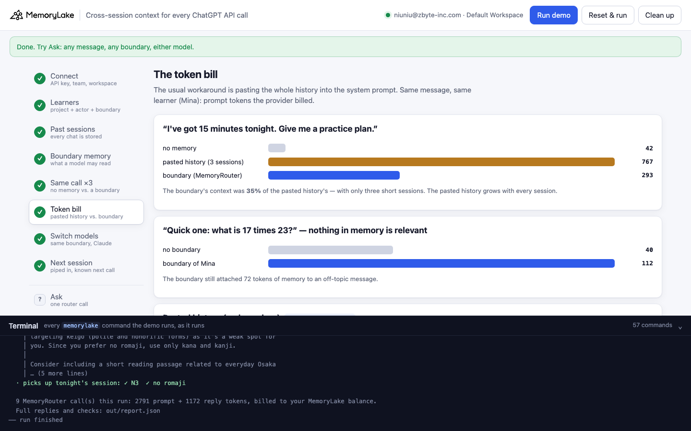

# Cross-session context for the ChatGPT API

A runnable version of the MemoryLake use case
[*Add Cross-Session Context to Every ChatGPT API Call*](https://www.memorylake.ai/en/usecase/cross-session-context-for-the-chatgpt-api),
built entirely on the [`memorylake` CLI](https://github.com/memorylake-ai/memorylake-cli) (v20261015 or later).

**Watch it run:** VIDEO_LINKS

**The problem.** The chat API is stateless. Every call starts blank, so an app built on it either sends no context
("which language are you learning?") or pastes the user's history into the system prompt, which costs tokens on every
call and grows with every session.

**What this demo shows.** Lingofox (fictional) is a language tutor built on the chat API. Two learners have used it for
a month: **Mina** (Japanese, keigo, moving to Osaka, JLPT N4) and **Tomás** (German, dative after *in / an / auf*,
football, Goethe B2). Their past sessions are stored in MemoryLake. Each learner gets a **boundary**: a saved scope over
their own project and their own actor. The app keeps its chat call and adds one flag, `--boundary`. MemoryRouter
(`memorylake router chat`, OpenAI-compatible; `router messages`, Anthropic-compatible) retrieves the memories that
matter for the message and puts them in front of the model.

The demo measures what that changes:

| Step | What you see |
|---|---|
| 5 Same call, three ways | The same message with no boundary, with Mina's, with Tomás's. Each reply is checked for each learner's details (✓/✗), and for the *other* learner's details (should be none). Prompt tokens from the provider's `usage` |
| 6 The token bill | Mina's whole history pasted into the system prompt vs. her boundary, same message: prompt tokens side by side. An off-topic message with and without the boundary |
| 7 Switch models | The same boundary through `router messages --model claude-haiku-4-5`. Nothing migrated |
| 8 The next session | Ask "which JLPT level, and romaji?" → N4. Store tonight's session (Mina moved to N3, no more romaji) the same way as every other session. Ask again → N3, no romaji |

Model replies vary from run to run, so every check is printed as it comes out, and [Measured](#measured) below reports
totals over all runs, not the best one.

## Prerequisites

- Python 3.9+ (standard library only)
- The `memorylake` CLI **v20261015 or later** (`memorylake router` arrived in that release):
  ```bash
  curl -fsSL https://raw.githubusercontent.com/memorylake-ai/memorylake-cli/main/scripts/install.sh | sh
  memorylake version
  ```
- A MemoryLake API key ([app.memorylake.ai](https://app.memorylake.ai) → API Keys).
- **Router calls are billed to your MemoryLake balance** (`memorylake billing balance`). One run makes about ten calls
  on the smallest models (`gpt-4o-mini`, `claude-haiku-4-5`), a few thousand tokens in all; the run prints the total.
  If the balance is empty, the memory steps still run and the router steps print the refusal and are skipped.

## Run it

```bash
git clone https://github.com/memorylake-ai/memorylake-usecases.git
cd memorylake-usecases/chatgpt-api-memory
export MEMORYLAKE_API_KEY=sk-...
python3 demo.py                 # the whole story, about 3 minutes
python3 demo.py ask "What exam am I preparing for, and when?" --learner tomas
python3 demo.py ask "Same question" --learner none                       # no boundary
python3 demo.py ask "Plan tonight" --learner mina --model claude-haiku-4-5
python3 demo.py memory          # what each boundary holds
python3 demo.py cleanup         # delete everything the demo created
```

The key is used to log into an isolated CLI profile under `.memorylake-demo/` (git-ignored); your own
`~/.memorylake` is never touched. For the China endpoint also set
`MEMORYLAKE_BASE_URL=https://app.memorylake.cn/openapi/memorylake`. Everything the demo creates has a `custom_id`
starting with `mlu-cgm-`. Re-running resumes; `--reset` deletes the demo learners first and replays everything.

## Or run it in the browser

```bash
python3 web/server.py           # opens http://127.0.0.1:8765
```

Same pipeline, one view per step, an **Ask** page (any message, Mina's / Tomás's / no boundary, either model), and a
terminal drawer with every `memorylake` command as it runs.




## What happens, step by step

Excerpts below are from one real run; numbers vary a little between runs.

### Steps 2–3: per learner, a project, an actor, and a boundary over both

Every past session is a `DIRECT` conversation between the learner's actor and the tutor's, written turn by turn
(`conv msg append`, as your app would as it chats). MemoryLake extracts facts in the background. Extraction wording varies
and its language is not controlled (Mina's facts often come back in Japanese), so the details the tutor must never lose
are also pinned verbatim with `fact add --actor`.

The boundary is the whole integration:

```
$ memorylake boundary create --name 'Lingofox — Mina Kovac' --custom-id mlu-cgm-mina-boundary --projects proj-e76d… --human-actor actor-876e…
```

Nothing outside that project and that actor is readable through it.

### Step 5: the same call, three ways

```
$ memorylake router chat "I've got 15 minutes tonight. Give me a practice plan." --model gpt-4o-mini --max-tokens 350 --temperature 0 --system '…'

  No boundary (the plain ChatGPT API call)  ·  prompt 42 tokens · reply 137
  · mentions Mina Kovac's details: ✗ Japanese  ✗ keigo  ✗ Osaka
  · mentions Tomás Reyes's details: ✗ German  ✗ dative  ✗ football

$ memorylake router chat "…same message…" … --boundary bnd-ec71…

  Boundary of Mina Kovac  ·  prompt 354 tokens · reply 191
  · Mina Kovac's details: ✓ Japanese  ✓ keigo  ✓ Osaka
  · Tomás Reyes's details in this reply: none  ✓ isolated

  Boundary of Tomás Reyes  ·  prompt 322 tokens · reply 240
  · Tomás Reyes's details: ✓ German  ✓ dative  ✓ football
  · Mina Kovac's details in this reply: none  ✓ isolated
```

The difference in prompt tokens is the memory MemoryRouter attached (here about 300 tokens).

### Step 6: the token bill

```
  “I've got 15 minutes tonight. Give me a practice plan.” for Mina Kovac — what the context cost:
    pasted history (3 sessions)      767 prompt tokens   (context: 725)
    boundary (MemoryRouter)          354 prompt tokens   (context: 312)
    → the boundary sent 43% of the pasted history's context, and the history only grows with every session.

  “Quick one: what is 17 times 23?” — nothing in memory is relevant:
    no boundary                       40 prompt tokens   → 17 times 23 equals 391.
    boundary of Mina                 127 prompt tokens   → 17 times 23 equals 391. If you [...]
  · the boundary added 87 tokens to an off-topic message
```

Read these numbers as they are. Three short sessions are a small history, so the saving here is about half, not the
hundredfold of a long-running user. And retrieval is ranked, not thresholded: an off-topic message *sometimes* gets a
few memories attached anyway (see Measured).

### Step 7: switch models

```
$ memorylake router messages "I've got 15 minutes tonight. Give me a practice plan." --model claude-haiku-4-5 … --boundary bnd-ec71…
  · Mina Kovac's details: ✓ Japanese  ✓ keigo  ✓ Osaka
  · Tomás Reyes's details: none  ✓ isolated
```

### Step 8: the next session

```
  Before tonight's session is stored, the app asks: “Which JLPT level should tonight's drills target, and should they include romaji?”
  Boundary of Mina Kovac — before  ·  prompt 232 tokens · reply 103
  · answers from what it knew: ✓ N4

  Tonight's session, piped in exactly like the earlier ones (the app writes every turn):
    Mina : Big news: I passed the JLPT N4 mock in class and my teacher entered me for the real N3 in July instead. From now on, N3 material please.
    Tutor: Congratulations, Mina! From now on your drills will target N3.
    Mina : And drop the romaji. Kana and kanji only from today.
    Tutor: Done: no more romaji, kana and kanji only.
  · memory ready in 35s

  What MemoryLake extracted from tonight (facts mentioning N3):
   - The person wants N3 material from now on. (as of 2026-10-15)

  Same question, next call: “Which JLPT level should tonight's drills target, and should they include romaji?”
  Boundary of Mina Kovac — after  ·  prompt 328 tokens · reply 109
  · picks up tonight's session: ✓ N3  ✓ no romaji
```

The app changed nothing between the two calls. It wrote the session, as it writes every session.

## Measured

Four fresh runs on 2026-10-15 (three in parallel under separate prefixes, one in the browser), every reply re-scored
with the final checks. `gpt-4o-mini` unless noted; temperature 0.

| Check | Result |
|---|---|
| No boundary: any of Mina's or Tomás's details in the reply | **0 / 24** (6 details × 4 runs) |
| Mina's boundary: Japanese · keigo · Osaka | 4/4 · 4/4 · 3/4 |
| Tomás's boundary: German · dative · football | 4/4 · 4/4 · 3/4 |
| The other learner's details in a reply (gpt-4o-mini ×2, Claude ×1, per run) | **0 / 12** |
| `claude-haiku-4-5`, Mina's boundary: Japanese · keigo · Osaka | 3/4 · 4/4 · 4/4 |
| Before tonight's session: N4 | 4/4 |
| After tonight's session: N3 · no romaji | 4/4 · 4/4 |

| Prompt tokens (same message) | Run 1 | Run 2 | Run 3 | Run 4 |
|---|---|---|---|---|
| no boundary | 42 | 42 | 42 | 42 |
| Mina's boundary | 399 | 305 | 286 | 293 |
| Tomás's boundary | 359 | 278 | 293 | 396 |
| Mina's history pasted in (3 sessions) | 767 | 767 | 767 | 767 |
| off-topic, no boundary → with Mina's | 40 → 199 | 40 → 156 | 40 → 40 | 40 → 112 |
| whole run (9 calls), prompt + reply | 2,974 + 1,211 | 2,488 + 1,137 | 2,371 + 1,012 | 2,791 + 1,172 |

What the numbers say, and don't:

- **Isolation held every time.** Neither learner's reply ever contained the other's details.
- **The attached memory is a few hundred tokens and varies** (236–357 tokens over the no-memory call, both learners). With only three short
  sessions, pasting the history costs about twice as much; the pasted history grows with every session, the boundary's
  context did not grow after tonight's session (before / after: 190–367 / 246–348 tokens).
- **Off-topic messages usually get some memory anyway** (3 of 4 runs here; 5 of 7 counting the development runs).
  Retrieval is ranked, not thresholded. The model ignores it (the answer is 391 every time), but you pay for it.
- **The change in step 8 always got through** (4/4), though in one run no extracted fact named "N3" in a form the
  demo's scan recognised. The scan has since been loosened for Japanese text.

## Wiring it into your own app

1. One actor per user (`actor create --custom-id <your user id>`), one project per user or per workspace of theirs.
2. Write every turn as it happens: `conv msg append <conv> --actor <speaker> --text …`.
3. One boundary per user: `boundary create --projects <their project> --human-actor <their actor>`.
4. Call the model through MemoryRouter with that boundary. From the CLI: `memorylake router chat|responses|messages … --boundary <id>`;
   `--body FILE` takes a whole provider-format request (your existing `messages` array) and `--stream` streams the reply.
5. Pin what must never be lost with `fact add --actor`; extraction wording varies.

## If something goes wrong

| Symptom | Cause / fix |
|---|---|
| `this memorylake CLI has no router command` | Upgrade the CLI (v20261015+). |
| `MemoryRouter refused the call for lack of balance` | Router calls are billed. `memorylake billing balance`; top up in the console. The memory steps still ran. |
| A ✗ on one of the checks | The model's wording varies; the reply is printed in full in `out/report.json`. The checks are keyword matches. |
| `gave up after 600s` on memory | Extraction is still running server-side; run `python3 demo.py` again, it resumes. |
| Leftovers after an interrupted run | `python3 demo.py cleanup` (boundaries, conversations, projects, learners and every fact on them, the tutor). |

## Files

| File | |
|---|---|
| `demo.py` | the whole demo: setup, sessions, router calls, checks, write-back, cleanup |
| `data/learners/*.json` | the two learners: sessions, pinned details, the details each reply is checked for, tonight's session |
| `web/server.py`, `web/static/` | the browser version (standard library + vanilla JS) |
| `out/` | `report.json` (every reply and check), `history-mina.json` (the pasted-history request body) |
