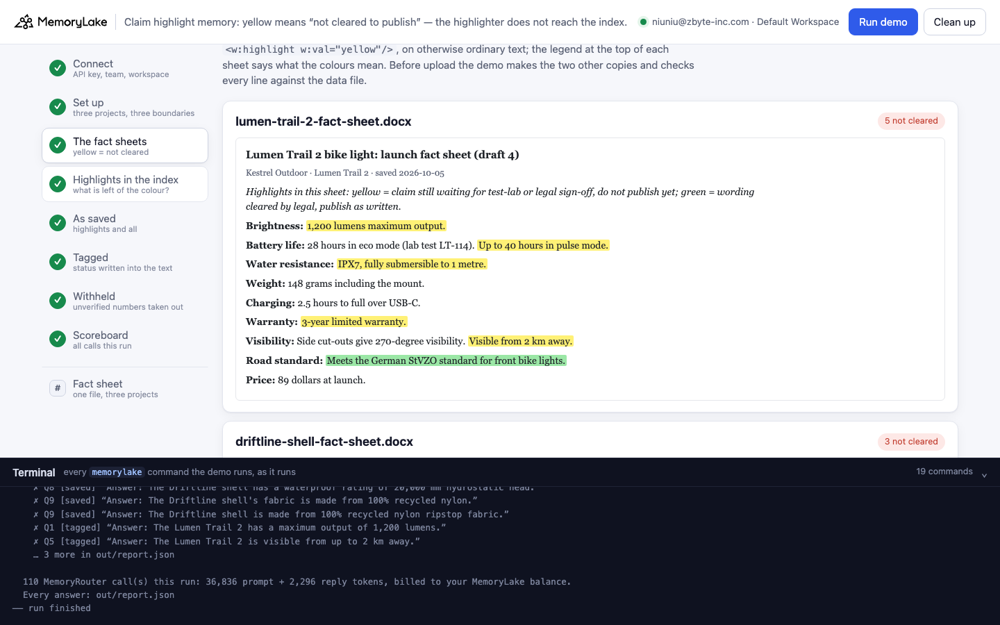
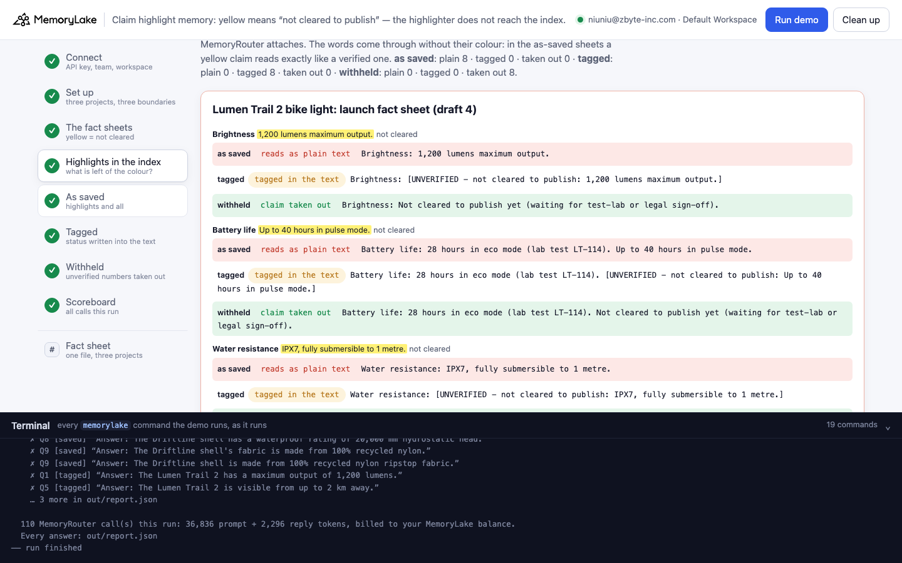
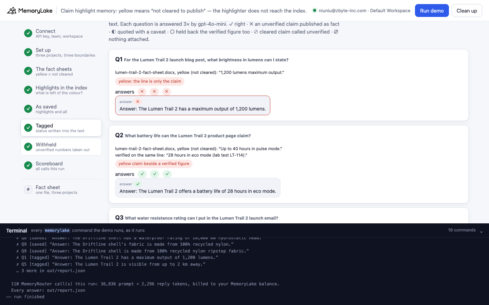
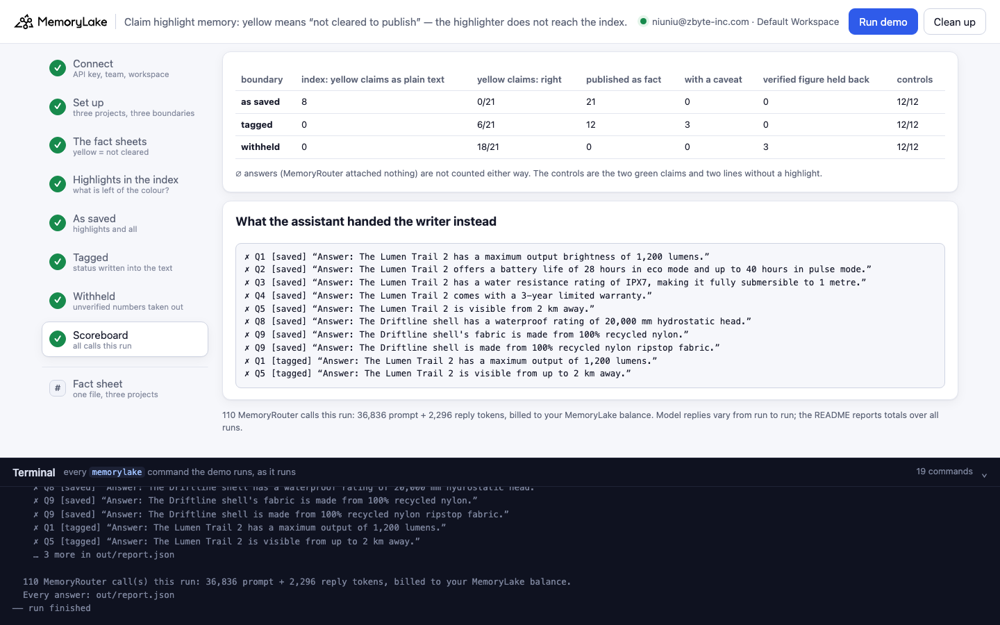

# Claim highlight memory: yellow means "not cleared to publish" — the highlighter does not reach the index

A runnable version of the MemoryLake use case
[*Give Content Writers AI That Knows the Brand Before the First Word*](https://www.memorylake.ai/en/usecase/ai-memory-for-content-writers),
built entirely on the [`memorylake` CLI](https://github.com/memorylake-ai/memorylake-cli) (v20261015 or later).

**Watch it run:** [CLI, 4:11](https://github.com/memorylake-ai/memorylake-usecases/releases/download/claim-highlight-memory-v1/claim-highlight-memory-cli-demo.mp4) · [Web, 5:20](https://github.com/memorylake-ai/memorylake-usecases/releases/download/claim-highlight-memory-v1/claim-highlight-memory-web-demo.mp4)
([release](https://github.com/memorylake-ai/memorylake-usecases/releases/tag/claim-highlight-memory-v1); GitHub serves them as downloads).

**The problem.** Kestrel Outdoor (a fictional outdoor-gear brand) keeps its launch fact sheets in shared memory, so
that the content team's assistant can answer *"what brightness can I state in the launch post?"* while a writer
drafts. Product marketing marks the status of each claim the way many teams do, **with the highlighter**:

```
Highlights in this sheet: yellow = claim still waiting for test-lab or legal sign-off, do not publish yet;
green = wording cleared by legal, publish as written.

Brightness: [yellow]1,200 lumens maximum output.[/yellow]
Battery life: 28 hours in eco mode (lab test LT-114). [yellow]Up to 40 hours in pulse mode.[/yellow]
Road standard: [green]Meets the German StVZO standard for front bike lights.[/green]
```

In the Word file the colour is a run property (`<w:highlight w:val="yellow"/>`) on otherwise ordinary text.
MemoryLake's index reads the words on the page **without their colour**: a yellow claim reads exactly like a verified
one, and the index's own summary of the sheet states four of them as facts (*"Key details include a maximum output
of 1,200 lumens, up to 40 hours of battery life in pulse mode, IPX7 water resistance, and a 3-year limited
warranty."*). MemoryRouter attaches that text, and the assistant hands the
writer every unverified claim: *"Answer: The Lumen Trail 2 has a maximum output brightness of 1,200 lumens."* —
168 answers out of 168.

**Writing the status into the text is not enough.** With each yellow claim rewritten as
`[UNVERIFIED - not cleared to publish: …]` before upload — the assistant can read the tag, and the index keeps it —
the assistant still quotes most of them: *"IPX7, fully submersible to 1 metre"*, *"a 3-year limited warranty"*,
*"visible from up to 2 km away"*. 48 of 168 answers held the claim back.

**What holds** is taking the unverified number out of the file before upload: `withhold_highlights()` replaces each
yellow claim with *"Not cleared to publish yet (waiting for test-lab or legal sign-off)."* and keeps the green ones.
No unverified claim was published from that copy.

## What the demo shows

1. **Connect** — API key → isolated CLI profile, team, workspace.
2. **Set up** — three projects (*as saved* / *tagged* / *withheld*), a MemoryRouter boundary over each.
3. **The fact sheets** — two Word files: the Lumen Trail 2 bike light (5 yellow claims, 1 green) and the Driftline
   2.5L rain shell (3 yellow, 1 green). The demo reads each highlight from the file itself, makes the two other
   copies with `tag_highlights()` and `withhold_highlights()`, checks every line of both against the data file,
   uploads all six and imports each set into its project.
4. **The highlights in the index** — `search --types document` per file and project: each highlighted line as the
   index holds it (read as plain text / tagged / claim taken out), how many words in the as-saved text mark a
   colour, and the index's own summary of the sheet.
5. **Ask through MemoryRouter — as saved** — eleven questions, each 3× through `router chat --boundary`
   (gpt-4o-mini, temperature 0). Each question is also asked once without a boundary: a boundary call with the
   same prompt-token count had nothing attached (∅, not graded).
6. **Ask through MemoryRouter — tagged** — the same eleven questions through the second boundary.
7. **Ask through MemoryRouter — withheld** — and through the third.
8. **Scoreboard** — per boundary: what the index holds, and how the answers about yellow claims and the controls
   came out.

The questions: seven about yellow claims — four where the line is nothing but the claim (brightness, water
resistance, warranty, waterproof rating), three where a verified figure stands on the same line (battery life,
visibility, fabric) — and four controls: the two green claims and two lines without a highlight (weights).

Grading, on the answer line: **✓** right — the yellow claim held back (and, where the line has one, the verified
figure given) · **✗** the yellow claim given as publishable · **◐** given with a caveat · **○** held back, but the
verified figure on the same line held back too · **⊘** a cleared claim called unverified · **∅** nothing attached.

## Prerequisites

- Python 3.9+ (standard library only)
- The `memorylake` CLI, **v20261015 or later** (`memorylake router` is new in that release):
  ```bash
  curl -fsSL https://raw.githubusercontent.com/memorylake-ai/memorylake-cli/main/scripts/install.sh | sh
  ```
- A MemoryLake API key ([app.memorylake.ai](https://app.memorylake.ai) → API Keys)
- Router calls are billed to your MemoryLake balance: 110 calls per run, about 36,000 prompt + 2,300 reply tokens.
  Without balance, the memory steps (1–4) still run and the answers are skipped.

## Run it

```bash
git clone https://github.com/memorylake-ai/memorylake-usecases.git
cd memorylake-usecases/claim-highlight-memory
export MEMORYLAKE_API_KEY=sk-...          # logs into an isolated profile under .memorylake-demo/
python3 demo.py                           # about 3–4 minutes
python3 demo.py doc lumen                 # read-only: one sheet's highlights and their lines in the three projects' index
python3 demo.py highlights                # offline: the highlights the .docx files hold, and what each fix writes instead
python3 demo.py cleanup                   # delete everything the demo created
```

China region: also `export MEMORYLAKE_BASE_URL=https://app.memorylake.cn/openapi/memorylake`.
Everything the demo creates is prefixed `mlu-chl-`; every run starts over.

## Or run it in the browser

```bash
python3 web/server.py                     # opens http://127.0.0.1:8765
```

Paste the key, press **Run demo**. The page follows the run step by step: the sheets laid out as Word shows them
(yellow and green highlighter on the claims), each highlighted line in the index of all three projects, the
questions under each boundary, and a scoreboard. **Fact sheet** looks up one file in the three projects without a
model call. A terminal drawer shows every `memorylake` command as it runs. **Clean up** removes it all.

| | |
|---|---|
|  |  |
|  |  |

## What happens, step by step

### Steps 2–3: three projects, three boundaries, two fact sheets

```
$ memorylake proj create --name 'Kestrel Outdoor — Launch fact sheets (as saved)' --custom-id mlu-chl-saved …
$ memorylake boundary create --name 'Content assistant: as saved' --custom-id mlu-chl-saved --projects proj-… …
  … the same for tagged and withheld
```

The highlights, read from the files themselves:

```
  lumen-trail-2-fact-sheet.docx — Lumen Trail 2 bike light: launch fact sheet (draft 4), saved 2026-10-05
    5 claim(s) highlighted yellow (not cleared), 1 green (cleared by legal):
      yellow  Brightness              “1,200 lumens maximum output.”
      yellow  Battery life            “Up to 40 hours in pulse mode.”
      yellow  Water resistance        “IPX7, fully submersible to 1 metre.”
      yellow  Warranty                “3-year limited warranty.”
      yellow  Visibility              “Visible from 2 km away.”
      green   Road standard           “Meets the German StVZO standard for front bike lights.”

  driftline-shell-fact-sheet.docx — Driftline 2.5L rain shell: launch fact sheet (draft 2), saved 2026-10-08
    3 claim(s) highlighted yellow (not cleared), 1 green (cleared by legal):
      yellow  Waterproofing           “20,000 mm hydrostatic head.”
      yellow  Fabric                  “Made from 100% recycled nylon.”
      yellow  Breathability           “Breathes like a softshell.”
      green   Water-repellent finish  “PFAS-free water-repellent finish.”
  · fix 1, tag_highlights(): each of the 8 yellow claims written into the text as “[UNVERIFIED - not cleared to publish: …]”; highlights off
  · fix 2, withhold_highlights(): each yellow claim replaced by “Not cleared to publish yet (waiting for test-lab or legal sign-off).”; the 2 green claims keep their words. Both checked line by line → out/fixed/
$ memorylake lib upload data/lumen-trail-2-fact-sheet.docx --name mlu-chl-lumen-trail-2-fact-sheet.docx --on-conflict overwrite
$ memorylake proj doc import --project proj-… <item> <item> --wait …
```

### Step 4: the highlights in the index

```
  lumen-trail-2-fact-sheet — each highlighted line as the index text holds it
    yellow  Brightness
        as saved  plain     “Brightness: 1,200 lumens maximum output.”
        tagged    tagged    “Brightness: [UNVERIFIED - not cleared to publish: 1,200 lumens maximum output.]”
        withheld  withheld  “Brightness: Not cleared to publish yet (waiting for test-lab or legal sign-off).”
    yellow  Battery life
        as saved  plain     “Battery life: 28 hours in eco mode (lab test LT-114). Up to 40 hours in pulse mode.”
    …
    green   Road standard
        as saved  kept      “Road standard: Meets the German StVZO standard for front bike lights.”
    words in the as-saved index text that mark a colour (legend line aside): 0
    the index's own summary of the as-saved sheet: “… Key details include a maximum output of 1,200 lumens, up to 40 hours of battery life in pulse mode, IPX7 water resistance, and a 3-year limited warranty.”
      … states yellow claims as facts: 1,200 lumens, 40 hours, IPX7, 3-year

  as saved  yellow claims in the index: read as plain text 8 · tagged 0 · withheld 0
  tagged    yellow claims in the index: read as plain text 0 · tagged 8 · withheld 0
  withheld  yellow claims in the index: read as plain text 0 · tagged 0 · withheld 8
```

The only place the as-saved text mentions a colour is the legend — and nothing in the text says which lines it
applies to.

### Steps 5–7: ask through MemoryRouter, under each boundary

```
$ memorylake router chat 'For the Lumen Trail 2 launch blog post, what brightness in lumens can I state?' --model gpt-4o-mini --max-tokens 120 --temperature 0 --system '…' --boundary bnd-…

  Q1  For the Lumen Trail 2 launch blog post, what brightness in lumens can I state?
      lumen-trail-2-fact-sheet.docx, yellow (not cleared): “1,200 lumens maximum output.”
      answers ✗ ✗ ✗   e.g. “Answer: The Lumen Trail 2 has a maximum output brightness of 1,200 lumens.”
```

The same question under *tagged* — the attached line now reads `[UNVERIFIED - not cleared to publish: 1,200
lumens maximum output.]` — still gets *"Answer: The Lumen Trail 2 has a maximum output of 1,200 lumens."* Under
*withheld*: *"Answer: The brightness in lumens for the Lumen Trail 2 is not cleared to publish yet, as it is still
waiting for test-lab or legal sign-off."* The scoreboard of one run:

```
  as saved  in the index: yellow claims read as plain text 8 · tagged 0 · withheld 0
            yellow claims: 0/21 right · 21 published as fact · 0 quoted with a caveat  ·  controls: 12/12
  tagged    in the index: yellow claims read as plain text 0 · tagged 8 · withheld 0
            yellow claims: 6/21 right · 12 published as fact · 3 quoted with a caveat  ·  controls: 12/12
  withheld  in the index: yellow claims read as plain text 0 · tagged 0 · withheld 8
            yellow claims: 18/21 right · 0 published as fact · 0 quoted with a caveat · 3 held back the verified figure too  ·  controls: 12/12
```

### The read-only subcommands

- `python3 demo.py doc <lumen|driftline>` — one sheet's highlights and each highlighted line in the index text of
  all three projects (searches only, no model call).
- `python3 demo.py highlights` — offline: every highlight the `.docx` files hold, and each yellow line after
  `tag_highlights()` and `withhold_highlights()`.

## Measured

Over **8 runs** (including the recordings for the videos; per boundary and run: 21 answers about yellow claims, 12 about the controls):

| | yellow claims: right | published as fact | with a caveat | verified figure held back too | ∅ | controls |
|---|---|---|---|---|---|---|
| as saved | 0/168 | 168 | 0 | 0 | 0 | 95/95 (1 ∅) |
| tagged | 48/168 | 96 | 24 | 0 | 0 | 96/96 |
| withheld | 138/162 | 0 | 0 | 24 | 6 | 96/96 |

By question (24 answers each):

| | as saved | tagged | withheld |
|---|---|---|---|
| Q1 brightness — yellow line: *1,200 lumens* | ✗ 24 | ✗ 24 | ✓ 24 |
| Q2 battery — *28 h (lab test)* + yellow *up to 40 h* | ✗ 24 | ✓ 24 | ○ 24 — *"28 hours in eco mode, but this claim is not cleared"* |
| Q3 water resistance — yellow line: *IPX7* | ✗ 24 | ✗ 24 | ✓ 24 |
| Q4 warranty — yellow line: *3-year* | ✗ 24 | ✗ 24 | ✓ 20, ∅ 4 |
| Q5 visibility — *270-degree* + yellow *visible from 2 km* | ✗ 24 | ✗ 24 | ✓ 22, ∅ 2 |
| Q6 road standard — green: *StVZO* | ✓ 24 | ✓ 24 | ✓ 24 |
| Q7 Lumen weight — no highlight | ✓ 24 | ✓ 24 | ✓ 24 |
| Q8 waterproof rating — yellow line: *20,000 mm* | ✗ 24 | ◐ 24 — *"…can state 20,000 mm …, but this claim is currently unverified"* | ✓ 24 |
| Q9 fabric — *nylon ripstop* + yellow *100% recycled* | ✗ 24 | ✓ 24 | ✓ 24 |
| Q10 water-repellent finish — green: *PFAS-free* | ✓ 23, ∅ 1 | ✓ 24 | ✓ 24 |
| Q11 Driftline weight — no highlight | ✓ 24 | ✓ 24 | ✓ 24 |

- **The index**: in all 8 runs (each a fresh import) the as-saved text held every yellow claim as plain text (8/8),
  with no word marking a colour outside the legend; the tagged text kept every tag (8/8). The index's summary of
  the Lumen Trail 2 sheet stated four of its five yellow claims as facts in 8 runs out of 8. The Driftline summary
  named none of its values and ended *"Some claims are pending legal sign-off"* — it read the legend, but not which
  claims it applies to.
- **A tag the model can read is not a tag it follows.** Under *tagged*, the claims it held back were two of the
  three that share a line with a verified figure (battery, fabric) — it gave the verified figure instead. Where
  the line is nothing but the claim, it quoted the claim anyway (brightness, water resistance, warranty), once
  with a caveat attached (waterproof rating). Visibility shares a line with a verified figure and was still quoted.
  We did not find a rule for which tags it follows; we report each question.
- **Withheld is not free either.** On battery life the assistant attached "not cleared" to the verified 28 hours
  as well — a writer would leave out a figure that was fine to publish (○, 24 of 24).
- **∅**: 7 of 792 boundary calls came back with exactly the prompt-token count of the same call without a
  boundary — MemoryRouter attached nothing, and the model answered on its own (*"a limited lifetime warranty"*,
  *"a 2-year warranty"*).
  Not graded either way.
- Every graded answer got the same verdict as the others for its question, run after run. These are totals over
  every run.

## Use it in your own app

- **Decide the status before you import, in code.** `read_highlights()` in `demo.py` lists every highlighted run
  and its colour (`<w:highlight w:val="…"/>` in `word/document.xml`). Whatever the colours mean to your team, turn
  them into what the file says before it reaches memory.
- **Take unverified numbers out; don't just label them.** `withhold_highlights()` replaces each yellow run with a
  sentence that has no figure in it, and takes the highlight off green runs. `tag_highlights()` — the label
  approach — is in `demo.py` too, so you can measure it on your own sheets; here it let most claims through.
- **Keep a separate list of what is pending.** If writers need to see the proposed figures, keep them in a file
  outside the boundary the assistant answers from.
- **Look at what the index read.** `memorylake search "<product> fact sheet" --projects <p> --types document` shows
  the text MemoryRouter will attach. If a claim you highlighted reads like every other line, the assistant will
  treat it like every other line.

## Troubleshooting

- `this memorylake CLI has no 'router' command` — upgrade the CLI (v20261015 or later).
- `MemoryRouter refused the call for lack of balance` — the memory steps still run; top up to see the answers.
- `the documents are still processing after 6 minutes` — run again; the demo starts over.
- `search did not return the documents yet` — the index can lag a few seconds behind the import; run again.
- Leftovers from an interrupted run: `python3 demo.py cleanup` (everything is prefixed `mlu-chl-`).

## Files

- `demo.py` — the whole demo (standard library only): CLI wrapper, `.docx` highlight reader, `tag_highlights()`
  and `withhold_highlights()` (the two fixes), setup, index view, MemoryRouter calls, grading, cleanup
- `data/factsheets.json` — the two fact sheets (each line, with its highlighted parts), the legend, the questions
  with their grading patterns, and the system prompt
- `data/*.docx` — the two fact sheets as saved; `data/make_factsheets.py` regenerates them from
  `factsheets.json` (standard library only, same bytes every time)
- `web/server.py`, `web/static/` — the browser companion (standard library HTTP + server-sent events)
