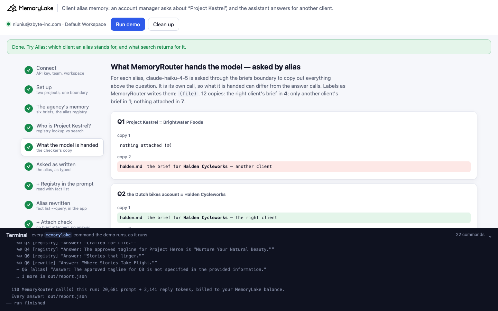
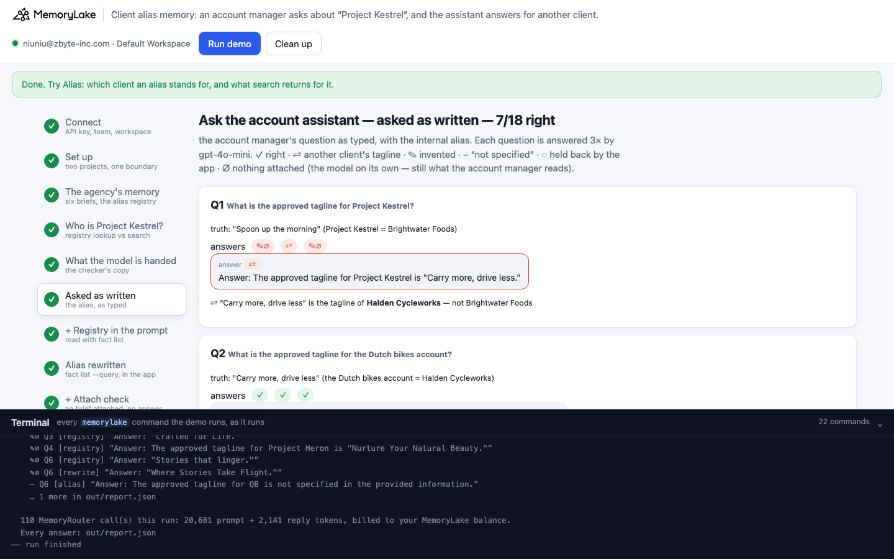
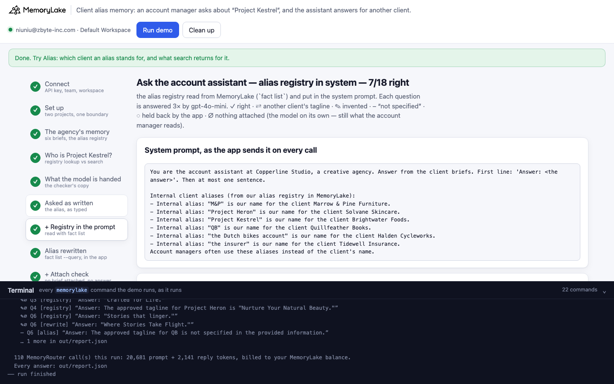
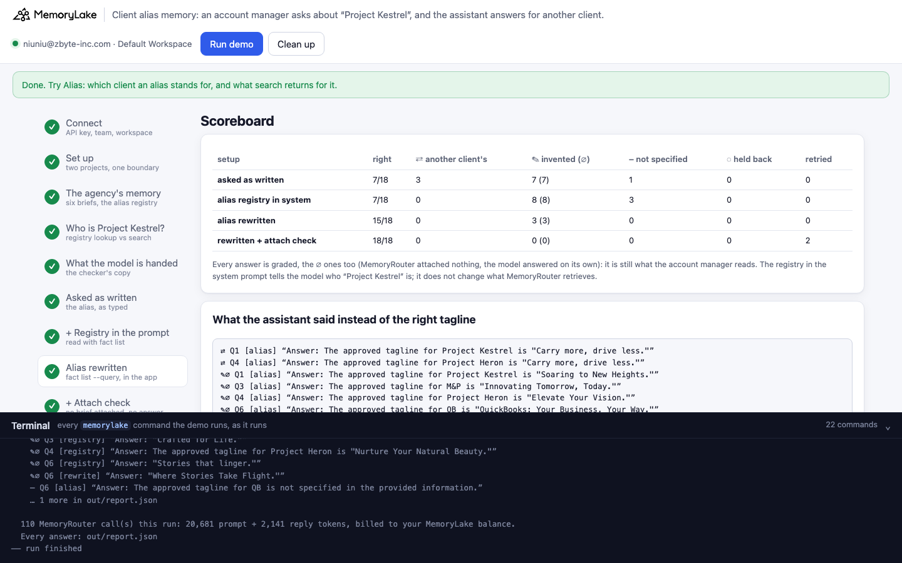

# Client alias memory: an account manager asks about "Project Kestrel", and the assistant answers for another client

A runnable version of the MemoryLake use case
[*Give Agencies Client Context Memory That Works Across Every AI Tool*](https://www.memorylake.ai/en/usecase/client-context-memory-for-agencies),
built entirely on the [`memorylake` CLI](https://github.com/memorylake-ai/memorylake-cli) (v20261015 or later).

**Watch it run:** videos are being recorded.

**The problem.** Copperline Studio (a fictional creative agency) keeps one brief per client in shared memory: six
clients, one Markdown brief each (product, contact, launch date, approved tagline, banned word). An account assistant
answers from them. It runs on MemoryRouter: every question is an ordinary model call with `--boundary` added, and
MemoryRouter attaches what matches. Asked *"What is the approved tagline for Brightwater Foods?"*, it says "Spoon up
the morning", every time.

But nobody at the agency says "Brightwater Foods". They say **Project Kestrel** — an internal codename that appears
in no brief. MemoryRouter retrieves on the words it is given, so it attaches some other client's brief, or nothing,
and the model answers anyway, under the name it was asked about:

```
Q1  What is the approved tagline for Project Kestrel?          (Project Kestrel = Brightwater Foods)
    ⇄  "Answer: The approved tagline for Project Kestrel is "Carry more, drive less.""
                                                         ← Halden Cycleworks' tagline: its brief was attached
    ✎∅ "Answer: The approved tagline for Project Kestrel is "Soaring to New Heights.""
                                                         ← nothing attached; invented
Q4  What is the approved tagline for Project Heron?            (Project Heron = Solvane Skincare)
    ⇄  "Answer: The approved tagline for Project Heron is "Stories for the long way home.""
                                                         ← Quillfeather Books' tagline
```

Nothing in those replies says the brief belongs to another client. Over 5 runs, the two codename questions were
answered right **0 of 30** times.

The agency already has the answer to "who is Project Kestrel": an alias registry, kept as facts in MemoryLake. The
obvious fix is to read it (`fact list`) and put it in the system prompt. It changes what the model *knows*, not what
MemoryRouter *retrieves* — retrieval still runs on "Project Kestrel". The model now notices that Halden's brief is
not Kestrel's and says "not specified" — or, when nothing was attached, still invents one. Codename questions:
**0 of 30** again.

What works is changing the words retrieval sees: the app finds the alias in the question, looks it up exactly
(`fact list --query "Project Kestrel"` → Brightwater Foods) and asks about **Brightwater Foods**. That brings all six
questions to 82 of 90. The last 8 are a different failure that every setup shares: **MemoryRouter attached nothing
at all, and the model invented a tagline.** Every invented answer in every run had nothing attached. The app can see
that — the prompt tokens equal those of the same call without a boundary — so the last setup only shows an answer
when something was attached, and asks again otherwise: **89 of 90**, and the 90th was held back ("no brief came
back"), not invented.

## What the demo shows

| | Step | What you see |
|---|---|---|
| 1–3 | connect, set up, store | Two projects: six client briefs (Library → project, one boundary) and the alias registry (six `fact add`, no boundary) |
| 4 | **Who is "Project Kestrel"?** | `fact list --query <alias>` → exactly one fact naming the client, for every alias. `search` with the question as typed: for the codenames, the right brief is not in the top 3 |
| 5 | **What MemoryRouter hands the model** | claude-haiku-4-5 copies out what it was given through the same boundary: for the codenames, another client's brief (`(halden.md)`) or nothing |
| 6 | asked as written | Six alias questions × 3. Codenames: another client's tagline (⇄) or invented (✎∅) |
| 7 | + alias registry in the system prompt | The registry, read with `fact list`, in the system prompt. Codenames: "not specified" (–) or invented (✎∅) |
| 8 | alias rewritten | The app swaps the alias for the client's name before the call. Right, except when nothing was attached |
| 9 | rewritten + attach check | An answer is shown only when prompt tokens are above the no-boundary baseline; up to 3 calls |
| 10 | scoreboard | Every answer, graded |

Six aliases, two of each sort that matters: **codenames** (Project Kestrel, Project Heron — no connection to the
client's name), **initials** (M&P, QB), a **description** ("the Dutch bikes account") and a **generic** one ("the
insurer"). Only the codenames are reliably wrong as typed: a description or a generic word shares meaning with the
brief, and initials sometimes match.

## Prerequisites

- Python 3.9+ (standard library only)
- The `memorylake` CLI, **v20261015 or later** (`memorylake router` is new in that release):
  ```bash
  curl -fsSL https://raw.githubusercontent.com/memorylake-ai/memorylake-cli/main/scripts/install.sh | sh
  ```
- A MemoryLake API key ([app.memorylake.ai](https://app.memorylake.ai) → API Keys)
- Router calls are billed to your MemoryLake balance: about 110 calls per run (more when the attach check retries),
  about 20,500–23,000 prompt + 2,100–2,800 reply tokens. Without balance, the memory steps (1–4) still run and the
  answers are skipped.

## Run it

```bash
git clone https://github.com/memorylake-ai/memorylake-usecases.git
cd memorylake-usecases/client-alias-memory
export MEMORYLAKE_API_KEY=sk-...          # logs into an isolated profile under .memorylake-demo/
python3 demo.py                           # about 4 minutes
python3 demo.py alias "Project Kestrel"   # read-only: which client? what does search return?
python3 demo.py briefs                    # offline: the six briefs and the alias registry
python3 demo.py cleanup                   # delete everything the demo created
```

China region: also `export MEMORYLAKE_BASE_URL=https://app.memorylake.cn/openapi/memorylake`.
Everything the demo creates is prefixed `mlu-cam-`; every run starts over.

## Or run it in the browser

```bash
python3 web/server.py                     # opens http://127.0.0.1:8765
```

Paste the key, press **Run demo**. The page follows the run step by step: the six briefs and the registry, the
registry lookup next to what search returns, the checker's copy of what the model was handed, the questions under
each setup (with "“Carry more, drive less” is the tagline of Halden Cycleworks — not Brightwater Foods" under every ⇄
answer), and a scoreboard. **Alias** looks up one alias without a model call. A terminal drawer shows every
`memorylake` command as it runs. **Clean up** removes it all.

| | |
|---|---|
|  |  |
|  |  |

## What happens, step by step

### Steps 2–3: two projects, six briefs, one registry

```bash
memorylake proj create --name "Copperline Studio client briefs" --custom-id mlu-cam-briefs …
memorylake proj create --name "Copperline Studio client alias registry" --custom-id mlu-cam-aliases …
memorylake boundary create --name "Account assistant: client briefs" --custom-id mlu-cam-briefs --projects <briefs>
memorylake lib upload data/briefs/brightwater.md --name mlu-cam-brightwater.md --on-conflict overwrite   # ×6
memorylake proj doc import --project <briefs> <6 item ids> --wait
memorylake fact add --project <aliases> 'Internal alias: "Project Kestrel" is our name for the client Brightwater Foods.' …
```

Each brief names its client and never the alias (`demo.py` checks this before uploading). The registry has one fact
per alias. It is not in the boundary: the app reads it itself.

### Step 4: who is "Project Kestrel"?

```
  Project Kestrel          registry → Brightwater Foods          search top 3: marrow.md, solvane.md, halden.md   (its brief: not in top 3)
  the Dutch bikes account  registry → Halden Cycleworks          search top 3: halden.md, brightwater.md, tidewell.md   (its brief: #1)
  M&P                      registry → Marrow & Pine Furniture    search top 3: marrow.md, brightwater.md, tidewell.md   (its brief: #1)
  Project Heron            registry → Solvane Skincare           search top 3: quill.md, halden.md, marrow.md   (its brief: not in top 3)
  the insurer              registry → Tidewell Insurance         search top 3: tidewell.md, solvane.md, halden.md   (its brief: #1)
  QB                       registry → Quillfeather Books         search top 3: quill.md, marrow.md, solvane.md   (its brief: #1)
```

`fact list --projects <aliases> --query "Project Kestrel"` returns the one fact for that alias. Search ranks by
similarity to the question as typed; nothing in Brightwater's brief resembles "Kestrel".

### Step 5: what MemoryRouter hands the model

MemoryRouter's replies don't say what was attached, so the demo asks claude-haiku-4-5, through the same boundary, to
copy out everything above the question — twice per alias, plus once without a boundary for the baseline:

```
  Q1  What is the approved tagline for Project Kestrel?   (Project Kestrel = Brightwater Foods)
      1. (halden.md) — the brief for Halden Cycleworks  ← another client
      2. (halden.md) — the brief for Halden Cycleworks  ← another client
  Q4  What is the approved tagline for Project Heron?   (Project Heron = Solvane Skincare)
      1. (halden.md) — the brief for Halden Cycleworks  ← another client
      2. (halden.md) — the brief for Halden Cycleworks  ← another client
```

Over 5 runs, for the two codenames: Brightwater's or Solvane's own brief attached **0 of 20** times — another
client's brief 11, nothing 9.

### Steps 6–9: ask the account assistant

Every question goes through `memorylake router chat "<question>" --model gpt-4o-mini --temperature 0 --system
"<prompt>" --boundary <briefs>`, three times. Before each setup, each question is asked once *without* a boundary:
a boundary call with no more prompt tokens than that had nothing attached (∅).

- **Step 6, as written.** The question as the account manager typed it.
- **Step 7, + alias registry in the system prompt.** The app reads the registry (`fact list --projects <aliases>`)
  and appends it to the system prompt:
  ```
  Internal client aliases (from our alias registry in MemoryLake):
  - Internal alias: "M&P" is our name for the client Marrow & Pine Furniture.
  - Internal alias: "Project Heron" is our name for the client Solvane Skincare.
  - Internal alias: "Project Kestrel" is our name for the client Brightwater Foods.
  …
  ```
- **Step 8, alias rewritten.** The app finds the registry alias in the question (whole words, longest first), runs
  `fact list --query "<alias>"`, and asks *"What is the approved tagline for Brightwater Foods?"* with the plain
  system prompt.
- **Step 9, rewritten + attach check.** The same rewritten question; if the call's prompt tokens equal the
  no-boundary baseline, the reply is not shown and the call is repeated, up to 3 calls in all. Still nothing: the
  app says no brief came back (◌) instead of showing what the model made up.

Grading: ✓ the client's own tagline · ⇄ another client's tagline · ✎ none of the six (invented) · – says the briefs
don't give one · ◌ held back by the app.

### The read-only subcommands

- `python3 demo.py alias "<alias>"` — the client the registry gives for it (`fact list --query`), or "not in the
  registry"; and which briefs `search` returns for a question that uses it (no model call). `alias "Project Osprey"`
  finds nothing: the app can say it doesn't know the client instead of letting retrieval guess.
- `python3 demo.py briefs` — offline: the six briefs and the registry facts.

## Measured

Over **5 runs** (per setup and run: 6 questions × 3 answers):

| | right | ⇄ another client's tagline | ✎ invented (all with nothing attached) | – "not specified" | ◌ held back |
|---|---|---|---|---|---|
| asked as written | 41/90 | 12 | 35 | 2 | – |
| + alias registry in the system prompt | 42/90 | 0 | 34 | 14 | – |
| alias rewritten | 82/90 | 0 | 8 | 0 | – |
| rewritten + attach check | 89/90 | 0 | 0 | 0 | 1 |

By question (15 answers each):

| | as written | + registry in the prompt | rewritten | rewritten + check |
|---|---|---|---|---|
| Q1 Project Kestrel (codename) | ✎∅ 10, ⇄ 5 | ✎∅ 11, – 4 | ✓ 15 | ✓ 15 |
| Q4 Project Heron (codename) | ⇄ 7, ✎∅ 7, – 1 | – 9, ✎∅ 6 | ✓ 14, ✎∅ 1 | ✓ 15 |
| Q2 the Dutch bikes account (description) | ✓ 14, ✎∅ 1 | ✓ 14, ✎∅ 1 | ✓ 14, ✎∅ 1 | ✓ 15 |
| Q3 M&P (initials) | ✓ 10, ✎∅ 5 | ✓ 9, ✎∅ 6 | ✓ 14, ✎∅ 1 | ✓ 14, ◌ 1 |
| Q5 the insurer (generic) | ✓ 15 | ✓ 15 | ✓ 15 | ✓ 15 |
| Q6 QB (initials) | ✎∅ 12, ✓ 2, – 1 | ✎∅ 10, ✓ 4, – 1 | ✓ 10, ✎∅ 5 | ✓ 15 |

- **A codename gives retrieval nothing to go on.** For Kestrel and Heron, the checker never saw the right brief
  attached (0 of 20 copies), and search had it in its top 3 once in 10 lookups (#2); what came back instead was
  whichever brief happened to rank first (Halden's, mostly).
- **The registry in the prompt moves the failure, it doesn't fix it.** With it, the model never passed another
  client's tagline off as Kestrel's (⇄ 12 → 0): it says "not specified" instead. But it still has no Brightwater
  brief to answer from, and right answers stay at 42/90.
- **Rewriting the alias fixes retrieval.** Codenames go from 0/30 to 29/30.
- **Every ✎ answer, in every setup, was on a call with nothing attached** (35 + 34 + 8 = 77 of 77). MemoryRouter
  sometimes attaches nothing even for the client's full name (8 of 90 rewritten calls), and the model never says so:
  it writes a plausible tagline. Prompt tokens equal to the no-boundary baseline are the app's signal; 12 calls
  needed a retry, 1 question came back empty three times and was held back.
- These are totals over every run. Model replies vary from run to run.

## Use it in your own app

- **Keep aliases as their own memory.** One fact per alias, naming the canonical record, in a project the app reads
  itself; `fact list --projects <registry>` returns all of it, `--query` finds one.
- **Resolve aliases before retrieval, not in the prompt.** MemoryRouter retrieves on the conversation it is given;
  telling the model who "Kestrel" is happens after retrieval. Swap the alias for the canonical name in the text you
  send. `rewritten()` and `resolve()` in `demo.py` do exactly this.
- **Check that something was attached.** Compare the call's prompt tokens with the same call without a boundary
  (or keep the baseline per prompt). Equal means the model answered from nothing — don't show it as an answer from
  memory. `checked()` in `demo.py` retries and then holds the answer back.
- **An unknown alias is a known unknown.** If the registry has no fact for it, say so, rather than letting retrieval
  pick a client.

## Troubleshooting

- `this memorylake CLI has no 'router' command` — upgrade the CLI (v20261015 or later).
- `MemoryRouter refused the call for lack of balance` — the memory steps still run; top up to see the answers.
- `the documents are still processing after 6 minutes` — run again; the demo starts over.
- `expected 6 alias facts` — the `fact add` call did not store all six; run again.
- Leftovers from an interrupted run: `python3 demo.py cleanup` (everything is prefixed `mlu-cam-`).

## Files

- `demo.py` — the whole demo (standard library only): CLI wrapper, setup, upload and import, the registry facts,
  alias lookup and rewrite, the attach check, checker, MemoryRouter calls, grading, cleanup
- `data/agency.json` — the six clients (aliases and taglines used for grading), the questions, the system prompt,
  the registry wording and the checker prompt
- `data/briefs/` — the six client briefs (plain ASCII Markdown)
- `web/server.py`, `web/static/` — the browser companion (standard library HTTP + server-sent events)
