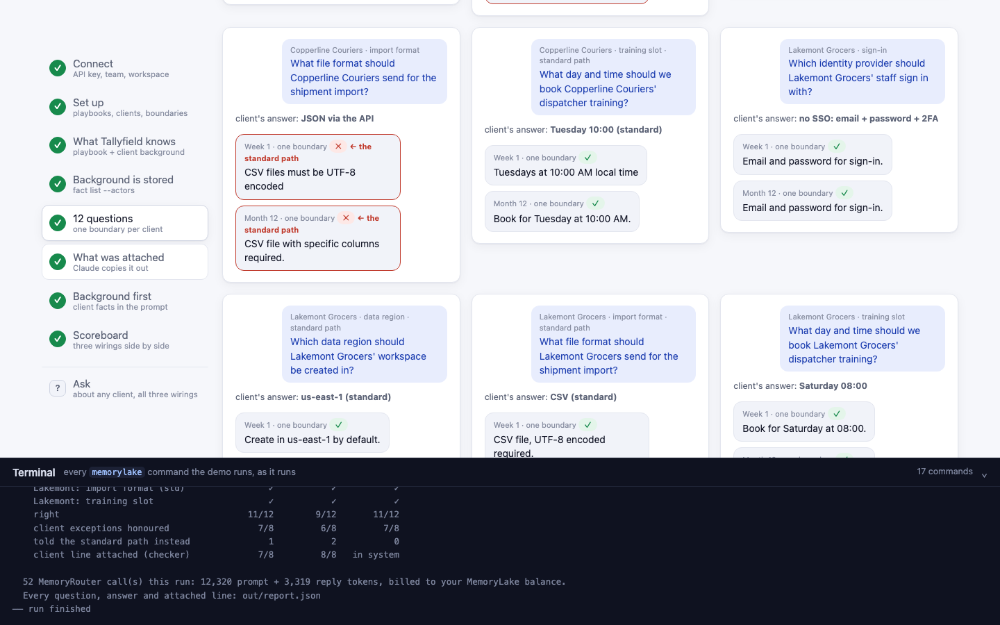
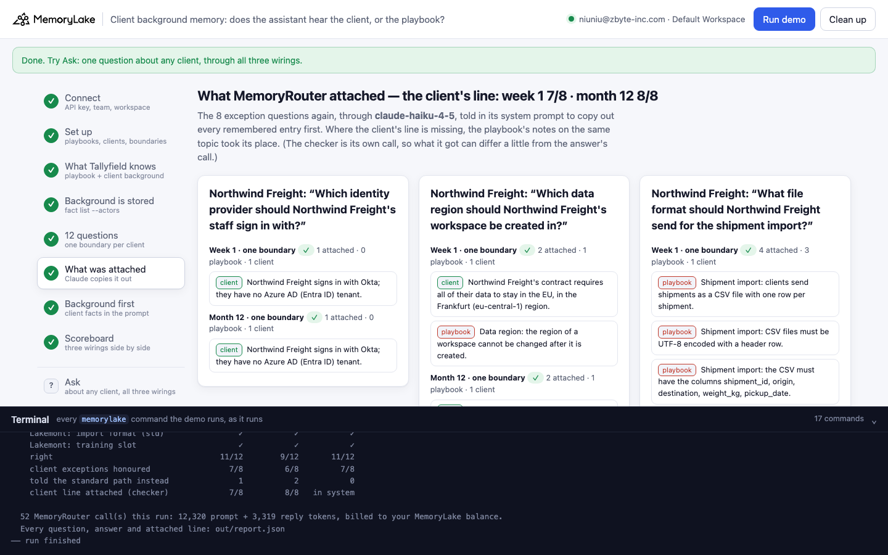
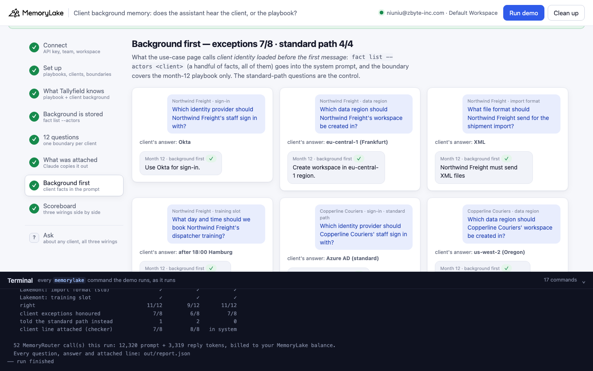
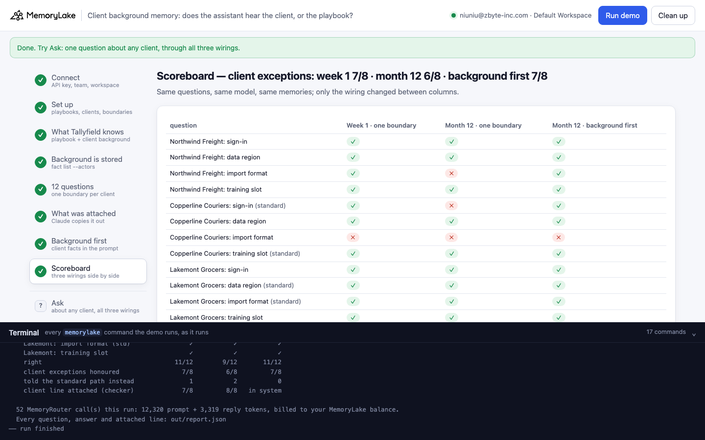

# Client background memory: does the assistant hear the client, or the playbook?

A runnable version of the MemoryLake use case
[*Give Customer Success Teams AI That Already Knows Each Client*](https://www.memorylake.ai/en/usecase/ai-memory-for-client-onboarding-teams),
built entirely on the [`memorylake` CLI](https://github.com/memorylake-ai/memorylake-cli) (v20261015 or later).

**Watch it run:** [CLI, 6:24](https://github.com/memorylake-ai/memorylake-usecases/releases/download/client-background-memory-v1/client-background-memory-cli-demo.mp4) · [Web, 6:36](https://github.com/memorylake-ai/memorylake-usecases/releases/download/client-background-memory-v1/client-background-memory-web-demo.mp4)
([release](https://github.com/memorylake-ai/memorylake-usecases/releases/tag/client-background-memory-v1); GitHub serves them as downloads).

**The problem.** An onboarding assistant needs two kinds of memory: the team's shared playbook (how we normally
do SSO, regions, imports, training) and each client's background (the few things where *this* client is
different). The obvious wiring is one boundary per client over both, and let the retrieval layer pick. But the
retrieval layer ranks memories by how close they are to the question, and onboarding questions are worded like
the playbook. When a client's exception is written in the client's words, the playbook's notes on the same topic
win the slots, and the client's line never reaches the prompt. When it does reach the prompt, it is one bullet
among several standard ones, and the model can still go with the majority.

**What this demo shows.** Tallyfield (fictional dispatch software) has three clients in onboarding. Northwind
Freight signs in with Okta, must stay in Frankfurt, can only export XML and trains after 18:00; Copperline
Couriers must be in us-west-2 and sends shipments through the API as JSON; Lakemont Grocers has no SSO and trains
on Saturdays. The assistant answers through MemoryRouter (`router chat`, `gpt-4o-mini`, temperature 0) with
three wirings:

| Wiring | How | What happens on the 8 client exceptions (9 runs) |
|---|---|---|
| **Week 1 · one boundary** | `boundary create --projects <playbook> --human-actor <client>`, playbook of 12 notes | **60 / 72**. *"What file format should Copperline Couriers send?"* → *"CSV file, UTF-8 encoded required"*, **0 of 9 runs** right |
| **Month 12 · one boundary** | the same, playbook of 293 notes (steps + a record of every client who followed them) | **53 / 72**. Copperline's import 0 / 9 again; Lakemont told to book *"Tuesday at 10:00 AM"* |
| **Month 12 · background first** | the client's facts (`fact list --actors`, all of them) in the system prompt; the boundary covers the playbook only | **71 / 72**. The 4 standard-path questions are the control: 34 / 36 |

A checker (Claude copying out what MemoryRouter attached) shows why: for Copperline's import question the
attached lines are the playbook's *"Shipment import: … CSV …"* notes and not the client's *"sends shipments
through the Tallyfield REST API as JSON"* (13 of the 14 checks we kept logs for, at 12 notes as at 293). The
bigger playbook made things somewhat worse, but the wording decided which exceptions were lost. This is what the use-case page means by *client identity loaded before the first message*: a client's
background is a handful of facts, so read all of it and put it in front; let the retrieval layer handle the
part that is too big to read whole.

Model replies vary from run to run, so every reply is graded and printed as it comes out, and
[Measured](#measured) below reports totals over all runs, not the best one.

## Prerequisites

- Python 3.9+ (standard library only)
- The `memorylake` CLI **v20261015 or later** (`memorylake router` arrived in that release):
  ```bash
  curl -fsSL https://raw.githubusercontent.com/memorylake-ai/memorylake-cli/main/scripts/install.sh | sh
  memorylake version
  ```
- A MemoryLake API key ([app.memorylake.ai](https://app.memorylake.ai) → API Keys).
- **Router calls are billed to your MemoryLake balance** (`memorylake billing balance`). One run makes 36 calls on
  `gpt-4o-mini` and 16 on `claude-haiku-4-5`, about 12,000 prompt + 3,200 reply tokens in all; the run prints the
  total. If the balance is empty, the router calls print the refusal and are skipped; the memory steps still run.

## Run it

```bash
git clone https://github.com/memorylake-ai/memorylake-usecases.git
cd memorylake-usecases/client-background-memory
export MEMORYLAKE_API_KEY=sk-...
python3 demo.py                                   # the whole story, about 6 minutes
python3 demo.py client northwind                  # what MemoryLake holds about one client
python3 demo.py ask copperline "How should they send us their shipments?"   # one question, all three wirings
python3 demo.py ask lakemont "When can we train their dispatchers?" --arm month12
python3 demo.py cleanup                           # delete everything the demo created
```

The key is used to log into an isolated CLI profile under `.memorylake-demo/` (git-ignored); your own
`~/.memorylake` is never touched. For the China endpoint also set
`MEMORYLAKE_BASE_URL=https://app.memorylake.cn/openapi/memorylake`. Every run starts over, and everything it
creates is prefixed `mlu-cbg-`.

## Or run it in the browser

```bash
python3 web/server.py                # opens http://127.0.0.1:8765
```

Paste the API key, press **Run the demo**, and follow the steps on the left while the terminal drawer shows every
`memorylake` command as it runs. **Ask** sends one question about any client through all three wirings.
**Clean up** removes everything.

| Step 5: 12 questions, one boundary per client | Step 6: what MemoryRouter attached |
|---|---|
|  |  |
| **Step 7: background first** | **Step 8: the scoreboard** |
|  |  |

## What happens, step by step

All output below is from one real run (lines shortened with `…`).

### Steps 2–4: two playbooks, three clients, one boundary per client

```
$ memorylake proj create --name 'Tallyfield onboarding playbook (Week 1)' --custom-id mlu-cbg-playbook-week1 …
$ memorylake actor create --custom-id mlu-cbg-client-northwind --display-name 'Northwind Freight' …
$ memorylake boundary create --name 'Northwind Freight onboarding (week1)' --custom-id mlu-cbg-b-northwind-week1 --projects proj-… --human-actor actor-…
  · one boundary per client over both kinds of memory: the playbook project + the client's actor; the same commands for the other two clients
  · client background: Northwind Freight 4 · Copperline Couriers 2 · Lakemont Grocers 2 fact(s), each on the client's own actor
  · playbook, week 1: 12 notes (the standard steps, three per topic)
  · playbook, month 12: 293 notes (29 standard steps + 264 onboarding and check-in records of clients who followed them)
```

Everything is stored verbatim with `fact add` (no extraction involved), and step 4 lists each client's actor with
`fact list --actors`: every exception is there, on the actor every boundary for that client includes.

### Step 5: 12 onboarding questions through each client's boundary

Each reply starts with `Answer: …`; the first clause of that line is graded against what the client told us.
"The standard path" marks an answer that is the playbook default where the client is an exception.

```
    Northwind Freight: What file format should Northwind Freight send for the shipment import?
      week1    ✗ CSV file, UTF-8 encoded required.   ← the standard path
      month12  ✗ CSV file, UTF-8 encoded required.   ← the standard path

    Copperline Couriers: What file format should Copperline Couriers send for the shipment import?
      week1    ✗ CSV file, UTF-8 encoded required.   ← the standard path
      month12  ✗ CSV files must be UTF-8 encoded   ← the standard path

    Lakemont Grocers: Which identity provider should Lakemont Grocers' staff sign in with?
      week1    ✓ Email and password for sign-in.
      month12  ✗ Azure AD SSO for sign-in.   ← the standard path

    Lakemont Grocers: What day and time should we book Lakemont Grocers' dispatcher training?
      week1    ✓ Book for Saturday at 08:00.
      month12  ✗ Book for Tuesday at 10:00 AM.   ← the standard path

    right: week1 10/12 · month12 7/12
    on the 8 client exceptions: week1 6/8 · month12 4/8
    answered with the standard path instead: week1 2 · month12 4
```

### Step 6: what MemoryRouter attached

The same exception questions through `claude-haiku-4-5`, told in its system prompt to copy out every remembered
entry before answering (the user message is unchanged, so retrieval sees the same query):

```
    Copperline Couriers: What file format should Copperline Couriers send for the shipment import?
      week1    ✗ the client's line   (3 attached: 3 playbook, 0 Copperline Couriers)
                 [playbook] Shipment import: CSV files must be UTF-8 encoded with a header row.
                 [playbook] Shipment import: clients send shipments as a CSV file with one row [...]
      month12  ✗ the client's line   (5 attached: 5 playbook, 0 Copperline Couriers)

    Lakemont Grocers: What day and time should we book Lakemont Grocers' dispatcher training?
      week1    ✓ the client's line   (3 attached: 2 playbook, 1 Lakemont Grocers)
      month12  ✓ the client's line   (2 attached: 1 playbook, 1 Lakemont Grocers)
  · the client's own line attached: week1 6/8 · month12 7/8; playbook lines per question: week1 1.5 · month12 2.0
```

Two ways the exception gets lost. Copperline's import line is (almost) never attached: the question shares the playbook's
words (*file format, shipment import*), not the client's (*REST API, JSON*). Lakemont's training line *was*
attached in this run and the answer was still *Tuesday at 10:00*: in a boundary the client's line and the
playbook's are peers, and nothing tells the model which one overrides. The checker is its own call, so what it
got can differ a little from what the answer's call got; [Measured](#measured) has the totals.

### Step 7: background first

```
$ memorylake fact list --page-size 200 --actors actor-… --workspace ws-…
  · all 4 of Northwind Freight's facts go into the system prompt (out/body-first-northwind.json); MemoryRouter attaches from the playbook only

    Northwind Freight: What file format should Northwind Freight send for the shipment import?
      first    ✓ Northwind Freight must send XML files

    Copperline Couriers: What file format should Copperline Couriers send for the shipment import?
      first    ✓ JSON format via Tallyfield REST API

    Lakemont Grocers: What day and time should we book Lakemont Grocers' dispatcher training?
      first    ✓ Saturday at 08:00 AM.

    right: 12/12 · client exceptions 8/8 · standard-path questions 4/4 (the control)
```

The system prompt says the client's facts apply to every answer about them and override the playbook. The
call is otherwise the same `router chat`, with a boundary over the month-12 playbook only, so the playbook's
notes still come along for everything the client did not say.

### Step 8: the scoreboard

```
                                            week 1    month 12    bg first
    Northwind: sign-in                           ✓           ✓           ✓
    Northwind: data region                       ✓           ✓           ✓
    Northwind: import format                     ✗           ✗           ✓
    Northwind: training slot                     ✓           ✓           ✓
    Copperline: sign-in (std)                    ✓           ✗           ✓
    Copperline: data region                      ✓           ✓           ✓
    Copperline: import format                    ✗           ✗           ✓
    Copperline: training slot (std)              ✓           ✓           ✓
    Lakemont: sign-in                            ✓           ✗           ✓
    Lakemont: data region (std)                  ✓           ✓           ✓
    Lakemont: import format (std)                ✓           ✓           ✓
    Lakemont: training slot                      ✓           ✗           ✓
    right                                    10/12        7/12       12/12
    client exceptions honoured                 6/8         4/8         8/8
    told the standard path instead               2           4           0
    client line attached (checker)             6/8         7/8   in system
```

### The read-only subcommands

```
$ python3 demo.py ask copperline "How should they send us their shipments?"
    Week 1 · one boundary:
      Answer: Send shipments as a UTF-8 CSV.   Ensure it includes the required columns and header.
    Month 12 · one boundary:
      Answer: Send shipments as a CSV file.   Ensure it includes shipment_id, origin, destination,
      weight_kg, and pickup_date.
    Month 12 · background first:
      Answer: Use Tallyfield REST API as JSON. Copperline Couriers does not use file exports.
```

`ask` names the client in the system prompt for every wiring (a free-form question may just say *they*).
`client <name>` lists the client's facts and the boundaries that read them.

## Measured

Every fresh run with the final questions and grading while building this demo (1 in the terminal before this one,
3 parallel copies, 1 browser check, the run above, the 2 recordings): 9 runs.

| | Week 1 · one boundary | Month 12 · one boundary | Month 12 · background first |
|---|---|---|---|
| client exceptions honoured | **60 / 72** | **53 / 72** | **71 / 72** |
| answered with the standard path instead | 12 | 19 | 0 |
| standard-path questions right (control) | 36 / 36 | 28 / 36 | 34 / 36 |
| checker: the client's line attached | 59 / 72 | 57 / 72 | all of it, in the system prompt |
| Copperline's import question | 0 / 9 | 0 / 9 | 8 / 9 |

- Playbook size moved things only a little (exceptions 60 vs 53 of 72; the client's line attached about as often).
  The misses sit on particular questions, run after run: Copperline's import line was attached in 1 of the 14
  mixed-boundary checks we kept logs for (7 of 9 runs; the reports of the first browser check and the CLI recording were removed with their cleanup), and in that one run the answer was still CSV.
- Background first missed once on an exception: Copperline's import answered *"No file export"*, which is true but
  not the answer (JSON through the API); the grader counts it wrong. Its control misses are Copperline's sign-in
  question: one answer was *"Use their corporate identity provider"*, apparently reading the parent company in Copperline's region fact as a hint about
  sign-in. Putting background in front is not free; check the standard-path questions too.
- Earlier versions of the questions (*"How do we set up sign-in …"*, *"When should we run the training …"*) drew
  process answers (*"book two weeks ahead"*); the questions were sharpened to ask for the thing itself, and those
  runs are not in the table. Before that, a probe with one client and playbooks of 0 / 30 / 120 notes: the client's
  own line attached 8/8, 6/8, 4/8.
- The grader reads only the first clause of the `Answer:` line (so *"XML, as they cannot produce CSV"* is XML); it
  was checked against hand-labelled replies, and every reply is printed so you can disagree with it.
- One model (`gpt-4o-mini`) was measured for the answers.

## Use it in your own app

- Keep shared know-how and per-client facts in different scopes: the playbook in a project, each client on their
  own actor (`actor create --custom-id <your client id>`, `actor bind`, `fact add --actor`).
- Before the first message about a client, read the client's scope whole (`fact list --actors <client>`, paging
  until the continuation token is null) and put it in the system prompt, saying it overrides the defaults. It is
  small, and reading it does not depend on how the question is worded.
- Use MemoryRouter (`router chat|responses|messages --boundary`) for the part that is too big to read whole: a
  boundary over the shared playbook.
- If you do put both in one boundary, test the exceptions with questions worded the way your team asks them, not
  the way the client said it. Write the client's facts in the playbook's words (*"Shipment import: Copperline sends
  JSON through the API, not CSV"*) and they compete better, but they are still peers of the standard notes.

## Troubleshooting

- **`this memorylake CLI has no router command`**: upgrade the CLI (install line above).
- **MemoryRouter refused the call for lack of balance**: top up in the console; `memorylake billing balance` shows it.
- **A run was interrupted**: run again; it deletes what the previous run left and starts over.
- **`fact(s) are still … after deleting`**: deletes are retried and re-checked; run `python3 demo.py cleanup` again.

## Files

| File | What it is |
|---|---|
| `demo.py` | The demo: CLI wrapper, setup, the three wirings, the grader, the checker, subcommands, cleanup |
| `data/tallyfield.json` | The two playbooks, the three clients' facts, the system prompt, the 12 questions with each client's answer |
| `web/server.py`, `web/static/` | Browser companion (standard library server, no build step) |
| `out/` | Request bodies and `report.json` with every question, answer and attached line (git-ignored) |
