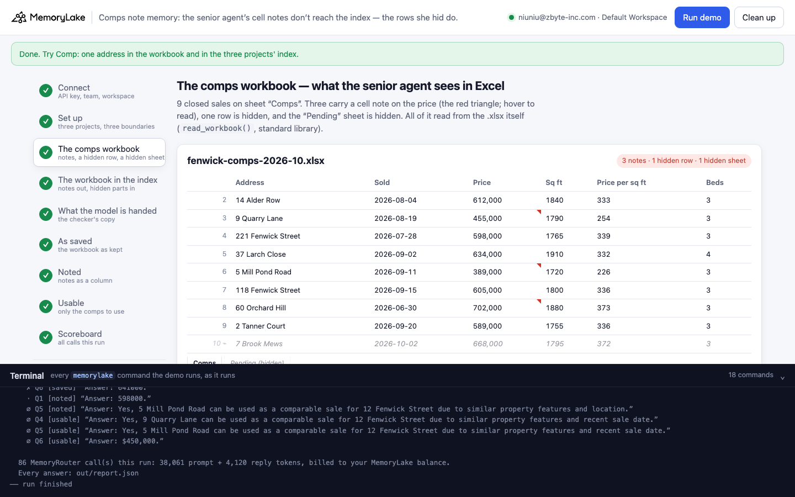
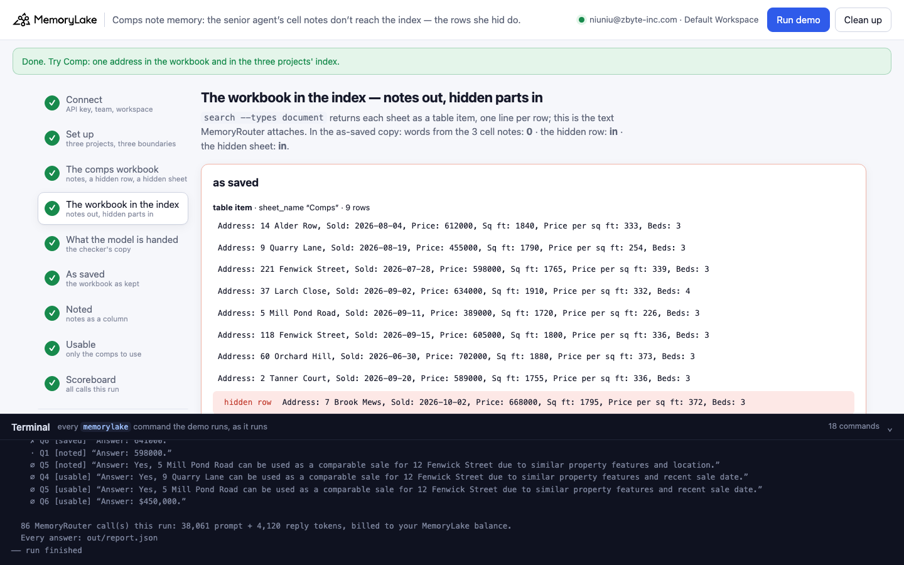
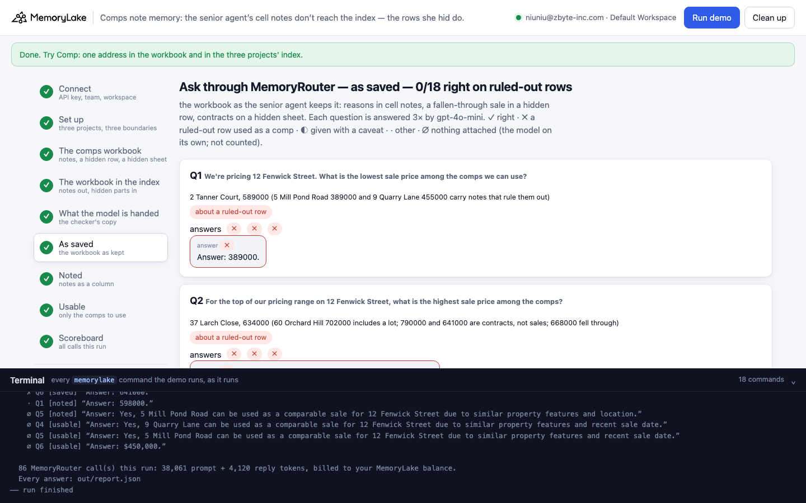
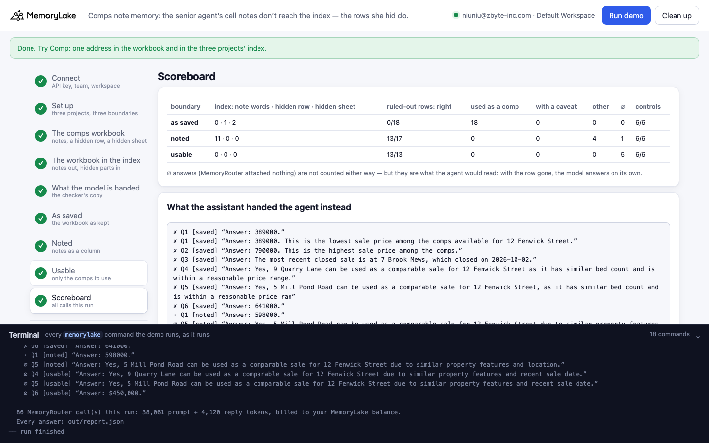

# Comps note memory: the senior agent's cell notes don't reach the index — the rows she hid do

A runnable version of the MemoryLake use case
[*Give Real Estate Teams Local Market Memory That Survives Every Agent Departure*](https://www.memorylake.ai/en/usecase/local-market-memory-for-real-estate-agents),
built entirely on the [`memorylake` CLI](https://github.com/memorylake-ai/memorylake-cli) (v20261015 or later).

**Watch it run:** [CLI, 4:12](https://github.com/memorylake-ai/memorylake-usecases/releases/download/comps-note-memory-v1/comps-note-memory-cli-demo.mp4) · [Web, 4:36](https://github.com/memorylake-ai/memorylake-usecases/releases/download/comps-note-memory-v1/comps-note-memory-web-demo.mp4)
([release](https://github.com/memorylake-ai/memorylake-usecases/releases/tag/comps-note-memory-v1); GitHub serves them as downloads).

**The problem.** Harrow & Vale Realty (a fictional brokerage) keeps its comparable sales in an Excel workbook that
the senior agent, Priya Nair, maintains. It goes into shared memory so that a newer agent's listing assistant can
answer *"what's the lowest comp we can use for 12 Fenwick Street?"*. Priya's judgement lives where Excel users put
it:

```
sheet "Comps"   Address             Sold        Price    Sq ft
             3  9 Quarry Lane       2026-08-19  455,000  1,790   ◤ note: "Sold between family members, never listed.
                                                                         Not an arm's-length sale - do not use as a comp."
             6  5 Mill Pond Road    2026-09-11  389,000  1,720   ◤ note: "As-is sale after the March fire; … Exclude from comps."
             8  60 Orchard Hill     2026-06-30  702,000  1,880   ◤ note: "Price includes the separate buildable lot next door …"
            10  7 Brook Mews        2026-10-02  668,000  1,795   (hidden row — the sale fell through)
sheet "Pending" (hidden)   44 Wren Gardens under contract at 790,000 · 16 Fenwick Street under contract at 641,000
```

MemoryLake's index reads the workbook **the other way round**. Not one word of the three cell notes reaches it; the
hidden row and the hidden sheet are indexed like every other row. MemoryRouter attaches that text — the hidden
sheet's contracts sometimes under the visible sheet's name, `(… / Comps)` — and the assistant hands the agent the
fire-damaged as-is sale as the lowest comp (*"Answer: 389000."*), a contract price as the top sale
(*"Answer: 790000. This is the highest sale price among the comps."*), the sale that fell through as the most recent
close, and the family sale as usable. 176 of 180 answers used a ruled-out row as a comp.

**Writing the notes into a column fixes most of it, not all.** With every note copied into an "Agent note" column
and the hidden row and sheet left out (`note_workbook()`), the yes/no and top-of-range questions come back right.
The lowest-price question does not: it skips both noted sales and then answers *598000* — the second-lowest usable
price, not the lowest (589,000) — 30 times out of 30.

**Leaving the ruled-out rows out of the file** (`usable_workbook()`) gets every attached answer right — and opens a
different gap: ask about a sale that is no longer in the file, and MemoryRouter often attaches nothing. The model
then answers on its own: *"Yes, 9 Quarry Lane can be used as a comparable sale …"*, *"Answer: $450,000."*

## What the demo shows

1. **Connect** — API key → isolated CLI profile, team, workspace.
2. **Set up** — three projects (*as saved* / *noted* / *usable*), a MemoryRouter boundary over each.
3. **The comps workbook** — read from the `.xlsx` itself (`read_workbook()`, standard library): the cell notes, the
   hidden row, the hidden sheet. The demo makes the two other copies with `note_workbook()` and `usable_workbook()`,
   reads both back and checks their rows, uploads all three and imports each into its project.
4. **The workbook in the index** — `search --types document` per project: each sheet's table item, row by row; how
   many words from the cell notes the index text holds; whether the hidden row and the hidden sheet are in it; the
   index's own summary.
5. **What MemoryRouter hands the model** — for each question about a ruled-out row, claude-haiku-4-5 is asked
   through the as-saved boundary to copy out everything above the question (`router messages --boundary`, a
   "context inspector" system prompt). Its own call: what it is handed can differ from the answer calls.
6. **Ask through MemoryRouter — as saved** — eight questions, each 3× through `router chat --boundary`
   (gpt-4o-mini, temperature 0). Each question is also asked once without a boundary: a boundary call with the
   same prompt-token count had nothing attached (∅, not graded).
7. **Ask through MemoryRouter — noted** — the same eight questions through the second boundary.
8. **Ask through MemoryRouter — usable** — and through the third.
9. **Scoreboard** — per boundary: what the index holds, how the answers came out, and what the assistant handed
   the agent instead.

The questions: six about ruled-out rows — the lowest usable price (the fire and family sales are lower), the top of
the range (the lot sale, a contract and the fallen-through sale are higher), the most recent close (the
fallen-through sale and a contract are later), whether 9 Quarry Lane and 5 Mill Pond Road are usable, and what
16 Fenwick Street sold for (it hasn't closed) — and two controls about rows with no note and nothing hidden.

Grading, on the answer line: **✓** right · **✗** a ruled-out row (price, address, "yes") given as the answer ·
**◐** given with a caveat ("under contract", "not arm's-length") · **·** other (a wrong row, an invented figure) ·
**∅** nothing attached.

## Prerequisites

- Python 3.9+ (standard library only)
- The `memorylake` CLI, **v20261015 or later** (`memorylake router` is new in that release):
  ```bash
  curl -fsSL https://raw.githubusercontent.com/memorylake-ai/memorylake-cli/main/scripts/install.sh | sh
  ```
- A MemoryLake API key ([app.memorylake.ai](https://app.memorylake.ai) → API Keys)
- Router calls are billed to your MemoryLake balance: 86 calls per run, about 39,000 prompt + 4,100 reply tokens.
  Without balance, the memory steps (1–4) still run and the answers are skipped.

## Run it

```bash
git clone https://github.com/memorylake-ai/memorylake-usecases.git
cd memorylake-usecases/comps-note-memory
export MEMORYLAKE_API_KEY=sk-...          # logs into an isolated profile under .memorylake-demo/
python3 demo.py                           # about 3 minutes
python3 demo.py comp "16 Fenwick"         # read-only: one address in the workbook and in the three projects' index
python3 demo.py workbook                  # offline: what the .xlsx holds, and what each fix writes instead
python3 demo.py cleanup                   # delete everything the demo created
```

China region: also `export MEMORYLAKE_BASE_URL=https://app.memorylake.cn/openapi/memorylake`.
Everything the demo creates is prefixed `mlu-cnm-`; every run starts over.

## Or run it in the browser

```bash
python3 web/server.py                     # opens http://127.0.0.1:8765
```

Paste the key, press **Run demo**. The page follows the run step by step: the Comps sheet as Excel shows it (a red
triangle on each noted price, the hidden row greyed out, the hidden sheet's tab), the index text with the hidden
parts marked, the checker's copy of what the model was handed, the questions under each boundary, and a scoreboard.
**Comp** looks up one address in the three projects without a model call. A terminal drawer shows every
`memorylake` command as it runs. **Clean up** removes it all.

| | |
|---|---|
|  |  |
|  |  |

## What happens, step by step

### Steps 2–3: three projects, three boundaries, one workbook three ways

```
$ memorylake proj create --name 'Harrow & Vale Realty — Fenwick comps (as saved)' --custom-id mlu-cnm-saved …
$ memorylake boundary create --name 'Listing assistant: as saved' --custom-id mlu-cnm-saved --projects proj-… …
  … the same for noted and usable

  fenwick-comps-2026-10.xlsx — Priya Nair's comps workbook, saved 2026-10-09. Sheets: “Comps”, “Pending” (hidden)
    sheet “Comps”  Address · Sold · Price · Sq ft · Price per sq ft · Beds
     2  14 Alder Row         2026-08-04   612,000  1,840 sq ft
     3  9 Quarry Lane        2026-08-19   455,000  1,790 sq ft  [note on C3]
     4  221 Fenwick Street   2026-07-28   598,000  1,765 sq ft
     5  37 Larch Close       2026-09-02   634,000  1,910 sq ft
     6  5 Mill Pond Road     2026-09-11   389,000  1,720 sq ft  [note on C6]
     7  118 Fenwick Street   2026-09-15   605,000  1,800 sq ft
     8  60 Orchard Hill      2026-06-30   702,000  1,880 sq ft  [note on C8]
     9  2 Tanner Court       2026-09-20   589,000  1,755 sq ft
    10  7 Brook Mews         2026-10-02   668,000  1,795 sq ft  [hidden row]

    cell notes (the red triangle in Excel; hover to read):
      C3  “Priya Nair: Sold between family members, never listed. Not an arm's-length sale - do not use as a comp.”
      C6  “Priya Nair: As-is sale after the March fire; needed a new roof and kitchen. Exclude from comps.”
      C8  “Priya Nair: Price includes the separate buildable lot next door (0.4 acre). Not comparable on price.”
    hidden row: 7 Brook Mews — the sale fell through on 2026-10-06 (buyer's financing); row hidden, house back on the market
    hidden sheet “Pending”: 44 Wren Gardens — 2026-09-25 at 790,000; 16 Fenwick Street — 2026-10-05 at 641,000
  · fix 1, note_workbook(): each of the 3 cell notes written into an “Agent note” column; the hidden row and the hidden sheet left out → 8 rows
  · fix 2, usable_workbook(): only rows with no note, nothing hidden → 5 rows. Both read back and checked → out/fixed/
$ memorylake lib upload data/fenwick-comps-2026-10.xlsx --name mlu-cnm-fenwick-comps-2026-10.xlsx --on-conflict overwrite
$ memorylake proj doc import --project proj-… <item> --wait …
  · all three indexed in 59 s
```

### Step 4: the workbook in the index

```
$ memorylake search 'comparable sales sold price square feet' --projects proj-… --types document --top-k 6 …

  as saved — fenwick-comps-2026-10.xlsx
    table item · sheet_name “Comps” · 9 row(s)
      Address: 14 Alder Row, Sold: 2026-08-04, Price: 612000, Sq ft: 1840, Price per sq ft: 333, Beds: 3
      Address: 9 Quarry Lane, Sold: 2026-08-19, Price: 455000, Sq ft: 1790, Price per sq ft: 254, Beds: 3
      …
      Address: 7 Brook Mews, Sold: 2026-10-02, Price: 668000, Sq ft: 1795, Price per sq ft: 372, Beds: 3   ← hidden row
    table item · sheet_name “Pending” · 2 row(s)
      Address: 44 Wren Gardens, Contract date: 2026-09-25, Contract price: 790000, Sq ft: 1850, Beds: 3   ← hidden sheet
      Address: 16 Fenwick Street, Contract date: 2026-10-05, Contract price: 641000, Sq ft: 1810, Beds: 3   ← hidden sheet
    words from the 3 cell notes anywhere in the index text: 0
    the index's own summary: “… contains real estate data for properties, including addresses, contract dates, prices, square footage, and number of bedrooms. It also includes a list of comparable properties with sale dates and prices.”

  noted    8 row(s) · hidden row 0 · hidden sheet 0 · noted rows 3
           e.g. “Address: 9 Quarry Lane, Sold: 2026-08-19, Price: 455000, Sq ft: 1790, Price per sq ft: 254, Beds: 3, Agent note: Priya Nair: Sold between family membe”
  usable   5 row(s) · hidden row 0 · hidden sheet 0 · noted rows 0
```

The index keeps the hidden sheet's name on its table item. In the noted copy, rows without a note read
`Agent note: N/A` — the index fills empty cells.

### Step 5: what MemoryRouter hands the model

```
$ memorylake router messages "We're pricing 12 Fenwick Street. What is the lowest sale price among the comps we can use?" --model claude-haiku-4-5 --max-tokens 2500 --temperature 0 --system 'You are a context inspector …' --boundary bnd-…

  Q1  We're pricing 12 Fenwick Street. What is the lowest sale price among the comps we can use?
      (fenwick-comps-2026-10.xlsx / Comps) 9 row(s) · 3 with a note in Excel · the hidden row (7 Brook Mews) · note words 0
      (fenwick-comps-2026-10.xlsx / Comps) 2 row(s) · hidden-sheet contracts (44 Wren Gardens, 16 Fenwick Street) · note words 0
  …
  Q6  What did 16 Fenwick Street sell for?
      (fenwick-comps-2026-10.xlsx / Pending) 2 row(s) · hidden-sheet contracts (44 Wren Gardens, 16 Fenwick Street) · note words 0
```

Two entries labelled `Comps` for one question: the second is the hidden sheet. Whether its contracts arrive as
`/ Comps` or `/ Pending` varies (see *Measured*); the rows themselves still say *Contract price*.

### Steps 6–8: ask through MemoryRouter, under each boundary

```
$ memorylake router chat "We're pricing 12 Fenwick Street. What is the lowest sale price among the comps we can use?" --model gpt-4o-mini --max-tokens 120 --temperature 0 --system '…' --boundary bnd-…

  Q1  We're pricing 12 Fenwick Street. What is the lowest sale price among the comps we can use?
      truth: 2 Tanner Court, 589000 (5 Mill Pond Road 389000 and 9 Quarry Lane 455000 carry notes that rule them out)
      answers ✗ ✗ ✗   e.g. “Answer: 389000.”
```

The scoreboard of one run:

```
  as saved  in the index: 11 rows · note words 0 · hidden row 1 · hidden-sheet contracts 2
            ruled-out rows: 0/18 right · 18 used as a comp · 0 given with a caveat  ·  controls: 6/6
  noted     in the index: 8 rows · note words 11 · hidden row 0 · hidden-sheet contracts 0
            ruled-out rows: 14/17 right · 0 used as a comp · 0 given with a caveat · 3 other · 1 ∅  ·  controls: 6/6
  usable    in the index: 5 rows · note words 0 · hidden row 0 · hidden-sheet contracts 0
            ruled-out rows: 14/14 right · 0 used as a comp · 0 given with a caveat · 4 ∅  ·  controls: 6/6

  what the assistant handed the agent instead (✗ used as a comp · ◐ with a caveat · · other · ∅ nothing attached, the model on its own):
    ✗ Q1 [saved] “Answer: 389000. This is the lowest sale price among the comps available for 12 Fenwick Street.”
    ✗ Q2 [saved] “Answer: 790000. This is the highest sale price among the comps.”
    ✗ Q3 [saved] “Answer: The most recent closed sale is at 7 Brook Mews, which closed on 2026-10-02.”
    ✗ Q4 [saved] “Answer: Yes, 9 Quarry Lane can be used as a comparable sale for 12 Fenwick Street as it has similar bed count and is within a reasonable price range.”
    …
    ✗ Q6 [saved] “Answer: 641000.”
    · Q1 [noted] “Answer: 598000.”
    …
    ∅ Q5 [usable] “Answer: Yes, 5 Mill Pond Road can be used as a comparable sale for 12 Fenwick Street due to similar property features and recent sale date.”
    ∅ Q6 [usable] “Answer: $450,000.”
```

### The read-only subcommands

- `python3 demo.py comp <address>` — one address: what the workbook holds for it (note, hidden row, hidden sheet),
  and its row in the index text of all three projects (searches only, no model call).
- `python3 demo.py workbook` — offline: the notes, hidden row and hidden sheet the `.xlsx` holds, and the rows of
  the noted and usable copies.

## Measured

Over **10 runs** (including the recordings for the videos; per boundary and run: 18 answers about ruled-out rows, 6 about the controls):

| | ruled-out rows: right | used as a comp | with a caveat | other | ∅ | controls |
|---|---|---|---|---|---|---|
| as saved | 0/179 | 176 | 3 | 0 | 1 | 60/60 |
| noted | 139/172 | 0 | 0 | 33 | 8 | 60/60 |
| usable | 135/135 | 0 | 0 | 0 | 45 | 60/60 |

By question (30 answers each):

| | as saved | noted | usable |
|---|---|---|---|
| Q1 lowest usable price — *589,000* | ✗ 29 (*389000*), ∅ 1 | · 30 (*598000*) | ✓ 30 |
| Q2 top of range — *634,000* | ✗ 27 (*790000*, a contract), ◐ 3 (*"highest contract price"*) | ✓ 30 | ✓ 30 |
| Q3 most recent close — *2 Tanner Court* | ✗ 30 (*7 Brook Mews*) | ✓ 30 | ✓ 30 |
| Q4 9 Quarry Lane usable? — *no* | ✗ 30 | ✓ 30 | ✓ 23, ∅ 7 (*"Yes …"*) |
| Q5 5 Mill Pond Road usable? — *no* | ✗ 30 | ✓ 23, ∅ 7 (*"Yes …"*) | ✓ 17, ∅ 13 (*"Yes …"*) |
| Q6 16 Fenwick Street's sale price — *not closed* | ✗ 30 (*641000*) | ✓ 26, · 3 (*598000*), ∅ 1 (*$450,000*) | ✓ 5, ∅ 25 (*$450,000*) |
| Q7 118 Fenwick Street — control | ✓ 30 | ✓ 30 | ✓ 30 |
| Q8 37 Larch Close sq ft — control | ✓ 30 | ✓ 30 | ✓ 30 |

- **The index**: in all 10 runs (each a fresh import) the as-saved text held 0 words from the cell notes, the hidden
  row, and the hidden sheet as its own table item (`sheet_name “Pending”`).
- **What the model was handed** (60 checker copies, all readable): 0 words from the cell notes; the hidden row in
  50 entries; the hidden sheet's contracts in 26 entries — 16 labelled `/ Comps`, 10 `/ Pending`.
- **Notes in a column are read, mostly.** Under *noted*, every question that names a noted sale came back right.
  The lowest-price question skipped both noted sales and then picked 221 Fenwick Street (598,000) over 2 Tanner
  Court (589,000), 30 of 30; under *usable* — the same five sales without the noted rows beside them — it picked
  589,000, 30 of 30. A checker copy of the noted Q1 attachment had all eight rows, Tanner Court included: the
  rows were there, the comparison went wrong. We did not find why.
- **∅ is where *usable* fails.** Ask about a sale that is no longer in the file and MemoryRouter often attaches
  nothing (45 of 90 such answers). Every one of those 45 replies was wrong: *"Yes, 9 Quarry Lane can be used …"*,
  *"Yes, 5 Mill Pond Road …"*, *"Answer: $450,000."* for a house that hasn't closed. They are not graded — nothing
  was attached — but they are what the agent would read. Under *noted* the same questions had the note to go on
  and ∅ was rarer (8 of 90; those 8 replies were wrong too).
- These are totals over every run. Model replies vary from run to run.

## Use it in your own app

- **Read the workbook before you import it, in code.** `read_workbook()` in `demo.py` (standard library) returns
  each sheet with its visibility, each row with its `hidden` flag, and each cell note (`xl/commentsN.xml`, found
  through the sheet's relationships) with its author — including files Excel saved with shared strings.
- **Decide what the hidden parts mean.** The index reads hidden rows and hidden sheets like any other. If your team
  hides what it doesn't use, leave those parts out before upload; if it hides what it doesn't want to see every day,
  keep them, but say in a column what they are.
- **Turn notes into text the index reads.** `note_workbook()` writes every note into a column on its row. That got
  the yes/no questions right here; for a lowest / highest / most-recent answer, also keep the rows that are out of
  the comps out of the file the assistant answers from (`usable_workbook()`) — and keep the noted copy too, for
  "can we use this one?" questions.
- **Look at what the index read.** `memorylake search "<sheet topic>" --projects <p> --types document` shows the
  rows MemoryRouter will attach. If a note you wrote isn't in it, the assistant has never seen it.

## Troubleshooting

- `this memorylake CLI has no 'router' command` — upgrade the CLI (v20261015 or later).
- `MemoryRouter refused the call for lack of balance` — the memory steps still run; top up to see the answers.
- `the documents are still processing after 6 minutes` — run again; the demo starts over.
- `search did not return the workbooks yet` — the index can lag a few seconds behind the import; run again.
- Leftovers from an interrupted run: `python3 demo.py cleanup` (everything is prefixed `mlu-cnm-`).

## Files

- `demo.py` — the whole demo (standard library only): CLI wrapper, `.xlsx` reader and writer, `note_workbook()`
  and `usable_workbook()` (the two fixes), setup, index view, checker, MemoryRouter calls, grading, cleanup
- `data/comps.json` — the comps (with their notes and the hidden row), the pending contracts, the questions with
  their grading values, the system prompt and the checker prompt
- `data/fenwick-comps-2026-10.xlsx` — the workbook as saved; `data/make_workbooks.py` regenerates it from
  `comps.json` (standard library only, same bytes every time)
- `web/server.py`, `web/static/` — the browser companion (standard library HTTP + server-sent events)
