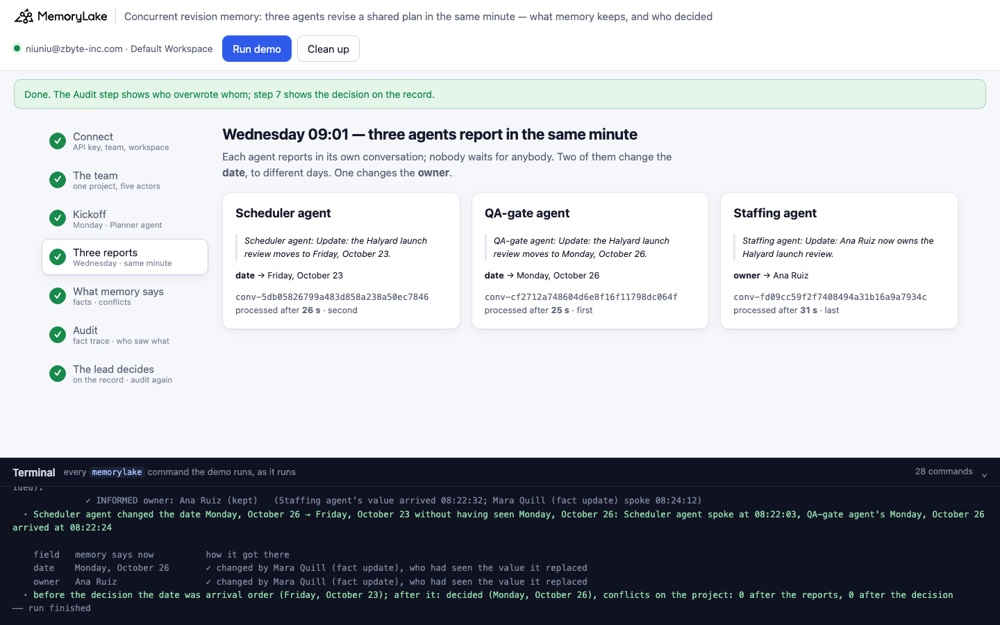
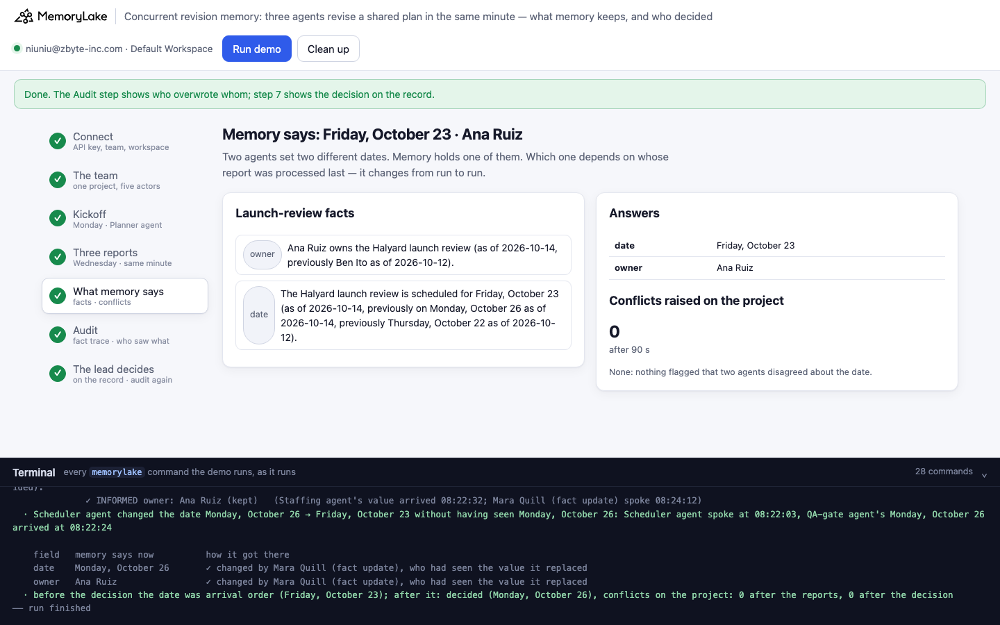
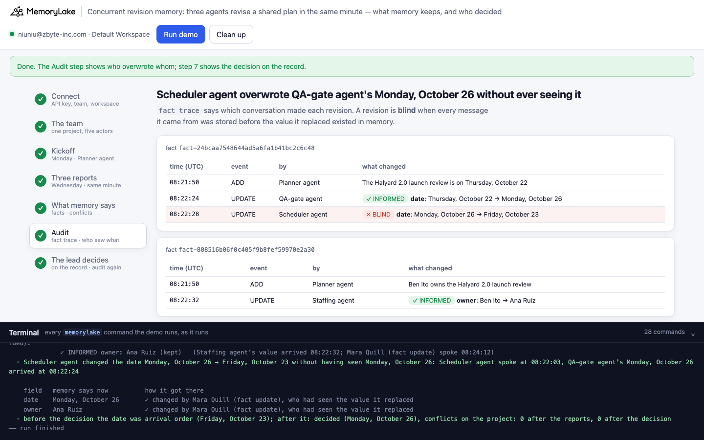
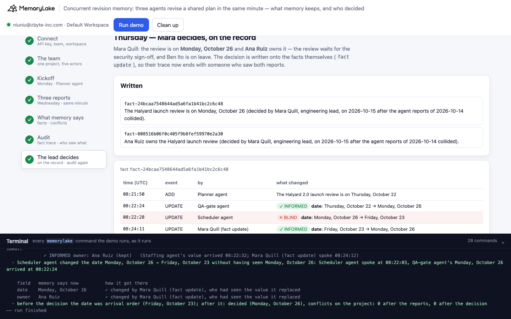

# Concurrent revision memory: two agents change the same plan in the same minute, and memory picks a winner nobody chose

A runnable version of the MemoryLake use case
[*Give Multi-Agent Systems a Shared Memory Backend They Can Trust*](https://www.memorylake.ai/en/usecase/memory-backend-for-multi-agent-systems),
built entirely on the [`memorylake` CLI](https://github.com/memorylake-ai/memorylake-cli) (v20261015 or later).

**Watch it run:** [CLI, 4:42](https://github.com/memorylake-ai/memorylake-usecases/releases/download/concurrent-revision-memory-v1/concurrent-revision-memory-cli-demo.mp4) · [Web, 5:07](https://github.com/memorylake-ai/memorylake-usecases/releases/download/concurrent-revision-memory-v1/concurrent-revision-memory-web-demo.mp4)
([release](https://github.com/memorylake-ai/memorylake-usecases/releases/tag/concurrent-revision-memory-v1); GitHub serves them as downloads). Each video is one run; the numbers below add up all of them.

**The problem.** A crew of agents shares one memory. Each agent reports what it decided in its own conversation, and
MemoryLake extracts facts from every conversation in the background. When two agents change *different* things at the
same moment, both changes land. When two agents change *the same* thing at the same moment — to different values —
memory keeps whichever report was processed last:

- the other value survives only inside the fact's `previously …` history;
- which agent wins changes from run to run (the extraction order is not the order the agents spoke in);
- no conflict is raised: each revision on its own is a normal "the date moved" update.

Nobody chose the answer the team now reads. **`fact trace` can tell**: every revision carries the conversation it came
from, and the conversation's messages carry the time the server stored them. A revision whose messages were all stored
*before* the value it replaced existed was made by an agent that never saw that value — a blind overwrite.

**What this demo shows.** Corvane Labs (fictional) is launching Halyard 2.0. On Monday the Planner agent records the
launch review: Thursday, October 22, owned by Ben Ito. On Wednesday at 09:01 three agents report in the same minute,
each in its own conversation with the engineering lead, Mara Quill:

| agent | reports | changes |
|---|---|---|
| Scheduler agent | "the launch review moves to Friday, October 23" (ops freeze runs through Thursday) | the date |
| QA-gate agent | "the launch review moves to Monday, October 26" (security sign-off lands Friday evening) | the date |
| Staffing agent | "Ana Ruiz now owns the launch review" (Ben is on leave) | the owner |

The demo reads memory back, watches for conflicts, audits every revision with `fact trace`, then has Mara decide —
written onto the facts themselves — and audits again. No model calls: nothing is billed.

## Prerequisites

- **Python 3.9+** (standard library only).
- **The `memorylake` CLI, v20261015 or later** (`memorylake version`):
  ```bash
  curl -fsSL https://raw.githubusercontent.com/memorylake-ai/memorylake-cli/main/scripts/install.sh | sh
  ```
- **A MemoryLake API key**: sign up at [app.memorylake.ai](https://app.memorylake.ai), open **API Keys**, create one.
  Everything the demo uses (conversations, fact extraction, `fact trace`, conflict detection) is part of the free plan.

## Run it

```bash
git clone https://github.com/memorylake-ai/memorylake-usecases.git
cd memorylake-usecases/concurrent-revision-memory
export MEMORYLAKE_API_KEY=sk-...        # logs into an isolated profile under .memorylake-demo/, never touches ~/.memorylake
python3 demo.py                         # about 4 minutes (two rounds of extraction, then 90 s watching for conflicts)
python3 demo.py audit                   # every revision of the launch review: who made it, and had they seen what it replaced?
python3 demo.py facts                   # what memory says about the launch review now
python3 demo.py cleanup                 # deletes everything the demo created
```

China region: also `export MEMORYLAKE_BASE_URL=https://app.memorylake.cn/openapi/memorylake`. To use a specific
workspace: `export MEMORYLAKE_WORKSPACE=ws-…` (default: the team's default workspace). Without `MEMORYLAKE_API_KEY`
the demo uses your existing `memorylake auth login` session.

Every object the demo creates has a `custom_id` starting with `mlu-crv-`. Each run starts over: it deletes what a
previous run left behind first (`--reset` is accepted and does the same).

## Or run it in the browser

```bash
python3 web/server.py                   # opens http://127.0.0.1:8765
```

Paste the API key, press **Run demo**, and follow the steps: the team, the kickoff, the three reports (live), what
memory says, the audit, and the lead's decision. The terminal drawer at the bottom shows every `memorylake` command as
it runs. The server is standard library only and binds to localhost; the key stays in that process and in
`.memorylake-demo/`.

| | |
|---|---|
|  |  |
|  |  |

## What happens, step by step

Output excerpts below are from a real run (ids shortened).

### Steps 2–3: one shared project, and the kickoff

One project, "Halyard 2.0 launch", and five actors (Mara and four agents). Every conversation is a `GROUP`
conversation between Mara and one agent, in that project. The Planner's kickoff is processed first:

```
    Mara Quill (engineering lead): Let's lock the Halyard 2.0 launch review.
    Planner agent: Recorded: the Halyard launch review is on Thursday, October 22, and Ben Ito owns it.
$ memorylake conv create --custom-id mlu-crv-kickoff --project proj-6dc8… --actors actor-ec60…,actor-7a7f… --kind GROUP --name 'Kickoff — Planner agent' …

  What the team's memory says about the launch review:
    [date] The Halyard 2.0 launch review is on Thursday, October 22 (as of 2026-10-12).
    [owner] Ben Ito owns the Halyard 2.0 launch review (as of 2026-10-12).
```

### Step 4: three reports in the same minute

Three threads wait on one barrier, then each opens its conversation and appends its two messages (timestamped
2026-10-14 09:01–09:02). Then the demo polls `conv cook-status` until all three are processed.

```
    Scheduler agent  date → Friday, October 23
    QA-gate agent    date → Monday, October 26
    Staffing agent   owner → Ana Ruiz
$ memorylake conv msg append conv-31b2… --actor actor-f2fe… --custom-id turn-02 --timestamp 2026-10-14T09:02:00Z --text 'Scheduler agent: Update: the Halyard launch review moves to Friday, October 23.' --parent conv-entry-…
  · all three reports processed: Staffing agent 38 s · Scheduler agent 43 s · QA-gate agent 57 s
```

### Step 5: what memory says now

```
    [date] The Halyard launch review is scheduled for Monday, October 26 (as of 2026-10-14, previously
    Friday, October 23 as of 2026-10-14, previously Thursday, October 22 as of 2026-10-12).
    [owner] Ana Ruiz owns the Halyard launch review (as of 2026-10-14, previously Ben Ito owns the
    Halyard 2.0 launch review as of 2026-10-12).

    date   Monday, October 26
    owner  Ana Ruiz
$ memorylake fact conflict list --project proj-6dc8…
    conflicts raised on the project: 0
```

Both date changes "landed", one after the other, with the same as-of date. Read the fact and Monday looks like the
latest decision; Friday looks like an earlier one it superseded. Neither is true: they were made in the same minute by
two agents who never saw each other's report. In the next run it can be the other way round (see *Measured*).

### Step 6: the audit

For each launch-review fact, `fact trace` lists every revision with the `conversation_id` and `source_entry_ids` it
came from; `conv msg list` gives each message's `created_at`. Following each field along the trace:

```
$ memorylake fact trace fact-cbcc… --project proj-6dc8…

  fact fact-cbcc…  (date)
    08:00:58  ADD     Planner agent    “The Halyard 2.0 launch review is on Thursday, October 22”
    08:01:50  UPDATE  Scheduler agent  “The Halyard launch review is scheduled for Friday, October 23”
              ✓ INFORMED date: Thursday, October 22 → Friday, October 23   (Planner agent's value arrived 08:00:58; Scheduler agent spoke 08:01:09)
    08:02:06  UPDATE  QA-gate agent    “The Halyard launch review is scheduled for Monday, October 26”
              ✗ BLIND    date: Friday, October 23 → Monday, October 26   (Scheduler agent's value arrived 08:01:50; QA-gate agent spoke 08:01:09)

  fact fact-cea7…  (owner)
    08:00:58  ADD     Planner agent    “Ben Ito owns the Halyard 2.0 launch review”
    08:01:43  UPDATE  Staffing agent   “Ana Ruiz owns the Halyard launch review”
              ✓ INFORMED owner: Ben Ito → Ana Ruiz   (Planner agent's value arrived 08:00:58; Staffing agent spoke 08:01:09)

    report                                          what it did to memory
    Scheduler agent  date → Friday, October 23    ✗ applied 08:01:50, then overwritten blind by QA-gate agent
    QA-gate agent    date → Monday, October 26    ✓ applied 08:02:06 — memory says this now
    Staffing agent   owner → Ana Ruiz              ✓ applied 08:01:43 — memory says this now

    field   memory says now          how it got there
    date    Monday, October 26       ✗ QA-gate agent's report was processed last; nobody chose it
            overwritten without being seen: Friday, October 23 (now only in “previously …”)
    owner   Ana Ruiz                 ✓ changed by Staffing agent, who had seen the value it replaced
```

The rule: a revision replaces the value set at the field's previous change. If every message the revision was
extracted from was stored before that value existed, its author could not have seen it. The QA-gate agent spoke at
08:01:09; the Scheduler's Friday reached memory at 08:01:50. The owner change passes the same test.

### Step 7: the lead decides, on the record

Mara reads the audit and decides: Monday (the review waits for the security sign-off), Ana owns it. The decision is
written onto the facts themselves with `fact update`, so their trace ends with someone who had seen both reports:

```
$ memorylake fact update fact-cbcc… --text 'The Halyard launch review is on Monday, October 26 (decided by Mara Quill, engineering lead, on 2026-10-15 after the agent reports of 2026-10-14 collided).' --project proj-6dc8…
$ memorylake fact update fact-cea7… --text 'Ana Ruiz owns the Halyard launch review (decided by Mara Quill, engineering lead, on 2026-10-15 after the agent reports of 2026-10-14 collided).' --project proj-6dc8…
…
    08:03:42  UPDATE  Mara Quill (fact update) “The Halyard launch review is on Monday, October 26 (decided by Mara Quill, …).”
              ✓ INFORMED date: Monday, October 26 (kept)   (QA-gate agent's value arrived 08:02:06; Mara Quill (fact update) spoke 08:03:42)

    field   memory says now          how it got there
    date    Monday, October 26       ✓ changed by Mara Quill (fact update), who had seen the value it replaced
    owner   Ana Ruiz                 ✓ changed by Mara Quill (fact update), who had seen the value it replaced
```

Why not just tell memory in a conversation? An earlier version did: Mara said "Decision: the review is on Monday" in
her own conversation. When the race had already landed on Monday, extraction left the date fact untouched (it only
added "the review waits for the security sign-off") — the trace still ended with the blind overwrite, and nothing in
memory showed that a person had chosen. A decision that agrees with what memory holds has to be written where the
audit reads. `fact update` replaces the text; the old values stay in `fact trace`.

## Measured

Every run of the final version is counted, from the saved reports (`out/runs/`): three terminal runs (the second a
re-run, the third with `--reset`), each alongside three parallel copies with their own `custom_id` prefix; two browser
runs (one of them recorded for the Web video); and the run recorded for the CLI video, from a fresh `git clone`.

| | runs | date settled by arrival order | which date won | blind overwrites flagged | owner change | conflicts on the race | decided after step 7 |
|---|---|---|---|---|---|---|---|
| terminal + copies | 12 | 12 | Monday 6 · Friday 6 | 1 per run | clean 12 | 0 | 12 |
| browser | 2 | 2 | Friday 2 | 1 per run | clean 1 · two live answers 1 | 0 | 2 |
| CLI video | 1 | 1 | Monday | 1 | clean | 0 | 1 |
| **all** | **15** | **15** | **Monday 7 · Friday 8** | **15 of 15 runs** | **clean 14 of 15** | **0 of 15** | **15 of 15** |

- **Two agents changed the date in the same minute, and memory settled it by arrival order every time.** Which one won
  was close to a coin toss. The losing value was always still readable — inside the winner's `previously …`, with the
  same as-of date.
- **The owner change, made by one agent alone, landed cleanly in 14 of 15.** In one browser run extraction wrote "Ana
  Ruiz now owns …" as a new fact and left "Ben Ito owns …" live beside it; the demo reports `UNRESOLVED` and the lead's
  decision removes the extra fact.
- **Conflict detection flagged the date race in 0 of 15 runs.** One run raised one `self` conflict about something
  else: a weekday/date mismatch extraction itself introduced into the ops-freeze fact.

Earlier versions of the demo (not counted above) showed two more shapes worth knowing: extraction sometimes keeps the
date and the owner in **one** fact, and then every report revises that fact; and under load it once applied the owner
change **backwards** — "Ben Ito owns … (previously Ana Ruiz as of 2026-10-14)" — which detection did flag, as a `self`
conflict about the as-of order. The audit reads all of these the same way: per field, along the trace.

## Use it in your own agents

- **Don't let two agents revise the same field through memory at the same time.** Extraction applies revisions in the
  order it finishes them, not the order they were made, and a same-day "previously" chain looks exactly like a real
  sequence of decisions. Give each field one owner, or route changes to it through a single writer.
- **Audit shared facts with `fact trace` + message times.** Each revision's `conversation_id` names the agent;
  `source_entry_ids` → `conv msg list` → `created_at` says when that agent spoke. A revision made before the value it
  replaced existed is a blind overwrite — flag it for a person, as `demo.py audit` does.
- **Don't wait for conflict detection to catch a race.** It asks "can these facts all be true?". Two dated revisions
  of one fact can be.
- **Record decisions where the audit reads.** If a person settles a race, write it onto the fact (`fact update`), with
  who and when in the text. A confirmation said in a conversation may change nothing in memory.

## Troubleshooting

- **`no fact conflict command`** — the CLI is older than v20261015; reinstall with the `install.sh` line above.
- **`extraction did not finish in 600 s`** — the service is busy; run again (each run starts over).
- **No blind overwrite this run** — the two date reports must be processed close together. On a slow network one
  thread may append long after the others; the audit then reads the later revision as informed, which it is.
- **Leftovers after an interrupted run** — `python3 demo.py cleanup`.

## Files

| file | what it is |
|---|---|
| `demo.py` | the whole demo: CLI wrapper, kickoff, the three concurrent reports, the audit, the decision, cleanup |
| `data/story.json` | the team, the kickoff, the three reports and the lead's decision |
| `web/server.py`, `web/static/` | the browser companion (standard library server, no build step) |
| `out/report.json`, `out/world.json` | what memory said, the audit and the verdicts of the last run (`cleanup` moves both to `out/runs/`) |
