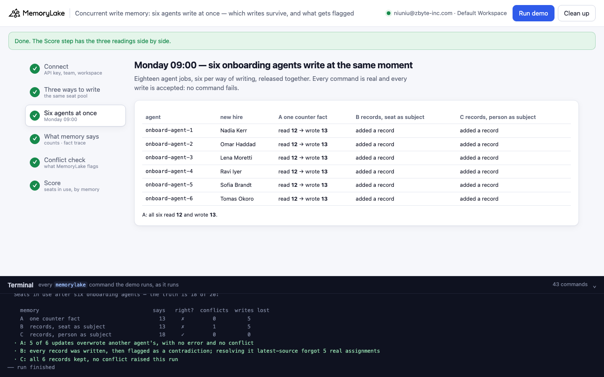
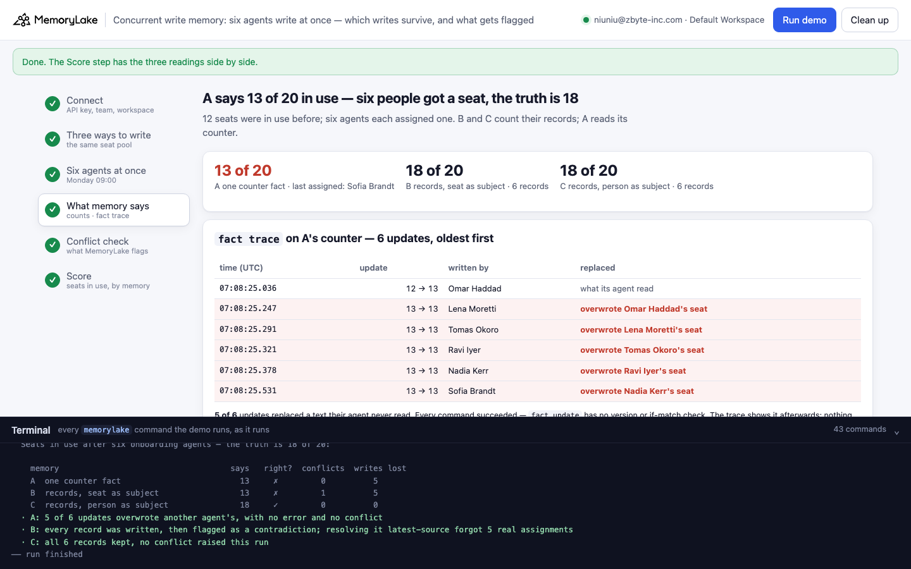
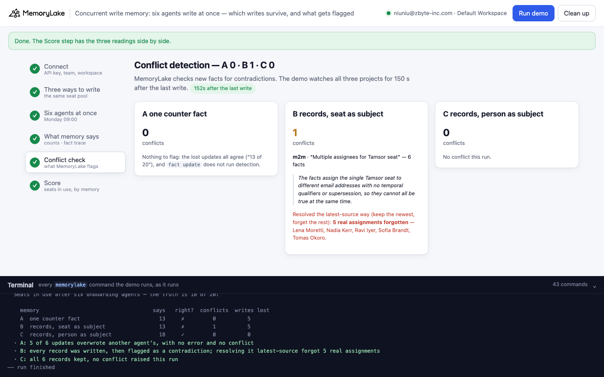
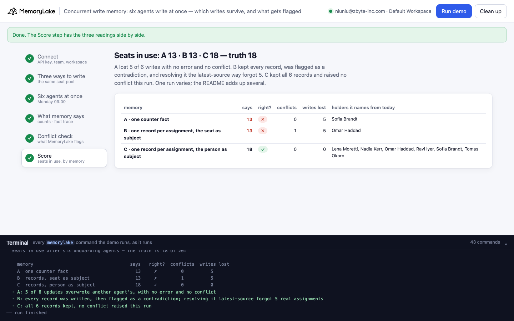

# Concurrent write memory: six agents write at once, five writes vanish, and the conflict check looks the other way

A runnable version of the MemoryLake use case
[*Run Concurrent Agents on Shared Memory Without Race Conditions*](https://www.memorylake.ai/en/usecase/concurrent-agent-memory-access-without-race-conditions),
built entirely on the [`memorylake` CLI](https://github.com/memorylake-ai/memorylake-cli) (v20261015 or later).

**Watch it run:** videos are being recorded.

**The problem.** Several agents share one memory, and some of them write at the same moment. Two things go wrong, and
neither raises an error:

- **Read, add one, write back — and lose the other agents' writes.** Six agents each read a counter fact that says
  "12 of 20 in use", each write "13 of 20", and MemoryLake accepts all six `fact update` calls. The counter ends at 13;
  six people got a seat, so the truth is 18. `fact update` is atomic per call but has no version or if-match check, so
  the last writer wins. And no conflict is raised: six writes of "13 of 20" agree with each other.
- **Write one record each — and get flagged as a contradiction.** If each agent adds its own record instead
  ("Tamsor seat assigned to nadia.kerr@…"), every write survives — until conflict detection reads "the seat" as one
  seat assigned to six people. Resolve that the way the page suggests (*latest-source*: keep the newest write) and
  five real assignments are forgotten.

What works: one record per assignment, written so that all of them can be true at once — the person as the subject
("Nadia Kerr holds one of Kesswick Labs' 20 Tamsor seats") — and the app counts the records. No write is lost, nothing
is flagged.

**What this demo shows.** Kesswick Labs (fictional) has 20 seats on Tamsor (a fictional design tool); 12 are in use.
On Monday at 09:00 six people start, and six onboarding agents — one per new hire — each give their person a seat and
record it in shared memory, all at the same instant. The same race runs three ways, each in its own project:

| | how each agent writes | what the app reads |
|---|---|---|
| **A** one counter fact | `fact get` → add one → `fact update` | the number in the fact |
| **B** a record per assignment, the seat as subject | `fact add "Tamsor seat assigned to <email> by <agent>."` | 12 + the number of records |
| **C** a record per assignment, the person as subject | `fact add "<Name> (<email>) holds one of Kesswick Labs' 20 Tamsor seats; assigned by <agent> on 2026-10-19."` | 12 + the number of records |

Then it reads each memory back, shows the counter's history with `fact trace`, watches all three projects for
conflicts for 150 seconds, and resolves any conflict the *latest-source* way. No model calls: nothing is billed.

## Prerequisites

- **Python 3.9+** (standard library only).
- **The `memorylake` CLI, v20261015 or later** (`memorylake version`):
  ```bash
  curl -fsSL https://raw.githubusercontent.com/memorylake-ai/memorylake-cli/main/scripts/install.sh | sh
  ```
- **A MemoryLake API key**: sign up at [app.memorylake.ai](https://app.memorylake.ai), open **API Keys**, create one.
  Everything the demo uses (projects, facts, `fact trace`, conflict detection) is part of the free plan.

## Run it

```bash
git clone https://github.com/memorylake-ai/memorylake-usecases.git
cd memorylake-usecases/concurrent-write-memory
export MEMORYLAKE_API_KEY=sk-...        # logs into an isolated profile under .memorylake-demo/, never touches ~/.memorylake
python3 demo.py                         # about 3½ minutes (the race takes seconds; then 150 s watching for conflicts)
python3 demo.py trace                   # the counter's update history: who overwrote whom
python3 demo.py conflicts               # what conflict detection flagged in each project, and how it was resolved
python3 demo.py count                   # seats in use, by memory, and the holders each one names
python3 demo.py cleanup                 # deletes everything the demo created
```

China region: also `export MEMORYLAKE_BASE_URL=https://app.memorylake.cn/openapi/memorylake`. To use a specific
workspace: `export MEMORYLAKE_WORKSPACE=ws-…` (default: the team's default workspace). Without `MEMORYLAKE_API_KEY`
the demo uses your existing `memorylake auth login` session.

Every object the demo creates has a `custom_id` starting with `mlu-cwr-`. Each run starts over: it deletes what a
previous run left behind first (`--reset` is accepted and does the same).

## Or run it in the browser

```bash
python3 web/server.py                   # opens http://127.0.0.1:8765
```

Paste the API key, press **Run demo**, and follow the steps: the three ways to write, the six agents (live), what
memory says with the counter's `fact trace`, the conflict check, and the score. The terminal drawer at the bottom shows
every `memorylake` command as it runs. The server is standard library only and binds to localhost; the key stays in
that process and in `.memorylake-demo/`.

| | |
|---|---|
|  |  |
|  |  |

## What happens, step by step

Output excerpts below are from real runs (ids shortened).

### Step 2: the same seat pool, three ways

Three projects with the same name, "Tamsor seat pool" (only the `custom_id` says which is which). A starts with one
fact, the counter; B and C start empty — the pool size (20 seats, 12 in use before today) lives in the app.

```
$ memorylake proj create --name 'Tamsor seat pool' --custom-id mlu-cwr-pool-a
$ memorylake fact add 'Kesswick Labs Tamsor seats: 12 of 20 in use.' --project proj-ac11…
$ memorylake proj create --name 'Tamsor seat pool' --custom-id mlu-cwr-pool-b
$ memorylake proj create --name 'Tamsor seat pool' --custom-id mlu-cwr-pool-c
```

### Step 3: six agents at the same moment

Eighteen agent jobs — six per project — wait on one barrier and start together. In A each agent runs
`fact get` then `fact update`; in B and C, one `fact add`. Every command succeeds.

```
$ memorylake fact get fact-a671… --project proj-ac11…
$ memorylake fact update fact-a671… --text 'Kesswick Labs Tamsor seats: 13 of 20 in use (last assigned: Ravi Iyer by onboard-agent-4).' --project proj-ac11…
$ memorylake fact add 'Tamsor seat assigned to omar.haddad@kesswick.test by onboard-agent-2.' --project proj-585b…
$ memorylake fact add 'Tomas Okoro (tomas.okoro@kesswick.test) holds one of Kesswick Labs'"'"' 20 Tamsor seats; assigned by onboard-agent-6 on 2026-10-19.' --project proj-e119…
    A  onboard-agent-4  read 12 → wrote 13  (Ravi Iyer)
    A  onboard-agent-3  read 12 → wrote 13  (Lena Moretti)
    …
  · every write was accepted: A 6 updates · B 6 adds · C 6 adds — no command failed
```

### Step 4: what memory says now — and what `fact trace` shows

```
$ memorylake fact trace fact-a671… --project proj-ac11…

  Six people got a seat; 12 were in use before: the truth is 18 of 20.

  A  the counter says 13 of 20 in use  — last assigned: Nadia Kerr
  B  6 assignment records → 12 + 6 = 18 in use
  C  6 assignment records → 12 + 6 = 18 in use

  fact trace on A's counter — 6 updates, oldest first:
    time (UTC)     update                 written by          replaced
    07:04:29.338   12 → 13 of 20           Ravi Iyer           ok (replaced what it read)
    07:04:29.582   13 → 13 of 20           Lena Moretti        OVERWROTE Ravi Iyer's seat
    07:04:29.625   13 → 13 of 20           Sofia Brandt        OVERWROTE Lena Moretti's seat
    07:04:29.857   13 → 13 of 20           Omar Haddad         OVERWROTE Sofia Brandt's seat
    07:04:29.914   13 → 13 of 20           Tomas Okoro         OVERWROTE Omar Haddad's seat
    07:04:30.658   13 → 13 of 20           Nadia Kerr          OVERWROTE Tomas Okoro's seat
  · 5 of 6 updates replaced a text their agent never read — 5 assignments are gone from the counter, and every command succeeded: `fact update` has no version or if-match check
```

Each `UPDATE` in the trace carries the text it replaced (`old_fact`). An update is clean when that is the text its
agent read; here only the first one is. The other five replaced a "13 of 20" written a few milliseconds earlier by
another agent. The trace shows it afterwards; nothing stopped it.

### Step 5: conflict detection

The demo lists conflicts in all three projects every 15 seconds for 150 seconds after the last write (a write's
check usually lands within 10–110 s).

```
  · watching all three projects for 150 s after the last write (detection usually lands in 10–110 s)
      3s after the last write — conflicts: A 0 · B 0 · C 0
     20s after the last write — conflicts: A 0 · B 1 · C 0
    151s after the last write — conflicts: A 0 · B 1 · C 0

  B: m2m · logical — “Conflicting Tamsor seat assignees”
      “Multiple facts assert the single-valued assignment of the Tamsor seat to different people,
       with no temporal markers or supersession to reconcile them.”
      6 facts in it
  · A has none: a lost update is not a contradiction, and `fact update` does not run detection

  B: resolving it the latest-source way — keep the newest write, forget the rest:
$ memorylake fact conflict resolve cfl-b715… --project proj-585b… --strategy keep_fact --keep-fact-id fact-22cc…
  · forgotten: 5 fact(s) — Nadia Kerr, Omar Haddad, Ravi Iyer, Sofia Brandt, Tomas Okoro
```

A has nothing to flag: the lost updates all say "13 of 20", and `fact update` does not run the check. B's six
records are read as one seat assigned to six people. Resolving that conflict with `keep_fact` — keep the newest, the
*latest-source* strategy — forgets the other five, and they disappear from `fact list`.

### Step 6: the score

```
  Seats in use after six onboarding agents — the truth is 18 of 20:

    memory                                    says   right?  conflicts  writes lost
    A  one counter fact                         13     ✗         0          5
    B  records, seat as subject                 13     ✗         1          5
    C  records, person as subject               18     ✓         0          0
  · A: 5 of 6 updates overwrote another agent's, with no error and no conflict
  · B: every record was written, then flagged as a contradiction; resolving it latest-source forgot 5 real assignments
  · C: all 6 records kept, no conflict raised this run
```

## Measured

7 runs of this version of the demo: three terminal runs (the third with `--reset`), three parallel copies of the demo with their own `custom_id` prefix, the browser run recorded for the Web video. Every number below comes from the saved reports (`out/runs/`). Truth in every run: 18 of 20.

| run | A one counter fact | B records, seat as subject | C records, person as subject |
|---|---|---|---|
| run1 | 13 · 5 of 6 updates overwrote · 0 conflicts | 13 · flagged (“Tamsor seat assigned to multiple people”, 6 facts) · 5 forgotten | 18 · 0 conflicts |
| copy1 | 13 · 5 of 6 updates overwrote · 0 conflicts | 13 · flagged (“Conflicting Tamsor seat assignees”, 6 facts) · 5 forgotten | 18 · 0 conflicts |
| copy2 | 13 · 5 of 6 updates overwrote · 0 conflicts | 13 · flagged (“Conflicting Tamsor seat assignees”, 6 facts) · 5 forgotten | 18 · 0 conflicts |
| run2 | 13 · 5 of 6 updates overwrote · 0 conflicts | 13 · flagged (“Tamsor seat assigned to multiple users”, 6 facts) · 5 forgotten | 18 · 0 conflicts |
| copy3 | 13 · 5 of 6 updates overwrote · 0 conflicts | 13 · flagged (“Tamsor seat assigned to multiple users”, 6 facts) · 5 forgotten | 18 · 0 conflicts |
| run3 --reset | 13 · 5 of 6 updates overwrote · 0 conflicts | 13 · flagged (“Conflicting Tamsor seat assignees”, 6 facts) · 5 forgotten | 18 · 0 conflicts |
| web1 | 13 · 5 of 6 updates overwrote · 0 conflicts | 13 · flagged (“Multiple assignees for Tamsor seat”, 6 facts) · 5 forgotten | 18 · 0 conflicts |

- **A lost 5 of 6 writes in every run (35 of 42), and was never flagged (0 of 7).** All six agents read 12 before any of them wrote; each update replaced a "13 of 20" another agent had written milliseconds earlier. Which agent's write survived changed from run to run; the count never did.
- **B was flagged as a contradiction in 7 of 7 runs**, always one `m2m` conflict spanning all six records, named 4 different ways in 7 runs (the name and description are written by a model). `keep_fact` on it forgot the other five records every time (35 real assignments in all).
- **C came out right in 7 of 7 runs, with 0 conflicts.**
- **The pool size changes what gets flagged.** An earlier version of this demo also wrote "Kesswick Labs has 20 Tamsor seats; 12 were in use before 2026-10-19." into B's project before the race: B was then flagged in 0 of 5 runs. In a separate probe of six records each, with no pool fact, "… seat assigned to …" records were flagged 5 of 6 times; with the pool fact, 1 of 3. The detector judges whether the facts it can see can all be true — a record that leaves the seat count to the app looks like one seat with six owners.

## Use it in your own agents

- **Don't read-modify-write a shared fact from more than one agent.** `fact update` replaces the text with no version
  check: concurrent increments, appends to a list, or edits to a status all lose writes, and every call returns
  success. If you must keep one fact per thing, have a single writer (a queue in front of it).
- **Append a record per event, and compute in code.** Each agent's `fact add` is its own fact; nothing can overwrite
  it. Count, sum or take the latest with `fact list --query` (an exact substring match) in your app — here that is the
  only reading that came out 18 every time.
- **Write records that can all be true at once.** Conflict detection asks "can these facts all be true?", not "did
  two agents race?". "Tamsor seat assigned to X" and "… to Y" read as one seat with two owners; "X holds one of the 20
  seats" and "Y holds one of the 20 seats" do not. Put the many-valued thing (the person, the order, the event) in the
  subject.
- **Read a conflict before resolving it, and never auto-resolve m2m conflicts with many facts.** `keep_fact` on a
  conflict that spans six facts forgets five of them. `dismiss` marks a false alarm and changes nothing.
- **Use `fact trace` to audit a shared fact.** Every `UPDATE` keeps `old_fact`; if your writers record what they read,
  you can find every overwrite afterwards — as `demo.py trace` does.

## Troubleshooting

- **`no fact conflict command`** — the CLI is older than v20261015; reinstall with the `install.sh` line above.
- **`429 Too Many Requests`** — eighteen writes start at once; another process hitting the same account at the same
  moment can push it over. Run again.
- **Fewer than five overwrites in A** — the agents must read before any of them writes; on a slow or uneven network
  some agents start late and read a newer count. The demo prints what each agent read, so the trace still adds up.
- **Leftovers after an interrupted run** — `python3 demo.py cleanup`.

## Files

| file | what it is |
|---|---|
| `demo.py` | the whole demo: CLI wrapper, the eighteen agent jobs, the trace audit, the conflict watch and resolution, cleanup |
| `data/story.json` | the seat pool, the six new hires and their agents, and the three ways to write |
| `web/server.py`, `web/static/` | the browser companion (standard library server, no build step) |
| `out/report.json`, `out/race.json` | what each agent read and wrote, the trace, the conflicts and the score of the last run (`cleanup` moves both to `out/runs/`) |
