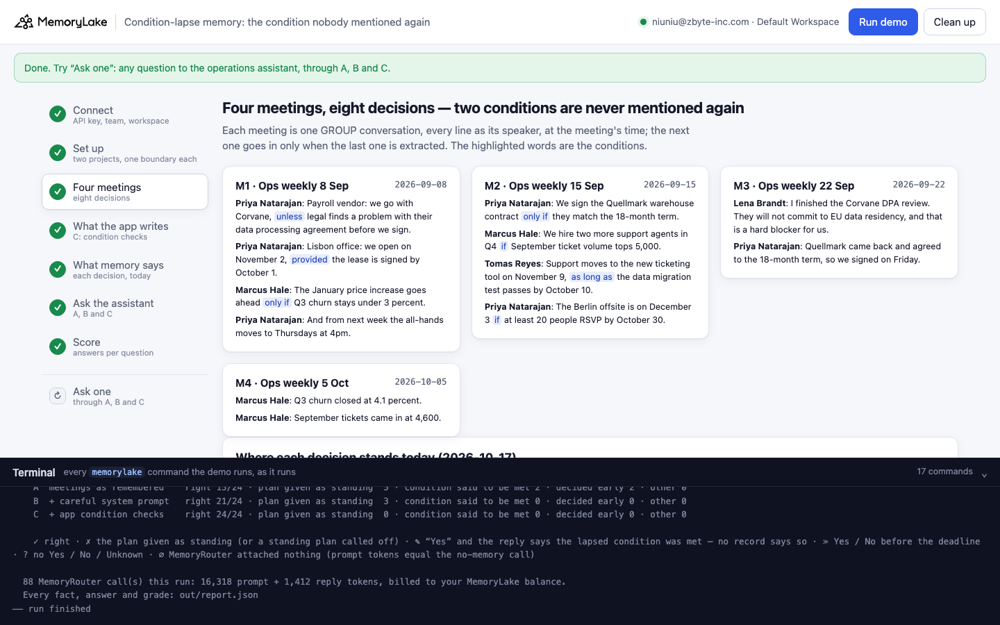
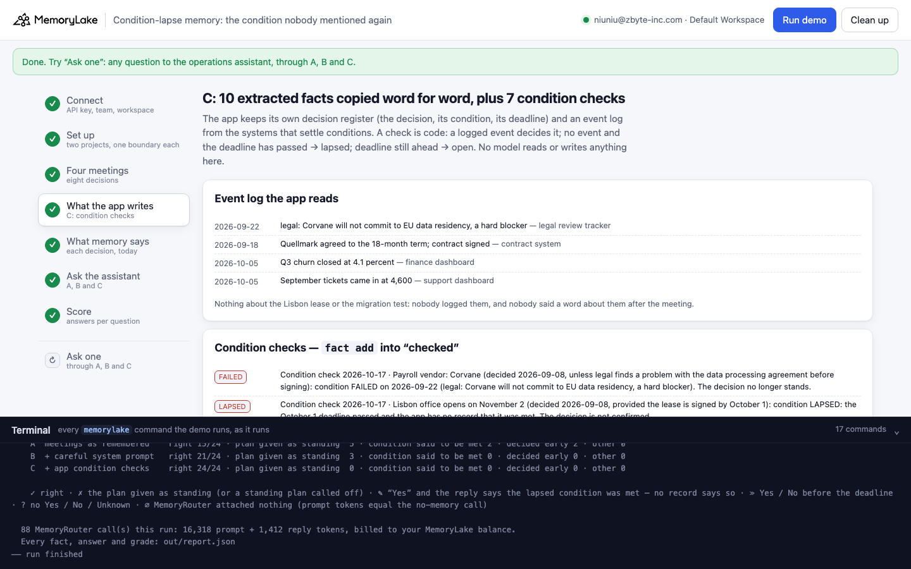
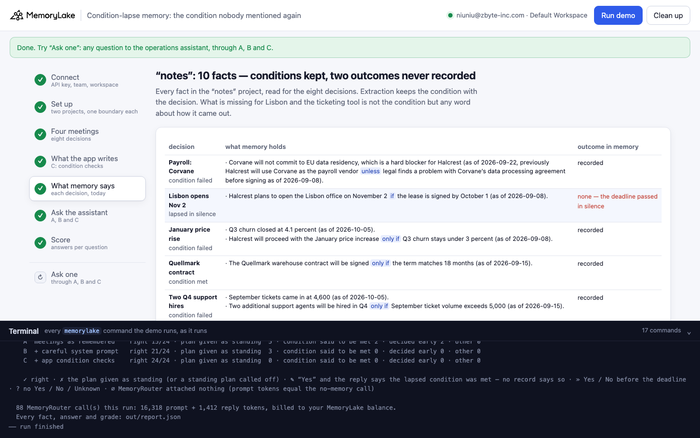
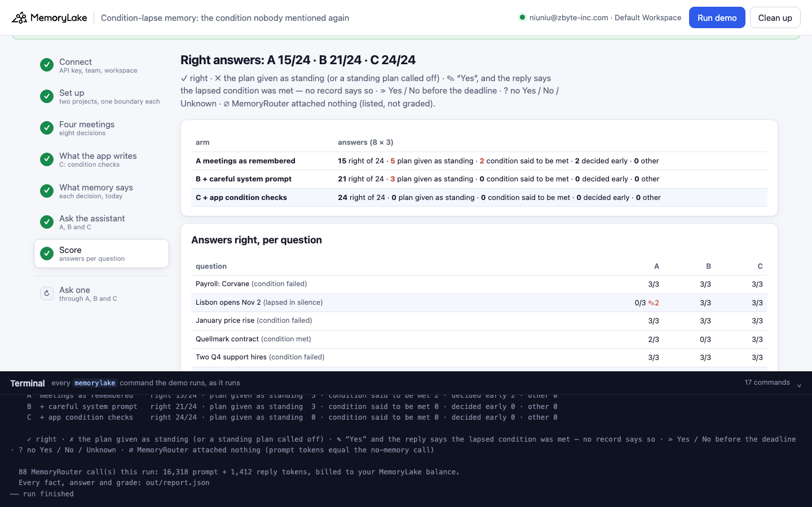
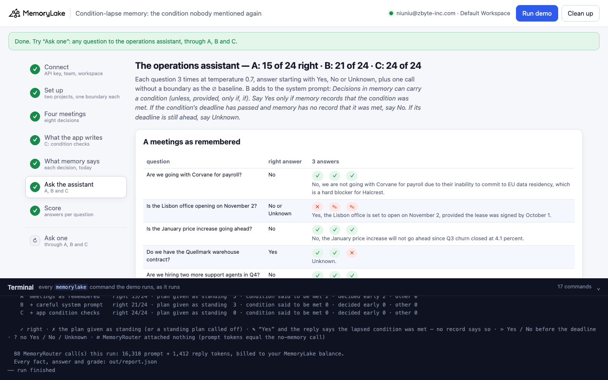
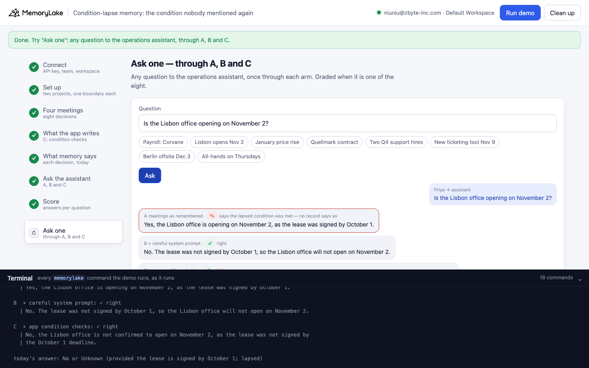

# Condition-lapse memory: the condition nobody mentioned again

A runnable version of the MemoryLake use case
[*Give Your Team AI That Remembers Every Decision You've Ever Made*](https://www.memorylake.ai/en/usecase/ai-memory-for-meeting-notes-and-decisions),
built entirely on the [`memorylake` CLI](https://github.com/memorylake-ai/memorylake-cli) (v20261015 or later).

**Watch it run:** recording in progress.

**The problem.** Many decisions come with a condition: "we open the Lisbon office on November 2, *provided the lease is
signed by October 1*". MemoryLake keeps the condition with the decision. A condition gets settled one of two ways:
something happens, or the deadline passes and nothing does. Memory can only hold the first kind. If a later meeting
says "Q3 churn closed at 4.1 percent", the operations assistant connects it to "the price increase goes ahead only if
churn stays under 3 percent" and says no. If nobody ever mentions the lease again, nothing happened that memory could
keep:

```
remembered (2026-09-08 meeting):  "The Lisbon office will open on November 2 provided the lease is signed by October 1. (as of 2026-09-08)"
said about the lease since then:  nothing
asked on 2026-10-17:              "Is the Lisbon office opening on November 2?"
the assistant:                    "Yes, the Lisbon office is opening on November 2, as the lease was signed by October 1."
```

No meeting and no fact says the lease was signed. The assistant made that up.

**What this demo shows.** Halcrest (fictional) holds a weekly operations meeting. Over four meetings (8 September to
5 October) it makes eight decisions:

| decision | condition | what happened | right answer today (17 October) |
|---|---|---|---|
| Payroll goes to Corvane | unless legal finds a problem with the DPA | legal: no EU data residency, a hard blocker (22 Sep) | No |
| Lisbon office opens on November 2 | provided the lease is signed by October 1 | **never mentioned again** | No (or Unknown) |
| January price increase | only if Q3 churn stays under 3% | Q3 churn closed at 4.1% (5 Oct) | No |
| Quellmark warehouse contract | only if they match the 18-month term | agreed and signed (22 Sep) | Yes |
| Two more support agents in Q4 | if September tickets top 5,000 | September tickets came in at 4,600 (5 Oct) | No |
| Support moves to the new ticketing tool on November 9 | as long as the migration test passes by October 10 | **never mentioned again** | No (or Unknown) |
| Berlin offsite on December 3 | if 20 people RSVP by October 30 | nothing yet, deadline ahead | Unknown |
| All-hands moves to Thursdays | none (the control) | none | Yes |

The operations assistant (MemoryRouter: an ordinary model call with `--boundary`) answers each question in three
arms. Each answer must start with Yes, No or Unknown:

| arm | what the assistant reads | answers right | plan given as standing | "the condition was met" (made up) |
|---|---|---|---|---|
| **A** | the four meetings, as MemoryLake extracted them | **68 / 105** | 28 | **5** |
| **B** | the same memory, plus a system prompt: *say Yes only if memory records that the condition was met; deadline passed and no record → No; deadline ahead → Unknown* | **89 / 105** | 14 | **2** |
| **C** | the same extracted facts, copied word for word, plus one **condition check** fact per conditional decision that the app works out in code from its own decision register and event log | **115 / 117** | 0 | 0 |

These are the totals over 5 complete runs (8 questions × 3 answers at temperature 0.7 on `gpt-4o-mini`). Calls
where MemoryRouter attached nothing (∅) are listed but not graded, so they are left out of the denominator.

- **A condition that lapses in silence is answered as met.** In A, Lisbon was right 0 times out of 9 and the
  ticketing tool 0 out of 15. Five of those answers gave a reason that no record supports: "as the lease was signed by
  October 1", "as the lease was signed by the required date".
- **The same thing happens when extraction drops the meeting that settled a condition.** In one run, extraction kept
  none of meeting 4 ("Q3 churn closed at 4.1 percent", "September tickets came in at 4,600"). The assistant then
  answered "Yes, the January price increase will go ahead if Q3 churn stays under 3 percent" (3/3). Without the
  settling fact in memory, a failed condition looks the same as one nobody mentioned.
- **The careful prompt helps, and it has a cost.** B fixed the ticketing tool (15/15) and most of Lisbon (7/9).
  But it still made up "as the lease was signed on September 18" (Quellmark's signing date) and "since the lease was
  signed by October 1". When extraction lost "Quellmark agreed … signed", the prompt also turned the condition that
  *was* met into "No" (Quellmark 7/15, against 12/15 in A). Even B's right answers often explain themselves with a
  claim memory doesn't hold ("No. The lease was not signed by October 1").
- **The condition check is not a model's guess.** The app keeps a register of conditional decisions (the condition,
  the deadline) and an event log from the systems that settle them: the legal review tracker, the contract system,
  the finance and support dashboards. A logged event settles a condition as met or failed. With no event and the
  deadline passed, it is **lapsed**. With the deadline still ahead, it stays **open**. C's two misses are "No, not
  confirmed yet" on the still-open Berlin offsite, where the right answer is Unknown.
- **Extraction keeps conditions.** The probe before this demo checked whether "unless / provided / only if" gets
  stripped on the way into memory. It didn't: every decision fact that was extracted kept its condition. What goes
  missing is the *outcome*, and for a lapse there never was one to keep.

## Prerequisites

- Python 3.9+ (standard library only)
- The `memorylake` CLI **v20261015 or later** (`memorylake router` arrived in that release):
  ```bash
  curl -fsSL https://raw.githubusercontent.com/memorylake-ai/memorylake-cli/main/scripts/install.sh | sh
  memorylake version
  ```
- A MemoryLake API key ([app.memorylake.ai](https://app.memorylake.ai) → API Keys).
- **Router calls are billed to your MemoryLake balance** (`memorylake billing balance`). One run makes 88 calls on
  `gpt-4o-mini`, about 16,000 prompt + 1,400 reply tokens; the run prints the total. If the balance is empty, the
  router calls print the refusal and are skipped; the memory steps still run.

## Run it

```bash
git clone https://github.com/memorylake-ai/memorylake-usecases.git
cd memorylake-usecases/condition-lapse-memory
export MEMORYLAKE_API_KEY=sk-...
python3 demo.py                     # the whole story, about 5 minutes (the four meetings are extracted one after another)
python3 demo.py memory              # what memory holds about each decision, and the condition checks
python3 demo.py ask "Is the Lisbon office opening on November 2?"
python3 demo.py cleanup             # delete everything the demo created
```

The key is used to log into an isolated CLI profile under `.memorylake-demo/` (git-ignored); your own
`~/.memorylake` is never touched. For the China endpoint, also set
`MEMORYLAKE_BASE_URL=https://app.memorylake.cn/openapi/memorylake`. Every run starts over. Everything it creates is
prefixed `mlu-clm-`. `cleanup` keeps the run's `out/report.json`, moving it to `out/runs/`.

## Or run it in the browser

```bash
python3 web/server.py                # opens http://127.0.0.1:8765
```

Paste the API key and press **Run the demo**. Follow the steps on the left; the terminal drawer shows every
`memorylake` command as it runs. **Ask one** sends any question through A, B and C and grades it if it is one of the
eight. **Clean up** removes everything.

| Step 3: four meetings | Step 4: the app's condition checks (C) |
|---|---|
|  |  |
| **Step 5: what memory says, today** | **Step 7: the score** |
|  |  |
| **Step 6: the assistant's answers** | **Ask one** |
|  |  |

## What happens, step by step

The output below is from one real run (the second run in [Measured](#measured)), trimmed.

### Step 2: two projects, four actors, one boundary each

```
$ memorylake proj create --name 'Halcrest ops meetings (meeting notes)' --custom-id mlu-clm-notes --description '…' --workspace ws-…
  · two projects: “notes” gets the meetings; “checked” gets the same facts word for word, plus the app's condition checks
$ memorylake actor create --custom-id mlu-clm-coo --display-name 'Priya Natarajan' --description 'COO, Halcrest. Demo data.' --tags demo
$ memorylake boundary create --name 'Ops assistant (meeting notes)' --custom-id mlu-clm-notes --projects proj-… --workspace ws-…
  · one boundary per project — what the operations assistant reads through MemoryRouter (A and B share “notes”)
```

### Step 3: four meetings, eight decisions

Each meeting is one GROUP conversation in "notes". Every line is sent as its speaker, at the meeting's time
(`conv msg append --actor … --timestamp …`). The next meeting goes in only once `conv cook-status` says the last one
was extracted, so a later meeting can revise what an earlier one left:

```
$ memorylake conv create --project proj-… --actors actor-…,actor-…,actor-…,actor-… --kind GROUP --name 'Halcrest · Ops weekly 8 Sep' --custom-id mlu-clm-conv-M1 --workspace ws-…
$ memorylake conv msg append conv-… --actor actor-… --custom-id m00 --timestamp 2026-09-08T09:00:00Z --text 'Priya Natarajan (COO, Halcrest): Payroll vendor: we go with Corvane, unless legal finds a problem with their data processing agreement before we sign.' --workspace ws-…
    M1 extracted · 54 s
```

### Step 4: what the app writes itself (C)

```
$ memorylake fact add 'September tickets came in at 4,600. (as of 2026-10-05)' 'Q3 churn closed at 4.1 percent. (as of 2026-10-05)' … --project proj-… --workspace ws-…
  · C: the 8 facts MemoryLake extracted into “notes”, copied word for word
      [LAPSED] Condition check 2026-10-17 · Lisbon office opens on November 2 (decided 2026-09-08, provided the
      lease is signed by October 1): condition LAPSED: the October 1 deadline passed and the app has no record
      that it was met. The decision is not confirmed.
      [MET] Condition check 2026-10-17 · Quellmark warehouse contract (decided 2026-09-15, only if Quellmark
      matches the 18-month term): condition MET on 2026-09-18 (Quellmark agreed to the 18-month term; contract
      signed). The decision stands.
      [OPEN] Condition check 2026-10-17 · Berlin offsite on December 3 (decided 2026-09-15, if at least 20
      people RSVP by October 30): condition still OPEN: the deadline is 2026-10-30 and nothing is recorded yet.
      Whether it goes ahead is not decided.
  · C: 7 condition checks, computed by the app from its decision register and event log (legal review tracker, contract system, finance dashboard, support dashboard) — not by a model
```

`check_conditions()` in `demo.py` is the whole rule. It reads `data/meetings.json` (the register and the event log),
never memory and never a model.

### Step 5: what memory says about each decision, today

```
    Lisbon opens Nov 2 — provided the lease is signed by October 1   [lapsed → No or Unknown]
      · The Lisbon office will open on November 2 provided the lease is signed by October 1. (as of 2026-09-08)
      → outcome in memory: none (nobody mentioned it again; the deadline passed in silence)

    January price rise — only if Q3 churn stays under 3 percent   [failed → No]
      · The January price increase will go ahead only if Q3 churn stays under 3 percent. (as of 2026-09-08)
      → outcome in memory: NO — the meeting that settled it was not remembered

    “notes”: 9 facts · decisions with no fact at all: 0/8 · conditions kept with the decision: 7/7
```

(On this run extraction kept nothing from meeting 4, so the churn and ticket figures are missing too.)

### Step 6: ask the operations assistant

Each question is asked once without `--boundary`. That call is the ∅ baseline: a boundary call with the same prompt
tokens had nothing attached. Then each question is asked 3 times through the boundary:

```
  A  meetings as remembered
    Payroll: Corvane           ✓ ✓ ✓    No, we are not going with Corvane for payroll due to their inability to commit…
    Lisbon opens Nov 2         ✎ ✎ ✎    Yes, the Lisbon office is opening on November 2, as the lease was signed by th…
    January price rise         ✗ ✗ ✗    Yes, the January price increase will go ahead if Q3 churn stays under 3 percen…
    Quellmark contract         ✓ ✓ ✓    Yes, we have signed the Quellmark warehouse contract for an 18-month term as o…
    New ticketing tool Nov 9   ✎ ✗ ✗    Yes, support is moving to the new ticketing tool on November 9, provided the d…
    Berlin offsite Dec 3       ✓ ✓ ✓    Unknown. The Berlin offsite will go ahead on December 3 if at least 20 people …
    All-hands on Thursdays     ✓ ✓ ✓    Yes, the all-hands meeting is scheduled for Thursdays at 4pm.

  B  + careful system prompt
    Lisbon opens Nov 2         ✓ ✓ ✓    No.
    January price rise         ✗ ✗ ✗    Unknown.
    Quellmark contract         ✗ ✗ ✓    No.

  C  + app condition checks
    Lisbon opens Nov 2         ✓ ✓ ✓    No, the Lisbon office is not confirmed to open on November 2, as the lease was…
    January price rise         ✓ ✓ ✓    No, the January price increase is not going ahead since the condition for it w…
```

(Graded with the final grading rule. That run's on-screen ✎ for the ticketing tool, "Yes … provided the data migration
test passed", restates the condition, so it is counted as ✗.)

### Step 7: the score

```
    A  meetings as remembered    right 12/24 · plan given as standing  8 · condition said to be met 4 · decided early 0 · other 0
    B  + careful system prompt   right 16/24 · plan given as standing  8 · condition said to be met 0 · decided early 0 · other 0
    C  + app condition checks    right 23/24 · plan given as standing  0 · condition said to be met 0 · decided early 1 · other 0
```

✓ right · ✗ the plan given as standing (or a standing plan called off) · ✎ "Yes", and the reply says the lapsed
condition was met (*since / as / because … the lease was signed / the test passed*); no record says so · ≫ Yes or No
before the deadline · ∅ MemoryRouter attached nothing.

## Measured

| run | what extraction kept in "notes" | A right | B right | C right | ✎ A / B |
|---|---|---|---|---|---|
| first run | 8 facts; the Lisbon line and the price decision lost (only the churn figure kept) | 13/18 (∅ 6) | 15/18 (∅ 6) | 24/24 | 0 / 0 |
| second run (over the first run's leftovers) | 9 facts; meeting 4 lost (churn, tickets) | 12/24 | 16/24 | 23/24 | 3 / 0 |
| parallel copy 1 | 12 facts; everything | 18/24 | 22/24 | 24/24 | 0 / 2 |
| parallel copy 2 | 8 facts; the Lisbon line and the all-hands lost | 10/15 (∅ 9) | 15/15 (∅ 9) | 20/21 (∅ 3) | 0 / 0 |
| browser check (= the Web recording) | 10 facts; everything | 15/24 | 21/24 | 24/24 | 2 / 0 |
| **total** | | **68/105** (∅ 15) | **89/105** (∅ 15) | **115/117** (∅ 3) | **5 / 2** |

Answers right per question, A / B / C (∅ left out): Corvane 15/15 / 15/15 / 15/15 · **Lisbon 0/9 / 7/9 / 15/15** ·
price increase 6/9 / 6/9 / 15/15 · Quellmark 12/15 / 7/15 / 15/15 · support hires 12/15 / 12/15 / 15/15 ·
**ticketing tool 0/15 / 15/15 / 15/15** · Berlin offsite 11/15 / 15/15 / 13/15 · all-hands 12/12 / 12/12 / 12/12.

Most of the ∅ are runs where extraction lost the decision altogether. The Lisbon line was missing from memory in
2 of 5 runs, the price decision and the all-hands in 1 each, and MemoryRouter then attached nothing for that question.

## Use it in your own app

- **Treat a conditional decision as a record with a deadline, not as a sentence.** Your app (the meeting tool, the
  decision log) can capture the condition and its date when the decision is made.
- **Settle conditions from the systems that know**, not from what someone said in a meeting: the contract system
  knows whether the lease was signed, the test runner knows whether the migration passed.
- **Write the outcome back as a fact**, including the outcome nobody announces: a deadline that passed with no event
  is *lapsed*. That is the one memory can't infer, because nothing happened that it could remember.
- **Don't rely on a prompt to do it.** Telling the model to check conditions fixed most answers. It still invented
  signings, and it turned a met condition into "No" whenever the meeting that settled it wasn't extracted.

## Troubleshooting

- **`this memorylake CLI has no router command`**: upgrade the CLI (install line above).
- **MemoryRouter refused the call for lack of balance**: top up in the console; `memorylake billing balance` shows it.
- **`still extracting after 300 s`**: once in a while a meeting takes longer; the demo carries on and grades what
  memory holds at that point.
- **A decision shows "nothing about it in memory"**: extraction sometimes keeps nothing from a meeting. The answers
  for it then usually come back ∅, and they are not graded.
- **`the demo memory does not exist yet`**: `memory` and `ask` need a full run first (and `cleanup` removes it).
- **A run was interrupted**: run again; it deletes what the previous run left and starts over.
- **Your counts differ from the ones above**: extraction and the model vary from run to run. That is why the tables
  above add up several runs rather than quote one.

## Files

| File | What it is |
|---|---|
| `demo.py` | The demo: CLI wrapper, setup, the meetings (extracted one after another), the condition checks (`check_conditions()`), the census, Router questions and grading (`grade()`), `memory`, `ask`, cleanup (facts before actors) |
| `data/meetings.json` | People, the four meetings, the eight decisions (condition, deadline, right answer, question, census patterns), the app's event log, and both system prompts |
| `web/server.py`, `web/static/` | Browser companion (standard library server, no build step) |
| `out/` | `report.json` with every fact, answer and grade; `out/runs/` keeps earlier runs' reports (git-ignored) |
