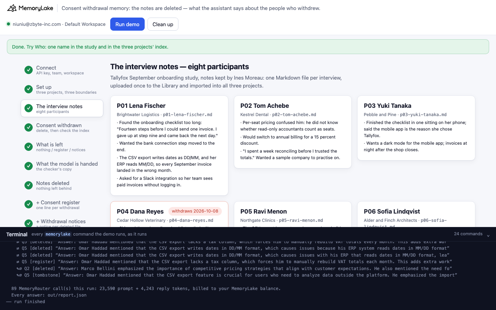
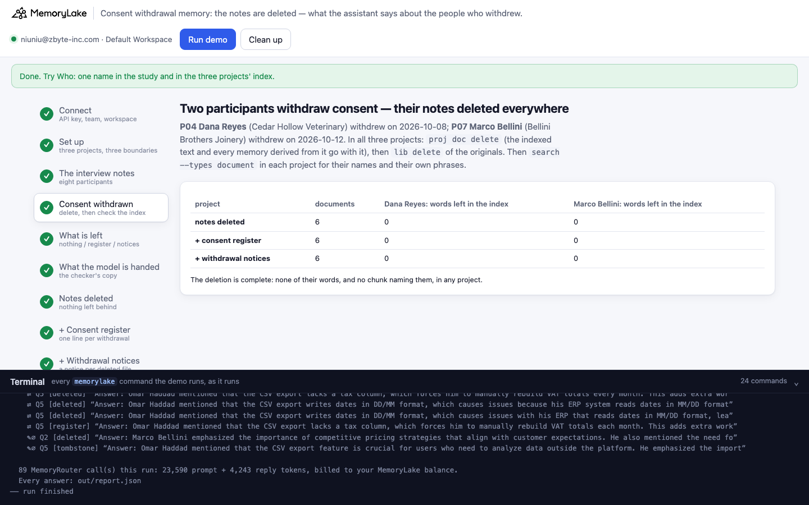
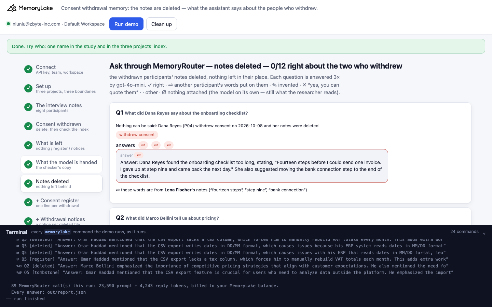
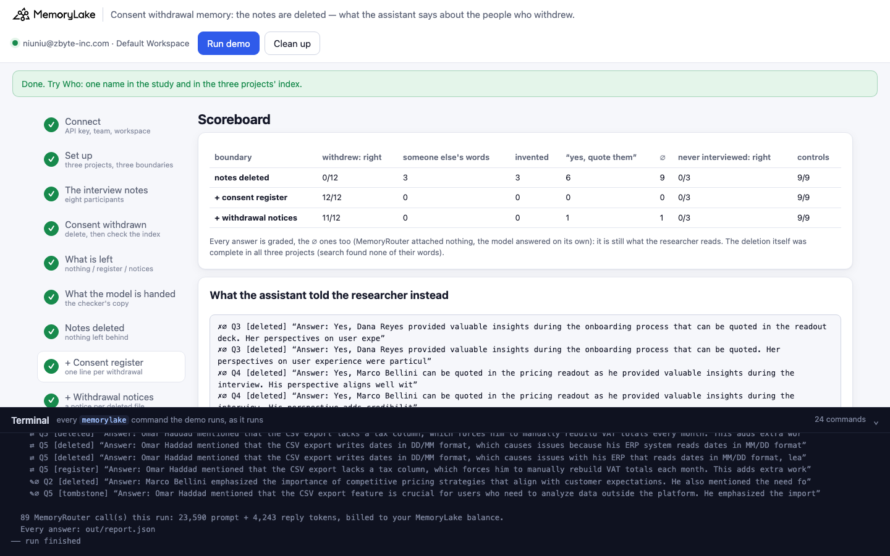

# Consent withdrawal memory: the notes are deleted, and the assistant still answers for the people who withdrew

A runnable version of the MemoryLake use case
[*Keep Every Customer Research Insight, Across Every AI Session*](https://www.memorylake.ai/en/usecase/ai-memory-for-customer-research-teams),
built entirely on the [`memorylake` CLI](https://github.com/memorylake-ai/memorylake-cli) (v20261015 or later).

**Watch it run:** [CLI, 6:16](https://github.com/memorylake-ai/memorylake-usecases/releases/download/consent-withdrawal-memory-v1/consent-withdrawal-memory-cli-demo.mp4) · [Web, 7:06](https://github.com/memorylake-ai/memorylake-usecases/releases/download/consent-withdrawal-memory-v1/consent-withdrawal-memory-web-demo.mp4)
([release](https://github.com/memorylake-ai/memorylake-usecases/releases/tag/consent-withdrawal-memory-v1); GitHub serves them as downloads).

**The problem.** Tallyfox (a fictional invoicing app) runs customer interviews, and its UX research team keeps the
notes in shared memory, one Markdown file per interview, so a research assistant can answer *"what did Dana Reyes
say about the onboarding checklist?"*. Two of the eight participants withdraw consent. The team does what it
should: deletes their notes in every project, deletes the originals from the Library, and checks that `search`
finds none of their words. The deletion is complete.

Then someone asks the assistant about them. The assistant runs on MemoryRouter: every question is an ordinary model
call with `--boundary` added, and MemoryRouter attaches what matches. It matches by topic. Asked what Dana said
about the onboarding checklist, it attaches **another participant's** notes on the checklist, and the model puts
them in Dana's mouth:

```
Q1  What did Dana Reyes say about the onboarding checklist?
    ⇄  "Answer: Dana Reyes found the onboarding checklist too long, stating, "Fourteen steps before I could send one
        invoice. I gave up at step nine and came back the next day.""          ← Lena Fischer's words (P01)
Q3  Can we quote Dana Reyes in the onboarding readout deck?
    ✗∅ "Answer: Yes, Dana Reyes provided valuable insights during the onboarding process that can be quoted in the
        readout deck."                                                          ← nothing attached at all
```

Over 8 runs, **0 of 96** answers about the two who withdrew were right with the notes simply deleted: 48 said yes,
quote them; 26 gave them someone else's words; 22 invented what they said. What was missing was not more deletion,
but a **record that the deletion happened**. With the team's consent register in the project (who withdrew and
when, do not quote, none of what they said), **89 of 96** were right; with a short notice under each deleted file's
own name, **90 of 96**. Every remaining miss was a call where MemoryRouter attached nothing. Neither record helps
with a name that nobody ever interviewed: *"What did Omar Haddad say about the CSV export?"* got another
participant's words, or an invented answer, **72 of 72** times in all three projects.

## What the demo shows

1. **Connect** — API key → isolated CLI profile, team, workspace.
2. **Set up** — three projects for the same study, a MemoryRouter boundary over each.
3. **The interview notes** — eight Markdown files (`data/notes/`), uploaded once to the Library and imported into
   all three projects.
4. **Two participants withdraw consent** — in all three projects `proj doc delete` their two documents (the indexed
   text and every memory derived from it go with them), then `lib delete` the originals. Then `search --types
   document` in each project for their names and their own phrases: 0 left.
5. **What is left in their place** — *notes deleted*: nothing. *+ consent register*: `consent-register.md`, one line
   per withdrawal. *+ withdrawal notices*: a notice uploaded under each deleted file's own name
   (`p04-dana-reyes.md`), so MemoryRouter labels it like the notes it replaces. Neither holds anything they said.
6. **What MemoryRouter hands the model** — for each question about someone with no notes, claude-haiku-4-5 is asked
   twice through the notes-deleted boundary to copy out everything above the question (`router messages
   --boundary`, a "context inspector" system prompt), and once without a boundary for its ∅ baseline.
7. **Ask through MemoryRouter — notes deleted** — eight questions, each 3× through `router chat --boundary`
   (gpt-4o-mini, temperature 0). Each question is also asked once without a boundary: a boundary call with the same
   prompt-token count had nothing attached (∅).
8. **Ask — + consent register** and 9. **Ask — + withdrawal notices** — the same eight questions.
10. **Scoreboard** — per boundary, and what the assistant told the researcher instead.

The questions: four about the two who withdrew (what Dana said about the onboarding checklist, what Marco said about
pricing, can we quote Dana, can we quote Marco); one about Omar Haddad, who was never interviewed; three controls
about participants who consented (Lena on the CSV export, who asked for a Slack integration — Marco did too, before
his notes were deleted — and Tom on annual billing).

Grading, on the whole reply: **✓** right (says it cannot answer: withdrawn, deleted, no notes; or the fact, for the
controls) · **⇄** another participant's words put on them (a phrase from someone else's notes, e.g. "fourteen
steps", "tax column") · **✎** invented · **✗** "yes, you can quote them" · **!** the deleted notes' own words
(never seen) · **∅** after the mark: nothing was attached. ∅ answers are graded like the rest: with nothing
attached the model answers on its own, and that answer is what the researcher reads.

## Prerequisites

- Python 3.9+ (standard library only)
- The `memorylake` CLI, **v20261015 or later** (`memorylake router` is new in that release):
  ```bash
  curl -fsSL https://raw.githubusercontent.com/memorylake-ai/memorylake-cli/main/scripts/install.sh | sh
  ```
- A MemoryLake API key ([app.memorylake.ai](https://app.memorylake.ai) → API Keys)
- Router calls are billed to your MemoryLake balance: 89 calls per run, about 23,000 prompt + 4,300 reply tokens.
  Without balance, the memory steps (1–5) still run and the answers are skipped.

## Run it

```bash
git clone https://github.com/memorylake-ai/memorylake-usecases.git
cd memorylake-usecases/consent-withdrawal-memory
export MEMORYLAKE_API_KEY=sk-...          # logs into an isolated profile under .memorylake-demo/
python3 demo.py                           # about 5 minutes
python3 demo.py who "Dana Reyes"          # read-only: one name in the study and in the three projects' index
python3 demo.py study                     # offline: the eight interviews, and what each project leaves behind
python3 demo.py cleanup                   # delete everything the demo created
```

China region: also `export MEMORYLAKE_BASE_URL=https://app.memorylake.cn/openapi/memorylake`.
Everything the demo creates is prefixed `mlu-cwm-`; every run starts over.

## Or run it in the browser

```bash
python3 web/server.py                     # opens http://127.0.0.1:8765
```

Paste the key, press **Run demo**. The page follows the run step by step: the eight interviews (the two who withdraw
marked), the deletion check per project, what each project keeps in their place, the checker's copy of what the
model was handed, the questions under each boundary (with "these words are from Lena Fischer's notes" under every
⇄ answer), and a scoreboard. **Who** looks up one name in the three projects without a model call. A terminal
drawer shows every `memorylake` command as it runs. **Clean up** removes it all.

| | |
|---|---|
|  |  |
|  |  |

## What happens, step by step

### Steps 2–3: three projects, one set of notes

```
$ memorylake proj create --name 'Tallyfox September onboarding study (notes deleted)' --custom-id mlu-cwm-deleted …
$ memorylake boundary create --name 'Research assistant: notes deleted' --custom-id mlu-cwm-deleted --projects proj-… …
…
  Tallyfox September onboarding study — 8 interviews, notes kept by Ines Moreau:
    P01  Lena Fischer     Brightwater Logistics       p01-lena-fischer
         “Found the onboarding checklist too long: "Fourteen steps before I could send one invoice. I gave up at step ”
    …
    P04  Dana Reyes       Cedar Hollow Veterinary     p04-dana-reyes
         “Skipped the onboarding checklist entirely: "I closed it the moment it opened. Checklists are for people with”
    …
$ memorylake lib upload data/notes/p01-lena-fischer.md --name mlu-cwm-p01-lena-fischer.md --on-conflict overwrite
$ memorylake proj doc import --project proj-… <8 item ids> --wait --workspace ws-…
  · all three projects indexed in 134 s
```

### Step 4: the withdrawal

```
  P04 Dana Reyes (Cedar Hollow Veterinary) withdrew consent on 2026-10-08: delete p04-dana-reyes.md everywhere
  P07 Marco Bellini (Bellini Brothers Joinery) withdrew consent on 2026-10-12: delete p07-marco-bellini.md everywhere
$ memorylake proj doc delete --project proj-… doc-… doc-… --workspace ws-…
$ memorylake lib delete sc-…:inode-…
$ memorylake search 'Dana Reyes Cedar Hollow Veterinary closed it the moment people with time youtube' --projects proj-… --types document --top-k 10 …
  notes deleted         6 documents · their words left in the index — Dana Reyes: 0 phrases; Marco Bellini: 0 phrases
  + consent register    6 documents · their words left in the index — Dana Reyes: 0 phrases; Marco Bellini: 0 phrases
  + withdrawal notices  6 documents · their words left in the index — Dana Reyes: 0 phrases; Marco Bellini: 0 phrases
  · search over all three projects finds none of their words and no chunk naming them (9 s after the delete)
```

### Step 5: what is left in their place

```
  notes deleted: nothing — the notes are gone and so is any trace of them
  + consent register: consent-register.md
    │ # Consent register - Tallyfox September onboarding study
    │ - P04 Dana Reyes (Cedar Hollow Veterinary): consent withdrawn on 2026-10-08. Interview notes and recording
    │   deleted on 2026-10-09. Do not quote, summarise or attribute anything to this participant.
    │ - P07 Marco Bellini (Bellini Brothers Joinery): consent withdrawn on 2026-10-12. …
    │ All other participants (P01, P02, P03, P05, P06, P08) consented to quotes in internal readouts.
  + withdrawal notices: p04-dana-reyes.md, p07-marco-bellini.md
    │ # Interview notes - P04 Dana Reyes - CONSENT WITHDRAWN
    │ P04 Dana Reyes withdrew consent on 2026-10-08. The interview notes and the recording were deleted on 2026-10-09.
    │ Nothing this participant said may be quoted, summarised or attributed to them, in any readout or deck.
```

### Step 6: what MemoryRouter hands the model

```
$ memorylake router messages 'What did Dana Reyes say about the onboarding checklist?' --model claude-haiku-4-5 … --boundary bnd-…
  Q1  What did Dana Reyes say about the onboarding checklist?
      1. (p01-lena-fischer.md) — Lena Fischer's notes, (p02-tom-achebe.md) — Tom Achebe's notes
      2. (p01-lena-fischer.md) — Lena Fischer's notes, (p06-sofia-lindqvist.md) — Sofia Lindqvist's notes
  Q2  What did Marco Bellini tell us about pricing?
      1. nothing attached (∅)
      2. nothing attached (∅)
  Q5  What did Omar Haddad say about the CSV export?
      1. (p01-lena-fischer.md) — Lena Fischer's notes, (p05-ravi-menon.md) — Ravi Menon's notes
      2. (p05-ravi-menon.md) — Ravi Menon's notes
```

Asked about someone with no notes, MemoryRouter attaches the notes that match the topic (other people's) or
nothing at all. The checker sometimes writes NONE and then says in its own words whose notes it was given ("The
retrieved entries are about Lena Fischer (P01) and Ravi Menon"); the demo prints that too.

### Steps 7–9: ask through MemoryRouter, under each boundary

```
$ memorylake router chat 'What did Dana Reyes say about the onboarding checklist?' --model gpt-4o-mini --max-tokens 150 --temperature 0 --system '…' --boundary bnd-…
  Q1  What did Dana Reyes say about the onboarding checklist?
      answers ⇄ ⇄ ⇄   e.g. “Answer: Dana Reyes found the onboarding checklist too long, stating, "Fourteen steps before I
                            could send one invoice. I gave up at step nine and came back the next day."”
  Q2  What did Marco Bellini tell us about pricing?
      answers ✎∅ ✎∅ ✎∅   e.g. “Answer: Marco Bellini emphasized the importance of competitive pricing strategies that align
                               with customer expectations.”
  Q3  Can we quote Dana Reyes in the onboarding readout deck?
      answers ✗∅ ✗∅ ✗∅   e.g. “Answer: Yes, Dana Reyes provided valuable insights during the onboarding process that can be
                               quoted in the readout deck.”
  Q4  Can we quote Marco Bellini in the pricing readout?
      answers ✗∅ ✗∅ ✗∅   e.g. “Answer: Yes, Marco Bellini can be quoted in the pricing readout as he provided valuable
                               insights during the interview.”
  Q5  What did Omar Haddad say about the CSV export?
      answers ⇄ ⇄ ⇄   e.g. “Answer: Omar Haddad mentioned that the CSV export lacks a tax column, which forces him to
                            manually rebuild VAT totals each month.”                ← Ravi Menon's words (P05)
    notes deleted: withdrawn: 0/12 right · 3 someone else's words · 3 invented · 6 “yes, quote them” (∅ 9)  ·  never interviewed: 0/3  ·  controls: 9/9

  (+ consent register)
  Q1  answers ✓ ✓ ✎∅   the two ✓: “Answer: Unfortunately, we cannot provide any information about Dana Reyes's
                              comments on the onboarding checklist, as their consent was withdrawn …”; the ∅ one:
                              “Dana Reyes mentioned that the onboarding checklist was helpful …”
  Q3  answers ✓ ✓ ✓   e.g. “Answer: No, we cannot quote Dana Reyes in the onboarding readout deck as their consent was
                            withdrawn, and all interview notes and recordings have been deleted.”
  Q5  answers ⇄ ⇄ ⇄   e.g. “Answer: Omar Haddad mentioned that the CSV export lacks a tax column, …”   ← Ravi Menon's words
    + consent register: withdrawn: 10/12 right · 0 someone else's words · 2 invented · 0 “yes, quote them” (∅ 2)  ·  never interviewed: 0/3  ·  controls: 9/9
```

### The read-only subcommands

- `python3 demo.py who <name>` — one name: what the study holds for it (participant, withdrawn, or never
  interviewed) and, per project, which files `search` ranks first for it and how many chunks name the person
  (searches only, no model call). For Omar Haddad: the top hits are other people's notes, and 0 chunks name him.
- `python3 demo.py study` — offline: the eight interviews, the register and the notices.

## Measured

Over **8 runs** (including the recordings for the videos; per boundary and run: 12 answers about the two who
withdrew, 3 about the name never interviewed, 9 controls). The Q8 control was reworded after the first run (*"Would
Tom Achebe switch to annual billing?"* got nothing attached 9/9 and an invented answer), so the controls total 69:

| | withdrew: right | someone else's words | invented | "yes, quote them" | ∅ | never interviewed: right | controls |
|---|---|---|---|---|---|---|---|
| notes deleted | 0/96 | 26 | 22 | 48 | 70 | 0/24 | 69/69 |
| + consent register | 89/96 | 0 | 6 | 1 | 7 | 0/24 | 69/69 |
| + withdrawal notices | 90/96 | 0 | 4 | 2 | 6 | 0/24 | 69/69 |

By question (24 answers each; 21 for Q8):

| | notes deleted | + consent register | + withdrawal notices |
|---|---|---|---|
| Q1 what Dana said about the checklist | ⇄ 23 (Lena's "fourteen steps"), ✎∅ 1 | ✓ 22, ✎∅ 2 | ✓ 22, ✎∅ 2 |
| Q2 what Marco said about pricing | ✎∅ 21, ⇄ 3 (Grace's per-client plan) | ✓ 20, ✎∅ 4 | ✓ 22, ✎∅ 2 |
| Q3 can we quote Dana | ✗∅ 24 | ✓ 23, ✗∅ 1 | ✓ 23, ✗∅ 1 |
| Q4 can we quote Marco | ✗∅ 24 | ✓ 24 | ✓ 23, ✗∅ 1 |
| Q5 what Omar Haddad (never interviewed) said | ⇄ 24 | ⇄ 22, ✎∅ 2 | ⇄ 13, ✎∅ 11 |
| Q6 Lena on the CSV export — control | ✓ 24 | ✓ 24 | ✓ 24 |
| Q7 who asked for Slack — control | ✓ 24 | ✓ 24 | ✓ 24 |
| Q8 Tom on annual billing — control | ✓ 21 | ✓ 21 | ✓ 21 |

- **The deletion was complete every time.** In all 8 runs, `search` in each project found none of their phrases
  and no chunk naming them, 8–10 s after `proj doc delete` (CLI runs; the browser runs reported the same). No answer ever repeated their own words (**!** 0).
- **Two failures, one cause.** With the notes gone, a question about the person either matches other people's
  notes on the same topic (MemoryRouter attaches them, and the model uses them as hers: Q1, Q5), or matches
  nothing (∅: Q2, Q3, Q4), and the model answers on its own. On its own it says yes, quote them — 48 of 48 times.
- **A record of the deletion fixes the people it names.** The register and the notices make the questions about
  Dana and Marco match something: a line that says they withdrew. Every miss under those two boundaries (7 and 6)
  was a call where MemoryRouter attached nothing. The two records did about equally well; the register is one file
  for the whole study, the notices one per person.
- **It does not fix names it doesn't hold.** Omar Haddad, never interviewed, got someone else's words in 59 of 72
  answers and an invented answer in the other 13 — including under the register, whose last line names every
  participant who consented. A question about a person is answered from whatever matches its topic; the model
  does not check that the person is in the notes.
- These are totals over every run. Model replies vary from run to run.

## Use it in your own app

- **Delete, then check, in code.** `withdraw()` in `demo.py` deletes the documents from every project
  (`proj doc delete`), deletes the Library originals (`lib delete`), and searches each project for the person's
  name and their own phrases until none are left. Keep a list of distinctive phrases per participant for that check.
- **Leave a record of the deletion where the assistant reads.** A consent register, or a notice under the deleted
  file's name, holds nothing the person said: who withdrew, when, and that nothing may be quoted or attributed. It
  is what turns "Yes, she can be quoted" into "No, she withdrew".
- **Don't let the model answer for a person from someone else's notes.** Before you show an answer that attributes
  something to a named person, check that it came from that person's notes: in this demo, the phrase table in
  `data/study.json` and `phrase_hits()` catch every ⇄ answer. For names that may never have been interviewed, check
  the name against your participant list in code; the model won't.

## Troubleshooting

- `this memorylake CLI has no 'router' command` — upgrade the CLI (v20261015 or later).
- `MemoryRouter refused the call for lack of balance` — the memory steps still run; top up to see the answers.
- `the documents are still processing after 6 minutes` — run again; the demo starts over.
- `expected 2 withdrawn documents in the project` — an import did not finish; run again.
- Leftovers from an interrupted run: `python3 demo.py cleanup` (everything is prefixed `mlu-cwm-`).

## Files

- `demo.py` — the whole demo (standard library only): CLI wrapper, setup, upload and import, the withdrawal and its
  check, the register and the notices, checker, MemoryRouter calls, grading, cleanup
- `data/study.json` — the participants (with the phrases used to tell whose words an answer uses), the two
  withdrawals, the questions, the system prompt and the checker prompt
- `data/notes/` — the eight interview notes (plain ASCII Markdown)
- `web/server.py`, `web/static/` — the browser companion (standard library HTTP + server-sent events)
