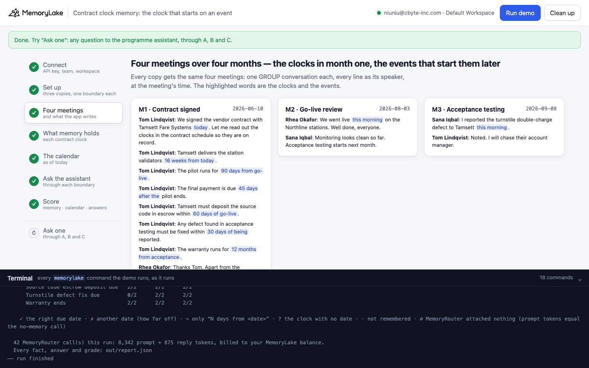
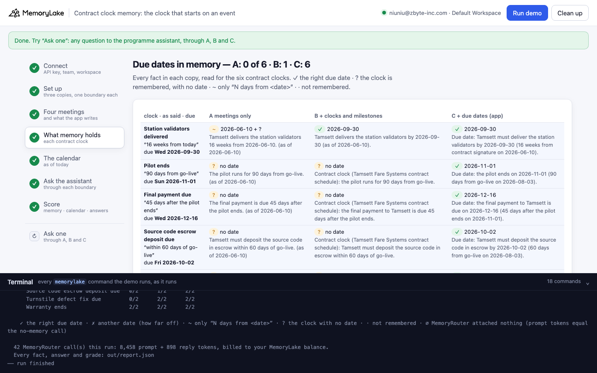
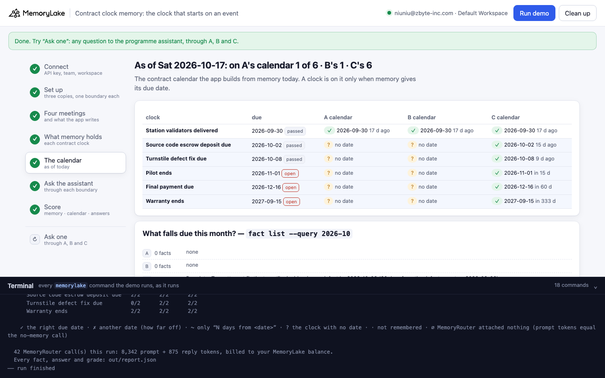
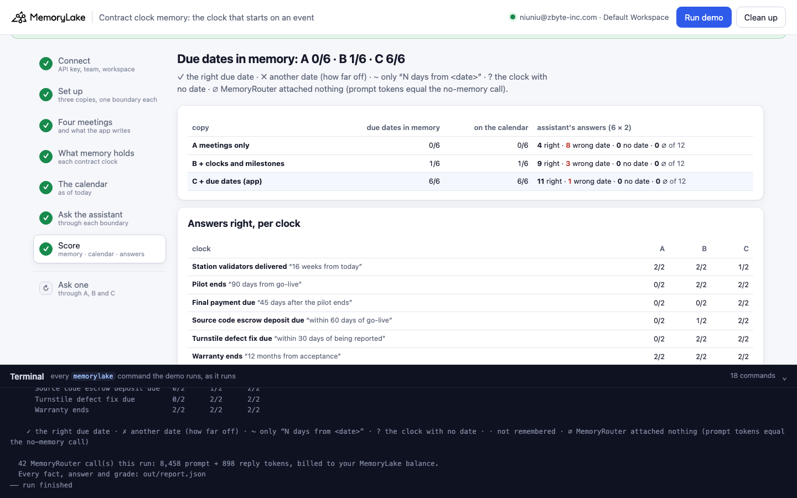

# Contract clock memory: the clock that starts on an event

A runnable version of the MemoryLake use case
[*Months of Project Context, Retained Across Every AI Session*](https://www.memorylake.ai/en/usecase/ai-memory-for-long-term-projects),
built entirely on the [`memorylake` CLI](https://github.com/memorylake-ai/memorylake-cli) (v20261015 or later).

**Watch it run:** [CLI, 5:02](https://github.com/memorylake-ai/memorylake-usecases/releases/download/contract-clock-memory-v1/contract-clock-memory-cli-demo.mp4) · [Web, 5:35](https://github.com/memorylake-ai/memorylake-usecases/releases/download/contract-clock-memory-v1/contract-clock-memory-web-demo.mp4)
([release](https://github.com/memorylake-ai/memorylake-usecases/releases/tag/contract-clock-memory-v1); GitHub serves them as downloads). In the Web recording C missed one answer: the
validators date came back as 2026-09-29, an off-by-one date that extraction wrote into the same copy.

**The problem.** A long project's contract is full of clocks that start on an event, not on a date: the pilot runs
90 days *from go-live*, the final payment is due 45 days *after the pilot ends*, a defect must be fixed within 30 days
*of being reported*, the warranty runs 12 months *from acceptance*. The clocks are read out in month one, the day the
contract is signed. The events that start them happen in month two, three, four, in other meetings. MemoryLake
remembers both, as separate facts, and nothing ever joins them:

```
remembered (2026-06-10 meeting):  "The pilot runs for 90 days from go-live. (as of 2026-06-10)"
remembered (2026-08-03 meeting):  "The system went live on the Northline stations. (on 2026-08-03)"
remembered: nothing that says the pilot ends on 2026-11-01
```

Ask "when does the pilot end?" and the model has to find both facts and do the arithmetic itself. For a chained clock
(45 days after a 90-day pilot) it got it wrong every time.

**What this demo shows.** Fernbeck Transit (fictional) is replacing its fare system with a vendor, Tamsett Fare Systems
(fictional). Four PMO meetings over four months: the contract is signed and its six clocks are read out (10 June), the
system goes live (3 August), a defect is reported in acceptance testing (8 September), the acceptance certificate is
signed (15 September). Today is 17 October. The demo stores the same four meetings three times:

| copy | what is stored | due dates in memory | clocks on today's calendar | programme assistant's answers right |
|---|---|---|---|---|
| **A** | the meetings only | **4 / 48** | **4 / 48** | **44 / 96** |
| **B** | the meetings + the app writes the six clocks and the four milestones as structured facts (the use case page's "stable parameters" and "events with timestamps") | **6 / 48** | **6 / 48** | **70 / 96** |
| **C** | B + the app works out each due date in code when the milestone that starts it is written, and pins it | **48 / 48** | **48 / 48** | **95 / 96** |

Measured over 8 complete runs (6 clocks each; the assistant's answers are 6 questions × 2 at temperature 0.7 on
`gpt-4o-mini` through MemoryRouter). MemoryRouter attached something on every one of those calls (no ∅).

- **The five clocks that start on an event never got a due date in A or B: 0 of 40 each.** The only clock that ever
  did is the one that starts on the day it was said ("16 weeks from today" → 2026-09-30), and even that one only some
  of the time (A 4 of 8 runs, B 6 of 8; the others kept "16 weeks from 2026-06-10" or put it a day early).
- **The chained clock is wrong every time without C:** the final payment, 0 / 16 in A and 0 / 16 in B. B holds every
  ingredient as a clean fact (the clock, go-live on 2026-08-03, the pilot's 90 days); the model still answered
  2026-10-29, 2026-11-17, 2026-11-29 … rather than 2026-12-16.
- **The event can go missing too.** The defect report ("I reported the turnstile double-charge defect to Tamsett this
  morning") was never remembered as an event in A (0 / 8 runs), so A's answer to "by when must Tamsett fix it?" was
  0 / 16 (mostly 30 days from acceptance, 2026-10-15). B has the milestone and got it 16 / 16.
- **A stale statement stays.** 7 of 8 runs remembered the programme manager's "none of those clocks have started yet
  (as of 2026-06-10)", which is no longer true.
- A search by date can't see an unresolved clock: `fact list --query 2026-10` ("what falls due this month?") finds
  0 facts in A and B, 2 in C (the escrow deposit and the defect fix, both already overdue), in every run.
- **A pinned date can still lose to an extracted one.** C's single miss in 96: extraction had also written "Tamsett
  delivers the station validators on 2026-09-29" (a day early) into C, and the model took that date once instead of
  the app's "Due date: … by 2026-09-30". If the app owns a date, it should also remove or correct competing ones.

## Prerequisites

- Python 3.9+ (standard library only; `zoneinfo` reads your system's time-zone database. On Windows,
  `pip install tzdata`)
- The `memorylake` CLI **v20261015 or later** (`memorylake router` arrived in that release):
  ```bash
  curl -fsSL https://raw.githubusercontent.com/memorylake-ai/memorylake-cli/main/scripts/install.sh | sh
  memorylake version
  ```
- A MemoryLake API key ([app.memorylake.ai](https://app.memorylake.ai) → API Keys).
- **Router calls are billed to your MemoryLake balance** (`memorylake billing balance`). One run makes 42 calls on
  `gpt-4o-mini`, about 8,000 prompt + 900 reply tokens; the run prints the total. If the balance is empty, the
  router calls print the refusal and are skipped; the memory steps still run.

## Run it

```bash
git clone https://github.com/memorylake-ai/memorylake-usecases.git
cd memorylake-usecases/contract-clock-memory
export MEMORYLAKE_API_KEY=sk-...
python3 demo.py                     # the whole story, under 3 minutes (about a minute of it is extraction)
python3 demo.py memory              # each clock as each copy remembers it, and the calendar as of today
python3 demo.py ask "When is the final payment to Tamsett due?"
python3 demo.py cleanup             # delete everything the demo created
```

The key is used to log into an isolated CLI profile under `.memorylake-demo/` (git-ignored); your own
`~/.memorylake` is never touched. For the China endpoint also set
`MEMORYLAKE_BASE_URL=https://app.memorylake.cn/openapi/memorylake`. Every run starts over, and everything it
creates is prefixed `mlu-ckm-`. "Today" is your local date (Europe/London); the due dates are fixed, so the
"in N days / N days ago" column changes with the day you run it.

## Or run it in the browser

```bash
python3 web/server.py                # opens http://127.0.0.1:8765
```

Paste the API key, press **Run the demo**, and follow the steps on the left while the terminal drawer shows every
`memorylake` command as it runs. **Ask one** sends any question through A, B and C and grades it when it is about one
of the six clocks. **Clean up** removes everything.

| Step 3: four meetings, and what the app writes | Step 4: what memory holds for each clock |
|---|---|
|  |  |
| **Step 5: the contract calendar as of today** | **Step 7: the score** |
|  |  |

## What happens, step by step

The output below is from one real run (the `--reset` run in [Measured](#measured)), trimmed.

### Step 2: three copies, three actors, one boundary each

Three projects, one per copy, so no copy's answers can come from another's facts. Three actors: the programme
manager (Rhea Okafor), the procurement lead (Tom Lindqvist) and the IT security lead (Sana Iqbal). One boundary per
copy covers its project; it is what the programme assistant reads through MemoryRouter.

### Step 3: four meetings, and what the app writes itself

Each meeting is a GROUP conversation, in every copy, each line from its speaker at the meeting's time
(`data/project.json`):

```bash
memorylake conv msg append <conv> --actor <tom> --custom-id m00 --timestamp 2026-06-10T09:00:00Z \
  --text 'Tom Lindqvist (procurement lead): We signed the vendor contract with Tamsett Fare Systems today. …'
```

| meeting | date | what is said |
|---|---|---|
| Contract signed | 2026-06-10 | validators 16 weeks from today · pilot 90 days from go-live · final payment 45 days after the pilot ends · escrow within 60 days of go-live · acceptance defects fixed within 30 days of being reported · warranty 12 months from acceptance · "none of those clocks have started yet" |
| Go-live review | 2026-08-03 | "We went live this morning on the Northline stations." |
| Acceptance testing | 2026-09-08 | "I reported the turnstile double-charge defect to Tamsett this morning." |
| Acceptance | 2026-09-15 | "We signed the acceptance certificate today." |

Copies B and C also get the app's own writes, with `fact add` (kept verbatim) and the kind in metadata:

```
Contract clock (Tamsett Fare Systems contract schedule): the pilot runs for 90 days from go-live.      (B, C: 6 clocks)
Milestone: go-live on the Northline stations on 2026-08-03.                                           (B, C: 4 milestones)
Due date: the pilot ends on 2026-11-01 (90 days from go-live on 2026-08-03).                          (C only: 6 due dates)
Due date: the final payment to Tamsett is due on 2026-12-16 (45 days after the pilot ends on 2026-11-01).
```

The due dates are plain date arithmetic in `demo.py` (`due()`): start day + length, and a chained clock starts on the
day the clock before it runs out.

### Step 4: what memory holds for each contract clock

Every fact in each copy (`fact list --projects`), read for the six clocks:

```
    Pilot ends — “90 days from go-live” (go-live on the Northline stations 2026-08-03) → due Sun 2026-11-01
      A  ? no date The pilot runs for 90 days from go-live. (as of 2026-06-10)
      B  ? no date Contract clock (Tamsett Fare Systems contract schedule): the pilot runs for 90 days from go-live.
      C  ✓ 2026-11-01 Due date: the pilot ends on 2026-11-01 (90 days from go-live on 2026-08-03).

    Final payment due — “45 days after the pilot ends” (pilot ends 2026-11-01) → due Wed 2026-12-16
      A  ? no date The final payment is due 45 days after the pilot ends. (as of 2026-06-10)
      B  ? no date Contract clock (Tamsett Fare Systems contract schedule): the final payment to Tamsett is due 45
         days after the pilot ends.
      C  ✓ 2026-12-16 Due date: the final payment to Tamsett is due on 2026-12-16 (45 days after the pilot ends on
         2026-11-01).

    the milestones that start the clocks, as copy A remembers them (separate facts):
      contract signature The vendor contract with Tamsett Fare Systems was signed. (on 2026-06-10)
      go-live The Fernbeck Transit fare system replacement went live on the Northline stations. (on 2026-08-03)
      the defect report · not remembered
      acceptance The acceptance certificate was signed. (on 2026-09-15)

    and from the day the contract was signed, still in memory:
      “Apart from the validators, none of the contract schedule clocks have started yet (as of 2026-06-10).”

    A  meetings only             clocks with their due date 1/6 · clock with no date 5 · …
    B  + clocks and milestones   clocks with their due date 1/6 · clock with no date 5 · …
    C  + due dates (app)         clocks with their due date 6/6 · …
```

Facts sometimes come out in Chinese (one run wrote the whole contract meeting as "试点期自 go-live 起持续 90 天。");
the census reads those too.

### Step 5: the contract calendar, as of today

The calendar the app builds from memory: a clock is on it only when memory gives its due date.

```
                                     due                    A calendar                B calendar                C calendar
    Station validators delivered     2026-09-30 17 d ago    ✓ 2026-09-30  17 d ago    ✓ 2026-09-30  17 d ago    ✓ 2026-09-30  17 d ago
    Source code escrow deposit due   2026-10-02 15 d ago    ? no date                 ? no date                 ✓ 2026-10-02  15 d ago
    Turnstile defect fix due         2026-10-08 9 d ago     ? no date                 ? no date                 ✓ 2026-10-08  9 d ago
    Pilot ends                       2026-11-01 in 15 d     ? no date                 ? no date                 ✓ 2026-11-01  in 15 d
    Final payment due                2026-12-16 in 60 d     ? no date                 ? no date                 ✓ 2026-12-16  in 60 d
    Warranty ends                    2027-09-15 in 333 d    ? no date                 ? no date                 ✓ 2027-09-15  in 333 d

    what falls due this month? — every fact whose text contains “2026-10”:
$ memorylake fact list --projects <project> --query 2026-10 --page-size 200
      A  meetings only             0 fact(s)
      B  + clocks and milestones   0 fact(s)
      C  + due dates (app)         2 fact(s)
          Due date: Tamsett must deposit the source code in escrow by 2026-10-02 (60 days from go-live on 2026-08-03).
          Due date: Tamsett must fix the turnstile double-charge defect by 2026-10-08 (30 days from the defect report on 2026-09-08).
```

### Step 6: ask the programme assistant

Each clock's question through each copy's boundary, twice, plus one call without a boundary as the ∅ baseline (a
boundary call with exactly that many prompt tokens had nothing attached). The system prompt gives today's date and
asks for `Date: YYYY-MM-DD`.

```bash
memorylake router chat 'When is the final payment to Tamsett due?' --model gpt-4o-mini --max-tokens 80 \
  --temperature 0.7 --system 'You are the programme assistant for … Today is Saturday 2026-10-17. …' --boundary <B's boundary>
```

```
  A  meetings only
    Final payment due                2026-12-16   ✗ 2026-11-29 (-17 days)  ✗ 2026-11-29 (-17 days)
    Turnstile defect fix due         2026-10-08   ✗ 2026-10-15 (+7 days)  ✗ 2026-10-15 (+7 days)
      | Date: 2026-11-29. The final payment to Tamsett is due 45 days after the pilot ends on 2026-11-14.

  B  + clocks and milestones
    Final payment due                2026-12-16   ✗ 2026-10-29 (-48 days)  ✗ 2026-11-17 (-29 days)
      | Date: 2026-10-29. The final payment to Tamsett is due 45 days after the pilot ends on October 29, 2026.

  C  + due dates (app)
    C  + due dates (app)         right 12 · wrong date  0 · no date  0 · ∅  0   of 12
```

In the same B run the model answered "when does the pilot end?" correctly (2026-11-01, both times); asked about the
payment that depends on it, it did not carry that date forward.

### Step 7: the score

```
    A  meetings only             memory 1/6 · calendar 1/6 · answers right 7/12
    B  + clocks and milestones   memory 1/6 · calendar 1/6 · answers right 9/12
    C  + due dates (app)         memory 6/6 · calendar 6/6 · answers right 12/12
```

## Measured

| run | A memory | B memory | C memory | A answers | B answers | C answers |
|---|---|---|---|---|---|---|
| first run | 1/6 | 1/6 | 6/6 | 4/12 | 8/12 | 12/12 |
| second run (over the first run's leftovers) | 0/6 | 1/6 | 6/6 | 7/12 | 10/12 | 12/12 |
| parallel copy 1 | 0/6 | 0/6 | 6/6 | 5/12 | 8/12 | 12/12 |
| parallel copy 2 | 1/6 | 0/6 | 6/6 | 4/12 | 8/12 | 12/12 |
| `--reset` | 1/6 | 1/6 | 6/6 | 7/12 | 9/12 | 12/12 |
| browser check | 1/6 | 1/6 | 6/6 | 8/12 | 10/12 | 12/12 |
| CLI recording | 0/6 | 1/6 | 6/6 | 5/12 | 8/12 | 12/12 |
| browser recording | 0/6 | 1/6 | 6/6 | 4/12 | 9/12 | 11/12 |
| **total** | **4/48** | **6/48** | **48/48** | **44/96** | **70/96** | **95/96** |

Answers right per clock, A / B / C (16 each): validators 14 / 14 / 15 · pilot 9 / 15 / 16 · final payment 0 / 0 / 16 ·
escrow 5 / 10 / 16 · defect fix 0 / 16 / 16 · warranty 16 / 15 / 16. Milestones A remembered as events: contract
signature 7 / 8 runs, go-live 5 / 8, defect report 0 / 8, acceptance 8 / 8. The census grader was corrected once
during these runs (a Chinese-language run, and "16 weeks after 2026-06-10 (expected 2026-09-30)" read as unresolved);
every census above is re-read from the stored facts with the final grader.

The probe before this demo checked the obvious explanation first, that extraction doesn't do period arithmetic.
With correct message timestamps it does: "45 days from today", "six months from today", "four months from today",
"within 60 days", "two weeks from today" all came out as the right dates (2 copies). What stays unresolved is a period
whose start is an event.

## Use it in your own app

- **Keep the contract's clocks as data, not prose.** A clock is a length and a starting event (`days: 90, from:
  golive`). Store it so code can read it back (`fact update --metadata`).
- **Work out the due date when the starting event is written.** The moment your app records "went live on
  2026-08-03", compute every clock that starts on go-live (and every clock chained to those) and pin the date with
  `fact add`: "Due date: the pilot ends on 2026-11-01 (90 days from go-live on 2026-08-03)". Write the date in the
  fact's text; a calendar, a date search and the model all read the text.
- **Don't count on the event being extracted.** The defect report was never remembered in copy A. Milestones that
  start clocks should come from the system that knows them (the project tracker), not from what a meeting happened
  to say.
- **Retire statements that time makes false.** "None of the clocks have started yet" is true only on the day it is
  said; once the first milestone is recorded, update or delete it.

## Troubleshooting

- **`this memorylake CLI has no router command`**: upgrade the CLI (install line above).
- **MemoryRouter refused the call for lack of balance**: top up in the console; `memorylake billing balance` shows it.
- **`still extracting after 600 s`**: once in a while a conversation finishes cooking with no facts in the project;
  the demo carries on and grades those clocks as they stand.
- **`the demo memory does not exist yet`**: `memory` and `ask` need a full run first (and `cleanup` removes it).
- **A run was interrupted**: run again; it deletes what the previous run left and starts over.
- **Your counts differ from the ones above**: extraction and the model vary from run to run; that is why the table
  above adds up eight runs rather than quoting one.

## Files

| File | What it is |
|---|---|
| `demo.py` | The demo: CLI wrapper, setup, the meetings, the app's structured writes and due-date arithmetic (`due()`), census (each clock's due date read from facts), calendar and date search, Router questions and grading, `memory`, `ask`, cleanup (facts before actors) |
| `data/project.json` | Organisation, people, the four meetings, the milestones, the six clocks (length, starting event, question) and the system prompt |
| `web/server.py`, `web/static/` | Browser companion (standard library server, no build step) |
| `out/` | `report.json` with every fact, answer and grade (git-ignored) |
