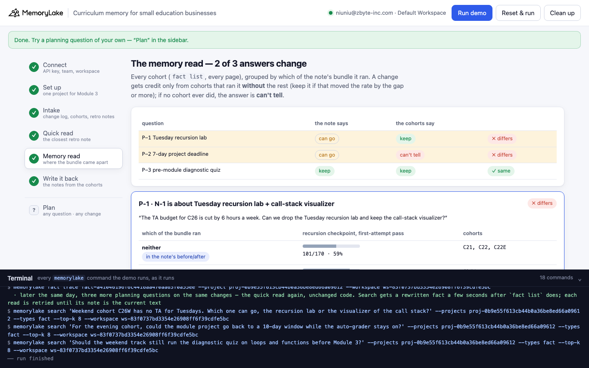
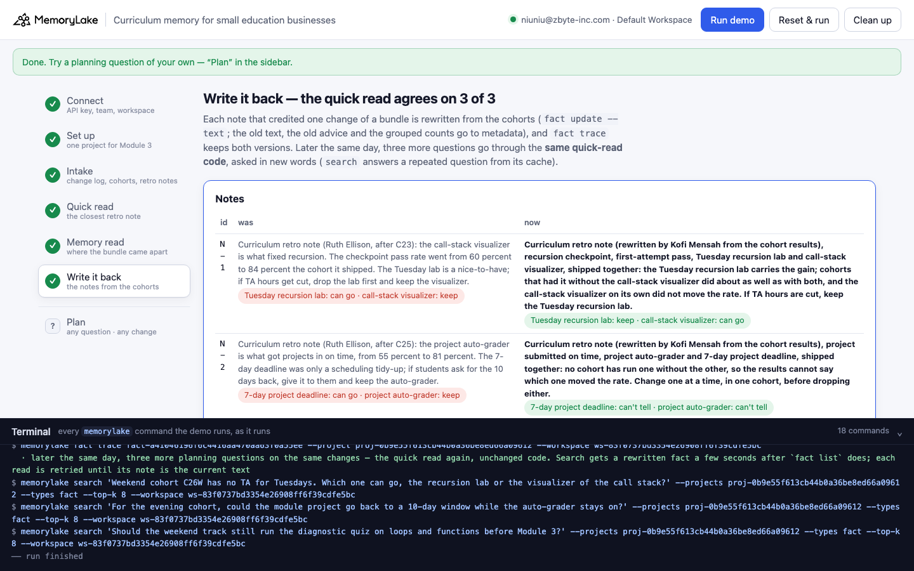

# Curriculum memory for small education businesses

A runnable version of the MemoryLake use case
[*Give Small Education Businesses Curriculum Memory That Carries Across Every Cohort*](https://www.memorylake.ai/en/usecase/curriculum-memory-for-small-education-businesses),
built entirely on the [`memorylake` CLI](https://github.com/memorylake-ai/memorylake-cli).

**Watch it run:** [CLI, 2:12](https://github.com/memorylake-ai/memorylake-usecases/releases/download/curriculum-memory-v1/curriculum-memory-cli-demo.mp4) · [Web, 2:39](https://github.com/memorylake-ai/memorylake-usecases/releases/download/curriculum-memory-v1/curriculum-memory-web-demo.mp4)
([release](https://github.com/memorylake-ai/memorylake-usecases/releases/tag/curriculum-memory-v1); GitHub serves them as downloads).

**The problem.** "Each revision happened with partial memory of why the prior version existed." Then somebody writes the
why down, as a retro note: *the visualizer fixed recursion, the lab can go*. A note like that can quote the right
before/after and still credit the wrong change. Curriculum changes ship in bundles: a new lab and a new tool in the same
release, an auto-grader and a shorter deadline in the same term. The rate goes up, the note names the change its author
noticed, and the next budget cut drops the one that did the work.

**What this demo shows.** Larkspur Code School (fictional) runs a 12-week bootcamp. Its Module 3 (data structures)
curriculum lives in one MemoryLake project: 5 entries from the curriculum change log, the Module 3 results of 9 cohorts
from the LMS (word for word: which changes were live, recursion checkpoint passes, projects on time, withdrawals) and
the 3 retro notes Ruth Ellison left when she handed the curriculum to Kofi Mensah. Kofi plans cohort C26 on 2026-10-15
with three questions:

| Question | Quick read: the closest retro note | Memory read: the cohorts where the bundle came apart | |
|---|---|---|---|
| P-1 TA hours cut: drop the Tuesday recursion lab, keep the visualizer? | "the call-stack visualizer is what fixed recursion, 60% to 84%; if TA hours get cut, drop the lab first" → lab **can go** | lab alone (C24W) **82%**, visualizer alone (C23E) 60%, neither 59% → lab **keep** | ✗ |
| P-2 give the 10-day project deadline back, keep the auto-grader? | "the auto-grader got projects in on time, 55% to 81%; the 7-day deadline was a tidy-up" → deadline **can go** | auto-grader alone: **no cohort**; 7-day deadline alone: **no cohort** → **can't tell** | ✗ |
| P-3 keep the diagnostic quiz? (control) | "the quiz cut withdrawals from about 9% to about 3%" → **keep** | without it 22/250 (9%), with it 9/285 (3%); shipped on its own → **keep** | ✓ |

Ruth's numbers are right: the checkpoint did go from 59% to 84%. But the lab and the visualizer shipped together in
May, and her before/after compares "neither" with "both". Two cohorts ran one without the other: the May evening cohort
had no TA for the lab, and the July weekend cohort's LMS did not have the visualizer yet. The visualizer alone stayed at
60%; the lab alone reached 82%. The second note has the same shape with no way out: the auto-grader and the 7-day
deadline went live together in both September cohorts, so the records cannot say which one moved on-time submissions.
The honest answer there is **can't tell**, not the change the note happened to name. The quiz note is the control: the
quiz shipped on its own, and both reads agree.

Step 6 rewrites the two notes from the cohorts where the next planning session will read them (`fact update --text`, with
the old text, the old advice and the grouped counts kept in metadata). `fact trace` keeps both versions. Later that day,
three more questions go through the **same quick-read code** and agree with the cohorts, 3 of 3.

```
setup ──────── proj create
intake ─────── fact add --project <p> '<record>' …   (17 records, one call)  + fact update --metadata {live, checkpoint, ontime, withdrew …}
quick read ─── search '<planning question>' --projects <p> --types fact --top-k 8  → closest retro note on that change → its advice
memory read ── fact list --projects <p>   (every cohort, every page)
               → group the cohorts by which of the note's bundle they ran: neither / A only / B only / both
               → a change gets credit only from cohorts that ran it without the rest; no such cohort → can't tell
write back ─── fact update <note> --text '<conclusion from the cohorts>' --metadata {…, prefer: {…}, previous: '<old text>', basis: {…}}
               fact trace <note>  → ADD, UPDATE (old text kept) → quick read again (new wording)
```

No conversations and no extraction: every record is pinned word for word, and both reads are plain code over what the
CLI returns. No model decides anything.

## Prerequisites

- **Python 3.9+** (standard library only, nothing to `pip install`)
- **The `memorylake` CLI** on your `PATH`:
  ```bash
  curl -fsSL https://raw.githubusercontent.com/memorylake-ai/memorylake-cli/main/scripts/install.sh | sh
  ```
- **A MemoryLake API key.** Sign up at [app.memorylake.ai](https://app.memorylake.ai), open **API Keys**, create one. A free
  personal account is enough: nothing here needs an agent or a model call.

## Run it

```bash
git clone https://github.com/memorylake-ai/memorylake-usecases.git
cd memorylake-usecases/curriculum-memory
export MEMORYLAKE_API_KEY=sk-...           # China region: also export MEMORYLAKE_BASE_URL=https://app.memorylake.cn/openapi/memorylake
python3 demo.py
```

About a minute the first time (one project, 17 facts, each with its metadata), under a minute on a re-run. Every run
replays Kofi's first planning session: a note an earlier run rewrote is put back word for word from `metadata.previous`
first. With the key set, the demo logs into an isolated CLI profile under `./.memorylake-demo/` and never touches your
own `~/.memorylake`. Everything it creates has a `custom_id` starting with `mlu-cur-`.

Then ask a planning question of your own, or list every cohort by one change's bundle:

```bash
python3 demo.py plan "Can the lab go if TA hours are cut?" --change LAB
python3 demo.py plan "Can students have the 10-day project deadline back?" --change DEADLINE
python3 demo.py cohorts GRADER             # or: LAB, VIZ, QUIZ, DEADLINE
python3 demo.py cleanup                    # deletes the project and every fact on it
```

After a run has rewritten the note, `plan` also shows what the note said before and what the quick read would have
answered then:

```
  → N-1: “Curriculum retro note (rewritten by Kofi Mensah from the cohort results), recursion checkpoint, first-attempt pass, Tuesday recursion lab and call-stack visualizer, ship…”
  → quick read:  keep
  · N-1 was rewritten by a run; before that it said “Curriculum retro note (Ruth Ellison, after C23): the call-stack visualizer is what fixed recursion. The checkpoint pass…” → the quick read would have said: can go
      recursion checkpoint, first-attempt pass
      neither                             101/170  59%   C21, C22, C22E
      Tuesday recursion lab only            41/50  82%   C24W
      call-stack visualizer only            32/53  60%   C23E
      both                                194/231  84%   C23, C24, C25, C25E
  · Tuesday recursion lab: keep — Tuesday recursion lab alone (C24W): 41/50 (82%) vs 101/170 (59%) with neither — 23 points better
  · call-stack visualizer: can go — call-stack visualizer alone (C23E): 32/53 (60%) vs 101/170 (59%) with neither — 1 point better
  → memory read: keep  ✓ same (before the rewrite: ✗ differs)
```

`cohorts GRADER` lists the 9 cohorts with the changes each one ran, and ends with:

```
      project submitted on time
      neither                             214/391  55%   C21, C22, C22E, C23, C23E, C24, C…
      project auto-grader only               no cohort   —
      7-day project deadline only            no cohort   —
      both                                 91/113  81%   C25, C25E
  · project auto-grader: can't tell — no cohort ever ran the project auto-grader without the rest of the bundle
  · 7-day project deadline: can't tell — no cohort ever ran the 7-day project deadline without the rest of the bundle
```

## Or run it in the browser

```bash
python3 web/server.py                # opens http://127.0.0.1:8765
```

Paste the key, connect, run. The page drives the same functions as `demo.py` and streams every `memorylake` command into a
terminal drawer as it runs: the change log, cohorts and notes, the quick read of each question with its top 8, the
memory read as one table per bundle (the row with the change the note credits, on its own, highlighted), and the
write-back with `fact trace`. **Plan** takes any question and change, and lists the cohorts by any change's bundle.





## What happens, step by step

### Steps 2–3: one project, three sources, one fact per record

```
$ memorylake proj create --name 'Larkspur - Module 3 curriculum' --custom-id mlu-cur-curriculum --description '…'
$ memorylake fact add --project proj-… 'Curriculum change CH-LAB (released May 2026, Module 3 data structures): added a Tuesday recursion lab, two hours of paired exercises on recursion and trees with one TA per eight students (about 6 TA hours a week). Shipped together with the call-stack visualizer (CH-VIZ). …' …
$ memorylake fact update fact-… --project proj-… --metadata '{"key": "cur:CH-LAB", "record": "CH-LAB", "tool": "changelog", "kind": "change", "by": "Ruth Ellison", "on": "2026-04-27", "change": "LAB", "release": "May 2026"}'
  · … and 16 more `fact update --metadata` the same way

    change log       5   CH-LAB May 2026 · CH-VIZ May 2026 · CH-QUIZ mid-May 2026 · CH-DEADLINE September 2026 · CH-GRADER September 2026
    cohort results   9   C21 C22 C22E C23 C23E C24 C24W C25 C25E
    retro notes      3

  Ruth's retro notes, as she left them:
    N-1   Curriculum retro note (Ruth Ellison, after C23): the call-stack visualizer is what fixed recursion. The checkpoint pass rate went from 60 percent to 84 percent the cohort it shipped. The Tuesday lab is a nice-to-have; if TA hours get cut, drop the lab first and keep the visualizer.
    N-2   Curriculum retro note (Ruth Ellison, after C25): the project auto-grader is what got projects in on time, from 55 percent to 81 percent. The 7-day deadline was only a scheduling tidy-up; if students ask for the 10 days back, give it to them and keep the auto-grader.
    N-3   Curriculum retro note (Ruth Ellison, after C24): the pre-module diagnostic quiz cut Module 3 withdrawals from about 9 percent to about 3 percent, because the students who were behind on functions now get the week-5 catch-up. Keep the quiz.
```

A cohort's metadata holds the changes it ran (`"live": ["LAB", "QUIZ"]`) and its three readings as `[count, of]`
pairs. A note's metadata names the bundle it is about, the metric, the change it credits and its advice per change
(`"prefer": {"LAB": "can go", "VIZ": "keep"}`). The text of every record stays exactly as written, including the
reason a cohort ran half a bundle ("The Tuesday lab did not run for this cohort: no evening TA could be staffed.").

### Step 4: the quick read

```
$ memorylake search 'The TA budget for C26 is cut by 6 hours a week. Can we drop the Tuesday recursion lab and keep the call-stack visualizer?' --projects proj-… --types fact --top-k 8

  P-1 (Tuesday recursion lab): “The TA budget for C26 is cut by 6 hours a week. Can we drop the Tuesday recursion lab and keep the call-stack visualizer?”
  search · top 8:
      #1   N-1         retro notes    Curriculum retro note (Ruth Ellison, after C23): the call-stack visualizer …   ← closest note
      #2   CH-LAB      change log     Curriculum change CH-LAB (released May 2026, Module 3 data structures): add…
      #3   CH-VIZ      change log     Curriculum change CH-VIZ (released May 2026, Module 3 data structures): emb…
      #4   C24W        cohort results Cohort C24W (weekend track, started 2026-07-11), Module 3 results. Curricul…
      …
  → quick read on the Tuesday recursion lab: can go
```

The closest note is the highest-ranked retro note whose bundle includes the change in question. Its text and advice
are read from `fact list` by the hit's fact id, not from the hit itself: `search` can answer a repeated question from a
cache of older text.

### Step 5: the memory read

```
$ memorylake fact list --projects proj-… --page-size 50

  P-1 · N-1 is about: Tuesday recursion lab + call-stack visualizer
      recursion checkpoint, first-attempt pass
      neither                             101/170  59%   C21, C22, C22E
      Tuesday recursion lab only            41/50  82%   C24W
      call-stack visualizer only            32/53  60%   C23E                                ← the change the note credits, on its own
      both                                194/231  84%   C23, C24, C25, C25E
  · the note's before/after is neither 101/170 (59%) vs both 194/231 (84%) — it never looks at the rows in between
  · Tuesday recursion lab: keep — Tuesday recursion lab alone (C24W): 41/50 (82%) vs 101/170 (59%) with neither — 23 points better
  · call-stack visualizer: can go — call-stack visualizer alone (C23E): 32/53 (60%) vs 101/170 (59%) with neither — 1 point better
  → quick read:  can go
  → memory read: keep

  P-2 · N-2 is about: project auto-grader + 7-day project deadline
      project submitted on time
      neither                             214/391  55%   C21, C22, C22E, C23, C23E, C24, C…
      project auto-grader only               no cohort   —                                   ← the change the note credits, on its own
      7-day project deadline only            no cohort   —
      both                                 91/113  81%   C25, C25E
  · the note's before/after is neither 214/391 (55%) vs both 91/113 (81%) — it never looks at the rows in between
  · project auto-grader: can't tell — no cohort ever ran the project auto-grader without the rest of the bundle
  · 7-day project deadline: can't tell — no cohort ever ran the 7-day project deadline without the rest of the bundle
  → quick read:  can go
  → memory read: can't tell

  P-3 · N-3 is about: pre-module diagnostic quiz
      withdrew during Module 3
      without it                           22/250   9%   C21, C22, C22E, C23
      with the pre-module diagnostic quiz    9/285   3%   C23E, C24, C24W, C25, C25E
  · pre-module diagnostic quiz: keep — pre-module diagnostic quiz live (C23E, C24, C24W, C25, C25E): 9/285 (3%) vs 22/250 (9%) without it — 6 points better
  → quick read:  keep
  → memory read: keep

  q    change                       the note says   the cohorts say
  --------------------------------------------------------------------------
  P-1  Tuesday recursion lab        can go          keep             ✗ differs
  P-2  7-day project deadline       can go          can't tell       ✗ differs
  P-3  pre-module diagnostic quiz   keep            keep             ✓ same

  → 2 of 3: the note credits one change of a bundle the cohorts either split the other way or never split at all
```

The rules are a few lines of code (`bundle_table()` and `verdicts()` in `demo.py`), reading only the cohorts'
metadata. Pool the metric over the cohorts in each group. A change is **keep** if the cohorts that ran it without the
rest of its bundle beat the no-change cohorts by the gap (10 points for the checkpoint and on-time rates, 3 for
withdrawals), **can go** if such cohorts exist and did not, and **can't tell** if no cohort ever ran it alone. One cohort
per "alone" row is thin evidence, and the table says which cohort it is; what it rules out is the note's claim that the
visualizer did the work. Nothing here rules out an interaction (the lab may work better with the visualizer, 84% vs
82%); what the cohorts do show is that the lab is the half you cannot drop.

### Step 6: write it back

```
    N-1 was “Curriculum retro note (Ruth Ellison, after C23): the call-stack visualizer is what fixed recursion. The checkpoint pass rate went from 60 percent to 84 percent the cohor…”
        now “Curriculum retro note (rewritten by Kofi Mensah from the cohort results), recursion checkpoint, first-attempt pass, Tuesday recursion lab and call-stack visualizer, shipped together: the Tuesday recursion lab carries the gain; cohorts that had it without the call-stack visualizer did about as well as with both, and the call-stack visualizer on its own did not move the rate. If TA hours are cut, keep the Tuesday recursion lab.”

    N-2 was “Curriculum retro note (Ruth Ellison, after C25): the project auto-grader is what got projects in on time, from 55 percent to 81 percent. The 7-day deadline was only a sc…”
        now “Curriculum retro note (rewritten by Kofi Mensah from the cohort results), project submitted on time, project auto-grader and 7-day project deadline, shipped together: no cohort has run one without the other, so the results cannot say which one moved the rate. Change one at a time, in one cohort, before dropping either.”
$ memorylake fact trace fact-… --project proj-…

  fact trace N-1 (newest first):
    UPDATE  MANUAL  2026-10-15T04:18:10  Curriculum retro note (rewritten by Kofi Mensah from the cohort results), recursion check…
    ADD     MANUAL  2026-10-15T04:17:34  Curriculum retro note (Ruth Ellison, after C23): the call-stack visualizer is what fixed …

  P-4 (Tuesday recursion lab): “Weekend cohort C26W has no TA for Tuesdays. Which one can go, the recursion lab or the visualizer of the call stack?”
    closest note N-1 (#1) · quick read: keep · memory read: keep  ✓ same

  P-5 (7-day project deadline): “For the evening cohort, could the module project go back to a 10-day window while the auto-grader stays on?”
    closest note N-2 (#1) · quick read: can't tell · memory read: can't tell  ✓ same

  P-6 (pre-module diagnostic quiz): “Should the weekend track still run the diagnostic quiz on loops and functions before Module 3?”
    closest note N-3 (#1) · quick read: keep · memory read: keep  ✓ same

  → the quick read now agrees with the cohorts on 3 of 3: the notes it follows are the ones the cohort results rewrote
```

The rewritten notes state only the conclusion, and their advice becomes one answer per change
(`metadata.prefer = {"LAB": "keep", "VIZ": "can go"}`, `{"GRADER": "can't tell", "DEADLINE": "can't tell"}`). The counts
change with every cohort, so they go to `metadata.basis` (per group: the cohorts, the count, the total), next to the old
text, the old advice and the change the old note credited. Text and metadata change in one `fact update` call, so
`fact trace` records the rewrite together with its basis. The later questions are worded differently on purpose:
`search` caches results by query text, so asking the morning's exact question again could return the morning's answer.

## Measured

| What | Result |
|---|---|
| Closest note = the note on that change's bundle, in the top 8 | 6 / 6 questions, every run (P-1 to P-4 and P-6 at #1; P-5 at #1 or #2) |
| Quick read vs memory read: P-1 ✗, P-2 ✗ (can't tell), P-3 ✓ | 9 / 9 runs (4 from scratch including the CLI recording, 2 re-runs, 3 in the browser including the recording) |
| After write-back: quick read agrees with the cohorts | 3 / 3, every run, first try |
| Time | 62 s from scratch, 47–50 s re-run (75–76 s with `--reset` deleting the previous run first) |

## Wiring it into your own curriculum

- **Log every cohort with the exact set of changes it ran**, including the ones that didn't make it to a cohort and
  why ("no evening TA", "not in the weekend LMS yet"). Those exceptions are the only cohorts that can tell two bundled
  changes apart.
- **Make a retro note name its bundle**, not just the change it credits. A note that says what shipped together can
  be checked against the cohorts; one that only names a winner can't.
- **Treat "can't tell" as an answer.** If two changes have always shipped together, the records can't split the
  credit, and picking the one the note named is a coin toss. Change one at a time in one cohort, then write that cohort
  down like any other.

## If something goes wrong

- **`the memorylake CLI is not on PATH`**: install it (above) or `export MEMORYLAKE_BIN=/path/to/memorylake`.
- **Search results differ on your run**: ranking moves between runs. Step 4 prints exactly what came back; the memory
  read uses search only to pick the note, and with it the bundle and the metric.
- **"no retro note on this change in the top 8"**: the question's words matched cohort records more closely than any
  note. Name the change the way the notes do ("Tuesday recursion lab", "auto-grader", "diagnostic quiz").
- **"search answered from its cache"**: step 4 asks the same questions every run, and `search` can serve a repeated
  question from a cache made by an earlier run; the line names the hits whose fact ids are not in `fact list` now.
- **Something half-created after an interrupted run**: `python3 demo.py --reset`, or `python3 demo.py cleanup`.

## Files

```
curriculum-memory/
├── demo.py              # the CLI runner (every step is a plain `memorylake` command, echoed)
├── data/story.json      # 5 change-log entries, 9 cohorts, 3 retro notes; 3 planning questions + 3 later ones (fictional, plain ASCII)
├── web/server.py        # local web companion: same functions, Server-Sent Events
├── web/static/          # no-build front end
└── out/runs.jsonl       # one line per run (git-ignored)
```
