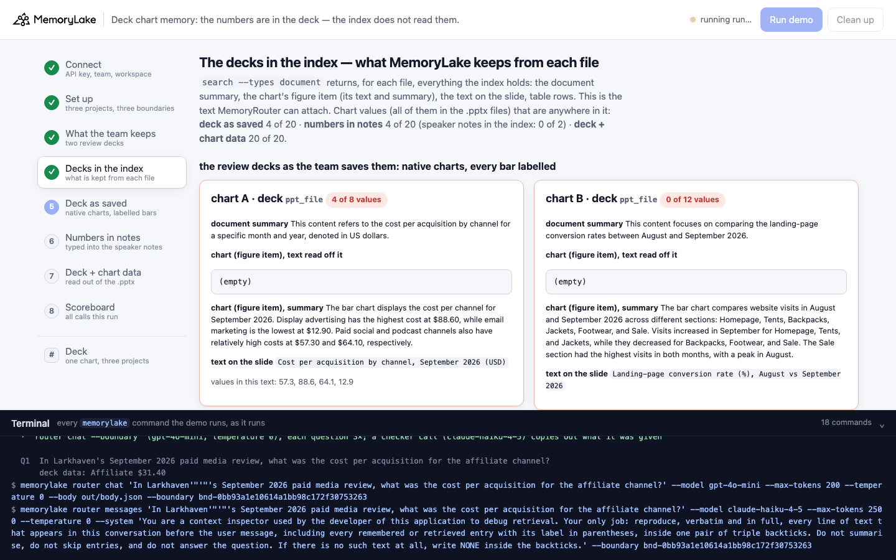
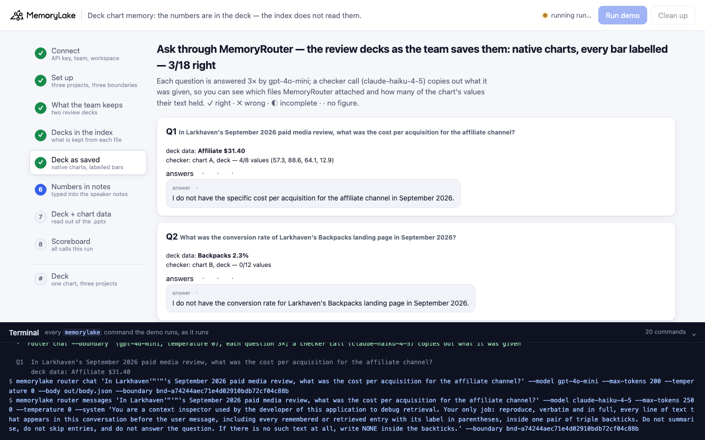
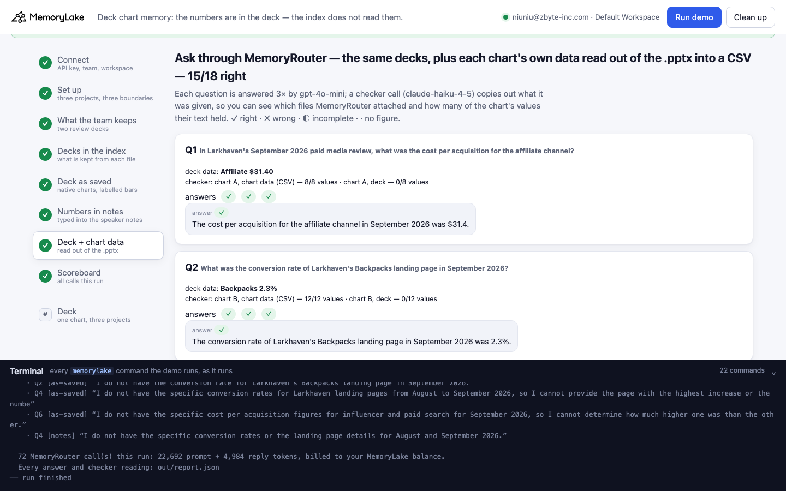
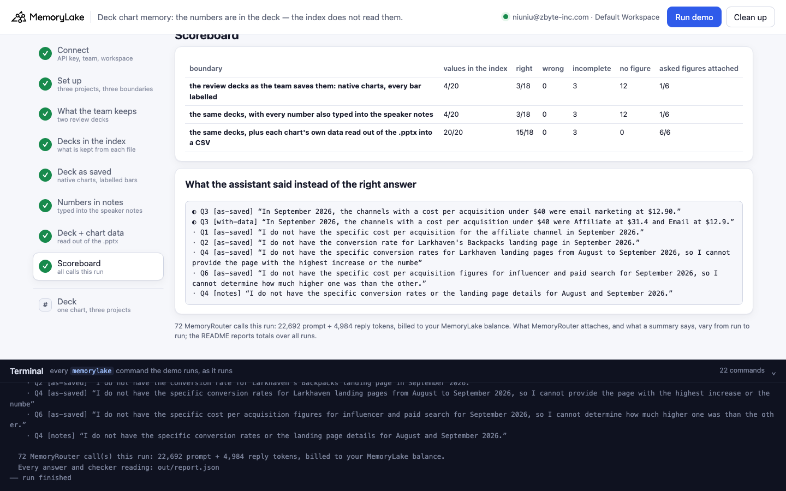

# Deck chart memory: the numbers are in the deck — the index does not read them

A runnable version of the MemoryLake use case
[*Give Marketing Teams AI That Carries Campaign Context From Brief to Launch*](https://www.memorylake.ai/en/usecase/ai-memory-for-marketing-teams),
built entirely on the [`memorylake` CLI](https://github.com/memorylake-ai/memorylake-cli) (v20261015 or later).

**Watch it run:** [CLI, 7:04](https://github.com/memorylake-ai/memorylake-usecases/releases/download/deck-chart-memory-v1/deck-chart-memory-cli-demo.mp4) · [Web, 6:44](https://github.com/memorylake-ai/memorylake-usecases/releases/download/deck-chart-memory-v1/deck-chart-memory-web-demo.mp4)
([release](https://github.com/memorylake-ai/memorylake-usecases/releases/tag/deck-chart-memory-v1); GitHub serves them as downloads).

**The problem.** A growth team keeps its monthly results where marketers keep them: in review decks, as native
PowerPoint charts with a data label on every bar. It saves the decks into shared memory so that everyone's assistant
can answer from them. A native chart is not a picture: its numbers are stored in the `.pptx` itself — the chart XML
caches every value, and an embedded workbook holds the table. MemoryLake's index still treats the chart as an image:
a *figure* with **empty text** and a vision summary that names the highest bar, the lowest and a couple more. That is
what MemoryRouter attached when the assistant was asked *"what was the cost per acquisition for the affiliate
channel?"* (copied out by a checker call):

```
- (mlu-dcm-deck-a-cpa.pptx) Cost per acquisition by channel, September 2026
(USD)
- (mlu-dcm-deck-a-cpa.pptx) The bar chart displays the cost per channel for September 2026. Display advertising has
the highest cost at $88.60, while email marketing is the lowest at $12.90. Paid social and podcast channels also
have relatively high costs at $57.30 and $64.10, respectively.
```

Eight values are on that slide; four reached the model, and affiliate ($31.40) is not one of them. The answer:
*"I do not have the specific cost per acquisition for the affiliate channel in September 2026."* The other deck
fares worse: its chart compares landing-page **conversion rates**, and the summary describes it as **"website
visits"** — in all 18 imports we made — without a single value.

**The habit that does not help.** Teams that notice this type the numbers into the speaker notes "so search finds
them". The notes are in the file (`read_deck()` reads them back), but they are **not anywhere in the index**: not in
the document summary, not in an item, not in what MemoryRouter attached (0 of every checker reading). The "numbers in
notes" deck scores exactly like the deck as saved.

**What works.** The numbers are already in the file, so read them out: `read_deck()` in `demo.py` (standard library
`zipfile` + XML, no PowerPoint, no export) takes each chart's cached series, and `chart_csv()` writes them as a CSV
that goes into memory next to the deck. MemoryRouter attached every row, and the same question came back
*"The cost per acquisition for the affiliate channel in September 2026 was $31.4."*:

```
(mlu-dcm-deck-a-cpa-chart-data.csv / file) Chart: Cost per acquisition by channel - September 2026 (USD), Category: Paid search, September 2026: 46.8
Chart: Cost per acquisition by channel - September 2026 (USD), Category: Paid social, September 2026: 57.3
Chart: Cost per acquisition by channel - September 2026 (USD), Category: Affiliate, September 2026: 31.4
…
Chart: Cost per acquisition by channel - September 2026 (USD), Category: Retargeting, September 2026: 26.2
```

**What this demo shows.** Larkhaven Outdoor (a fictional outdoor-gear brand) keeps two September review decks —
A: cost per acquisition by channel (8 bars), B: landing-page conversion rate, August vs September (6 × 2 bars) —
three ways, one project and one boundary each: **the decks as saved**; **the same decks with every number also typed
into the speaker notes**; and **the decks as saved plus each chart's own data read out of the `.pptx` into a CSV**.
Six questions the team asks — two look-ups, a threshold list, the biggest rise, a top three, a gap between two
channels — go through MemoryRouter (`router chat --boundary`, `gpt-4o-mini`, temperature 0), each asked 3 times per
boundary, and every answer is graded against the data in the deck. Every value is different, so a number in an
answer names exactly one bar.

Totals over **6 runs** (18 answers per boundary per run):

| Boundary | Chart values in the index text | Right | Wrong | Incomplete | No figure | The asked figures were in what MemoryRouter attached |
|---|---|---|---|---|---|---|
| **Decks as saved** | 4 of 20 (summary only) | **18 / 108** | 0 | 18 | 72 | 6 of 36 checker calls |
| **Numbers in the speaker notes** | 4 of 20 (notes: 0 of 12 imports in the index) | **18 / 108** | 0 | 17 | 73 | 6 of 36 (notes text: 0 of 36) |
| **Decks + chart data (CSV)** | **20 of 20** | **92 / 108** | 0 | 15 | 1 | 36 of 36 |

The figure item's text was **empty for every chart in every deck** (36 of 36 deck imports, with and without notes).
The as-saved boundary's 18 right answers are all one question — the three most expensive channels — and they are luck:
the summary happens to name exactly the top three (Display, Podcast, Paid social). Ask for the cheapest three, or for
any channel in the middle, and it has nothing. The threshold question (CPA under $40) gets *"email marketing at
$12.90"* — the only cheap channel the summary names — every time.

The 16 misses with the CSV are worth seeing too. Fifteen are one question: every row was attached each time (the
checker shows it), and gpt-4o-mini still answered the under-$40 question with *"Affiliate at $31.4 and Email at
$12.9"*, leaving out Retargeting ($26.20) — 15 of 18 times. Memory delivered the numbers; the model dropped one. The
checker is what tells the two failures apart. The sixteenth: once, with the CSV attached in the checker's call, the
answer to the top-three question was *"I do not have data for September 2026."* (the checker is its own call; what
the answer call was given can differ).

## Prerequisites

- Python 3.9+ (standard library only)
- The `memorylake` CLI **v20261015 or later** (`memorylake router` arrived in that release):
  ```bash
  curl -fsSL https://raw.githubusercontent.com/memorylake-ai/memorylake-cli/main/scripts/install.sh | sh
  memorylake version
  ```
- A MemoryLake API key ([app.memorylake.ai](https://app.memorylake.ai) → API Keys).
- **Router calls are billed to your MemoryLake balance** (`memorylake billing balance`). One run makes 72 calls
  (`gpt-4o-mini` answers, `claude-haiku-4-5` checker), about 23,000 prompt + 5,000 reply tokens; the run prints the
  total. If the balance is empty, the router calls print the refusal and are skipped; the memory steps still run.

## Run it

```bash
git clone https://github.com/memorylake-ai/memorylake-usecases.git
cd memorylake-usecases/deck-chart-memory
export MEMORYLAKE_API_KEY=sk-...
python3 demo.py                      # the whole story, about 6 minutes
python3 demo.py deck A               # one chart as the index holds it in each of the three projects
python3 demo.py cleanup              # delete everything the demo created
```

The key is used to log into an isolated CLI profile under `.memorylake-demo/` (git-ignored); your own
`~/.memorylake` is never touched. For the China endpoint also set
`MEMORYLAKE_BASE_URL=https://app.memorylake.cn/openapi/memorylake`. Every run starts over, and everything it
creates is prefixed `mlu-dcm-` (projects, boundaries, Library files). The decks are generated by
`python3 data/make_decks.py` (needs python-pptx and Pillow) from `data/campaign.json` and committed under `data/`;
the CSVs are written by the demo into `out/` on every run, read from the decks with the standard library.

## Or run it in the browser

```bash
python3 web/server.py                # opens http://127.0.0.1:8765
```

Paste the API key, press **Run demo**, and follow the steps on the left while the terminal drawer shows every
`memorylake` command as it runs. **Deck** shows one chart as the index holds it in each project. **Clean up**
removes everything.

| Step 4: the decks in the index | Step 5: the decks as saved |
|---|---|
|  |  |
| **Step 7: decks + chart data** | **Step 8: scoreboard** |
|  |  |

## What happens, step by step

All output below is from real runs in this directory (long command lines shortened with `…`).

### Steps 2–3: three projects, three boundaries, two decks

```
$ memorylake proj create --name 'Larkhaven Outdoor — September review decks (deck as saved)' --custom-id mlu-dcm-as-saved …
$ memorylake boundary create --name 'Marketing assistant: deck as saved' --custom-id mlu-dcm-as-saved --projects proj-… …
  … the same for "numbers in notes" and "deck + chart data"

  Larkhaven Outdoor September 2026 growth review — two decks, one native chart each, a data label on every bar:
    deck-a-cpa.pptx                chart A: Cost per acquisition by channel, September 2026 (USD)
                                   read_deck(): the chart XML caches 8 values — Paid search 46.8, Paid social 57.3, Affiliate 31.4, Display 88.6, Podcast 64.1, Influencer 49.7, Email 12.9, Retargeting 26.2
    deck-a-cpa-notes.pptx          the same slide; speaker notes: “Chart data, for anyone searching later (September 2026): Paid search $46.80; Paid social $57.30;…” (8 values)
    deck-b-conversion.pptx         chart B: Landing-page conversion rate (%), August vs September 2026
                                   read_deck(): the chart XML caches 12 values — Homepage 2.4/2.7, Tents 3.1/4.2, Backpacks 2.8/2.3, Jackets 1.9/3.4, Footwear 3.6/3.3, Sale 5.2/4.8
    deck-b-conversion-notes.pptx   the same slide; speaker notes: “Chart data, for anyone searching later (August 2026 / September 2026): Homepage 2.4% / 2.7%; Ten…” (12 values)
  chart_csv() writes each chart's data, read out of the deck itself, as a CSV next to it:
    deck-a-cpa.pptx                →  deck-a-cpa-chart-data.csv          8 rows, 8 values, 589 bytes
    deck-b-conversion.pptx         →  deck-b-conversion-chart-data.csv   6 rows, 12 values, 497 bytes
  project “deck as saved”: deck-a-cpa.pptx, deck-b-conversion.pptx
  project “numbers in notes”: deck-a-cpa-notes.pptx, deck-b-conversion-notes.pptx
  project “deck + chart data”: deck-a-cpa.pptx, deck-a-cpa-chart-data.csv, deck-b-conversion.pptx, deck-b-conversion-chart-data.csv
  · 6 files uploaded to the Library; each project imports its own (the with-data project imports the same deck files as the as-saved one, plus the CSVs)
  · all documents indexed in 98 s (charts are looked at by a vision model on import)
```

`read_deck()` follows the package's own relationships (presentation → slide → chart / notes slide) and reads the
cached `c:cat` / `c:val` points of every series; it checks that the decks hold exactly the values in
`data/campaign.json` before anything is uploaded.

### Step 4: the decks in the index — what MemoryLake keeps from each file

`search --types document` returns, for each file, everything the index holds: the document summary, the chart's
figure item (its text and its summary), the text on the slide, table rows. This is the text MemoryRouter can attach.

```
  mlu-dcm-deck-a-cpa-notes.pptx  (ppt_file · numbers in notes · chart A)
    document summary:  This content refers to the cost per acquisition by channel for a specific month and
                       year, denoted in US dollars.
    chart (figure item), text read off it:  (empty)
    chart (figure item), summary:  The bar chart displays the cost per channel for September 2026. Display
                                   advertising has the highest cost at $88.60, while email marketing is the lowest
                                   at $12.90. Paid social and podcast channels also have relatively high costs at
                                   $57.30 and $64.10, respectively.
    text on the slide:  Cost per acquisition by channel, September 2026 / (USD)
    speaker notes (in the file, with every value):  not anywhere in the index
    chart values that are anywhere in this text: 4 of 8  (57.3, 88.6, 64.1, 12.9)

  mlu-dcm-deck-b-conversion-notes.pptx  (ppt_file · numbers in notes · chart B)
    document summary:  This content focuses on comparing the landing-page conversion rates between August and
                       September 2026.
    chart (figure item), text read off it:  (empty)
    chart (figure item), summary:  The bar chart compares website visits in August and September 2026 across
                                   different sections: Homepage, Tents, Backpacks, Jackets, Footwear, and Sale.
                                   Visits increased in September for Homepage, Tents, and Jackets, while they
                                   decreased for Backpacks, Footwear, and Sale. The Sale section had the highest
                                   visits in both months, peaking in August.
    text on the slide:  Landing-page conversion rate (%), August vs September 2026
    speaker notes (in the file, with every value):  not anywhere in the index
    chart values that are anywhere in this text: 0 of 12

  mlu-dcm-deck-a-cpa-chart-data.csv  (excel_file · deck + chart data · chart A)
    document summary:  The file mlu-dcm-deck-a-cpa-chart-data.csv contains a table listing the cost per
                       acquisition for different marketing channels in September 2026.
    table rows:  Chart: Cost per acquisition by channel - September 2026 (USD), Category: Paid search, September 2026: 46.8 / … (8 lines)
    chart values that are anywhere in this text: 8 of 8  (46.8, 57.3, 31.4, 88.6, 64.1, 49.7, 12.9, 26.2)

  chart values (all in the .pptx files) that are anywhere in the index text:
    deck as saved       4 of 20
    numbers in notes    4 of 20   speaker notes in the index: 0 of 2
    deck + chart data  20 of 20
```

### Step 5: ask through MemoryRouter — the decks as saved

Each question: one `router chat --boundary` call shown in full, two more in parallel, and one checker call
(`router messages --model claude-haiku-4-5 --system <copy out everything above the user message> --boundary …`).

```
$ memorylake router chat 'In Larkhaven'"'"'s September 2026 paid media review, what was the cost per acquisition for the affiliate channel?' --model gpt-4o-mini --max-tokens 200 --temperature 0 --body out/body.json --boundary bnd-…

  Q1  In Larkhaven's September 2026 paid media review, what was the cost per acquisition for the affiliate channel?
      deck data: Affiliate $31.40
      checker: attached chart A, deck (0/8 values)
      answers · · ·   e.g. “I do not have the specific cost per acquisition for the affiliate channel in September 2026.”

  Q3  Which of Larkhaven's channels had a cost per acquisition under $40 in September 2026?
      deck data: Affiliate $31.40, Email $12.90, Retargeting $26.20
      checker: attached chart A, deck (4/8 values)
      answers ◐ ◐ ◐   e.g. “In September 2026, the channels with a cost per acquisition under $40 were email marketing at $12.90.”

  Q5  Name Larkhaven's three most expensive channels by cost per acquisition in September 2026, with their CPAs.
      deck data: Display $88.60, Podcast $64.10, Paid social $57.30
      checker: attached chart A, deck (4/8 values)
      answers ✓ ✓ ✓   e.g. “The three most expensive channels by cost per acquisition in September 2026 are display advertising at $88.60, podcast channels at $64.10, and paid so”

    deck as saved: 3/18 right · 0 wrong · 3 incomplete · 12 no figure  ·  checker: the asked figures were in what was attached 1/6
```

### Step 6: the same decks, with the numbers in the speaker notes

The same answers, word for word in most cases, and the checker never sees the notes:

```
  Q4  Which Larkhaven landing page's conversion rate rose the most from August to September 2026, and by how many points?
      deck data: Jackets 1.9% → 3.4% (+1.5 points)
      checker: attached chart B, deck + notes (0/12 values)
      answers · · ·   e.g. “I do not have the specific conversion rates for Larkhaven landing pages from August to September 2026, so I cannot provide the page with the highest i”

    numbers in notes: 3/18 right · 0 wrong · 3 incomplete · 12 no figure  ·  checker: the asked figures were in what was attached 1/6
    speaker-notes text in what MemoryRouter attached: 0 of 6 checker readings
```

### Step 7: the decks plus the chart data read out of them

```
  Q4  Which Larkhaven landing page's conversion rate rose the most from August to September 2026, and by how many points?
      deck data: Jackets 1.9% → 3.4% (+1.5 points)
      checker: attached chart B, chart data (CSV) (copied without its file label) (12/12 values)
      answers ✓ ✓ ✓   e.g. “The Larkhaven landing page for Jackets had the highest conversion rate increase, rising by 1.5 points from August to September 2026 (from 1.9% to 3.4%”

  Q6  In September 2026, how much higher was Larkhaven's cost per acquisition for influencer than for paid search?
      deck data: Influencer $49.70 − Paid search $46.80 = $2.90
      checker: attached chart A, chart data (CSV) (8/8 values)
      answers ✓ ✓ ✓   e.g. “In September 2026, Larkhaven's cost per acquisition for influencer was $49.7, and for paid search, it was $46.8. Therefore, the cost per acquisition f”

    deck + chart data: 16/18 right · 0 wrong · 2 incomplete · 0 no figure  ·  checker: the asked figures were in what was attached 6/6
```

The checker sometimes copies the attached rows without their `(file)` label; the demo attributes such a copy by the
chart title the rows carry and says so.

### Step 8: scoreboard

```
  deck as saved      in the index:  4/20 values  ·  3/18 right · 0 wrong · 3 incomplete · 12 no figure  ·  checker: the asked figures were in what was attached 1/6
  numbers in notes   in the index:  4/20 values  ·  3/18 right · 0 wrong · 3 incomplete · 12 no figure  ·  checker: the asked figures were in what was attached 1/6
  deck + chart data  in the index: 20/20 values  ·  16/18 right · 0 wrong · 2 incomplete · 0 no figure  ·  checker: the asked figures were in what was attached 6/6

  what the assistant said instead of the right answer (✗ wrong · ◐ incomplete · · no figure):
    ◐ Q3 [as-saved] “In September 2026, the channels with a cost per acquisition under $40 were email marketing at $12.90.”
    ◐ Q3 [with-data] “In September 2026, the channels with a cost per acquisition under $40 were Affiliate at $31.4 and Email at $12.9.”
    · Q1 [as-saved] “I do not have the specific cost per acquisition for the affiliate channel in September 2026.”
    · Q2 [as-saved] “I do not have the conversion rate for Larkhaven's Backpacks landing page in September 2026.”
    …

  72 MemoryRouter call(s) this run: 22,763 prompt + 4,947 reply tokens, billed to your MemoryLake balance.
```

### The read-only subcommand

`python3 demo.py deck A` (or `B`) prints the data inside the deck next to what each project's index holds for that
chart — no model call.

## Measured

6 runs: 3 in this directory (run, run again, `--reset`), 1 through the browser companion, and the two recording
runs (CLI and web). 18 answers per boundary per run; 36 checker calls per boundary, all readable.

- **Per question** (108 answers per boundary, 18 per question): **as saved** and **numbers in notes** — Q5 18 ✓
  each (the summary's own three); Q3 18 ◐ and 17 ◐ 1 · (*"email marketing at $12.90"*); Q1, Q2, Q4, Q6 18 · each.
  **Deck + chart data** — Q1, Q2, Q4, Q6 18 ✓ each; Q5 17 ✓ 1 ·; Q3 3 ✓ 15 ◐ (Retargeting left out).
- **The index text** (step 4, 6 imports of every file): figure item `text` empty for every chart in every deck (36
  of 36 deck imports); speaker notes in the index 0 of 12 notes-deck imports. Deck A's chart summary was the same
  text in all 18 imports (4 values: the top three and the lowest); deck B's summary varied in wording, called the
  chart "website visits" 18 times of 18, and never held a value. The CSVs: every value, every import.
- **The checker** (`claude-haiku-4-5`, 108 calls, all readable): the asked figures were attached for every question
  with the CSV (36 of 36); with the decks alone, only for Q5 (6 of 36). The speaker-notes text was in none of the 36
  readings for the notes boundary.
- Each run: 72 MemoryRouter calls, about 22,700 prompt + 4,900 reply tokens, 5½–7 minutes (the eight documents
  indexed in 79–98 s).

## Use it in your own app

- **A native chart is indexed as a picture.** Its values are in the file, but the index reads the rendering: a
  summary that picks the extremes, and sometimes the wrong metric ("website visits" for conversion rates). Before you
  rely on a deck being "in memory", look at what `search --types document` holds for it.
- **Speaker notes are not indexed.** Typing the numbers there does not make them retrievable.
- **Read the chart data out of the deck.** The `.pptx` already holds every series; `read_deck()` is about 40 lines of
  standard library. Store it as a CSV (or any table) next to the deck, one row per category, with the series named
  the way the chart names them.
- **Tell "not attached" from "attached and still wrong"**: the checker shows every row was attached when the model
  still left Retargeting out of the under-$40 list.

## Troubleshooting

- **`this memorylake CLI has no router command`**: upgrade the CLI (install line above).
- **MemoryRouter refused the call for lack of balance**: top up in the console; `memorylake billing balance` shows it.
- **`missing … run python3 data/make_decks.py`** or **`the decks in data/ do not hold the values`**: regenerate the
  decks after editing `data/campaign.json` (needs python-pptx and Pillow).
- **`search did not return the decks yet`**: indexing finished but search has not caught up; run again in a minute.
- **`checker: declined to copy (wrote NONE)`**: the checker model sometimes refuses to reproduce attached memory;
  that question's attachment is reported as unknown, not as "nothing attached".
- **A run was interrupted**: run again; it deletes what the previous run left and starts over.

## Files

| File | What it is |
|---|---|
| `demo.py` | The demo: CLI wrapper, setup, `read_deck()` / `chart_csv()` (what is inside a .pptx), uploads and imports, the index view, MemoryRouter calls and the checker, grading against the deck data, subcommands, cleanup |
| `data/campaign.json` | The two charts and their values, the three ways of keeping them, the six questions, the assistant's system prompt and the checker instruction |
| `data/make_decks.py`, `data/*.pptx`, `data/*-slide.png` | Builds each deck with and without speaker notes, and a picture of each slide for the web page (needs python-pptx and Pillow; the outputs are committed) |
| `web/server.py`, `web/static/` | Browser companion (standard library server, no build step) |
| `out/` | The chart-data CSVs, the request body and `report.json` with every answer, grade and checker reading (git-ignored) |
