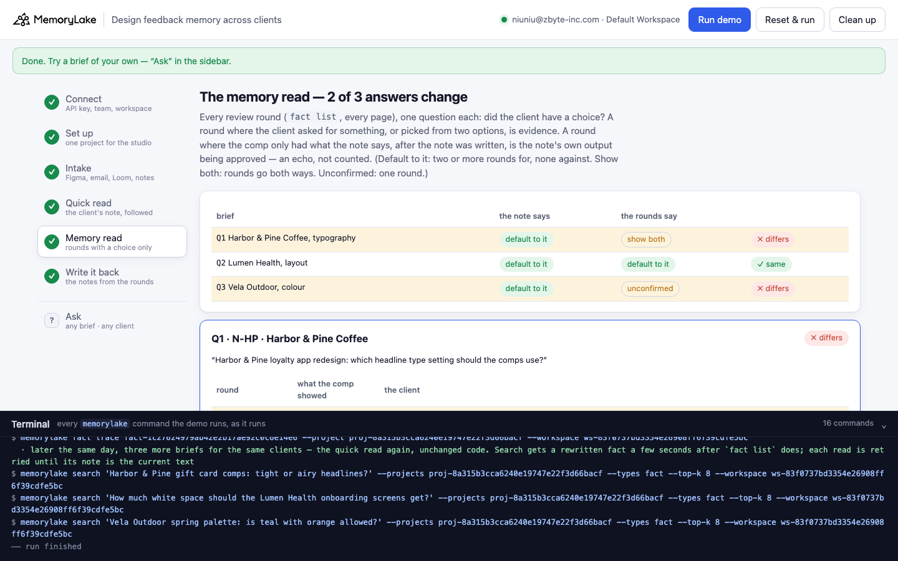
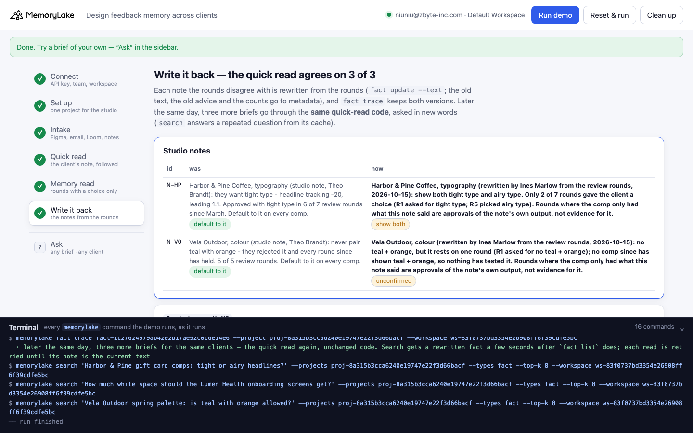

# Design feedback memory across clients

A runnable version of the MemoryLake use case
[*Give Designers AI Memory of Every Client's Feedback Patterns and Preferences*](https://www.memorylake.ai/en/usecase/design-feedback-memory-across-clients),
built entirely on the [`memorylake` CLI](https://github.com/memorylake-ai/memorylake-cli).

**Watch it run:** [CLI, 2:40](https://github.com/memorylake-ai/memorylake-usecases/releases/download/design-feedback-memory-v1/design-feedback-memory-cli-demo.mp4) · [Web, 2:41](https://github.com/memorylake-ai/memorylake-usecases/releases/download/design-feedback-memory-v1/design-feedback-memory-web-demo.mp4)
([release](https://github.com/memorylake-ai/memorylake-usecases/releases/tag/design-feedback-memory-v1); GitHub serves them as downloads).

**The problem.** "Client A always pushes for tighter type." The page's answer is per-client reflection memory: recurring
preferences surface from the review rounds, and every AI design tool reads them before it generates anything. Then the
tools follow the note, and that changes what the client sees. Once a note says "tight type", every comp has tight type,
the client approves the only option on the table, and the approval goes into the note's count. The count grows from
the note's own output. It stops measuring what the client prefers and starts measuring how faithfully the studio
followed the note.

**What this demo shows.** Quillon Studio (fictional) keeps its client feedback in one MemoryLake project: 16 review
rounds from Figma comments, email threads and Loom transcripts (the client's own words, plus what the comp showed on
that point), and three studio notes written by Theo Brandt, a senior designer who has since left. On 2026-10-15 three
briefs come in:

| Brief | Quick read: the client's note | Memory read: rounds where the client had a choice | |
|---|---|---|---|
| Q1 Harbor & Pine loyalty app: which headline type setting? | "tight type … approved with tight type in 6 of 7 review rounds" → **default to it** | 1 for (R1 asked for it), 1 against (R5 picked airy when shown both), 5 echoes → **show both** | ✗ |
| Q2 Lumen Health care-plan page: dense or lots of white space? (control) | "generous white space … 4 of 4 review rounds" → **default to it** | 4 for, 0 against, 0 echoes → **default to it** | ✓ |
| Q3 Vela Outdoor campaign: can we use teal and orange together? | "never pair teal with orange … 5 of 5 review rounds" → **default to it** | 1 for (R1 rejected the pairing), 4 echoes → **unconfirmed** | ✗ |

Theo's counts are right. Harbor & Pine did approve tight type in 6 of 7 rounds. But the note was written after round
1, and in rounds 2, 3, 4, 6 and 7 the comp only had tight type *because the note said so*. The client approved the
comp. Nobody asked them to choose. The one round where the designer put tight and airy side by side (R5, the loyalty
app) went to airy, and the quick read's own search ranks that email #2, right under the note. Vela Outdoor's "5 of 5"
is one real rejection followed by four comps that never showed the pairing again. Lumen Health is the control. Theo
wrote that note *after* four rounds in which the client asked for space each time, unprompted, so both reads agree.

Step 6 rewrites the two notes from the rounds where the next AI tool will read them (`fact update --text`, with the old
text, the old advice and the counts kept in metadata). `fact trace` keeps both versions. Later that day, three more
briefs go through the **same quick-read code** and agree with the rounds, 3 of 3.

```
setup ──────── proj create
intake ─────── fact add --project <p> '<record>' …   (19 records, one call)  + fact update --metadata {client, round, shown, response …}
quick read ─── search '<brief>' --projects <p> --types fact --top-k 8  → the client's note on that point → its advice
memory read ── fact list --projects <p>   (every record, every page)
               → each round on the note's client and point: did the client have a choice?
                 asked for it / picked it from two or more options        → evidence, for or against
                 only the note's option on the comp, after the note        → echo, not counted
write back ─── fact update <note> --text '<conclusion from the rounds>' --metadata {…, prefer, previous: '<old text>', basis: {…}}
               fact trace <note>  → ADD, UPDATE (old text kept) → quick read again (new wording)
```

No conversations and no extraction: every record is pinned word for word, and both reads are plain code over what the
CLI returns. No model decides anything.

## Prerequisites

- **Python 3.9+** (standard library only, nothing to `pip install`)
- **The `memorylake` CLI** on your `PATH`:
  ```bash
  curl -fsSL https://raw.githubusercontent.com/memorylake-ai/memorylake-cli/main/scripts/install.sh | sh
  ```
- **A MemoryLake API key.** Sign up at [app.memorylake.ai](https://app.memorylake.ai), open **API Keys**, create one. A free
  personal account is enough: nothing here needs an agent or a model call.

## Run it

```bash
git clone https://github.com/memorylake-ai/memorylake-usecases.git
cd memorylake-usecases/design-feedback-memory
export MEMORYLAKE_API_KEY=sk-...           # China region: also export MEMORYLAKE_BASE_URL=https://app.memorylake.cn/openapi/memorylake
python3 demo.py
```

About a minute and a half the first time (one project, 19 facts, each with its metadata), about a minute on a re-run.
Every run replays the morning of the three briefs: a note an earlier run rewrote is put back word for word from
`metadata.previous` first. With the key set, the demo logs into an isolated CLI profile under `./.memorylake-demo/` and
never touches your own `~/.memorylake`. Everything it creates has a `custom_id` starting with `mlu-dfm-`.

Then try a brief of your own, or list every round on one client's note:

```bash
python3 demo.py ask "Tight or airy headlines for the menu boards?" --client HP
python3 demo.py ask "Can the spring kit put teal next to orange?" --client VO
python3 demo.py rounds VO                  # or: HP, LH
python3 demo.py cleanup                    # deletes the project and every fact on it
```

After a run has rewritten the note, `ask` also shows what the note said before and what the quick read would have
answered then:

```
  → N-HP: “Harbor & Pine Coffee, typography (rewritten by Ines Marlow from the review rounds, 2026-10-15): show both tight type and airy type. Only 2 of 7 rounds gave the client a …”
  → quick read:  show both
  · N-HP was rewritten by a run; before that it said “Harbor & Pine Coffee, typography (studio note, Theo Brandt): they want tight type - headline tracking -20, leading 1.1.…” → the quick read would have said: default to it
  every round on N-HP:
      R1  2026-03-10  Figma comment    comp: airy type only               asked for tight type                       for
      R2  2026-04-02  Email thread     comp: tight type only              approved — only N-HP's option on the comp  echo
      R3  2026-04-28  Figma comment    comp: tight type only              approved — only N-HP's option on the comp  echo
      R4  2026-05-20  Loom transcript  comp: tight type only              approved — only N-HP's option on the comp  echo
      R5  2026-06-17  Email thread     comp: tight type + airy type       picked airy type                           AGAINST
      R6  2026-07-22  Figma comment    comp: tight type only              approved — only N-HP's option on the comp  echo
      R7  2026-09-09  Loom transcript  comp: tight type only              approved — only N-HP's option on the comp  echo
  · show both — rounds where the client had a choice: 1 for (R1), 1 against (R5); 5 echoes not counted
  → memory read: show both  ✓ same (before the rewrite: ✗ differs)
```

`rounds VO` prints the note as it is now and as it was, then:

```
  5 round(s):
      R1  2026-04-08  Loom transcript  comp: teal + orange only           asked for no teal + orange                 for
      R2  2026-05-13  Figma comment    comp: no teal + orange only        approved — only N-VO's option on the comp  echo
      R3  2026-06-24  Email thread     comp: no teal + orange only        approved — only N-VO's option on the comp  echo
      R4  2026-08-12  Figma comment    comp: no teal + orange only        approved — only N-VO's option on the comp  echo
      R5  2026-09-16  Loom transcript  comp: no teal + orange only        approved — only N-VO's option on the comp  echo
  · unconfirmed — rounds where the client had a choice: 1 for (R1), 0 against (—); 4 echoes not counted
```

## Or run it in the browser

```bash
python3 web/server.py                # opens http://127.0.0.1:8765
```

Paste the key, connect, run. The page drives the same functions as `demo.py` and streams every `memorylake` command into a
terminal drawer as it runs: the notes and every round per client, the quick read of each brief with its top 8, the
memory read (one table per note: what each comp showed, what the client said, for / against / echo), and the
write-back with `fact trace`. **Ask** takes any brief and client, and lists every round on any client's note.





## What happens, step by step

### Steps 2–3: one project, three tools and the notes, one fact per record

`proj create`, then a single `fact add` with all 19 records, word for word, then one `fact update --metadata` per record.
A round's metadata says which client and point it is about, the date, the tool, what the comp showed on that point
(`shown: ["tight"]`, or `["tight", "airy"]` when the designer offered both), and how the client answered (`asked`,
`picked` or `approved`, and the value). A note's metadata holds the preference, the count it cites, the rounds it
counted and its advice (`prefer: "default to it"`).

```
    Figma comment      7   HP-R1 LH-R1 HP-R3 VO-R2 HP-R6 LH-R4 VO-R4
    Email thread       4   HP-R2 HP-R5 VO-R3 LH-R3
    Loom transcript    5   VO-R1 HP-R4 LH-R2 HP-R7 VO-R5
    Studio notes       3   N-HP N-VO N-LH

  Theo Brandt's notes, as they stand:
    N-HP  Harbor & Pine Coffee, typography (studio note, Theo Brandt): they want tight type - headline tracking -20, leading 1.1. Approved with tight type in 6 of 7 review rounds since March. Default to it on every comp.
    N-LH  Lumen Health, layout (studio note, Theo Brandt): generous white space - they push back on dense pages every time. Raised in 4 of 4 review rounds. Default to it on every comp.
    N-VO  Vela Outdoor, colour (studio note, Theo Brandt): never pair teal with orange - they rejected it and every round since has held. 5 of 5 review rounds. Default to it on every comp.
```

### Step 4: the quick read

What the page promises an AI design tool does: retrieve the client's preferences before generating. `search` the brief,
take the client's note on that point from the top 8, and default to it. The note is then read again from `fact list` by
fact id, so a cached search hit can't stand in for the current text.

```
  Q1 (Harbor & Pine Coffee, typography): “Harbor & Pine loyalty app redesign: which headline type setting should the comps use?”
  search · top 8:
      #1   N-HP   Studio notes     Harbor & Pine Coffee, typography (studio note, Theo Brandt): they want tigh…   ← the note
      #2   HP-R5  Email thread     Email from Dana Reyes (Harbor & Pine), re: Loyalty app home, options A and …
      #3   HP-R1  Figma comment    Figma comment on 'Spring menu boards v1' - Dana Reyes (Harbor & Pine, brand…
      #4   HP-R2  Email thread     Email from Dana Reyes (Harbor & Pine), re: Spring menu boards v2 - Approved…
      #5   HP-R3  Figma comment    Figma comment on 'Summer cold-brew posters v1' - Dana Reyes (Harbor & Pine)…
      #6   HP-R4  Loom transcript  Loom transcript, Dana Reyes (Harbor & Pine) reviewing 'Store window decals …
      #7   HP-R7  Loom transcript  Loom transcript, Dana Reyes (Harbor & Pine) reviewing 'Holiday cup sleeves …
      #8   LH-R3  Email thread     Email from Omar Haddad (Lumen Health), re: Appointment reminders, two layou…
  → N-HP: “Harbor & Pine Coffee, typography (studio note, Theo Brandt): they want tight type - headline tracking -20, leading 1.1. Approved with tight type in 6 of 7 review rounds …”
  → quick read: default to it (tight type)
```

HP-R5 at #2 is the round where the client picked airy type. It's in front of the quick read, which ignores it, because
the note already summarises the rounds. All three notes ranked #1 for their brief in every run.

### Step 5: the memory read

Every record from `fact list` (every page), and every round on the note's client and point judged by one question:
**did the client have a choice?**

- *asked*: the client asked for something the comp did not have → evidence, for or against the note
- *picked*: the comp showed two or more options and the client picked one → evidence
- *approved* a comp that only had the note's option, dated after the note → **echo**: the client approved what the
  note produced, and nothing else was on the table

Default to it if two or more rounds with a choice back the note and none go against it. Show both if they go both ways.
Unconfirmed if only one round backs it.

```
  Q1 · N-HP (2026-03-12) counts 6 of 7 rounds for tight type:
      R1  2026-03-10  Figma comment    comp: airy type only               asked for tight type                       for
      R2  2026-04-02  Email thread     comp: tight type only              approved — only N-HP's option on the comp  echo
      R3  2026-04-28  Figma comment    comp: tight type only              approved — only N-HP's option on the comp  echo
      R4  2026-05-20  Loom transcript  comp: tight type only              approved — only N-HP's option on the comp  echo
      R5  2026-06-17  Email thread     comp: tight type + airy type       picked airy type                           AGAINST
      R6  2026-07-22  Figma comment    comp: tight type only              approved — only N-HP's option on the comp  echo
      R7  2026-09-09  Loom transcript  comp: tight type only              approved — only N-HP's option on the comp  echo
  · show both — rounds where the client had a choice: 1 for (R1), 1 against (R5); 5 echoes not counted
  → quick read:  default to it
  → memory read: show both

  Q2 · N-LH (2026-08-14) counts 4 of 4 rounds for generous white space:
      R1  2026-04-15  Figma comment    comp: compact layout only          asked for generous white space             for
      R2  2026-05-27  Loom transcript  comp: compact layout only          asked for generous white space             for
      R3  2026-06-30  Email thread     comp: compact layout + generous w… picked generous white space                for
      R4  2026-08-05  Figma comment    comp: compact layout only          asked for generous white space             for
  · default to it — rounds where the client had a choice: 4 for (R1, R2, R3, R4), 0 against (—); 0 echoes not counted
  → quick read:  default to it
  → memory read: default to it
```

```
  q    client                point       the note says   the rounds say 
  ----------------------------------------------------------------------------
  Q1   Harbor & Pine Coffee  typography  default to it   show both       ✗ differs
  Q2   Lumen Health          layout      default to it   default to it   ✓ same
  Q3   Vela Outdoor          colour      default to it   unconfirmed     ✗ differs

  → 2 of 3: the notes counted approvals of comps they had shaped themselves
```

The echo rule uses only what memory holds: the date the note was written and what each later comp showed. No one has
to label rounds as "shaped by the note" by hand.

### Step 6: write it back

Each note the rounds disagree with is rewritten from the rounds (`fact update --text`). The old text, the old advice
and the counts go into the same call's metadata, so the change shows up in `fact trace`:

```
    N-HP was “Harbor & Pine Coffee, typography (studio note, Theo Brandt): they want tight type - headline tracking -20, leading 1.1. Approved with tight type in 6 of 7 review rounds …”
         now “Harbor & Pine Coffee, typography (rewritten by Ines Marlow from the review rounds, 2026-10-15): show both tight type and airy type. Only 2 of 7 rounds gave the client a choice (R1 asked for tight type; R5 picked airy type). Rounds where the comp only had what this note said are approvals of the note's own output, not evidence for it.”

    N-VO was “Vela Outdoor, colour (studio note, Theo Brandt): never pair teal with orange - they rejected it and every round since has held. 5 of 5 review rounds. Default to it on ev…”
         now “Vela Outdoor, colour (rewritten by Ines Marlow from the review rounds, 2026-10-15): no teal + orange, but it rests on one round (R1 asked for no teal + orange); no comp since has shown teal + orange, so nothing has tested it. Rounds where the comp only had what this note said are approvals of the note's own output, not evidence for it.”

  fact trace N-HP (newest first):
    UPDATE  MANUAL  2026-10-15T07:26:28  Harbor & Pine Coffee, typography (rewritten by Ines Marlow from the review rounds, 2026-1…
    ADD     MANUAL  2026-10-15T07:25:44  Harbor & Pine Coffee, typography (studio note, Theo Brandt): they want tight type - headl…
```

Later the same day, three more briefs go through the same quick-read code, in new words (`search` can answer a
repeated question from its cache):

```
  F1 (Harbor & Pine Coffee): “Harbor & Pine gift card comps: tight or airy headlines?”
    note N-HP (#1) · quick read: show both · memory read: show both  ✓ same

  F2 (Lumen Health): “How much white space should the Lumen Health onboarding screens get?”
    note N-LH (#1) · quick read: default to it · memory read: default to it  ✓ same

  F3 (Vela Outdoor): “Vela Outdoor spring palette: is teal with orange allowed?”
    note N-VO (#1) · quick read: unconfirmed · memory read: unconfirmed  ✓ same

  → the quick read now agrees with the rounds on 3 of 3: the notes it follows are the ones the rounds rewrote
```

## Measured

| What | Result |
|---|---|
| The client's note in the top 8 for its brief | 18 / 18 reads (3 briefs × 6 runs), always #1; Q1's top 8 was the same list in the same order in every run |
| Quick read vs memory read: Q1 ✗, Q2 ✓, Q3 ✗ | 6 / 6 runs (1 from scratch, 3 with `--reset`, 1 re-run, 1 in the browser) |
| After write-back: quick read agrees with the rounds | 3 / 3, every run, first try |
| Time | 74 s from scratch, 53–64 s re-run, 93–96 s with `--reset` (which deletes the previous run first) |

## Wiring it into your own studio

- **Log what each comp showed, not just what the client said.** "Approved" means nothing until you know what was on the
  table. One field per round (the options shown on the point the note is about) is enough to tell evidence from echo.
- **Date your notes.** An approval after the note, of a comp built from the note, is the note's own output. An approval
  before it is the client's.
- **Put the alternative in front of the client now and then.** A note that is always followed is never tested. The one
  Harbor & Pine round with two options is the only one that says anything, and it says the opposite.

## If something goes wrong

- **`the memorylake CLI is not on PATH`**: install it (above) or `export MEMORYLAKE_BIN=/path/to/memorylake`.
- **Search results differ on your run**: ranking can move between runs. Step 4 prints exactly what came back; the
  memory read does not use search at all.
- **"no note on this point in the top 8"**: the brief's words matched round records more closely than the note. Name
  the client and the point the way the note does ("Harbor & Pine", "type", "white space", "teal and orange").
- **"search answered from its cache"**: step 4 asks the same briefs every run, and `search` can serve a repeated
  question from a cache made by an earlier run. The line names the hits whose fact ids are not in `fact list` now.
- **Something half-created after an interrupted run**: `python3 demo.py --reset`, or `python3 demo.py cleanup`.

## Files

```
design-feedback-memory/
├── demo.py              # the CLI runner (every step is a plain `memorylake` command, echoed)
├── data/story.json      # 16 review rounds (Figma, email, Loom) + 3 studio notes; 3 briefs + 3 later ones (fictional)
├── web/server.py        # local web companion: same functions, Server-Sent Events
├── web/static/          # no-build front end
└── out/runs.jsonl       # one line per run (git-ignored)
```
