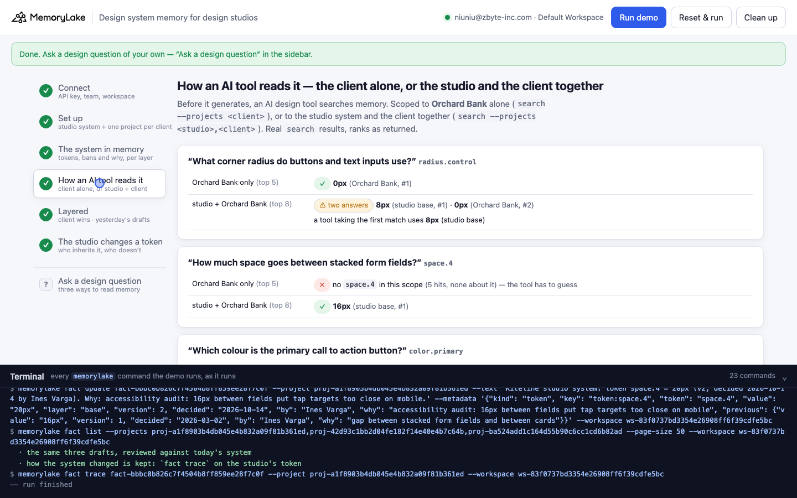
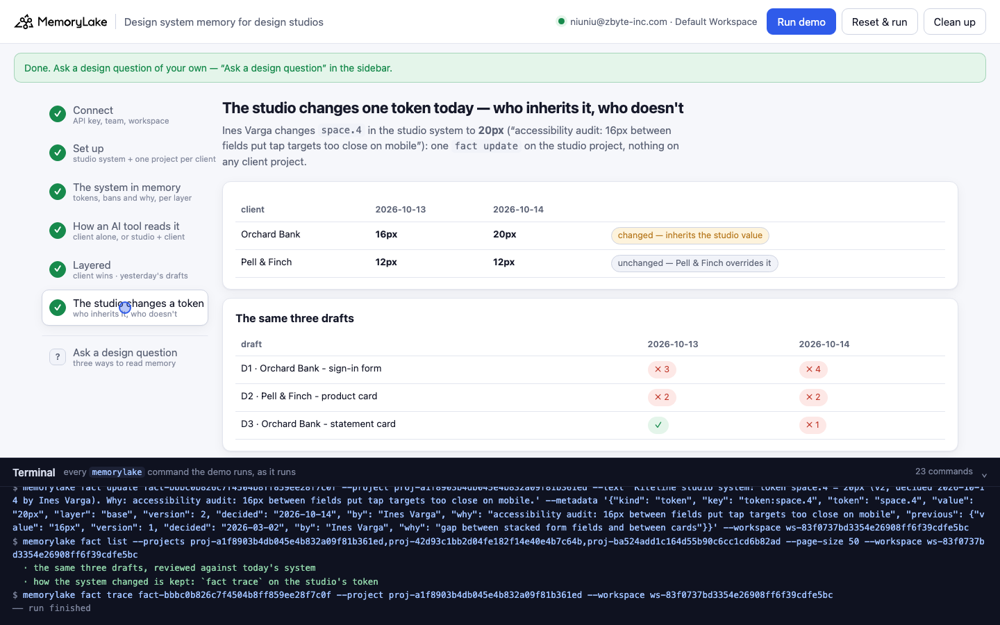

# Design system memory for design studios

A runnable version of the MemoryLake use case
[*Give Design Studios Design System Memory That AI Tools Actually Read*](https://www.memorylake.ai/en/usecase/design-system-memory-for-design-studios),
built entirely on the [`memorylake` CLI](https://github.com/memorylake-ai/memorylake-cli).

**Watch it run:** [CLI, 2:21](https://github.com/memorylake-ai/memorylake-usecases/releases/download/design-system-memory-v1/design-system-memory-cli-demo.mp4) · [Web, 3:30](https://github.com/memorylake-ai/memorylake-usecases/releases/download/design-system-memory-v1/design-system-memory-web-demo.mp4) — real, unedited runs on a free account
([release](https://github.com/memorylake-ai/memorylake-usecases/releases/tag/design-system-memory-v1); GitHub serves them as downloads).

**The problem.** *A studio's design system has a base, and every client changes a few things on top of it.* Give an AI design
tool the client's system alone and it has no rule for anything the client didn't change: spacing, body text, focus rings. Give
it the studio's system and the client's together and it gets **two values for every token the client did change** — 8px and
0px for the same corner radius — and search ranks by relevance, not by which layer wins. Either way the output drifts from the
system, and a designer spends the afternoon putting it back.

**What this demo shows.** Kiteline Studio (fictional, eight people) keeps its design system as two layers of memory:

| Layer | Where | What is in it |
|---|---|---|
| **Studio system** | one project | 12 tokens (colour, radius, spacing, type, shadow, focus) + 2 banned patterns, each one fact with `metadata`: token, value, version, who decided it, when, **why** |
| **Per client** | one project per client | **only what that client changes**: Orchard Bank (a bank) overrides 5 tokens and bans drop shadows; Pell & Finch (a shop) overrides 3 |

1. **The client alone misses rules.** Asked *"how much space goes between stacked form fields?"*, `search` scoped to Orchard
   Bank's project returns 5 hits and none of them is about spacing: Orchard never changed it, so it isn't there.
2. **Studio + client returns both values, and the wrong one first.** Asked *"what corner radius do buttons and inputs use?"*,
   `search --projects <studio>,<orchard>` returns **8px (studio, #1)** and **0px (Orchard Bank, #2)**. A tool that takes the first
   match draws rounded buttons for a bank whose brand book says square. Same for the primary colour.
3. **Layered, the client wins, token by token.** `fact list --projects <studio>,<client>` (every page, not a top-k), then every
   token from the studio replaced by the client's override where there is one. Yesterday's three AI drafts are reviewed against
   that: D1 (Orchard sign-in form) ✗ 3 — studio blue and studio radius where Orchard overrides them, and a drop shadow Orchard
   bans; D2 (Pell & Finch product card) ✗ 2 — **Orchard Bank's green and square corners on Pell & Finch's card**, named as
   Orchard's; D3 ✓. Every finding cites the layer, version and date it comes from.
4. **The studio changes one token today.** `space.4` goes 16px → 20px after an accessibility audit: one `fact update` on the
   studio project, nothing on any client project. Orchard Bank inherits it (16 → 20); Pell & Finch overrides it and stays at
   12px. D3, which passed yesterday, fails today on exactly that token. `fact trace` keeps both versions.

```
layers ──────── proj create × 3: studio system · Orchard Bank · Pell & Finch
system ──────── fact add --project <layer> '<token> = <value> (vN, decided …). Why: …' …  (one call per layer)
                 + fact update --metadata {token, value, layer, version, decided, by, why}
AI tool, A ──── search '<question>' --projects <client>                → misses every token the client didn't change
AI tool, B ──── search '<question>' --projects <studio>,<client>       → both values; studio's ranked first
layered ─────── fact list --projects <studio>,<client>  → client override wins per token → review drafts ✓/✗, cited
evolve ──────── fact update <studio token> --text '… 20px (v2 …)' --metadata {…, previous: {16px, v1}}
                 fact list again → Orchard inherits, Pell keeps its override · fact trace → ADD → UPDATE
```

The resolution and the review are plain code over the pinned facts' metadata, not a model: the same memory gives the same
answer every time, and every ✓ and ✗ names the fact behind it. `search` is shown because it is what an AI tool calls before it
generates; the layered answer comes from `fact list`, where nothing is ranked away. No conversations, no extraction: every token
is pinned word for word.

## Prerequisites

- **Python 3.9+** (standard library only, nothing to `pip install`)
- **The `memorylake` CLI** on your `PATH`:
  ```bash
  curl -fsSL https://raw.githubusercontent.com/memorylake-ai/memorylake-cli/main/scripts/install.sh | sh
  ```
- **A MemoryLake API key.** Sign up at [app.memorylake.ai](https://app.memorylake.ai), open **API Keys**, create one. A free
  personal account is enough: nothing here needs an agent or a model call.

## Run it

```bash
git clone https://github.com/memorylake-ai/memorylake-usecases.git
cd memorylake-usecases/design-system-memory
export MEMORYLAKE_API_KEY=sk-...           # China region: also export MEMORYLAKE_BASE_URL=https://app.memorylake.cn/openapi/memorylake
python3 demo.py
```

About 1–1½ minutes the first time, about 30 s on a re-run, which reads back what is already there. With the key set, the demo
logs into an isolated CLI profile under `./.memorylake-demo/` and never touches your own `~/.memorylake`. Everything it creates
has a `custom_id` starting with `mlu-dsm-`.

```bash
python3 demo.py ask pell "How big is body text?"   # any design question, either client: client only · studio + client · layered
python3 demo.py system orchard       # a client's layered system today: every token, inherited or overridden
python3 demo.py review               # the three drafts against today's systems
python3 demo.py --reset              # delete everything the demo created, then replay
python3 demo.py cleanup              # delete everything the demo created
```

## Or run it in the browser

```bash
python3 web/server.py                # opens http://127.0.0.1:8765
```

Paste the key, connect, run. The page drives the same functions as `demo.py` and streams every `memorylake` command into a
terminal drawer as it runs: the two layers with their reasons, the two ways an AI tool reads them side by side, both clients'
layered systems and the three drafts reviewed, then today's change and who inherits it. **Ask a design question** takes any
question for either client and shows the three reads next to each other.





## What happens, step by step

Output below is from real runs (ids shortened).

### Steps 2–3 — three projects; the system in memory

```
$ memorylake proj create --name 'Kiteline studio system (base)' --custom-id mlu-dsm-studio-system …
$ memorylake proj create --name 'Orchard Bank (client system)' --custom-id mlu-dsm-client-orchard …
$ memorylake proj create --name 'Pell & Finch (client system)' --custom-id mlu-dsm-client-pell …
$ memorylake fact add --project proj-cbe1… 'Kiteline studio system: token color.primary = #2F5BEA (v1, decided 2026-03-02 by Ines Varga). Why: one saturated blue for every primary action.' …
$ memorylake fact update fact-5bea… --project proj-cbe1… --metadata '{"kind": "token", "key": "token:color.primary", "token": "color.primary", "value": "#2F5BEA", "layer": "base", "version": 1, …}'

  Orchard Bank (client system) — 5 token(s), 1 banned pattern(s)
    color.primary   #0B3D2E                         v1 2026-06-18  why: Orchard's brand book makes forest green the only ac…
    font.heading    Source Serif 4 600              v1 2026-06-18  why: Orchard's serif headline face, licensed for web
    radius.card     0px                             v1 2026-06-18  why: square corners on cards too, same brand rule
    radius.control  0px                             v1 2026-06-18  why: Orchard's brand book uses square corners on every s…
    shadow.card     none                            v1 2026-06-18  why: flat surfaces only; see the drop-shadow ban
    banned         drop-shadow                        2026-06-18  why: Orchard's brand book: flat surfaces only

  Orchard Bank overrides 5 of the studio's tokens: color.primary, font.heading, radius.card, radius.control, shadow.card
  Pell & Finch overrides 3 of the studio's tokens: color.primary, font.body, space.4
```

`fact add` takes no metadata, so each fact gets a `fact update --metadata` right after. On a re-run, entries are matched by
the `key` in their metadata, not by text — so a token the studio has since revised is not pinned again at its old value.

### Step 4 — how an AI tool reads it

```
$ memorylake search 'What corner radius do buttons and text inputs use?' --projects proj-b5d0… --types fact --top-k 5
$ memorylake search 'What corner radius do buttons and text inputs use?' --projects proj-cbe1…,proj-b5d0… --types fact --top-k 8

  “What corner radius do buttons and text inputs use?”  (radius.control)
    Orchard Bank only (top 5)      ✓ 0px  (Orchard Bank, #1)
    studio + Orchard Bank (top 8)  ⚠ 8px (studio base, #1) · 0px (Orchard Bank, #2)
                                     two answers for one token; a tool taking the first match uses 8px (studio base)

  “How much space goes between stacked form fields?”  (space.4)
    Orchard Bank only (top 5)      ✗ no space.4 in this scope (5 hits, none about it) — the tool has to guess
    studio + Orchard Bank (top 8)  ✓ 16px (studio base, #1)

  “Which colour is the primary call to action button?”  (color.primary)
    Orchard Bank only (top 5)      ✓ #0B3D2E  (Orchard Bank, #1)
    studio + Orchard Bank (top 8)  ⚠ #2F5BEA (studio base, #1) · #0B3D2E (Orchard Bank, #2)
                                     two answers for one token; a tool taking the first match uses #2F5BEA (studio base)

  Orchard Bank alone holds 5 token(s): the other 7 (color.surface, color.text, focus.ring, font.body, space.2, space.4, space.6) are not in its scope at all.
```

Neither scope is wrong as a search; each is wrong as the *only* thing a tool reads. Ranks are as returned by `search`; see
[Measured](#measured) for how stable they were.

### Step 5 — layered: the client wins, token by token; yesterday's drafts

```
$ memorylake fact list --projects proj-cbe1…,proj-b5d0… --page-size 50

  Orchard Bank as of 2026-10-13 — studio system, client overrides on top (12 tokens):
    color.primary   #0B3D2E                         Orchard Bank override (studio: #2F5BEA)      v1 · fact-a46d…
    font.body       Inter 16/24                     inherited from studio                        v1 · fact-fb87…
    radius.control  0px                             Orchard Bank override (studio: 8px)          v1 · fact-b48a…
    space.4         16px                            inherited from studio                        v1 · fact-a5e1…
    …
    banned: drop-shadow (Orchard Bank), tiny-text (studio base), gradient-button (studio base)

  D1  Orchard Bank - sign-in form  — ✗ 3 finding(s)
      made by a design copilot that searched the studio system only
    ✗ color.primary        #2F5BEA                 Orchard Bank overrides it: #0B3D2E (v1, 2026-06-18) — #2F5BEA is the studio value it replaces
    ✗ radius.control       8px                     Orchard Bank overrides it: 0px (v1, 2026-06-18) — 8px is the studio value it replaces
    ✓ space.4              16px                    studio base v1, 2026-03-02
    ✓ font.body            Inter 16/24             studio base v1, 2026-03-02
    ✗ pattern drop-shadow  drop-shadow             banned by Orchard Bank (2026-06-18): Orchard's brand book: flat surfaces only

  D2  Pell & Finch - product card  — ✗ 2 finding(s)
      made by an image-AI session still scoped to yesterday's Orchard Bank work
    ✗ color.primary        #0B3D2E                 Pell & Finch overrides it: #C2410C (v1, 2026-07-29) — #0B3D2E is Orchard Bank's
    ✗ radius.card          0px                     Pell & Finch inherits the studio's 12px (v1, 2026-03-02) — 0px is Orchard Bank's
    ✓ space.4              12px                    Pell & Finch v1, 2026-07-29
    ✓ font.body            Karla 15/22             Pell & Finch v1, 2026-07-29

  D3  Orchard Bank - statement card  — ✓ passes

  D1 ✗ 3   D2 ✗ 2   D3 ✓
```

The drafts were made yesterday, so they are reviewed against the system **as of yesterday**: each token's metadata carries its
`decided` date, and a revised token keeps its `previous` value, so the review can be re-run for any day.

### Step 6 — the studio changes one token today

```
$ memorylake fact update fact-a5e1… --project proj-cbe1… --text 'Kiteline studio system: token space.4 = 20px (v2, decided 2026-10-14 by Ines Varga). Why: accessibility audit: 16px between fields put tap targets too close on mobile.' --metadata '{… "value": "20px", "version": 2, … "previous": {"value": "16px", "version": 1, "decided": "2026-03-02", …}}'

  space.4 per client, 2026-10-13 → 2026-10-14:
    Orchard Bank     16px → 20px   changed — inherits the studio value
    Pell & Finch     12px → 12px   unchanged — Pell & Finch overrides it

  D3  Orchard Bank - statement card  — ✗ 1 finding(s)
    ✗ space.4              16px                    Orchard Bank inherits the studio's 20px (v2, 2026-10-14) — 16px was the studio value before v2

  D1 ✗ 3 → ✗ 4   D2 ✗ 2 → ✗ 2   D3 ✓ → ✗ 1

$ memorylake fact trace fact-a5e1… --project proj-cbe1…
  space.4 history (fact-a5e1…), newest first:
    UPDATE  MANUAL  2026-10-14T03:20:10  Kiteline studio system: token space.4 = 20px (v2, decided 2026-10-14 by Ines Varga). Why: accessibility…
                                         was: Kiteline studio system: token space.4 = 16px (v1, decided 2026-03-02 by Ines Varga). Why: gap betw…
    ADD     MANUAL  2026-10-14T03:19:24  Kiteline studio system: token space.4 = 16px (v1, decided 2026-03-02 by Ines Varga). Why: gap between s…
```

Nobody touched Orchard Bank's project, and its system changed; Pell & Finch's override kept theirs where it was. That is the
whole point of keeping overrides — and only overrides — in the client layer.

## Measured

Seven recorded runs on a free account on 2026-10-14 (five from scratch — four with `--reset`, one for the web video — and two re-runs, one of them from the web page):

| What | Result |
|---|---|
| Client-only search finds the override (radius, primary colour) | 14 / 14 |
| Client-only search has no `space.4` at all | 7 / 7 (it isn't in the scope, so this cannot vary) |
| Studio + client search returns **both** values for an overridden token | 14 / 14 |
| …with the **studio value ranked first** | 14 / 14 (radius 8px #1, Orchard 0px #2; primary #2F5BEA #1, Orchard #0B3D2E #2) |
| Review as of 2026-10-13: D1 ✗ 3 · D2 ✗ 2 · D3 ✓ | 7 / 7 |
| After the change: Orchard 16 → 20 px, Pell & Finch 12 → 12 px; D3 ✓ → ✗ 1 | 7 / 7 |
| Time | 55–84 s from scratch, 26–28 s re-run |

Steps 5 and 6 are deterministic (they read `fact list` and metadata). The ranks in step 4 are what `search` returned; "studio
first" held every time here, but it is search ranking, not a rule — the demo prints whatever comes back.

## Wiring it into your own studio

- **Studio system**: one fact per token from your Figma variables / tokens JSON (`fact add --project`), with token, value,
  version, decided, by and why in `metadata` (`fact update --metadata` replaces the whole object). Banned patterns the same way.
- **Clients**: one project per client, holding only the tokens and bans that client changes. A client with no overrides is an
  empty project, and that is fine.
- **Before an AI tool generates**: resolve the client's system (`fact list --projects <studio>,<client>`, client wins per
  token) and hand the tool the resolved table, not a search result. `system` in `demo.py` is that function.
- **After it generates**: review the output's tokens against the same resolved table. `review` in `demo.py` is that function.
- **When the studio changes a token**: `fact update` with the new text and the old value kept in `metadata.previous`; every
  client that doesn't override it picks it up on the next resolve.

## If something goes wrong

- **`the memorylake CLI is not on PATH`**: install it (above) or `export MEMORYLAKE_BIN=/path/to/memorylake`.
- **Search ranks differ on your run** (the client's value first, or a token outside the top k): ranking can move. Step 4 prints
  exactly what came back; steps 5 and 6 do not depend on it.
- **Something half-created after an interrupted run**: `python3 demo.py --reset`, or `python3 demo.py cleanup`.

## Files

```
design-system-memory/
├── demo.py              # the CLI runner (every step is a plain `memorylake` command, echoed)
├── data/story.json      # studio system, client overrides, banned patterns, questions, drafts, today's change (fictional, plain ASCII)
├── web/server.py        # local web companion: same functions, Server-Sent Events
├── web/static/          # no-build front end
└── out/runs.jsonl       # one line per run (git-ignored)
```
