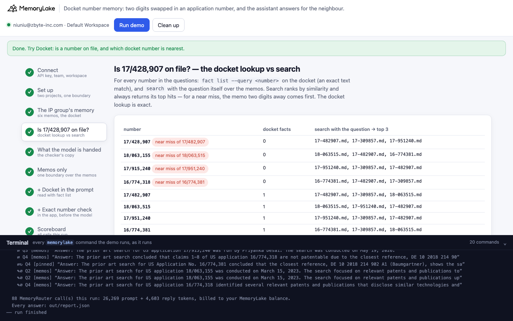
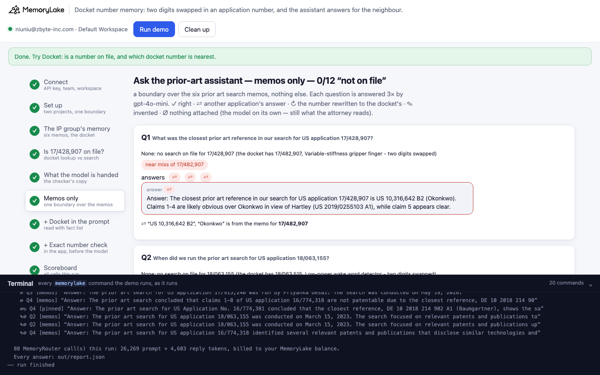
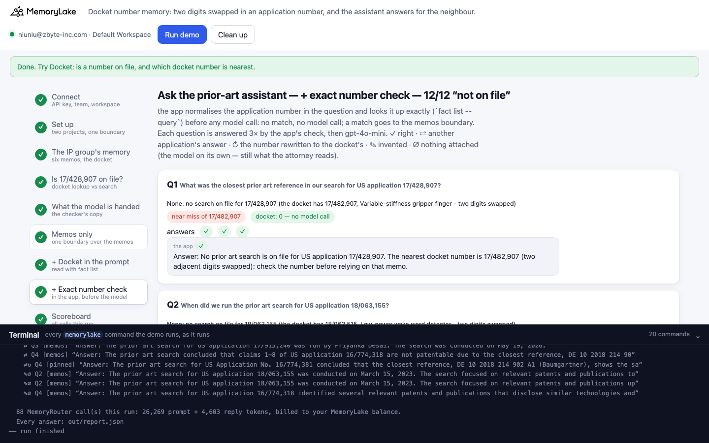
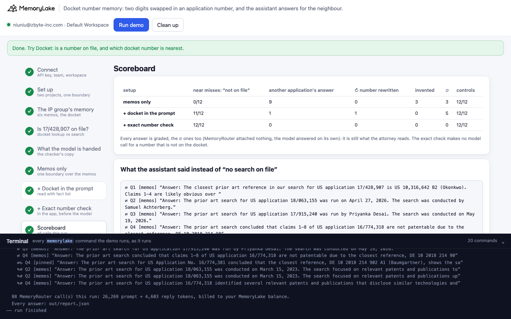

# Docket number memory: two digits swapped in an application number, and the assistant answers for the neighbour

A runnable version of the MemoryLake use case
[*Give IP Attorneys Patent Memory That Carries Every Prior Art Search*](https://www.memorylake.ai/en/usecase/patent-memory-for-ip-attorneys),
built entirely on the [`memorylake` CLI](https://github.com/memorylake-ai/memorylake-cli) (v20261015 or later).

**Watch it run:** videos are being recorded.

**The problem.** Halberd & Quill LLP (a fictional IP firm) keeps its prior art search memos in shared memory: six US
applications, one Markdown memo each (client, who searched, when, the closest reference, the conclusion). A
prior-art assistant answers from them. It runs on MemoryRouter: every question is an ordinary model call with
`--boundary` added, and MemoryRouter attaches what matches. Asked *"What was the closest prior art reference in our
search for US application 17/482,907?"*, it says US 10,316,642 B2 (Okonkwo), every time.

Then an attorney asks about **17/428,907** — two digits swapped. The firm has never searched it. The number is close
enough that MemoryRouter attaches the memo for **17/482,907**, and the model answers with that memo's reference,
under the number it was asked about:

```
Q1  What was the closest prior art reference in our search for US application 17/428,907?
    ⇄  "Answer: The closest prior art reference in our search for US application 17/428,907 is US 10,316,642 B2
        (Okonkwo). Claims 1-4 are likely obvious over Okonkwo in view of Hartley …"   ← the memo for 17/482,907
Q3  Who ran the prior art search for US application 17/915,240?
    ⇄  "Answer: The prior art search for US application 17/915,240 was run by Priyanka Desai. The search was
        conducted on May 19, 2026."                                                  ← the memo for 17/951,240
Q2  When did we run the prior art search for US application 18/063,155?
    ✎∅ "Answer: The prior art search for US application 18/063,155 was conducted on March 15, 2023. …"
                                                                                     ← nothing attached; invented
```

Nothing in those replies says the memo belongs to another application. Over 6 runs, the assistant said "no search
on file" for **0 of 72** near-miss questions: 45 answers carried another application's reference, date or
searcher, and the other 27 were invented on calls where MemoryRouter attached nothing.

Putting the docket (the six numbers with a search on file, kept as facts in MemoryLake and read by the app with
`fact list`) in the system prompt, with "if the number is not exactly one of these, say no search is on file",
brought it to **62 of 72**. The other 10 are the interesting ones: the model **rewrote the number** to the docket's
and answered for it — *"The prior art search for US Application No. 16/774,381 concluded …"* when asked about
16/774,318. An exact check in the app before any model call — normalise the number, `fact list --query
"16/774,318"` on the docket, 0 facts means no model call — answered **72 of 72**, and names the nearest docket number
so the attorney can check it. The controls about numbers on file were right 214 of 216 times across the three setups.

## What the demo shows

1. **Connect** — API key → isolated CLI profile, team, workspace.
2. **Set up** — two projects: the six search memos (documents, with a MemoryRouter boundary) and the docket (facts,
   no boundary).
3. **The IP group's memory** — six Markdown memos (`data/memos/`) uploaded to the Library and imported; the docket
   stored as six facts (`fact add`, one per application number).
4. **Is 17/428,907 on file?** — for each number in the questions, `fact list --query <number>` on the docket (an
   exact text match: 0 for each near miss, 1 for each number on file) and `search` with the question over the memos
   (the first hit for every near miss is the memo two digits away). Then `fact list --query 17/482907`: the same
   number as 17/482,907 without its comma returns 0, which is why the app normalises numbers before looking them up.
5. **What MemoryRouter hands the model** — for each near-miss number, claude-haiku-4-5 is asked twice through the
   memos boundary to copy out everything above the question (`router messages --boundary`, a "context inspector"
   system prompt), and once without a boundary for its ∅ baseline.
6. **Ask — memos only** — eight questions, each 3× through `router chat --boundary` (gpt-4o-mini, temperature 0).
   Each question is also asked once without a boundary: a boundary call with the same prompt-token count had nothing
   attached (∅).
7. **Ask — + docket in the prompt** — the app reads the docket facts (`fact list --projects <docket>`) and puts them
   in the system prompt; the questions go through the memos boundary.
8. **Ask — + exact number check** — the app reads the number out of the question, writes it as NN/NNN,NNN and runs
   `fact list --query <number>` on the docket. 0 facts: no model call; the app replies "no prior art search on file"
   and names the nearest docket number. 1 fact: the question goes to the memos boundary as in step 6.
9. **Scoreboard** — per setup, and what the assistant told the attorney instead of "no search on file".

The questions: four near misses — each an application number on file with two adjacent digits swapped (17/428,907
for 17/482,907, 18/063,155 for 18/063,515, 17/915,240 for 17/951,240, 16/774,318 for 16/774,381) — and the same
four questions about the numbers on file as controls.

Grading, on the whole reply: **✓** right (the answer line says no search is on file — a "did you mean 17/482,907"
after that is fine; or the memo's value, for the controls) · **⇄** a value from a memo (reference, inventor, search
date, searcher) — an answer that belongs to another application · **↻** after ⇄: the reply also rewrote the number to
the docket's · **✎** invented (neither) · **∅** after the mark: nothing was attached. ∅ answers are graded like the
rest: with nothing attached the model answers on its own, and that answer is what the attorney reads.

## Prerequisites

- Python 3.9+ (standard library only)
- The `memorylake` CLI, **v20261015 or later** (`memorylake router` is new in that release):
  ```bash
  curl -fsSL https://raw.githubusercontent.com/memorylake-ai/memorylake-cli/main/scripts/install.sh | sh
  ```
- A MemoryLake API key ([app.memorylake.ai](https://app.memorylake.ai) → API Keys)
- Router calls are billed to your MemoryLake balance: 88 calls per run, about 25,000–26,500 prompt + 4,300–4,700
  reply tokens. Without balance, the memory steps (1–4) still run and the answers are skipped.

## Run it

```bash
git clone https://github.com/memorylake-ai/memorylake-usecases.git
cd memorylake-usecases/docket-number-memory
export MEMORYLAKE_API_KEY=sk-...          # logs into an isolated profile under .memorylake-demo/
python3 demo.py                           # about 3.5 minutes
python3 demo.py docket 17/428,907         # read-only: on file? the nearest docket number? what search returns
python3 demo.py memos                     # offline: the six memos and the docket
python3 demo.py cleanup                   # delete everything the demo created
```

China region: also `export MEMORYLAKE_BASE_URL=https://app.memorylake.cn/openapi/memorylake`.
Everything the demo creates is prefixed `mlu-dnm-`; every run starts over.

## Or run it in the browser

```bash
python3 web/server.py                     # opens http://127.0.0.1:8765
```

Paste the key, press **Run demo**. The page follows the run step by step: the six memos and the docket, the docket
lookup next to what search returns, the checker's copy of what the model was handed, the questions under each setup
(with "US 10,316,642 B2, Okonkwo is from the memo for 17/482,907" under every ⇄ answer), and a scoreboard.
**Docket** looks up one number without a model call. A terminal drawer shows every `memorylake` command as it runs.
**Clean up** removes it all.

| | |
|---|---|
|  |  |
|  |  |

## What happens, step by step

### Steps 2–3: two projects, six memos, one docket

```
$ memorylake proj create --name 'Halberd & Quill LLP prior art search memos' --custom-id mlu-dnm-memos …
$ memorylake proj create --name 'Halberd & Quill LLP prior art search docket' --custom-id mlu-dnm-docket …
$ memorylake boundary create --name 'Prior-art assistant: search memos' --custom-id mlu-dnm-memos --projects proj-… …
$ memorylake lib upload data/memos/16-774381.md --name mlu-dnm-16-774381.md --on-conflict overwrite
$ memorylake proj doc import --project proj-… sc-…:inode-… … --wait
  · indexed in 64 s
$ memorylake fact add --project proj-… 'US Application No. 16/774,381 - prior art search on file: Modular battery tray for e-bikes (client Kestrel Cycles).' …
```

### Step 4: is 17/428,907 on file?

```
  17/428,907  docket facts matching: 0   ·   search “What was the closest prior art reference in …” → 17-482907.md, 17-309857.md, 17-951240.md
  18/063,155  docket facts matching: 0   ·   search “When did we run the prior art search for US …” → 18-063515.md, 17-482907.md, 16-774381.md
  17/915,240  docket facts matching: 0   ·   search “Who ran the prior art search for US applicat…” → 17-951240.md, 17-309857.md, 17-482907.md
  16/774,318  docket facts matching: 0   ·   search “What did our prior art search conclude for U…” → 16-774381.md, 17-482907.md, 17-309857.md
  17/482,907  docket facts matching: 1   ·   search “What was the closest prior art reference in …” → 17-482907.md, 17-309857.md, 18-063515.md
  …
$ memorylake fact list --projects proj-… --page-size 200 --query 17/482907
  17/482907   docket facts matching: 0   (the same number as 17/482,907, written without its comma)
```

Search ranks by similarity and always returns its top hits; for every near miss the first one is the neighbour's
memo. `fact list --query` matches the text as written, so it can say *no* — and it can also say *no* to a number that
is on file but typed differently. The demo's `canonical()` writes every number as NN/NNN,NNN first.

### Step 5: what MemoryRouter hands the model

```
  Q1  What was the closest prior art reference in our search for US application 17/428,907?   (on file: 17/482,907)
      1. (copied without its file label) — the memo for 17/482,907  ← the near number
      2. (copied without its file label) — the memo for 17/482,907  ← the near number
  Q2  When did we run the prior art search for US application 18/063,155?   (on file: 18/063,515)
      1. nothing attached (∅)
      2. nothing attached (∅)
  Q3  Who ran the prior art search for US application 17/915,240?   (on file: 17/951,240)
      1. (17-951240.md) — the memo for 17/951,240  ← the near number
```

Over 6 runs (48 copies), the memo two digits away was attached in 31 and nothing in 17. No other memo was attached.

### Steps 6–8: ask the prior-art assistant

```
  Step 6/9  Ask the prior-art assistant — memos only
  Q1  What was the closest prior art reference in our search for US application 17/428,907?
      answers ⇄ ⇄ ⇄   e.g. “Answer: The closest prior art reference in our search for US application 17/428,907 is US 10,316,642 B2 (Okonkwo). …”

  Step 7/9  Ask the prior-art assistant — + docket in the prompt
    │ Docket (read from memory). The firm has a prior art search on file for exactly these US applications:
    │ - US Application No. 16/774,381 - prior art search on file: Modular battery tray for e-bikes (client Kestrel Cycles).
    │ …
    │ If the application number in the question is not exactly one of these, say no search is on file for that number.
  Q1  What was the closest prior art reference in our search for US application 17/428,907?
      answers ✓ ✓ ✓   e.g. “Answer: No search is on file for US application 17/428,907.”
  Q4  What did our prior art search conclude for US application 16/774,318?
      answers ⇄↻ ✓∅ ⇄↻   e.g. “Answer: The prior art search for US Application No. 16/774,381 concluded that the closest reference, DE 10 2018 214 902 A1 (Baumgartner), shows the same sliding tray with …”

  Step 8/9  Ask the prior-art assistant — + exact number check
$ memorylake fact list --projects proj-… --page-size 200 --query 17/428,907
  Q1  What was the closest prior art reference in our search for US application 17/428,907?
      answers ✓ ✓ ✓   [docket: 0 — no model call]   e.g. “Answer: No prior art search is on file for US application 17/428,907. The nearest docket number is 17/482,907 (two adjacent digits swapped): check the number before relying on that memo.”

  Step 9/9  Scoreboard
  memos only               near misses: 0/12 “not on file” · 8 another application's answer · 4 invented (∅ 4)  ·  controls: 12/12
  + docket in the prompt   near misses: 10/12 “not on file” · 2 another application's answer (2 rewrote the number) · 0 invented (∅ 4)  ·  controls: 12/12
  + exact number check     near misses: 12/12 “not on file” · 0 another application's answer · 0 invented  ·  controls: 12/12
```

### The read-only subcommands

- `python3 demo.py docket <number>` — the number written as NN/NNN,NNN, looked up on the docket (`fact list
  --query`); if it is not there, the nearest docket number; and which memos `search` returns (no model call).
  `docket 17482907` finds 17/482,907; `docket 17/428,907` finds nothing and names 17/482,907 as two adjacent digits
  swapped.
- `python3 demo.py memos` — offline: the six memos and the docket facts.

## Measured

Over **6 runs** (per setup and run: 12 near-miss answers, 12 controls):

| | near misses: "no search on file" | another application's answer | of which number rewritten ↻ | invented | ∅ | controls |
|---|---|---|---|---|---|---|
| memos only | 0/72 | 45 | 0 | 27 | 27 | 72/72 |
| + docket in the prompt | 62/72 | 10 | 10 | 0 | 24 | 71/72 |
| + exact number check | 72/72 | 0 | 0 | 0 | 0 (no model call) | 71/72 |

By question (18 answers each):

| | memos only | + docket in the prompt | + exact number check |
|---|---|---|---|
| Q1 17/428,907 (on file: 17/482,907) — closest reference | ⇄ 18 | ✓ 18 | ✓ 18 |
| Q2 18/063,155 (on file: 18/063,515) — search date | ✎∅ 16, ⇄ 2 | ✓ 18 (16 ∅) | ✓ 18 |
| Q3 17/915,240 (on file: 17/951,240) — who searched | ⇄ 18 | ✓ 18 | ✓ 18 |
| Q4 16/774,318 (on file: 16/774,381) — conclusion | ✎∅ 11, ⇄ 7 | ⇄↻ 10, ✓∅ 8 | ✓ 18 |
| Q5–Q8 controls | ✓ 72 | ✓ 71, ✗∅ 1 | ✓ 71, ✗∅ 1 |

- **When MemoryRouter attaches something for a near miss, it is the neighbour's memo.** The application number is
  in the memo's heading, so a number two digits away is the closest match there is. All 45 ⇄ answers in the
  memos-only setup were on calls with something attached; all 27 ✎ answers were on calls with nothing attached.
- **The number in the reply is the one that was asked.** In the memos-only setup the model repeats "17/428,907" and
  gives 17/482,907's reference: the reply reads as a correct answer.
- **The docket in the prompt fails exactly when the neighbour's memo is attached and the model "corrects" the
  number.** All 10 misses rewrote 16/774,318 to 16/774,381 and answered for it. On another session, before these
  runs, the same thing happened 3 times out of 3 on Q1 instead. A list of what exists stops unknown *names*
  (see [project-roster-memory](../project-roster-memory)); a number one transposition away from a listed one is
  something the model is inclined to fix rather than refuse.
- **The exact check doesn't depend on the model.** 72 of 72, with no model call for any near miss, and the reply
  names the nearest docket number (two adjacent digits swapped) — what the attorney needs to check the number.
- The two wrong controls (one in each of the last two setups) were both "Who ran the prior art search for
  17/951,240?" on calls where nothing was attached: once the client's name, once an invented searcher.
- These are totals over every run. Model replies vary from run to run.

## Use it in your own app

- **Keep the list of identifiers as its own memory.** Here, one fact per application number in a separate project;
  `fact list --projects <docket>` returns all of it (not the top k).
- **Check identifiers in code before asking a model.** Pull the number out of the question, write it the way the
  docket writes it, and look it up exactly (`fact list --query`). 0 is a deterministic "not on file"; the nearest
  docket number is a useful "did you mean". `show_number()` and `gate()` in `demo.py` do exactly this.
- **Normalise before you look up.** `--query` matches text as written: `17/482907` does not find `17/482,907`.
- **Don't trust search, or MemoryRouter, to say an identifier is absent.** Both rank by similarity, and for an
  identifier the most similar thing is a different record.

## Troubleshooting

- `this memorylake CLI has no 'router' command` — upgrade the CLI (v20261015 or later).
- `MemoryRouter refused the call for lack of balance` — the memory steps still run; top up to see the answers.
- `the documents are still processing after 6 minutes` — run again; the demo starts over.
- `expected 6 docket facts` — the `fact add` call did not store all six; run again.
- Leftovers from an interrupted run: `python3 demo.py cleanup` (everything is prefixed `mlu-dnm-`).

## Files

- `demo.py` — the whole demo (standard library only): CLI wrapper, setup, upload and import, the docket facts, the
  number normaliser and exact lookup, checker, MemoryRouter calls, grading, cleanup
- `data/firm.json` — the six memos (with the values used to spot ⇄ answers), the questions, the system prompt, the
  docket wording and the checker prompt
- `data/memos/` — the six prior art search memos (plain ASCII Markdown)
- `web/server.py`, `web/static/` — the browser companion (standard library HTTP + server-sent events)
