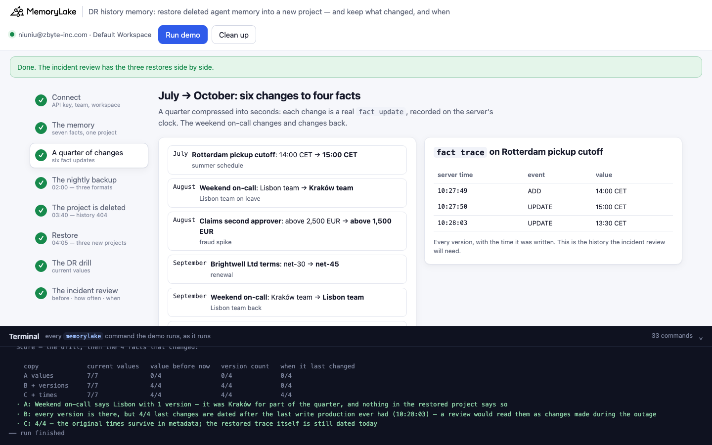
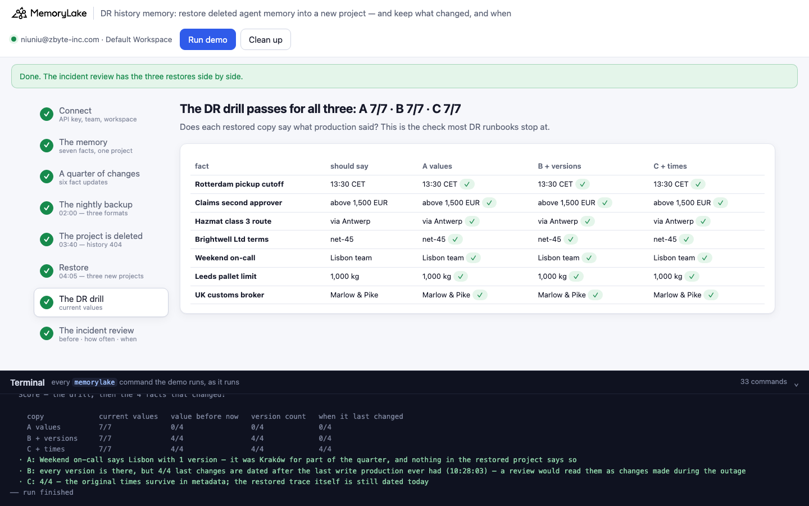
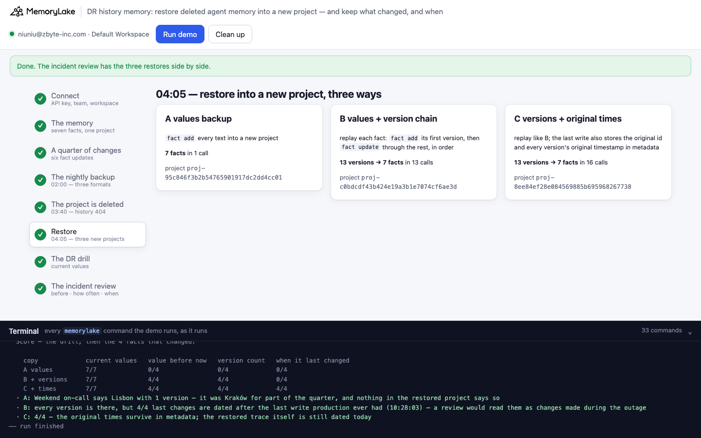
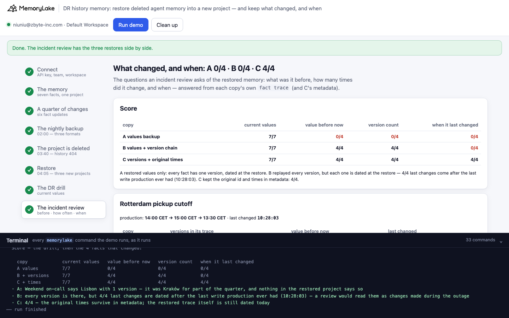

# DR history memory: the restore passes the drill, and the history is gone

A runnable version of the MemoryLake use case
[*Run Agent Memory With Disaster Recovery Built In, Not Bolted On*](https://www.memorylake.ai/en/usecase/disaster-recovery-for-agent-memory-infrastructure),
built entirely on the [`memorylake` CLI](https://github.com/memorylake-ai/memorylake-cli) (v20261015 or later).

**Watch it run:** [CLI, 2:29](https://github.com/memorylake-ai/memorylake-usecases/releases/download/dr-history-memory-v1/dr-history-memory-cli-demo.mp4) · [Web, 3:13](https://github.com/memorylake-ai/memorylake-usecases/releases/download/dr-history-memory-v1/dr-history-memory-web-demo.mp4)
([release](https://github.com/memorylake-ai/memorylake-usecases/releases/tag/dr-history-memory-v1); GitHub serves them as downloads). Each video is one run; the numbers below add up all of them.

**The problem.** The use case page promises an *audit trail through DR events*. That part is easy to lose in the
restore you run yourself. A teardown script meant for staging deletes the production memory project. `proj delete`
takes every fact **and its `fact trace` history** with it: the old project id answers 404 from then on. You restore
last night's backup into a new project and run the DR drill: every fact says what it said in production. The drill
passes. Then the incident review starts asking questions the restored memory can no longer answer:

- **"What was it before?"** A backup of current values restores current values. In the new project every fact has
  one version, an `ADD` dated at the restore, so every fact "never changed". The weekend on-call fact says Lisbon. It
  was Kraków for part of the quarter, and nothing in the restored project says so.
- **"When did it change?"** Back up the version chain from `fact trace` and replay it (`fact add` the first version,
  `fact update` through the rest), and the new trace has every version. It also dates every one of them at the
  restore: the cutoff change from October now looks like it was made after the original project was deleted.

What works: back up the whole trace, original timestamps and ids included, replay the versions, and write the original
id and every version's original timestamp into the restored fact's metadata, in the same call as its last text.

**Scope.** Multi-region replication and automatic failover, the page's other promises, happen on the server and are
not visible to a CLI. This demo is about the layer above them: the backup and restore your team runs for its own
mistakes, such as a project deleted by accident.

**What this demo shows.** Harrowgate Freight (fictional) runs a dispatch agent on project memory:

| time | what happens |
|---|---|
| (setup) | seven facts: Rotterdam pickup cutoff 14:00 CET, claims above 2,500 EUR need a second approver, hazmat class 3 via Antwerp, Brightwell Ltd on net-30, weekend on-call Lisbon team, Leeds pallet limit 1,000 kg, UK customs broker Marlow & Pike |
| July → October | six `fact update`s to four facts: cutoff → 15:00 → **13:30**; claims threshold → **1,500 EUR**; Brightwell → **net-45**; weekend on-call → Kraków → **back to Lisbon** |
| 02:00 | the nightly backup, in three formats (one per restore) |
| 03:40 | a teardown script deletes the production memory project; `fact trace` on its facts → 404 |
| 04:05 | the backup is restored into a new project, a different way for each format |

| | backup | restore |
|---|---|---|
| **A** values | `fact list` export: id + text of every live fact | `fact add` every text into a new project |
| **B** values + version chain | the export + each fact's version texts from `fact trace` | replay each fact: `fact add` its first version, then `fact update` through the rest |
| **C** versions + original times | the export + the full `fact trace`: texts, timestamps, original fact id | replay like B; the last write also stores the original id and every version's original timestamp in metadata |

The months are labels: the six changes run about two seconds apart, and every time shown is the server's own clock
(`fact trace` timestamps). The score's ground truth is a separate read of the original project's trace taken just
before it is deleted (`out/truth.json`). C's answers come from the restored project, after the full restore path.
No model calls: nothing is billed.

## Prerequisites

- **Python 3.9+** (standard library only).
- **The `memorylake` CLI, v20261015 or later** (`memorylake version`):
  ```bash
  curl -fsSL https://raw.githubusercontent.com/memorylake-ai/memorylake-cli/main/scripts/install.sh | sh
  ```
- **A MemoryLake API key**: sign up at [app.memorylake.ai](https://app.memorylake.ai), open **API Keys**, create one.
  Everything the demo uses (projects, facts, `fact trace`) is part of the free plan.

## Run it

```bash
git clone https://github.com/memorylake-ai/memorylake-usecases.git
cd memorylake-usecases/dr-history-memory
export MEMORYLAKE_API_KEY=sk-...        # logs into an isolated profile under .memorylake-demo/, never touches ~/.memorylake
python3 demo.py                         # about 75 seconds
python3 demo.py history oncall          # production's trace (from out/truth.json) next to each restored copy's
python3 demo.py cleanup                 # deletes everything the demo created
```

China region: also `export MEMORYLAKE_BASE_URL=https://app.memorylake.cn/openapi/memorylake`. To use a specific
workspace: `export MEMORYLAKE_WORKSPACE=ws-…` (default: the team's default workspace). Without `MEMORYLAKE_API_KEY`
the demo uses your existing `memorylake auth login` session.

Every object the demo creates has a `custom_id` starting with `mlu-drh-`. Each run starts over: it deletes what a
previous run left behind first (`--reset` is accepted and does the same).

## Or run it in the browser

```bash
python3 web/server.py                   # opens http://127.0.0.1:8765
```

Paste the API key, press **Run demo**, and follow the steps: the memory, the quarter's changes with their trace, the
three backup formats, the deleted project, the three restores (live), the DR drill, and the incident review. The
terminal drawer at the bottom shows every `memorylake` command as it runs. The server is standard library only and
binds to localhost; the key stays in that process and in `.memorylake-demo/`.

| | |
|---|---|
|  |  |
|  |  |

## What happens, step by step

Output below is from one real run (the third terminal run; ids shortened where marked with …).

### Step 3: a quarter of changes

Six `fact update`s, each echoed as it runs. Then the history of one fact, as production has it:

```
$ memorylake fact trace fact-20300d… --project proj-d0421c… --workspace ws-…

  fact trace on Rotterdam pickup cutoff — every version, on the server's clock:
    10:22:00  ADD     14:00 CET
    10:22:01  UPDATE  15:00 CET
    10:22:15  UPDATE  13:30 CET
```

### Step 4: the nightly backup, three formats

One `fact list` and a `fact trace` per fact; each format keeps a different part of what comes back:

```
    file                 per fact                                                   bytes
    out/backup-a.json    `fact list` export: id + text of every live fact             884
    out/backup-b.json    the export + each fact's version texts from `fact trace`    1368
    out/backup-c.json    the export + full `fact trace`: texts, times, original id   3791
  · 7 facts, 13 versions in their history
```

### Step 5: the project is deleted

```
$ memorylake proj delete proj-d0421c… --workspace ws-…
$ memorylake fact trace fact-20300d… --project proj-d0421c… --workspace ws-…
    → Project not found with id: proj-d0421c… [NOT_FOUND]
  · Rotterdam pickup cutoff's history went with the project: the backup is all that is left. Last write the project ever had: 10:22:15 server time
```

### Step 6: restore, three ways

A is one `fact add` with seven texts. B and C replay each fact's versions in order. C's last write for each fact
carries the history:

```
$ memorylake fact update fact-… --text 'Same-day pickup cutoff at the Rotterdam depot is 13:30 CET.' --metadata '{"restored_from": {"project": "proj-d0421c…", "fact_id": "fact-20300d…"}, "history": [{"v": 1, "event": "ADD", "at": "2026-10-18T10:22:00…Z", "event_id": "api-…"}, {"v": 2, "event": "UPDATE", "at": "2026-10-18T10:22:01…Z", …}, {"v": 3, "event": "UPDATE", "at": "2026-10-18T10:22:15…Z", …}]}' --project proj-… --workspace ws-…
    A  added 7 facts in 1 call
    B  replayed 13 versions into 7 facts (13 calls)
    C  replayed 13 versions into 7 facts, original id + times in metadata (16 calls)
```

(C makes three more calls than B: the three facts that never changed get their history with a metadata-only
`fact update`.)

### Step 7: the DR drill

```
    fact                          should say        A values          B + versions      C + times
    Rotterdam pickup cutoff       13:30 CET         13:30 CET ✓       13:30 CET ✓       13:30 CET ✓
    Claims second approver        above 1,500 EUR   above 1,500 EUR ✓ above 1,500 EUR ✓ above 1,500 EUR ✓
    Hazmat class 3 route          via Antwerp       via Antwerp ✓     via Antwerp ✓     via Antwerp ✓
    Brightwell Ltd terms          net-45            net-45 ✓          net-45 ✓          net-45 ✓
    Weekend on-call               Lisbon team       Lisbon team ✓     Lisbon team ✓     Lisbon team ✓
    Leeds pallet limit            1,000 kg          1,000 kg ✓        1,000 kg ✓        1,000 kg ✓
    UK customs broker             Marlow & Pike     Marlow & Pike ✓   Marlow & Pike ✓   Marlow & Pike ✓
  · A: 7/7 · B: 7/7 · C: 7/7 — the drill passes for all three restores
```

### Step 8: the incident review

For each of the four facts that changed: the restored copy's own `fact trace` (and, for C, its metadata):

```
  Weekend on-call — production: Lisbon team → Kraków team → Lisbon team; last changed 10:22:12
    A values      1 version(s)  before: (none: never changed) ✗    changed: 10:22:31 (trace) +19.0s ✗
    B + versions  3 version(s)  before: Kraków team ✓              changed: 10:22:35 (trace) +23.4s ✗
    C + times     3 version(s)  before: Kraków team ✓              changed: 10:22:12 (metadata) ✓

  Score — the drill, then the 4 facts that changed:

    copy             current values   value before now   version count   when it last changed
    A values         7/7              0/4                0/4             0/4
    B + versions     7/7              4/4                4/4             0/4
    C + times        7/7              4/4                4/4             4/4
  · A: Weekend on-call says Lisbon with 1 version — it was Kraków for part of the quarter, and nothing in the restored project says so
  · B: every version is there, but 4/4 last changes are dated after the last write production ever had (10:22:15) — a review would read them as changes made during the outage
  · C: 4/4 — the original times survive in metadata; the restored trace itself is still dated today
```

The gaps are seconds because the demo compresses a quarter into seconds. In a real restore they are the time between
the change and the restore: days or months.

`python3 demo.py history oncall` puts the traces side by side:

```
  Weekend on-call
    production (fact-fb6e2f…, from out/truth.json — the project itself is gone):
      10:22:00  ADD     Lisbon team
      10:22:04  UPDATE  Kraków team
      10:22:12  UPDATE  Lisbon team
    A values (fact-7f96f8…), fact trace:
      10:22:31  ADD     Lisbon team
    B + versions (fact-e5b47b…), fact trace:
      10:22:34  ADD     Lisbon team
      10:22:35  UPDATE  Kraków team
      10:22:35  UPDATE  Lisbon team
    C + times (fact-4c22fb…), fact trace:
      10:22:44  ADD     Lisbon team
      10:22:45  UPDATE  Kraków team
      10:22:45  UPDATE  Lisbon team
      metadata.history: v1 10:22:00, v2 10:22:04, v3 10:22:12
```

## Measured

6 runs: three terminal runs (the second over the first's leftovers, the third with `--reset`), a browser run, the
browser run recorded for the Web video, and the run recorded for the CLI video (from a fresh `git clone`). Every
number comes from the saved reports (`out/runs/`).

| | A values | B values + version chain | C versions + original times |
|---|---|---|---|
| current values (the DR drill) | 7/7 in 6 of 6 runs | 7/7 in 6 of 6 | 7/7 in 6 of 6 |
| value before now | 0 of 24 | 24 of 24 | 24 of 24 |
| version count | 0 of 24 | 24 of 24 | 24 of 24 |
| when it last changed | 0 of 24 | 0 of 24 (24 of 24 dated after production's last write) | 24 of 24 |

The first terminal run took 71 s. All writes go through the API (no extraction from conversations), so nothing in
the outcome depends on a model.

## Use it in your own agents

- **A DR drill that checks current values checks half of it.** Add the questions an incident review asks of memory:
  the value before now, how many times it changed, when. Run them against the restored copy, not the backup file.
- **`proj delete` deletes history too.** The facts and their `fact trace` go with the project, so a backup that
  should support an audit has to carry the trace: version texts, timestamps, ids.
- **Replaying versions restores the chain, not the clock.** `fact trace` records when MemoryLake wrote each version,
  and a replay writes them all at restore time. There is no way to backdate a trace entry, so keep the original
  times next to the fact: metadata, written in the same `fact update` as the last text.
- **Per-version metadata is not in the trace.** `fact update --metadata` replaces the whole object and `fact trace`
  entries carry no metadata, so only the last write's metadata survives. Put the whole history in that last write.
- **Keep the original fact id.** After a restore every fact has a new id. `restored_from` lets anyone who has the
  old id in a log, ticket or prompt find the new one.

## Troubleshooting

- **`no fact trace with full history`** — the CLI is older than v20261015; reinstall with the `install.sh` line above.
- **`the deleted project still answers fact trace`** — the server kept the project's history after `proj delete`;
  the demo stops rather than tell a story the server no longer supports. Please open an issue.
- **Leftovers after an interrupted run** — `python3 demo.py cleanup`.

## Files

| file | what it is |
|---|---|
| `demo.py` | the whole demo: CLI wrapper, the changes, the three backups, the deletion, the three restores, the drill and the review, cleanup |
| `data/story.json` | the seven facts, the six changes, and the three backup formats |
| `web/server.py`, `web/static/` | the browser companion (standard library server, no build step) |
| `out/backup-*.json`, `out/truth.json`, `out/restore.json`, `out/report.json` | the three backups, the ground truth read before the deletion, the project ids, and the score (`cleanup` moves them to `out/runs/`) |
