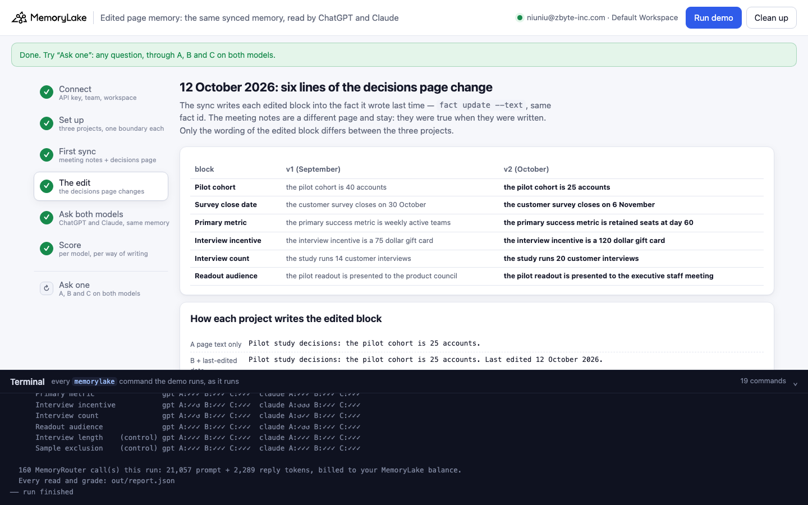
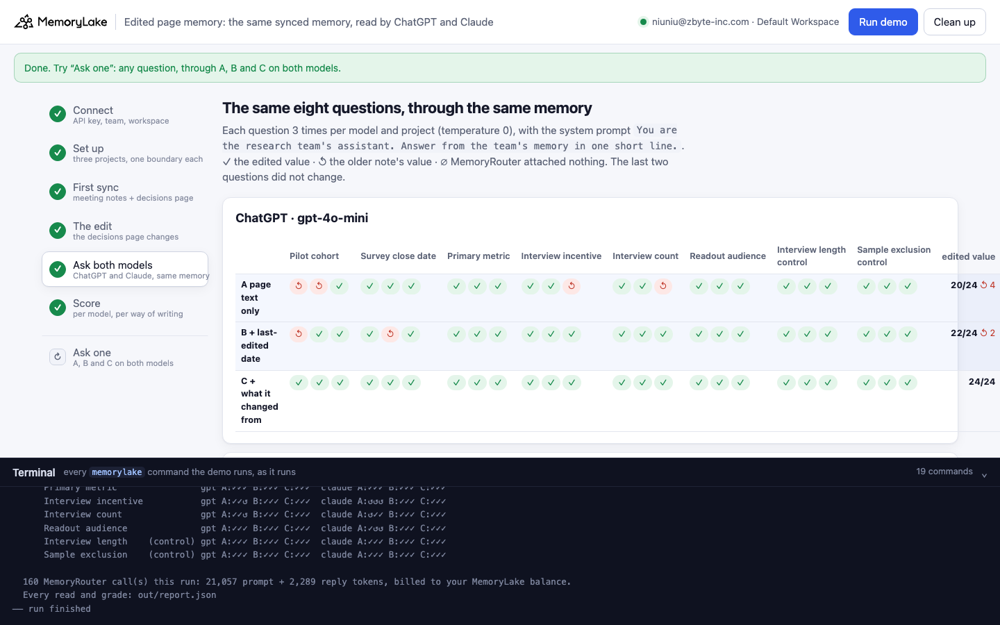
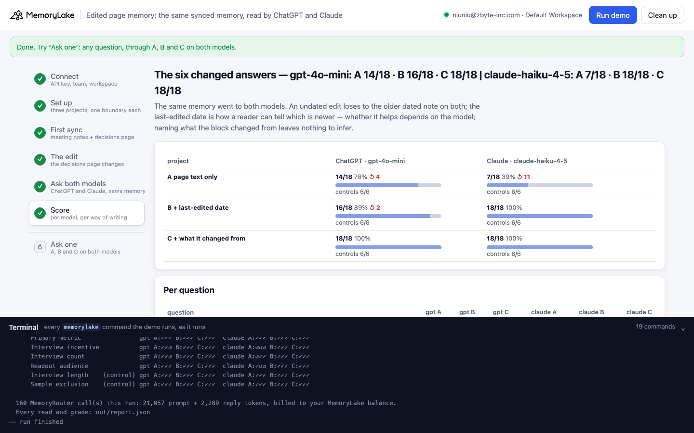
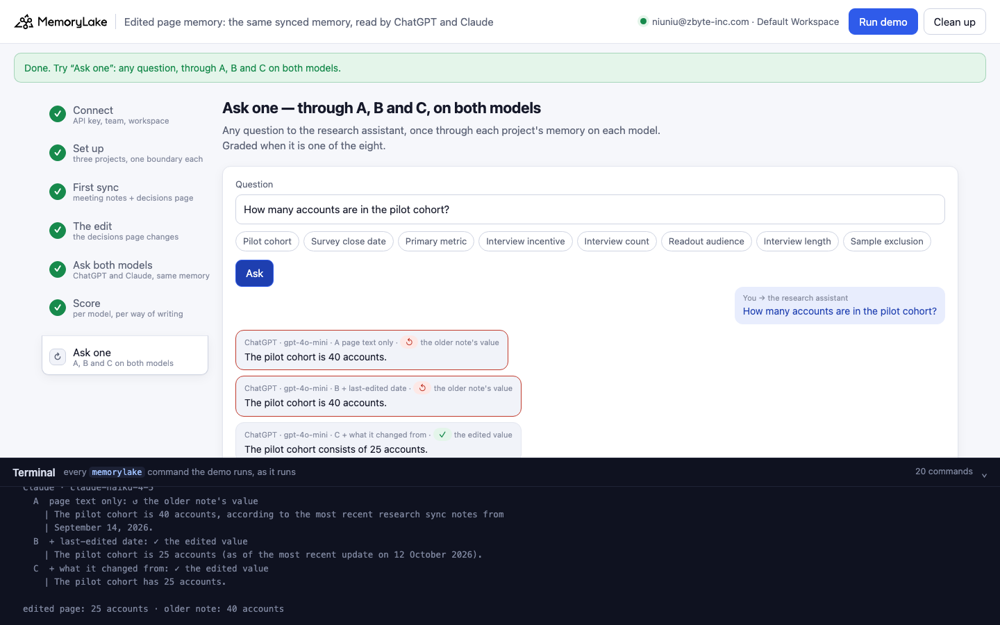

# Edited page memory: the same synced memory, read by ChatGPT and Claude

A runnable version of the MemoryLake use case
[*Your Knowledge Shouldn't Be Trapped in Notion*](https://www.memorylake.ai/en/usecase/ai-memory-beyond-notion-ai),
built entirely on the [`memorylake` CLI](https://github.com/memorylake-ai/memorylake-cli) (v20261015 or later).

**Watch it run:** [CLI, 4:01](https://github.com/memorylake-ai/memorylake-usecases/releases/download/edited-page-memory-v1/edited-page-memory-cli-demo.mp4) · [Web, 5:00](https://github.com/memorylake-ai/memorylake-usecases/releases/download/edited-page-memory-v1/edited-page-memory-web-demo.mp4)
([release](https://github.com/memorylake-ai/memorylake-usecases/releases/tag/edited-page-memory-v1); GitHub serves them as downloads).

**The problem.** You sync your team's workspace into MemoryLake so every AI tool starts from what the team wrote
down — ChatGPT for drafting, Claude for analysis, the same memory behind both. Workspaces hold two kinds of page.
Meeting notes are dated in their title. A living page — "Pilot study decisions" — says what is decided *now*, and its
text carries no date: the editor keeps "last edited" as a page property. When that page is edited, a sync that
copies the page text writes a fact with no date next to an older note that has one:

```
older note   "Research sync notes, 14 September 2026: the pilot cohort will be 40 accounts."
edited page  "Pilot study decisions: the pilot cohort is 25 accounts."
question     "How many accounts are in the pilot cohort?"
Claude       "The pilot cohort is 40 accounts, according to the most recent research sync notes from September 14, 2026."
ChatGPT      "The pilot cohort is 40 accounts."
```

Both facts reached both models. The model has to decide which one is current, and the only date in sight belongs to
the old one.

**What this demo shows.** Larkfield Analytics (a fictional research team) syncs its workspace into MemoryLake, one
fact per page block: two meeting-notes pages from September and the living decisions page. On 12 October six lines of
the decisions page change (pilot cohort, survey close date, primary metric, interview incentive, interview count,
readout audience); two lines stay the same (the controls). The sync updates the six blocks in place
(`fact update --text`, keyed by block) and leaves the meeting notes alone — they were true when they were written.
Then ChatGPT (gpt-4o-mini) and Claude (claude-haiku-4-5) are asked the same eight questions through MemoryRouter.
The edited page is written three ways, each into its own project:

| | the edited block, as written | |
|---|---|---|
| **A** | `Pilot study decisions: the pilot cohort is 25 accounts.` | the page text only |
| **B** | `Pilot study decisions: the pilot cohort is 25 accounts. Last edited 12 October 2026.` | plus the page's last-edited date (every block of the page) |
| **C** | `Pilot study decisions: the pilot cohort is 25 accounts, changed from 40 accounts.` | plus what the block changed from (the sync diffs against what it wrote last time) |

Over 6 runs (each question three times per model and project, temperature 0), the six changed questions:

| | ChatGPT · gpt-4o-mini | Claude · claude-haiku-4-5 |
|---|---|---|
| **A** page text only | 76/108 (↺ 32) | 43/108 (↺ 65) |
| **B** + last-edited date | 91/108 (↺ 17) | 108/108 |
| **C** + what it changed from | 108/108 | 108/108 |
| controls (unchanged), every arm | 108/108 | 108/108 |

- **Undated, the edit loses on both models.** Claude gave the older note's value most of the time and said why: *"40
  accounts, according to the most recent research sync notes from September 14, 2026"* — the only fact with a date
  looked like the newest.
- **The date fixes Claude, not ChatGPT.** With "Last edited 12 October 2026" in every block, Claude was right every
  time; gpt-4o-mini still gave the older value 17 times, 13 of them on the pilot cohort, whose September note says
  *"will be 40 accounts"*.
- **Naming what changed fixes both.** *"…25 accounts, changed from 40 accounts"* was right every time on both models.
  The fact no longer depends on the reader working out which of two facts is newer.
- MemoryRouter attached memory to every read (no ∅), and the two unchanged questions were right on every arm — the
  failure is not retrieval and not the extra words.

## Prerequisites

1. **Python 3.9+** (standard library only).
2. **The `memorylake` CLI, v20261015 or later** — `memorylake router` is new in that release:
   ```bash
   curl -fsSL https://raw.githubusercontent.com/memorylake-ai/memorylake-cli/main/scripts/install.sh | sh
   memorylake version
   ```
3. **A MemoryLake API key** — sign up at [app.memorylake.ai](https://app.memorylake.ai), open **API Keys**, create one.
   For the China region use `https://app.memorylake.cn` and also set
   `MEMORYLAKE_BASE_URL=https://app.memorylake.cn/openapi/memorylake`.
4. **MemoryRouter calls are billed** to your MemoryLake balance: about 160 calls per run, half on gpt-4o-mini and
   half on claude-haiku-4-5 (roughly 21,000 prompt tokens). Without balance the memory steps still run and the
   replies are skipped.

## Run it

```bash
git clone https://github.com/memorylake-ai/memorylake-usecases.git
cd memorylake-usecases/edited-page-memory
export MEMORYLAKE_API_KEY=sk-...
python3 demo.py
```

About 3 minutes. With a key set, the demo logs into an isolated CLI profile under `.memorylake-demo/` and never
touches your `~/.memorylake`. Without one it uses your existing `memorylake auth login` session. Everything it
creates is prefixed `mlu-epg-`; every run starts over.

Then:

```bash
python3 demo.py memory
```

```bash
python3 demo.py ask "How many accounts are in the pilot cohort?"
```

```bash
python3 demo.py cleanup
```

`memory` prints, for each of the eight questions, the older note and the edited block in each project; `ask` sends one
question through A, B and C on both models; `cleanup` deletes the three boundaries, every fact in the three projects,
and the projects. The full report of a run is in `out/report.json`; `cleanup` moves it to `out/runs/`.

## Or run it in the browser

```bash
python3 web/server.py
```

Opens `http://127.0.0.1:8765`. Paste the API key, press **Run demo**. The page runs the same pipeline (it imports
`demo.py`) and shows each step ([video, 5:00](https://github.com/memorylake-ai/memorylake-usecases/releases/download/edited-page-memory-v1/edited-page-memory-web-demo.mp4)): the first sync, the edit and how each project writes it, both models' answers, and
the score. **Ask one** sends any question through all three projects on both models. The terminal drawer at the
bottom shows every `memorylake` command as it runs.

| | |
|---|---|
|  |  |
|  |  |

## What happens, step by step

The commands below are from a real run (ids shortened).

### Step 2: three projects, one boundary each

```
$ memorylake proj create --name 'Larkfield research' --custom-id mlu-epg-text --description 'Larkfield research team memory, synced from the team workspace. Demo data.'
$ memorylake boundary create --name 'Larkfield research (page text only)' --custom-id mlu-epg-text --projects proj-c93642…
```

The three projects carry the same plain name; only the custom id differs. Each has its own boundary, so a model reads
exactly one version of the team's memory at a time.

### Step 3: the first sync

Each block becomes one fact, the same in all three projects. Meeting notes carry their date in the page title, so their
facts do too; the decisions page's "last edited 15 September 2026" is a page property and stays out of the text.

```
$ memorylake fact add 'Research sync notes, 14 September 2026: the pilot cohort will be 40 accounts.' 'Research sync notes, 14 September 2026: the customer survey closes on 30 October.' … --project proj-c93642…
$ memorylake fact add 'Pilot study decisions: the pilot cohort is 40 accounts.' 'Pilot study decisions: the customer survey closes on 30 October.' … --project proj-c93642…
```

The sync keeps block → fact id (and the text it wrote) in `out/sync-state.json`.

### Step 4: the decisions page is edited

```
    On 12 October 2026 the team edits “Pilot study decisions”: 6 of 8 lines change. The meeting notes are not touched.
      ~ the pilot cohort is 40 accounts
        → the pilot cohort is 25 accounts
      ~ the customer survey closes on 30 October
        → the customer survey closes on 6 November
      …

$ memorylake fact update fact-fcd02d… --text 'Pilot study decisions: the pilot cohort is 25 accounts.' --project proj-c93642…
$ memorylake fact update fact-30a99d… --text 'Pilot study decisions: the pilot cohort is 25 accounts. Last edited 12 October 2026.' --project proj-dbdc35…
$ memorylake fact update fact-163aca… --text 'Pilot study decisions: the pilot cohort is 25 accounts, changed from 40 accounts.' --project proj-421ecc…
```

`fact list` on each project then shows both facts about the cohort next to each other:

```
    A  page text only   (16 facts in the project)
      older note   │ Research sync notes, 14 September 2026: the pilot cohort will be 40 accounts.
      edited page  │ Pilot study decisions: the pilot cohort is 25 accounts.

    B  + last-edited date   (16 facts in the project)
      older note   │ Research sync notes, 14 September 2026: the pilot cohort will be 40 accounts.
      edited page  │ Pilot study decisions: the pilot cohort is 25 accounts. Last edited 12 October 2026.

    C  + what it changed from   (16 facts in the project)
      older note   │ Research sync notes, 14 September 2026: the pilot cohort will be 40 accounts.
      edited page  │ Pilot study decisions: the pilot cohort is 25 accounts, changed from 40 accounts.
```

### Step 5: the same eight questions, on both models

Each question once without a boundary first (the prompt-token count of a call with nothing attached), then three
times per model and project:

```
$ memorylake router chat 'How many accounts are in the pilot cohort?' --model gpt-4o-mini --max-tokens 80 --temperature 0 --system "You are the research team's assistant. Answer from the team's memory in one short line." --boundary bnd-aecfa8…
```

From one run (columns: the six changed questions, then the two controls):

```
  ChatGPT · gpt-4o-mini
    A  page text only            ↺↺✓ ✓✓↺ ✓✓✓ ✓✓✓ ✓✓✓ ↺↺✓ ✓✓✓ ✓✓✓   edited value 19/24 · ↺ older note 5
    B  + last-edited date        ↺↺✓ ✓✓✓ ✓✓✓ ✓✓✓ ✓✓↺ ✓✓✓ ✓✓✓ ✓✓✓   edited value 21/24 · ↺ older note 3
    C  + what it changed from    ✓✓✓ ✓✓✓ ✓✓✓ ✓✓✓ ✓✓✓ ✓✓✓ ✓✓✓ ✓✓✓   edited value 24/24 · ↺ older note 0

  Claude · claude-haiku-4-5
    A  page text only            ↺↺↺ ↺↺↺ ✓✓✓ ↺↺↺ ↺✓↺ ↺↺↺ ✓✓✓ ✓✓✓   edited value 10/24 · ↺ older note 14
    B  + last-edited date        ✓✓✓ ✓✓✓ ✓✓✓ ✓✓✓ ✓✓✓ ✓✓✓ ✓✓✓ ✓✓✓   edited value 24/24 · ↺ older note 0
    C  + what it changed from    ✓✓✓ ✓✓✓ ✓✓✓ ✓✓✓ ✓✓✓ ✓✓✓ ✓✓✓ ✓✓✓   edited value 24/24 · ↺ older note 0
```

Then one question, six readers. `python3 demo.py ask "How many accounts are in the pilot cohort?"` after the same run:

```
  ChatGPT · gpt-4o-mini
    A  page text only: ✓ the edited value
      | The pilot cohort will be 25 accounts.
    B  + last-edited date: ↺ the older note's value
      | The pilot cohort is 40 accounts.
    C  + what it changed from: ✓ the edited value
      | The pilot cohort consists of 25 accounts.

  Claude · claude-haiku-4-5
    A  page text only: ↺ the older note's value
      | The pilot cohort is 40 accounts, according to the most recent research sync notes from
      | September 14, 2026.
    B  + last-edited date: ✓ the edited value
      | The pilot cohort has 25 accounts.
    C  + what it changed from: ✓ the edited value
      | The pilot cohort is 25 accounts.
```

A reply is graded by the value it states first, before any "changed from / previously …" clause — so *"6 November
(it was moved from the original 30 October date)"* counts as the edited value. The grader checks itself against 21
real replies before every run.

### Step 6: the score

Per model and project, the six changed questions (edited value / reads, ↺ the older note's value), the controls, and
a per-question grid. Every read and grade is in `out/report.json`.

## Use it with your own workspace

- **Carry the edit date into the text.** A page property that the sync drops is invisible to every model. If the
  current state lives on a living page, write its last-edited date into each fact the sync writes — that was enough
  for Claude here, not for ChatGPT.
- **Better: say what changed.** Keep, per block, the text you wrote last time (`out/sync-state.json` here), diff on
  the next sync, and write *"…, changed from <old value>"*. The fact then answers the question on its own, whatever
  else is in memory, for both models.
- **Update in place, keyed by block.** `fact update <id> --text …` keeps one fact per block, so the decisions page
  never has two versions of itself in memory. It does not touch other pages' facts — the dated meeting notes stay, as
  they should: they were true when written.
- **Test with the models you actually use.** The same memory, the same boundary, the same question, and a fix that
  works for one model left the other answering the old value. Run your questions through each model you route to.

## Troubleshooting

- **`this memorylake CLI has no router command`** — upgrade the CLI (v20261015+).
- **Replies are skipped / "MemoryRouter refused the call for lack of balance"** — top up your MemoryLake balance;
  the memory steps still run.
- **`ask` doesn't grade my question** — only the eight questions shown in the demo are graded; quote them exactly.
  In a shell, quote the whole question.
- **Port 8765 in use** — `web/server.py` tries the next port and prints which one it took; or pass `--port N`.
- **A run stopped half-way** — run `python3 demo.py cleanup`, then `python3 demo.py` again.

## Files

| file | what it is |
|---|---|
| `demo.py` | the demo: CLI wrapper, the two syncs, the questions on both models, grading, `memory` / `ask` / `cleanup` |
| `data/workspace.json` | the pages and the eight topics: meeting-note line, decision block v1 and v2, question, values |
| `web/server.py` | the browser companion (standard library HTTP + Server-Sent Events, imports `demo.py`) |
| `web/static/` | the page (no build step) |
| `web/screenshot-*.png` | screenshots from a real browser run |
