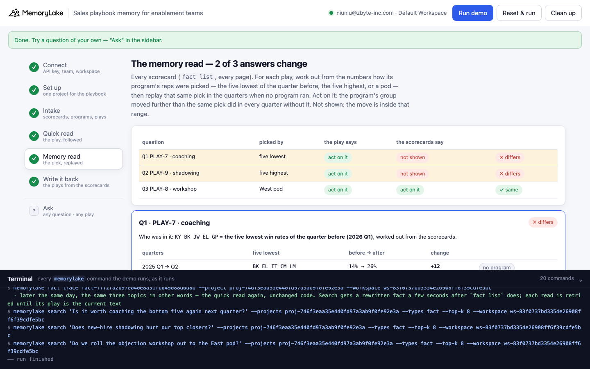
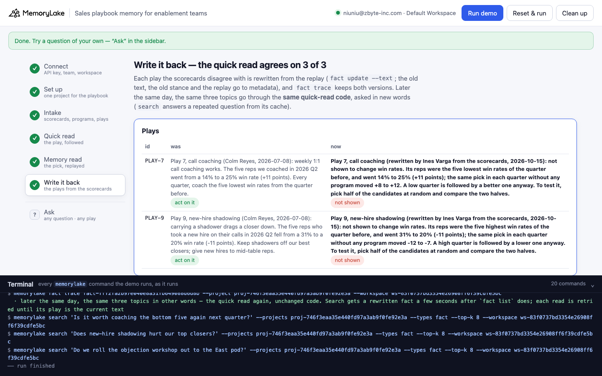

# Sales playbook memory for enablement teams

A runnable version of the MemoryLake use case
[*Give Sales Enablement Playbook Memory That Reps' AI Tools Actually Read*](https://www.memorylake.ai/en/usecase/sales-playbook-memory-for-enablement-teams),
built entirely on the [`memorylake` CLI](https://github.com/memorylake-ai/memorylake-cli).

**Watch it run:** videos are being recorded.

**The problem.** The page's promise is a playbook that every rep's AI tool reads before it writes an email, preps a
call or plans coaching. The plays in that playbook are written from results: "we coached the bottom five and their win
rate went up 11 points, so coach the bottom five every quarter." The number is real. It just isn't the program's. Pick
the five lowest win rates of any quarter and look at them the next quarter, with nothing done at all, and they are up
too. A low quarter is partly bad luck, and bad luck doesn't repeat. The same goes the other way: the five best closers
of any quarter fall back the next one, whatever you hand them. A play written from "the worst got better" or "the
best got worse" has measured **regression to the mean**, and an AI tool that reads it will keep spending managers'
time on it.

**What this demo shows.** Fernhollow Software (fictional) keeps its playbook in one MemoryLake project: every AE's
quarterly scorecard from the CRM (12 reps in two pods, 2025 Q1 to 2026 Q3, 84 scorecards), the three enablement
programs that ran, and three plays. Colm Reyes, the enablement manager who wrote Plays 7 and 9, left in September. On
2026-10-15, Q4 planning asks three questions:

| Question | Quick read: the play | Memory read: the program's pick, replayed without it | |
|---|---|---|---|
| Q1 Which reps should get weekly call coaching in Q4? | Play 7: coaching took the five reps it was given to from 14% to 25% (+11) → **act on it** | the five were the five lowest of 2026 Q1; the five lowest of each earlier quarter, uncoached, moved +12, +12, +11, +8 → **not shown** | ✗ |
| Q2 Can our top closers take a new-hire shadower in Q4? | Play 9: the five who carried a shadower fell from 31% to 20% (−11) → **act on it** (keep shadowers off them) | the five were the five highest of 2026 Q1; the five highest of each earlier quarter, no shadowers, moved −12, −12, −7, −10 → **not shown** | ✗ |
| Q3 Should the East pod get the objection-handling workshop? (control) | Play 8: West took it and went 21% → 28% (+7) while East held at 23% → **act on it** | West was picked by territory, not results; in earlier quarters it moved −2, −1, 0, −1 → **act on it** | ✓ |

Nobody wrote down how the coached and shadowed reps were picked. The demo works it out from the scorecards: the coached
five are exactly the five lowest win rates of the quarter before, the shadowed five exactly the five highest. Then it
replays that same pick in every earlier pair of quarters in which no program ran. Coaching's +11 sits inside the +8 to
+12 that the five lowest made on their own (0.2 points above their average). Shadowing's −11 sits inside the −7 to
−12 the five highest fell on their own. Play 8 is the control: the West pod is a fixed group, it barely moved in the
quarters before, and +7 is above every one of them, with East flat in the same quarter. A checker that only ever said
"no" would be no use; this one credits the program that worked.

Step 6 rewrites Plays 7 and 9 where the next AI tool will read them (`fact update --text`, with the old text, the old
stance and the replay kept in metadata). `fact trace` keeps both versions. Later that day, the same three topics,
asked in other words, go through the **same quick-read code** and agree with the scorecards, 3 of 3.

```
setup ──────── proj create
intake ─────── fact add --project <p> '<scorecard>' …   (30 per call, 3 calls)  + fact update --metadata {rep, pod, quarter, won, opps}
               programs: {program, quarter, members}   plays: {program, claim, direction, advice, stance}
quick read ─── search '<question>' --projects <p> --types fact --top-k 8  → the play on that program → its stance
memory read ── fact list --projects <p>   (every record, every page)
               → who was in the program = the k lowest / k highest of the quarter before / a pod?   (from the numbers)
               → the same pick in every earlier pair of quarters with no program: before → after
               → the program's move beyond every one of those, in the play's direction?  act on it : not shown
write back ─── fact update <play> --text '<conclusion from the replay>' --metadata {…, stance, previous: '<old text>', basis: {…}}
               fact trace <play>  → ADD, UPDATE (old text kept) → quick read again (new wording)
```

No conversations and no extraction: every record is pinned word for word, and both reads are plain code over what the
CLI returns. No model decides anything, and no record is labelled with how its reps were picked.

## Prerequisites

- **Python 3.9+** (standard library only, nothing to `pip install`)
- **The `memorylake` CLI** on your `PATH`:
  ```bash
  curl -fsSL https://raw.githubusercontent.com/memorylake-ai/memorylake-cli/main/scripts/install.sh | sh
  ```
- **A MemoryLake API key.** Sign up at [app.memorylake.ai](https://app.memorylake.ai), open **API Keys**, create one. A free
  personal account is enough: nothing here needs an agent or a model call.

## Run it

```bash
git clone https://github.com/memorylake-ai/memorylake-usecases.git
cd memorylake-usecases/enablement-playbook-memory
export MEMORYLAKE_API_KEY=sk-...           # China region: also export MEMORYLAKE_BASE_URL=https://app.memorylake.cn/openapi/memorylake
python3 demo.py
```

About two minutes the first time (one project, 90 facts, each with its metadata), about a minute on a re-run. Every run
replays the morning of Q4 planning: a play an earlier run rewrote is put back word for word from `metadata.previous`
first. With the key set, the demo logs into an isolated CLI profile under `./.memorylake-demo/` and never touches your
own `~/.memorylake`. Everything it creates has a `custom_id` starting with `mlu-epm-`.

Then ask a question of your own about one play's program, or replay one program's pick in every quarter:

```bash
python3 demo.py ask "Should we coach the bottom five in Q4?" --play 7
python3 demo.py ask "Do our best closers lose deals when they carry a shadower?" --play 9
python3 demo.py replay 9                   # or: 7, 8
python3 demo.py cleanup                    # deletes the project and every fact on it
```

After a run has rewritten the play, `ask` also shows what the play said before and what the quick read would have
answered then:

```
  → PLAY-7: “Play 7, call coaching (rewritten by Ines Varga from the scorecards, 2026-10-15): not shown to change win rates. Its reps were the five lowest win rates of the quarter before, and went 14% t…”
  → quick read:  not shown
  · PLAY-7 was rewritten by a run; before that it said “Play 7, call coaching (Colm Reyes, 2026-07-08): weekly 1:1 call coaching works. The five reps we coached in 2026 Q2 wen…” → the quick read would have said: act on it
  who was in coaching: KY BK JW EL GP = the five lowest win rates of the quarter before (2026 Q1); the same pick by quarter:
      2025 Q1 → Q2      five lowest   BK EL IT CM LM   14% →  26%   +12  
      2025 Q2 → Q3      five lowest   BK HS JW CM GP   14% →  26%   +12  
      2025 Q3 → Q4      five lowest   KY JW IT LM EL   15% →  26%   +11  
      2025 Q4 → 2026 Q1 five lowest   JW FN AR EL GP   16% →  24%    +8  
      2026 Q1 → Q2      five lowest   KY BK JW EL GP   14% →  25%   +11  ← coaching
  · not shown — without a program this group moved +8 to +12; with it +11, inside that range (+0.2 beyond their average)
  → memory read: not shown  ✓ same (before the rewrite: ✗ differs)
```

## Or run it in the browser

```bash
python3 web/server.py                # opens http://127.0.0.1:8765
```

Paste the key, connect, run. The page drives the same functions as `demo.py` and streams every `memorylake` command into a
terminal drawer as it runs: the win-rate grid (12 reps × 7 quarters), the programs and the plays, the quick read of
each question with its top 8, the memory read (one replay table per play), and the write-back with `fact trace`.
**Ask** takes any question and play, and replays any program's pick.





## What happens, step by step

### Steps 2–3: one project, 90 records, one fact each

Scorecards, programs and plays are pinned word for word, 30 texts per `fact add`. `fact add` takes no metadata, so
each new fact gets one `fact update --metadata`, four at a time:

```
$ memorylake fact add --project proj-… '2025 Q1 scorecard, Ana Ruiz (West pod): won 8 of 26 qualified opportunities (31% win rate).' '2025 Q1 scorecard, Ben Kowalski (East pod): won 3 of 31 qualified opportunities (10% win rate).' '… 28 more entries' --workspace ws-…
$ memorylake fact update fact-… --project proj-… --metadata '{"key": "epm:SC-2025Q1-AR", "record": "SC-2025Q1-AR", "kind": "scorecard", "by": "CRM export", "on": "2025Q1", "rep": "AR", "pod": "West", "quarter": "2025Q1", "won": 8, "opps": 26}' --workspace ws-…
  · … and 89 more `fact update --metadata` the same way (four at a time)
```

The program records name who was in each program and nothing else; the plays carry what they claim:

```
  84 scorecards, win rate by quarter:
    rep              pod   25 Q1 25 Q2 25 Q3 25 Q4 26 Q1 26 Q2 26 Q3
    Ana Ruiz         West    31%   23%   30%   17%   28%   23%   35%
    Chloe Mensah     West    17%   15%   21%   21%   27%   18%   42%
    Elin Larsson     West    12%   25%   18%   19%   16%    7%   23%
    Grace Park       West    34%   15%   36%   19%   18%   33%   21%
    Isla Tran        West    16%   30%   17%   27%   27%   24%   14%
    Kenji Yamada     West    40%   27%   11%   30%   10%   18%   30%
    Ben Kowalski     East    10%   13%   31%   22%   13%   28%    8%
    Dev Okoro        East    32%   26%   28%   33%   23%   24%   26%
    Farid Nasser     East    25%   19%   22%   15%   41%   16%   14%
    Hugo Silva       East    23%   13%   29%   28%   21%   13%   32%
    Jonah Weiss      East    27%   14%   13%    9%   14%   36%   23%
    Lena Moretti     East    18%   41%   18%   41%   30%   18%   30%
    team                     24%   22%   23%   24%   22%   22%   25%

  3 plays, as they stand:
    PLAY-7  Play 7, call coaching (Colm Reyes, 2026-07-08): weekly 1:1 call coaching works. The five reps we coached in 2026 Q2 went from a 14% to a 25% win rate (+11 points). Every quarter, coach the five lowest win rates from the quarter before.
    PLAY-8  Play 8, objection-handling workshop (Ines Varga, 2026-10-06): the West pod took the workshop in 2026 Q3 and went from a 21% to a 28% win rate (+7 points) while the East pod, without it, held at 23%. Roll it out to East in Q4.
    PLAY-9  Play 9, new-hire shadowing (Colm Reyes, 2026-07-08): carrying a shadower drags a closer down. The five reps who took a new hire on their calls in 2026 Q2 fell from a 31% to a 20% win rate (-11 points). Keep shadowers off our best closers; give new hires to mid-table reps.
```

Look along any row: a rep's win rate swings 10 to 20 points from quarter to quarter on 22 to 32 opportunities, while
the team holds at 22–25%. That swing is what the plays measured.

### Step 4: the quick read

`search` the question, take the play on that program, act on it. The play ranks #1 among the 90 records:

```
$ memorylake search 'Which reps should get weekly call coaching in Q4?' --projects proj-… --types fact --top-k 8 --workspace ws-…

  Q1: “Which reps should get weekly call coaching in Q4?”
  search · top 8:
      #1   PLAY-7          Play 7, call coaching (Colm Reyes, 2026-07-08): weekly 1:1 call coaching works. The…   ← the play
      #2   SC-2025Q4-JW    2025 Q4 scorecard, Jonah Weiss (East pod): won 2 of 22 qualified opportunities (9% …
      #3   P-COACH         2026 Q2 program, weekly call coaching (Colm Reyes, 2026-04-02): Kenji Yamada, Ben K…
      #4   SC-2025Q4-KY    2025 Q4 scorecard, Kenji Yamada (West pod): won 9 of 30 qualified opportunities (30…
      #5   SC-2025Q4-BK    2025 Q4 scorecard, Ben Kowalski (East pod): won 7 of 32 qualified opportunities (22…
      #6   SC-2025Q4-EL    2025 Q4 scorecard, Elin Larsson (West pod): won 6 of 32 qualified opportunities (19…
      #7   SC-2025Q4-GP    2025 Q4 scorecard, Grace Park (West pod): won 5 of 26 qualified opportunities (19% …
      #8   SC-2025Q4-AR    2025 Q4 scorecard, Ana Ruiz (West pod): won 4 of 23 qualified opportunities (17% wi…
  → PLAY-7: “Play 7, call coaching (Colm Reyes, 2026-07-08): weekly 1:1 call coaching works. The five reps we coached in 2026 Q2 went from a 14% to a 25% win rate (+11 points). Every quarter, coach the …”
  → quick read: act on it (coach the five lowest again)
```

### Step 5: the memory read

Every record (`fact list`, every page). For each play, the program's members are matched against the scorecards of the
quarter before: are they exactly the k lowest, the k highest, or a pod? Then the same pick is replayed in every earlier
pair of quarters. A pair in which any of the group was in some other program is shown but not compared.

```
  Q1 · PLAY-7 (2026-07-08) credits call coaching for 14% → 25% (+11 points) in 2026 Q2
    who was in it: KY BK JW EL GP = the five lowest win rates of the quarter before (2026 Q1), worked out from the scorecards
      2025 Q1 → Q2      five lowest   BK EL IT CM LM   14% →  26%   +12  
      2025 Q2 → Q3      five lowest   BK HS JW CM GP   14% →  26%   +12  
      2025 Q3 → Q4      five lowest   KY JW IT LM EL   15% →  26%   +11  
      2025 Q4 → 2026 Q1 five lowest   JW FN AR EL GP   16% →  24%    +8  
      2026 Q1 → Q2      five lowest   KY BK JW EL GP   14% →  25%   +11  ← coaching
  · not shown — without a program this group moved +8 to +12; with it +11, inside that range (+0.2 beyond their average)
  → quick read:  act on it
  → memory read: not shown

  Q2 · PLAY-9 (2026-07-08) blames new-hire shadowing for 31% → 20% (-11 points) in 2026 Q2
    who was in it: CM IT AR LM FN = the five highest win rates of the quarter before (2026 Q1), worked out from the scorecards
      2025 Q1 → Q2      five highest  KY GP DO AR JW   33% →  21%   -12  
      2025 Q2 → Q3      five highest  LM IT KY DO EL   30% →  18%   -12  
      2025 Q3 → Q4      five highest  GP BK AR HS DO   31% →  24%    -7  
      2025 Q4 → 2026 Q1 five highest  LM DO KY HS IT   32% →  22%   -10  
      2026 Q1 → Q2      five highest  FN LM AR IT CM   31% →  20%   -11  ← shadowing
  · not shown — without a program this group moved -12 to -7; with it -11, inside that range (-0.8 beyond their average)
  → quick read:  act on it
  → memory read: not shown

  Q3 · PLAY-8 (2026-10-06) credits objection-handling workshop for 21% → 28% (+7 points) in 2026 Q3
    who was in it: AR CM EL GP IT KY = the West pod (fixed by territory, not by results), worked out from the scorecards
      2025 Q1 → Q2      West pod      6 reps           25% →  23%    -2  
      2025 Q2 → Q3      West pod      6 reps           23% →  22%    -1  
      2025 Q3 → Q4      West pod      6 reps           22% →  22%    +0  
      2025 Q4 → 2026 Q1 West pod      6 reps           22% →  21%    -1  
      2026 Q1 → Q2      West pod      6 reps          not a comparison: coaching, shadowing ran in 2026 Q2
      2026 Q2 → Q3      West pod      6 reps           21% →  28%    +7  ← workshop
      · East pod, same quarter, no workshop: 23% → 23%  +0
  · act on it — without a program this group moved -2 to +0; with it +7, past every one of those (+8.0 beyond their average)
  → quick read:  act on it
  → memory read: act on it

  q   play     program    picked by      the play says  the scorecards say 
  ----------------------------------------------------------------------------------
  Q1  PLAY-7   coaching   five lowest    act on it      not shown           ✗ differs
  Q2  PLAY-9   shadowing  five highest   act on it      not shown           ✗ differs
  Q3  PLAY-8   workshop   West pod       act on it      act on it           ✓ same

  → 2 of 3: groups picked for an extreme quarter drift back on their own; the plays credited (or blamed) the program for it
```

"Not shown" is not "doesn't work". Coaching may well help. These scorecards can't tell, because the coached reps were
chosen in a way that guarantees a rise. The rewritten play says how to find out.

### Step 6: write it back

The command is shortened here (the full text and metadata are in the run output):

```
$ memorylake fact update fact-… --project proj-… --text 'Play 7, call coaching (rewritten by Ines Varga from the scorecards, 2026-10-15): not shown to change win rates. …' --metadata '{"key": "epm:PLAY-7", …, "stance": "not shown", "previous": "Play 7, call coaching (Colm Reyes, 2026-07-08): …", "basis": {…}}' --workspace ws-…
  · … and 1 more play(s) the same way

    PLAY-7 was “Play 7, call coaching (Colm Reyes, 2026-07-08): weekly 1:1 call coaching works. The five reps we coached in 2026 Q2 went from a 14% to a 25% win rate (+11 points). Every quarter, coach the …”
           now “Play 7, call coaching (rewritten by Ines Varga from the scorecards, 2026-10-15): not shown to change win rates. Its reps were the five lowest win rates of the quarter before, and went 14% to 25% (+11 points); the same pick in each quarter without any program moved +8 to +12. A low quarter is followed by a better one anyway. To test it, pick half of the candidates at random and compare the two halves.”

    PLAY-9 was “Play 9, new-hire shadowing (Colm Reyes, 2026-07-08): carrying a shadower drags a closer down. The five reps who took a new hire on their calls in 2026 Q2 fell from a 31% to a 20% win rate (…”
           now “Play 9, new-hire shadowing (rewritten by Ines Varga from the scorecards, 2026-10-15): not shown to change win rates. Its reps were the five highest win rates of the quarter before, and went 31% to 20% (-11 points); the same pick in each quarter without any program moved -12 to -7. A high quarter is followed by a lower one anyway. To test it, pick half of the candidates at random and compare the two halves.”
```

`fact trace` lists the play's versions, newest first: ADD (Colm's text), then one UPDATE per rewrite. A re-run puts the
original text back before it starts, so the trace grows by two UPDATEs per run. Later the same day, the same topics in
other words (`search` can answer a repeated question from a cache of older text):

```
  F1: “Is it worth coaching the bottom five again next quarter?”
    play PLAY-7 (#1) · quick read: not shown · memory read: not shown  ✓ same

  F2: “Does new-hire shadowing hurt our top closers?”
    play PLAY-9 (#1) · quick read: not shown · memory read: not shown  ✓ same

  F3: “Do we roll the objection workshop out to the East pod?”
    play PLAY-8 (#1) · quick read: act on it · memory read: act on it  ✓ same

  → the quick read now agrees with the scorecards on 3 of 3: the plays it follows are the ones the replay rewrote
```

## Measured

| What | Result |
|---|---|
| The replay (all three tables, every number) | identical in 5 / 5 runs: the data is pinned, the read is plain code |
| The play in the top 8 for its question | 15 / 15 reads (3 questions × 5 runs); #1 in 14, #2 once (Q2) |
| Quick read vs memory read: Q1 ✗, Q2 ✗, Q3 ✓ | 5 / 5 runs (1 from scratch, 1 with `--reset`, 2 re-runs, 1 in the browser) |
| After write-back: quick read agrees with the scorecards | 3 / 3 in the 3 runs with today's F2 wording, first try. The first wording ("Who should the new AEs shadow on live calls?") missed Play 9 in 2 runs and ranked it #7 once; the rewrite had dropped "new-hire" from its title (now kept) |
| Time | 104 s from scratch, 63–73 s re-run, 131 s with `--reset` (which deletes the previous run first) |

## Wiring it into your own enablement team

- **Write down how a program's people were picked.** "The five lowest last quarter" makes a rise certain, whatever the
  program does. This demo can recover the rule from the scorecards; most teams can't, because nobody kept them.
- **Keep every scorecard, not just the program cohort's.** The comparison here comes entirely from quarters in which
  no program ran. Without the full history there is nothing to replay the pick against.
- **To test a program, pick at random from the candidates.** Coach five of the bottom ten, chosen by coin, and compare
  them with the other five next quarter. Both halves regress the same amount, so the difference is the coaching.

## If something goes wrong

- **`the memorylake CLI is not on PATH`**: install it (above) or `export MEMORYLAKE_BIN=/path/to/memorylake`.
- **Search results differ on your run**: ranking can move between runs. Step 4 prints exactly what came back; the
  memory read does not use search at all.
- **"the play is not in the top 8"**: the question's words matched scorecards or program records more closely than the
  play. Name the program the way the play does ("call coaching", "new-hire shadowing", "objection-handling workshop").
- **"search answered from its cache"**: step 4 asks the same questions every run, and `search` can serve a repeated
  question from a cache made by an earlier run. The line names the hits whose fact ids are not in `fact list` now.
- **Something half-created after an interrupted run**: `python3 demo.py --reset`, or `python3 demo.py cleanup`.

## Files

```
enablement-playbook-memory/
├── demo.py              # the CLI runner (every step is a plain `memorylake` command, echoed)
├── data/story.json      # 84 scorecards + 3 programs + 3 plays; 3 questions + 3 later ones (fictional)
├── web/server.py        # local web companion: same functions, Server-Sent Events
├── web/static/          # no-build front end
└── out/runs.jsonl       # one line per run (git-ignored)
```
