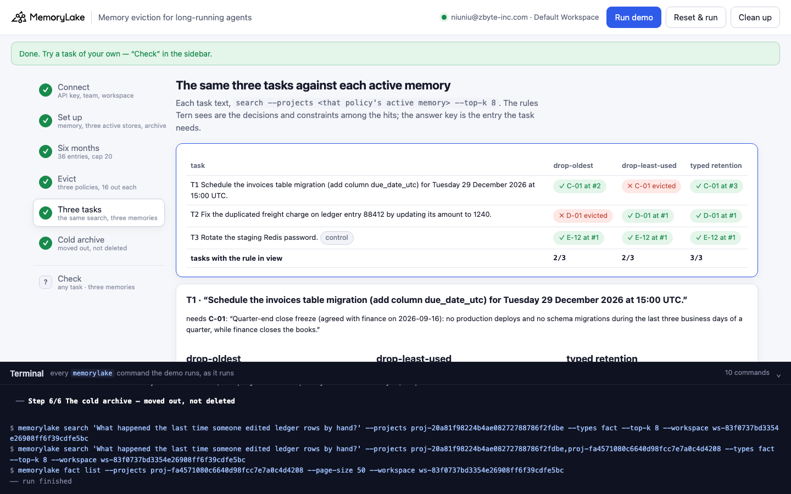
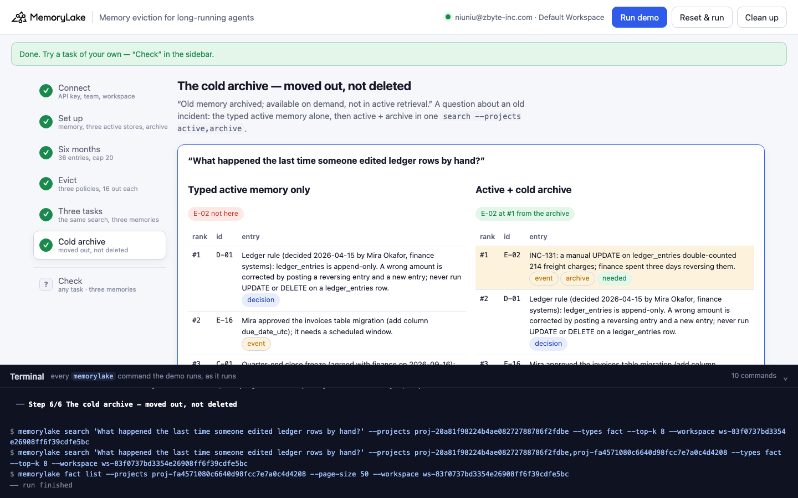

# Memory eviction for long-running agents

A runnable version of the MemoryLake use case
[*Manage Long-Running Agent Memory With Eviction That Preserves What Matters*](https://www.memorylake.ai/en/usecase/memory-eviction-strategy-for-long-running-agents),
built entirely on the [`memorylake` CLI](https://github.com/memorylake-ai/memorylake-cli).

**Watch it run:** [CLI, 4:12](https://github.com/memorylake-ai/memorylake-usecases/releases/download/eviction-memory-v1/eviction-memory-cli-demo.mp4) · [Web, 4:35](https://github.com/memorylake-ai/memorylake-usecases/releases/download/eviction-memory-v1/eviction-memory-web-demo.mp4)
([release](https://github.com/memorylake-ai/memorylake-usecases/releases/tag/eviction-memory-v1); GitHub serves them as downloads).

**The problem.** An agent that runs for months keeps remembering things, and at some point its active memory has to be
capped. The page names what the two obvious policies cost: "Dropping oldest entries loses founding decisions. Dropping
least-accessed loses critical-but-rare facts." Neither loss is visible when it happens. It shows up weeks later, when a
task needs the entry that was thrown away and the agent goes ahead because nothing in its memory says not to.

**What this demo shows.** Tern (fictional) is the platform-operations agent at Kestrel Lane Freight. It has been running
since 2026-04-14 and has remembered 36 entries: 6 decisions, 4 constraints, 4 preferences, 16 events and 6 chat turns,
each with its type, the day it was written, how often Tern has retrieved it and when it last did. Its active memory is
capped at 20, so 16 entries have to go. Three policies decide which:

| Policy | Rule | Evicts (the entry a task will need) |
|---|---|---|
| drop-oldest | keep the 20 most recently written entries | **D-01** — the ledger rule, written on day 2: `ledger_entries` is append-only, never UPDATE a row |
| drop-least-used | keep the 20 most-retrieved entries | **C-01** — the quarter-end close freeze, needed once (at the Q3 close) |
| typed retention | keep every decision, constraint and preference; keep an event while it was used in the last 14 days; archive chat turns; move the rest to a cold archive | nothing a task needs — and nothing is deleted |

Each policy's active memory is its own MemoryLake project holding the 20 entries it kept, word for word. Then the same
three tasks are searched against all three (the task text, `--projects <that policy's active memory>`, top 8):

| Task | Needs | drop-oldest | drop-least-used | typed retention |
|---|---|---|---|---|
| T1 Schedule the invoices table migration for Tuesday 29 December 2026 at 15:00 UTC | C-01 (29–31 Dec are the last three business days of Q4) | ✓ C-01 at #2 | **✗ C-01 evicted** | ✓ C-01 at #3 |
| T2 Fix the duplicated freight charge on ledger entry 88412 by updating its amount | D-01 | **✗ D-01 evicted** | ✓ D-01 at #1 | ✓ D-01 at #1 |
| T3 Rotate the staging Redis password (control) | E-12 (Redis moved to cluster mode on 2026-10-02) | ✓ E-12 at #1 | ✓ E-12 at #1 | ✓ E-12 at #1 |

Each naive policy is right on two tasks and wrong on a different third one; the control shows the difference is not
"typed keeps more" (all three keep 20). Last, the cold archive: a question about an old incident
("What happened the last time someone edited ledger rows by hand?") is not answerable from the typed active memory alone,
and is answered at #1 by `search --projects active,archive`, together with the entry's eviction record.

What it uses:

- **One project per memory tier** (`proj create`): the full memory, one active memory per policy, a cold archive.
- **`fact add` + `fact update --metadata`**: every entry word for word, with the fields an eviction job reads (type,
  written on, uses, last used). The policies are plain code over the metadata `fact list` returns.
- **`search --projects <one project>`** for the tasks, and **`search --projects active,archive`** for the deep query.
- **An eviction record in metadata** on every archived entry: `evicted_on`, `policy`, `reason`, `from_project`,
  `memory_fact` (the original fact id). `python3 demo.py evictions` prints the log.

## Prerequisites

- **Python 3.9+** (standard library only, nothing to `pip install`)
- **The `memorylake` CLI** on your `PATH`:
  ```bash
  curl -fsSL https://raw.githubusercontent.com/memorylake-ai/memorylake-cli/main/scripts/install.sh | sh
  ```
- **A MemoryLake API key.** Sign up at [app.memorylake.ai](https://app.memorylake.ai), open **API Keys**, create one. A free
  personal account is enough: nothing here needs an agent or a model call.

## Run it

```bash
git clone https://github.com/memorylake-ai/memorylake-usecases.git
cd memorylake-usecases/eviction-memory
export MEMORYLAKE_API_KEY=sk-...           # China region: also export MEMORYLAKE_BASE_URL=https://app.memorylake.cn/openapi/memorylake
python3 demo.py
```

About two minutes the first time (five projects, 112 facts with their metadata), a little over a minute on a re-run, which
reads everything back and checks the tasks again. With the key set, the demo logs into an isolated CLI profile under
`./.memorylake-demo/` and never touches your own `~/.memorylake`. Everything it creates has a `custom_id` starting with
`mlu-evm-`.

Then check a task of your own against the three active memories, or print the eviction log:

```bash
python3 demo.py check "Deploy the rates service on Friday at 16:00 UTC" --needs D-05
python3 demo.py evictions
python3 demo.py cleanup                    # deletes the five projects and every fact on them
```

`check` prints each memory's top 3 and the rules (decisions and constraints) among its top 8:

```
  “Deploy the rates service on Friday at 16:00 UTC” · needs D-05
    drop-oldest       ✗ D-05 evicted             rules seen: C-04 C-01
        #1   C-04  constraint  The carrier-rates job must not run while the nightly settlement j…
        #2   E-15  event       The carrier-rates job failed twice on 2026-10-11 with lock timeou…
        #3   E-10  event       The settlement job's runtime grew from 55 to 80 minutes after the…
    drop-least-used   ✓ D-05 at #2               rules seen: D-05 D-03 D-04
        #1   P-03  preference  Write every timestamp in UTC.
        #2   D-05  decision    Release train: merge by 14:00 UTC, the train ships at 15:00 UTC, …   ← needed
        #3   D-03  decision    All production infrastructure changes go through Terraform in the…
    typed retention   ✓ D-05 at #3               rules seen: D-04 D-05 C-04 C-01 D-02
        #1   P-03  preference  Write every timestamp in UTC.
        #2   D-04  decision    Production secrets live in Vault under kv/prod/<service>; rotate …
        #3   D-05  decision    Release train: merge by 14:00 UTC, the train ships at 15:00 UTC, …   ← needed
```

Under drop-oldest the release-train rule ("Nothing ships on Fridays") is gone too, and the rules Tern sees are about a
different job.

## Or run it in the browser

```bash
python3 web/server.py                # opens http://127.0.0.1:8765
```

Paste the key, connect, run. The page drives the same functions as `demo.py` and streams every `memorylake` command into a
terminal drawer as it runs: the 36 entries with their metadata, what each policy evicts, the three tasks against the three
active memories (with each memory's top 3), and the cold archive with its eviction log. **Check** takes any task.





## What happens, step by step

### Steps 2–3: five projects, 36 entries

```
$ memorylake proj create --name 'Tern · memory at month six (36)' --custom-id mlu-evm-memory --description '…'
  · … and 4 more `proj create` the same way
$ memorylake fact add --project proj-… 'Ledger rule (decided 2026-04-15 by Mira Okafor, finance systems): …' 'Postgres major-version upgrades …' '… 34 more entries'
$ memorylake fact update fact-… --project proj-… --metadata '{"key": "evm:D-01", "record": "D-01", "type": "decision", "on": "2026-04-15", "uses": 9, "last_used": "2026-10-09"}'
  · … and 35 more `fact update --metadata` the same way

  36 entries · cap 20 · 6 decisions · 4 constraints · 4 preferences · 16 events · 6 turns
    id    type        written     uses  last used   text
    D-01  decision    2026-04-15     9  2026-10-09  Ledger rule (decided 2026-04-15 by Mira Okafor, finance sys…
    …
    C-01  constraint  2026-09-16     1  2026-09-28  Quarter-end close freeze (agreed with finance on 2026-09-16…
    …
```

`fact add` takes no metadata, so each new fact gets one `fact update --metadata` (four at a time). Re-runs match entries
by `metadata.key` and only write what is missing or changed.

### Step 4: evict

The policies are plain code over the metadata `fact list` returned — the same four numbers any eviction job would have:

```
  drop-oldest — keep the 20 most recently written entries
    keeps 20 · evicts 16: C-02 C-03 D-01 D-02 D-03 D-04 D-05 E-01 E-02 E-03 E-04 E-05 E-06 P-01 P-02 P-03
    ✗ evicts D-01 (decision): “Ledger rule (decided 2026-04-15 by Mira Okafor, finance systems): led…” — written 2026-04-15, before the newest 20 (cut-off 2026-08-04)

  drop-least-used — keep the 20 most-retrieved entries (ties: last used)
    keeps 20 · evicts 16: C-01 C-02 C-03 C-04 E-01 E-02 E-03 E-04 E-06 P-04 T-01 T-02 T-03 T-04 T-05 T-06
    ✗ evicts C-01 (constraint): “Quarter-end close freeze (agreed with finance on 2026-09-16): no prod…” — used 1× (the 20 kept were used ≥ 3×)

  typed retention — keep every decision, constraint and preference; keep an event while it was used in the last 14 days; archive chat turns; move the rest to the cold archive
    keeps 20 · evicts 16: E-01 E-02 E-03 E-04 E-05 E-06 E-07 E-08 E-09 E-10 T-01 T-02 T-03 T-04 T-05 T-06

  active memory now:  drop-oldest 20 · drop-least-used 20 · typed retention 20   ·   cold archive 16   (memory before eviction: 36)
```

Each policy's 20 go into its own active-memory project (one `fact add`, then the metadata). Typed retention's 16 go into
the cold archive, each with an eviction record in its metadata.

### Step 5: the same three tasks against each active memory

```
$ memorylake search 'Schedule the invoices table migration (add column due_date_utc) for Tuesday 29 December 2026 at 15:00 UTC.' --projects proj-… --types fact --top-k 8

  T1  “Schedule the invoices table migration (add column due_date_utc) for Tuesday 29 December 2026 at 15:00 UTC.”
      needs C-01 (constraint): “Quarter-end close freeze (agreed with finance on 2026-09-16): no production deploys and n…”
    drop-oldest       ✓ C-01 at #2               rules seen: C-01 C-04
    drop-least-used   ✗ C-01 evicted             rules seen: D-05 D-03 D-04
    typed retention   ✓ C-01 at #3               rules seen: D-05 C-01 C-04 D-02
    → under drop-least-used, Tern goes ahead: the migration lands inside the quarter-end close freeze (29-31 December are the last three business days of Q4)

  T2  “Fix the duplicated freight charge on ledger entry 88412 by updating its amount to 1240.”
      needs D-01 (decision): “Ledger rule (decided 2026-04-15 by Mira Okafor, finance systems): ledger_entries is appen…”
    drop-oldest       ✗ D-01 evicted             rules seen: C-01 C-04
    drop-least-used   ✓ D-01 at #1               rules seen: D-01 D-04 D-03 D-02 D-06
    typed retention   ✓ D-01 at #1               rules seen: D-01 C-01 C-04 D-02 D-03 D-04
    → under drop-oldest, Tern goes ahead: Tern runs an UPDATE on ledger_entries — the exact edit behind INC-131

  T3  “Rotate the staging Redis password.”
      needs E-12 (event): “Staging Redis moved to cluster mode on 2026-10-02; its password now rotates through the V…”   (control: every policy kept it)
    drop-oldest       ✓ E-12 at #1               rules seen: D-06
    drop-least-used   ✓ E-12 at #1               rules seen: D-03 D-04
    typed retention   ✓ E-12 at #1               rules seen: D-03 D-04 C-02 C-01

        drop-oldest         drop-least-used     typed retention
  T1    ✓ C-01 at #2        ✗ C-01 evicted      ✓ C-01 at #3
  T2    ✗ D-01 evicted      ✓ D-01 at #1        ✓ D-01 at #1
  T3    ✓ E-12 at #1        ✓ E-12 at #1        ✓ E-12 at #1
        2/3 tasks           2/3 tasks           3/3 tasks
```

"Rules seen" are the decisions and constraints among the top 8: what Tern would check before acting. Note what
drop-least-used shows for T1: the release-train, Terraform and Vault rules, all true and all beside the point — the
memory still answers, just without the one rule that matters (which other rules come back varies a little between runs). A ✗ says *evicted* when the policy did not keep the entry, and
*not in the top 8* if a kept entry was simply outranked (that has not happened in any run).

### Step 6: the cold archive

```
  “What happened the last time someone edited ledger rows by hand?”
    typed active memory only:
        #1   D-01  decision    Ledger rule (decided 2026-04-15 by Mira Okafor, finance systems):…
        #2   E-16  event       Mira approved the invoices table migration (add column due_date_u…
        #3   C-01  constraint  Quarter-end close freeze (agreed with finance on 2026-09-16): no …
      → E-02 is not in the active memory
    active + cold archive (`--projects active,archive`):
        #1   E-02  event       INC-131: a manual UPDATE on ledger_entries double-counted 214 fre…   ← archive
        #2   D-01  decision    Ledger rule (decided 2026-04-15 by Mira Okafor, finance systems):…
        #3   E-16  event       Mira approved the invoices table migration (add column due_date_u…
      → E-02 at #1 from the archive: evicted 2026-10-15 by typed retention — event, last used 2026-06-01 (136 days ago, window 14)

  eviction log — 16 entries in the cold archive, none deleted:
    event outside the window   10   E-01 E-02 E-03 E-04 E-05 E-06 E-07 E-08 E-09 E-10
    chat turn                   6   T-01 T-02 T-03 T-04 T-05 T-06
```

The active memory stays at 20, and the incident is one `--projects` away. Search hits carry each fact's metadata, so the
eviction record comes back with the hit — no second lookup.

## Measured

| What | Result |
|---|---|
| T1 / T2 / T3 against the three active memories: oldest ✓✗✓, least-used ✗✓✓, typed ✓✓✓ | 6 / 6 runs (2 from scratch including the recorded one, 1 with `--reset`, 3 re-runs including both browser runs) |
| The needed entry's rank where it was kept | C-01 #2 (oldest) / #3 (typed); D-01 #1; E-12 #1 — the same in every run |
| Deep query: not in the typed active memory; #1 from active + archive | every run |
| Time | 2:00 from scratch (3:21 before the metadata writes were parallelised), 1:15 re-run, 4:04 with `--reset` (deletes the previous run first) |

## Wiring it into your own agent

- **Store the fields an eviction job needs when you write the memory**: type, written on, use count, last used. Without
  a type, the only policies left are by age or by use, and each loses a different kind of entry.
- **Never let a rule compete with events for space.** Decisions and constraints are few, rarely retrieved and expensive
  to lose; keep them out of the eviction pool entirely.
- **Archive instead of delete, with a record.** A cold archive project costs nothing in active retrieval, answers deep
  questions with one more `--projects` id, and the eviction record answers "what got dropped, when and why".

## If something goes wrong

- **`the memorylake CLI is not on PATH`**: install it (above) or `export MEMORYLAKE_BIN=/path/to/memorylake`.
- **A ✓ ranks differently on your run**: search ranking can move between runs. Step 5 prints exactly what came back; a
  kept entry outside the top 8 is reported as *not in the top 8*, never as evicted.
- **"search answered … from its cache"**: `search` can serve a repeated question from a cache made by an earlier run;
  the line names the hits whose fact ids are not in that project's `fact list` now.
- **Something half-created after an interrupted run**: `python3 demo.py --reset`, or `python3 demo.py cleanup`.

## Files

```
eviction-memory/
├── demo.py              # the CLI runner (every step is a plain `memorylake` command, echoed)
├── data/story.json      # 36 memory entries with type / written / uses / last used; 3 policies, 3 tasks, 1 deep query (fictional)
├── web/server.py        # local web companion: same functions, Server-Sent Events
├── web/static/          # no-build front end
└── out/runs.jsonl       # one line per run (git-ignored)
```
