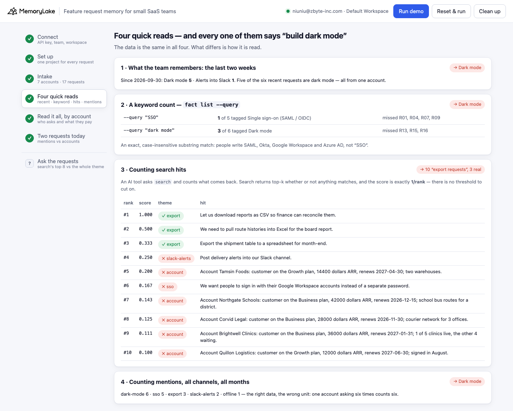
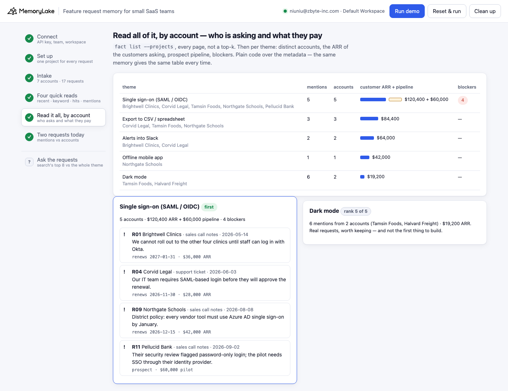

# Feature request memory for small SaaS teams

A runnable version of the MemoryLake use case
[*Give Small SaaS Teams Feature Request Memory That Reveals What Users Actually Want*](https://www.memorylake.ai/en/usecase/feature-request-memory-for-small-saas-teams),
built entirely on the [`memorylake` CLI](https://github.com/memorylake-ai/memorylake-cli).

**Watch it run:** [CLI, 1:43](https://github.com/memorylake-ai/memorylake-usecases/releases/download/feature-request-memory-v1/feature-request-memory-cli-demo.mp4) · [Web, 2:59](https://github.com/memorylake-ai/memorylake-usecases/releases/download/feature-request-memory-v1/feature-request-memory-web-demo.mp4)
([release](https://github.com/memorylake-ai/memorylake-usecases/releases/tag/feature-request-memory-v1); GitHub serves them as downloads).

**The problem.** *"You build based on memory of recent requests instead of cumulative signal."* A small SaaS team gets feature
requests through tickets, sales calls, a Canny board and shared Slack channels. When the roadmap meeting comes, whoever is
loudest or most recent wins: the customer who asked five times this fortnight looks like demand, and the five customers who
each asked once, in five different words, look like noise.

**What this demo shows.** Driftline (fictional, six people) sells dispatch software. Every request since May is one fact in a
MemoryLake project, word for word, with metadata: account, channel, date, urgency, and the theme triage gave it. Every account
is one fact with its plan, ARR and renewal date. Then the same 17 requests are read five ways:

| Read | What it says to build | Why |
|---|---|---|
| **The last two weeks** | Dark mode, 5 of 6 | all five from **one** $4,800 account |
| **A keyword count** (`fact list --query`) | Dark mode, 3 vs 1 | "SSO" finds 1 of the 5 single sign-on requests; people wrote SAML, Okta, Google Workspace, Azure AD |
| **Counting `search` hits** | "10 export requests" | search returns top-k whether or not anything matches, and its **score is 1/rank** — there is nothing to cut on; 3 of the 10 are export requests |
| **Counting mentions** | Dark mode, 6 vs 5 | the right data in the wrong unit: one account asking six times counts six |
| **All of it, by account** | **Single sign-on** | 5 accounts, $120,400 ARR + a $60,000 pilot, 4 blockers incl. 2 renewals; dark mode is 2 accounts and $19,200 |

Then two requests arrive today — one more single sign-on ask from a new account, one more dark-mode ask from the same account
as before. **Mentions go up for both** (dark mode still "leads", 7 vs 6). **Accounts go up only for SSO** (5 → 6; dark mode stays at 2).

```
setup ────────── proj create  "Driftline feature requests"
intake ───────── fact add --project <p> '<Account …>' × 7     + fact update --metadata {account, status, plan, arr, renews}
                 fact add --project <p> '<Feature request …>' × 17 + fact update --metadata {account, source, received, theme, urgency}
quick reads ──── fact list (filtered to the last 14 days) · fact list --query SSO · search '<theme>' --top-k 10 · mention count
by account ───── fact list --projects <p>  (every page)  → per theme: distinct accounts, customer ARR, pipeline, blockers
today ────────── search '<new request>' --top-k 3  (triage hint) → fact add + update --metadata → the table again
```

The table is plain code over the pinned facts' metadata, not a model: the same memory gives the same table every time, and
every row can be traced back to the request, the account, the channel and the date (`python3 demo.py theme sso`). No
conversations and no extraction: every request is pinned word for word.

## Prerequisites

- **Python 3.9+** (standard library only, nothing to `pip install`)
- **The `memorylake` CLI** on your `PATH`:
  ```bash
  curl -fsSL https://raw.githubusercontent.com/memorylake-ai/memorylake-cli/main/scripts/install.sh | sh
  ```
- **A MemoryLake API key.** Sign up at [app.memorylake.ai](https://app.memorylake.ai), open **API Keys**, create one. A free
  personal account is enough: nothing here needs an agent or a model call.

## Run it

```bash
git clone https://github.com/memorylake-ai/memorylake-usecases.git
cd memorylake-usecases/feature-request-memory
export MEMORYLAKE_API_KEY=sk-...           # China region: also export MEMORYLAKE_BASE_URL=https://app.memorylake.cn/openapi/memorylake
python3 demo.py
```

About 45–60 s the first time, about 15 s on a re-run, which reads back what is already there. With the key set, the demo logs
into an isolated CLI profile under `./.memorylake-demo/` and never touches your own `~/.memorylake`. Everything it creates has a
`custom_id` starting with `mlu-frm-`.

```bash
python3 demo.py theme sso                          # every request behind one theme, back to account, channel, date and fact id
python3 demo.py ask "Who asked for dark mode?"     # search's top 8 as returned, then the whole theme behind the first request hit
python3 demo.py themes                             # today's table: mentions, accounts, ARR, pipeline, blockers
python3 demo.py --reset                            # delete everything the demo created, then replay
python3 demo.py cleanup                            # delete everything the demo created
```

## Or run it in the browser

```bash
python3 web/server.py                # opens http://127.0.0.1:8765
```

Paste the key, connect, run. The page drives the same functions as `demo.py` and streams every `memorylake` command into a
terminal drawer as it runs: the accounts and requests as they are pinned, the four quick reads side by side, the table by
account, and today's two requests moving it. **Ask the requests** takes any question and shows search's top 8 next to the full
theme behind it.





## What happens, step by step

Output below is from real runs (ids shortened).

### Steps 2–3 — one project; every account and every request, one fact each

```
$ memorylake proj create --name 'Driftline feature requests' --custom-id mlu-frm-requests …
$ memorylake fact add --project proj-05b4… 'Account Halvard Freight: customer on the Starter plan, 4800 dollars ARR, renews 2027-03-31; one depot, 12 dispatchers.' …
$ memorylake fact add --project proj-05b4… 'Feature request R01 from Brightwell Clinics (sales call notes, 2026-05-14, blocker): We cannot roll out to the other four clinics until staff can log in with Okta.' …
$ memorylake fact update fact-6da9… --project proj-05b4… --metadata '{"kind": "request", "key": "request:R01", "request": "R01", "account": "brightwell", "source": "call", "received": "2026-05-14", "theme": "sso", "urgency": "blocker"}'

  7 accounts · 17 requests received before today (2026-10-14)
    Pellucid Bank       Enterprise pilot  prospect $60,000 pipeline
    Northgate Schools   Business          $42,000 ARR          renews 2026-12-15
    Brightwell Clinics  Business          $36,000 ARR          renews 2027-01-31
    Corvid Legal        Business          $28,000 ARR          renews 2026-11-30
    Tamsin Foods        Growth            $14,400 ARR          renews 2027-04-30
    Quillon Logistics   Growth            $12,000 ARR          renews 2027-06-30
    Halvard Freight     Starter           $4,800 ARR           renews 2027-03-31

  requests by channel: support ticket 8 · sales call notes 4 · shared Slack channel 3 · Canny board 2
    R01  2026-05-14  Brightwell Clinics  call   sso          BLOCKER We cannot roll out to the other four clinics until staff can log in w…
    R04  2026-06-03  Corvid Legal        ticket sso          BLOCKER Our IT team requires SAML-based login before they will approve the re…
    …
    R16  2026-10-09  Halvard Freight     ticket dark-mode    Requesting a darker colour scheme for the dispatch board.
    R17  2026-10-12  Halvard Freight     call   dark-mode    Their ops lead raised dark mode again on the quarterly call.
```

`fact add` takes no metadata, so each fact gets a `fact update --metadata` right after. The **theme** is what triage assigned
when the request came in; the demo counts that, never a search result. On a re-run, facts are matched by the `key` in their
metadata, so nothing is pinned twice.

### Step 4 — four quick reads

```
  · read 1 — what the team remembers: requests since 2026-09-30 (the same `fact list`, filtered by date)
  last two weeks: 6 requests — Dark mode 5, Alerts into Slack 1
  → “Dark mode is what everyone is asking for”: 5 of 6 — all from Halvard Freight ($4,800 ARR)

  · read 2 — a keyword count: `fact list --query` is an exact, case-insensitive substring match
$ memorylake fact list --projects proj-05b4… --query SSO --page-size 50
    “SSO” → 1 request(s) R11   (triage tagged 5 as Single sign-on (SAML / OIDC))
      missed R01: We cannot roll out to the other four clinics until staff can log in with Okta.
      missed R04: Our IT team requires SAML-based login before they will approve the renewal.
      missed R07: We want people to sign in with their Google Workspace accounts instead of a separate pass…
      missed R09: District policy: every vendor tool must use Azure AD single sign-on by January.
$ memorylake fact list --projects proj-05b4… --query 'dark mode' --page-size 50
    “dark mode” → 3 request(s) R05, R12, R17   (triage tagged 6 as Dark mode)
  → by keyword: Single sign-on (SAML / OIDC) 1 · Dark mode 3 — Dark mode leads

  · read 3 — ask search and count the hits: an AI tool asking “export reports to a spreadsheet or CSV file”
$ memorylake search 'export reports to a spreadsheet or CSV file' --projects proj-05b4… --types fact --top-k 10
      #   score  theme        hit
      1   1.000  ✓ export       Feature request R08 from Tamsin Foods (support ticket, 2026-07-30, normal): Let us downlo…
      2   0.500  ✓ export       Feature request R03 from Corvid Legal (Canny board, 2026-05-29, normal): Export the shipm…
      3   0.333  ✓ export       Feature request R10 from Northgate Schools (support ticket, 2026-08-26, normal): We need …
      4   0.250  ✗ account      Account Tamsin Foods: customer on the Growth plan, 14400 dollars ARR, renews 2027-04-30; …
      5   0.200  ✗ sso          Feature request R07 from Tamsin Foods (Canny board, 2026-07-21, normal): We want people t…
      6   0.167  ✗ slack-alerts Feature request R02 from Brightwell Clinics (shared Slack channel, 2026-05-20, normal): P…
      …
  → 10 hits for “Export to CSV / spreadsheet”; 3 of them are export requests (R08, R03, R10), 7 are about something else
    search returns top-k whether or not anything matches, and the score is exactly 1/rank (1.0, 0.5, 0.333, 0.25, 0.2 …): there is no relevance threshold to cut on

  · read 4 — count every request, all channels, all months (the right data, the wrong unit)
  mentions: Dark mode 6 · Single sign-on (SAML / OIDC) 5 · Export to CSV / spreadsheet 3 · Alerts into Slack 2 · Offline mobile app 1
  → Dark mode leads with 6 — 6 requests from 2 account(s): Tamsin Foods, Halvard Freight
```

The `score` field in `search` results is the reciprocal of the rank — 1, ½, ⅓, … — on every query we ran, so it says nothing
about *how* relevant a hit is. Search is the right tool for "what is nearest to this?"; it is the wrong tool for "how many?".

### Step 5 — read all of it, by account

```
$ memorylake fact list --projects proj-05b4… --page-size 50

    theme                          mentions accounts        customer ARR  pipeline  blockers
    Single sign-on (SAML / OIDC)          5        5            $120,400   $60,000  4
    Export to CSV / spreadsheet           3        3             $84,400         -  -
    Alerts into Slack                     2        2             $64,000         -  -
    Offline mobile app                    1        1             $42,000         -  -
    Dark mode                             6        2             $19,200         -  -

  → Single sign-on (SAML / OIDC): 5 accounts, $120,400 ARR + $60,000 pipeline, 4 blocker(s)
      R01 Brightwell Clinics  sales call notes     2026-05-14  renews 2027-01-31        We cannot roll out to the other four clinics until staff can lo…
      R04 Corvid Legal        support ticket       2026-06-03  renews 2026-11-30        Our IT team requires SAML-based login before they will approve …
      R09 Northgate Schools   sales call notes     2026-08-08  renews 2026-12-15        District policy: every vendor tool must use Azure AD single sig…
      R11 Pellucid Bank       sales call notes     2026-09-02  prospect, $60,000 pilot  Their security review flagged password-only login; the pilot ne…
  → Dark mode: 6 mentions from 2 account(s) (Tamsin Foods, Halvard Freight), $19,200 ARR — rank 5 of 5 by ARR
```

### Step 6 — two requests arrive today

```
$ memorylake search 'Can our staff log in through OneLogin? Forty users are waiting to be invited.' --projects proj-05b4… --types fact --top-k 3

  R18  Quillon Logistics · support ticket · blocker: “Can our staff log in through OneLogin? Forty users are waiting to be invited.”
    nearest in memory: R09 (sso), R01 (sso), R11 (sso)
    ✓ hint sso · tagged sso

  R19  Halvard Freight · shared Slack channel · normal: “Still the top ask from our night dispatchers: a dark mode.”
    nearest in memory: R15 (dark-mode), R17 (dark-mode), R13 (dark-mode)
    ✓ hint dark-mode · tagged dark-mode
$ memorylake fact add --project proj-05b4… 'Feature request R18 from Quillon Logistics (support ticket, 2026-10-14, blocker): …' 'Feature request R19 from Halvard Freight …'

    theme                          mentions accounts        customer ARR  pipeline  blockers
    Single sign-on (SAML / OIDC)        5→6      5→6   $120,400→$132,400   $60,000  5
    …
    Dark mode                           6→7        2             $19,200         -  -

  → counted by mentions, Dark mode still leads (7); by accounts and ARR, Single sign-on (SAML / OIDC) (6 accounts, $132,400 + $60,000 pipeline)
```

The search in this step is a **hint** for whoever tags the new request, printed against the tag they chose (✓ / ✗); the count
uses the tag. Nearest-neighbour suggestions are useful and not reliable enough to count on: see [Measured](#measured).

## Measured

Seven recorded runs on a free account on 2026-10-14 (six from scratch — three with `--reset`, two from the web page, one of them for the web video — and one re-run):

| What | Result |
|---|---|
| Last two weeks: dark mode 5 of 6, all from Halvard Freight | 7 / 7 (a date filter over `fact list`, cannot vary) |
| `fact list --query SSO` → 1 of 5; `--query "dark mode"` → 3 of 6 | 7 / 7 |
| `search … --top-k 10` returns 10 hits, 3 of them export requests | 7 / 7 (which 7 others fill the list varies) |
| `search` score = exactly 1/rank on every hit | 7 / 7 runs, every query |
| By account: SSO first (5 accounts, $120,400 + $60,000), dark mode last by ARR | 7 / 7 (deterministic over `fact list`) |
| Today: SSO 5 → 6 accounts, dark mode 2 → 2; mentions 5 → 6 and 6 → 7 | 7 / 7 |
| Triage hint (`search --top-k 3`, majority theme) agrees with the tag | 12 / 12 in the demo; **7 / 9** in an earlier probe on similar data (one OneLogin query came back all dark-mode, one Excel query had an SSO request first) |
| Time | 37–59 s from scratch, 10–13 s re-run |

Everything except the search lines is plain code over `fact list` and metadata. The search lines are what `search` returned;
the demo prints whatever comes back.

## Wiring it into your own team

- **Intake**: one fact per request, verbatim (`fact add --project`), from wherever it lands — a support-tool webhook, your
  Canny export, a sales-call note, a Slack shortcut. Put account, channel, date, urgency and theme in `metadata`
  (`fact update --metadata` replaces the whole object).
- **Accounts**: one fact per account with plan, ARR, renewal date and status in `metadata`, updated when they change, so the
  weighting is as current as your CRM.
- **Triage**: before tagging a new request, `search '<its text>' --top-k 3` shows the nearest requests already in memory and
  their themes. Use it as a suggestion; store the tag a person (or your own classifier) chose.
- **Roadmap time**: `fact list --projects <p>` every page, group by theme, de-duplicate to accounts, weight by ARR. `themes`
  in `demo.py` is that function. Hand an AI planning tool the table, not a search result.
- **Provenance**: every row is a list of fact ids; `theme <name>` prints each one with its account, channel, date and the
  customer's own words.

## If something goes wrong

- **`the memorylake CLI is not on PATH`**: install it (above) or `export MEMORYLAKE_BIN=/path/to/memorylake`.
- **Search results differ on your run**: ranking moves, especially in the first minutes after facts are written. Step 4's read
  3 and step 6's hints print exactly what came back; steps 5 and 6's tables do not depend on search.
- **Something half-created after an interrupted run**: `python3 demo.py --reset`, or `python3 demo.py cleanup`.

## Files

```
feature-request-memory/
├── demo.py              # the CLI runner (every step is a plain `memorylake` command, echoed)
├── data/story.json      # accounts, 17 requests, today's 2, the keyword and search checks (fictional, plain ASCII)
├── web/server.py        # local web companion: same functions, Server-Sent Events
├── web/static/          # no-build front end
└── out/runs.jsonl       # one line per run (git-ignored)
```
