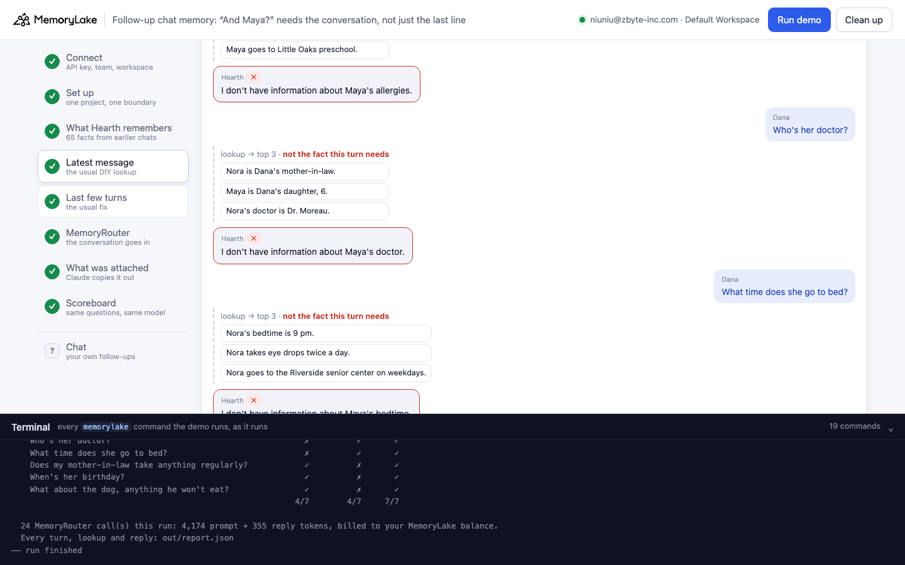
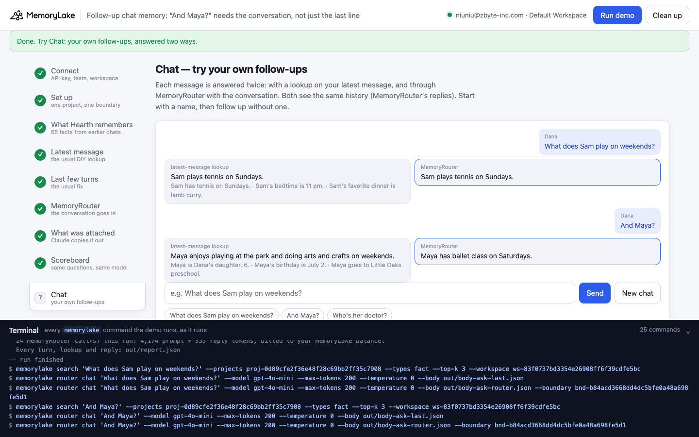
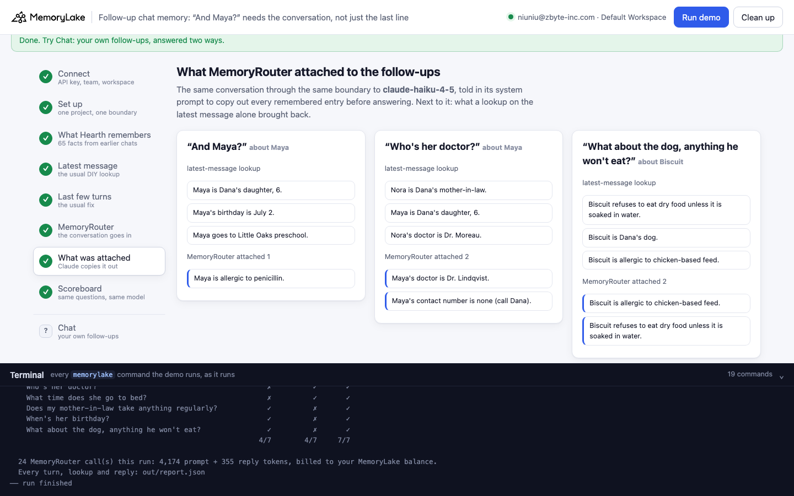
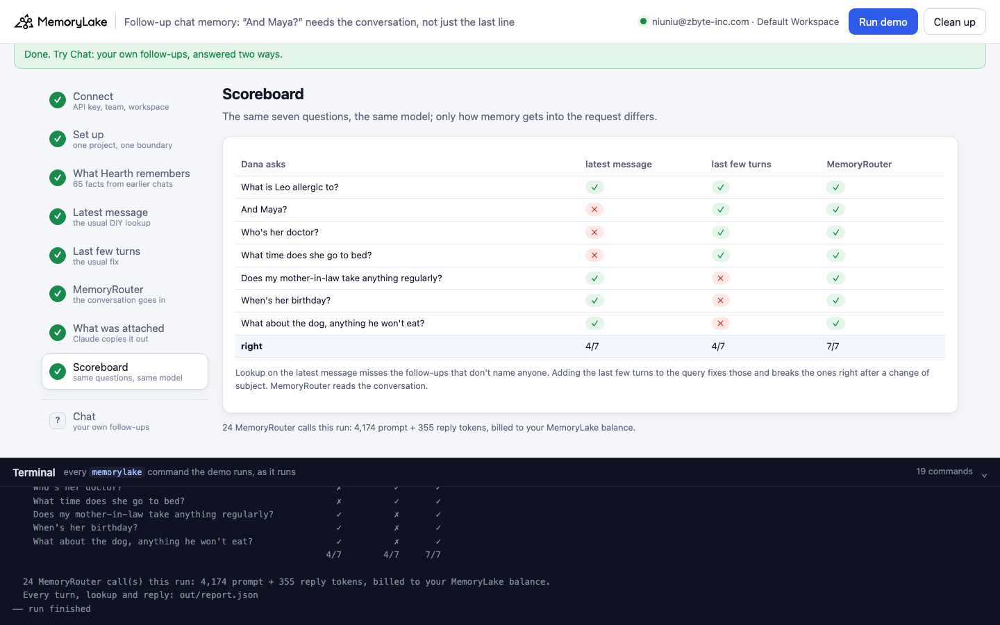

# Follow-up chat memory: "And Maya?" needs the conversation, not just the last line

A runnable version of the MemoryLake use case
[*Give Chatbots a Conversation Memory That Never Resets*](https://www.memorylake.ai/en/usecase/conversation-memory-api-for-chatbots),
built entirely on the [`memorylake` CLI](https://github.com/memorylake-ai/memorylake-cli) (v20261015 or later).

**Watch it run:** [CLI, 3:45](https://github.com/memorylake-ai/memorylake-usecases/releases/download/followup-chat-memory-v1/followup-chat-memory-cli-demo.mp4) · [Web, 4:19](https://github.com/memorylake-ai/memorylake-usecases/releases/download/followup-chat-memory-v1/followup-chat-memory-web-demo.mp4)
([release](https://github.com/memorylake-ai/memorylake-usecases/releases/tag/followup-chat-memory-v1); GitHub serves them as downloads).

**The problem.** A chatbot with long-term memory has to decide, on every turn, which memories go into the prompt. The
usual do-it-yourself way is to search memory with what the user just typed. That works for "What is Leo allergic
to?". It does not work for the next message, "And Maya?": the words that say *what* is being asked are in the
previous turn, and a search for "And Maya?" brings back facts about Maya that have nothing to do with allergies. The
chatbot then says it doesn't know something it was told.

**What this demo shows.** Hearth (fictional) is a family-assistant chatbot. In earlier chats Dana told it about her
family: Leo (9), Maya (6), her husband Sam, her mother-in-law Nora and the dog Biscuit. That is 65 facts in one
MemoryLake project (allergies, doctors, bedtimes, birthdays …), with one **boundary** over it. Tonight Dana asks seven
quick questions in one chat. Only the first one names who it is about. The demo sends the same seven questions to the
same model (`gpt-4o-mini`, temperature 0) three ways. The only difference is how memory gets into the request:

| Step | Approach | What you see |
|---|---|---|
| 4 | **Lookup on the latest message**: `memorylake search "<what Dana just typed>"`, top 3 pasted into the system prompt | "And Maya?" and "Who's her doctor?" bring back Maya's age, birthday, school, or Nora's doctor. Hearth: *"I don't have information about Maya's allergies."* **4–5 of 7 right** in every run |
| 5 | **Lookup on the last few turns** (the usual fix): the last two user turns + the latest message as one query | The follow-ups about Maya now work. When Dana changes subject, the earlier topic drags along: the lookup for the dog question returns Nora's facts and Hearth makes up *"The dog won't eat carrots."* **4–5 of 7 right** |
| 6 | **MemoryRouter**: `router chat --body <conversation so far> --boundary <id>` | MemoryRouter reads the conversation, so each follow-up gets the fact about the person it points back to. **7 of 7 right**, every run |
| 7 | **What MemoryRouter attached**: the same conversation through the same boundary to Claude, told to copy out its memory first | On "And Maya?" MemoryRouter attached exactly one line, *Maya is allergic to penicillin.* The latest-message lookup had brought back *Maya is Dana's daughter, 6.* |
| 8 | Scoreboard | Seven questions × three approaches, ✓/✗ |

Model replies vary from run to run, so every reply is graded and printed as it comes out, and [Measured](#measured)
below reports totals over all runs, not the best one.

## Prerequisites

- Python 3.9+ (standard library only)
- The `memorylake` CLI **v20261015 or later** (`memorylake router` arrived in that release):
  ```bash
  curl -fsSL https://raw.githubusercontent.com/memorylake-ai/memorylake-cli/main/scripts/install.sh | sh
  memorylake version
  ```
- A MemoryLake API key ([app.memorylake.ai](https://app.memorylake.ai) → API Keys).
- **Router calls are billed to your MemoryLake balance** (`memorylake billing balance`). One run makes 21 calls on
  `gpt-4o-mini` and 3 on `claude-haiku-4-5`, about 4,200 prompt + 350 reply tokens in all; the run prints the total.
  If the balance is empty, the router calls print the refusal and are skipped. The lookups still run and show what
  each approach retrieves.

## Run it

```bash
git clone https://github.com/memorylake-ai/memorylake-usecases.git
cd memorylake-usecases/followup-chat-memory
export MEMORYLAKE_API_KEY=sk-...
python3 demo.py                      # the whole story, about 2½ minutes
python3 demo.py chat                 # Dana's seven questions again, through MemoryRouter
python3 demo.py chat --arm last      # … with a lookup on the latest message (or --arm window)
python3 demo.py cleanup              # delete everything the demo created
```

The key is used to log into an isolated CLI profile under `.memorylake-demo/` (git-ignored); your own
`~/.memorylake` is never touched. For the China endpoint also set
`MEMORYLAKE_BASE_URL=https://app.memorylake.cn/openapi/memorylake`. Everything the demo creates has a `custom_id`
starting with `mlu-fcm-`. Every run starts over with a fresh project (the previous one is deleted first), so no
lookup can be answered from an earlier run's search cache.

## Or run it in the browser

```bash
python3 web/server.py           # opens http://127.0.0.1:8765
```

Same pipeline, one view per step: each approach as a chat transcript (with what the lookup brought back under each
of Dana's messages), what MemoryRouter attached next to what the lookup got, the scoreboard, a **Chat** page where your
own messages are answered both ways side by side, and a terminal drawer with every `memorylake` command as it runs.






## What happens, step by step

Excerpts below are from one real run (shortened ids); wording varies between runs.

### Steps 2–3: one project, one boundary, what Hearth remembers

```text
$ memorylake proj create --name 'Hearth: Dana'"'"'s family' --custom-id mlu-fcm-family --description '…' --workspace ws-83f0…
$ memorylake boundary create --name 'Hearth for Dana' --custom-id mlu-fcm-boundary --projects proj-95d6… --workspace ws-83f0…
$ memorylake fact add --project proj-95d6… 'Leo is Dana'"'"'s son, 9.' 'Maya is Dana'"'"'s daughter, 6.' --workspace ws-83f0…  … 63 more
  · stored 65 facts in 3 `fact add` call(s): 5 family members × 12 things Dana has mentioned, plus who is who
```

The facts stand in for what earlier chats left behind. Storing them with `fact add` keeps the memory identical on
every run, so the three approaches below are compared on the same memory.

### Step 4: lookup on the latest message

This is how most chatbots wire memory in by hand: search with the user's message, paste the top hits into the
system prompt, call the model with the conversation so far. The call goes through MemoryRouter *without* a boundary,
so the model sees only what the lookup pasted in.

```text
$ memorylake search 'And Maya?' --projects proj-95d6… --types fact --top-k 3 --workspace ws-83f0…
$ memorylake router chat 'And Maya?' --model gpt-4o-mini --max-tokens 200 --temperature 0 --body out/body-last.json

    Dana: And Maya?
      lookup #1: Maya is Dana's daughter, 6.   ← the fact this turn needs is not in the top 3
    ✗ Hearth: I don't have information about Maya's allergies.

    Dana: Who's her doctor?
      lookup #1: Maya is Dana's daughter, 6.   ← the fact this turn needs is not in the top 3
    ✗ Hearth: I don't have information about Maya's doctor.
```

The model knows from the conversation that Dana means Maya's allergies. The lookup did not. It searched for "And
Maya?", and the facts it brought back are about Maya but not about allergies. For "Who's her doctor?" the top 3 were
*Maya is Dana's daughter*, *Nora is Dana's mother-in-law* and *Nora's doctor is Dr. Moreau*. The model correctly
refuses to give Nora's doctor for Maya, so it says it doesn't know.

### Step 5: lookup on the last few turns

The usual fix is to search with more of the conversation. Here the query is the last two user turns plus the latest
message:

```text
    Dana: Who's her doctor?
      lookup query: “What is Leo allergic to? And Maya? Who's her doctor?”
      lookup #1: Leo is allergic to peanuts.
    ✓ Hearth: Maya's doctor is Dr. Lindqvist.

    Dana: What about the dog, anything he won't eat?
      lookup query: “Does my mother-in-law take anything regularly? When's her birthday? What […]”
      lookup #1: Nora is Dana's mother-in-law.   ← the fact this turn needs is not in the top 3
    ✗ Hearth: The dog won't eat vegetables.
```

It fixes the follow-ups and breaks the turn after a change of subject: the window still holds two questions about
Nora, so the lookup returns Nora's facts. Nothing about the dog's food reached the model, and gpt-4o-mini made an
answer up ("vegetables" here, "carrots" in other runs). The same happens on "Does my mother-in-law take anything
regularly?", which comes right after three turns about Maya: the lookup returns Nora's doctor instead of her eye
drops, and in other runs Hearth answered *"Nora takes medication regularly as prescribed by Dr. Moreau."*

### Step 6: MemoryRouter with the conversation

```text
$ memorylake router chat 'And Maya?' --model gpt-4o-mini --max-tokens 200 --temperature 0 --body out/body-router.json --boundary bnd-ee30…

    Dana: And Maya?
    ✓ Hearth: Maya is allergic to penicillin.

    Dana: Who's her doctor?
    ✓ Hearth: Maya's doctor is Dr. Lindqvist.
    …
    Dana: What about the dog, anything he won't eat?
    ✓ Hearth: Biscuit won't eat dry food unless it is soaked in water and is allergic to chicken- […]

    7/7 answers right
```

`out/body-router.json` holds the system prompt and the conversation so far, in OpenAI's format; `--boundary` is the
only memory-related thing the chatbot passes. It does no lookup of its own.

### Step 7: what MemoryRouter attached

The response does not say which memories were attached. So the demo asks Claude (`claude-haiku-4-5`, through the same
boundary, with the same conversation) to copy out every remembered entry before answering, and matches each copied
line to a stored fact:

```text
    Dana: And Maya?   (about Maya)
      latest-message lookup got: Maya is Dana's daughter, 6.; Maya's birthday is July 2.; Maya goes to Little Oaks preschool.
      MemoryRouter attached 1: Maya is allergic to penicillin.

    Dana: Who's her doctor?   (about Maya)
      latest-message lookup got: Maya is Dana's daughter, 6.; Nora is Dana's mother-in-law.; Nora's doctor is Dr. Moreau.
      MemoryRouter attached 2: Maya's doctor is Dr. Lindqvist.; Maya is allergic to penicillin.
```

Retrieval on "And Maya?" with the conversation in view returns the one fact the question needs. The checker is
Claude quoting what it was given, in a separate call, so it shows what MemoryRouter attaches for this conversation,
not a log of the exact call in step 6.

### Step 8: scoreboard

```text
    Dana asks                                        latest msg last turns  Router
    What is Leo allergic to?                                  ✓          ✓       ✓
    And Maya?                                                 ✗          ✓       ✓
    Who's her doctor?                                         ✗          ✓       ✓
    What time does she go to bed?                             ✓          ✓       ✓
    Does my mother-in-law take anything regularly?            ✓          ✗       ✓
    When's her birthday?                                      ✓          ✓       ✓
    What about the dog, anything he won't eat?                ✓          ✗       ✓
                                                            5/7        5/7     7/7
```

## Measured

Every fresh run while building and recording this demo (3 in the terminal, 1 browser check, the 2 recordings), plus
the `chat --arm last` subcommand twice and 2 runs of the same chat in the feasibility probe:

| | runs | right answers |
|---|---|---|
| Lookup on the latest message | 10 | **45 / 70** (4 or 5 every time). Misses only on follow-ups that do not name anyone ("And Maya?", "Who's her doctor?", "What time does she go to bed?"), and every miss is "I don't have information about …" / "I do not know …" |
| Lookup on the last few turns | 7 | **34 / 49** (5 six times, 4 once). Misses on the turns after a change of subject, and the replies are made up ("carrots", "vegetables", "as prescribed by Dr. Moreau") |
| MemoryRouter with the conversation | 8 | **56 / 56** |
| Checker: the follow-up's own fact among the attached lines | 6 | 17 / 18 ("And Maya?", "Who's her doctor?", the dog question). In the one miss, Claude copied out only the dog's allergy for "anything he won't eat?" |

- "What time does she go to bed?" is the turn that varies for the latest-message lookup: its top 3 sometimes has
  Maya's bedtime (after Nora's), sometimes not.
- MemoryRouter attached 1 to 3 lines per follow-up. In the feasibility probe it also resolved a reference three turns
  back ("Back to the dog: what does he eat for dinner?", 2/2) and a change of subject with no pronoun at all.
- The browser's Chat page shows the same thing on your own messages. In the recording, after "What does Sam play on
  weekends?", "And Maya?" got *"Maya enjoys playing at the park and doing arts and crafts on weekends"* from the
  latest-message lookup (made up; the top 3 were her age, birthday and school) and *"Maya has ballet class on
  Saturdays"* through MemoryRouter.
- One model (`gpt-4o-mini`) was measured for the answers; the lookups are MemoryLake `search` with `--top-k 3`.

## Use it in your own app

- Send the conversation, not just the last message: with MemoryRouter that is the `messages` your OpenAI or Anthropic
  SDK already sends (`--body` here), plus `--boundary <id>` (or `?boundary_id=` on the endpoint your SDK points at).
- If you look memory up yourself, the query has to say what the follow-up is about. The latest message alone loses
  it, and a fixed window of recent turns carries the old subject into the new one. Rewriting the follow-up into a
  standalone question first is the usual answer; this demo does not measure that.
- Keep facts in short, self-contained sentences that name the person ("Maya's doctor is Dr. Lindqvist."), so the one
  that answers a question can be attached on its own.

## Troubleshooting

- **`this memorylake CLI has no router command`**: upgrade the CLI (install line above).
- **MemoryRouter refused the call for lack of balance**: top up in the console; `memorylake billing balance` shows it.
- **A run was interrupted**: run again; it deletes the previous project and starts over.
- **`fact(s) are still in the project after deleting`**: deletes are retried and re-checked; run
  `python3 demo.py cleanup` again.

## Files

| File | What it is |
|---|---|
| `demo.py` | The demo: CLI wrapper, the three approaches, the checker, the grader, subcommands |
| `data/family.json` | What Hearth remembers (5 family members × 12 attributes) and tonight's seven questions with what a right answer contains |
| `web/server.py`, `web/static/` | Browser companion (standard library server, no build step) |
| `out/` | Request bodies and `report.json` with every turn, lookup and reply (git-ignored) |
