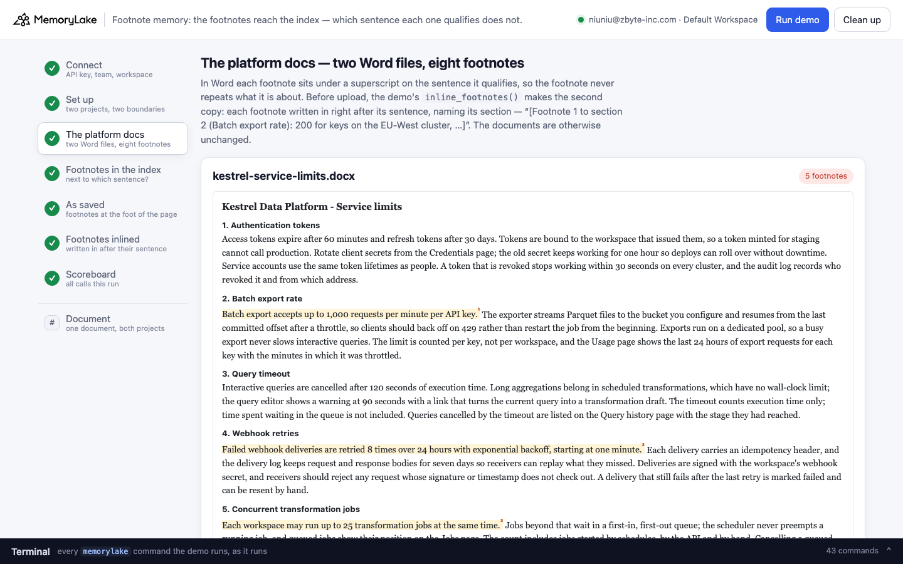
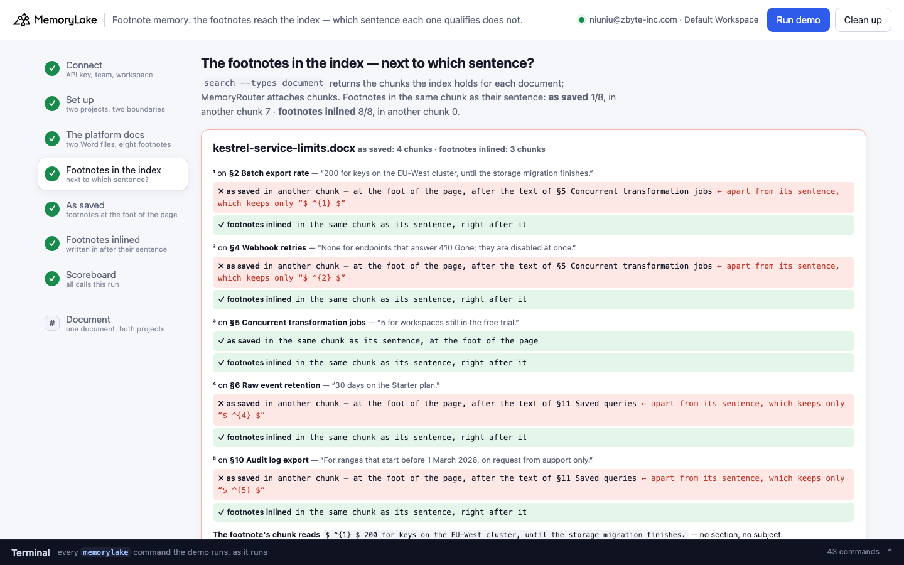
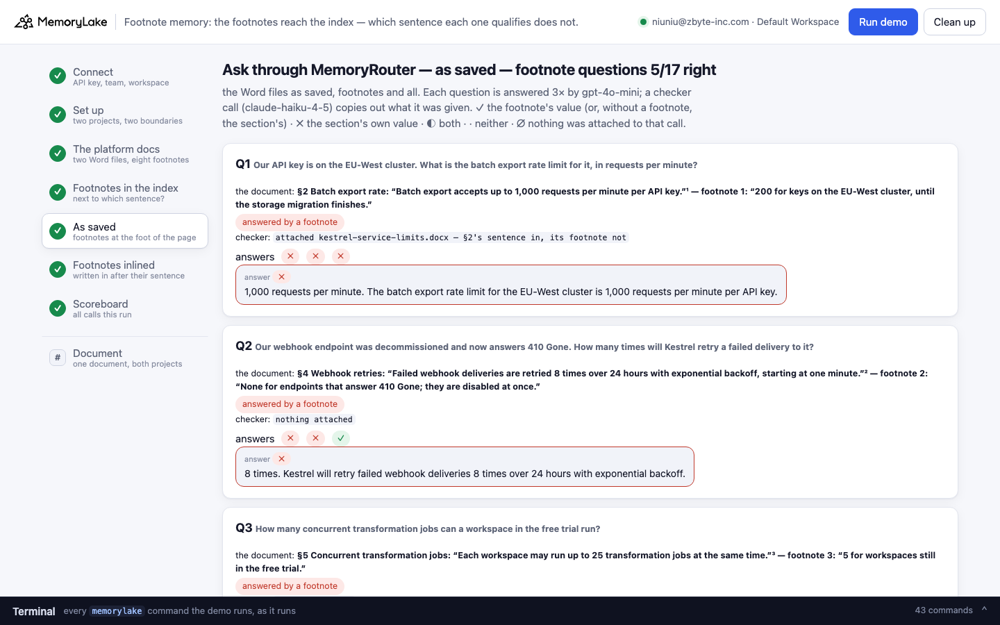
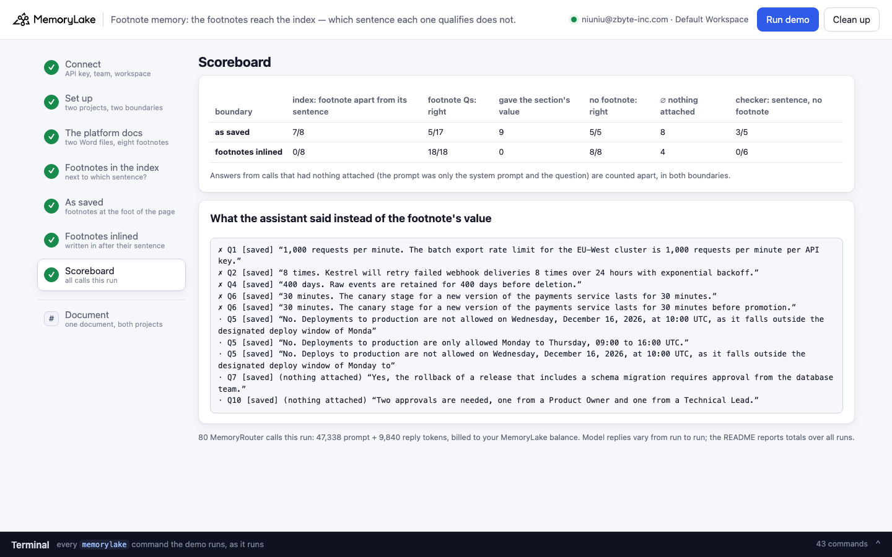

# Footnote memory: the footnotes reach the index — which sentence each one qualifies does not

A runnable version of the MemoryLake use case
[*Give Software Engineers AI That Knows the Codebase Before the First Question*](https://www.memorylake.ai/en/usecase/ai-memory-for-software-engineers),
built entirely on the [`memorylake` CLI](https://github.com/memorylake-ai/memorylake-cli) (v20261015 or later).

**Watch it run:** videos are being recorded; links follow in the next commit.

**The problem.** Kestrel (a fictional data-platform company) keeps its platform team's Word documents — the service
limits and the release policy — in shared memory, so that a platform assistant can answer an engineer's *"what is
the batch export rate limit for our EU-West key?"* without anyone digging through the docs: the page's "constraints
… re-established every session". The exceptions in those documents are **Word footnotes**, written the way people
write footnotes:

```
§2 Batch export rate: “Batch export accepts up to 1,000 requests per minute per API key.”¹
   footnote 1: “200 for keys on the EU-West cluster, until the storage migration finishes.”
```

The footnote doesn't say what it is 200 *of*. On the page it doesn't have to — the superscript 1 sits on the
sentence it qualifies. In the file, the sentence carries only a `w:footnoteReference`, and the text lives in
`word/footnotes.xml`.

MemoryLake's index does read the footnotes. It reads the page as rendered: the sentence keeps a bare `$ ^{1} $`, and
the footnote's words go where Word prints them — at the foot of the page. On these pages the foot of the page is
**another chunk** of the index, starting a few paragraphs further down. Asked *"Our API key is on the EU-West
cluster. What is the batch export rate limit for it?"*, MemoryRouter attached the chunk with the sentence (a checker
call copies out what the model was given):

```
(mlu-ftn-kestrel-service-limits.docx) Kestrel Data Platform - Service limits
…
2. Batch export rate
Batch export accepts up to 1,000 requests per minute per API key. $ ^{1} $  The exporter streams Parquet files …
```

and the assistant answered *"1,000 requests per minute. The batch export rate limit for the EU-West cluster is 1,000
requests per minute per API key."* Even when MemoryRouter does attach the foot of the page, the footnote arrives as
`$ ^{2} $  60 minutes for the payments service.` after the text of §6 Hotfixes — and the assistant answered the
canary question with §3's 30 minutes, every time.

**The fix is one step before upload.** The same files with each footnote written in right after the sentence it
qualifies, naming its section — `[Footnote 1 to section 2 (Batch export rate): 200 for keys on the EU-West cluster,
…]` (a 30-line standard-library function in `demo.py`, `inline_footnotes()`) — come back right.

## What the demo shows

- **The platform docs**: two Word files with eight footnotes, each read back from the `.docx` itself with the
  section and sentence it qualifies.
- **The footnotes in the index**: for every footnote, whether the index keeps its words in the same chunk as its
  sentence — in a project holding the documents as saved, and in one holding the same documents with footnotes
  inlined.
- **Ten questions an engineer asks** (seven answered by a footnote, three by a section without one) through
  MemoryRouter, once per boundary, each asked three times. A checker call shows what was attached.

Graded per answer: **✓** the footnote's value (for the three questions without a footnote, the section's) · **✗**
the section's own value, the one the footnote overrides · **◐** both · **·** neither, or "I don't have that". The
deploy-freeze question counts as ✓ only when the answer names the freeze — a bare "No" is a guess. Calls that had
**nothing** attached (the prompt was only the system prompt and the question, under 150 tokens) are marked **∅**
and counted apart, in both boundaries: MemoryRouter attaches nothing to a share of calls, whatever the documents.

## Prerequisites

- Python 3.9+ (standard library only)
- The `memorylake` CLI, **v20261015 or later** (`memorylake router` is new in that release):
  ```bash
  curl -fsSL https://raw.githubusercontent.com/memorylake-ai/memorylake-cli/main/scripts/install.sh | sh
  memorylake version
  ```
- A MemoryLake API key: sign up at [app.memorylake.ai](https://app.memorylake.ai), open **API Keys**, create one.
- MemoryRouter calls are billed to your MemoryLake balance: 80 calls per run, about 47,000 prompt + 11,000 reply
  tokens. With no balance the demo stops after step 4 (the index view already shows the problem) and says so.

## Run it

```bash
git clone https://github.com/memorylake-ai/memorylake-usecases.git
cd memorylake-usecases/footnote-memory
export MEMORYLAKE_API_KEY=sk-...          # logs into an isolated profile under .memorylake-demo/
python3 demo.py                           # about 6 minutes
python3 demo.py doc limits                # read-only: one document's footnotes and where each sits in both projects' index
python3 demo.py footnotes                 # offline: the footnotes the .docx files hold, and what inline_footnotes() writes
python3 demo.py cleanup                   # delete everything the demo created
```

China region: also `export MEMORYLAKE_BASE_URL=https://app.memorylake.cn/openapi/memorylake`.
Everything the demo creates is prefixed `mlu-ftn-`; every run starts over.

## Or run it in the browser

```bash
python3 web/server.py                     # opens http://127.0.0.1:8765
```

Paste the key, press **Run demo**. The page follows the run step by step: the documents laid out like Word pages
(each qualified sentence with its superscript, the footnotes at the foot), where every footnote sits in the index of
both projects, the questions under each boundary with the checker's reading, and a scoreboard. **Document** looks up
one document in both projects without a model call. A terminal drawer shows every `memorylake` command as it runs.
**Clean up** removes it all.

| | |
|---|---|
|  |  |
|  |  |

## What happens, step by step

### Steps 2–3: two projects, two boundaries, two documents

```
$ memorylake proj create --name 'Kestrel platform docs (as saved)' --custom-id mlu-ftn-saved …
$ memorylake boundary create --name 'Platform assistant: as saved' --custom-id mlu-ftn-saved --projects proj-… …
$ memorylake proj create --name 'Kestrel platform docs (footnotes inlined)' --custom-id mlu-ftn-inlined …
$ memorylake boundary create --name 'Platform assistant: footnotes inlined' --custom-id mlu-ftn-inlined --projects proj-… …
```

The demo prints each document's footnotes, read from the file:

```
  kestrel-release-policy.docx — 8 sections, 3 footnotes. In Word each one sits under a superscript on the sentence it qualifies:
    ¹  on §1 Deploy windows: “Production deploys run Monday to Thursday, 09:00 to 16:00 UTC, through the release pipeline.”¹
         footnote 1: “Not from 15 to 31 December: year-end freeze.”
    ²  on §3 Canary stage: “Every new version takes 5% of production traffic for 30 minutes before the pipeline promotes it.”²
         footnote 2: “60 minutes for the payments service.”
    ³  on §4 Rollback: “Any engineer on the on-call rotation may roll back a release without approval.”³
         footnote 3: “Except releases that include a schema migration: a database owner signs off first.”
```

then makes the inlined copies, uploads both sets and imports each into its project:

```
  · the fix, before upload: inline_footnotes() writes each footnote in after the sentence it qualifies, naming its section (“[Footnote 1 to section 2 (Batch export rate): 200 for keys o…]”) → out/inlined/*.inlined.docx
$ memorylake lib upload data/kestrel-service-limits.docx --name mlu-ftn-kestrel-service-limits.docx --on-conflict overwrite
$ memorylake lib upload out/inlined/kestrel-service-limits.inlined.docx --name mlu-ftn-kestrel-service-limits.inlined.docx --on-conflict overwrite
$ memorylake proj doc import --project proj-… <two item ids> --wait …
  · all documents indexed in 50 s
```

### Step 4: the footnotes in the index

For each document the demo runs `search --types document` with the title, each footnoted sentence and each
footnote's words, and keeps every chunk that comes back:

```
$ memorylake search 'Kestrel Data Platform - Service limits' --projects proj-… --types document --top-k 6 …

  kestrel-service-limits — each footnote, and where its words sit in the index: as saved 4 chunks, footnotes inlined 3 chunks
    ¹  on §2 Batch export rate: “200 for keys on the EU-West cluster, until the storage migration finis”
        ✗ as saved           in another chunk — at the foot of the page, after the text of §5 Concurrent transformation jobs  ← apart from its sentence
                              (its sentence keeps only “$ ^{1} $”)
        ✓ footnotes inlined  in the same chunk as its sentence, right after it
    ²  on §4 Webhook retries: “None for endpoints that answer 410 Gone; they are disabled at once.”
        ✗ as saved           in another chunk — at the foot of the page, after the text of §5 Concurrent transformation jobs  ← apart from its sentence
                              (its sentence keeps only “$ ^{2} $”)
        ✓ footnotes inlined  in the same chunk as its sentence, right after it
    ³  on §5 Concurrent transformation jobs: “5 for workspaces still in the free trial.”
        ✓ as saved           in the same chunk as its sentence, at the foot of the page
        ✓ footnotes inlined  in the same chunk as its sentence, right after it
    …
    the footnote's chunk reads: “$ ^{1} $  200 for keys on the EU-West cluster, until the storage migration finishes.” — no section, no subject
    …
  where the footnotes sit in the index, per project:
    as saved           footnotes found 8/8 · in the same chunk as their sentence 1 · in another chunk 7
    footnotes inlined  footnotes found 8/8 · in the same chunk as their sentence 8 · in another chunk 0
```

Each page of these documents is indexed as one long chunk that stops a little before the end of the page, plus a
short chunk that repeats the last sentence and carries the footnote block. Footnote 3 qualifies that last sentence,
so it shares a chunk with it; the other seven don't. The same bytes split the same way in every import.

### Steps 5–6: ask through MemoryRouter, under each boundary

Every answer is an ordinary model call with a boundary added; MemoryRouter decides what to attach:

```
$ memorylake router chat 'Our API key is on the EU-West cluster. What is the batch export rate limit for it, in requests per minute?' --model gpt-4o-mini --max-tokens 160 --temperature 0 --system '…' --boundary bnd-…
$ memorylake router messages '…' --model claude-haiku-4-5 --max-tokens 2500 --temperature 0 --system '<copy out everything above my request>' --boundary bnd-…
```

As saved (one run):

```
  Q1  Our API key is on the EU-West cluster. What is the batch export rate limit for it, in requests per minute?
      the document: §2 Batch export rate: “Batch export accepts up to 1,000 requests per minute per API key.”¹ — footnote 1: “200 for keys on the EU-West cluster, until the storage migration finishes.”
      checker: attached kestrel-service-limits.docx — §2's sentence in, its footnote not
      answers ✗ ✗ ∅·   e.g. “1,000 requests per minute. The batch export rate limit for the EU-West cluster is 1,000 requests per minute per API key.”

  Q6  How long does the canary stage last for a new version of the payments service?
      the document: §3 Canary stage: “Every new version takes 5% of production traffic for 30 minutes before the pipeline promotes it.”² — footnote 2: “60 minutes for the payments service.”
      checker: attached kestrel-release-policy.docx — §3's sentence in, its footnote at the foot of the page, after the text of §6 Hotfixes
      answers ✗ ✗ ✗   e.g. “30 minutes. The canary stage lasts for 30 minutes during which 5% of production traffic is directed to the new version.”
```

Footnotes inlined, same questions:

```
      checker: attached kestrel-service-limits.inlined.docx — §2's sentence in, its footnote right after it
      answers ✓ ✓ ✓   e.g. “200 requests per minute. This is the rate limit for API keys on the EU-West cluster until the storage migration is completed.”
      checker: attached kestrel-release-policy.inlined.docx — §3's sentence in, its footnote right after it
      answers ✓ ✓ ✓   e.g. “60 minutes. The canary stage for the payments service lasts for one hour.”
```

### The read-only subcommands

`python3 demo.py doc limits` (or `release`) shows one document's footnotes and where each sits in the index of both
projects — searches only, no model call. `python3 demo.py footnotes` lists the footnotes the `.docx` files hold and
the text `inline_footnotes()` writes instead, without touching the network.

## Measured

Over **4 runs** (the first, two reruns and the browser run; 84 answers to footnote questions and 36 to
questions without a footnote per boundary, minus the calls that had nothing attached):

| | footnote questions | of the misses: the section's own value | no footnote | ∅ nothing attached |
|---|---|---|---|---|
| as saved | 32/72 | 32/40 | 24/24 | 24 |
| footnotes inlined | 72/72 | — | 26/26 | 22 |

By question (answers from calls that had something attached; ∅ counted apart):

| | as saved | footnotes inlined |
|---|---|---|
| Q1 EU-West export rate (footnote 1, §2; in another chunk) | 0/10 (10 said 1,000) · ∅ 2 | 11/11 · ∅ 1 |
| Q2 410 Gone retries (footnote 2, §4; in another chunk) | 8/11 (3 said 8 times) · ∅ 1 | 11/11 · ∅ 1 |
| Q3 free-trial concurrent jobs (footnote 3, §5; **same chunk**) | 12/12 | 12/12 |
| Q4 Starter retention (footnote 4, §6; in another chunk) | 3/10 (7 said 400 days) · ∅ 2 | 10/10 · ∅ 2 |
| Q5 deploy on 16 December (footnote 1, §1; in another chunk) | 4/12 (8 said "No" for another reason — outside the window, a holiday) | 12/12 |
| Q6 payments canary (footnote 2, §3; in another chunk) | 0/12 (12 said 30 minutes) | 12/12 |
| Q7 schema-migration rollback (footnote 3, §4; in another chunk) | 5/5 · ∅ 7 | 4/4 · ∅ 8 |
| Q8–Q10 sections without a footnote | 24/24 · ∅ 12 | 26/26 · ∅ 10 |

- **The index**: in all 4 runs the same seven footnotes sat in another chunk than their sentence in the as-saved
  project, and all eight sat right after their sentence in the inlined one.
- **Where the footnote shares the sentence's chunk, it works as saved** (Q3, 12/12) — the control inside the
  as-saved project. Where it doesn't, the answer depends on whether MemoryRouter also attaches the foot of the page,
  and on whether the footnote names its subject: Q7's "Except releases that include a schema migration: a database
  owner signs off first" carries its own subject and was right whenever it was attached; Q6's "60 minutes for the
  payments service" was attached in several checker copies and lost every time.
- **The checker** (as saved, footnote questions, 28 copies): the sentence without its footnote 10, the sentence
  and the footnote at the foot of the page 13, nothing attached 4, another part of the document 1. Inlined
  (28 copies): the footnote right after its sentence 23, nothing attached 5.
- **∅**: MemoryRouter attached nothing to about one call in five, in both boundaries alike (Q7 and Q10 most often);
  those answers are left out of every count above, whatever they said.
- Model replies vary from run to run; these are totals over every run.

## Use it in your own app

- **Write footnotes into the text, next to what they qualify, before you import.** `inline_footnotes()` in
  `demo.py` is the whole fix: for each `w:footnoteReference`, read the footnote from `word/footnotes.xml`, put
  `[Footnote N to section K (title): …]` in its place, and drop the footnotes part. Naming the section matters: in
  the probe before this demo, inlining the bare footnote ("[Footnote: 30 days on the Starter plan.]") still got 0/6
  on two of the questions.
- **Or write exceptions as sentences that carry their own subject** — "Batch export keys on the EU-West cluster are
  capped at 200 requests per minute" survives wherever it lands; "200 for keys on the EU-West cluster" doesn't.
- **Check for footnotes at the door.** A `.docx` with `word/footnotes.xml` holding more than the two separator
  entries has footnotes; `read_footnotes()` lists them with the sentence each one qualifies.
- **Look at what the index read.** `memorylake search "<a footnote's words>" --projects <p> --types document`
  returns the chunk that holds it. A line starting `$ ^{1} $` is a footnote that has left its sentence.

## Troubleshooting

- `this memorylake CLI has no 'router' command` — upgrade the CLI (v20261015 or later).
- `MemoryRouter refused the call for lack of balance` — the memory steps still run; top up to see the answers.
- `the documents are still processing after 6 minutes` — run again; the demo starts over.
- `search did not return the documents yet` — the index can lag a few seconds behind the import; run again.
- Leftovers from an interrupted run: `python3 demo.py cleanup` (everything is prefixed `mlu-ftn-`).

## Files

- `demo.py` — the whole demo (standard library only): CLI wrapper, `.docx` footnote reader and
  `inline_footnotes()`, setup, index view, MemoryRouter calls, the checker parser, grading, cleanup
- `data/docs.json` — the two documents (sections, and each footnote on the sentence it qualifies), the questions
  with their grading patterns, the system prompt and the checker instruction
- `data/*.docx` — the two documents as saved, with real Word footnotes; `data/make_docs.py` regenerates them from
  `docs.json` (standard library only)
- `web/server.py`, `web/static/` — the browser companion (standard library HTTP + server-sent events)
