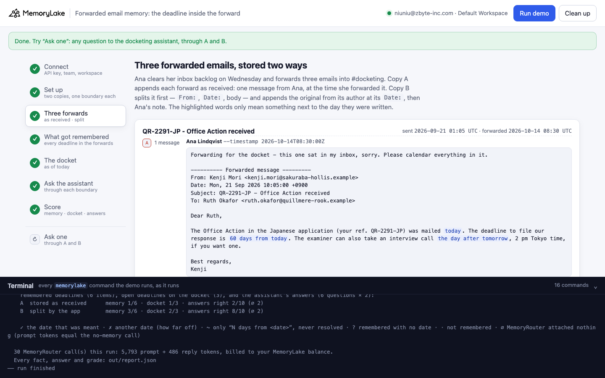
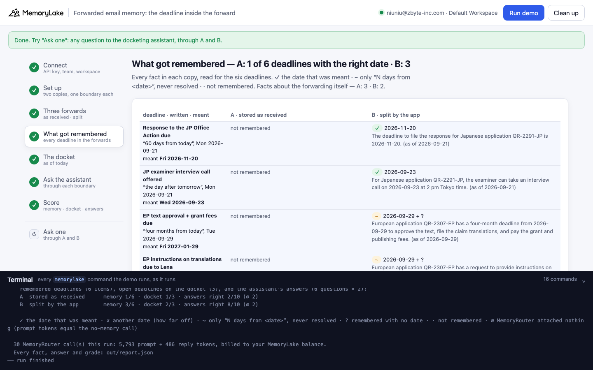
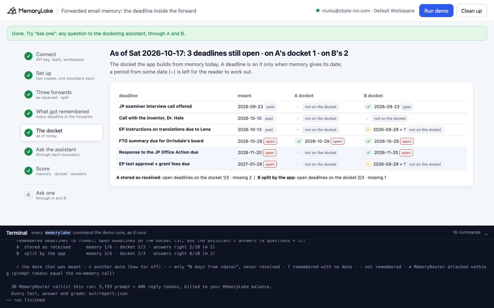
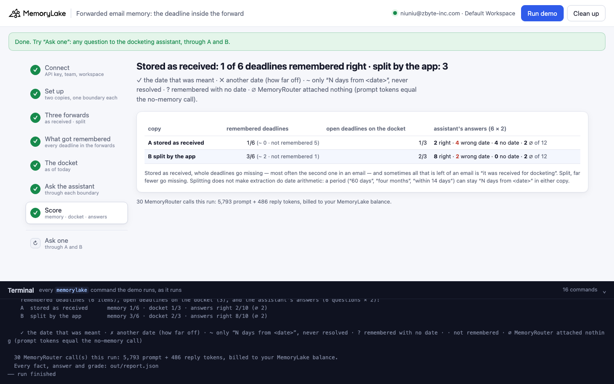

# Forwarded email memory: the deadline inside the forward

A runnable version of the MemoryLake use case
[*Give Patent and IP Teams AI That Remembers Every Prior Art Finding*](https://www.memorylake.ai/en/usecase/ai-memory-for-patent-and-ip-research),
built entirely on the [`memorylake` CLI](https://github.com/memorylake-ai/memorylake-cli) (v20261015 or later).

**Watch it run:** [CLI, 3:20](https://github.com/memorylake-ai/memorylake-usecases/releases/download/forwarded-email-memory-v1/forwarded-email-memory-cli-demo.mp4) · [Web, 3:52](https://github.com/memorylake-ai/memorylake-usecases/releases/download/forwarded-email-memory-v1/forwarded-email-memory-web-demo.mp4)
([release](https://github.com/memorylake-ai/memorylake-usecases/releases/tag/forwarded-email-memory-v1); GitHub serves them as downloads). In the CLI recording copy B lost three deadlines too
(1/6 each), and its census shows A's JP response as ✗ 2026-09-23: the grader was fixed after that recording and now reads that
fact ("…60 days from that date and … an interview call on 2026-09-23") as ~ never resolved.

**The problem.** A patent firm dockets from email, and most deadlines arrive forwarded. A foreign associate reports
an Office Action, a client asks for an opinion before a board meeting, and the docketing paralegal forwards the email
into the firm's `#docketing` channel, which MemoryLake remembers. The obvious way to store that is the way it
arrived: one message from the paralegal, her note on top and the original email below. MemoryLake's extraction then
often remembers *the forward* rather than what it says:

```
Ana Lindqvist (docketing paralegal): Another one for the docket from the same backlog.
  ---------- Forwarded message ---------
  From: Lena Vogt <l.vogt@brandauer-wenz.example>
  Date: Tue, 29 Sep 2026 11:20:00 +0200
  … four months from today to approve the text … instructions on the translations within 14 days.

remembered: "A forwarded email titled "QR-2307-EP - Rule 71(3) communication" was received for the
             Quillmere & Rook docket backlog. (on 2026-10-14)"
```

That fact is all that run kept of the email. Neither deadline is in memory, and nothing in memory says one is
missing.

**What this demo shows.** Quillmere & Rook (fictional) gets three emails that hold six deadlines between them, each
written relative to the day it was sent ("60 days from today", "the day after tomorrow", "four months from today",
"within 14 days", "three weeks from today"). On Wednesday 14 October the paralegal clears her inbox backlog and
forwards all three. The demo stores the same three forwards twice:

| copy | how a forward is stored | deadlines remembered with the right date | not remembered at all | docketing assistant's answers right |
|---|---|---|---|---|
| **A** | as received: one message from the paralegal, at the time she forwarded it | **9 / 54** | **28 / 54** | **38 / 93** (∅ 15) |
| **B** | split by the app: the original as its own message, from its author, at its `Date:`, then the paralegal's note | **25 / 54** | **11 / 54** | **80 / 101** (∅ 7) |

Measured over 9 complete runs (6 deadlines each; the assistant's answers are 6 questions × 2 at temperature 0.7 on
`gpt-4o-mini` through MemoryRouter; ∅ = MemoryRouter attached nothing and is not graded). Copy A loses the second
deadline in an email most often: the JP examiner interview 2 / 9 in A against 8 / 9 in B. In 5 of A's 9 runs, at
least one email left nothing behind but "an email titled … was received for docketing".

What splitting does **not** fix: extraction's date arithmetic. In both copies a period can stay unresolved
("60 days from 2026-09-21", "four months from 2026-09-29"): 15 of A's 54 items and 17 of B's. The anchor date is
right, which is more than A can say for its missing items, but a docket that counts only real dates leaves them off.

What it is **not** about: the forward's own timestamp. Before building this demo, a probe checked whether a forward
sent on 14 October makes extraction count "60 days from today" from the 14th. It did not: across 15 forwarded copies,
no date was counted from the forward time. Extraction reads the `Date:` line of the forwarded email. The failure is
that content goes missing, not that it is misdated.

## Prerequisites

- Python 3.9+ (standard library only; `zoneinfo` reads your system's time-zone database. On Windows,
  `pip install tzdata`)
- The `memorylake` CLI **v20261015 or later** (`memorylake router` arrived in that release):
  ```bash
  curl -fsSL https://raw.githubusercontent.com/memorylake-ai/memorylake-cli/main/scripts/install.sh | sh
  memorylake version
  ```
- A MemoryLake API key ([app.memorylake.ai](https://app.memorylake.ai) → API Keys).
- **Router calls are billed to your MemoryLake balance** (`memorylake billing balance`). One run makes 30 calls on
  `gpt-4o-mini`, about 6,000 prompt + 500 reply tokens; the run prints the total. If the balance is empty, the
  router calls print the refusal and are skipped; the memory steps still run.

## Run it

```bash
git clone https://github.com/memorylake-ai/memorylake-usecases.git
cd memorylake-usecases/forwarded-email-memory
export MEMORYLAKE_API_KEY=sk-...
python3 demo.py                     # the whole story, about 2½ minutes (a minute or so of it is extraction)
python3 demo.py memory              # each deadline as each copy remembers it, and the docket as of today
python3 demo.py ask "When is our response to the Japanese Office Action in QR-2291-JP due?"
python3 demo.py cleanup             # delete everything the demo created
```

The key is used to log into an isolated CLI profile under `.memorylake-demo/` (git-ignored); your own
`~/.memorylake` is never touched. For the China endpoint also set
`MEMORYLAKE_BASE_URL=https://app.memorylake.cn/openapi/memorylake`. Every run starts over, and everything it
creates is prefixed `mlu-fem-`.

## Or run it in the browser

```bash
python3 web/server.py                # opens http://127.0.0.1:8765
```

Paste the API key, press **Run the demo**, and follow the steps on the left while the terminal drawer shows every
`memorylake` command as it runs. **Ask one** sends any question through A and B and grades it when it is about one
of the six deadlines. **Clean up** removes everything.

| Step 3: three forwards, stored two ways | Step 4: what got remembered |
|---|---|
|  |  |
| **Step 5: the docket as of today** | **Step 7: the score** |
|  |  |

## What happens, step by step

The output below is from one real run (the `--reset` run in [Measured](#measured)), trimmed.

### Step 2: two copies, four actors, one boundary each

Two projects, one per copy, so neither copy's answers can come from the other's facts. Four actors: the paralegal
(Ana Lindqvist) and the three senders (a Tokyo associate, a Munich associate, a client's in-house counsel). One
boundary per copy covers its project; it is what the docketing assistant reads through MemoryRouter.

### Step 3: three forwards, stored two ways

Each forward is its own GROUP conversation, in both copies. The forwards are in `data/forwards.json`, exactly as a
mail client writes them: note, marker line, `From:` / `Date:` / `Subject:` / `To:`, blank line, original body.

```bash
# A: the forward as received
memorylake conv msg append <conv> --actor <ana> --custom-id m00 --timestamp 2026-10-14T08:30:00Z \
  --text 'Ana Lindqvist (docketing paralegal, Quillmere & Rook): Forwarding for the docket - this one sat in my inbox, sorry. … ---------- Forwarded message --------- From: Kenji Mori <…> Date: Mon, 21 Sep 2026 10:05:00 +0900 …'

# B: the app splits it first. The original, from its author, at its Date: …
memorylake conv msg append <conv> --actor <kenji> --custom-id m00 --timestamp 2026-09-21T01:05:00Z \
  --text 'Kenji Mori (Tokyo associate, Sakuraba-Hollis IP): Dear Ruth, The Office Action … was mailed today. The deadline to file our response is 60 days from today. …'
# … then the paralegal's note
memorylake conv msg append <conv> --actor <ana> --custom-id m01 --timestamp 2026-10-14T08:30:00Z \
  --text 'Ana Lindqvist (docketing paralegal, Quillmere & Rook): Forwarding for the docket - … (Forwarded: "QR-2291-JP - Office Action received", Kenji Mori'"'"'s email of Mon 21 Sep 2026.)'
```

The split is ordinary parsing (`split_forward()` in `demo.py`: the marker line, the header block, `email.utils` for
the address and the date); the sender is matched to an actor by email address.

### Step 4: what got remembered

`fact list --projects` for each copy, read for each deadline: the date a fact gives for it, against the date the
sender meant (the email's `Date:` in the sender's own time zone, plus the period they wrote).

```
  f2  "QR-2307-EP - Rule 71(3) communication"

    EP text approval + grant fees due — "four months from today", Tue 2026-09-29 → meant Fri 2027-01-29
      A  · not remembered
      B  ✓ 2027-01-29 The Rule 71(3) response period for European application QR-2307-EP runs for four months
         from 2026-09-29, requiring approval of the text, filing of claim translations, and payment of the grant
         and publishing fees by 2027-01-29 (as of 2026-09-29).

    EP instructions on translations due to Lena — "within 14 days", Tue 2026-09-29 → meant Tue 2026-10-13
      A  · not remembered
      B  ✓ 2026-10-13 Translation instructions for European application QR-2307-EP were requested within 14 days
         from 2026-09-29, i.e., by 2026-10-13 (as of 2026-09-29).
  …
    A also remembers the forwarding itself:
      "A client email from Priya Raman with subject line "Re: QR-2315-US gripper patent - FTO" was received
       for docketing. (on 2026-10-14)"
      "A forwarded email titled "QR-2307-EP - Rule 71(3) communication" was received for the Quillmere & Rook
       docket backlog. (on 2026-10-14)"

    A  stored as received      right date 1/6 · never resolved 1 · no date 0 · wrong 0 · not remembered 4 · facts about the forward itself 2
    B  split by the app        right date 4/6 · never resolved 2 · no date 0 · wrong 0 · not remembered 0 · facts about the forward itself 3
```

`~` marks a deadline that only exists as "three weeks from 2026-10-08": the anchor is right, the date was never
worked out. B gets a "the email was forwarded for docketing" fact from the paralegal's note too, next to the
deadlines rather than in place of them.

### Step 5: the docket, as of today

The docket the app builds from memory: a deadline is on it only when memory gives its date.

```
                                                   meant                A docket                       B docket
    JP examiner interview call offered             2026-09-23 24 d ago  ✓ 2026-09-23        24 d ago   ✓ 2026-09-23        24 d ago
    Call with the inventor, Dr. Hale               2026-10-10 7 d ago   · not on the docket            ~ 2026-10-08 + ?
    EP instructions on translations due to Lena    2026-10-13 4 d ago   · not on the docket            ✓ 2026-10-13        4 d ago
    FTO summary due for Orrisdale's board          2026-10-29 in 12 d   · not on the docket            ~ 2026-10-08 + ?
    Response to the JP Office Action due           2026-11-20 in 34 d   ~ 2026-09-21 + ?               ✓ 2026-11-20        in 34 d
    EP text approval + grant fees due              2027-01-29 in 104 d  · not on the docket            ✓ 2027-01-29        in 104 d

    A  stored as received      open deadlines on the docket 0/3 · missing 3
    B  split by the app        open deadlines on the docket 2/3 · missing 1
```

### Step 6: ask the docketing assistant

Each deadline's question through each copy's boundary (`memorylake router chat … --boundary <id>`), twice, plus
one call without a boundary per question as the ∅ baseline: a boundary call whose `prompt_tokens` equal the
baseline had nothing attached. The system prompt gives today's date and asks for `Date: YYYY-MM-DD`, or
`Date: unknown` if memory does not say.

```
  A  stored as received
    EP text approval + grant fees due              2027-01-29   ∅  ? no date
    FTO summary due for Orrisdale's board          2026-10-29   ? no date  ? no date
    …
  B  split by the app
    EP text approval + grant fees due              2027-01-29   ✓ 2027-01-29  ✓ 2027-01-29
    FTO summary due for Orrisdale's board          2026-10-29   ✓ 2026-10-29  ✓ 2026-10-29
```

When memory holds only "60 days from 2026-09-21", the model has to do the arithmetic itself. Across the nine runs
it answered the JP response right 30 times in 32; the other two (both copy A, CLI recording) were 2026-12-14 and
2026-12-15, about 60 days from the day the email was *forwarded*. The EP question came back as 2026-01-29 in 17 of 30
graded answers: four months from 29 September, in the wrong year.

### Step 7: the score

```
    A  stored as received      memory 1/6 · docket 0/3 · answers right 4/8 (∅ 4)
    B  split by the app        memory 4/6 · docket 2/3 · answers right 10/12
```

## Measured

| run | A memory | B memory | A not remembered | B not remembered | A answers | B answers |
|---|---|---|---|---|---|---|
| first run | 0/6 | 4/6 | 2 | 0 | 2/12 | 10/12 |
| second run (over the first run's leftovers) | 2/6 | 3/6 | 2 | 0 | 6/10 (∅ 2) | 10/12 |
| parallel copy 1 | 2/6 | 3/6 | 4 | 2 | 4/10 (∅ 2) | 8/11 (∅ 1) |
| parallel copy 2 | 1/6 | 2/6 | 2 | 3 | 7/10 (∅ 2) | 8/10 (∅ 2) |
| `--reset` | 1/6 | 4/6 | 4 | 0 | 4/8 (∅ 4) | 10/12 |
| browser check | 1/6 | 3/6 | 4 | 0 | 4/12 | 11/12 |
| CLI recording | 1/6 | 1/6 | 4 | 3 | 3/11 (∅ 1) | 9/11 (∅ 1) |
| browser recording | 1/6 | 3/6 | 5 | 1 | 2/10 (∅ 2) | 8/10 (∅ 2) |
| after the last grader fix (`run`, `memory`, `ask`, `cleanup`) | 0/6 | 2/6 | 1 | 2 | 6/10 (∅ 2) | 6/11 (∅ 1) |
| **total** | **9/54** | **25/54** | **28/54** | **11/54** | **38/93** | **80/101** |

Per deadline, right date in A / B: JP response 3 / 6 · JP interview 2 / 8 · EP approval and fees 0 / 1 · EP
instructions 0 / 1 · FTO summary 3 / 6 · inventor call 1 / 3. The grader was corrected three times during these runs
(a period such as "on 2026-09-29, giving four months from that date" or "60 days from that date and … on 2026-09-23"
was first read as a wrong date; a fact that drifted into French was misread). Every census above is re-read from
the stored facts with the final grader; answers are graded as they were at the time.

The probe before this demo (one email per conversation, three deadlines each): forwarded as received, 15 of 27
deadlines came through (2 of 9 copies kept only "an email was received for docketing"); split, 9 of 9.

## Use it in your own app

- **Split forwards before you store them.** The original email is a message from its author at its `Date:`. Append it
  as that: `conv msg append --actor <author> --timestamp <Date:>`, then the forwarder's note as its own message. A mail
  client's forward format is regular enough for the standard library (`email.utils.parseaddr`,
  `parsedate_to_datetime`); a reply chain inside a forward can be split the same way, one message per quoted email.
- **Count the deadlines, not the facts.** A forward that produced facts can still have lost its deadlines;
  "an email titled … was received for docketing" is a fact. Check the deadlines you expected against `fact list`.
- **Do the date arithmetic yourself.** Even split, extraction may store "60 days from 2026-09-21". If a deadline must
  be exact, compute it in code from the email's `Date:` and pin it with `fact add`.

## Troubleshooting

- **`this memorylake CLI has no router command`**: upgrade the CLI (install line above).
- **MemoryRouter refused the call for lack of balance**: top up in the console; `memorylake billing balance` shows it.
- **`still extracting after 600 s`**: once in a while a conversation finishes cooking with no facts in the project;
  the demo carries on and grades those items as not remembered.
- **`the demo memory does not exist yet`**: `memory` and `ask` need a full run first (and `cleanup` removes it).
- **A run was interrupted**: run again; it deletes what the previous run left and starts over.
- **Your counts differ from the ones above**: extraction varies from run to run; that is why the table above adds
  up six runs rather than quoting one.

## Files

| File | What it is |
|---|---|
| `demo.py` | The demo: CLI wrapper, setup, the forward splitter, the two ways of storing, census (each deadline's date read from facts, graded against the email's date + the period), docket, Router questions and grading, `memory`, `ask`, cleanup (facts before actors) |
| `data/forwards.json` | The three forwarded emails, as a mail client writes them |
| `data/firm.json` | Firm, people (with email addresses and time zones), the six deadlines (what was written, the period, the question) and the system prompt |
| `web/server.py`, `web/static/` | Browser companion (standard library server, no build step) |
| `out/` | `report.json` with every fact, answer and grade (git-ignored) |
