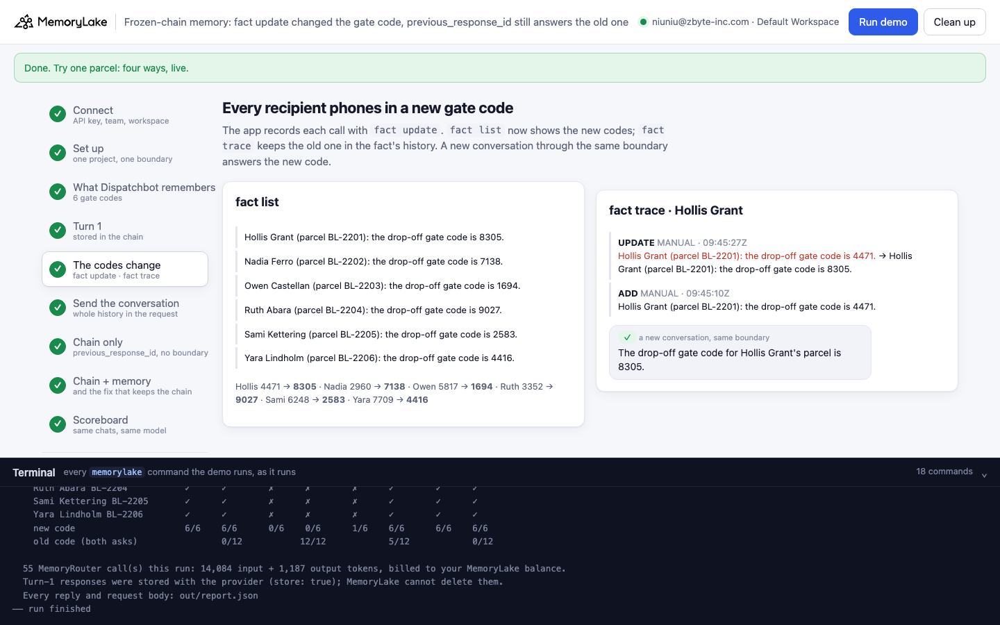
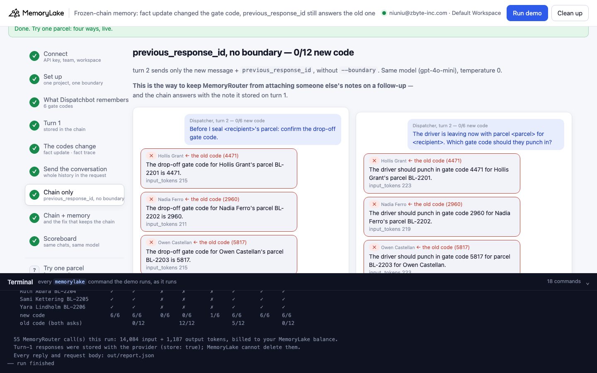
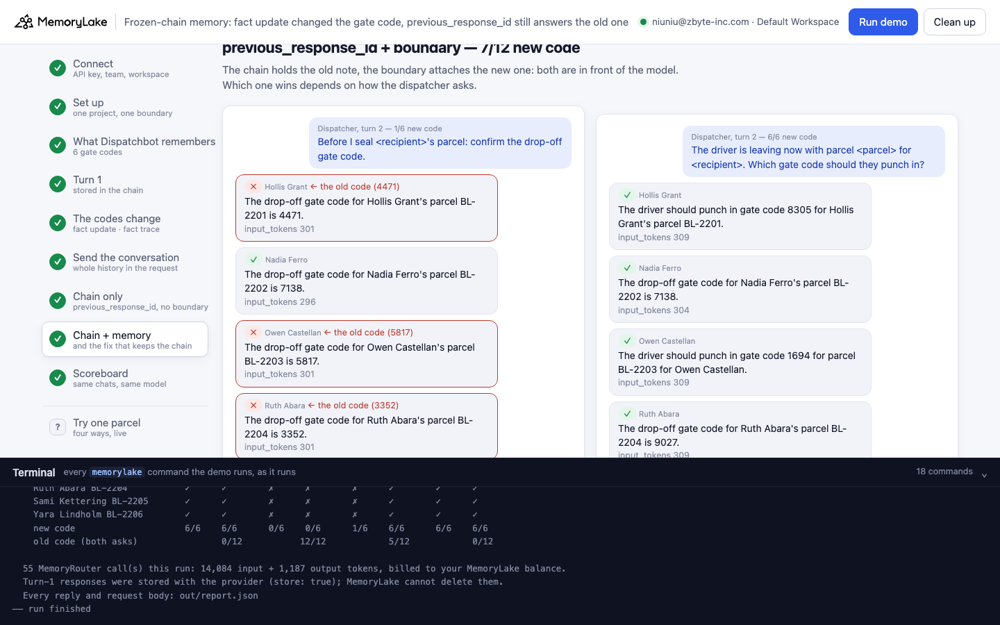
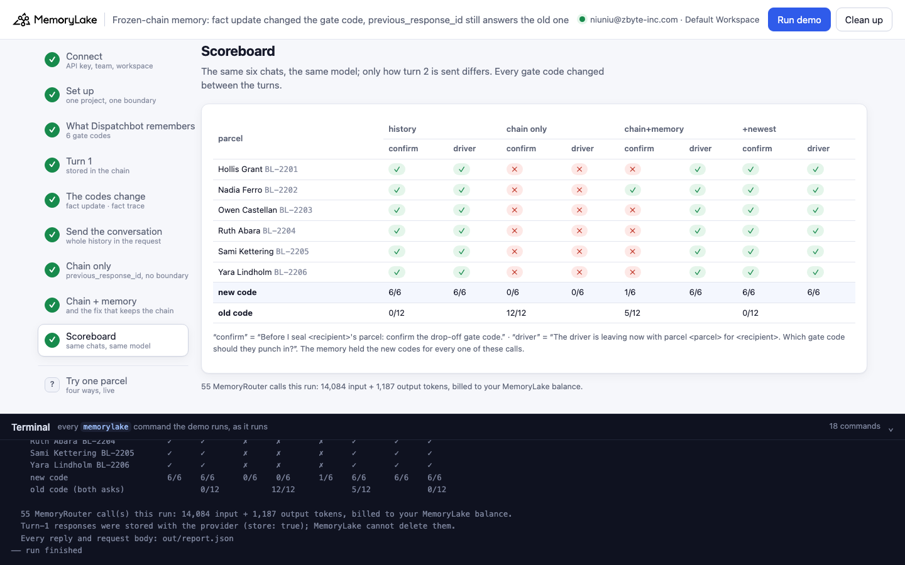
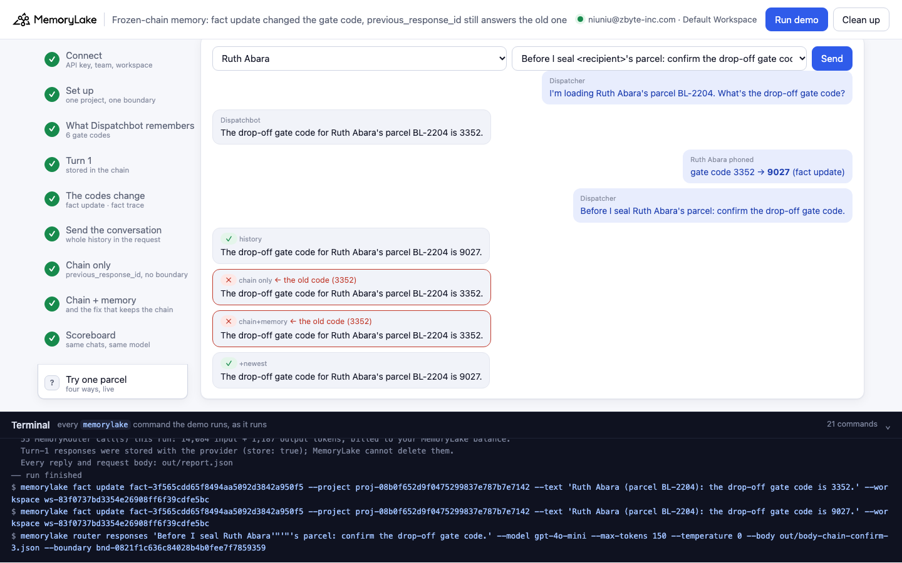

# Frozen-chain memory: `fact update` changed the gate code, `previous_response_id` still answers the old one

A runnable version of the MemoryLake use case
[*Ship LLM Apps Without Building Memory Infrastructure From Scratch*](https://www.memorylake.ai/en/usecase/memory-api-for-llm-developers),
built entirely on the [`memorylake` CLI](https://github.com/memorylake-ai/memorylake-cli) (v20261015 or later).

**Watch it run:** [CLI, 3:44](https://github.com/memorylake-ai/memorylake-usecases/releases/download/frozen-chain-memory-v1/frozen-chain-memory-cli-demo.mp4) · [Web, 4:35](https://github.com/memorylake-ai/memorylake-usecases/releases/download/frozen-chain-memory-v1/frozen-chain-memory-web-demo.mp4)
([release](https://github.com/memorylake-ai/memorylake-usecases/releases/tag/frozen-chain-memory-v1); GitHub serves them as downloads).

**The problem.** A memory API with versioning means you can change a fact in place (`fact update`) and every later
read gets the new value, with the old one kept in the fact's history (`fact trace`). MemoryRouter reads that memory
on each call and attaches the notes that fit. The OpenAI Responses API offers a shortcut for conversations: send
`store: true`, then on the next turn send only the new message plus `previous_response_id`, and the provider keeps
the history. What the provider keeps is the whole turn-1 request, **including the notes MemoryRouter attached to
it**. Change the fact after that, and the conversation still carries a copy of the old note that no memory
operation can reach.

**What this demo shows.** Brindle Lane Deliveries (fictional) delivers parcels across town. Its dispatch assistant,
Dispatchbot, reads delivery notes through MemoryRouter: one MemoryLake project holds each of six recipients' drop-off
gate code, and one **boundary** covers it. The dispatcher has the same chat for every parcel:

1. *"I'm loading Hollis Grant's parcel BL-2201. What's the drop-off gate code?"* — answered right, stored.
2. Every recipient phones in a new gate code. The app runs `fact update`; `fact list` shows the new codes.
3. The dispatcher asks again, two ways: *"Before I seal Hollis Grant's parcel: confirm the drop-off gate code."*
   (**confirm**) and *"The driver is leaving now with parcel BL-2201 for Hollis Grant. Which gate code should they
   punch in?"* (**driver**).

Turn 2 goes to the same model (`gpt-4o-mini`, temperature 0) four ways:

| Step | Turn 2 is sent as | What you see |
|---|---|---|
| 5 | A new conversation through the boundary (check) | The new code: the memory is current |
| 6 | **The whole conversation in `input`** (turn 1 + Dispatchbot's reply with the old code), with `--boundary` | **New code, 12/12** in every run |
| 7 | **`previous_response_id`, no boundary** — the usual way to keep MemoryRouter from attaching someone else's notes on a follow-up | **Old code, 12/12** in every run. `fact list` printed the new codes a few seconds earlier |
| 8 | **`previous_response_id` + boundary** | The old note (in the chain) and the new one (attached now) side by side. **confirm: mostly the old code** (0–2 of 6 new per run); **driver: mostly the new one** (5–6 of 6) |
| 8 | **Fix that keeps the chain**: the same, plus one sentence in `instructions`: *if two notes disagree, the notes attached to the newest message are current* | **New code**, 143/144 over all runs |
| 9 | Scoreboard | Six parcels × four ways × two asks, ✓/✗ |

Model output varies from run to run, so every reply is graded and printed as it comes out, and [Measured](#measured)
below reports totals over all runs, not the best one.

## Prerequisites

- Python 3.9+ (standard library only)
- The `memorylake` CLI **v20261015 or later** (`memorylake router` arrived in that release):
  ```bash
  curl -fsSL https://raw.githubusercontent.com/memorylake-ai/memorylake-cli/main/scripts/install.sh | sh
  memorylake version
  ```
- A MemoryLake API key ([app.memorylake.ai](https://app.memorylake.ai) → API Keys).
- **Router calls are billed to your MemoryLake balance** (`memorylake billing balance`). One run makes 55 calls on
  `gpt-4o-mini`, about 14,100 input + 1,200 output tokens in all; the run prints the total. If the balance is empty,
  the router calls print the refusal and are skipped.
- Turn-1 replies are stored with the model provider (`store: true`, which is what `previous_response_id` needs).
  MemoryLake has no command to delete them; `cleanup` removes everything on the MemoryLake side.

## Run it

```bash
git clone https://github.com/memorylake-ai/memorylake-usecases.git
cd memorylake-usecases/frozen-chain-memory
export MEMORYLAKE_API_KEY=sk-...
python3 demo.py                                   # the whole story, about 1½ minutes
python3 demo.py ask --recipient "Ruth Abara"      # one parcel: code change between the turns, turn 2 four ways
python3 demo.py ask --recipient "Ruth Abara" --ask driver
python3 demo.py facts                             # the 6 notes behind the boundary
python3 demo.py cleanup                           # delete everything the demo created
```

The key is used to log into an isolated CLI profile under `.memorylake-demo/` (git-ignored); your own
`~/.memorylake` is never touched. For the China endpoint also set
`MEMORYLAKE_BASE_URL=https://app.memorylake.cn/openapi/memorylake`. Everything the demo creates has a `custom_id`
starting with `mlu-fzc-`. Every run starts over with a fresh project (the previous one is deleted first).

## Or run it in the browser

```bash
python3 web/server.py           # opens http://127.0.0.1:8765
```

Same pipeline, one view per step: turn 1 for every parcel, the code change (`fact list` next to `fact trace`), each
way of sending turn 2 as transcripts with ✓/✗ and `input_tokens` (the two asks side by side), the scoreboard, a
**Try one parcel** page that runs one recipient's chat — code change included — the four ways live, and a terminal
drawer with every `memorylake` command as it runs.







## What happens, step by step

Excerpts below are from one real run (shortened ids); wording varies between runs.

### Steps 2–3: one project, one boundary, six notes

```text
$ memorylake proj create --name 'Brindle Lane: delivery notes' --custom-id mlu-fzc-notes --description 'Drop-off gate codes a dispatch assistant reads. Demo data.' --workspace ws-83f0…
$ memorylake boundary create --name Dispatchbot --custom-id mlu-fzc-boundary --projects proj-3a29… --workspace ws-83f0…
$ memorylake fact add --project proj-3a29… 'Hollis Grant (parcel BL-2201): the drop-off gate code is 4471.' 'Nadia Ferro (parcel BL-2202): the drop-off gate code is 2960.' … --workspace ws-83f0…
  · stored 6 facts: one drop-off gate code per recipient
```

### Step 4: turn 1, stored with the provider

```text
$ memorylake router responses "I'm loading Hollis Grant's parcel BL-2201. What's the drop-off gate code?" --model gpt-4o-mini --max-tokens 150 --temperature 0 --body out/body-turn1-0.json --boundary bnd-44bc…
    Dispatcher: I'm loading Hollis Grant's parcel BL-2201. What's the drop-off gate code?
      Dispatchbot: The drop-off gate code for Hollis Grant's parcel BL-2201 is 4471.
    …
  · 6/6 answered the gate code on file
```

`out/body-turn1-0.json` is a Responses API body with `"store": true`. MemoryRouter attaches Hollis's note to the
message; the provider stores that request and the reply as the start of the chain.

### Step 5: the recipients call

```text
    Hollis Grant phoned: the building changed the gate code.  4471 → 8305
    …
$ memorylake fact update fact-0c70… --project proj-3a29… --text 'Hollis Grant (parcel BL-2201): the drop-off gate code is 8305.' --workspace ws-83f0…
  · updated 6 facts in place; the old text is kept in each fact's history
$ memorylake fact trace fact-0c70… --project proj-3a29… --workspace ws-83f0…
    UPDATE  MANUAL  Hollis Grant (parcel BL-2201): the drop-off gate code is 4471.  →  Hollis Grant (parcel BL-2201): the drop-off gate code is 8305.
    ADD     MANUAL  Hollis Grant (parcel BL-2201): the drop-off gate code is 4471.
   - Hollis Grant (parcel BL-2201): the drop-off gate code is 8305.
   - Nadia Ferro (parcel BL-2202): the drop-off gate code is 7138.
   …
  · a new conversation through the same boundary, to check MemoryRouter now attaches the new code:
    ✓ Hollis Grant    The drop-off gate code for Hollis Grant's parcel is 8305.
```

The memory side did its job: one fact per recipient, edited in place, history kept, and MemoryRouter attaches the
new text.

### Step 6: the whole conversation in the request

```text
$ memorylake router responses "Before I seal Hollis Grant's parcel: confirm the drop-off gate code." --model gpt-4o-mini --max-tokens 150 --temperature 0 --body out/body-history-confirm-0.json --boundary bnd-44bc…
    Dispatcher: “Before I seal <recipient>'s parcel: confirm the drop-off gate code.”
    ✓ Hollis Grant    The drop-off gate code for Hollis Grant's parcel BL-2201 is 8305.
    ✓ Nadia Ferro     The drop-off gate code for Nadia Ferro's parcel BL-2202 is 7138.
    …
    6/6 new code · input_tokens 211–219
```

`body-history-confirm-0.json` holds `"input": [turn 1, Dispatchbot's reply]` — the reply that says *4471*. The old
code is in the request, but as something the assistant said; the note MemoryRouter attaches to this turn is the new
one, and the model goes with it.

### Step 7: on the chain, without the boundary

```text
$ memorylake router responses "Before I seal Hollis Grant's parcel: confirm the drop-off gate code." --model gpt-4o-mini --max-tokens 150 --temperature 0 --body out/body-bare-confirm-0.json
    ✗ Hollis Grant    The drop-off gate code for Hollis Grant's parcel BL-2201 is 4471.   ← the old code (4471)
    ✗ Nadia Ferro     The drop-off gate code for Nadia Ferro's parcel BL-2202 is 2960.   ← the old code (2960)
    …
    0/6 new code · 6 old code · input_tokens 211–219
    Dispatcher: “The driver is leaving now with parcel <parcel> for <recipient>. Which gate code should they punch in?”
    ✗ Hollis Grant    The driver should punch in gate code 4471 for Hollis Grant's parcel BL-2201.   ← the old code (4471)
    …
    0/6 new code · 6 old code · input_tokens 219–227
```

`body-bare-confirm-0.json` is `{"instructions": …, "input": [], "store": false, "previous_response_id": "resp_…"}`.
Leaving the boundary off follow-ups is what you would do after reading
[response-chain-memory](../response-chain-memory): there, a follow-up that doesn't name the customer gets someone
else's notes attached. Here the follow-up names the customer, the boundary isn't involved, and the only gate code
the model can see is the one MemoryRouter attached on turn 1 — stored in the chain before the `fact update`, and
wrong.

### Step 8: on the chain, with the boundary — and the fix

```text
    Dispatcher: “Before I seal <recipient>'s parcel: confirm the drop-off gate code.”
    ✗ Hollis Grant    The drop-off gate code for Hollis Grant's parcel BL-2201 is 4471.   ← the old code (4471)
    ✓ Nadia Ferro     The drop-off gate code for Nadia Ferro's parcel BL-2202 is 7138.
    ✗ Owen Castellan  The drop-off gate code for Owen Castellan's parcel BL-2203 is 5817.   ← the old code (5817)
    …
    2/6 new code · 4 old code · input_tokens 296–306
    Dispatcher: “The driver is leaving now with parcel <parcel> for <recipient>. Which gate code should they punch in?”
    ✓ Hollis Grant    The driver should punch in gate code 8305 for Hollis Grant's parcel BL-2201.
    …
    6/6 new code · input_tokens 304–314

  The fix that keeps the chain — previous_response_id + boundary + “newest notes are current”
    ✓ Hollis Grant    The drop-off gate code for Hollis Grant's parcel BL-2201 is 8305.
    …
    6/6 new code · input_tokens 319–329
```

With the boundary, `input_tokens` go up by about 85: MemoryRouter attached the new note. The model now has two notes
for the same gate, the old one from turn 1 and the new one, and nothing that says which is current. Asked to
*confirm*, it mostly confirms what it said before; asked *which code to punch in*, it mostly takes the newer one.
The same code path is right or wrong depending on how the dispatcher phrases the question. One sentence in
`instructions` (sent on turn 2, so it applies to this turn) settles it.

### Step 9: scoreboard

```text
                                     history      chain only    chain+memory         +newest
    parcel                    confirm driver  confirm driver  confirm driver  confirm driver
    Hollis Grant BL-2201         ✓      ✓        ✗      ✗        ✗      ✓        ✓      ✓
    Nadia Ferro BL-2202          ✓      ✓        ✗      ✗        ✓      ✓        ✓      ✓
    Owen Castellan BL-2203       ✓      ✓        ✗      ✗        ✗      ✓        ✓      ✓
    Ruth Abara BL-2204           ✓      ✓        ✗      ✗        ✗      ✓        ✓      ✓
    Sami Kettering BL-2205       ✓      ✓        ✗      ✗        ✓      ✓        ✓      ✓
    Yara Lindholm BL-2206        ✓      ✓        ✗      ✗        ✗      ✓        ✓      ✓
    new code                     6/6    6/6      0/6    0/6      2/6    6/6      6/6    6/6
    old code (both asks)                0/12           12/12            4/12            0/12
```

## Measured

Every fresh run while building and recording this demo: 9 in the terminal (3 with this prefix, 6 in three parallel
copies), 1 browser check and the 2 recordings. Each run: 6 parcels × 2 asks per way of sending turn 2.

| Turn 2 sent as | runs | new code | old code |
|---|---|---|---|
| Whole conversation in `input` + boundary | 12 | **144 / 144** | 0 |
| `previous_response_id`, no boundary | 12 | **0 / 144** | **144** |
| `previous_response_id` + boundary, *confirm* | 12 | **15 / 72** (0–2 per run) | 57 |
| `previous_response_id` + boundary, *driver* | 12 | 69 / 72 (5–6 per run) | 3 |
| `previous_response_id` + boundary + “newest notes are current” | 12 | **143 / 144** | 1 (Yara Lindholm, *confirm*, once) |
| Check: a new conversation through the boundary after `fact update` | 12 | 12 / 12 | 0 |

- Turn 1 answered the code on file 72/72. No reply gave both codes or no code.
- In the *confirm* column with the boundary, the right answers came from two parcels only (Sami Kettering 8 times,
  Nadia Ferro 7); the other four parcels got the old code on *confirm* in every run.
- `input_tokens`: whole conversation and chain-without-boundary 211–227; chain + boundary 296–314; with the extra
  sentence 319–337.
- One model (`gpt-4o-mini`) was measured. Before the demo, two probes on another data set (4 and 6 recipients, the
  *confirm* ask with the same wording pattern) gave the same split: chain without boundary 0/36 new, chain +
  boundary 5/24 on *confirm* and 12/12 on *driver*.

## Use it in your own app

- Whatever MemoryRouter attaches to a stored request becomes part of the provider's conversation. A memory API's
  versioning works on the memory, not on copies the provider keeps. A fact changed mid-conversation is invisible to
  turns that only continue the chain.
- If facts can change during a conversation — gate codes, addresses, prices, on-call rotations — either send the
  conversation yourself (`store: false`, history in `input`), so the notes are attached fresh on every turn and
  nothing old is frozen in, or keep the chain and tell the model in `instructions` that the notes attached to the
  newest message are current.
- Don't rely on "leave the boundary off follow-ups" with `previous_response_id`: it holds only while turn 1's notes
  are still right.
- Test with a fact that changes between two turns of the same conversation, and with more than one phrasing of the
  follow-up. In this demo a *driver* phrasing passes with the boundary on and hides the problem the *confirm*
  phrasing shows.

## Troubleshooting

- **`this memorylake CLI has no router command`**: upgrade the CLI (install line above).
- **MemoryRouter refused the call for lack of balance**: top up in the console; `memorylake billing balance` shows it.
- **`turn 1 did not come back with a response id`**: the provider did not store the response; run again.
- **The check in step 5 answers the old code**: retrieval had not caught up with the edit yet (the demo waits 15 s);
  the run says so, and its numbers are off. Run again.
- **A run was interrupted**: run again; it deletes the previous project and starts over.

## Files

| File | What it is |
|---|---|
| `demo.py` | The demo: CLI wrapper, turn 1, the code change, the four ways to send turn 2, the grader, subcommands |
| `data/recipients.json` | Six recipients (parcel, old and new gate code), the fact template and the dispatcher's turns |
| `web/server.py`, `web/static/` | Browser companion (standard library server, no build step) |
| `out/` | Request bodies, `report.json` with every reply, `runs/` with earlier reports (git-ignored) |
