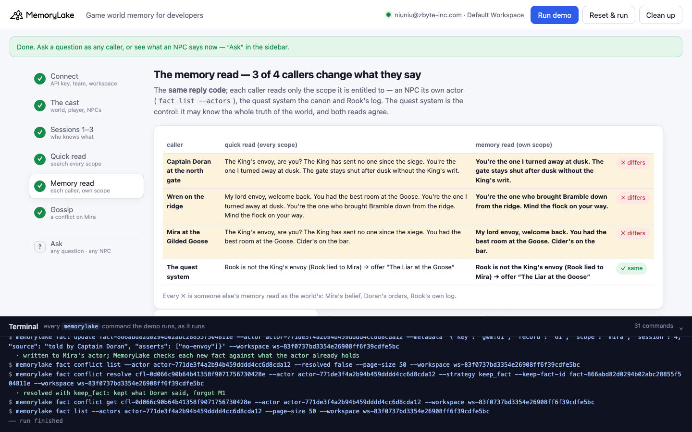
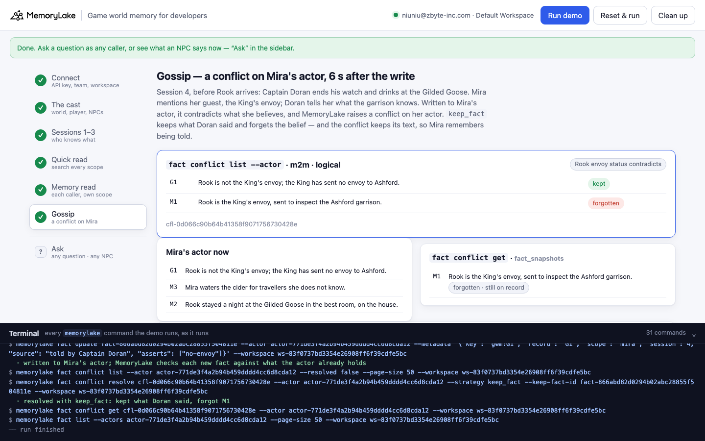

# Game world memory for developers

A runnable version of the MemoryLake use case
[*Give Game Worlds Memory of Every Character, Quest, and Player Choice*](https://www.memorylake.ai/en/usecase/game-world-memory-for-developers),
built entirely on the [`memorylake` CLI](https://github.com/memorylake-ai/memorylake-cli).

**Watch it run:** [CLI, 2:22](https://github.com/memorylake-ai/memorylake-usecases/releases/download/game-world-memory-v1/game-world-memory-cli-demo.mp4) · [Web, 3:50](https://github.com/memorylake-ai/memorylake-usecases/releases/download/game-world-memory-v1/game-world-memory-web-demo.mp4)
([release](https://github.com/memorylake-ai/memorylake-usecases/releases/tag/game-world-memory-v1); GitHub serves them as downloads).

**The problem.** In a game, a lot of what gets remembered is not true. The player lies to an innkeeper, and the
innkeeper believes it. That belief is exactly what the innkeeper's memory should hold: she will act on it until
somebody tells her otherwise. But it is true only *for her*. Put it in one pool with everything else and retrieve
"what does the world know about the player?", and every NPC in the game has suddenly heard the lie, and some of them
have heard the denial as well.

**What this demo shows.** Ashford is an RPG by Lanternfish Games (both fictional) whose NPCs speak from memory, kept
at the three scopes the use case page describes: the world's canon in one **project** (lore, rules, the quest table),
the player's own event log on one **actor**, and what each NPC has seen or been told on **that NPC's actor**. Every
record is pinned word for word, with its scope, session, source and what it asserts in metadata. In session 2 the
player, Rook, told Mira the innkeeper they were the King's envoy, to get a night at the Gilded Goose for free. The King
has sent no envoy. Session 4 starts, and four callers need context about Rook:

| Caller | Quick read: `search` every scope | Memory read: the caller's own scope | |
|---|---|---|---|
| Captain Doran at the north gate (never heard the envoy story) | "My lord envoy, welcome back. You had the best room at the Goose. You're the one I turned away at dusk." | "You're the one I turned away at dusk." | ✗ |
| Wren on the ridge (has not been to town since the harvest fair) | "My lord envoy, welcome back. You had the best room at the Goose. You're the one I turned away at dusk. You're the one who brought Bramble down from the ridge." | "You're the one who brought Bramble down from the ridge." | ✗ |
| Mira at the Gilded Goose (believes the lie) | "The King's envoy, are you? The King has sent no one since the siege." | "My lord envoy, welcome back." | ✗ |
| The quest system (control) | Rook lied → offer "The Liar at the Goose" | Rook lied → offer "The Liar at the Goose" | ✓ |

(One fresh run, verbatim. The quick read's exact words vary from run to run, because `search` returns a different top 8; that the three NPCs are wrong does not: 21 of 21 across 7 runs, see [Measured](#measured).)

Both reads use **the same reply code**. The only difference is which records reach it. The quick read gives every
caller the hits of one `search` across all five scopes. The memory read gives an NPC its own actor (`fact list
--actors`) and the quest system the canon plus Rook's log, which is everything it is entitled to know. Every ✗ comes
from someone else's memory read as the world's: Mira's belief reaches Doran and Wren; the canon's denial reaches
Mira before anybody has told her; Doran's turning Rook away at the gate comes out of Wren's mouth. The quest system
is entitled to the whole truth of the world, so its two reads agree. That is the control.

Then the story moves on. Step 6 plays the gossip: Doran ends his watch and drinks at the Goose, Mira mentions her
guest the envoy, and Doran tells her "Rook is not the King's envoy". Written to Mira's actor, that contradicts what
she believes, and **MemoryLake's contradiction check raises a conflict on her actor** (`fact conflict list --actor`,
7 to 13 seconds after the write in 6 of 6 runs). Resolving it with `keep_fact` keeps what Doran said and forgets the
belief, and the conflict keeps the forgotten text (`fact_snapshots`). So Mira's next line remembers that she was
lied to:

> You told me you were the King's envoy. Captain Doran says the King has sent no one since the siege. That night in
> the best room was not on the house after all.

Doran and Wren still say what they said before. Gossip reached Mira, not them.

Everything is a plain `memorylake` command, echoed as it runs. The lines are templates: in your game, this is where
the LLM call goes, and the point is what you put in its context.

## Prerequisites

- Python 3.9+ (standard library only)
- The `memorylake` CLI on your `PATH`:
  ```bash
  curl -fsSL https://raw.githubusercontent.com/memorylake-ai/memorylake-cli/main/scripts/install.sh | sh
  ```
- A MemoryLake API key: sign up at [app.memorylake.ai](https://app.memorylake.ai), open **API Keys**, create one.
  A free personal account is enough. Nothing in this demo calls an LLM.

## Run it

```bash
git clone https://github.com/memorylake-ai/memorylake-usecases.git
cd memorylake-usecases/game-world-memory
export MEMORYLAKE_API_KEY=sk-...
python3 demo.py
```

It takes one to two minutes. With a key set, the demo logs into an isolated CLI profile under `.memorylake-demo/` and never
touches your own `~/.memorylake`. Without a key it uses your current `memorylake auth login` session. Everything it
creates is prefixed `mlu-gwm-`.

China region:

```bash
export MEMORYLAKE_BASE_URL=https://app.memorylake.cn/openapi/memorylake
```

Afterwards:

```bash
python3 demo.py npc mira
```

```bash
python3 demo.py ask "Who is the traveller at the gate?" --as doran
```

```bash
python3 demo.py conflicts
```

```bash
python3 demo.py cleanup
```

`npc` prints what an NPC says now and the facts it says it from (for Mira, including the belief the conflict made her
forget). `ask` runs any question as any caller (`doran`, `wren`, `mira`, `quest`) through both reads. `conflicts`
lists the conflicts on Mira's actor. `cleanup` deletes every fact, the four actors and the world project.

Running it again replays the morning of session 4: the gossip from the last run is taken back and Mira's belief is
pinned again, so the conflict happens again. `--reset` deletes everything first.

## Or run it in the browser

```bash
python3 web/server.py
```

The page opens at http://127.0.0.1:8765. Paste the key, connect, press **Run demo**. Each step has its own view: the
cast, who knows what, every caller's top 8 with the rows that are not theirs to know highlighted, the two reads side
by side, the conflict on Mira's actor. **Ask** takes any question as any caller, or shows what an NPC says now. The
terminal drawer at the bottom shows every `memorylake` command as it runs. The server is standard library only,
binds to localhost and drives the same functions as `demo.py`.





## What happens, step by step

### Steps 2–3: the cast, and who knows what

One project for the world (`proj create --custom-id mlu-gwm-world`), one actor for the player and one per NPC
(`actor create` + `actor bind`). Then one `fact add` per scope with all of that scope's records, word for word, and
`fact update --metadata` on each:

```
  world canon — 8 fact(s)
    Q1  s0  Quest 'The Envoy's Writ' is offered to the King's envoy: Captain Doran hands over the…
    Q2  s0  Quest 'The Liar at the Goose' is offered when the player has claimed a title they do …
    W1  s0  The King has sent no envoy to Ashford since the siege last winter.   [no-envoy]
    W2  s0  Ashford's north gate opens after dusk only for someone carrying the King's writ.
    W3  s0  The King's writ is carried only by the King's envoys.
    W4  s0  Mira keeps the Gilded Goose, the inn on the market square of Ashford.
    W5  s0  Captain Doran commands the north gate garrison and drinks at the Gilded Goose after h…
    W6  s0  Wren keeps the flock on the ridge above Ashford and rarely comes down to the market s…

  Rook's event log — 3 fact(s)
    E1  s1  Session 1: Rook found Wren's goat Bramble on the ridge and brought her down.   [goat]
    E2  s2  Session 2: Rook told Mira they were the King's envoy, to get a night at the Gilded Go…   [lie, room]
    E3  s3  Session 3: Rook tried the north gate after dusk and Captain Doran turned them away.   [gate]

  Mira — 3 fact(s)
    M1  s2  Rook is the King's envoy, sent to inspect the Ashford garrison.   [envoy]
    M2  s2  Rook stayed a night at the Gilded Goose in the best room, on the house.   [room]
    M3  s2  Mira waters the cider for travellers she does not know.

  Captain Doran — 3 fact(s)
    D1  s0  The King has sent no envoy to Ashford since the siege last winter; the garrison has o…   [no-envoy]
    D3  s0  Doran does not open the north gate after dusk without the King's writ.
    D2  s3  A traveller called Rook tried the north gate after dusk, and Doran turned them away.   [gate]

  Wren — 2 fact(s)
    R2  s0  Wren has not been down to the market square since the harvest fair.
    R1  s1  Rook found Bramble, Wren's goat, on the ridge and brought her down.   [goat]
```

Mira's M1 is written as a plain statement, not as "Mira believes …". Her actor *is* the frame: everything on it is
what Mira holds to be true. That is also what lets the contradiction check in step 6 see it.

### Step 4: the quick read

One `search` per caller across the world project and all four actors, the hits handed to the reply code:

```bash
memorylake search "Captain Doran at the north gate: what do I know about Rook?" \
  --projects <world> --actors <rook>,<mira>,<doran>,<wren> --types fact --top-k 8
```

```
  Captain Doran at the north gate — After dusk, Rook walks up to the north gate.
    #1 M1  Mira                 Rook is the King's envoy, sent to inspect the Ashford garrison.   ← not theirs to know
    #2 W3  world canon          The King's writ is carried only by the King's envoys.
    #3 W2  world canon          Ashford's north gate opens after dusk only for someone carrying t…
    #4 D3  Captain Doran        Doran does not open the north gate after dusk without the King's …
    #5 Q1  world canon          Quest 'The Envoy's Writ' is offered to the King's envoy: Captain …
    #6 D2  Captain Doran        A traveller called Rook tried the north gate after dusk, and Dora…
    #7 E2  Rook's event log     Session 2: Rook told Mira they were the King's envoy, to get a ni…   ← not theirs to know
    #8 E3  Rook's event log     Session 3: Rook tried the north gate after dusk and Captain Doran…   ← not theirs to know
  · 3 of the hits come from a scope Captain Doran cannot know: M1, E2, E3
  → My lord envoy, welcome back. You had the best room at the Goose. You're the one I turned away at dusk. The gate stays shut after dusk without the King's writ.
```

Mira's belief is the best match for "what do I know about Rook?" (rank 1 for Doran in 7 of 7 runs). The search did
its job; the question was asked of the wrong pool.

### Step 5: the memory read

The same reply code, each caller reading only its own scope:

```
  caller                           quick read (every scope)   memory read (own scope)   
  ------------------------------------------------------------------------------------------
  Captain Doran at the north gate  defers + room, gate        plain + gate               ✗ differs
  Wren on the ridge                defers + room, gate, goat  plain + goat               ✗ differs
  Mira at the Gilded Goose         calls_out + room           defers + room              ✗ differs
  The quest system                 liar                       liar                       ✓ same
```

`defers` is "my lord envoy", `calls_out` is "the King has sent no one", `plain` says neither; the rest is what
the caller remembers about Rook. Mira *should* defer: she was lied to and has not found out yet. The quick read has
her calling the lie out in session 4, before Doran has said a word to her.

### Step 6: gossip, and a conflict on Mira's actor

```
$ memorylake fact add --actor <mira> 'Rook is not the King'"'"'s envoy; the King has sent no envoy to Ashford.'
$ memorylake fact conflict list --actor <mira> --resolved false

  `fact conflict list --actor` after 13s: [m2m · logical] “Rook envoy status contradicts”  cfl-0c47e00fd2174fd7912eb61c8ab22905
    G1  Rook is not the King's envoy; the King has sent no envoy to Ashford.
    M1  Rook is the King's envoy, sent to inspect the Ashford garrison.
$ memorylake fact conflict resolve <conflict> --actor <mira> --strategy keep_fact --keep-fact-id <G1>
  · resolved with keep_fact: kept what Doran said, forgot M1
$ memorylake fact conflict get <conflict> --actor <mira>

  Mira's actor now (3 fact(s)): G1, M2, M3
  `fact conflict get` still holds what she was told: M1 “Rook is the King's envoy, sent to inspect the Ashford garrison.”

  Session 4, after the gossip — memory read, own scope:
    Captain Doran at the north gate  You're the one I turned away at dusk. The gate stays shut after dusk without the King's writ.
    Wren on the ridge                You're the one who brought Bramble down from the ridge. Mind the flock on your way.
    Mira at the Gilded Goose         You told me you were the King's envoy. Captain Doran says the King has sent no one since the siege. That night in the best room was not on the house after all. Cider's on the bar.
    The quest system                 Rook is not the King's envoy (Rook lied to Mira) → offer “The Liar at the Goose”
```

The check runs on the actor the fact is written to, against what that actor already holds. The same denial has been
in the world project and on Doran's actor all along; neither ever conflicts with Mira's belief, because they are
different scopes. The forgotten belief is gone from `fact list --actors <mira>`, so no later read treats it as current,
and it stays in the conflict's `fact_snapshots`, so Mira can still remember being told it.

## Measured

7 runs of the full demo on a free account (4 fresh, 3 on existing data, one of them from the web app), 2026-10-15:

- Doran, Wren and Mira: quick read ✗ in **21 of 21**, memory read the same every time. Mira's belief (M1) was in
  Doran's and Wren's top 8 in 7 of 7; a denial (W1 or D1) was in Mira's top 8 in 7 of 7.
- The quest system: ✓ in 7 of 7 (Rook's log, E2, was in its top 8 every time).
- The conflict on Mira's actor: raised in **6 of 6** runs with the wording above, 7 to 13 s after the write, naming
  exactly G1 and M1. One earlier run used "The King has sent no envoy to Ashford since the siege last winter" for the
  gossip: no conflict in 10 minutes. Across that run and five probe actors, "no envoy … since the siege" was flagged
  2 times in 6. It does not say Rook is lying: Rook could have been sent before the siege, so both can be true, and
  the check is not wrong to stay quiet. "Rook is not the King's envoy" leaves no such room (3 of 3 probe actors, then
  6 of 6 runs).

## Wiring it into your own game

- **One scope per knower.** A project for what is true in the world, an actor for each player's own history, an
  actor for each NPC (or faction) holding what it has seen or been told. Write each event to every scope that
  witnessed it: one `fact add` per scope, with `fact update --metadata` for session and source.
- **Read the scope of whoever is speaking.** NPC dialogue reads that NPC's actor. Systems that need the truth (quests,
  achievements, anti-cheat) read the world and the player's log. If an NPC should know public lore, put that lore on
  a project of its own and read it alongside the actor (`search --projects lore --actors <npc>` is a union of the
  two). Never read the world's denial in the same context as an NPC's belief by accident.
- **Write beliefs as plain statements on the believer's actor.** The scope is the "Mira believes" part. Then news that
  contradicts the belief raises a conflict when it reaches that actor, and nowhere else.
- **Resolve, don't delete.** `keep_fact` forgets the belief for every later read, and the conflict keeps its text; a
  character who was lied to can say so.

## If something goes wrong

- **`no conflict naming the gossip after 150s`**: the check sometimes answers later, in a batch. Run
  `python3 demo.py conflicts` after a few minutes. If you changed the gossip's wording, make sure it cannot be true
  at the same time as the belief (see [Measured](#measured)).
- **`the memorylake CLI is not on PATH`**: install it (see Prerequisites) or set `MEMORYLAKE_BIN`.
- **`not logged in`**: export `MEMORYLAKE_API_KEY`, or run `memorylake auth login`.
- **`search answered from its cache`**: `search` can return an earlier run's hits for the same question and scope for
  a while. The demo prints this rather than hiding it; the reads still use the records the hits point to.
- **The web page says `port 8765 is in use`**: it moves to the next free port and prints it; or pass `--port`.

## Files

| Path | What it is |
|---|---|
| `demo.py` | the demo: `run` (default), `npc`, `ask`, `conflicts`, `cleanup` |
| `data/story.json` | the world, the cast, every record with its scope and what it asserts, the callers, the reply lines |
| `web/server.py` | the browser companion (standard library HTTP + Server-Sent Events) |
| `web/static/` | the page: `index.html`, `app.js`, `style.css`, the MemoryLake logo |
| `web/screenshot-*.png` | the two screenshots above |
| `out/runs.jsonl` | one line per run: hits, what each read said, the conflict (git-ignored) |
