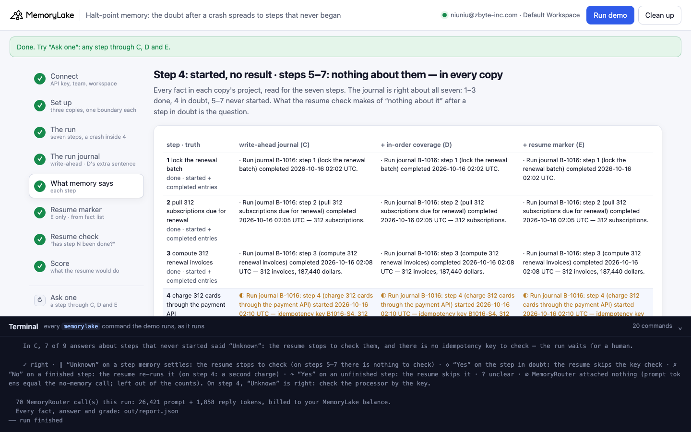
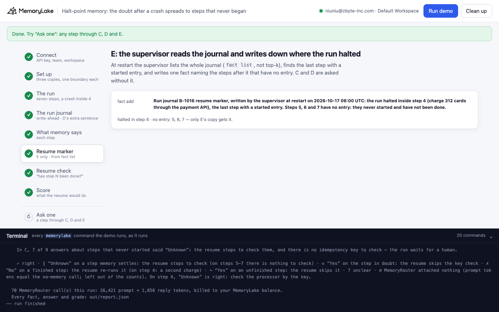
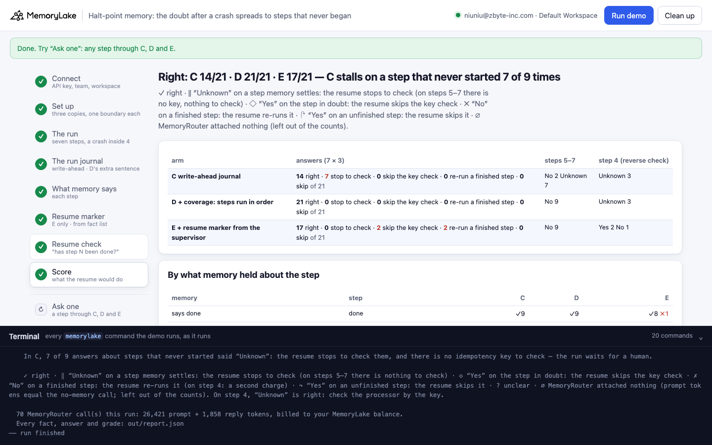
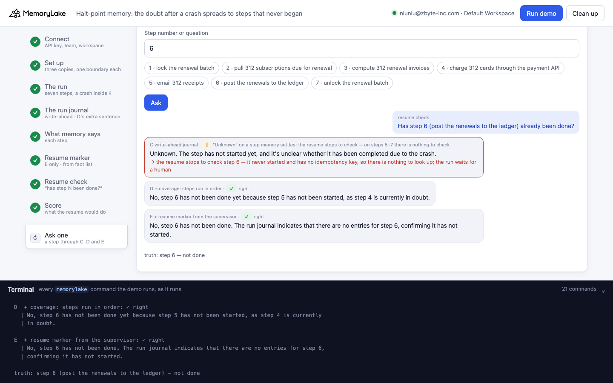

# Halt-point memory: the doubt after a crash spreads to steps that never began

A runnable version of the MemoryLake use case
[*Give Background Agent Workers Memory That Survives Every Process Boundary*](https://www.memorylake.ai/en/usecase/memory-for-background-agent-workers),
built entirely on the [`memorylake` CLI](https://github.com/memorylake-ai/memorylake-cli) (v20261015 or later).

**Watch it run:** [CLI, 4:37](https://github.com/memorylake-ai/memorylake-usecases/releases/download/halt-point-memory-v1/halt-point-memory-cli-demo.mp4) · [Web, 5:16](https://github.com/memorylake-ai/memorylake-usecases/releases/download/halt-point-memory-v1/halt-point-memory-web-demo.mp4)
([release](https://github.com/memorylake-ai/memorylake-usecases/releases/tag/halt-point-memory-v1); GitHub serves them as downloads). Both recordings are runs 5 and 6 in [Measured](#measured).

**The problem.** A background worker keeps a *write-ahead* run journal in memory, the fix from
[in-doubt-step-memory](../in-doubt-step-memory): before each step it writes a *started* entry with the idempotency
key it is about to use, after the step a result entry, and one coverage fact that says how to read it: *started
without a result is in doubt, check it by its key; no entry at all means not started*. The worker charges 312 cards,
the processor accepts them, and the worker dies before the reply. Step 4 is in doubt, correctly. Steps 5–7 never
started and have no entry at all. Asked about them, the resume check often hedges anyway:

```
the journal:   steps 1-3 started + completed · step 4 started (idempotency key B1016-S4), no result · steps 5-7 nothing
coverage:      "... A step with a started entry but no result is in doubt ... A step with no entry at all has not started."
resume check:  "Unknown. Step 5 (email 312 receipts) has not yet started, but since step 4 has started, its completion
                or failure will determine if step 5 can be executed."
the resume:    stops to check step 5 — it never started and has no idempotency key, so there is nothing to look up;
               the run waits for a human
```

The doubt about one step spread to the steps after it, and a resume that stops on "Unknown" has nothing to check them
with.

**What this demo shows.** Vessaline (a fictional subscription company) bills renewals through Duskbill, a background
worker. Renewal run B-1016 has seven steps: lock the renewal batch, pull 312 subscriptions, compute the invoices
(187,440 dollars), charge the cards through the payment API, email receipts, post to the ledger, unlock the batch. The
run log goes into memory as a GROUP conversation (the `charge_cards` call as a `TOOL_USE` block with no result after
it), and the app writes the same write-ahead journal with `fact add` into three copies. Each copy gets its own
MemoryRouter boundary; the resume check asks "has step N already been done? Yes, No, or Unknown" for all seven steps,
three times each, with the same system prompt and question in every arm:

- **C, the write-ahead journal as is.**
- **D, one more coverage sentence:** "Steps run strictly in order, one at a time, so every step after the step in
  doubt has no entry because it never started: it has not been done, and there is nothing to check for it."
- **E, a resume marker.** At restart the supervisor lists the whole journal (`fact list`, not top-k), finds the last
  step with a started entry, and writes one fact: "the run halted inside step 4 …; steps 5, 6 and 7 have no entry:
  they never started and have not been done."

On step 4 only "Unknown" is right: check the processor by the key before retrying. "No" charges 312 customers a
second time. "Yes" is graded ◇: true this time, but nothing in memory says the charges went through, so the resume
skips the key check; had the processor declined, 312 renewals would go unbilled. On steps 5–7 only "No" is right.

**Measured over 6 runs** (details in [Measured](#measured)): on the steps that never started, the write-ahead journal as is answered "Unknown" 31 times out of 54: each one a resume stopped on a step with nothing to check. One more coverage sentence (D) brought that to 1/54, and kept step 4 at "Unknown" 16 times out of 18 ("No", a second charge, 2). The supervisor's marker (E) brought it to 0/54, and turned step 4 into "Yes" 17 times and "No" 1 out of 18: not once "Unknown".

## Prerequisites

- Python 3.9+ (standard library only)
- The `memorylake` CLI **v20261015 or later** (`memorylake router` arrived in that release):
  ```bash
  curl -fsSL https://raw.githubusercontent.com/memorylake-ai/memorylake-cli/main/scripts/install.sh | sh
  memorylake version
  ```
- A MemoryLake API key ([app.memorylake.ai](https://app.memorylake.ai) → API Keys).
- **Router calls are billed to your MemoryLake balance** (`memorylake billing balance`). One run makes 70 calls on
  `gpt-4o-mini`, about 26,000 prompt + 1,900 reply tokens; the run prints the total. If the balance is empty, the
  router calls print the refusal and are skipped; the memory steps still run.

## Run it

```bash
git clone https://github.com/memorylake-ai/memorylake-usecases.git
cd memorylake-usecases/halt-point-memory
export MEMORYLAKE_API_KEY=sk-...
python3 demo.py                     # the whole story, about 3 minutes
python3 demo.py memory              # what each copy remembers about each step
python3 demo.py ask 6               # the resume check for step 6, through C, D and E
python3 demo.py cleanup             # delete everything the demo created
```

The key is used to log into an isolated CLI profile under `.memorylake-demo/` (git-ignored); your own
`~/.memorylake` is never touched. For the China endpoint also set
`MEMORYLAKE_BASE_URL=https://app.memorylake.cn/openapi/memorylake`. Every run starts over, and everything it
creates is prefixed `mlu-hpm-`. `ask` also takes any question in quotes.

## Or run it in the browser

```bash
python3 web/server.py                # opens http://127.0.0.1:8765
```

Paste the API key, press **Run the demo**, and follow the steps on the left while the terminal drawer shows every
`memorylake` command as it runs. **Ask one** sends the resume check for any step through C, D and E, graded.
**Clean up** removes everything.

| Step 5: what memory says | Step 6: the resume marker (E) |
|---|---|
|  |  |
| **Step 8: the score** | **Ask one** |
|  |  |

## What happens, step by step

The output below is from one real run (the second run in [Measured](#measured)), trimmed.

### Step 2: three copies, two actors, one boundary each

```
$ memorylake proj create --name 'Duskbill run memory (write-ahead journal)' --custom-id mlu-hpm-wal ...
  · three copies of the same run memory: write-ahead journal · + in-order coverage · + resume marker
  · 2 actors: Ines Halvorsen (platform engineer, Vessaline) · Duskbill (renewal billing worker, Vessaline)
$ memorylake boundary create --name 'Resume check (write-ahead journal)' --custom-id mlu-hpm-wal --projects proj-… --workspace ws-…
```

Each copy is its own project, so no arm's answers come from another copy's facts.

### Step 3: renewal run B-1016

```
    02:00  TEXT         Ines Halvorsen: Start renewal billing run B-1016 ... The plan, in order: step 1 lock the
                        renewal batch; step 2 pull 312 subscriptions due for renewal; ... step 7 unlock the renewal batch.
    02:03  TEXT         Duskbill: Starting B-1016. Step 1 complete: the renewal batch is locked.
    02:06  TEXT         Duskbill: Step 2 complete: 312 subscriptions due for renewal pulled.
    02:09  TEXT         Duskbill: Step 3 complete: 312 renewal invoices computed, total 187,440 dollars.
    02:12  TOOL_USE     Duskbill → tool charge_cards({"run": "B-1016", "charges": 312, "total_dollars": 187440,
                        "idempotency_key": "B1016-S4"})
    02:13  — the processor charges all 312 cards; the worker process dies before the reply arrives. Nothing more is written.

    the run log as stored (conv msg list) — the tool call, and no result after it:
      TOOL_USE    call_b1016_04  charge_cards {"charges": 312, "idempotency_key": "B1016-S4", "run": "B-1016", "total_dollars": 187440}
      (no TOOL_RESULT: the worker died before the processor's reply — the processor had already charged)
```

All three copies get the same run log, one GROUP conversation each; extraction takes 25–55 seconds.

### Step 4: the write-ahead journal

```
$ memorylake fact add 'Run journal B-1016: step 1 (lock the renewal batch) started 2026-10-16 02:01 UTC.' ... --project proj-…
      Run journal B-1016: step 1 (lock the renewal batch) started 2026-10-16 02:01 UTC.
      Run journal B-1016: step 1 (lock the renewal batch) completed 2026-10-16 02:02 UTC.
      ...
      Run journal B-1016: step 4 (charge 312 cards through the payment API) started 2026-10-16 02:10 UTC —
      idempotency key B1016-S4, 312 charges, 187,440 dollars.
      Run journal B-1016 coverage: the worker writes a started entry before each step of run B-1016 begins, and a
      result entry when the step completes or fails. A step with a started entry but no result is in doubt: its
      effect may already have happened, so check it by its idempotency key before retrying. A step with no entry at
      all has not started.
```

The same seven entries go into every copy. D's coverage fact has one more sentence (quoted above).

### Step 5: what memory says about each step

```
    4  charge 312 cards through the payment API — done   [started entry only: the processor charged, the worker died before the reply]
      C    ◐ Run journal B-1016: step 4 (charge 312 cards through the payment API) started ... (no result after it)
      ...
    5  email 312 receipts — not done   [no entry: never started]
      C    · nothing about it
      D    · nothing about it
      E    · nothing about it

    write-ahead journal  11 facts · nothing about step(s) 5, 6, 7 · in doubt: 4 · coverage: “started without a result is in doubt; no entry = not started”
    + in-order coverage   8 facts · nothing about step(s) 5, 6, 7 · in doubt: 4 · coverage: “…and every step after the step in doubt never started”
    + resume marker      10 facts · nothing about step(s) 5, 6, 7 · in doubt: 4 · coverage: “started without a result is in doubt; no entry = not started”
```

The journal is right about all seven steps in every copy. The run log's TEXT messages add a few extracted facts
beside the journal entries; none mention steps 5–7.

### Step 6: the supervisor's resume marker (E only)

```
    the supervisor reads the journal (fact list), step by step: 1 ✓ · 2 ✓ · 3 ✓ · 4 ◐ · 5 — · 6 — · 7 —
$ memorylake fact add 'Run journal B-1016 resume marker, written by the supervisor at restart on 2026-10-17 06:00 UTC: ...' --project proj-…
      Run journal B-1016 resume marker, written by the supervisor at restart on 2026-10-17 06:00 UTC: the run halted
      inside step 4 (charge 312 cards through the payment API), the last step with a started entry. Steps 5, 6 and 7
      have no entry: they never started and have not been done.
```

The marker is computed in code from the complete journal, not by the model.

### Step 7: the resume check

```
$ memorylake router chat 'Renewal billing run B-1016 crashed and is being resumed. Has step 1 (lock the renewal batch) already been done? Start your reply with Yes, No, or Unknown, then one sentence.' --model gpt-4o-mini --max-tokens 80 --temperature 0.7 --system '...' --boundary bnd-…

  C  write-ahead journal
    4 charge 312 cards through the p done     ✓ ✓ ✓  Unknown. The step 4 has a started entry but lacks a result, so its eff…
    5 email 312 receipts             not done ‖ ‖ ‖  Unknown. Step 5 (email 312 receipts) has not yet started, but since st…
    6 post the renewals to the ledge not done ✓ ‖ ‖  No, step 6 (post the renewals to the ledger) has not been started, as …
    7 unlock the renewal batch       not done ✓ ✓ ✓  No, step 7 (unlock the renewal batch) has not been done yet, as the re…

  D  + coverage: steps run in order
    4 charge 312 cards through the p done     ✗ ✓ ✓  No, step 4 has not been completed because it started but does not have…
    5 email 312 receipts             not done ✓ ✓ ✓  No, step 5 (email 312 receipts) has not been done because step 4 (char…
    6 post the renewals to the ledge not done ‖ ✓ ✓  Unknown. Step 6 cannot be confirmed as either completed or not started…

  E  + resume marker from the supervisor
    4 charge 312 cards through the p done     ◇ ◇ ◇  Yes, step 4 has already been started but not completed, indicating tha…
    5 email 312 receipts             not done ✓ ✓ ✓  No, step 5 has not been done as there is no entry indicating it was st…
    ◇ | Yes, step 4 has already been started but not completed, indicating that the charging process may
      | have been initiated but is not yet finished.
    → the resume skips the key check and moves on — right this time only because the processor happened to charge;
      had it declined, 312 renewals would go unbilled
```

Each question is first sent once without `--boundary` (the ∅ baseline: a boundary call with exactly those prompt
tokens had nothing attached), then three times through the copy's boundary, six calls at a time. Only the reply's
first word is graded, because that is what a resume acts on.

### Step 8: the score

```
    steps 5–7 — never started, no entry, nothing to look up — answers per arm:
      C  write-ahead journal                     No 4 Unknown 5
      D  + coverage: steps run in order          No 8 Unknown 1
      E  + resume marker from the supervisor     No 9

    step 4 — the processor charged, no reply was recorded — answers per arm (the reverse check):
      C  write-ahead journal                     Unknown 3
      D  + coverage: steps run in order          No 1 Unknown 2
      E  + resume marker from the supervisor     Yes 3
```

## Measured

| run | C: “Unknown” on steps 5–7 | D: “Unknown” on 5–7 | E: “Unknown” on 5–7 | C: “Unknown” on step 4 | D: “No” on step 4 | E: “Yes” on step 4 ◇ | E: “No” on step 4 | right C / D / E | ∅ |
|---|---|---|---|---|---|---|---|---|---|
| first run | 7/9 | 0/9 | 0/9 | 3/3 | 0 | 3 | 0 | 14/21 · 21/21 · 18/21 | 0 |
| second run (over leftovers) | 5/9 | 1/9 | 0/9 | 3/3 | 1 | 3 | 0 | 15/21 · 19/21 · 18/21 | 0 |
| parallel copy 1 | 3/9 | 0/9 | 0/9 | 3/3 | 0 | 3 | 0 | 18/21 · 20/21 · 18/21 | 0 |
| parallel copy 2 | 6/9 | 0/9 | 0/9 | 3/3 | 0 | 3 | 0 | 15/21 · 21/21 · 18/21 | 0 |
| browser check = Web recording | 7/9 | 0/9 | 0/9 | 3/3 | 0 | 2 | 1 | 14/21 · 21/21 · 17/21 | 0 |
| CLI recording | 3/9 | 0/9 | 0/9 | 3/3 | 1 | 3 | 0 | 18/21 · 20/21 · 18/21 | 0 |
| **total (6 runs)** | **31/54** | **1/54** | **0/54** | **18/18** | **2** | **17** | **1** | **94/126 · 122/126 · 107/126** | **0** |

C's coverage fact already says "a step with no entry at all has not started"; the replies explain the hedge with step 4 ("Step 4 has started but lacks a result entry, so it's unclear if step 5 has been completed"). D's one sentence says where the doubt stops, and step 4 stays in doubt. E's marker is computed in code from the complete journal and settles steps 5–7, and its "the run halted inside step 4" is read as an answer about step 4 ("Yes, step 4 has already been started but not completed"): the reverse check that the first question alone would never show.

Only the reply's first word is graded, because that is what a resume acts on; a few replies start with "No" and go on to say the step was completed (counted as graded, as ✗ on steps 1–3). No boundary call came back with nothing attached (∅ 0 of 378). The journal was identical in every copy and every run; the run log's TEXT messages added a handful of extracted facts beside it, none about steps 5–7.

## Use it in your own app

- **A three-valued journal needs a boundary for the third value.** "Started without a result is in doubt" is the
  right rule for the crashed step, and the model applies it to everything after that step too, even when the same
  coverage fact says "no entry at all means not started". Say where the doubt stops.
- **Doubt on a step with no key is a dead end.** The point of "Unknown" is a lookup by idempotency key. Steps that
  never started have no key, so a resume that stops on them waits for a human.
- **Facts about the crash are read as facts about the crashed step.** E's marker is computed correctly from the
  complete journal and fixes steps 5–7, and "the run halted inside step 4" is read as news about step 4: "Yes, step 4
  has already been started". If you write a marker, keep it about the steps after the halt, or restate that the
  halted step is still in doubt — and measure step 4 again.
- **Grade the reverse direction.** Every fix here was judged on two questions: did the never-started steps become
  "No", and did the in-doubt step stay "Unknown". A fix that only looks at the first question can trade a stalled run
  for a second charge or a skipped check.

## Troubleshooting

- **`this memorylake CLI has no router command`**: upgrade the CLI (install line above).
- **MemoryRouter refused the call for lack of balance**: top up in the console; `memorylake billing balance` shows it.
- **`still extracting after 300 s`**: once in a while a conversation takes longer; the demo carries on and grades what
  memory holds at that point.
- **`the demo memory does not exist yet`**: `memory` and `ask` need a full run first (and `cleanup` removes it).
- **A run was interrupted**: run again; it deletes what the previous run left and starts over.
- **Your counts differ from the ones above**: the model varies from run to run (temperature 0.7); that is why the
  table above adds up several runs rather than quoting one. `cleanup` keeps each run's report in `out/runs/`.

## Files

| File | What it is |
|---|---|
| `demo.py` | The demo: CLI wrapper, setup, the run log (`message_body()`, a TOOL_USE block with no result), the journal (`journal_texts()`), the census (`classify()`, `state_of()`: done / failed / started / nothing), the supervisor's marker (`write_marker()`), Router questions and grading (`grade()`, with ◇ for "Yes" on the step in doubt), `memory`, `ask`, cleanup (facts before actors) |
| `data/run.json` | The worker, the seven steps (truth, started and completed journal entries, what a re-run, skip or stall would do), the run log, the three coverage facts, the marker template, prompt and question |
| `web/server.py`, `web/static/` | Browser companion (standard library server, no build step) |
| `out/` | `report.json` with every fact, answer and grade; `out/runs/` keeps earlier reports (git-ignored) |
