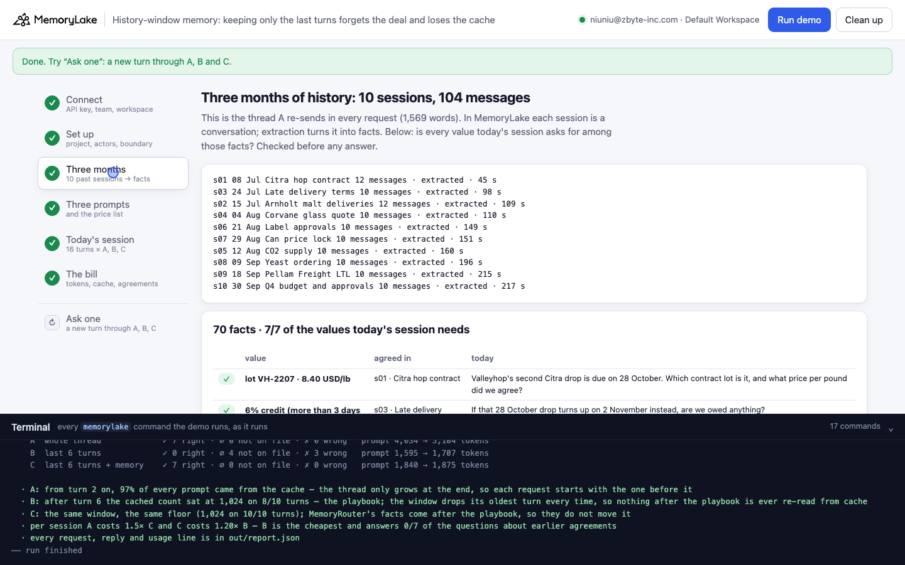
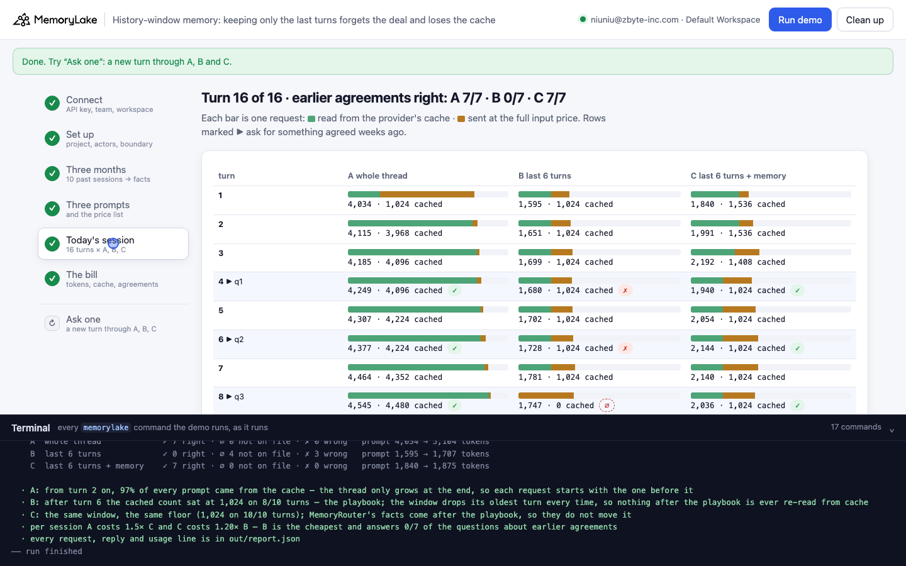
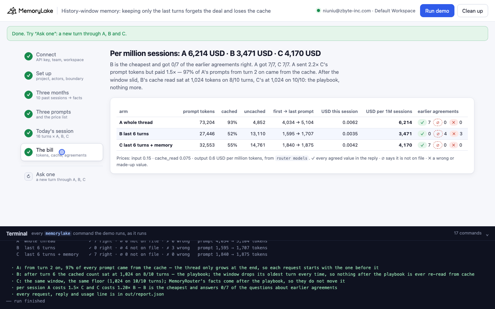
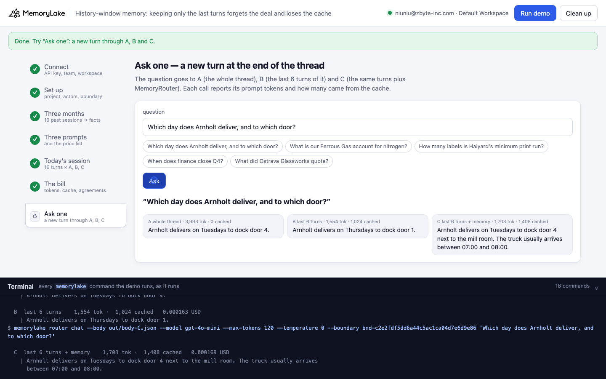

# History-window memory: "keep the last few turns" forgets the deal and loses the cache

A runnable version of the MemoryLake use case
[*Stop Bloating Token Costs by Stuffing Agent History Into Every Prompt*](https://www.memorylake.ai/en/usecase/stop-token-bloat-from-stuffed-agent-history),
built entirely on the [`memorylake` CLI](https://github.com/memorylake-ai/memorylake-cli) (v20261015 or later).

**Watch it run:** videos are being recorded; links follow.

**The problem.** An agent that re-sends its whole conversation history in every request gets more expensive with
every turn. The usual fix is a sliding window: keep the system prompt and the last few turns, drop the rest. That
fix loses two things at once. What was agreed weeks ago is no longer in the prompt, so the agent says it has nothing
on file, or invents a value. And because the window drops its oldest turn every time, no request ever starts like
the one before it, so the provider's prompt cache covers the system prompt and nothing more:

```
  turn  8  ▶ q3  Ines: I'm ordering 60 bags of pale malt from Arnholt for the November brews. Which day will it arrive, and at which door?
           agreed in s02: Tuesday · dock door 4
    ✓ A  whole thread              4,572 tok ·  4,480 cached
        | The order for 60 bags of pale malt from Arnholt will arrive on Tuesday, 3 November, at dock
          door 4.
    ∅ B  last 6 turns              1,792 tok ·  1,024 cached
        | I do not have the delivery day and dock door for the 60 bags of pale malt from Arnholt on
          file. Please confirm these details with Arnholt before placing the order.
    ✓ C  last 6 turns + memory     2,047 tok ·  1,024 cached
        | Arnholt Maltings will deliver the **60 bags of pale malt** on **Tuesday, 24 October**. The
          delivery will arrive at **dock door 4** next to the mill room.
```

Ines Varga (Head of Purchasing at Tolland Hollow Brewing, a fictional craft brewery) works with Cask, an AI
purchasing assistant, in one long thread. Ten sessions from July to September (104 messages) settle a hop contract,
malt delivery days, a late-delivery credit, a glass quote, the CO2 account, label sign-off and the quarter's approval
limit. On 19 October she plans the holiday orders in a 16-turn session; seven turns depend on something agreed weeks
earlier. The same session runs three ways:

- **A — the whole thread** in every request.
- **B — the last 6 turns**, the usual fix for A's bill.
- **C — the same 6 turns, plus MemoryRouter** (`router chat --boundary`) attaching what MemoryLake extracted from the
  ten past sessions.

Over the runs counted below, B got **0 of the 21** earlier agreements right (14 times "not on file", 7 times a made-up
value such as lot `C-2023-07` at 3.50 USD/lb or CO2 account `12345`). C got 21 of 21, A 20 of 21. After the window
slid, B's cache read was exactly the 1,024-token playbook on 27 of 30 turns (0 on the other three). About 90% of A's
prompt tokens were read from the cache, and A still cost 1.5–1.6× C per session.

## What it shows

- **A sliding window stops the cache at the system prompt.** A's thread only ever grows at the end, so each request
  starts with the whole previous request, and the provider reads all of it from its cache (`cached` climbs with the
  thread: 3,968 → 4,992 tokens). B's window drops its oldest turn every turn: from turn 7 on, `cached` stays at 1,024,
  the shared playbook, while B pays the full input price for its window every time.
- **The window forgets agreements, and the model fills the gap.** The playbook tells Cask to say "not on file" when it
  doesn't have a value. B mostly does. But in every run it also answered some questions with values it made up: a lot
  number, a 5% credit instead of 6%, a 250 USD emergency fee instead of 180.
- **Memory instead of history.** In C, each past session is a MemoryLake conversation (`conv create`, `conv msg
  append`). Extraction turns the 104 messages into about 70–80 facts, and the demo checks that every value today's
  session needs is among them before any answer. MemoryRouter attaches the relevant facts to each request (about 300
  tokens more than B). Because they come after the system prompt, the playbook stays cacheable.
- **Caching narrows the gap, but stuffing still costs more.** A sent 2.2× C's prompt tokens and paid 1.5× C's price,
  because most of A's tokens were billed at the cache price (half the input price on gpt-4o-mini). A grows by about 70
  tokens per turn here; with a real three-month thread, the gap widens.
- **Having everything in the prompt is not the same as answering right.** In one run, A had the approval rule in its
  prompt and still said 7,400 USD was below the 5,000 USD limit. C's replies are graded only on the agreed values: one
  C reply gave the right day (Tuesday) but a wrong date for it.

## Prerequisites

- Python 3.9 or later (standard library only).
- The `memorylake` CLI, v20261015 or later:
  `curl -fsSL https://raw.githubusercontent.com/memorylake-ai/memorylake-cli/main/scripts/install.sh | sh`
- A MemoryLake API key from [app.memorylake.ai](https://app.memorylake.ai) (**API Keys**).
- Router calls are billed to your MemoryLake balance: 48 calls on gpt-4o-mini per run, about 0.015 USD.

## Run it

```bash
cd history-window-memory
export MEMORYLAKE_API_KEY=sk-...
python3 demo.py            # about 5 minutes the first time (10 sessions extracted), 2 minutes after that
python3 demo.py facts      # what MemoryLake extracted from the ten past sessions
python3 demo.py ask "Which day does Arnholt deliver, and to which door?"   # one new turn through A, B and C
python3 demo.py cleanup    # deletes everything the demo created
```

The key is used to log in to an isolated CLI profile in `.memorylake-demo/`; your own `~/.memorylake` is not touched.
Everything the demo creates has a custom_id starting `mlu-hwm-`. A second run reuses the memory the first one built;
`--reset` deletes it and rebuilds it. Each run of today's session gets a new session id, written into the system
prompt right after the playbook, so one run never reuses the cached prompts of another. Only the playbook is shared,
the same for all three arms.

## Or run it in the browser

```bash
python3 web/server.py      # opens http://127.0.0.1:8765
```

Paste the key, press **Run demo**: the same pipeline, step by step, with every `memorylake` command in the terminal
drawer. **Today's session** shows one bar per request (green: read from the cache, amber: full price). **Ask one** sends
a new turn through A, B and C.

| Step 3: three months of history | Step 5: today's session |
|---|---|
|  |  |
| **Step 6: the bill** | **Ask one** |
|  |  |

## What happens, step by step

### Step 2: a project, two actors, a boundary

```
$ memorylake proj create --name 'Tolland Hollow purchasing (history-window-memory demo)' --custom-id mlu-hwm-thread
$ memorylake actor create --custom-id mlu-hwm-ines --display-name 'Ines Varga' --description '…' --tags demo
$ memorylake boundary create --name "Cask's memory" --custom-id mlu-hwm-cask --projects proj-… --human-actor actor-…
  · one project, Ines and Cask as actors, and a boundary (project + Ines): what arm C reads through MemoryRouter
```

### Step 3: three months of history

Each past session becomes a DIRECT conversation between Ines and Cask, with the session's real timestamps. The demo
waits for extraction to finish (`conv cook-status`), then checks the facts:

```
$ memorylake conv create --project proj-… --actors actor-…,actor-… --kind DIRECT --name 'Citra hop contract (2026-07-08)' --custom-id mlu-hwm-conv-s01
$ memorylake conv msg append conv-… --actor actor-… --custom-id m00 --timestamp 2026-07-08T09:00:00Z --text 'Morning Cask. I signed the annual Citra contract …'
$ memorylake conv cook-status conv-…
    s01  08 Jul  Citra hop contract         12 messages · extracted · 68 s
    …
    MemoryLake extracted 78 facts from the ten sessions. The values today's session asks for:
      ✓ q1  lot VH-2207 · 8.40 USD/lb                in the facts
           “The annual Citra contract with Valleyhop Farms (lot VH-2207) is for 1,800 lb of Citra
            pellets at 8.40 USD per pound. (as of 2026-07-08)”
      ✓ q3  Tuesday · dock door 4                    in the facts
           “Orders for an Arnholt Tuesday delivery have to be placed by the Thursday before the
            delivery (as of 2026-07-15).”
           “Arnholt Maltings should use dock door 4 next to the mill room (as of 2026-07-15).”
    …
  · 7/7 of the values are in the extracted facts
```

### Step 4: three prompts and the price list

```
    A  [playbook][session line][all 104 past messages][today so far]            + new turn
    B  [playbook][session line][last 6 turns]                                   + new turn
    C  [playbook][session line][last 6 turns]   … MemoryRouter attaches facts   + new turn
$ memorylake router models
    gpt-4o-mini: input 0.15 · cache read 0.075 · output 0.6 USD per million tokens
```

Each request is one `memorylake router chat --body out/body-<arm>.json --model gpt-4o-mini --max-tokens 120
--temperature 0 "<new turn>"`. The body holds the system prompt and the history; C adds `--boundary <id>`.

### Step 5: today's session

Sixteen turns; each goes to A, B and C at the same time. Plain turns print one line of token counts; the seven turns
that need an earlier agreement print all three replies, graded:

```
  turn  2  Ines: The Winter Porter needs 70 bags of base malt and 18 bags of Munich. The Spruce Tip u…
           A  4,113 tok ·  3,968 cached   B  1,652 tok ·  1,024 cached   C  2,052 tok ·  1,536 cached

  turn  4  ▶ q1  Ines: Valleyhop's second Citra drop is due on 28 October. Which contract lot is it, and what price per pound did we agree?
           agreed in s01: lot VH-2207 · 8.40 USD/lb
    ✓ A  whole thread              4,264 tok ·  4,096 cached
        | The second Citra drop on 28 October is from contract lot VH-2207 at 8.40 USD per pound.
    ✗ B  last 6 turns              1,700 tok ·  1,024 cached
        | The second Citra drop from Valleyhop is contract lot C-2023-07, with a price of 3.50 USD per
          pound. This was agreed on 15 September 2023.
    ✓ C  last 6 turns + memory     2,061 tok ·  1,024 cached
        | The second Citra drop from Valleyhop Farms is for contract lot **VH-2207**, with a price of
          **8.40 USD per pound**. The drop is scheduled for **28 October**.
```

✓ every agreed value is in the reply · ∅ says it is not on file · ✗ a wrong or made-up value. The grading rules are
checked against known replies before any call is made.

### Step 6: the bill

```
                                 prompt tok   cached  uncached  per session  per 1M sessions   agreements
    A  whole thread                  73,204     93%      4,852       0.0062            6,214          7/7
    B  last 6 turns                  27,446     52%     13,110       0.0035            3,471          0/7
    C  last 6 turns + memory         32,553     55%     14,761       0.0042            4,170          7/7

  · A: from turn 2 on, 97% of every prompt came from the cache — the thread only grows at the end, so each request starts with the one before it
  · B: after turn 6 the cached count sat at 1,024 on 8/10 turns — the playbook; the window drops its oldest turn every time, so nothing after the playbook is ever re-read from cache
  · C: the same window, the same floor (1,024 on 10/10 turns); MemoryRouter's facts come after the playbook, so they do not move it
  · per session A costs 1.5× C and C costs 1.20× B — B is the cheapest and answers 0/7 of the questions about earlier agreements
```

### `ask`: one new turn

`python3 demo.py ask "<question>"` sends one turn at the end of the ten past sessions through A, B and C, with token
counts and cost. Try something the window can't see, such as "What is our Ferrous Gas account for nitrogen?".

## Measured

Full runs of the final version on a free account. Agreements: ✓ / ∅ / ✗ out of 7 per arm. "Floor" counts B's turns
after the window slid (turns 7–16) whose `cached_tokens` was exactly the 1,024-token playbook.

| run | memory | A ✓/∅/✗ | B ✓/∅/✗ | C ✓/∅/✗ | cached A · B · C | B floor | USD per 1M sessions (A · B · C) |
|---|---|---|---|---|---|---|---|
| first run (`--reset`) | built, 78 facts | 7/0/0 | 0/4/3 | 7/0/0 | 87% · 55% · 53% | 9/10 | 6,643 · 3,500 · 4,281 |
| second run | reused | 6/0/1 | 0/6/1 | 7/0/0 | 93% · 60% · 54% | 10/10 | 6,267 · 3,208 · 4,214 |
| browser check | built, 70 facts | 7/0/0 | 0/4/3 | 7/0/0 | 93% · 52% · 54% | 8/10 | 6,214 · 3,471 · 4,170 |
| **total (3 runs)** | 7/7 values every time | **20/0/1** | **0/14/7** | **21/0/0** | | **27/30** | |

On the B turns that were not on the floor, `cached_tokens` was 0: the provider did not read even the playbook from
its cache that time. A's one ✗ was the approval question: the 5,000 USD rule was in its prompt, and it said 7,400 USD
was below it.

## Use it in your own app

- Don't trim history to save tokens: a sliding window loses old agreements and the prompt cache. Store the
  conversation in MemoryLake (`conv msg append`), keep a short window for the flow of the current session, and let
  retrieval bring back what was agreed earlier.
- Put what changes per request after what doesn't. MemoryRouter attaches memory after your system prompt, so a long
  shared system prompt stays cacheable.
- Check that what you need was extracted (`fact list --query`, or the demo's `facts` command) before trusting a reply.
- Read `usage.prompt_tokens_details.cached_tokens` on every call. With a window, expect it to stay at the length of
  your system prompt; if it drops to 0, even that was not cached.
- Price from the list you are billed by: `memorylake router models` gives `input`, `details.cache_read` and `output`.

## Troubleshooting

| Symptom | Cause / fix |
|---|---|
| `this memorylake CLI has no router command` | Upgrade the CLI (v20261015 or later). |
| `MemoryRouter refused the call for lack of balance` | Router calls are billed; the memory steps still ran. Top up in the console. |
| `still extracting after 420 s` | Extraction is slow right now; the run continues and the value check says which values are missing. Run again later (the memory is reused). |
| A value shows `NOT in the facts` | Extraction left it out this time; C can't answer that question from memory. `python3 demo.py --reset` rebuilds the memory. |
| B or A shows `0 cached` on a turn | The provider did not read even the shared playbook from its cache that time; it happens now and then. |
| Turn 1 shows little or nothing cached for A | Its thread, with this run's session id, has never been sent before; at most the playbook is read from the cache. |

## Files

| File | What it is |
|---|---|
| `demo.py` | The demo: CLI wrapper, setup, ingestion and the value check (`show_memory()`), the three prompts (`request()`), the session (`run_session()`), grading (`grade()`, `check_grader()`), the bill (`show_bill()`), `ask`, `facts`, cleanup |
| `data/thread.json` | The playbook, the ten past sessions, today's 16 turns, and the seven questions with their answer patterns |
| `web/server.py`, `web/static/` | Browser companion (standard library server, no build step) |
| `out/` | `report.json` with every call, token count and reply; `out/runs/` keeps earlier reports (git-ignored) |
