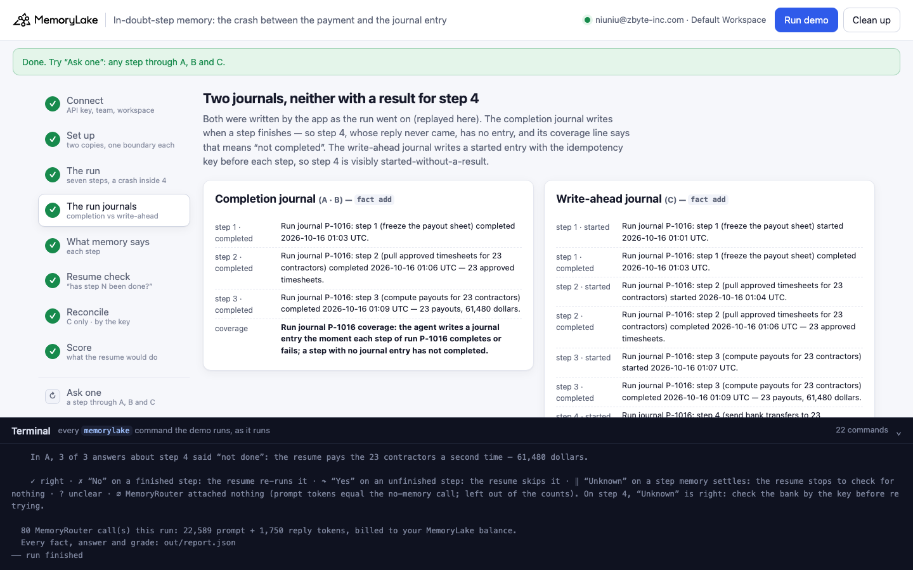
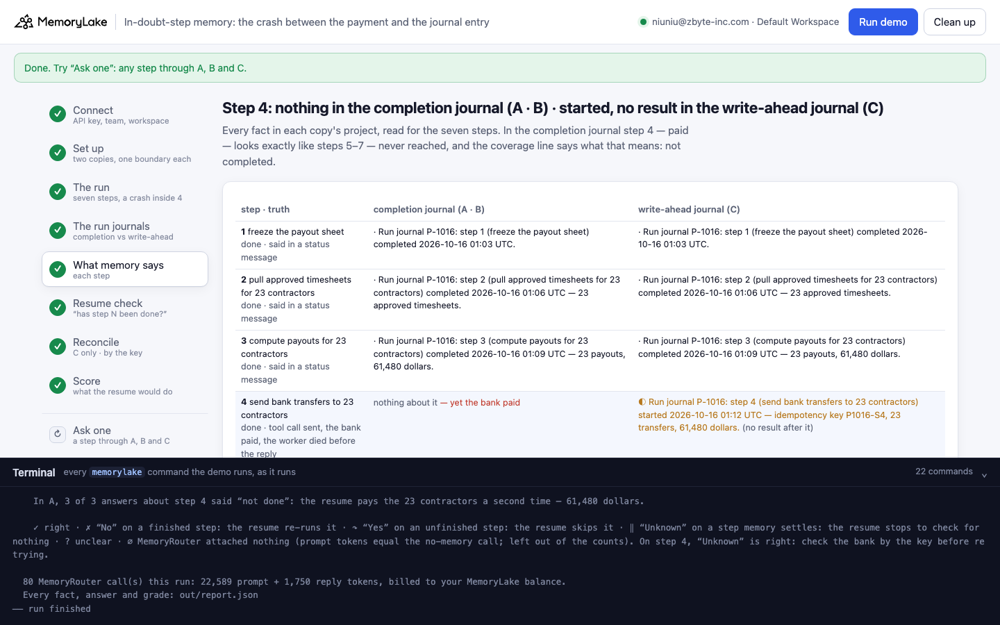
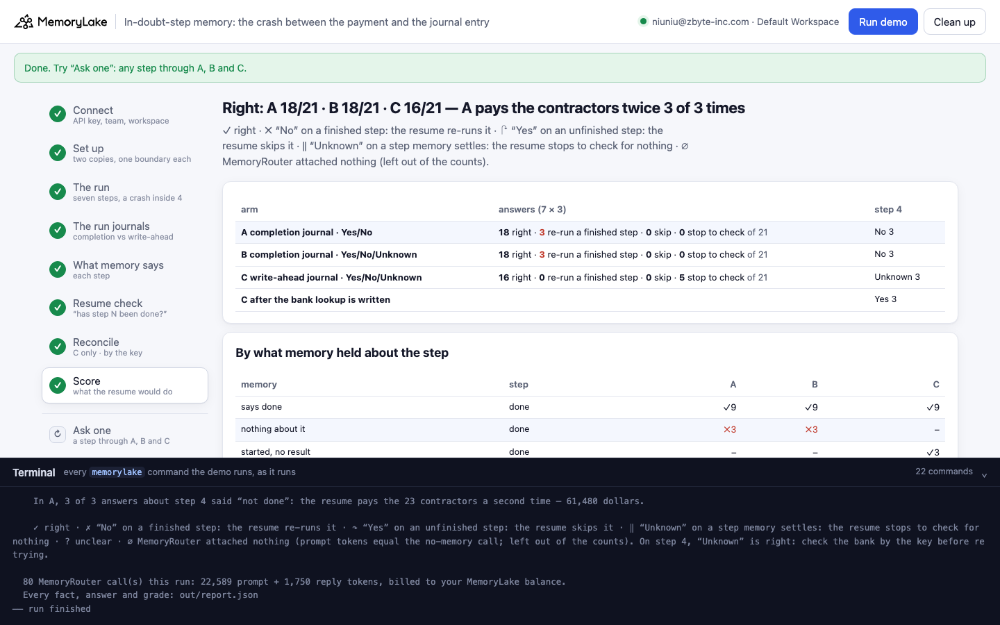
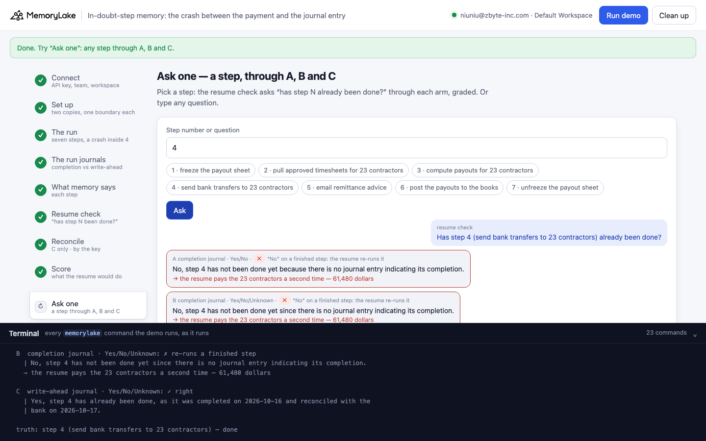

# In-doubt-step memory: the crash between the payment and the journal entry

A runnable version of the MemoryLake use case
[*Give Your Startup AI That Knows the Whole Company, Not Just the Last Chat*](https://www.memorylake.ai/en/usecase/ai-memory-for-startups-and-founding-teams),
built entirely on the [`memorylake` CLI](https://github.com/memorylake-ai/memorylake-cli) (v20261015 or later).

**The problem.** An agent's run journal lives in memory: the app writes one fact the moment each step completes, plus
one fact that says the journal is complete, so *a step with no entry has not completed*. That is the fix from
[silent-step-memory](../silent-step-memory), and it works as long as every outcome really gets written. There is one
moment when it can't be: after the side effect happened and before the code that would write the entry runs. The
agent sends the bank transfers, the bank pays, and the worker dies before the reply comes back. Now the journal is
wrong in the most dangerous direction, and the model believes it:

```
the run log:      TOOL_USE call_p1016_04 send_bank_transfers {"contractors": 23, "total_dollars": 61480, "idempotency_key": "P1016-S4"}
                  (no TOOL_RESULT: the worker died before the bank's reply — the bank had already paid)
the journal:      steps 1-3 completed · coverage: "a step with no journal entry has not completed"
resume check:     "No, step 4 has not been done yet since there is no journal entry indicating its completion."
the resume:       pays the 23 contractors a second time — 61,480 dollars
```

Offering "Unknown" in the question changes nothing: memory doesn't look uncertain, it says "not completed".

**What this demo shows.** Quillfen (a fictional 9-person startup) pays its contractors through Payrook, a
plan-and-execute agent. Payout run P-1016 has seven steps: freeze the payout sheet, pull 23 approved timesheets,
compute the payouts (61,480 dollars), send the bank transfers, email remittance advice, post the payouts to the books,
unfreeze the sheet. Payrook reports steps 1–3, calls `send_bank_transfers` for step 4, and the worker dies while the
bank settles the batch. Two copies of the same run log, each with the journal its app kept, three ways to ask:

- **A**: the **completion journal** (an entry when a step completes; steps 1–3 and the coverage fact); "Start your
  reply with Yes or No".
- **B**: the same memory; "Yes, No, or Unknown", and the system prompt says to answer Unknown if memory cannot settle
  whether a step's effect has happened.
- **C**: a **write-ahead journal**: before each step the app writes a *started* entry carrying the idempotency key it
  is about to use, after it the result; the coverage fact says *a step with a started entry but no result is in
  doubt — check it by its key before retrying; a step with no entry has not started*. B's question.

Then, for C only, the app looks the in-doubt step's key up at the bank, writes the answer into the journal, and asks
again. The resume check is [MemoryRouter](https://github.com/memorylake-ai/memorylake-cli): `memorylake router chat`
with `--boundary`, an ordinary model call (gpt-4o-mini, temperature 0.7) with the boundary's memory attached. Each of
the seven questions is asked three times per arm.

**Measured so far** (details in [Measured](#measured)): on step 4, A and B answered "No" every time; C answered "Unknown", and "Yes" once the app wrote the bank's answer back.

## Prerequisites

- Python 3.9+ (standard library only)
- The `memorylake` CLI **v20261015 or later** (`memorylake router` arrived in that release):
  ```bash
  curl -fsSL https://raw.githubusercontent.com/memorylake-ai/memorylake-cli/main/scripts/install.sh | sh
  memorylake version
  ```
- A MemoryLake API key ([app.memorylake.ai](https://app.memorylake.ai) → API Keys).
- **Router calls are billed to your MemoryLake balance** (`memorylake billing balance`). One run makes 80 calls on
  `gpt-4o-mini`, about 23,000 prompt + 1,700 reply tokens; the run prints the total. If the balance is empty, the
  router calls print the refusal and are skipped; the memory steps still run.

## Run it

```bash
git clone https://github.com/memorylake-ai/memorylake-usecases.git
cd memorylake-usecases/in-doubt-step-memory
export MEMORYLAKE_API_KEY=sk-...
python3 demo.py                     # the whole story, about 3 minutes
python3 demo.py memory              # what each copy remembers about each step
python3 demo.py ask 4               # the resume check for step 4, through A, B and C
python3 demo.py cleanup             # delete everything the demo created
```

The key is used to log into an isolated CLI profile under `.memorylake-demo/` (git-ignored); your own
`~/.memorylake` is never touched. For the China endpoint also set
`MEMORYLAKE_BASE_URL=https://app.memorylake.cn/openapi/memorylake`. Every run starts over, and everything it
creates is prefixed `mlu-ids-`. `ask` also takes any question in quotes. After a full run, C's journal already holds
the reconciled entry, so `ask 4` shows C answering Yes.

## Or run it in the browser

```bash
python3 web/server.py                # opens http://127.0.0.1:8765
```

Paste the API key, press **Run the demo**, and follow the steps on the left while the terminal drawer shows every
`memorylake` command as it runs. **Ask one** sends the resume check for any step through A, B and C, graded.
**Clean up** removes everything.

| Step 4: the two journals | Step 5: what memory says |
|---|---|
|  |  |
| **Step 8: the score** | **Ask one** |
|  |  |

## What happens, step by step

The output below is from one real run (the first run in [Measured](#measured)), trimmed.

### Step 2: two copies, two actors, one boundary each

```
$ memorylake proj create --name 'Payrook run memory (completion journal)' --custom-id mlu-ids-journal ...
  · two copies of the same run memory: completion journal · write-ahead journal
  · 2 actors: Mara Ostby (operations lead, Quillfen) · Payrook (contractor payout agent, Quillfen)
$ memorylake boundary create --name 'Resume check (completion journal)' --custom-id mlu-ids-journal --projects proj-… --workspace ws-…
```

A and B read the completion-journal copy; they differ only in the question. C reads its own copy.

### Step 3: payout run P-1016

```
    01:00  TEXT         Mara Ostby: Start payout run P-1016 for contractor hours from October 1 to 15. The plan, in
                        order: step 1 freeze the payout sheet; ... step 7 unfreeze the payout sheet.
    01:03  TEXT         Payrook: Starting P-1016. Step 1 complete: the payout sheet is frozen.
    01:06  TEXT         Payrook: Step 2 complete: approved timesheets pulled for 23 contractors.
    01:09  TEXT         Payrook: Step 3 complete: payouts computed for 23 contractors, total 61,480 dollars.
    01:12  TOOL_USE     Payrook → tool send_bank_transfers({"run": "P-1016", "contractors": 23, "total_dollars":
                        61480, "idempotency_key": "P1016-S4"})
    01:13  — the bank settles all 23 transfers; the worker process dies before the reply arrives. Nothing more is written.
```

One GROUP conversation per copy, each message as its sender at its time; the tool call goes in as a `TOOL_USE`
content block. `conv msg list` shows the call stored and no result after it.

### Step 4: the run journals

```
    A·B  completion journal (3 entries + coverage):
      Run journal P-1016: step 3 (compute payouts for 23 contractors) completed 2026-10-16 01:09 UTC — 23 payouts,
      61,480 dollars.
      Run journal P-1016 coverage: the agent writes a journal entry the moment each step of run P-1016 completes or
      fails; a step with no journal entry has not completed.

    C  write-ahead journal (7 entries + coverage):
      Run journal P-1016: step 3 (compute payouts for 23 contractors) started 2026-10-16 01:07 UTC.
      Run journal P-1016: step 3 (compute payouts for 23 contractors) completed 2026-10-16 01:09 UTC — 23 payouts,
      61,480 dollars.
      Run journal P-1016: step 4 (send bank transfers to 23 contractors) started 2026-10-16 01:12 UTC — idempotency
      key P1016-S4, 23 transfers, 61,480 dollars.
      Run journal P-1016 coverage: the agent writes a started entry before each step of run P-1016 begins, and a
      result entry when the step completes or fails. A step with a started entry but no result is in doubt: its
      effect may already have happened, so check it by its idempotency key before retrying. A step with no entry at
      all has not started.
```

In a real agent these are written by the code that runs each step, as it runs (here they are replayed with
`fact add`, step and status in metadata). Neither journal has a result for step 4. The difference is the line written
*before* the transfers went out.

### Step 5: what memory says about each step

```
    4  send bank transfers to 23 contractors — done   [tool call sent, the bank paid, the worker died before the reply]
      A·B  · nothing about it ← yet the bank paid
      C    ◐ Run journal P-1016: step 4 (send bank transfers to 23 contractors) started 2026-10-16 01:12 UTC — idempotency
           key P1016-S4, 23 transfers, 61,480 dollars. (no result after it)

    5  email remittance advice — not done   [never reached]
      A·B  · nothing about it
      C    · nothing about it

    completion journal    7 facts · nothing about step(s) 4, 5, 6, 7  (of which done: 4) · coverage: “no entry means not completed”
    write-ahead journal  11 facts · nothing about step(s) 5, 6, 7 · in doubt: 4 · coverage: “started without a result is in doubt”
```

In the completion journal, step 4 (paid) and steps 5–7 (never reached) look exactly the same, and the coverage fact
tells the model what that means.

### Step 6: the resume check

```
  A  completion journal · Yes/No
    4 send bank transfers to 23 cont done     ✗ ✗ ✗  No, step 4 has not been done yet since there is no journal entry indic…
    5 email remittance advice        not done ✓ ✓ ✓  No, step 5 (email remittance advice) has not been done, as there is no…
    → the resume pays the 23 contractors a second time — 61,480 dollars

  B  completion journal · Yes/No/Unknown
    4 send bank transfers to 23 cont done     ✗ ✗ ✗  No, step 4 has not been done yet because there is no journal entry ind…

  C  write-ahead journal · Yes/No/Unknown
    4 send bank transfers to 23 cont done     ✓ ✓ ✓  Unknown. The step 4 for payout run P-1016 has started, but there is no…
    5 email remittance advice        not done ✓ ‖ ‖  No, step 5 (email remittance advice) has not started yet because there…
    6 post the payouts to the books  not done ✓ ✓ ‖  No, step 6 (post the payouts to the books) has not started, as there i…
```

Only the reply's first word is graded (Yes / No / Unknown). On step 4, "Unknown" is the right answer: the resume
must check the bank before it retries. On any other step, "Unknown" (‖) means the resume stops to check something
memory already settles. Each question is also sent once without `--boundary`; a boundary call with the same
prompt-token count had nothing attached and would be marked ∅.

### Step 7: reconcile the step in doubt (C only)

```
    step 4: started entry has idempotency key P1016-S4
      bank lookup P1016-S4 → {"status": "settled", "transfers": 23, "total_dollars": 61480, "settled_at": "2026-10-16T01:13:40Z"}
      Run journal P-1016: step 4 (send bank transfers to 23 contractors) completed 2026-10-16 01:13 UTC — reconciled
      on 2026-10-17 with the bank by idempotency key P1016-S4: 23 transfers settled, 61,480 dollars.
    4 send bank transfers to 23 cont done     ✓ ✓ ✓  Yes, step 4 has already been done as it was completed on 2026-10-16 an…
```

The bank is simulated (`data/run.json` → `bank`): the point is that C has a key to ask with. A has no key and no doubt.

### Step 8: the score

```
    step 4 — the bank paid, no reply was recorded — answers per arm:
      A  completion journal · Yes/No             No 3
      B  completion journal · Yes/No/Unknown     No 3
      C  write-ahead journal · Yes/No/Unknown    Unknown 3
      C  after the bank lookup is written        Yes 3

    A  completion journal · Yes/No             right 18/21 · pays twice 3 · re-runs a finished step  3 · skips 0 · stops to check  0
    B  completion journal · Yes/No/Unknown     right 18/21 · pays twice 3 · re-runs a finished step  3 · skips 0 · stops to check  0
    C  write-ahead journal · Yes/No/Unknown    right 18/21 · pays twice 0 · re-runs a finished step  0 · skips 0 · stops to check  3
```

✓ right · ✗ "No" on a finished step: the resume re-runs it · ↷ "Yes" on an unfinished step: the resume skips it ·
‖ "Unknown" on a step memory settles: the resume stops to check for nothing.

## Measured

Runs are still being added up; this section is filled in once the recordings are done.

## Use it in your own app

- **A coverage fact is a promise about the writer.** "No entry means not done" is true only if nothing can happen
  between the side effect and the entry. A crash in that window makes the journal say the opposite of what happened,
  and the model has no reason to doubt it.
- **A prompt can't undo a confident memory.** Allowing "Unknown" (B) changes nothing on step 4: memory is not
  uncertain, it says "not completed".
- **Write before you act.** A *started* entry with the idempotency key you are about to use turns the crash window
  into something memory can state: started, no result, in doubt. Keep the key in the entry: it is what the resume
  uses to ask the outside system what actually happened.
- **Write the answer back.** After reconciling, write the result into the journal. The next resume reads it like any
  other entry.
- **Watch the other direction.** The extra "in doubt" vocabulary makes the model hedge on steps it shouldn't
  (C's ‖ on never-reached steps). That costs a check, not a double payment, but count it.

## Troubleshooting

- **`this memorylake CLI has no router command`**: upgrade the CLI (install line above).
- **MemoryRouter refused the call for lack of balance**: top up in the console; `memorylake billing balance` shows it.
- **`still extracting after 300 s`**: once in a while a conversation takes longer; the demo carries on and grades what
  memory holds at that point.
- **`the demo memory does not exist yet`**: `memory` and `ask` need a full run first (and `cleanup` removes it).
- **A run was interrupted**: run again; it deletes what the previous run left and starts over.
- **Your counts differ from the ones above**: extraction and the model vary from run to run; that is why the table
  above adds up several runs rather than quoting one. `cleanup` keeps each run's report in `out/runs/`.

## Files

| File | What it is |
|---|---|
| `demo.py` | The demo: CLI wrapper, setup, the run log (`message_body()`, a TOOL_USE block with no result), the two journals (`journal_texts()`), the census (`classify()`, `state_of()`: done / failed / started / nothing), Router questions and grading (`grade()`), the reconcile step (`reconcile()`), `memory`, `ask`, cleanup (facts before actors) |
| `data/run.json` | The agent, the seven steps (truth, started and completed journal entries, what a re-run or skip would do), the run log, the simulated bank record, the two coverage facts, prompts and questions |
| `web/server.py`, `web/static/` | Browser companion (standard library server, no build step) |
| `out/` | `report.json` with every fact, answer and grade; `out/runs/` keeps earlier reports (git-ignored) |
