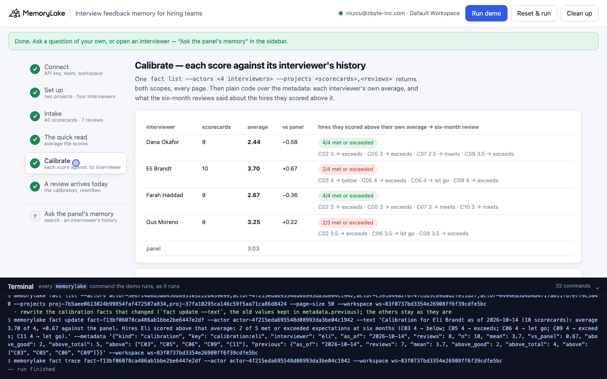
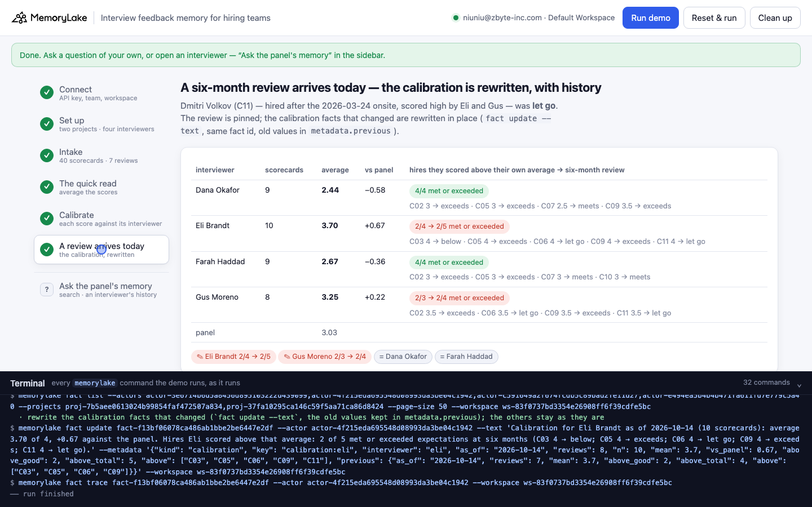

# Interview feedback memory for hiring teams

A runnable version of the MemoryLake use case
[*Give Hiring Teams Interview Feedback Memory That Actually Informs Decisions*](https://www.memorylake.ai/en/usecase/interview-feedback-memory-for-hiring-teams),
built entirely on the [`memorylake` CLI](https://github.com/memorylake-ai/memorylake-cli).

**Watch it run:** [CLI, 2:56](https://github.com/memorylake-ai/memorylake-usecases/releases/download/interview-feedback-memory-v1/interview-feedback-memory-cli-demo.mp4) · [Web, 3:55](https://github.com/memorylake-ai/memorylake-usecases/releases/download/interview-feedback-memory-v1/interview-feedback-memory-web-demo.mp4)
([release](https://github.com/memorylake-ai/memorylake-usecases/releases/tag/interview-feedback-memory-v1); GitHub serves them as downloads).

**The problem.** Interview feedback lands as scorecards, and the debrief reads them fast: average the scores, pick the higher
number. That treats every interviewer's 3.5 as the same 3.5. On a real panel one person scores hard and another scores
generously, and nobody checks what their high scores turned into once the person was hired. The page calls the fix
*"reflection memory for interviewer patterns"* and *"calibration against actual outcomes"*.

**What this demo shows.** Harborline (fictional) is hiring a Senior Backend Engineer. Four people interview. In the last year
they scored twelve candidates; eight were hired, seven of those have had their six-month review. Every scorecard and every
review is one fact in MemoryLake, word for word, with metadata. Today the debrief picks between two finalists:

| Read | Kai Brennan (Eli 4, Gus 3.5) | Lena Vasquez (Dana 3.5, Farah 3) | Says |
|---|---|---|---|
| **Average the scores** (`fact list --query <name>`) | **3.75** | 3.25 | Kai |
| **Each score against that interviewer's own average** | +0.28 (Eli averages 3.70, Gus 3.25) | **+0.70** (Dana averages 2.44, Farah 2.67) | Lena |
| **What their above-average scores turned into** (six-month reviews) | Eli 2 of 4, Gus 2 of 3 met or exceeded | Dana 4 of 4, Farah 4 of 4 | Lena |

Nothing is missing from the first read and its arithmetic is right. It is wrong about the unit: a 3.5 from Dana is one of
the highest scores she has given, and a 4 from Eli is what he gives most people.

The calibration is then **written back as memory on each interviewer** — every interviewer is an actor, and the calibration is
a fact on that actor. When a six-month review arrives today (a hire Eli and Gus both scored high was let go), the two
calibrations that changed are rewritten in place, and `fact trace` shows both versions:

```
setup ────────── proj create "scorecards" + "hire outcomes" · actor create × 4 (one per interviewer) + actor bind
intake ───────── fact add --project <scorecards> '<Scorecard …>' × 40  + fact update --metadata {candidate, interviewer, score, date}
                 fact add --project <outcomes>   '<Six-month review …>' × 7 + fact update --metadata {candidate, outcome, reviewed}
quick read ───── fact list --projects <scorecards> --query 'Kai Brennan' / 'Lena Vasquez'  → average
calibrate ────── fact list --actors <4 interviewers> --projects <scorecards>,<outcomes>   (both scopes in one call, every page)
                 → per interviewer: own average, and the reviews of hires they scored above it
                 fact add --actor <interviewer> '<Calibration …>' + fact update --metadata     (once per interviewer)
today ────────── fact add --project <outcomes> '<review dated today>' → recompute
                 fact update <calibration> --actor <interviewer> --text … --metadata {…, previous}   (only the ones that changed)
                 fact trace <calibration> --actor <eli>   → ADD, then UPDATE with the old text
```

The arithmetic is plain code over the pinned facts' metadata, not a model: the same memory gives the same numbers every time.
No conversations and no extraction: every scorecard and review is pinned word for word.

## Prerequisites

- **Python 3.9+** (standard library only, nothing to `pip install`)
- **The `memorylake` CLI** on your `PATH`:
  ```bash
  curl -fsSL https://raw.githubusercontent.com/memorylake-ai/memorylake-cli/main/scripts/install.sh | sh
  ```
- **A MemoryLake API key.** Sign up at [app.memorylake.ai](https://app.memorylake.ai), open **API Keys**, create one. A free
  personal account is enough: nothing here needs an agent or a model call.

## Run it

```bash
git clone https://github.com/memorylake-ai/memorylake-usecases.git
cd memorylake-usecases/interview-feedback-memory
export MEMORYLAKE_API_KEY=sk-...           # China region: also export MEMORYLAKE_BASE_URL=https://app.memorylake.cn/openapi/memorylake
python3 demo.py
```

About 1–1½ minutes the first time, about 20 s on a re-run, which reads back what is already there. With the key set, the demo
logs into an isolated CLI profile under `./.memorylake-demo/` and never touches your own `~/.memorylake`. Everything it creates
has a `custom_id` starting with `mlu-ifm-`.

```bash
python3 demo.py interviewer eli                                  # Eli's scorecards, the calibration on his actor, and its fact trace
python3 demo.py finalists                                        # both readings of today's finalists, from memory
python3 demo.py ask "Who scored Kai Brennan, and what did they say?"   # search's top 8 over both projects and the four interviewers
python3 demo.py --reset                                          # delete everything the demo created, then replay
python3 demo.py cleanup                                          # delete everything the demo created
```

## Or run it in the browser

```bash
python3 web/server.py                # opens http://127.0.0.1:8765
```

Paste the key, connect, run. The page drives the same functions as `demo.py` and streams every `memorylake` command into a
terminal drawer as it runs: the scorecard grid as it is pinned, the quick read, the calibration table and the two finalists read
both ways, and today's review rewriting the calibration with its trace. **Ask the panel's memory** takes any question, or opens
one interviewer's history.





## What happens, step by step

Output below is from real runs (ids shortened).

### Steps 2–3 — two projects, four interviewers, every scorecard and review one fact each

```
$ memorylake proj create --name 'Harborline — interview scorecards' --custom-id mlu-ifm-scorecards …
$ memorylake proj create --name 'Harborline — hire outcomes' --custom-id mlu-ifm-outcomes …
$ memorylake actor create --custom-id mlu-ifm-dana --display-name 'Dana Okafor' --description 'Staff Engineer, payments, …'
$ memorylake actor bind --actor actor-fd7c… --workspace ws-83f0…
  … the same for Eli Brandt, Farah Haddad, Gus Moreno
$ memorylake fact add --project proj-e836… 'Scorecard: Dana Okafor on Rowan Pike (C01, Senior Backend Engineer, onsite 2025-10-07): 2 of 4. Struggled to reason about concurrency.' …
$ memorylake fact update fact-e6b3… --project proj-e836… --metadata '{"kind": "scorecard", "key": "scorecard:C01:dana", "candidate": "C01", "interviewer": "dana", "score": 2, "date": "2025-10-07"}'
  · … and 39 more `fact update --metadata` the same way (candidate, interviewer, score, date)
$ memorylake fact add --project proj-aeb9… 'Six-month review: Priya Natarajan (C02), hired after the 2025-10-21 onsite, exceeds (reviewed 2026-05-04).' …

  40 scorecards · 7 six-month reviews (before today, 2026-10-14)

         candidate         onsite         Dana    Eli  Farah    Gus   outcome
    C01  Rowan Pike        2025-10-07        2    3.5    2.5      ·   not hired
    C02  Priya Natarajan   2025-10-21        3      ·      3    3.5   exceeds
    C03  Marcus Hale       2025-11-04        ·      4    2.5      3   below
    …
    C11  Dmitri Volkov     2026-03-24        2      4      ·    3.5   hired, review due
    C12  Hana Sato         2026-04-07      2.5    3.5    2.5      ·   not hired

    F1   Kai Brennan       2026-10-08        ·      4      ·    3.5   finalist
    F2   Lena Vasquez      2026-10-09      3.5      ·      3      ·   finalist
```

`fact add` takes several texts in one call and returns them in order; it takes no metadata, so each fact gets a
`fact update --metadata` right after. A re-run matches on `metadata.key` and pins only what is missing.

### Step 4 — the quick read

```
$ memorylake fact list --projects proj-e836… --query 'Kai Brennan' --page-size 50

    Kai Brennan — 2 scorecards
        4  Scorecard: Eli Brandt on Kai Brennan (F1, Senior Backend Engineer, onsite 2026-10-08): 4 of 4. Would hire tomorrow; …
      3.5  Scorecard: Gus Moreno on Kai Brennan (F1, Senior Backend Engineer, onsite 2026-10-08): 3.5 of 4. Strong design …
      average 3.75

    Lena Vasquez — 2 scorecards
      3.5  Scorecard: Dana Okafor on Lena Vasquez (F2, Senior Backend Engineer, onsite 2026-10-09): 3.5 of 4. Solid ac…
        3  Scorecard: Farah Haddad on Lena Vasquez (F2, Senior Backend Engineer, onsite 2026-10-09): 3 of 4. Good codi…
      average 3.25

  → “Kai is the stronger candidate”: 3.75 vs 3.25 — every scorecard read, the arithmetic right, and the scores treated as one scale
```

### Step 5 — calibrate: each score against its interviewer's history

```
$ memorylake fact list --actors actor-fd7c…,actor-fa20…,actor-fd2e…,actor-a9e2… --projects proj-e836…,proj-aeb9… --page-size 50

    interviewer    scorecards  average  vs panel   hires they scored above their own average → six-month review
    Dana Okafor             9     2.44     -0.58   4/4 met or exceeded   (C02 3 → exceeds; C05 3 → exceeds; C07 2.5 → meets; C09 3.5 → exceeds)
    Eli Brandt             10     3.70     +0.67   2/4 met or exceeded   (C03 4 → below; C05 4 → exceeds; C06 4 → let go; C09 4 → exceeds)
    Farah Haddad            9     2.67     -0.36   4/4 met or exceeded   (C02 3 → exceeds; C05 3 → exceeds; C07 3 → meets; C10 3 → meets)
    Gus Moreno              8     3.25     +0.22   2/3 met or exceeded   (C02 3.5 → exceeds; C06 3.5 → let go; C09 3.5 → exceeds)
    panel                         3.03

    finalist       average   each score against that interviewer's own average      vs own bar   backers' record
    Kai Brennan       3.75   Eli 4 (+0.30 vs 3.70), Gus 3.5 (+0.25 vs 3.25)              +0.28   4/7
    Lena Vasquez      3.25   Dana 3.5 (+1.06 vs 2.44), Farah 3 (+0.33 vs 2.67)           +0.70   8/8

  → by average: Kai (3.75). Against each interviewer's own bar: Lena (+0.70). Lena's interviewers' high scores held up 8/8; Kai's, 4/7.
    (7 reviewed hires in all: a signal for the debrief, not a verdict.)
$ memorylake fact add --actor actor-fd7c… 'Calibration for Dana Okafor as of 2026-10-14 (9 scorecards): average 2.44 of 4, -0.58 against the panel. Hires Dana scored above that average: 4 of 4 met or exceeded expectations at six months (…).'
$ memorylake fact update fact-6918… --actor actor-fd7c… --metadata '{"kind": "calibration", "key": "calibration:dana", "interviewer": "dana", "as_of": "2026-10-14", "reviews": 7, "n": 9, "mean": 2.44, …}'
  · wrote 4 calibration fact(s), one per interviewer
```

`fact list` with both `--actors` and `--projects` returns the union of the two scopes — scorecards, reviews and (later) the
calibrations in one paged read. "Backers' record" adds up the two interviewers' above-average hires: Kai's 4/7 is Eli 2/4 plus
Gus 2/3.

### Step 6 — a six-month review arrives today

```
  Dmitri Volkov (C11), hired after the 2026-03-24 onsite — six-month review today: let go
    scored by Dana Okafor 2, Eli Brandt 4, Gus Moreno 3.5
$ memorylake fact add --project proj-aeb9… 'Six-month review: Dmitri Volkov (C11), hired after the 2026-03-24 onsite, let go (reviewed 2026-10-14).'

    Eli Brandt             10     3.70     +0.67   2/4 → 2/5 met or exceeded    (…; C11 4 → let go)
    Gus Moreno              8     3.25     +0.22   2/3 → 2/4 met or exceeded    (…; C11 3.5 → let go)
$ memorylake fact update fact-6181… --actor actor-072e… --text 'Calibration for Eli Brandt as of 2026-10-14 (10 scorecards): … 2 of 5 met or exceeded …' --metadata '{…, "previous": {"above_good": 2, "above_total": 4, …}}'

    ✎ Eli Brandt: 2/4 → 2/5 met or exceeded (fact fact-6181…, same id)
    ✎ Gus Moreno: 2/3 → 2/4 met or exceeded (fact fact-251a…, same id)
    = Dana Okafor: unchanged
    = Farah Haddad: unchanged

    finalist       average   …   vs own bar   backers' record
    Kai Brennan       3.75   …        +0.28   4/9
    Lena Vasquez      3.25   …        +0.70   8/8
$ memorylake fact trace fact-6181… --actor actor-072e…

    `fact trace` — every version of Eli Brandt's calibration, oldest first:
      ADD    2026-10-14T05:22:57Z  MANUAL
        now: …Hires Eli scored above that average: 2 of 4 met or exceeded expectations at six months (C03 4 → below; C05 4 → exceeds; C06 4 → let go; C09 4 → exceeds).
      UPDATE 2026-10-14T05:23:10Z  MANUAL
        was: …Hires Eli scored above that average: 2 of 4 met or exceeded expectations at six months (…).
        now: …Hires Eli scored above that average: 2 of 5 met or exceeded expectations at six months (…; C11 4 → let go).

    ✓ the calibration is one fact with history (ADD → UPDATE), not a number recomputed and thrown away
```

Dana's 2 for Dmitri was below her own average, so her record does not move; Farah did not interview him. Only the two
calibrations whose numbers changed are rewritten, and each keeps its fact id: the next debrief reads the current version, and
`fact trace` still shows what the team believed about Eli's scores before today.

## Measured

Seven runs on a free account on 2026-10-14 — two from scratch, three with `--reset` (one of them from the web page), two
re-runs:

| What | Result |
|---|---|
| Average: Kai 3.75, Lena 3.25 | 7 / 7 (plain code over `fact list --query`) |
| Against each interviewer's own average: Lena +0.70, Kai +0.28 | 7 / 7 |
| Above-average hires that met or exceeded: Dana 4/4, Eli 2/4, Farah 4/4, Gus 2/3 (before today) | 7 / 7 |
| Today's review rewrites exactly Eli (2/4 → 2/5) and Gus (2/3 → 2/4); Dana and Farah unchanged | 5 / 5 fresh runs; the 2 re-runs rewrite nothing |
| `fact trace --actor` on Eli's calibration: `ADD → UPDATE`, the UPDATE carrying the old text | 7 / 7 |
| `fact list --actors … --projects …` returns both scopes in one paged read | 7 / 7 |
| Cleanup: both projects gone, the four actors gone, `fact list --actors <deleted id>` → 0 for every deleted interviewer | 8 / 8 deleted actors checked |
| Time | 68–76 s from scratch, 20–23 s re-run (`--reset` adds about a minute of cleanup) |

Nothing in this demo depends on `search` or extraction, so nothing varies between runs; `ask` prints whatever `search`
returns.

## Wiring it into your own team

- **Scorecards**: one fact per scorecard, verbatim (`fact add --project`), from your ATS webhook or export, with candidate,
  interviewer, score and date in `metadata` (`fact update --metadata` replaces the whole object). Keep the scale in the text
  ("3.5 of 4") so a reader never has to guess it.
- **Outcomes**: one fact per hire per review (probation end, six months, first performance cycle), in a separate project so
  they can be read on their own.
- **Interviewers**: one actor each. The calibration — their own average, and what their above-average scores turned into —
  is a fact on that actor; rewrite it with `fact update --text` when a review lands, and keep the old numbers in
  `metadata.previous`. `fact trace` is the audit trail.
- **At the debrief**: read every scorecard and every review in one `fact list --actors … --projects …`, then show each score
  next to its interviewer's average. Hand an AI summary tool that table, not the raw average.
- **Be honest about the sample**: a handful of reviewed hires per interviewer is a prompt for the debrief to ask "is this a
  Dana 3.5 or an Eli 3.5?", not a verdict.

## If something goes wrong

- **`the memorylake CLI is not on PATH`**: install it (above) or `export MEMORYLAKE_BIN=/path/to/memorylake`.
- **`… has no calibration fact; run python3 demo.py --reset`**: an earlier run was interrupted between steps 5 and 6.
- **Something half-created after an interrupted run**: `python3 demo.py --reset`, or `python3 demo.py cleanup`. Cleanup
  deletes each interviewer's facts before the actor itself (an actor deleted first leaves its facts readable and undeletable).

## Files

```
interview-feedback-memory/
├── demo.py              # the CLI runner (every step is a plain `memorylake` command, echoed)
├── data/story.json      # 4 interviewers, 14 candidates, 40 scorecards, 8 six-month reviews (fictional, plain ASCII)
├── web/server.py        # local web companion: same functions, Server-Sent Events
├── web/static/          # no-build front end
└── out/runs.jsonl       # one line per run (git-ignored)
```
