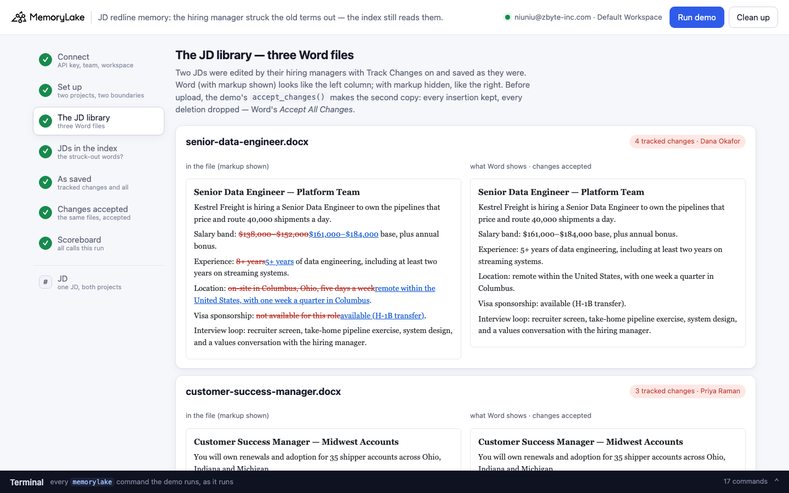
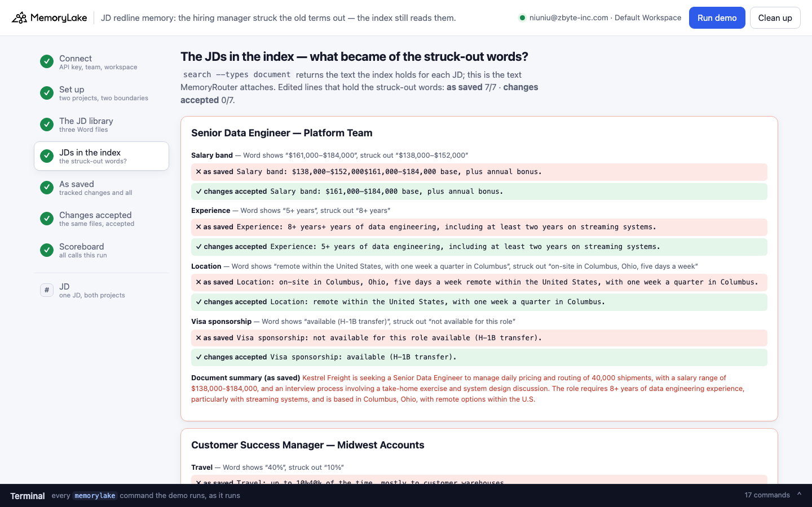
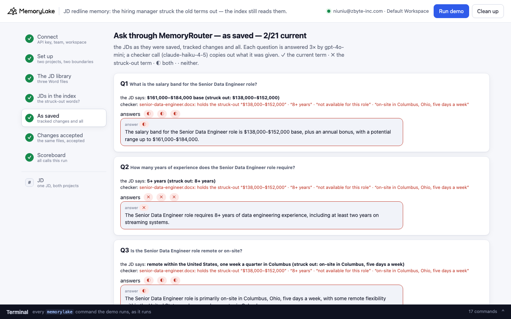
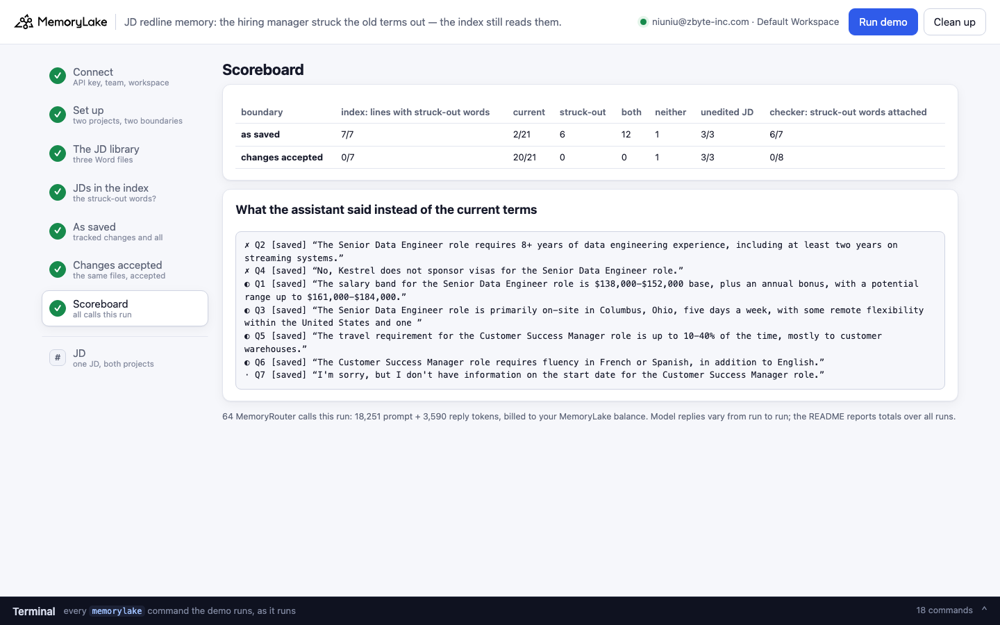

# JD redline memory: the hiring manager struck the old terms out — the index still reads them

A runnable version of the MemoryLake use case
[*Give Recruiting Teams Job Description Memory That Compounds Across Roles*](https://www.memorylake.ai/en/usecase/job-description-memory-across-roles),
built entirely on the [`memorylake` CLI](https://github.com/memorylake-ai/memorylake-cli) (v20261015 or later).

**Watch it run:** [CLI, 5:30](https://github.com/memorylake-ai/memorylake-usecases/releases/download/jd-redline-memory-v1/jd-redline-memory-cli-demo.mp4) · [Web, 6:32](https://github.com/memorylake-ai/memorylake-usecases/releases/download/jd-redline-memory-v1/jd-redline-memory-web-demo.mp4)
([release](https://github.com/memorylake-ai/memorylake-usecases/releases/tag/jd-redline-memory-v1); GitHub serves them as downloads).

**The problem.** The talent team at Kestrel Freight keeps its job descriptions in shared memory, so that a
recruiting assistant can answer *"what's the salary band for the data engineer role?"* from them. The JDs are Word
files. Two of them were edited by the hiring manager with **Track Changes** on and saved without accepting the
changes — which is how most edited Word files get saved. Word shows the new terms:

```
Salary band: $161,000–$184,000 base, plus annual bonus.
Experience: 5+ years of data engineering, including at least two years on streaming systems.
Location: remote within the United States, with one week a quarter in Columbus.
Visa sponsorship: available (H-1B transfer).
```

The file still holds the old ones, marked as deleted (`<w:del>…<w:delText>$138,000–$152,000</w:delText>…</w:del>`).
MemoryLake's index reads the deleted and the inserted words run together, and MemoryRouter attaches exactly that.
Asked *"Does Kestrel sponsor visas for the Senior Data Engineer role?"*, the model was given (a checker call copies
out what it was given):

```
- (mlu-jdr-senior-data-engineer.docx) Senior Data Engineer — Platform Team
Kestrel Freight is hiring a Senior Data Engineer to own the pipelines that price and route 40,000 shipments a day.
Salary band: $138,000-$152,000$161,000-$184,000 base, plus annual bonus.
Experience: 8+ years+ years of data engineering, including at least two years on streaming systems.
Location: on-site in Columbus, Ohio, five days a week remote within the United States, with one week a quarter in Columbus.
Visa sponsorship: not available for this role available (H-1B transfer).
Interview loop: recruiter screen, take-home pipeline exercise, system design, and a values conversation with the hiring manager.
```

and answered *"No, Kestrel does not sponsor visas for the Senior Data Engineer role."* — the answer the hiring
manager struck out. The old term comes first in every edited line, and on *Experience* the inserted "5" did not
survive at all. The document summary the index writes says the same: *"requires 8+ years of experience … a salary
range of $138,000-$184,000 … Visa sponsorship is not available for this role."*

**The fix is one step before upload.** The same files after *Accept All Changes* (a 20-line standard-library
function in `demo.py`, `accept_changes()`) come back right.

## What the demo shows

- **The JD library**: three Word files, each as Word shows it, next to the tracked changes the file holds (read back
  from the `.docx` itself). The third JD was never edited: it is the control.
- **The JDs in the index**: every edited line as `search --types document` returns it, in a project holding the
  files as saved and in a project holding the same files with changes accepted; and what the document summary says.
- **Eight questions a recruiter asks** (seven about edited lines, one about the unedited JD) through MemoryRouter,
  once per boundary, each asked three times. A checker call shows what was attached, and whether the attached entry
  held struck-out words.

Graded per answer: **✓** the current term only · **✗** the struck-out term only · **◐** both (the answer hedges
between them — *"French or Spanish"*, *"$138,000-$152,000 … with a potential range up to $161,000-$184,000"*) ·
**·** neither, or "I don't have that".

## Prerequisites

- Python 3.9+ (standard library only)
- The `memorylake` CLI, **v20261015 or later** (`memorylake router` is new in that release):
  ```bash
  curl -fsSL https://raw.githubusercontent.com/memorylake-ai/memorylake-cli/main/scripts/install.sh | sh
  memorylake version
  ```
- A MemoryLake API key: sign up at [app.memorylake.ai](https://app.memorylake.ai), open **API Keys**, create one.
- MemoryRouter calls are billed to your MemoryLake balance: 64 calls per run, about 18,000 prompt + 3,600 reply
  tokens. With no balance the demo stops after step 4 (the index view already shows the problem) and says so.

## Run it

```bash
git clone https://github.com/memorylake-ai/memorylake-usecases.git
cd memorylake-usecases/jd-redline-memory
export MEMORYLAKE_API_KEY=sk-...          # logs into an isolated profile under .memorylake-demo/
python3 demo.py                           # about 5 minutes
python3 demo.py jd de                     # read-only: one JD's edited lines in both projects' index
python3 demo.py cleanup                   # delete everything the demo created
```

China region: also `export MEMORYLAKE_BASE_URL=https://app.memorylake.cn/openapi/memorylake`.
Everything the demo creates is prefixed `mlu-jdr-`; every run starts over.

## Or run it in the browser

```bash
python3 web/server.py                     # opens http://127.0.0.1:8765
```

Paste the key, press **Run demo**. The page follows the run step by step: the three JDs with Word-style redlines
next to the accepted text, every edited line as the index holds it in both projects, the questions under each
boundary with the checker's copy of what was attached, and a scoreboard. **JD** looks up one JD in both projects
without a model call. A terminal drawer shows every `memorylake` command as it runs. **Clean up** removes it all.

| | |
|---|---|
|  |  |
|  |  |

## What happens, step by step

### Steps 2–3: two projects, two boundaries, one JD library

```
$ memorylake proj create --name 'Kestrel Freight — JD library (as saved)' --custom-id mlu-jdr-saved …
$ memorylake boundary create --name 'Recruiting assistant: as saved' --custom-id mlu-jdr-saved --projects proj-… …
$ memorylake proj create --name 'Kestrel Freight — JD library (changes accepted)' --custom-id mlu-jdr-accepted …
$ memorylake boundary create --name 'Recruiting assistant: changes accepted' --custom-id mlu-jdr-accepted --projects proj-… …
```

The demo prints each JD as Word shows it and the tracked changes in the file:

```
  senior-data-engineer.docx — Senior Data Engineer — Platform Team
    edited by Dana Okafor (hiring manager, Data Platform) with Track Changes on, saved without accepting
    …
    tracked changes in the file (8 marks — every edit is a deletion plus an insertion):
      Salary band:  “$138,000–$152,000” → “$161,000–$184,000”
      Experience:  “8+ years” → “5+ years”
      Location:  “on-site in Columbus, Ohio, five days a week” → “remote within the United States, with one week a quarter in Columbus”
      Visa sponsorship:  “not available for this role” → “available (H-1B transfer)”
```

then makes the accepted copies, uploads both sets and imports each into its project:

```
  · the fix, before upload: accept_changes() keeps every insertion and drops every deletion (Word's Accept All Changes) → out/accepted/*.final.docx, 0 tracked changes left
$ memorylake lib upload data/senior-data-engineer.docx --name mlu-jdr-senior-data-engineer.docx --on-conflict overwrite
$ memorylake lib upload out/accepted/senior-data-engineer.final.docx --name mlu-jdr-senior-data-engineer.final.docx --on-conflict overwrite
$ memorylake proj doc import --project proj-… <three item ids> --wait …
```

### Step 4: the JDs in the index

```
$ memorylake search 'Senior Data Engineer — Platform Team' --projects proj-… --types document --top-k 6 …

  senior-data-engineer — the edited lines, as the index holds them
    ✗ as saved          Salary band: $138,000-$152,000$161,000-$184,000 base, plus annual bonus.
    ✓ changes accepted  Salary band: $161,000–$184,000 base, plus annual bonus.
    ✗ as saved          Experience: 8+ years+ years of data engineering, including at least two years on streaming systems.
    ✓ changes accepted  Experience: 5+ years of data engineering, including at least two years on streaming systems.
    ✗ as saved          Location: on-site in Columbus, Ohio, five days a week remote within the United States, with one week a quarter in Columbus.
    ✓ changes accepted  Location: remote within the United States, with one week a quarter in Columbus.
    ✗ as saved          Visa sponsorship: not available for this role available (H-1B transfer).
    ✓ changes accepted  Visa sponsorship: available (H-1B transfer).
    document summary (as saved): The role involves data engineering with a focus on streaming systems and requires 8+
                                 years of experience. The position offers a salary range of $138,000-$184,000 with
                                 potential bonuses and is based in Columbus, Ohio, with remote options within the
                                 U.S.

  customer-success-manager — the edited lines, as the index holds them
    ✗ as saved          Travel: up to 10%40% of the time, mostly to customer warehouses.
    ✓ changes accepted  Travel: up to 40% of the time, mostly to customer warehouses.
    ✗ as saved          Languages: fluent FrenchSpanish required, alongside English.
    ✓ changes accepted  Languages: fluent Spanish required, alongside English.
    ✗ as saved          Start date: January 11, 2027 November 30, 2026.
    ✓ changes accepted  Start date: November 30, 2026.
```

### Steps 5–6: ask through MemoryRouter, under each boundary

Every answer is an ordinary model call with a boundary added; MemoryRouter decides what to attach:

```
$ memorylake router chat 'What is the salary band for the Senior Data Engineer role?' --model gpt-4o-mini --max-tokens 200 --temperature 0 --system '…' --boundary bnd-…
$ memorylake router messages 'What is the salary band for the Senior Data Engineer role?' --model claude-haiku-4-5 --max-tokens 2500 --temperature 0 --system '<copy out everything above my request>' --boundary bnd-…
```

As saved (one run):

```
  Q2  How many years of experience does the Senior Data Engineer role require?
      the JD says: 5+ years (struck out: 8+ years)
      checker: attached senior-data-engineer.docx: holds the struck-out “$138,000–$152,000” · “8+ years” · “not
               available for this role” · “on-site in Columbus, Ohio, five days a week”
      answers ✗ ✗ ✗   e.g. “The Senior Data Engineer role requires 8+ years of data engineering experience, including at least two years on streaming systems.”

  Q6  Which language besides English does the Customer Success Manager role require?
      the JD says: Spanish (struck out: French)
      answers ◐ ◐ ◐   e.g. “The Customer Success Manager role requires fluency in French or Spanish, in addition to English.”
```

Changes accepted, same questions:

```
      answers ✓ ✓ ✓   e.g. “The Senior Data Engineer role requires 5+ years of data engineering experience, including at least two years on streaming systems.”
      answers ✓ ✓ ✓   e.g. “The Customer Success Manager role requires fluency in Spanish, in addition to English.”
```

### The read-only subcommand

`python3 demo.py jd de` (or `csm`, `wol`) shows one JD's tracked changes and each edited line as the index holds it
in both projects, with both document summaries — searches only, no model call.

## Measured

Over **6 runs** (including the two recorded for the videos; 126 answers about edited lines per boundary, plus 18
about the unedited JD; graded with the rules above, refusals counted as "neither"):

| | current term | struck-out term | both | neither | unedited JD |
|---|---|---|---|---|---|
| as saved | 16/126 | 35 | 70 | 5 | 18/18 |
| changes accepted | 120/126 | 0 | 0 | 6 | 18/18 |

By question, over the 5 runs whose every reply was kept (15 answers each; the CLI video's run is in the totals above
from its printed scoreboard):

| | as saved | changes accepted |
|---|---|---|
| Q1 salary band | 0/15 (15 gave both bands, old first) | 15/15 |
| Q2 years of experience | 0/15 (15 said 8+) | 15/15 |
| Q3 remote or on-site | 0/15 (15 said "primarily on-site … five days a week, with some remote flexibility") | 14/15 |
| Q4 visa sponsorship | 0/15 (14 said "No, Kestrel does not sponsor visas") | 15/15 |
| Q5 travel | 0/15 (13 said "up to 10-40%") | 15/15 |
| Q6 language | 0/15 (15 said "French or Spanish") | 15/15 |
| Q7 start date | 13/15 | 12/15 (3 "I don't have the start date") |
| Q8 pay (never edited) | 15/15 | 15/15 |

- **The index**: all 42 edited-line readings (7 lines × 6 runs) in the as-saved project held the struck-out words,
  old first; none in the accepted project. The Senior Data Engineer summary stated the old terms in every run; the
  Customer Success Manager summary never did.
- **The checker**: in all 40 readable copies for questions about edited JDs, the as-saved entry MemoryRouter attached
  held the struck-out words.
- **Q7** is the one edited line the model mostly got right as saved: *"January 11, 2027 November 30, 2026"* — two
  complete dates, and it took the second. Which of two run-together values the model takes depends on the line, not
  on which one is current.
- Model replies vary from run to run; these are totals over every run.

## Use it in your own app

- **Accept (or reject) tracked changes before you import.** Word keeps deleted text in the file until the changes
  are accepted, and the index reads it as text. `accept_changes()` in `demo.py` is the whole fix: drop every
  `w:del` / `w:moveFrom`, keep the words inside every `w:ins` / `w:moveTo`. Or have authors run *Review › Accept All
  Changes* before a JD goes into the library.
- **Check for tracked changes at the door.** A `.docx` with a `<w:del` or `<w:ins` in `word/document.xml` has
  unaccepted edits; `tracked_changes()` lists them with their authors. Refuse, accept, or flag the file before it
  reaches memory.
- **Look at what the index read.** `memorylake search "<JD title>" --projects <p> --types document` shows the
  paragraph text MemoryRouter will attach. Two values run together (`$138,000-$152,000$161,000-$184,000`) mean the
  file holds an edit nobody accepted.
- **See what was attached.** A checker call through the same boundary (`router messages … --system "<copy out
  everything above my request>"`) shows the entries and their labels; the demo's `read_attached()` parses it.

## Troubleshooting

- `this memorylake CLI has no 'router' command` — upgrade the CLI (v20261015 or later).
- `MemoryRouter refused the call for lack of balance` — the memory steps still run; top up to see the answers.
- `the documents are still processing after 6 minutes` — run again; the demo starts over.
- `search did not return the JDs yet` — the index can lag a few seconds behind the import; run again.
- Leftovers from an interrupted run: `python3 demo.py cleanup` (everything is prefixed `mlu-jdr-`).

## Files

- `demo.py` — the whole demo (standard library only): CLI wrapper, `.docx` tracked-change reader and
  `accept_changes()`, setup, index view, MemoryRouter calls, the checker parser, grading, cleanup
- `data/jds.json` — the three JDs (paragraphs, with each tracked change as `[old, new]`), the questions with their
  current and struck-out patterns, the system prompt and the checker instruction
- `data/*.docx` — the three JDs as saved (two with tracked changes); `data/make_jds.py` regenerates them from
  `jds.json` (standard library only)
- `web/server.py`, `web/static/` — the browser companion (standard library HTTP + server-sent events)
