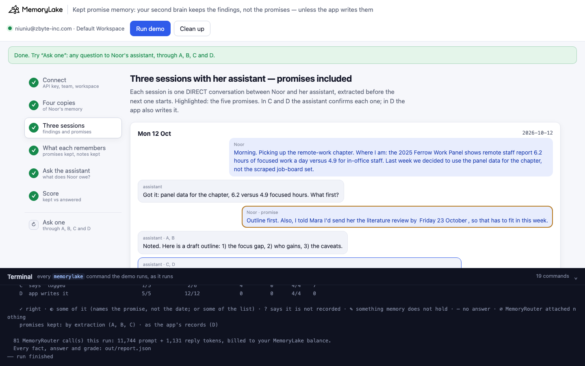
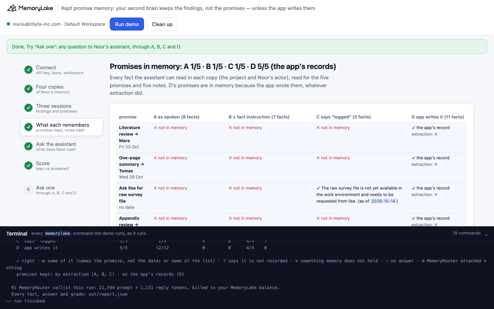
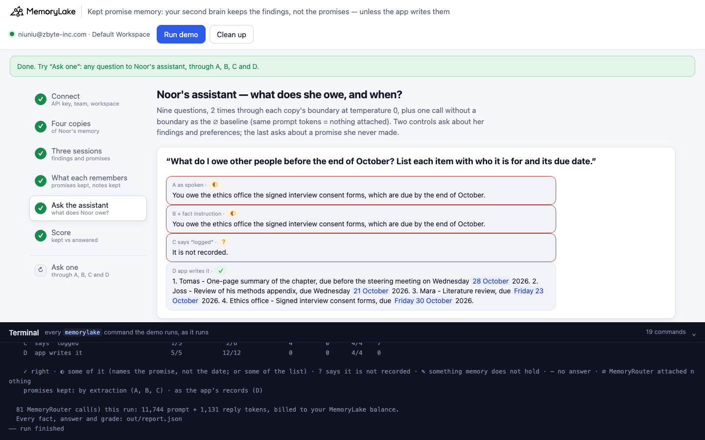
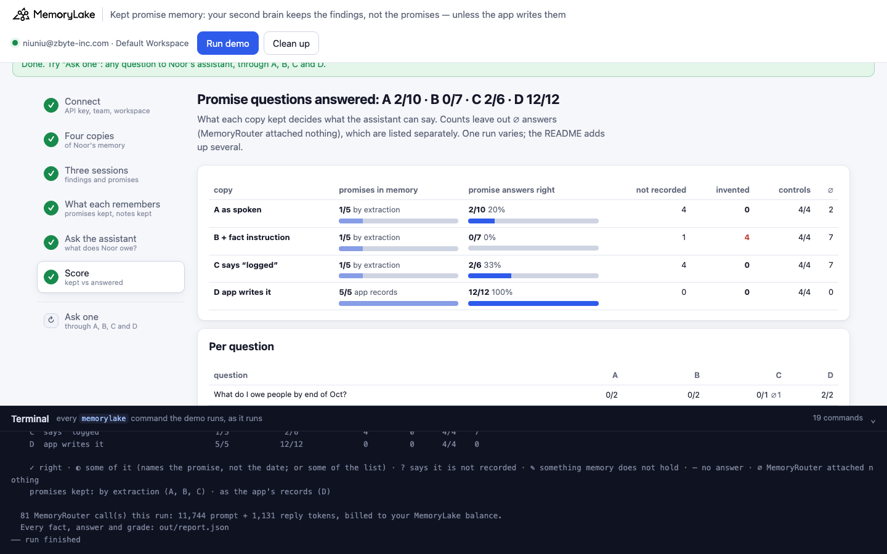

# Kept promise memory: your second brain keeps the findings, not the promises — unless the app writes them

A runnable version of the MemoryLake use case
[*Give Your AI a Second Brain That Actually Remembers Your Work*](https://www.memorylake.ai/en/usecase/ai-second-brain-for-knowledge-workers),
built entirely on the [`memorylake` CLI](https://github.com/memorylake-ai/memorylake-cli) (v20261015 or later).

**Watch it run:** videos are being recorded; links follow here.

**The problem.** A knowledge worker talks to her AI assistant every day: what she found, what she decided — and what
she promised. "I told Mara I'd send her the literature review by Friday 23 October." A second brain is supposed to
open the next session knowing what she is working on, and what she owes people is a large part of that.

MemoryLake's extraction turns the session into facts. It keeps the findings, the decisions, the preferences. The
promises, said the way people say them, almost never become facts. Writing a `fact instruction` that asks for every
commitment does not bring them back. Neither does the assistant replying "Commitment logged: literature review to
Mara, due Friday 23 October." — that line is in the chat, and nothing was written. What works is the app writing the
promise itself, when the assistant confirms it:

```
memorylake fact add "Commitment (made Mon 12 Oct 2026): Noor owes Mara the literature review, due Friday 23 October 2026." --project <id>
```

**What this demo shows.** Noor Abadi (a fictional research analyst) works on a book chapter about remote work with
her assistant: three short sessions over a week (12, 14 and 16 October), each a DIRECT conversation extracted before
the next one starts. Five promises are made in them — four to people, each with a date, and one to-do — between
findings, a decision, a caveat and a preference. The same sessions go into four copies of her memory:

| | the copy | what is different |
|---|---|---|
| **A** | as spoken | the assistant answers "Noted." |
| **B** | + fact instruction | the same as A, plus a `fact instruction` on the project and on Noor's actor that asks for "every commitment Noor makes … who it is for, what is owed, and the due date" |
| **C** | the assistant says "logged" | the assistant confirms each promise in the chat: "Commitment logged: …" |
| **D** | the app writes it | the same confirmation as C, and the app writes each promise with `fact add` (its parts in metadata) |

Then, on Monday 19 October, Noor's assistant is asked nine questions through MemoryRouter (`router chat --boundary`,
one boundary per copy: the project plus Noor's actor), twice per copy, on `gpt-4o-mini` at temperature 0: what she
owes by the end of October, each promise's due date, two controls about her findings and preferences, and one about a
promise she never made.

Over 8 runs, the four promises to people (with their dates) were kept by extraction **A 1/32 · B 1/32 ·
C 2/32**; in D the app's records held all of them (40/40). The assistant answered the promise questions
right **A 16/56 · B 2/29 · C 10/54 · D 96/96** (answers where MemoryRouter attached nothing left out — that
happened A 48 · B 84 · C 50 · D 0 times out of 144). The notes — findings, decision, caveat,
preference — were kept **A 36/40 · B 29/40 · C 33/40 · D 36/40**. Details in [Measured](#measured).

## Prerequisites

- **Python 3.9+** (standard library only).
- **The `memorylake` CLI, v20261015 or later** (`memorylake version`):
  ```bash
  curl -fsSL https://raw.githubusercontent.com/memorylake-ai/memorylake-cli/main/scripts/install.sh | sh
  ```
- **A MemoryLake API key**: sign up at [app.memorylake.ai](https://app.memorylake.ai), open **API Keys**, create one.
- **Balance for MemoryRouter**: about 80 calls on `gpt-4o-mini` per run (9 baseline calls with `--max-tokens 1`,
  72 answers). Everything else the demo does (projects, conversations, extraction, fact instructions, `fact add`) is
  part of the free plan.

## Run it

```bash
git clone https://github.com/memorylake-ai/memorylake-usecases.git
cd memorylake-usecases/kept-promise-memory
export MEMORYLAKE_API_KEY=sk-...        # logs into an isolated profile under .memorylake-demo/, never touches ~/.memorylake
python3 demo.py                         # about 5 minutes
python3 demo.py memory                  # per promise and note: what each copy kept
python3 demo.py ask 'What did I promise Tomas, and by when?'
python3 demo.py cleanup                 # deletes everything the demo created
```

China region: also `export MEMORYLAKE_BASE_URL=https://app.memorylake.cn/openapi/memorylake`. To use a specific
workspace: `export MEMORYLAKE_WORKSPACE=ws-…` (default: the team's default workspace). Without `MEMORYLAKE_API_KEY`
the demo uses your existing `memorylake auth login` session.

Every object the demo creates has a `custom_id` starting with `mlu-kpm-`. Each run starts over: it deletes what a
previous run left behind first.

## Or run it in the browser

```bash
python3 web/server.py                   # opens http://127.0.0.1:8765
```

Paste the API key, press **Run demo**, and follow the steps: the four copies, the three sessions (with the
assistant's "logged" lines and D's writes), what each copy kept, the assistant's answers and the score. **Ask one**
sends any question through all four copies. The terminal drawer at the bottom shows every `memorylake` command as it
runs. The server is standard library only and binds to localhost; the key stays in that process and in
`.memorylake-demo/`.

| | |
|---|---|
|  |  |
|  |  |

## What happens, step by step

Output excerpts below are from real runs (ids shortened).

### Step 2: four copies of Noor's memory

```
    Noor Abadi — Research analyst at Thornwick Policy Lab, writing a book chapter on remote work.
    Her sessions with her AI assistant go into four copies of her memory:
      A  as spoken
      B  + fact instruction
      C  says “logged”
      D  app writes it
$ memorylake proj create --name 'Noor'"'"'s notes' --custom-id mlu-kpm-spoken --workspace ws-83f0…
$ memorylake actor create --custom-id mlu-kpm-spoken-noor --display-name 'Noor Abadi' --description 'Research analyst at Thornwick Policy Lab, writing a book chapter on remote work. Demo data.' --tags demo
$ memorylake actor bind --actor actor-a7ef… --workspace ws-83f0…
  · four projects named “Noor's notes”, each with its own Noor and assistant actor

    B  + fact instruction: the fact instruction, on the project and on Noor's actor —
      “Remember Noor's research work: findings with their numbers, decisions, caveats, and preferences. Also
      remember every commitment Noor makes: each promise to another person, or task she says she will do, as
      its own fact with who it is for, what is owed, and the due date if one is given. Write every fact in
      English.”
$ memorylake fact instruction set --project proj-109b… --text 'Remember Noor'"'"'s research work: findings with their numbers, decisions, caveats, and preferences. Also remember every commitment Noor makes: each promise to another person, or task she says she will do, as its own fact with who it is for, what is owed, and the due date if one is given. Write every fact in English.' --workspace ws-83f0…
$ memorylake fact instruction set --actor actor-f7a5… --text 'Remember Noor'"'"'s research work: findings with their numbers, decisions, caveats, and preferences. Also remember every commitment Noor makes: each promise to another person, or task she says she will do, as its own fact with who it is for, what is owed, and the due date if one is given. Write every fact in English.' --workspace ws-83f0…
$ memorylake fact instruction get --project proj-109b… --workspace ws-83f0…
      read back: “Remember Noor's research work: findings with their numbers, decisions, caveats, and
      preferences. Also remember every commitment Noor makes: each promise to another person, or task she
      says she will do, as its own fact with who it is for, what is owed, and the due date if one is given.
      Write every fact in English.”
$ memorylake boundary create --name 'Noor'"'"'s assistant (as spoken)' --custom-id mlu-kpm-spoken --projects proj-4931… --human-actor actor-a7ef… --workspace ws-83f0…
  · one boundary per copy (project + Noor's actor) — what the assistant reads through MemoryRouter
```

All four projects are named "Noor's notes": the project name is context for extraction, so it must not differ between
the copies. Which copy is which lives in the `custom_id` and in the boundary's name. Each copy has its own Noor and
assistant actors, and one boundary over the project and Noor's actor (`boundary create --projects … --human-actor …`)
— what the assistant reads through MemoryRouter.

### Step 3: three sessions with her assistant

```
    Mon 12 Oct 2026
      Noor Morning. Picking up the remote-work chapter. Where I am: the 2025 Ferrow Work Panel shows remote
      staff report 6.2 hours of focused work a day versus 4.9 for in-office staff. Last week we decided to use
      the panel data for the chapter, not the scraped job-board set.
      AI Got it: panel data for the chapter, 6.2 versus 4.9 focused hours. What first?
      Noor Outline first. Also, I told Mara I'd send her the literature review by Friday 23 October, so that has
      to fit in this week. ← promise
      AI Noted. Here is a draft outline: 1) the focus gap, 2) who gains, 3) the caveats.
      C, D say instead: Commitment logged: literature review to Mara, due Friday 23 October. Here is a draft
      outline: 1) the focus gap, 2) who gains, 3) the caveats.
      Noor Good. After the outline I'll rerun the weighting with the 2024 census margins.
      AI Understood.

    … (Wed 14 Oct and Fri 16 Oct: Tomas, Ilse, Joss, the ethics office)
```

Each session is one DIRECT conversation (`conv create --kind DIRECT`), every turn appended with its real time
(`conv msg append --timestamp`), and extracted (`conv cook-status`) before the next session starts. In D the app
writes each promise when the assistant confirms it:

```
$ memorylake fact add 'Commitment (made Mon 12 Oct 2026): Noor owes Mara the literature review, due Friday 23 October 2026.' --project proj-e3d9… --workspace ws-83f0…
$ memorylake fact update fact-2eb1… --project proj-e3d9… --metadata '{"kind": "commitment", "to": "Mara", "item": "the literature review", "due": "2026-10-23", "made": "2026-10-12"}' --workspace ws-83f0…
```

### Step 4: what each copy remembers

```

                                              A  as spoken          B  + fact instruction C  says “logged”      D  app writes it      
    Literature review → Mara      Fri 23 Oct  ✗                     ✗                     ✗                     ✓ app record · extr ✗ 
    One-page summary → Tomas      Wed 28 Oct  ✗                     ✗                     ✓                     ✓ app record · extr ✗ 
    Ask Ilse for raw survey file     no date  ✓                     ✗                     ✓                     ✓ app record · extr ✗ 
    Appendix review → Joss        Wed 21 Oct  ✗                     ✗                     ✗                     ✓ app record · extr ✗ 
    Consent forms → ethics office Fri 30 Oct  ✗                     ✗                     ✗                     ✓ app record · extr ✗ 
    Finding: 6.0 vs 4.9 h (reweighted)        ✓                     ✗                     ✓                     ✓                     
    Decision: panel data, not job-board set   ✗                     ✓                     ✗                     ✗                     
    Caveat: under-samples shift workers       ✓                     ✗                     ✓                     ✓                     
    Preference: APA citations                 ✓                     ✓                     ✓                     ✓                     
    Finding: 9 of 14 managers track output    ✓                     ✓                     ✓                     ✓                     

    A  as spoken                    6 facts · promises kept by extraction 1/5 (1 with the due date) · notes 4/5
    B  + fact instruction           5 facts · promises kept by extraction 0/5 (0 with the due date) · notes 3/5
    C  says “logged”                7 facts · promises kept by extraction 2/5 (2 with the due date) · notes 4/5
    D  app writes it               10 facts · promises kept by extraction 0/5 (0 with the due date) · notes 4/5 · app records 5/5

    ✓ a fact names the promise and its due date · ◐ names it, no due date · ✗ not in memory · · only on the assistant's actor (not read) · extr = what extraction kept besides D's records
```

`fact list --projects` and `fact list --actors` for each copy, read for the five promises and five notes. Most of the
notes are there in every copy. The promises mostly are not — not in B, whose fact instruction asks for them by name,
and not in C, whose assistant said it logged them. Now and then one survives (in this run, Tomas's in C); the one that
survives most often is the to-do, which extraction writes as a state of the work ("The raw survey file is not yet
available and needs to be requested from Ilse"). D's promises are in memory because the app wrote them; extraction
did no better in D than elsewhere.

### Step 5: ask the assistant

```
  A  as spoken
$ memorylake router chat 'What do I owe other people before the end of October? List each item with who it is for and its due date.' --model gpt-4o-mini --max-tokens 1 --temperature 0 --system 'Today is Monday 19 October 2026. You are Noor Abadi'"'"'s AI research assistant. Answer from what you remember of her work, in one or two short sentences. If it is not in what you remember, say it is not recorded.'
  · each question once without --boundary (the ∅ baseline), then 2 answers through each copy's boundary; 6 at a time
$ memorylake router chat 'What do I owe other people before the end of October? List each item with who it is for and its due date.' --model gpt-4o-mini --max-tokens 120 --temperature 0 --system 'Today is Monday 19 October 2026. You are Noor Abadi'"'"'s AI research assistant. Answer from what you remember of her work, in one or two short sentences. If it is not in what you remember, say it is not recorded.' --boundary bnd-e6cf…
    What do I owe people by end of Oct  ? ?    I'm sorry, but that information is not recorded.
    Mara's lit review — due when?       ? ∅    It is not recorded.
    What did I promise Tomas?           ? ?    It is not recorded.
    What do I need from Ilse?           ✓ ✓    You still need to request the raw survey file from Ilse for the chapter.
    Joss's appendix — due when?         ∅ ?    It is not recorded.
    Consent forms — due when?           ∅ ∅    It is not recorded.
    Control: remote focused hours       ✓ ✓    After reweighting, remote staff report an average of 6.0 hours of focused …
    Control: citation style             ✓ ✓    You should use APA citations in your drafts.
    Reverse: a promise never made       ∅ ∅    It is not recorded.


  … (B and C read the same way)

  D  app writes it
    What do I owe people by end of Oct  ✓ ✓    You owe the following items before the end of October: 1. Literature revie…
    Mara's lit review — due when?       ✓ ✓    The literature review is due to Mara on Friday, 23 October 2026.
    What did I promise Tomas?           ✓ ✓    You promised Tomas a one-page summary of the chapter, due before the steer…
    What do I need from Ilse?           ✓ ✓    You still need to get the raw survey file from Ilse.
    Joss's appendix — due when?         ✓ ✓    Your review of Joss's methods appendix is due on Wednesday, 21 October 202…
    Consent forms — due when?           ✓ ✓    The signed consent forms are due to the ethics office by Friday, 30 Octobe…
    Control: remote focused hours       ✓ ✓    After reweighting, remote staff report 6.0 hours of focused work per day. …
    Control: citation style             ✓ ✓    You should use APA citations in your drafts.
    Reverse: a promise never made       ✓ ✓    It is not recorded whether you promised anyone a draft of the conclusion c…

    “What do I owe other people before the end of October? List each item with who it is for and its due date.”
    A ? | I'm sorry, but that information is not recorded.
    B ∅ | It is not recorded.
    C ◐ | You owe a one-page chapter summary to Tomas, due before the steering meeting on 28 October 2026.
    D ✓ | You owe the following items before the end of October: 1. Literature review for Mara, due Friday
          23 October 2026. 2. Review of methods appendix for Joss, due Wednesday 21 October 2026. 3.
          One-page summary of the chapter for Tomas, due before the steering meeting on Wednesday 28 October
          2026. 4. Signed interview consent forms for the ethics office, due Friday 30 October 2026.
```

Each question is first sent once without `--boundary` (with `--max-tokens 1`): a boundary call whose prompt tokens
equal that baseline had nothing attached (∅). Those answers are shown but not counted. With nothing in memory,
gpt-4o-mini mostly says "It is not recorded." — it does not invent a deadline. The cost is the honest-looking
"nothing recorded" when Noor in fact owes four people something this month.

### Step 6: the score

```
    per question, right / answered with something attached (2 answers per copy; ∅ = MemoryRouter attached nothing):
                                           A  as spoken          B  + fact instruction C  says “logged”      D  app writes it      
      What do I owe people by end of Oct?  0/2 ??              0/0 ∅∅              0/2 ◐◐              2/2 ✓✓              
      Mara's lit review — due when?        0/1 ?∅              0/0 ∅∅              0/1 ?∅              2/2 ✓✓              
      What did I promise Tomas?            0/2 ??              0/0 ∅∅              2/2 ✓✓              2/2 ✓✓              
      What do I need from Ilse?            2/2 ✓✓              0/0 ∅∅              2/2 ✓✓              2/2 ✓✓              
      Joss's appendix — due when?          0/1 ∅?              0/0 ∅∅              0/2 ??              2/2 ✓✓              
      Consent forms — due when?            0/0 ∅∅              0/0 ∅∅              0/0 ∅∅              2/2 ✓✓              
      Control: remote focused hours        2/2 ✓✓              0/2 ✎✎              2/2 ✓✓              2/2 ✓✓              
      Control: citation style              2/2 ✓✓              2/2 ✓✓              2/2 ✓✓              2/2 ✓✓              
      Reverse: a promise never made        0/0 ∅∅              0/0 ∅∅              2/2 ✓✓              2/2 ✓✓              

                                   promises kept  promise answers  not recorded  invented  controls   ∅
    A  as spoken                            1/5            2/8              6         0      4/4    6
    B  + fact instruction                   0/5            0/0              0         0      2/4   14
    C  says “logged”                        2/5            4/9              3         0      4/4    3
    D  app writes it                        5/5           12/12             0         0      4/4    0

    ✓ right · ◐ some of it (names the promise, not the date; or some of the list) · ? says it is not recorded · ✎ something memory does not hold · – no answer · ∅ MemoryRouter attached nothing
    promises kept: by extraction (A, B, C) · as the app's records (D)
```

## Measured

8 runs (terminal runs and parallel copies of the demo with their own `custom_id` prefix, plus the browser run). Every number below comes from the saved reports, re-graded with the final grader.

**What extraction kept** (per run: the four promises to people, counted when a fact names the promise with its due date · the to-do · the five notes):

| run | A promises · to-do · notes | B | C | D (extraction · records) |
|---|---|---|---|---|
| copy1 | 0/4 · ✗ · 5/5 | 0/4 · ✗ · 2/5 | 0/4 · ✗ · 4/5 | 0/4 · ✗ · 4/5 · records 5/5 |
| copy2 | 0/4 · ✓ · 5/5 | 1/4 · ✗ · 4/5 | 0/4 · ✗ · 5/5 | 0/4 · ✓ · 5/5 · records 5/5 |
| copy3 | 0/4 · ✗ · 4/5 | 0/4 · ✗ · 3/5 | 1/4 · ✗ · 4/5 | 0/4 · ✗ · 4/5 · records 5/5 |
| copy4 | 1/4 · ✓ · 4/5 | 0/4 · ✗ · 3/5 | 0/4 · ✗ · 4/5 | 0/4 · ✓ · 5/5 · records 5/5 |
| run2 | 0/4 · ✓ · 4/5 | 0/4 · ✗ · 4/5 | 0/4 · ✗ · 5/5 | 0/4 · ✗ · 5/5 · records 5/5 |
| run3 | 0/4 · ✓ · 4/5 | 0/4 · ✗ · 3/5 | 1/4 · ✓ · 4/5 | 0/4 · ✗ · 4/5 · records 5/5 |
| web1 | 0/4 · ✓ · 5/5 | 0/4 · ✗ · 5/5 | 0/4 · ✓ · 3/5 | 0/4 · ✗ · 4/5 · records 5/5 |
| web2 | 0/4 · ✗ · 5/5 | 0/4 · ✗ · 5/5 | 0/4 · ✓ · 4/5 | 0/4 · ✗ · 5/5 · records 5/5 |
| **all** | **1/32 · 5/8 · 36/40** | **1/32 · 0/8 · 29/40** | **2/32 · 3/8 · 33/40** | **0/32 · 2/8 · 36/40 · records 40/40** |

**The assistant's answers** (right / answered with something attached; ∅ = MemoryRouter attached nothing):

| question | A | B | C | D |
|---|---|---|---|---|
| What do I owe other people before the end of October? List each item with who it is for and its due date. | 0/9 (∅ 7) | 0/7 (∅ 9) | 0/8 (∅ 8) | 16/16 |
| When is the literature review due to Mara? | 0/7 (∅ 9) | 2/4 (∅ 12) | 0/10 (∅ 6) | 16/16 |
| What did I promise Tomas, and by when? | 2/16 | 0/7 (∅ 9) | 4/16 | 16/16 |
| What do I still need to get from Ilse? | 14/16 | 0/9 (∅ 7) | 6/16 | 16/16 |
| When is my review of Joss's methods appendix due? | 0/5 (∅ 11) | 0/0 (∅ 16) | 0/4 (∅ 12) | 16/16 |
| When do the signed consent forms have to go to the ethics office? | 0/3 (∅ 13) | 0/2 (∅ 14) | 0/0 (∅ 16) | 16/16 |
| After reweighting, how many hours of focused work a day do remote staff report? | 16/16 | 10/14 (∅ 2) | 10/14 (∅ 2) | 14/16 |
| Which citation style do I use in drafts? | 16/16 | 14/14 (∅ 2) | 16/16 | 16/16 |
| Did I promise anyone a draft of the conclusion chapter? | 6/8 (∅ 8) | 3/3 (∅ 13) | 8/10 (∅ 6) | 16/16 |

- **Promises are what goes missing.** Per promise, how often extraction kept it with its due date (8 runs):

| promise | A | B | C | D (extraction) |
|---|---|---|---|---|
| Literature review → Mara (Fri 23 Oct) | 0/8 | 1/8 | 0/8 | 0/8 |
| One-page summary → Tomas (Wed 28 Oct) | 1/8 | 0/8 | 2/8 | 0/8 |
| Ask Ilse for raw survey file (no date) | 5/8 | 0/8 | 3/8 | 2/8 |
| Appendix review → Joss (Wed 21 Oct) | 0/8 | 0/8 | 0/8 | 0/8 |
| Consent forms → ethics office (Fri 30 Oct) | 0/8 | 0/8 | 0/8 | 0/8 |

  The to-do for Ilse survives more often than the dated promises to people: extraction writes it as a state of the
  work ("The raw survey file is not yet available and needs to be requested from Ilse").
- **The fact instruction did not help** — B kept 1/32 promises to people, and kept fewer notes than A (29/40
  vs 36/40); its MemoryRouter calls came back with nothing attached most often (84 of 144). Instructions
  can make extraction keep things (see [provisioned-tenant-memory](../provisioned-tenant-memory/), where one kept
  bare metric readings); here the sentence asking for commitments did not.
- **"Commitment logged" in the chat is not a write.** C's assistant confirms each promise in a plain sentence with the
  date; extraction kept 2/32. A user reading the chat has every reason to believe it was stored.
- **The app's write is what the assistant reads.** D answered 96/96 promise questions right and named all four
  promises in every list answer (64/64 names). Its controls: 30/32.
- **What the model got wrong.** Asked about a promise Noor never made (a draft of the conclusion chapter), the assistant said she had promised Tomas "a one-page summary of the conclusion chapter" (A 2, C 2, D 0 times) — only in runs where Tomas's promise had been kept, so the summary was real and the chapter was not. The control on focused hours was answered with 6.2 — the reading before reweighting, presented as "after reweighting" — each time extraction had not kept the reweighted 6.0 in that copy (A 0 · B 4 · C 4 · D 2 wrong control answers). No promise question got a wrong specific date. Where extraction kept a need without Noor's promise or its date ("The ethics office still needs the signed interview consent forms"), the answer was "as soon as possible" or, in the list, "by the end of October" — the question's own words; and B twice said the consent forms were to come from Ilse (2 answers).

## Use it in your own assistant

- **Treat a promise as an action, not a sentence.** When your assistant recognizes a commitment (to someone, by a
  date), write it with `fact add` at that moment — who, what, due date in the text; parts in metadata
  (`fact update --metadata`) so your app can list and close them.
- **Say "logged" only after the write succeeded.** The confirmation line in C is the most convincing failure here:
  the user sees a precise, dated acknowledgement and nothing is in memory.
- **Don't rely on the extraction instruction for obligations.** Use `fact instruction` to shape what extraction keeps
  from free text; keep the things your product promises to remember (deadlines, owed items) as explicit writes.
- **Count before you answer "nothing".** "What do I owe people?" answered with "It is not recorded" reads like an
  empty to-do list. An app can check `fact list --query Commitment` first and say how many it holds.

## Troubleshooting

- **`unexpected argument '--boundary'` / no `router` command** — the CLI is older than v20261015; reinstall with the
  `install.sh` line above.
- **`MemoryRouter refused the call for lack of balance`** — the memory steps still run; top up to see the replies.
- **Quotes in `ask`** — use single quotes around the question in the shell (`ask 'What did I promise Tomas, and by when?'`).
- **A session stays "extracting" past 420 s** — the demo counts the copy as it stands and says so; run again.
- **Leftovers after an interrupted run** — `python3 demo.py cleanup` (it deletes each actor's facts before the
  actor: a deleted actor's facts could never be removed).

## Files

| file | what it is |
|---|---|
| `demo.py` | the whole demo: CLI wrapper, the four copies, sessions, census, MemoryRouter questions, grading, cleanup |
| `data/notebook.json` | Noor, the three sessions (with C/D's "logged" lines), the five promises and D's records, the notes, the nine questions |
| `web/server.py`, `web/static/` | the browser companion (standard library server, no build step) |
| `out/report.json` | every fact, answer and grade of the last run (`cleanup` moves it to `out/runs/`) |
