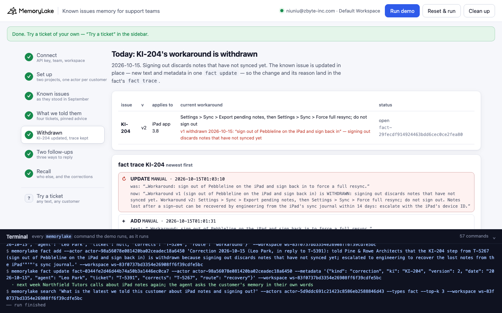
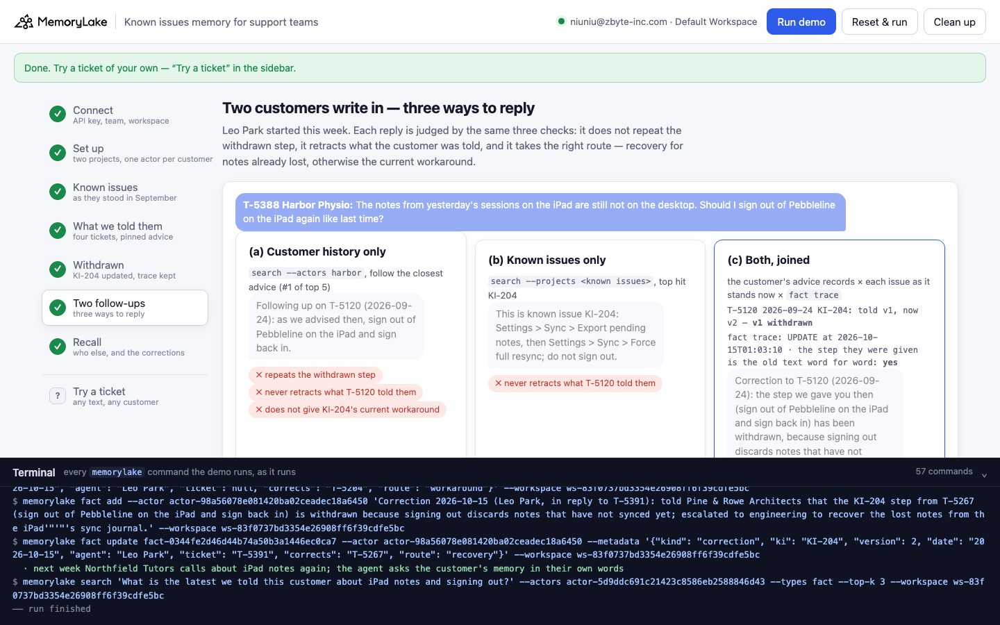

# Known issues memory for support teams

A runnable version of the MemoryLake use case
[*Give Support Teams Known Issues Memory That Stops Re-Discovery Cycles*](https://www.memorylake.ai/en/usecase/known-issues-memory-for-support-teams),
built entirely on the [`memorylake` CLI](https://github.com/memorylake-ai/memorylake-cli).

**Watch it run:** [CLI, 4:01](https://github.com/memorylake-ai/memorylake-usecases/releases/download/known-issues-memory-v1/known-issues-memory-cli-demo.mp4) · [Web, 5:38](https://github.com/memorylake-ai/memorylake-usecases/releases/download/known-issues-memory-v1/known-issues-memory-web-demo.mp4) — real, unedited runs on a free account
([release](https://github.com/memorylake-ai/memorylake-usecases/releases/tag/known-issues-memory-v1); GitHub serves them as downloads).

**The problem.** *The workaround lives in old tickets and in senior agents' heads.* Writing the workaround down once, in a
known-issues list, fixes the first half of that. It does not fix the second half: the workaround also went out in every reply
that used it. When engineering withdraws it, the known-issues list is updated in one place, but the old advice is still in
the history of every customer who was given it. The page's own questions are *"Issue lifecycle event memory"* and *"Audit:
did we tell them the workaround?"* — this demo is what happens when the answer is yes and the workaround turns out to be wrong.

**What this demo shows.** Pebbleline (fictional) makes a shared-notes app. Two kinds of memory sit behind every ticket:

| Memory | Where | What is in it |
|---|---|---|
| **Known issues** (team-wide) | one project | 4 issues, each pinned word for word with `metadata`: symptom, where it applies, the current workaround and its version, and what has been withdrawn (when, why) |
| **What we told each customer** | one actor per customer | the ticket conversation (a DIRECT conversation MemoryLake turns into memory), plus what support said, pinned **word for word** with the ticket, the date, the known issue and the workaround **version** it came from |

In September and October, three customers were told KI-204's workaround for iPad notes that never reach the desktop:
*sign out of Pebbleline on the iPad and sign back in*. A fourth had the same symptom on Android and was told KI-207's.

1. **Today, 2026-10-15, the workaround is withdrawn**: signing out discards notes that have not synced yet. KI-204 is updated
   in place — new text and metadata in one `fact update`. `fact trace` keeps the old text, and the step the three customers
   were given is in it **word for word**. It is also still, word for word, in their memory.
2. **Two of them write in.** Each reply is built three ways and judged by the same three checks (does not repeat the
   withdrawn step · retracts what we told them · takes the right route):
   - **(a) from the customer's history alone** (`search --actors`), the closest thing we told them is the withdrawn step, so
     the reply repeats it — to a customer who already lost three notes doing it ✗
   - **(b) from the known issues alone** (`search --projects`), the reply gives today's workaround but never tells the customer
     that what we said before was wrong, and for the customer whose notes are gone it offers the wrong fix ✗
   - **(c) joined** — the customer's advice records × each issue as it stands now × `fact trace` — the reply retracts the old
     step, says why, and routes each ticket: the new workaround for one, recovery of the lost notes for the other ✓
3. **Who else was told?** One `fact list --actors <every customer> --query KI-204` — every match, nothing ranked away — and
   each fact's metadata decides: Harbor, Northfield and Pine & Rowe were given the withdrawn step; Oakline's record mentions
   KI-204 but they were told something else. Northfield has not written in, so they get a proactive notice.
4. **The corrections go into memory**, and next week the customer's own memory answers *"what is the latest we told them?"*
   with the correction first.

```
known issues ── fact add --project <KI> 'KI-198 …' 'KI-204 …' 'KI-207 …' 'KI-211 …'   (one call)
                 + fact update --metadata {symptom, applies_when, workaround, version, withdrawn: []}
customers ───── conv create --project <tickets> --kind DIRECT · msg append × 5 · cook-status   (per customer)
                 fact add --actor <customer> '<what we told them, word for word>' + fact update --metadata {ki, version, advised, ticket, date}
today ───────── fact update <KI-204> --text '<v2>' --metadata {…, withdrawn: [{version: 1, workaround, on, reason}]}
                 fact trace <KI-204>                          → UPDATE: old text = the step the customers were given
follow-ups ──── (a) search '<ticket>' --actors <customer>        (b) search '<ticket>' --projects <KI>
                 (c) fact list --actors <customer> × fact list --projects <KI> × fact trace
recall ──────── fact list --actors <all customers> --query KI-204   → metadata says who was given the withdrawn step
                 fact add --actor <customer> 'Correction …' · search '<what did we last tell them>' --actors <customer>
```

The checks and the join are plain code over the pinned facts and their metadata, not a model: the same memory gives the same
answer every time, and every ✓ and ✗ names what it is based on. Nothing depends on what extraction happens to pull out of a
conversation; extracted facts are shown as "also remembered".

## Prerequisites

- **Python 3.9+** (standard library only, nothing to `pip install`)
- **The `memorylake` CLI** on your `PATH`:
  ```bash
  curl -fsSL https://raw.githubusercontent.com/memorylake-ai/memorylake-cli/main/scripts/install.sh | sh
  ```
- **A MemoryLake API key.** Sign up at [app.memorylake.ai](https://app.memorylake.ai), open **API Keys**, create one. A free
  personal account is enough: nothing here needs an agent or a model call.

## Run it

```bash
git clone https://github.com/memorylake-ai/memorylake-usecases.git
cd memorylake-usecases/known-issues-memory
export MEMORYLAKE_API_KEY=sk-...           # China region: also export MEMORYLAKE_BASE_URL=https://app.memorylake.cn/openapi/memorylake
python3 demo.py
```

About 2½–3 minutes the first time (most of it is MemoryLake turning the four tickets into memory, about 60 s), about 1 minute
on a re-run. **Every run replays today**: it puts KI-204 back as it stood in September (a fresh fact, so its trace is this
run's clean ADD → UPDATE), removes the corrections an earlier run wrote, and withdraws the workaround again. With the key set,
the demo logs into an isolated CLI profile under `./.memorylake-demo/` and never touches your own `~/.memorylake`. Everything
it creates has a `custom_id` starting with `mlu-kim-`.

```bash
python3 demo.py recall               # who was given a withdrawn step, and who has been corrected
python3 demo.py ask northfield "Notes from the iPad are not on the Mac again, should we sign out?"   # the three readings for any ticket
python3 demo.py customer pinerowe    # everything support has on a customer
python3 demo.py issues               # the known issues as they stand now, and KI-204's trace
python3 demo.py --reset              # delete everything the demo created, then replay
python3 demo.py cleanup              # delete everything the demo created
```

## Or run it in the browser

```bash
python3 web/server.py                # opens http://127.0.0.1:8765
```

Paste the key, connect, run. The page drives the same functions as `demo.py` and streams every `memorylake` command into a
terminal drawer as it runs: the known issues, the four tickets turning into memory, the withdrawal and its trace, the two
follow-ups three ways side by side, then the recall and the corrections. **Try a ticket** takes any text for any customer and
shows the three readings. After a run the corrections are in memory too, so the history-only reading can now pass for a
customer who has been corrected — that is the point of writing them back.





## What happens, step by step

All output below is from a real run (`python3 demo.py --reset` on a free account, 2026-10-15). Ids will differ on yours.

### Step 3 — the known issues, as they stood in September

One `fact add` for all four, then `fact update --metadata` on each (`fact add` takes no metadata):

```
  issue   v   status        applies to       current workaround
  KI-198  v1  fixed in 5.2  desktop app 5.1  Settings > Search > Rebuild index
  KI-204  v1  open          iPad app 3.8     sign out of Pebbleline on the iPad and sign back in
  KI-207  v1  open          Android          exclude Pebbleline from battery optimization in Android settings
  KI-211  v1  by design     any device       open Trash in the sidebar and restore the note (kept for 30 days)
```

### Step 4 — what each customer was told

Each ticket is a DIRECT conversation between the customer and Dana (senior agent) in a separate ticket-history project, so the
known-issues project holds only issues. What Dana said is pinned on the customer's actor word for word, with the ticket, the
date, the known issue and the workaround version:

```
  customer                ticket  date        issue    what we told them
  Harbor Physio           T-5120  2026-09-24  KI-204   v1: sign out of Pebbleline on the iPad and sign back in
  Northfield Tutors       T-5204  2026-10-02  KI-204   v1: sign out of Pebbleline on the iPad and sign back in
  Pine & Rowe Architects  T-5267  2026-10-08  KI-204   v1: sign out of Pebbleline on the iPad and sign back in
  Oakline Dental          T-5170  2026-09-30  KI-207   v1: exclude Pebbleline from battery optimization in Android settings (not KI-204)
```

### Step 5 — today, the workaround is withdrawn

New text and metadata in **one** `fact update`, so the change is in the fact's trace (a metadata-only update does not appear
in `fact trace`):

```
  KI-204  v2  open          iPad app 3.8     Settings > Sync > Export pending notes, then Settings > Sync > Force …
              v1 WITHDRAWN 2026-10-15: “sign out of Pebbleline on the iPad and sign back in” — signing out discards notes that have not synced yet

  fact trace KI-204 (newest first):
    UPDATE  MANUAL  2026-10-15T00:52:11
      was: “…Workaround: sign out of Pebbleline on the iPad and sign back in to force a full resync.”
      now: “…Workaround v1 (sign out of Pebbleline on the iPad and sign back in) is WITHDRAWN: signing out discards notes that have not synced yet. Workaround v2:…”
    ADD     MANUAL  2026-10-15T00:50:15
      text: “…Workaround: sign out of Pebbleline on the iPad and sign back in to force a full resync.”

  The withdrawn step is gone from the known issue. It is still in the trace — and, word for word, in 3 customers' memory: Harbor Physio, Northfield Tutors, Pine & Rowe Architects.
```

### Step 6 — two customers write in, three ways to reply

```
  T-5391 Pine & Rowe Architects: “Since I signed out on the iPad as you told us, three site-visit notes from Monday are gone. They are not in Trash either. Can you get them back?”

    (a) customer history only — `search --actors pinerowe`, follow the closest advice (#1 of top 5)
        → “Following up on T-5267 (2026-10-08): as we advised then, sign out of Pebbleline on the iPad and sign back in.”
    (b) known issues only — `search --projects <known issues>`, top hit KI-204
        → “This is known issue KI-204: Settings > Sync > Export pending notes, then Settings > Sync > Force full resync; do not sign out.”
    (c) both, joined — the customer's advice records × each issue as it stands now × `fact trace`
        T-5267 2026-10-08 KI-204: told v1, now v2 — v1 WITHDRAWN
        fact trace: UPDATE at 2026-10-15T00:52:11; the step they were given is the old text word for word: yes
        → “Correction to T-5267 (2026-10-08): the step we gave you then (sign out of Pebbleline on the iPad and sign back in) has been withdrawn, because signing out discards notes that have not synced yet. Please do not do it again; notes lost after a sign-out can be recovered by engineering from the iPad's sync journal within 14 days: escalate with the iPad's device ID.”
    ✗ (a) repeats the withdrawn step; never retracts what T-5267 told them; does not offer to recover the lost notes
    ✗ (b) never retracts what T-5267 told them; does not offer to recover the lost notes
    ✓ (c) passes all 3 checks

  ticket  customer                (a) history only  (b) issues only  (c) joined
  T-5388  Harbor Physio           ✗                 ✗                ✓
  T-5391  Pine & Rowe Architects  ✗                 ✗                ✓
```

The history-only reading is not a strawman: it is what "the support AI remembers the customer" usually means, and what it
remembers is right — we did tell them that. It is the known issue that changed. The issues-only reading gets Harbor's steps
right but leaves the customer believing the old advice still stands, and it cannot know that Pine & Rowe's lost notes came
from following us.

### Step 7 — who else was told, and the corrections

```
  `fact list --actors <all 4 customers> --query KI-204` — 4 fact(s):
    Harbor Physio           advice     told the withdrawn step
    Northfield Tutors       advice     told the withdrawn step
    Oakline Dental          advice     mentions KI-204, but was told KI-207 (exclude Pebbleline from battery…
    Pine & Rowe Architects  advice     told the withdrawn step

  Given the withdrawn step: Harbor Physio, Northfield Tutors, Pine & Rowe Architects
```

`--query` matches the fact text, not metadata — so the ticket record names the issue in its text, and the metadata decides
what it means (Oakline's record says *"Not KI-204 (iPad only)"*). A correction is then pinned on each of the three actors —
a proactive notice for Northfield, who has not written in — and the same query re-read gives *3 given the withdrawn step,
3 corrected, 0 left to tell*. Next week:

```
  “What is the latest we told this customer about iPad notes and signing out?” — memory of Northfield Tutors, top 3:
    1. ✓ Correction 2026-10-15 (Leo Park, proactive notice, no ticket): told Northfield Tutors that the KI-204 step from T-5204 …
    2. · Ticket T-5204 (2026-10-02, Dana Ruiz): lesson notes from the shared iPad not reaching the Mac. Matched KI-204; told Nor…
    3. · Northfield Tutors uses one shared iPad (Pebbleline iPad app 3.8) for lesson notes and a Mac desktop.
    the correction is #1
```

`python3 demo.py recall` afterwards shows the audit trail:

```
    ✓ corrected     Harbor Physio: T-5120 2026-09-24 — “sign out of Pebbleline on the iPad and sign back in” (withdrawn 2026-10-15)
    ✓ corrected     Northfield Tutors: T-5204 2026-10-02 — “sign out of Pebbleline on the iPad and sign back in” (withdrawn 2026-10-15)
    ✓ corrected     Pine & Rowe Architects: T-5267 2026-10-08 — “sign out of Pebbleline on the iPad and sign back in” (withdrawn 2026-10-15)
```

## Measured

Over 6 runs on 2026-10-15 (4 from scratch, including 2 run in parallel under different prefixes; 1 resume; 1 from the web
page): (a) fails both tickets **12/12**, with the withdrawn advice the #1 hit on the customer's actor every time; (b) puts KI-204
on top **12/12** and fails both tickets on the retraction (and Pine & Rowe on the route); (c) passes all checks **12/12**. The
recall query returned the same 4 facts and named the same 3 customers in every run; the correction came back #1 for Northfield
6/6. A 7th run, before a fix to the checker (it counted a retraction that quotes the old step as repeating it), is not
counted; its (a) and (b) results were the same. Extraction varies (0–3 facts per conversation) and nothing above depends on it.

## Wiring it into your own support stack

- **Pin what you told the customer, not just the conversation.** Extraction keeps the gist of a ticket; the exact step you
  gave, with the issue and the workaround *version*, is what a later withdrawal has to be matched against. One `fact add --actor`
  + `fact update --metadata` per reply.
- **Version the workaround inside the known issue**, and withdraw by updating text and metadata in the same `fact update`:
  `fact trace` then records what the issue said before, which is your proof of what customers were told and when.
- **Answer from both scopes.** History alone repeats what you said; the known issues alone forget that you said it.
- **Recall with `fact list --query`, not `search`.** A recall must find every customer, not the top k.

## If something goes wrong

- **`not logged in`** — export `MEMORYLAKE_API_KEY`, or run `memorylake auth login` first.
- **`gave up after 600s`** — the ticket conversations are still being turned into memory server-side. Run `python3 demo.py`
  again; it picks up where it stopped.
- **A `hit(s) left out … search answered from its cache` line** — `search` caches results per query text for a while; a hit
  whose fact no longer exists (an earlier run's correction) is dropped and counted, not shown.
- **Port 8765 in use** — the web server tries the next 19 ports and prints which one it took; or pass `--port`.
- **Start over** — `python3 demo.py --reset`, or `python3 demo.py cleanup` to remove everything.

## Files

| File | What it is |
|---|---|
| `demo.py` | the demo: every step is a `memorylake` CLI command, echoed as it runs |
| `data/story.json` | the known issues, the withdrawal, the four customers' tickets and what they were told, today's follow-ups (all fictional) |
| `web/server.py` | the browser companion: same functions, events over Server-Sent Events, standard library only |
| `web/static/` | the page (no build step) |
