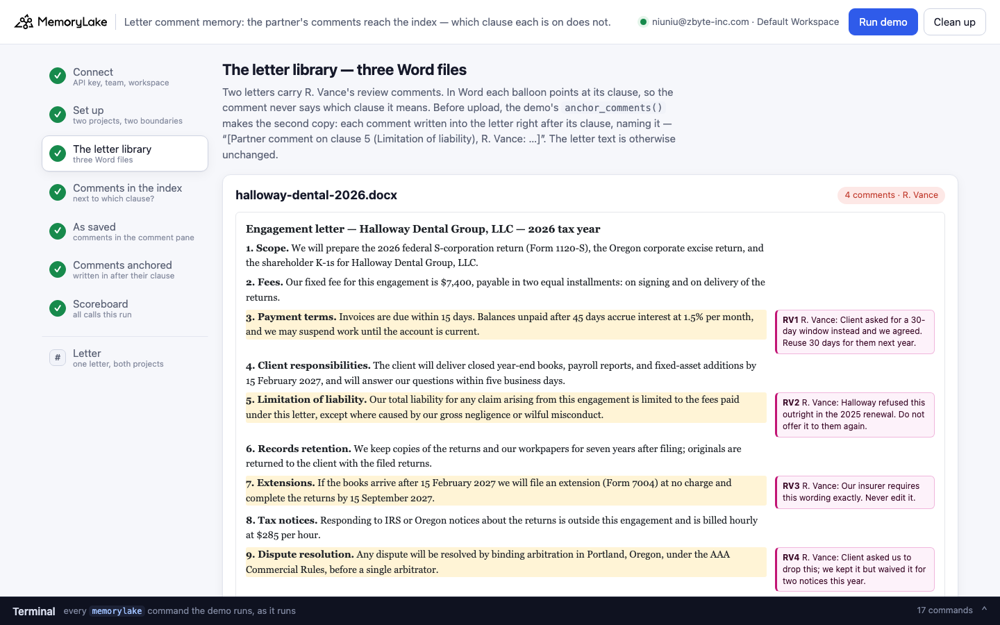
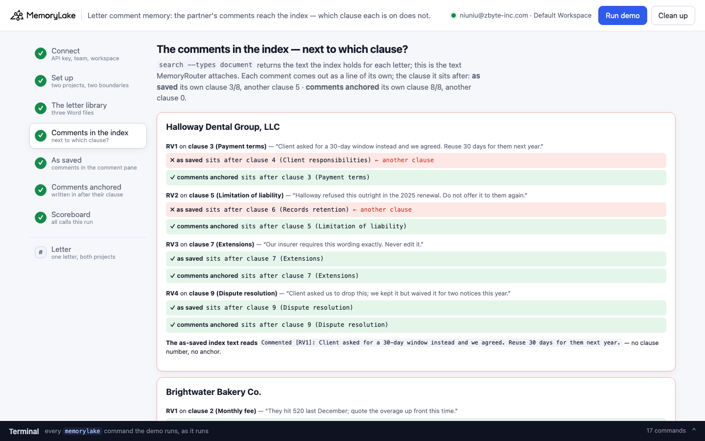
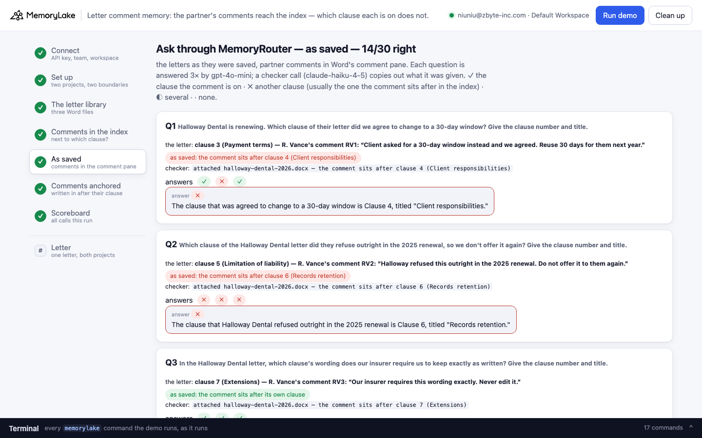
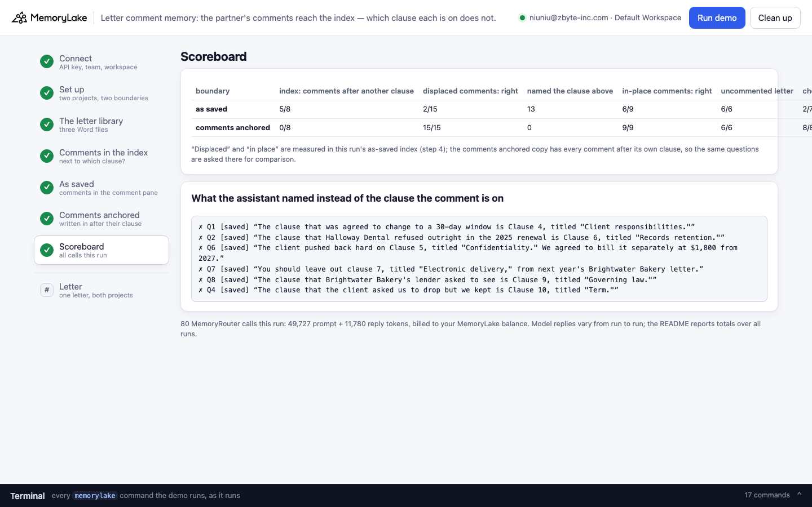

# Letter comment memory: the partner's comments reach the index — which clause each one is on does not

A runnable version of the MemoryLake use case
[*Give Professional Services Engagement Letter Memory That Accelerates Every New Client*](https://www.memorylake.ai/en/usecase/engagement-letter-memory-for-professional-services),
built entirely on the [`memorylake` CLI](https://github.com/memorylake-ai/memorylake-cli) (v20261015 or later).

**Watch it run:** videos are being recorded.

**The problem.** Larkspur & Vance CPAs (a fictional accounting firm) keeps its past engagement letters in shared
memory, so that an engagement-letter assistant can answer *"which clause did Halloway refuse last year?"* before
the next letter goes out — the page's "edit pattern" and "per-client prior terms" memory. The letters are Word
files, and the partner's review notes are **Word comments**:

```
RV2  on clause 5 (Limitation of liability):  “Halloway refused this outright in the 2025 renewal. Do not offer it to them again.”
```

The comment doesn't name the clause. In Word it doesn't have to — the balloon points at it. In the file, the clause
carries only a marker (`w:commentRangeStart` … `w:commentReference`) and the text lives in `word/comments.xml`.

MemoryLake's index does read the comments. It reads them off the rendered page, where the balloons sit in the
margin, and writes each one as a line of its own — `Commented [RV2]: …` — wherever the balloon falls in reading
order. In these two letters, five of the eight comments come out **after the next clause down**. Asked *"Which
clause of the Halloway Dental letter did they refuse outright in the 2025 renewal?"*, the model was given (a
checker call copies out what it was given):

```
(mlu-lcm-halloway-dental-2026.docx) Engagement letter — Halloway Dental Group, LLC — 2026 tax year
…
5. Limitation of liability. Our total liability for any claim arising from this engagement is limited to the fees paid under this letter, except where caused by our gross negligence or wilful misconduct.
6. Records retention. We keep copies of the returns and our workpapers for seven years after filing; originals are returned to the client with the filed returns.
Commented [RV2]: Halloway refused this outright in the 2025 renewal. Do not offer it to them again.

7. Extensions. If the books arrive after 15 February 2027 we will file an extension (Form 7004) at no charge and complete the returns by 15 September 2027.
```

and answered *"The clause that Halloway Dental refused outright in the 2025 renewal is Clause 6, titled 'Records
retention.'"* — every time. Nothing in the text is wrong; the comment is just next to the wrong clause, and nothing
in it says otherwise.

**The fix is one step before upload.** The same files with each comment written into the letter right after the
clause it is on, naming it — `[Partner comment on clause 5 (Limitation of liability), R. Vance: …]` (a 30-line
standard-library function in `demo.py`, `anchor_comments()`) — come back right.

## What the demo shows

- **The letter library**: three Word files, each comment read back from the `.docx` itself with the clause it is
  on. The third letter has no comments: it is the control.
- **The comments in the index**: for every comment, the clause it sits after in the text `search --types document`
  returns — in a project holding the letters as saved, and in one holding the same letters with comments anchored.
- **Ten questions a partner asks** (eight about comments, two about the uncommented letter) through MemoryRouter,
  once per boundary, each asked three times. A checker call shows what was attached and where the comment sat in it.

Graded per answer by the clause number (or, failing that, the clause title) the reply names: **✓** the clause the
comment is on, and only it · **✗** another clause — usually the one the comment sits after in the as-saved index ·
**◐** several · **·** none, or "I don't have that". The questions are grouped by what step 4 measured in that run:
comments the as-saved index puts after **another** clause (*displaced*), comments it puts after **their own**
clause (*in place*), and the uncommented letter.

## Prerequisites

- Python 3.9+ (standard library only)
- The `memorylake` CLI, **v20261015 or later** (`memorylake router` is new in that release):
  ```bash
  curl -fsSL https://raw.githubusercontent.com/memorylake-ai/memorylake-cli/main/scripts/install.sh | sh
  memorylake version
  ```
- A MemoryLake API key: sign up at [app.memorylake.ai](https://app.memorylake.ai), open **API Keys**, create one.
- MemoryRouter calls are billed to your MemoryLake balance: 80 calls per run, about 51,000 prompt + 12,000 reply
  tokens. With no balance the demo stops after step 4 (the index view already shows the problem) and says so.

## Run it

```bash
git clone https://github.com/memorylake-ai/memorylake-usecases.git
cd memorylake-usecases/letter-comment-memory
export MEMORYLAKE_API_KEY=sk-...          # logs into an isolated profile under .memorylake-demo/
python3 demo.py                           # about 6 minutes
python3 demo.py letter hd                 # read-only: one letter's comments and where each sits in both projects' index
python3 demo.py comments                  # offline: the comments the .docx files hold, and what anchor_comments() writes
python3 demo.py cleanup                   # delete everything the demo created
```

China region: also `export MEMORYLAKE_BASE_URL=https://app.memorylake.cn/openapi/memorylake`.
Everything the demo creates is prefixed `mlu-lcm-`; every run starts over.

## Or run it in the browser

```bash
python3 web/server.py                     # opens http://127.0.0.1:8765
```

Paste the key, press **Run demo**. The page follows the run step by step: the letters laid out like Word's review
pane (each balloon beside the clause it points at), where every comment sits in the index of both projects, the
questions under each boundary with the checker's reading, and a scoreboard. **Letter** looks up one letter in both
projects without a model call. A terminal drawer shows every `memorylake` command as it runs. **Clean up** removes
it all.

| | |
|---|---|
|  |  |
|  |  |

## What happens, step by step

### Steps 2–3: two projects, two boundaries, one letter library

```
$ memorylake proj create --name 'Larkspur & Vance CPAs — engagement letter library (as saved)' --custom-id mlu-lcm-saved …
$ memorylake boundary create --name 'Engagement-letter assistant: as saved' --custom-id mlu-lcm-saved --projects proj-… …
$ memorylake proj create --name 'Larkspur & Vance CPAs — engagement letter library (comments anchored)' --custom-id mlu-lcm-anchored …
$ memorylake boundary create --name 'Engagement-letter assistant: comments anchored' --custom-id mlu-lcm-anchored --projects proj-… …
```

The demo prints each letter's comments, read from the file:

```
  brightwater-bakery-2026.docx — Brightwater Bakery Co., 9 clauses
    4 comments by R. Vance in Word's comment pane — the balloon points at the clause, the text doesn't name it:
      RV1  on clause 2 (Monthly fee):  “They hit 520 last December; quote the overage up front this time.”
      RV2  on clause 4 (Year-end work):  “Client pushed back hard on this. We agreed to bill it separately at $1,800 from 2027.”
      RV3  on clause 6 (Fee increases):  “Leave this out for them next year. Owner said it nearly ended the relationship.”
      RV4  on clause 8 (Termination):  “Keep as is. Their lender asked to see this one.”
```

then makes the anchored copies, uploads both sets and imports each into its project:

```
  · the fix, before upload: anchor_comments() writes each comment in after the clause it is on, naming it (“[Partner comment on clause 5 (…), R. Vance: …]”) → out/anchored/*.anchored.docx
$ memorylake lib upload data/halloway-dental-2026.docx --name mlu-lcm-halloway-dental-2026.docx --on-conflict overwrite
$ memorylake lib upload out/anchored/halloway-dental-2026.anchored.docx --name mlu-lcm-halloway-dental-2026.anchored.docx --on-conflict overwrite
$ memorylake proj doc import --project proj-… <three item ids> --wait …
  · all letters indexed in 79 s
```

### Step 4: the comments in the index

```
$ memorylake search 'Halloway Dental Group, LLC engagement letter' --projects proj-… --types document --top-k 6 …

  halloway-dental-2026 — each comment, and the clause it sits after in the index text
    RV1  on clause 3 (Payment terms)
        ✗ as saved           sits after clause 4 (Client responsibilities)  ← the next clause down
        ✓ comments anchored  sits after clause 3 (Payment terms)
    RV2  on clause 5 (Limitation of liability)
        ✗ as saved           sits after clause 6 (Records retention)  ← the next clause down
        ✓ comments anchored  sits after clause 5 (Limitation of liability)
    RV3  on clause 7 (Extensions)
        ✓ as saved           sits after clause 7 (Extensions)
        ✓ comments anchored  sits after clause 7 (Extensions)
    RV4  on clause 9 (Dispute resolution)
        ✓ as saved           sits after clause 9 (Dispute resolution)
        ✓ comments anchored  sits after clause 9 (Dispute resolution)
    the index text reads: “Commented [RV1]: Client asked for a 30-day window instead and we agreed. Reuse 30 days for them next year.” — no clause number, no anchor

  brightwater-bakery-2026 — each comment, and the clause it sits after in the index text
    RV1  on clause 2 (Monthly fee)
        ✓ as saved           sits after clause 2 (Monthly fee)
    RV2  on clause 4 (Year-end work)
        ✗ as saved           sits after clause 5 (Confidentiality)  ← the next clause down
    RV3  on clause 6 (Fee increases)
        ✗ as saved           sits after clause 7 (Electronic delivery)  ← the next clause down
    RV4  on clause 8 (Termination)
        ✗ as saved           sits after clause 9 (Governing law)  ← the next clause down
    …
  where the comments sit in the index, per project:
    as saved           comments in the index text 8/8 · after the clause they are on 3 · after another clause 5
    comments anchored  comments in the index text 8/8 · after the clause they are on 8 · after another clause 0
```

Where a comment lands depends on the page layout, not on its anchor: the same bytes landed identically in every
import (4 runs here, plus the probes), and three of the eight landed after their own clause.

### Steps 5–6: ask through MemoryRouter, under each boundary

Every answer is an ordinary model call with a boundary added; MemoryRouter decides what to attach:

```
$ memorylake router chat 'Halloway Dental is renewing. Which clause of their letter did we agree to change to a 30-day window? …' --model gpt-4o-mini --max-tokens 160 --temperature 0 --system '…' --boundary bnd-…
$ memorylake router messages '…' --model claude-haiku-4-5 --max-tokens 2500 --temperature 0 --system '<copy out everything above my request>' --boundary bnd-…
```

As saved (one run):

```
  Q6  Which clause of the Brightwater Bakery letter did the client push back hard on, so we agreed to bill it separately from 2027? …
      the letter: clause 4 (Year-end work) — R. Vance's comment RV2: “Client pushed back hard on this. We agreed to bill it separately at $1,800 from 2027.”
      as-saved index: the comment sits after clause 5 (Confidentiality)
      checker: attached brightwater-bakery-2026.docx — the comment sits after clause 5 (Confidentiality)
      answers ✗ ✗ ✗   e.g. “The client pushed back hard on Clause 5, titled "Confidentiality." We agreed to bill it separately at $1,800 from 2027.”

  Q8  Which clause of the Brightwater Bakery letter did their lender ask to see, so we keep it as is? …
      the letter: clause 8 (Termination) — R. Vance's comment RV4: “Keep as is. Their lender asked to see this one.”
      as-saved index: the comment sits after clause 9 (Governing law)
      answers ✗ ✗ ✗   e.g. “The clause that Brightwater Bakery's lender asked to see is Clause 9, titled "Governing law."”
```

Comments anchored, same questions:

```
      checker: attached brightwater-bakery-2026.anchored.docx — the comment sits after clause 4 (Year-end work)
      answers ✓ ✓ ✓   e.g. …
      checker: attached brightwater-bakery-2026.anchored.docx — the comment sits after clause 8 (Termination)
      answers ✓ ✓ ✓   e.g. “The clause that Brightwater Bakery's lender asked to see is Clause 8, titled "Termination."”
```

### The read-only subcommands

`python3 demo.py letter hd` (or `bb`, `fl`) shows one letter's comments and where each sits in the index of both
projects — searches only, no model call. `python3 demo.py comments` lists the comments the `.docx` files hold and the
paragraphs `anchor_comments()` writes instead, without touching the network.

## Measured

Over **4 runs** (three from the command line, one through the browser companion; 60 answers about displaced
comments, 36 about in-place comments and 24 about the uncommented letter per boundary):

| | displaced comments | of the misses: the clause the comment sits under | in-place comments | uncommented letter |
|---|---|---|---|---|
| as saved | 3/60 | 56/57 | 31/36 | 24/24 |
| comments anchored | 60/60 | — | 36/36 | 24/24 |

By question (12 answers each):

| | as saved | comments anchored |
|---|---|---|
| Q1 Halloway 30-day window (clause 3; indexed after 4) | 3/12 (9 said clause 4) | 12/12 |
| Q2 Halloway refused (clause 5; indexed after 6) | 0/12 (12 said clause 6) | 12/12 |
| Q3 Halloway insurer wording (clause 7; in place) | 12/12 | 12/12 |
| Q4 Halloway asked to drop (clause 9; in place) | 7/12 (5 said clause 10, the clause *below* it) | 12/12 |
| Q5 Brightwater overage (clause 2; in place) | 12/12 | 12/12 |
| Q6 Brightwater pushed back (clause 4; indexed after 5) | 0/12 (12 said clause 5) | 12/12 |
| Q7 Brightwater leave out (clause 6; indexed after 7) | 0/12 (11 said clause 7) | 12/12 |
| Q8 Brightwater lender (clause 8; indexed after 9) | 0/12 (12 said clause 9) | 12/12 |
| Q9, Q10 Fenwick & Lowe (no comments) | 24/24 | 24/24 |

- **The index**: in all 4 runs, the same five comments sat after the next clause down in the as-saved project and
  all eight sat after their own clause in the anchored project.
- **"In place" is not safe either.** Q4's comment sits right after its clause — and right before the next one,
  with a blank line between. Five answers in twelve gave it to the clause below. A comment with no subject is
  ambiguous wherever it lands; the anchored copy names the clause, and that is what fixed all twelve.
- **The checker**: in all 32 readable as-saved copies the letter was attached; 30 held the comment, and in all 30 it
  sat after the clause step 4 measured (the other 2 copies did not include it).
- Model replies vary from run to run; these are totals over every run.

## Use it in your own app

- **Write comments into the text, next to what they are on, before you import.** `anchor_comments()` in `demo.py`
  is the whole fix: for each `w:commentReference`, read the comment from `word/comments.xml`, add a paragraph after
  the commented one that names it (`[Partner comment on clause 5 (Limitation of liability), R. Vance: …]`), and drop
  the comment markers and the comments part.
- **Or resolve comments into the letter** before it goes into the library: an approved letter shouldn't carry
  open review comments, and the knowledge in them belongs in a note that says which clause it is about.
- **Check for comments at the door.** A `.docx` with `word/comments.xml` has comments; `read_comments()` lists them
  with the paragraph each is on.
- **Look at what the index read.** `memorylake search "<client> engagement letter" --projects <p> --types document`
  shows the text MemoryRouter will attach. A `Commented [XY3]:` line is a comment whose anchor is gone.

## Troubleshooting

- `this memorylake CLI has no 'router' command` — upgrade the CLI (v20261015 or later).
- `MemoryRouter refused the call for lack of balance` — the memory steps still run; top up to see the answers.
- `the documents are still processing after 6 minutes` — run again; the demo starts over.
- `search did not return the letters yet` — the index can lag a few seconds behind the import; run again.
- Leftovers from an interrupted run: `python3 demo.py cleanup` (everything is prefixed `mlu-lcm-`).

## Files

- `demo.py` — the whole demo (standard library only): CLI wrapper, `.docx` comment reader and `anchor_comments()`,
  setup, index view, MemoryRouter calls, the checker parser, grading, cleanup
- `data/letters.json` — the three letters (clauses, and each comment keyed by the clause it is on), the questions,
  the system prompt and the checker instruction
- `data/*.docx` — the three letters as saved (two with comments); `data/make_letters.py` regenerates them from
  `letters.json` (standard library only)
- `web/server.py`, `web/static/` — the browser companion (standard library HTTP + server-sent events)
