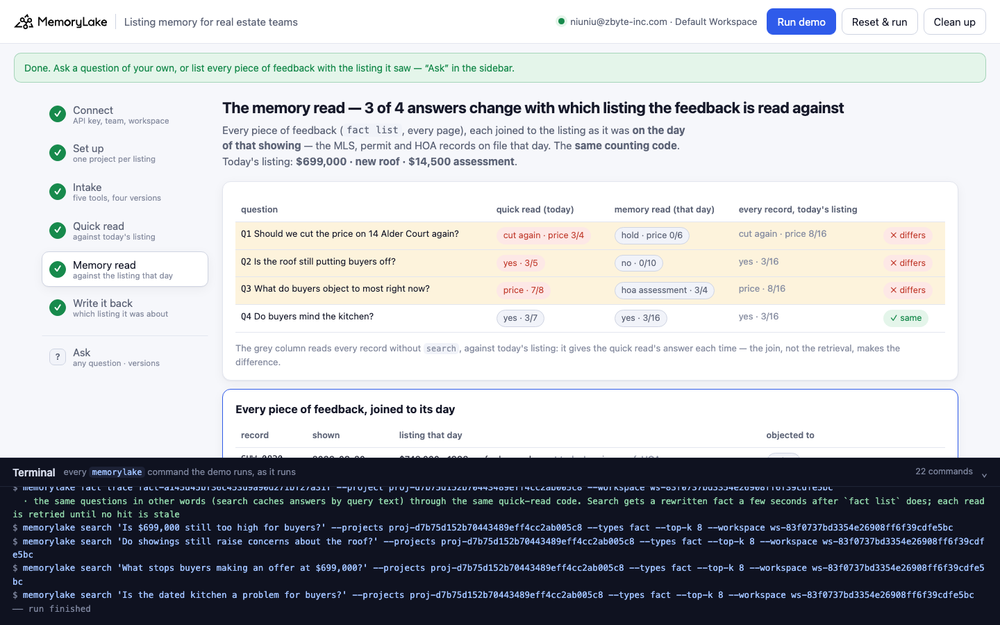
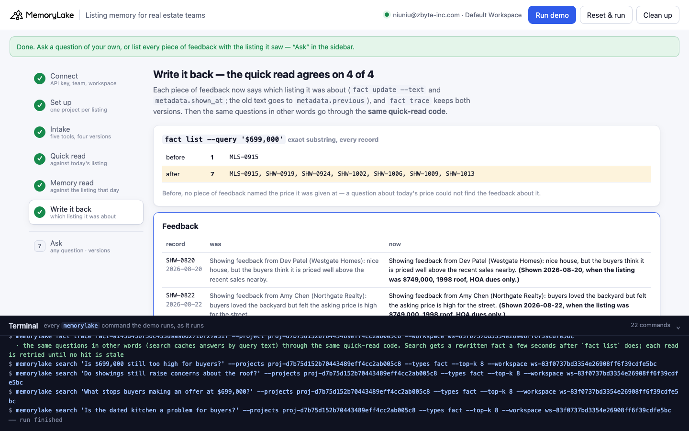

# Listing memory for real estate teams

A runnable version of the MemoryLake use case
[*Give Real Estate Teams Listing Memory That Holds Every Detail Across Agents*](https://www.memorylake.ai/en/usecase/listing-memory-for-real-estate-teams),
built entirely on the [`memorylake` CLI](https://github.com/memorylake-ai/memorylake-cli).

**Watch it run:** [CLI, 2:27](https://github.com/memorylake-ai/memorylake-usecases/releases/download/listing-memory-v1/listing-memory-cli-demo.mp4) · [Web, 3:50](https://github.com/memorylake-ai/memorylake-usecases/releases/download/listing-memory-v1/listing-memory-web-demo.mp4)
([release](https://github.com/memorylake-ai/memorylake-usecases/releases/tag/listing-memory-v1); GitHub serves them as downloads).

**The problem.** Listing memory is mostly feedback: every buyer's agent tells you what their buyers thought. "Felt the
asking price is high for the street." "Nervous about the water stain on the hall ceiling." "Walked once they read
about the assessment." All true. None of it says **which listing** the buyers saw. A listing changes while it sits
on the market: the price comes down, the roof gets replaced, the HOA votes an assessment. When a teammate covers the
listing and counts the feedback, every "too expensive" gets counted against today's price, even the ones said about
a price that no longer exists.

**What this demo shows.** Larkspur Realty (a fictional team) keeps one MemoryLake project for 14 Alder Court (a
fictional house): 28 records from 5 tools (MLS, the showing app, CRM, email, text), each pinned word for word with
its tool, author and **the day** in metadata, plus what each piece of feedback objected to. The listing went up at
$749,000 with the original 1998 roof; the roof was replaced on 2026-09-02, the price cut to $699,000 on 2026-09-15,
and the HOA voted a $14,500 special assessment on 2026-09-28. Today, 2026-10-15, Jordan Pike covers the listing while
Rosa Delgado is out, and the seller has asked: should we drop the price again?

| Question | Quick read: counted against today's listing | Memory read: counted against the listing that day | |
|---|---|---|---|
| Q1 Should we cut the price again? | **cut again**: price is the top objection | **hold**: 0 of 6 buyers at $699,000 said price; top objection is the HOA assessment | ✗ |
| Q2 Is the roof still putting buyers off? | **yes**: buyers raise the roof | **no**: 0 of 10 buyers since the new roof raised it; 2 praised it | ✗ |
| Q3 What do buyers object to most right now? | **price** | **the HOA assessment**: 3 of the 4 buyers since it was voted | ✗ |
| Q4 Do buyers mind the kitchen? (control) | yes | yes: 3 of 16 buyers | ✓ |

Every "too expensive" (8 of them) was said at $749,000. Every roof complaint, and the $735,000 offer that fell
through over the inspection, came before the roof was replaced. Both reads run **the same counting code**; the only
difference is which listing each piece of feedback is joined to. The quick read joins it to the listing as it is
today. The memory read joins it to the listing as it was on the day of that showing, from the MLS, permit and HOA
records on file that day. Nothing about the kitchen changed, so the two reads agree there.

Search is not the cause either: step 5 also prints every record read against today's listing without `search`, and
that gives the quick read's answer every time.

Step 6 writes the join back where the next read will see it: each piece of feedback gets the listing it was shown at
appended to its text ("(Shown 2026-08-22, when the listing was $749,000, 1998 roof, HOA dues only.)") and in
`metadata.shown_at`, with the old text in `metadata.previous`. `fact trace` keeps both versions. Before, no piece of
feedback contained "$699,000"; after, the 6 given at that price do. The same questions, asked in other words, then
go through the **same quick-read code**, and it agrees 4 of 4.

```
setup ──────── proj create
intake ─────── fact add --project <p> '<record>' …   (28 records, one call)  + fact update --metadata {tool, by, role, on, kind, field/label | objections/liked}
quick read ─── search '<question>' --projects <p> --types fact --top-k 8
               → the showing feedback in the hits → count objections against the listing as it is today
memory read ── fact list --projects <p>   (every record, every page)
               → every piece of feedback joined to the listing on its own day (MLS / permit / HOA records on file then)
               → the same counting code
write back ─── fact list --projects <p> --query '$699,000'   (before)
               fact update <feedback> --text '<text> (Shown <day>, when the listing was …)' --metadata {…, shown_at, previous}
               fact list --projects <p> --query '$699,000'   (after)
               fact trace <feedback>  → ADD, UPDATE (old text kept) → quick read again (other wording)
```

No conversations and no extraction: every record is pinned word for word, and both reads are plain code over what the
CLI returns. No model decides anything.

## Prerequisites

- **Python 3.9+** (standard library only, nothing to `pip install`)
- **The `memorylake` CLI** on your `PATH`:
  ```bash
  curl -fsSL https://raw.githubusercontent.com/memorylake-ai/memorylake-cli/main/scripts/install.sh | sh
  ```
- **A MemoryLake API key.** Sign up at [app.memorylake.ai](https://app.memorylake.ai), open **API Keys**, create one. A free
  personal account is enough: nothing here needs an agent or a model call.

## Run it

```bash
git clone https://github.com/memorylake-ai/memorylake-usecases.git
cd memorylake-usecases/listing-memory
export MEMORYLAKE_API_KEY=sk-...           # China region: also export MEMORYLAKE_BASE_URL=https://app.memorylake.cn/openapi/memorylake
python3 demo.py
```

About a minute and a half the first time (one project, 28 facts, each with its metadata), a bit over a minute on a
re-run. Every run replays Jordan's first morning: feedback an earlier run rewrote is put back word for word from
`metadata.previous` first. With the key set, the demo logs into an isolated CLI profile under `./.memorylake-demo/` and
never touches your own `~/.memorylake`. Everything it creates has a `custom_id` starting with `mlu-lsm-`.

Then list every piece of feedback with the listing it saw, or ask a question of your own:

```bash
python3 demo.py versions
python3 demo.py ask "Would a lower price bring offers?" --topic price
python3 demo.py ask "Is the HOA assessment scaring buyers off?" --topic hoa   # topics: price, roof, hoa, kitchen, parking, now
python3 demo.py cleanup                    # deletes the project and every fact on it
```

`versions` reads every record and joins each piece of feedback to its day (after a run, the feedback says so itself:
`(stated)`):

```
  V1  since 2026-08-18  $749,000 · 1998 roof · dues only         6 feedback
  V2  since 2026-09-02  $749,000 · new roof · dues only          4 feedback
  V3  since 2026-09-15  $699,000 · new roof · dues only          2 feedback
  V4  since 2026-09-28  $699,000 · new roof · $14,500 assessment 4 feedback

  record    shown       listing that day                         differs from today     objected to
  ----------------------------------------------------------------------------------------------------
  SHW-0820  2026-08-20  $749,000 · 1998 roof · dues only         price, roof, HOA       price  (stated)
  SHW-0822  2026-08-22  $749,000 · 1998 roof · dues only         price, roof, HOA       price  (stated)
  …
  SHW-0913  2026-09-13  $749,000 · new roof · dues only          price, HOA             price  (stated)
  SHW-0919  2026-09-19  $699,000 · new roof · dues only          HOA                    layout  (stated)
  SHW-0924  2026-09-24  $699,000 · new roof · dues only          HOA                    parking  (stated)
  SHW-1002  2026-10-02  $699,000 · new roof · $14,500 assessment —                      hoa  (stated)
  …

  today's listing: $699,000 · new roof · $14,500 assessment
  · 12 of 16 pieces of feedback were about a listing that no longer exists
```

## Or run it in the browser

```bash
python3 web/server.py                # opens http://127.0.0.1:8765
```

Paste the key, connect, run. The page drives the same functions as `demo.py` and streams every `memorylake` command into a
terminal drawer as it runs: the listing's four versions; the quick read of each question with its top 8 (the feedback
it counted highlighted); the memory read as a comparison table, every piece of feedback joined to its day, and one card
per question; and the write-back with the `$699,000` census and `fact trace`. **Ask** takes any question and its topic,
and lists every piece of feedback with the listing it saw.





## What happens, step by step

### Steps 2–3: one project, five tools, four versions of one house

`fact add` takes many texts in one call and returns them in order; `fact update --metadata` then attaches the source
to each (`fact add` takes no metadata). Listing changes carry `field` and `label`; feedback carries `objections` and
`liked` (lists round-trip as-is):

```
    MLS        3   MLS-0818 · MLS-0915 · MLS-0930
    Showings  15   SHW-0820 · SHW-0822 · SHW-0825 · SHW-0827 · SHW-0831 · SHW-0904 · SHW-0906 · SHW-0910 · SHW-0913 · SHW-0919 · SHW-0924 · SHW-1002 · SHW-1006 · SHW-1009 · SHW-1013
    CRM        5   HOA-0818 · DSC-0818 · CRM-0820 · CRM-0905 · CRM-1014
    Email      4   OFR-0830 · PRM-0902 · HOA-0928 · EML-1014
    Text       1   TXT-0901
  · the listing changed three times after it went up. The MLS, permit and HOA records say when; the feedback records do not say which version they saw
    V1  since 2026-08-18  $749,000 · 1998 roof · dues only         6 feedback
        DSC-0818 roof → 1998 roof, HOA-0818 HOA → dues only, MLS-0818 price → $749,000
    V2  since 2026-09-02  $749,000 · new roof · dues only          4 feedback
        PRM-0902 roof → new roof
    V3  since 2026-09-15  $699,000 · new roof · dues only          2 feedback
        MLS-0915 price → $699,000
    V4  since 2026-09-28  $699,000 · new roof · $14,500 assessment 4 feedback
        HOA-0928 HOA → $14,500 assessment
```

### Step 4: the quick read

What "any agent covering a showing retrieves full listing context" does the quick way: `search` the question, take
the showing feedback in the top 8, count what it objects to as if every buyer saw today's listing.

```
  Q1 “Should we cut the price on 14 Alder Court again?”
  search · top 8:
      #1   MLS-0915  MLS       2026-09-15  Price change on 14 Alder Court: now $699,000.
      #2   EML-1014  Email     2026-10-14  Ruth Hollis (seller): should we drop the price again before the weekend…
      #3   PRM-0902  Email     2026-09-02  Roof replacement at 14 Alder Court is finished: new architectural shing…
      #4   DSC-0818  CRM       2026-08-18  Seller disclosure for 14 Alder Court: the roof is the original 1998 roo…
      #5   OFR-0830  Email     2026-08-30  Dev Patel (Westgate Homes): my buyers withdraw their $735,000 offer on …   ← feedback: roof
      #6   SHW-0822  Showings  2026-08-22  Showing feedback from Amy Chen (Northgate Realty): buyers loved the bac…   ← feedback: price
      #7   SHW-0906  Showings  2026-09-06  Showing feedback from Sam Ortiz (Ortiz Realty): liked the new roof, but…   ← feedback: price
      #8   SHW-0831  Showings  2026-08-31  Showing feedback from Amy Chen (Northgate Realty): overpriced for what …   ← feedback: price, kitchen
  · 4 piece(s) of feedback in the hits, all counted against today's listing: price 3 · kitchen 1 · roof 1
  → quick read: cut again — price is the top objection (3 of 4 buyers)
```

The hits differ from run to run (how many pieces of feedback land in the top 8, and which); the answers did not, in
any run (see *Measured*).

### Step 5: the memory read

Every piece of feedback (`fact list`, every page), joined to the listing as it was on its own day:

```
  record    shown       listing that day                         objected to
  --------------------------------------------------------------------------------------
  SHW-0820  2026-08-20  $749,000 · 1998 roof · dues only         price
  SHW-0822  2026-08-22  $749,000 · 1998 roof · dues only         price
  SHW-0825  2026-08-25  $749,000 · 1998 roof · dues only         price, roof
  SHW-0827  2026-08-27  $749,000 · 1998 roof · dues only         roof
  OFR-0830  2026-08-30  $749,000 · 1998 roof · dues only         roof
  SHW-0831  2026-08-31  $749,000 · 1998 roof · dues only         price, kitchen
  SHW-0904  2026-09-04  $749,000 · new roof · dues only          price
  SHW-0906  2026-09-06  $749,000 · new roof · dues only          price
  SHW-0910  2026-09-10  $749,000 · new roof · dues only          price
  SHW-0913  2026-09-13  $749,000 · new roof · dues only          price
  SHW-0919  2026-09-19  $699,000 · new roof · dues only          layout
  SHW-0924  2026-09-24  $699,000 · new roof · dues only          parking
  SHW-1002  2026-10-02  $699,000 · new roof · $14,500 assessment hoa
  SHW-1006  2026-10-06  $699,000 · new roof · $14,500 assessment hoa
  SHW-1009  2026-10-09  $699,000 · new roof · $14,500 assessment hoa, kitchen
  SHW-1013  2026-10-13  $699,000 · new roof · $14,500 assessment kitchen

  today's listing: $699,000 · new roof · $14,500 assessment

  Q1 Should we cut the price on 14 Alder Court again?
    counted: 6 piece(s) of feedback about the price it has today ($699,000) — hoa assessment 3 · kitchen 2 · layout 1 · parking 1
    left out: 10 given at another version (SHW-0820, SHW-0822, SHW-0825, SHW-0827, OFR-0830, SHW-0831, SHW-0904, SHW-0906, SHW-0910, SHW-0913)
  → quick read:  cut again — price is the top objection (3 of 4 buyers)
  → memory read: hold the price — 0 of 6 buyers at $699,000 objected to it; top objection: hoa assessment  ✗ differs
    (all 16 pieces read against today's listing, no search: cut again — price is the top objection (8 of 16 buyers))
  …
       question                                       quick read (today)       memory read (that day)
  --------------------------------------------------------------------------------------------------------
  Q1   Should we cut the price on 14 Alder Court ag…  cut again · price 3/4    hold · price 0/6         ✗ differs
  Q2   Is the roof still putting buyers off?          yes · 3/5                no · 0/10                ✗ differs
  Q3   What do buyers object to most right now?       price · 5/7              hoa assessment · 3/4     ✗ differs
  Q4   Do buyers mind the kitchen?                    yes · 3/8                yes · 3/16               ✓ same

  → 3 of 4 answers change with which listing the feedback is read against; the control column (every record, today's listing) gives the quick read's answer 4 of 4 times
```

What counts as "about today's listing" depends on the question: for the price, feedback given at $699,000; for the
roof, feedback since it was replaced; for "right now", feedback given at the listing exactly as it is today; for the
kitchen, which never changed, every piece.

### Step 6: write it back

```
    SHW-0822 was “Showing feedback from Amy Chen (Northgate Realty): buyers loved the backyard but felt the asking price is high for the street.”
             now “Showing feedback from Amy Chen (Northgate Realty): buyers loved the backyard but felt the asking price is high for the street. (Shown 2026-08-22, when the listing was $749,000, 1998 roof, HOA dues only.)”

  `fact list --query '$699,000'` (exact substring, every record): before 1 — MLS-0915
                                   after  7 — MLS-0915, SHW-0919, SHW-0924, SHW-1002, SHW-1006, SHW-1009, SHW-1013
  · before, no piece of feedback named the price it was given at; a question that names today's price could not find the feedback about it

  fact trace SHW-0820 (newest first):
    UPDATE  MANUAL  2026-10-14T22:38:53  Showing feedback from Dev Patel (Westgate Homes): nice house, but the buyers think it is …
    ADD     MANUAL  2026-10-14T22:38:09  Showing feedback from Dev Patel (Westgate Homes): nice house, but the buyers think it is …

  F1   “Is $699,000 still too high for buyers?” → 6 feedback in the hits, 6 about today's listing
    quick read:  hold the price — 0 of 6 buyers at $699,000 objected to it; top objection: hoa assessment
    memory read: hold the price — 0 of 6 buyers at $699,000 objected to it; top objection: hoa assessment  ✓ same

  F2   “Do showings still raise concerns about the roof?” → 6 feedback in the hits, 3 about today's listing
    quick read:  no — 0 of 3 buyers since it changed raised the roof; 2 praised it
    memory read: no — 0 of 10 buyers since it changed raised the roof; 2 praised it  ✓ same

  F3   “What stops buyers making an offer at $699,000?” → 7 feedback in the hits, 4 about today's listing
    quick read:  hoa assessment (3 of 4 buyers)
    memory read: hoa assessment (3 of 4 buyers)  ✓ same

  F4   “Is the dated kitchen a problem for buyers?” → 8 feedback in the hits, 8 about today's listing
    quick read:  yes — 3 of 8 buyers raised the kitchen
    memory read: yes — 3 of 16 buyers raised the kitchen  ✓ same

  → the quick read now agrees on 4 of 4: each piece of feedback says which listing it was about
```

The follow-ups are reworded because `search` caches answers by query text. F1 and F3 name today's price on purpose:
after the write-back, the feedback given at $699,000 says so, and search brings it back (6 of 6 and 4 of 4 in every
run). With the first wording of those two questions, the top 8 was all $749,000-era feedback in 2 of 3 runs; the quick
read then correctly counted none of it, but had nothing left to answer from. On a re-run `fact trace` shows one ADD and
an UPDATE pair per earlier run (put back, then stamped again).

## Measured

| What | Result |
|---|---|
| Quick read vs memory read: Q1–Q3 ✗, Q4 ✓ | 12 / 12 runs (6 from scratch, 6 re-runs; 2 of the re-runs in the browser). In one early run, on a first draft of the data, Q3's quick read was a four-way tie instead of "price" |
| Control (every record, today's listing, no search) gives the quick read's answer | 4 / 4 questions, every run |
| After write-back: quick read agrees (final wording of the follow-ups) | 4 / 4 in 6 / 6 runs, first try; 0 answers from the search cache |
| `fact list --query '$699,000'` | 1 record before the write-back, 7 after, every run |
| Time | 67–97 s |

## Wiring it into your own team

- **Store the day with the feedback, and the listing's changes as records.** A showing app's feedback form has a
  date; the MLS has a change history. Keep both, and you can always rebuild which listing each buyer saw.
- **Join on the way in, or join on the way out.** Step 6 stamps each piece of feedback with the listing it was
  shown at, after the fact. A connector can do it when the feedback arrives; or every reader joins on the feedback's
  own day, never on today.
- **Count only what was said about the listing you are deciding on.** A price question needs feedback given at that
  price; a roof question, feedback since the roof changed. Everything else is history, and still worth keeping.

## If something goes wrong

- **`the memorylake CLI is not on PATH`**: install it (above) or `export MEMORYLAKE_BIN=/path/to/memorylake`.
- **Search results differ on your run**: ranking moves between runs. Step 4 prints exactly what came back; the memory
  read does not use search at all.
- **"search answered from its cache"**: `search` can serve a repeated question from a cache made by an earlier run;
  the line names the hits whose fact ids are not in `fact list` now, and the read is retried.
- **Something half-created after an interrupted run**: `python3 demo.py --reset`, or `python3 demo.py cleanup`.

## Files

```
listing-memory/
├── demo.py              # the CLI runner (every step is a plain `memorylake` command, echoed)
├── data/story.json      # 28 records from 5 tools (6 listing changes, 15 showings, 1 withdrawn offer, 6 notes), 4 questions + 4 rewordings (fictional, plain ASCII)
├── web/server.py        # local web companion: same functions, Server-Sent Events
├── web/static/          # no-build front end
└── out/runs.jsonl       # one line per run (git-ignored)
```
