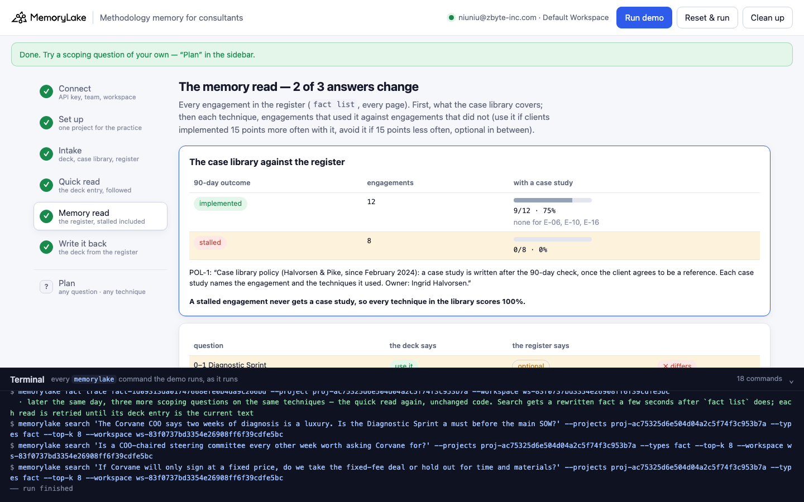
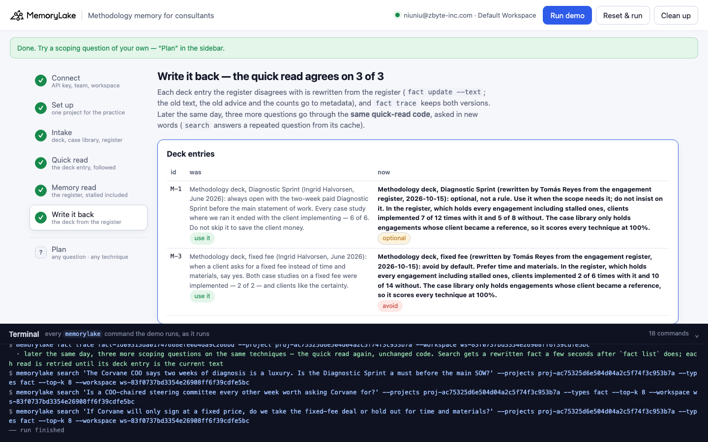

# Methodology memory for consultants

A runnable version of the MemoryLake use case
[*Give Consultants Methodology Memory That AI Tools Actually Apply*](https://www.memorylake.ai/en/usecase/methodology-memory-for-consultants),
built entirely on the [`memorylake` CLI](https://github.com/memorylake-ai/memorylake-cli).

**Watch it run:** videos are being recorded.

**The problem.** "The methodology that's supposed to be the firm's edge produces no AI leverage" until every AI tool
reads it. Once they do, they apply it exactly as written, and that includes its evidence. A methodology entry usually
cites the firm's case studies ("every case study where we ran it, 6 of 6, ended with the client implementing"). The
count can be correct and still prove nothing, because a firm only writes case studies about the engagements that
worked. A stalled engagement never becomes a case study, so every technique in the case library looks perfect.

**What this demo shows.** Halvorsen & Pike (fictional) is a small operations consultancy. Its practice memory lives in
one MemoryLake project: the 3 entries of Ingrid Halvorsen's methodology deck, the 9 case studies in the case library
plus the library's policy, and the PMO's engagement register, 20 engagements from 2024 to 2026 (word for word: client,
techniques used, the 90-day check, the case study or `none`). Tomás Reyes scopes a new engagement for Corvane Freight on
2026-10-15 with three questions:

| Question | Quick read: the deck entry | Memory read: the register, stalled engagements included | |
|---|---|---|---|
| Q-1 Corvane wants to skip the paid diagnostic. Do we insist on the Diagnostic Sprint? | "always open with the Diagnostic Sprint … 6 of 6" → **use it** | with it 7/12 (58%), without it 5/8 (63%) → **optional** | ✗ |
| Q-2 Do we need an executive steering committee? (control) | "stand up a steering committee … 8 of 8" → **use it** | with it 8/10 (80%), without it 4/10 (40%) → **use it** | ✓ |
| Q-3 The CFO asked for a fixed fee instead of time and materials. Agree? | "when a client asks for a fixed fee, say yes … 2 of 2" → **use it** | with it 2/6 (33%), without it 10/14 (71%) → **avoid** | ✗ |

Ingrid's counts are right: 6 of the 6 case studies with a Diagnostic Sprint were implemented. But the library's own
policy says a case study is written once the client agrees to be a reference, and only clients who implemented ever do.
Measured against the register, the library holds 9 of the 12 implemented engagements and **0 of the 8 stalled ones**.
Any technique counted in the library scores 100%, so the library can't rank techniques at all. The register can: the
Diagnostic Sprint shows no edge, and the fixed fee sits on 4 of the 8 stalled engagements. The steering committee entry
is the control. Its evidence came from the same filtered library, but the register backs it up, and both reads agree.

Step 6 rewrites the two deck entries from the register where the next AI tool will read them (`fact update --text`,
with the old text, the old advice and the counts kept in metadata). `fact trace` keeps both versions. Later that day,
three more questions go through the **same quick-read code** and agree with the register, 3 of 3.

```
setup ──────── proj create
intake ─────── fact add --project <p> '<record>' …   (33 records, one call)  + fact update --metadata {used, outcome, case …}
quick read ─── search '<scoping question>' --projects <p> --types fact --top-k 8  → the deck entry on that technique → its advice
memory read ── fact list --projects <p>   (every record, every page)
               → coverage: per 90-day outcome, how many engagements have a case study
               → per technique: engagements with it vs without it, from the register (not from the case library)
write back ─── fact update <entry> --text '<conclusion from the register>' --metadata {…, prefer, previous: '<old text>', basis: {…}}
               fact trace <entry>  → ADD, UPDATE (old text kept) → quick read again (new wording)
```

No conversations and no extraction: every record is pinned word for word, and both reads are plain code over what the
CLI returns. No model decides anything.

## Prerequisites

- **Python 3.9+** (standard library only, nothing to `pip install`)
- **The `memorylake` CLI** on your `PATH`:
  ```bash
  curl -fsSL https://raw.githubusercontent.com/memorylake-ai/memorylake-cli/main/scripts/install.sh | sh
  ```
- **A MemoryLake API key.** Sign up at [app.memorylake.ai](https://app.memorylake.ai), open **API Keys**, create one. A free
  personal account is enough: nothing here needs an agent or a model call.

## Run it

```bash
git clone https://github.com/memorylake-ai/memorylake-usecases.git
cd memorylake-usecases/methodology-memory
export MEMORYLAKE_API_KEY=sk-...           # China region: also export MEMORYLAKE_BASE_URL=https://app.memorylake.cn/openapi/memorylake
python3 demo.py
```

About a minute and a half the first time (one project, 33 facts, each with its metadata), under a minute on a re-run.
Every run replays Tomás's scoping session: a deck entry an earlier run rewrote is put back word for word from
`metadata.previous` first. With the key set, the demo logs into an isolated CLI profile under `./.memorylake-demo/` and
never touches your own `~/.memorylake`. Everything it creates has a `custom_id` starting with `mlu-mth-`.

Then ask a scoping question of your own, or list every engagement against one technique:

```bash
python3 demo.py plan "Do we insist on the Diagnostic Sprint?" --technique DS
python3 demo.py plan "Is a fixed fee a good idea for a network redesign?" --technique FF
python3 demo.py register FF                # or: DS, SC
python3 demo.py cleanup                    # deletes the project and every fact on it
```

After a run has rewritten the entry, `plan` also shows what the entry said before and what the quick read would have
answered then:

```
  → M-1: “Methodology deck, Diagnostic Sprint (rewritten by Tomás Reyes from the engagement register, 2026-10-15): optional, not a rule. Use it when the scope needs it; do not ins…”
  → quick read:  optional
  · M-1 was rewritten by a run; before that it said “Methodology deck, Diagnostic Sprint (Ingrid Halvorsen, June 2026): always open with the two-week paid Diagnostic Sprint…” → the quick read would have said: use it
  the case library against the register:
      90-day outcome   engagements   with a case study
      implemented          12          9 of 12    (none for E-06, E-10, E-16)
      stalled               8          0 of 8
      case library, with the Diagnostic Sprint     6/6  100%   CS-01, CS-02, CS-04, CS-05, CS-07, CS-08   ← what the deck counted
      register, with the Diagnostic Sprint         7/12  58%   E-01, E-03, E-04, E-06, E-07, E-08, E-11, E…
      register, without it                         5/8   63%   E-02, E-05, E-09, E-10, E-13, E-16, E-19, E…
  · optional — with it 7/12 (58%) vs without 5/8 (63%): 5 points worse with it — inside ±15
  → memory read: optional  ✓ same (before the rewrite: ✗ differs)
```

`register FF` lists the 20 engagements (techniques, 90-day outcome, case study; the ones with a fixed fee marked `●`)
and ends with:

```
      90-day outcome   engagements   with a case study
      implemented          12          9 of 12    (none for E-06, E-10, E-16)
      stalled               8          0 of 8
      case library, with the fixed fee             2/2  100%   CS-04, CS-06   ← what the deck counted
      register, with the fixed fee                 2/6   33%   E-04, E-08, E-09, E-13, E-14, E-19
      register, without it                        10/14  71%   E-01, E-02, E-03, E-05, E-06, E-07, E-10, E…
  · avoid — with it 2/6 (33%) vs without 10/14 (71%): 38 points worse with it
```

## Or run it in the browser

```bash
python3 web/server.py                # opens http://127.0.0.1:8765
```

Paste the key, connect, run. The page drives the same functions as `demo.py` and streams every `memorylake` command into a
terminal drawer as it runs: the deck, the case library and the register, the quick read of each question with its top 8,
the memory read (the library's coverage by outcome, then one table per technique: what the deck counted, the register
with it, the register without it), and the write-back with `fact trace`. **Plan** takes any question and technique, and
lists the register against any technique.





## What happens, step by step

### Steps 2–3: one project, three sources, one fact per record

```
$ memorylake proj create --name 'Halvorsen & Pike — practice memory' --custom-id mlu-mth-practice --description '…'
$ memorylake fact add --project proj-… 'Case library policy (Halvorsen & Pike, since February 2024): a case study is written after the 90-day check, once the client agrees to be a reference. Each case study names the engagement and the techniques it used. Owner: Ingrid Halvorsen.' 'Engagement register E-01 · Ostrava Rail Parts (manufacturing) · kickoff 2024-03-04 · techniques used: Diagnostic Sprint, steering committee · …' …
$ memorylake fact update fact-… --project proj-… --metadata '{"key": "mth:POL-1", "record": "POL-1", "tool": "library", "kind": "policy", "by": "Ingrid Halvorsen", "on": "2024-02-01"}'
  · … and 32 more `fact update --metadata` the same way

    Methodology deck      3   M-1 Diagnostic Sprint · M-2 steering committee · M-3 fixed fee
    Case library          9   CS-01 CS-02 CS-03 CS-04 CS-05 CS-06 CS-07 CS-08 CS-09   + policy POL-1
    Engagement register  20   E-01 … E-20

  Ingrid Halvorsen's methodology deck, as it stands:
    M-1  Methodology deck, Diagnostic Sprint (Ingrid Halvorsen, June 2026): always open with the two-week paid Diagnostic Sprint before the main statement of work. Every case study where we ran it ended with the client implementing — 6 of 6. Do not skip it to save the client money.
    M-2  Methodology deck, steering committee (Ingrid Halvorsen, June 2026): stand up an executive steering committee chaired by the client's COO and meet every other week. Every case study with one ended with the client implementing — 8 of 8.
    M-3  Methodology deck, fixed fee (Ingrid Halvorsen, June 2026): when a client asks for a fixed fee instead of time and materials, say yes. Both case studies on a fixed fee were implemented — 2 of 2 — and clients like the certainty.
```

A register entry reads like this, and its metadata holds the same fields (`"used": ["DS", "FF"]`,
`"outcome": "stalled"`, `"case": "none"`):

```
Engagement register E-04 · Marlow Building Supply (distribution) · kickoff 2024-06-10 · techniques used: Diagnostic Sprint, fixed fee · 90-day check 2024-12-16: stalled — scope dispute at week 9; 1 of 5 started · case study: none.
```

A case study names its engagement (`"engagement": "E-08"`), and a deck entry names its technique, the evidence it
cites and its advice (`"technique": "DS"`, `"evidence": [6, 6]`, `"prefer": "use it"`).

### Step 4: the quick read

```
$ memorylake search 'Corvane Freight wants to skip the paid diagnostic and go straight to the network redesign. Do we insist on the Diagnostic Sprint?' --projects proj-… --types fact --top-k 8

  Q-1 (Diagnostic Sprint): “Corvane Freight wants to skip the paid diagnostic and go straight to the network redesign. Do we insist on the Diagnostic Sprint?”
  search · top 8:
      #1   M-1     Methodology deck    Methodology deck, Diagnostic Sprint (Ingrid Halvorsen, June 2026): always…   ← the deck entry
      #2   CS-04   Case library        Case study CS-04 — Antler Valley Logistics (logistics, engagement E-08): …
      #3   CS-02   Case library        Case study CS-02 — Kestrel Cold Chain (logistics, engagement E-03): the D…
      #4   CS-01   Case library        Case study CS-01 — Ostrava Rail Parts (manufacturing, engagement E-01): o…
      …
  → quick read on the Diagnostic Sprint: use it
```

The quick read takes the highest-ranked deck entry on the technique in question. Its text and advice are read from
`fact list` by the hit's fact id, not from the hit itself: `search` can answer a repeated question from a cache of older
text. Note what else search returns: the case studies, every one of them a success. An assistant that looks for
"supporting evidence" in the top 8 finds more of the same filtered sample.

### Step 5: the memory read

```
$ memorylake fact list --projects proj-… --page-size 50

  the case library against the register:
      90-day outcome   engagements   with a case study
      implemented          12          9 of 12    (none for E-06, E-10, E-16)
      stalled               8          0 of 8
  · POL-1: “Case library policy (Halvorsen & Pike, since February 2024): a case study is written after the 90-day check, once the client agrees to be a reference…”
  · a stalled engagement never gets a case study, so every technique in the library scores 100%

  Q-1 · M-1 counts case studies: Diagnostic Sprint 6/6 (100%)
      case library, with the Diagnostic Sprint     6/6  100%   CS-01, CS-02, CS-04, CS-05, CS-07, CS-08   ← what the deck counted
      register, with the Diagnostic Sprint         7/12  58%   E-01, E-03, E-04, E-06, E-07, E-08, E-11, E…
      register, without it                         5/8   63%   E-02, E-05, E-09, E-10, E-13, E-16, E-19, E…
  · optional — with it 7/12 (58%) vs without 5/8 (63%): 5 points worse with it — inside ±15
  → quick read:  use it
  → memory read: optional

  Q-2 · M-2 counts case studies: steering committee 8/8 (100%)
      case library, with the steering committee    8/8  100%   CS-01, CS-02, CS-03, CS-04, CS-05, CS-06, C…   ← what the deck counted
      register, with the steering committee        8/10  80%   E-01, E-03, E-05, E-07, E-08, E-09, E-11, E…
      register, without it                         4/10  40%   E-02, E-04, E-06, E-10, E-12, E-14, E-16, E…
  · use it — with it 8/10 (80%) vs without 4/10 (40%): 40 points better with it
  → quick read:  use it
  → memory read: use it

  Q-3 · M-3 counts case studies: fixed fee 2/2 (100%)
      case library, with the fixed fee             2/2  100%   CS-04, CS-06   ← what the deck counted
      register, with the fixed fee                 2/6   33%   E-04, E-08, E-09, E-13, E-14, E-19
      register, without it                        10/14  71%   E-01, E-02, E-03, E-05, E-06, E-07, E-10, E…
  · avoid — with it 2/6 (33%) vs without 10/14 (71%): 38 points worse with it
  → quick read:  use it
  → memory read: avoid

  q    technique            the deck says   the register says
  ----------------------------------------------------------------------
  Q-1  Diagnostic Sprint    use it          optional           ✗ differs
  Q-2  steering committee   use it          use it             ✓ same
  Q-3  fixed fee            use it          avoid              ✗ differs

  → 2 of 3: the deck counted only engagements that became case studies, and only implemented ones do
```

The rules are a few lines of code (`coverage()`, `technique_table()` and `verdict()` in `demo.py`), reading only the
records' metadata. Coverage joins each engagement to its case study both ways (the register names the case study, the
case study names the engagement). A technique is **use it** if clients implemented at least 15 points more often with
it than without it, **avoid** if at least 15 points less often, **optional** in between, and **can't tell** if either
side has fewer than 4 engagements. This is a comparison across past engagements, not an experiment: engagements that
used a technique may differ in other ways. What it rules out is the deck's claim, because a sample that only contains
successes cannot tell a useful technique from a useless one.

### Step 6: write it back

```
    M-1 was “Methodology deck, Diagnostic Sprint (Ingrid Halvorsen, June 2026): always open with the two-week paid Diagnostic Sprint before the main statement of work. Every case stu…”
        now “Methodology deck, Diagnostic Sprint (rewritten by Tomás Reyes from the engagement register, 2026-10-15): optional, not a rule. Use it when the scope needs it; do not insist on it. In the register, which holds every engagement including stalled ones, clients implemented 7 of 12 times with it and 5 of 8 without. The case library only holds engagements whose client became a reference, so it scores every technique at 100%.”

    M-3 was “Methodology deck, fixed fee (Ingrid Halvorsen, June 2026): when a client asks for a fixed fee instead of time and materials, say yes. Both case studies on a fixed fee we…”
        now “Methodology deck, fixed fee (rewritten by Tomás Reyes from the engagement register, 2026-10-15): avoid by default. Prefer time and materials. In the register, which holds every engagement including stalled ones, clients implemented 2 of 6 times with it and 10 of 14 without. The case library only holds engagements whose client became a reference, so it scores every technique at 100%.”
$ memorylake fact trace fact-… --project proj-…

  fact trace M-1 (newest first):
    UPDATE  MANUAL  2026-10-15T05:20:29  Methodology deck, Diagnostic Sprint (rewritten by Tomás Reyes from the engagement registe…
    ADD     MANUAL  2026-10-15T05:19:30  Methodology deck, Diagnostic Sprint (Ingrid Halvorsen, June 2026): always open with the t…

  Q-4 (Diagnostic Sprint): “The Corvane COO says two weeks of diagnosis is a luxury. Is the Diagnostic Sprint a must before the main SOW?”
    deck entry M-1 (#1) · quick read: optional · memory read: optional  ✓ same

  Q-5 (steering committee): “Is a COO-chaired steering committee every other week worth asking Corvane for?”
    deck entry M-2 (#1) · quick read: use it · memory read: use it  ✓ same

  Q-6 (fixed fee): “If Corvane will only sign at a fixed price, do we take the fixed-fee deal or hold out for time and materials?”
    deck entry M-3 (#1) · quick read: avoid · memory read: avoid  ✓ same

  → the quick read now agrees with the register on 3 of 3: the deck entries it follows are the ones the register rewrote
```

The rewritten entries carry their own counts and say where they came from, so the next reader can check them. The old
text, the old advice and the register counts (`metadata.basis`: engagements, with and without) go to metadata, in the
same `fact update` call as the new text, so `fact trace` records the rewrite together with its basis. On a re-run, the
trace also shows the put-back at the start of each run (one more UPDATE per run). The later questions are worded
differently on purpose: `search` caches results by query text, so asking the morning's exact question again could
return the morning's answer.

## Measured

| What | Result |
|---|---|
| The deck entry on that technique, in the top 8 | 6 / 6 questions, every run (Q-3's entry ranked #1 or #4 — register entries that mention a fixed fee sometimes rank higher) |
| Quick read vs memory read: Q-1 ✗, Q-2 ✓, Q-3 ✗ | 7 / 7 runs (3 from scratch including 1 in the browser, 1 with `--reset`, 3 re-runs) |
| After write-back: quick read agrees with the register | 3 / 3, every run, first try |
| Time | 82–93 s from scratch, 50–58 s re-run (105 s with `--reset` deleting the previous run first) |

## Wiring it into your own methodology

- **Keep a register of every engagement**, including the ones that stalled, with the techniques each one used. It is
  the only denominator the methodology can be checked against; the case library is a sales asset, not a sample.
- **Make an entry name its evidence and where it came from** ("6 of 6 case studies"). An entry that says what it
  counted can be checked against the register; one that just says "always" can't.
- **Measure the filter before reading the counts.** If the library holds every success and no failures, any count drawn
  from it is 100% by construction. One join between the register and the library shows it.

## If something goes wrong

- **`the memorylake CLI is not on PATH`**: install it (above) or `export MEMORYLAKE_BIN=/path/to/memorylake`.
- **Search results differ on your run**: ranking moves between runs. Step 4 prints exactly what came back; the memory
  read does not use search at all.
- **"no deck entry on this technique in the top 8"**: the question's words matched register or case-study records more
  closely than the deck entry. Name the technique the way the deck does ("Diagnostic Sprint", "steering committee",
  "fixed fee").
- **"search answered from its cache"**: step 4 asks the same questions every run, and `search` can serve a repeated
  question from a cache made by an earlier run; the line names the hits whose fact ids are not in `fact list` now.
- **Something half-created after an interrupted run**: `python3 demo.py --reset`, or `python3 demo.py cleanup`.

## Files

```
methodology-memory/
├── demo.py              # the CLI runner (every step is a plain `memorylake` command, echoed)
├── data/story.json      # 3 deck entries, 9 case studies + the library policy, 20 register entries; 3 scoping questions + 3 later ones (fictional)
├── web/server.py        # local web companion: same functions, Server-Sent Events
├── web/static/          # no-build front end
└── out/runs.jsonl       # one line per run (git-ignored)
```
