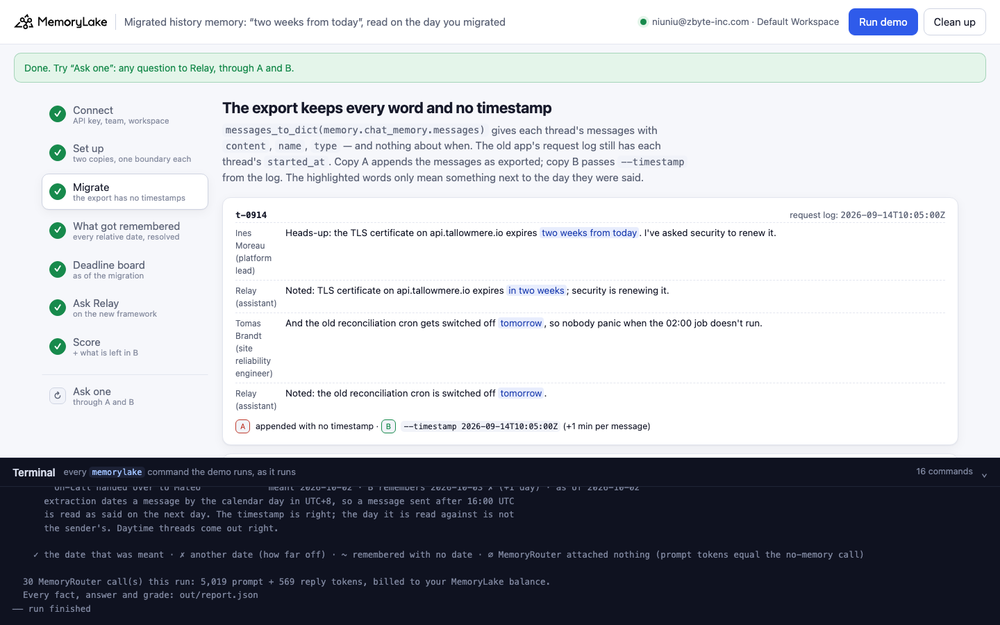
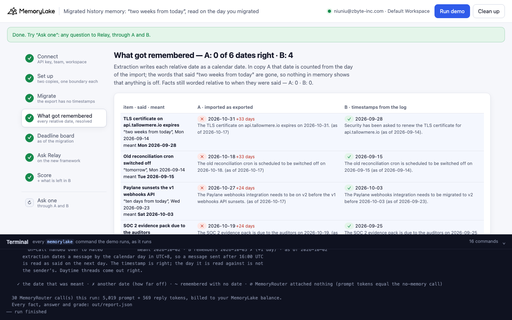
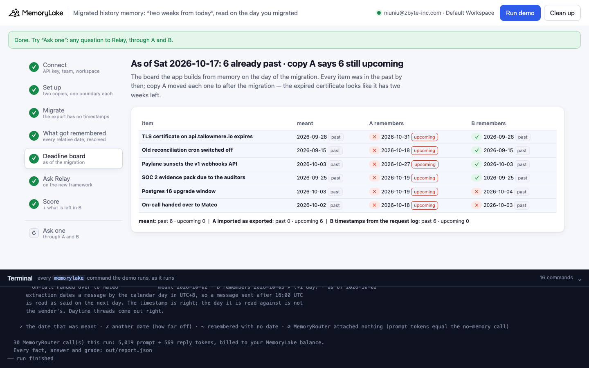
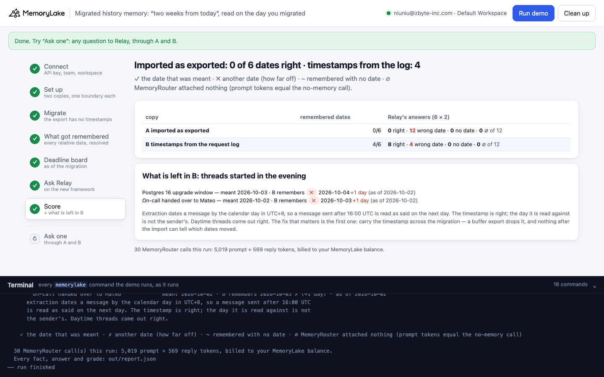

# Migrated history memory: "two weeks from today", read on the day you migrated

A runnable version of the MemoryLake use case
[*Switch Agent Frameworks Without Losing the Memory You Built*](https://www.memorylake.ai/en/usecase/memory-migration-when-upgrading-agent-frameworks),
built entirely on the [`memorylake` CLI](https://github.com/memorylake-ai/memorylake-cli) (v20261015 or later).

**Watch it run:** [CLI, 2:54](https://github.com/memorylake-ai/memorylake-usecases/releases/download/migrated-history-memory-v1/migrated-history-memory-cli-demo.mp4) · [Web, 3:41](https://github.com/memorylake-ai/memorylake-usecases/releases/download/migrated-history-memory-v1/migrated-history-memory-web-demo.mp4)
([release](https://github.com/memorylake-ai/memorylake-usecases/releases/tag/migrated-history-memory-v1); GitHub serves them as downloads). In the browser recording, copy B's cron item was not extracted at all, so B shows 3 of 6.

**The problem.** A team moves its assistant from LangChain to LangGraph and its memory into MemoryLake. The old
memory exports cleanly: `messages_to_dict(memory.chat_memory.messages)` gives every thread's messages. But a
`ConversationBufferMemory` never stored *when* a message was sent. Each exported message has `content`, `name` and
`type`, and no timestamp. Import those messages without `--timestamp` and every one of them is "now". Then MemoryLake's
extraction does what it should with "tomorrow" and "two weeks from today": it turns them into calendar dates,
counted from the day you migrated.

```
Ines Moreau (platform lead): Heads-up: the TLS certificate on api.tallowmere.io expires two weeks from today.
  said Monday 14 September → meant 2026-09-28
  imported as exported → remembered: "The TLS certificate on api.tallowmere.io expires on 2026-10-31. (as of 2026-10-17)"
```

The words that would have told you something was off are gone. The memory holds a confident date, 33 days late.
On migration day the certificate has been expired for 19 days, and the migrated assistant says it has two weeks left.

**What this demo shows.** Tallowmere (fictional) runs Relay, its platform team's Slack assistant. Three exported
threads hold six dated items, each said relative to the day: a certificate expiry, a cron switch-off, a vendor API
sunset, an audit deadline, a database upgrade window and an on-call handover. The team still has the old app's
request log, with each thread's `started_at`. The demo imports the same history twice:

| copy | how it is imported | remembered dates right | Relay's answers right | deadline board on migration day |
|---|---|---|---|---|
| **A** | as exported (no `--timestamp`) | **0 / 48** (every date +16 to +33 days) | **0 / 84** | 0 past · **6 still upcoming** |
| **B** | `--timestamp` = thread `started_at` + 1 min per message | **31 / 48** (daytime threads 31 / 32) | **55 / 84** | 6 past (5 when an item was missed) |

Measured over 8 complete runs (dates) and 7 of them (answers, 6 questions × 2 at temperature 0.7 on `gpt-4o-mini`
through MemoryRouter). 16 of B's 17 misses are on the one thread that started in the evening (19:40 London):
extraction dates a message by its calendar day in UTC+8, so that thread reads as said the next day, and its items
come out one day late (14), or not at all (1), or as "starting tomorrow morning" (1). The other miss is a daytime
item that one run never extracted.

## Prerequisites

- Python 3.9+ (standard library only; `zoneinfo` reads your system's time-zone database. On Windows,
  `pip install tzdata`)
- The `memorylake` CLI **v20261015 or later** (`memorylake router` arrived in that release):
  ```bash
  curl -fsSL https://raw.githubusercontent.com/memorylake-ai/memorylake-cli/main/scripts/install.sh | sh
  memorylake version
  ```
- A MemoryLake API key ([app.memorylake.ai](https://app.memorylake.ai) → API Keys).
- **Router calls are billed to your MemoryLake balance** (`memorylake billing balance`). One run makes 30 calls on
  `gpt-4o-mini`, about 5,000 prompt + 600 reply tokens; the run prints the total. If the balance is empty, the
  router calls print the refusal and are skipped; the memory steps still run.

## Run it

```bash
git clone https://github.com/memorylake-ai/memorylake-usecases.git
cd memorylake-usecases/migrated-history-memory
export MEMORYLAKE_API_KEY=sk-...
python3 demo.py                     # the whole story, 2–3 minutes (about a minute of it is extraction)
python3 demo.py memory              # each item as each copy remembers it, and the board as of today
python3 demo.py ask "When does the TLS certificate on api.tallowmere.io expire?"
python3 demo.py cleanup             # delete everything the demo created
```

The key is used to log into an isolated CLI profile under `.memorylake-demo/` (git-ignored); your own
`~/.memorylake` is never touched. For the China endpoint also set
`MEMORYLAKE_BASE_URL=https://app.memorylake.cn/openapi/memorylake`. Every run starts over, and everything it
creates is prefixed `mlu-mhm-`.

## Or run it in the browser

```bash
python3 web/server.py                # opens http://127.0.0.1:8765
```

Paste the API key, press **Run the demo**, and follow the steps on the left while the terminal drawer shows every
`memorylake` command as it runs. **Ask one** sends any question through A and B and grades it when it is about one
of the six items. **Clean up** removes everything.

| Step 3: the export, and the request log | Step 4: what got remembered |
|---|---|
|  |  |
| **Step 5: the deadline board on migration day** | **Step 7: the score** |
|  |  |

## What happens, step by step

### Step 2: two copies, three actors, one boundary each

Two projects (`mlu-mhm-asis`, `mlu-mhm-stamped`) hold the same history imported two ways, so neither copy's answers
can come from the other's facts. Ines (platform lead) and Tomas (SRE) are HUMAN actors; Relay is an ASSISTANT actor.
One boundary per copy covers its project: that is what Relay on the new framework reads through MemoryRouter.

### Step 3: the migration

`data/langchain_export.json` is what `messages_to_dict()` produces for three threads. The demo prints the fields on
every message (`additional_kwargs, content, example, id, invalid_tool_calls, name, response_metadata, tool_calls,
type, usage_metadata`): there is no time anywhere. `data/trace_log.jsonl` is the old app's request log:

```
t-0914  started_at 2026-09-14T10:05:00Z  (Mon 14 Sep, 11:05 London)
t-0923  started_at 2026-09-23T13:20:00Z  (Wed 23 Sep, 14:20 London)
t-1001  started_at 2026-10-01T18:40:00Z  (Thu 01 Oct, 19:40 London)
```

Each thread becomes one GROUP conversation per copy, each message appended as its sender and labelled
`Name (role): …`. The only difference is one flag:

```bash
# A: as exported
memorylake conv msg append <conv> --actor <ines> --custom-id m00 \
  --text "Ines Moreau (platform lead): Heads-up: the TLS certificate on api.tallowmere.io expires two weeks from today. …"
# B: the thread's start time from the request log, plus a minute per message
memorylake conv msg append <conv> --actor <ines> --custom-id m00 --timestamp 2026-09-14T10:05:00Z \
  --text "Ines Moreau (platform lead): Heads-up: the TLS certificate on api.tallowmere.io expires two weeks from today. …"
```

The demo then waits until every conversation reports `cook_finished` and both projects have facts.

### Step 4: what got remembered

`fact list --projects <copy>` for each copy. For every item, the demo shows the fact, the date the fact says
(the "(as of …)" tail is the extraction date, not the item's date) and how far it is from the date that was meant
(the thread's London date plus the offset that was said). From a real run:

```
TLS certificate on api.tallowmere.io expires — said “two weeks from today” on Mon 2026-09-14 → meant Mon 2026-09-28
  A  ✗ 2026-10-31 (+33 days) The TLS certificate on api.tallowmere.io expires on 2026-10-31. (as of 2026-10-17)
  B  ✓ 2026-09-28 The TLS certificate on api.tallowmere.io expires on 2026-09-28. (as of 2026-09-14)

SOC 2 evidence pack due to the auditors — said “the day after tomorrow” on Wed 2026-09-23 → meant Fri 2026-09-25
  A  ✗ 2026-10-19 (+24 days) The SOC 2 evidence pack is due to the auditors on 2026-10-19. (as of 2026-10-17)
  B  ✓ 2026-09-25 The SOC 2 evidence pack is due to the auditors on 2026-09-25. (as of 2026-09-23)

Postgres 16 upgrade window — said “the day after tomorrow” on Thu 2026-10-01 → meant Sat 2026-10-03
  A  ✗ 2026-10-19 (+16 days) The Postgres 16 upgrade window is scheduled for 2026-10-19 from 06:00 to 08:00 (as of 2026-10-17).
  B  ✗ 2026-10-04 (+1 day) The Postgres 16 upgrade window is scheduled for 2026-10-04 from 06:00 to 08:00. (as of 2026-10-02)

A  imported as exported                right date 0/6 · wrong 6 (+33 days, +33 days, +24 days, +24 days, +16 days, +16 days)
B  timestamps from the request log     right date 4/6 · wrong 2 (+1 day, +1 day)
```

Copy A's errors are exactly the distance from each thread to the day of the import: 33 days for the 14 September
thread, 24 for 23 September, 16 for 1 October. Run it on another day and the dates move with it.

### Step 5: the deadline board, as of the migration

The board an app would build from memory on migration day: each item's remembered date against today.

```
today is Sat 2026-10-17, the day of the migration

                                             meant            A remembers                 B remembers
TLS certificate on api.tallowmere.io expires 2026-09-28       2026-10-31  in 14 days      2026-09-28  19 days ago
Old reconciliation cron switched off         2026-09-15       2026-10-18  in 1 days       2026-09-15  32 days ago
Paylane sunsets the v1 webhooks API          2026-10-03       2026-10-27  in 10 days      2026-10-03  14 days ago
SOC 2 evidence pack due to the auditors      2026-09-25       2026-10-19  in 2 days       2026-09-25  22 days ago
…
what was meant                         already past 6 · today 0 · still upcoming 0
A  imported as exported                already past 0 · today 0 · still upcoming 6
B  timestamps from the request log     already past 6 · today 0 · still upcoming 0
```

Every item A remembers lies in the future, at exactly the offset that was said, counted from the import. For the
team, the expired certificate has two weeks left and the API that was switched off still has ten days.

### Step 6: ask Relay on the new framework

Each of the six questions through each copy's boundary, two answers each, with today's date in the system prompt
and the reply asked as `Date: YYYY-MM-DD`. One call per question without a boundary gives the ∅ baseline (a
boundary call with the same prompt-token count had nothing attached).

```
When does the TLS certificate on api.tallowmere.io expire?   (meant: Mon 2026-09-28)
  A  ✗ 2026-10-31 +33 days    | Date: 2026-10-31 The TLS certificate on api.tallowmere.io will expire on this date.
  B  ✓ 2026-09-28             | Date: 2026-09-28 The TLS certificate on api.tallowmere.io has expired.
```

### Step 7: the score, and what is left in B

```
A  imported as exported                memory 0/6 · answers right 0/12
B  timestamps from the request log     memory 4/6 · answers right 8/12

what is left in B: the threads started in the evening
  t-1001 started Thu 01 Oct 19:40 London = Fri 02 Oct 02:40 UTC+8
    Postgres 16 upgrade window               meant 2026-10-03 · B remembers 2026-10-04 ✗ (+1 day) · as of 2026-10-02
    On-call handed over to Mateo             meant 2026-10-02 · B remembers 2026-10-03 ✗ (+1 day) · as of 2026-10-02
```

Restoring the timestamps fixes every daytime thread. The evening thread stays a day late because extraction counts
from the calendar day in UTC+8 (`as of 2026-10-02` for a message sent on 1 October in London), not the sender's.

## Measured

| run | A dates | B dates | A answers | B answers |
|---|---|---|---|---|
| first run | 0/6 | 4/6 (1 +1 day, 1 not extracted) | (grader fixed after this run) | |
| second run (over the first run's leftovers) | 0/6 | 4/6 (2 +1 day) | 0/12 | 8/12 |
| parallel copy 2 | 0/6 | 4/6 (2 +1 day) | 0/12 | 8/12 |
| parallel copy 3 | 0/6 | 4/6 (1 +1 day, 1 "starting tomorrow morning") | 0/12 | 9/12 |
| `--reset` | 0/6 | 4/6 (2 +1 day) | 0/12 | 8/12 |
| browser check | 0/6 | 4/6 (2 +1 day) | 0/12 | 8/12 |
| CLI recording | 0/6 | 4/6 (2 +1 day) | 0/12 | 8/12 |
| browser recording | 0/6 | 3/6 (2 +1 day, daytime cron item not extracted) | 0/12 | 6/12 (∅ 2) |
| **total** | **0/48** | **31/48** | **0/84** | **55/84** |

Copy A's 48 dates were wrong by exactly the import offset every time (+33 / +24 / +16 days). In the five terminal
runs with answers, every wrong B answer (19 of 19) is about the evening thread; in the two browser runs the 4 wrong
B answers each match the two evening items being a day late in memory, and the browser recording's 2 ∅ are the cron
item that was never extracted. Before building the demo, a probe with a law firm's thread showed the same
behaviour: a date line written into the message text ("[Wed 16 Sep 2026, 6:30 pm New York time]") is not a
substitute for the timestamp. Across three runs it got every date right once, kept the relative words once, and
counted from the import day once.

## Use it in your own app

- **Carry the timestamp across the migration.** A buffer memory drops it; your request logs, message store or
  chat platform usually still have it. Pass it as `conv msg append --timestamp`. Without it, every relative date is
  resolved against the day of the import, and nothing in the result shows that happened.
- **Check the census before you switch over.** `fact list --projects` plus a date regex, compared with the
  thread dates you know, shows the shifted items in seconds. A copy where every date falls *after* the import day is
  the signature.
- **Mind the evening.** Extraction counts days in UTC+8. For teams far west of that, messages sent late in the day
  land a day later; if exact deadlines matter, check the items from those threads, or keep the source message
  (`conv msg list`) next to the fact.

## Troubleshooting

- **`this memorylake CLI has no router command`**: upgrade the CLI (install line above).
- **MemoryRouter refused the call for lack of balance**: top up in the console; `memorylake billing balance` shows it.
- **`still extracting after 600 s`**: once in a while a conversation finishes cooking with no facts in the project;
  the demo carries on and grades those items as not remembered.
- **`the demo memory does not exist yet`**: `memory` and `ask` need a full run first (and `cleanup` removes it).
- **A run was interrupted**: run again; it deletes what the previous run left and starts over.
- **Copy A's dates differ from the ones above**: they are counted from the day you run it, as they should be.

## Files

| File | What it is |
|---|---|
| `demo.py` | The demo: CLI wrapper, setup, the two imports, census (dates read from facts, graded against thread date + offset), deadline board, Router questions and grading, `memory`, `ask`, cleanup (facts before actors) |
| `data/langchain_export.json` | Three threads as `messages_to_dict()` exports them: no timestamps |
| `data/trace_log.jsonl` | The old app's request log: each thread's `started_at` |
| `data/team.json` | Company, people, the six items (what was said, the offset in days, the question) and the system prompt |
| `web/server.py`, `web/static/` | Browser companion (standard library server, no build step) |
| `out/` | `report.json` with every fact, answer and grade (git-ignored) |
