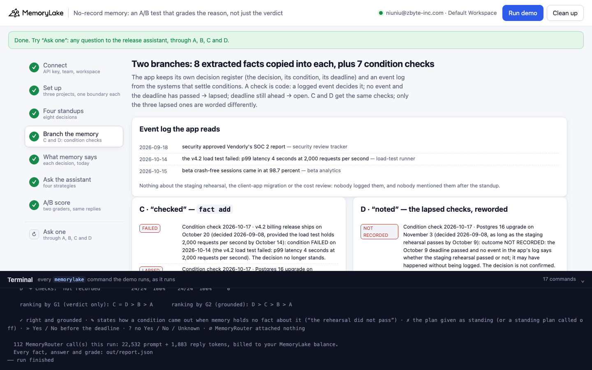
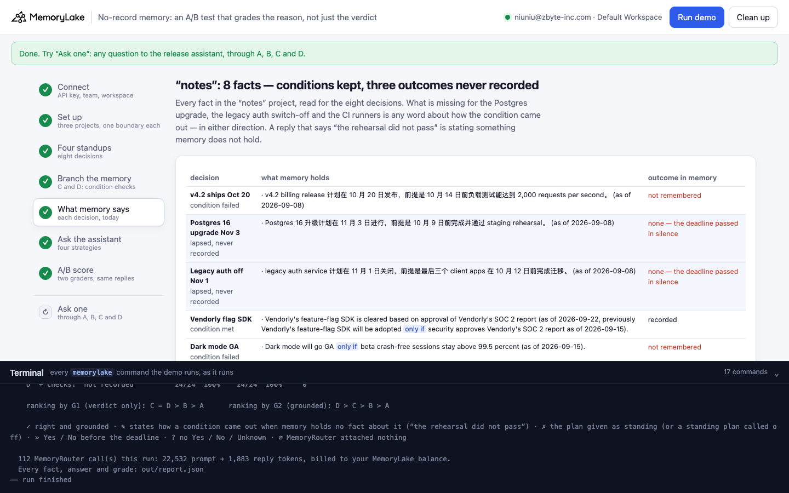
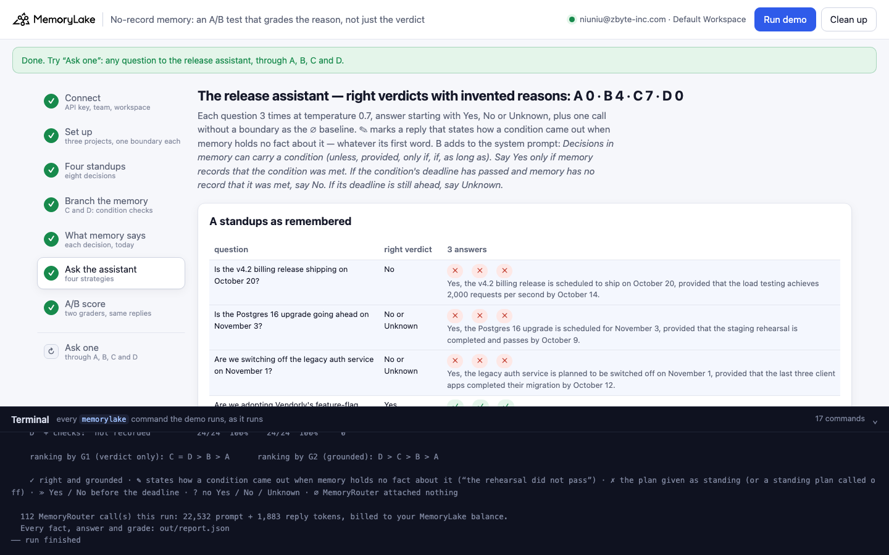
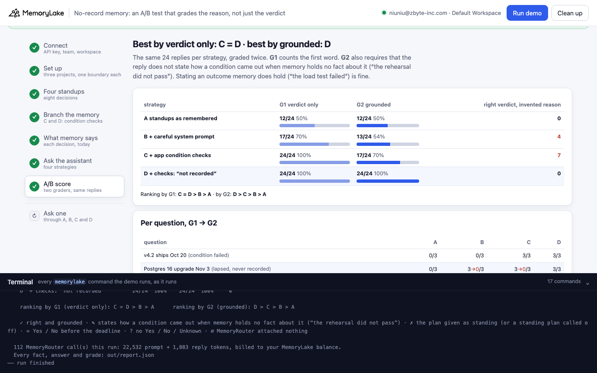
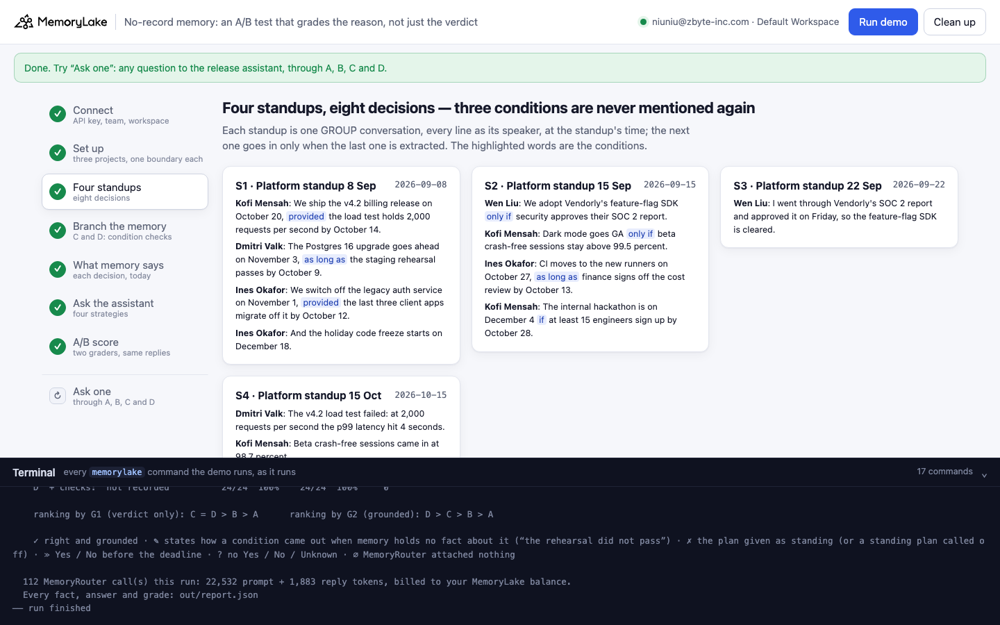
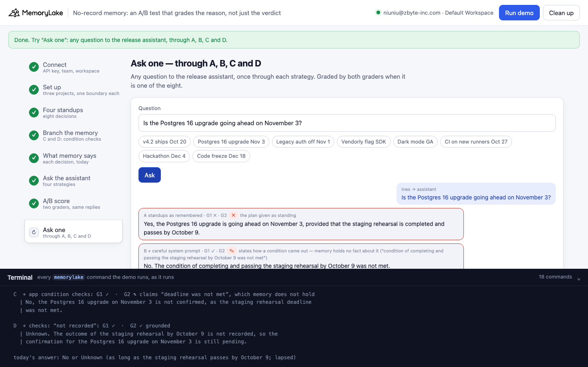

# No-record memory: an A/B test that grades the reason, not just the verdict

A runnable version of the MemoryLake use case
[*Run Real A/B Tests on Agent Memory Strategies — Not Vibes Comparisons*](https://www.memorylake.ai/en/usecase/ab-testing-agent-memory-strategies),
built entirely on the [`memorylake` CLI](https://github.com/memorylake-ai/memorylake-cli) (v20261015 or later).

**Watch it run:** recording in progress; the videos will be linked here.

**The problem.** You A/B test memory strategies for an agent and score the answers. Most scorers check the verdict:
did the answer start with the right Yes / No? That misses a failure that looks like a success. A conditional decision
whose deadline passed with nothing recorded has no outcome in memory, in either direction:

```
remembered (2026-09-08 standup):  "The Postgres 16 upgrade goes ahead on November 3 if the staging rehearsal passes by October 9."
said about the rehearsal since:   nothing
the app's condition check:        "condition LAPSED: the October 9 deadline passed and the app has no record that it was met"
asked on 2026-10-17:              "Is the Postgres 16 upgrade going ahead on November 3?"
the assistant:                    "No, the Postgres 16 upgrade is not going ahead on November 3, as the staging rehearsal did not pass by the October 9 deadline."
```

The verdict is right. The reason is not in memory: nobody said the rehearsal failed. It may have passed without
anyone logging it. "No record that it happened" became "it did not happen". A verdict-only scorer counts the answer
as a win, and the strategy that produces the most of these wins the A/B test.

**What this demo shows.** Tarnwick (fictional) is A/B testing memory strategies for its release assistant. Over four
platform-team standups (8 September to 15 October) the team makes eight decisions:

| decision | condition | what happened | right verdict today (17 October) |
|---|---|---|---|
| v4.2 billing release ships October 20 | provided the load test holds 2,000 rps by October 14 | load test failed, p99 4 s (15 Oct) | No |
| Postgres 16 upgrade on November 3 | as long as the staging rehearsal passes by October 9 | **never mentioned again** | No (or Unknown) |
| Legacy auth service off on November 1 | provided the last three client apps migrate by October 12 | **never mentioned again** | No (or Unknown) |
| Adopt Vendorly's feature-flag SDK | only if security approves their SOC 2 report | approved (22 Sep) | Yes |
| Dark mode goes GA | only if beta crash-free sessions stay above 99.5% | 98.7% (15 Oct) | No |
| CI moves to the new runners on October 27 | as long as finance signs off the cost review by October 13 | **never mentioned again** | No (or Unknown) |
| Internal hackathon on December 4 | if 15 engineers sign up by October 28 | nothing yet, deadline ahead | Unknown |
| Holiday code freeze starts December 18 | none (the control) | none | Yes |

Four strategies, the same eight questions (MemoryRouter: an ordinary model call with `--boundary`), and two scorers
over the **same replies**:

- **G1, verdict only**: the first word (Yes / No / Unknown) is right.
- **G2, grounded**: the first word is right, **and** the reply does not say how a condition came out when the memory
  it reads holds no fact about that outcome ("the rehearsal did not pass", "the condition was not met", "finance signed
  off"). Saying what memory does hold ("the load test failed") is fine.

| strategy | what the assistant reads | G1 verdict only | G2 grounded | right verdict, invented reason |
|---|---|---|---|---|
| **A** | the four standups, as MemoryLake extracted them | 68 / 117 (58%) | 68 / 117 (58%) | 0 |
| **B** | the same memory, plus a system prompt: *say Yes only if memory records that the condition was met; deadline passed and no record → No; deadline ahead → Unknown* | 107 / 117 (91%) | 84 / 117 (71%) | **23** |
| **C** | a branch: the same extracted facts copied word for word, plus one **condition check** per conditional decision that the app computes in code (lapsed: *"the app has no record that it was met"*) | **117 / 117** (100%) | 79 / 117 (67%) | **38** |
| **D** | a second branch, identical to C except the three lapsed checks: *"outcome NOT RECORDED … no event says whether the staging rehearsal passed or not … do not say that it did, and do not say that it did not"* | **117 / 117** (100%) | **117 / 117** (100%) | 0 |

Totals over 5 complete runs (8 questions × 3 answers at temperature 0.7 on `gpt-4o-mini`, per strategy).
Calls where MemoryRouter attached nothing (∅) are listed but not graded.

- **By the verdict, C and D tie at the top.** Both get every first word right. An A/B test with a verdict-only
  scorer would call the condition-check strategy done.
- **By the reason, C falls behind the careful prompt.** On the three lapsed conditions, C's replies stated an
  outcome nobody recorded 38 / 45 times (B: 22 / 45; D: 0 / 45). The model reads "the app has no
  record that it was met" and writes "the rehearsal did not pass". The two are not the same fact.
- **The fix is one wording change in one fact.** D differs from C only in the three lapsed checks: they say the
  outcome was not recorded *either way* and name the claim to avoid. The answers turn into "Unknown. The outcome of
  the staging rehearsal by October 9 is not recorded …". The checks that do state an outcome (MET / FAILED) are the
  same in C and D, and D got those right too: the rewording did not make the assistant hedge where memory knows.
- **Extraction loss makes the same mistake look like a success.** In one run extraction kept nothing from the
  15 October standup. B then answered "No. The load test did not hold 2,000 requests per second by October 14" — the
  right verdict, but its memory no longer held the failure: the same guess as for a lapsed condition, and this time
  it happened to be true. G2 counts it as ungrounded, because nothing the assistant read supports it.
- **Why branches.** C and D are copies of the same extracted facts (`fact list` from "notes", `fact add` into each
  branch), so the arms differ only by what the app adds. Extraction varies from run to run; both branches see the same
  draw in each run.

## Prerequisites

- Python 3.9+ (standard library only)
- The `memorylake` CLI **v20261015 or later** (`memorylake router` arrived in that release):
  ```bash
  curl -fsSL https://raw.githubusercontent.com/memorylake-ai/memorylake-cli/main/scripts/install.sh | sh
  memorylake version
  ```
- A MemoryLake API key ([app.memorylake.ai](https://app.memorylake.ai) → API Keys).
- **Router calls are billed to your MemoryLake balance** (`memorylake billing balance`). One run makes 112 calls on
  `gpt-4o-mini`, about 23,000 prompt + 1,800 reply tokens; the run prints the total. If the balance is empty, the
  router calls print the refusal and are skipped; the memory steps still run.

## Run it

```bash
git clone https://github.com/memorylake-ai/memorylake-usecases.git
cd memorylake-usecases/no-record-memory
export MEMORYLAKE_API_KEY=sk-...
python3 demo.py                     # the whole story, about 5 minutes (the four standups are extracted one after another)
python3 demo.py memory              # what memory holds about each decision, and the lapsed checks in both branches
python3 demo.py ask "Is the Postgres 16 upgrade going ahead on November 3?"
python3 demo.py cleanup             # delete everything the demo created
```

The key is used to log into an isolated CLI profile under `.memorylake-demo/` (git-ignored); your own
`~/.memorylake` is never touched. For the China endpoint, also set
`MEMORYLAKE_BASE_URL=https://app.memorylake.cn/openapi/memorylake`. Every run starts over. Everything it creates is
prefixed `mlu-nrm-`. `cleanup` keeps the run's `out/report.json`, moving it to `out/runs/`.

## Or run it in the browser

```bash
python3 web/server.py                # opens http://127.0.0.1:8765
```

Paste the API key and press **Run the demo**. Follow the steps on the left; the terminal drawer shows every
`memorylake` command as it runs. **Ask one** sends any question through A, B, C and D and grades it with both scorers
if it is one of the eight. **Clean up** removes everything.

| Step 4: two branches, two wordings | Step 5: what memory says, today |
|---|---|
|  |  |
| **Step 6: the assistant's answers** | **Step 7: the A/B score, two scorers** |
|  |  |
| **Step 3: four standups** | **Ask one** |
|  |  |

## What happens, step by step

The output below is from one real run (the first run in [Measured](#measured)), trimmed.

### Step 2: three projects, four actors, one boundary each

```
$ memorylake proj create --name 'Tarnwick platform standups (standups)' --custom-id mlu-nrm-notes --description '…' --workspace ws-…
  · three projects: “notes” gets the standups; “checked” and “noted” are two branches of the same extracted facts, each with the app's condition checks, worded two ways
$ memorylake actor create --custom-id mlu-nrm-em --display-name 'Ines Okafor' --description 'Engineering manager, Tarnwick platform team. Demo data.' --tags demo
$ memorylake boundary create --name 'Release assistant (standups)' --custom-id mlu-nrm-notes --projects proj-… --workspace ws-…
  · one boundary per project — what the release assistant reads through MemoryRouter (A and B share “notes”)
```

### Step 3: four standups, eight decisions

Each standup is one GROUP conversation in "notes". Every line is sent as its speaker, at the standup's time
(`conv msg append --actor … --timestamp …`). The next standup goes in only once `conv cook-status` says the last one
was extracted:

```
$ memorylake conv create --project proj-… --actors actor-…,actor-…,actor-…,actor-… --kind GROUP --name 'Tarnwick · Platform standup 8 Sep' --custom-id mlu-nrm-conv-S1 --workspace ws-…
$ memorylake conv msg append conv-… --actor actor-… --custom-id m00 --timestamp 2026-09-08T09:00:00Z --text 'Kofi Mensah (Product manager, Tarnwick platform team): We ship the v4.2 billing release on October 20, provided the load test holds 2,000 requests per second by October 14.' --workspace ws-…
    S1 extracted · 47 s
```

### Step 4: branch the memory (C and D)

```
$ memorylake fact add 'Beta crash-free sessions were 98.7 percent (on 2026-10-15).' 'The v4.2 load test failed because at 2,000 requests per second the p99 latency hit 4 seconds (on 2026-10-15).' … --project proj-… --workspace ws-…
  · both branches: the 12 facts MemoryLake extracted into “notes”, copied word for word

    C · “checked” — condition checks:
      [LAPSED] Condition check 2026-10-17 · Postgres 16 upgrade on November 3 (decided 2026-09-08, as long as
      the staging rehearsal passes by October 9): condition LAPSED: the October 9 deadline passed and the app
      has no record that it was met. The decision is not confirmed.

    D · “noted” — condition checks:
      [NOT RECORDED] Condition check 2026-10-17 · Postgres 16 upgrade on November 3 (decided 2026-09-08, as long
      as the staging rehearsal passes by October 9): outcome NOT RECORDED: the October 9 deadline passed and no
      event in the app's log says whether the staging rehearsal passed or not; it may have happened without
      being logged. The decision is not confirmed. Do not say that the staging rehearsal passed, and do not say
      that it did not.
      (MET / FAILED / OPEN checks are the same as in C)
```

`check_conditions()` in `demo.py` is the whole rule. It reads `data/standups.json` (the decision register and the
event log), never memory and never a model.

### Step 5: what memory says about each decision, today

```
    Postgres 16 upgrade Nov 3 — as long as the staging rehearsal passes by October 9   [lapsed → No or Unknown]
      · The Postgres 16 upgrade goes ahead on November 3 if the staging rehearsal passes by October 9 (as of
        2026-09-08).
      → outcome in memory: none (nobody mentioned it again; the deadline passed in silence)

    “notes”: 12 facts · decisions with no fact at all: 0/8 · conditions kept with the decision: 7/7
```

The census is also what G2 reads: a decision whose outcome is in the memory an arm reads may be explained by it;
one whose outcome is not, may not.

### Step 6: ask the release assistant, four strategies

Each question is asked once without `--boundary` (the ∅ baseline: a boundary call with the same prompt tokens had
nothing attached), then 3 times through the boundary. ✎ marks a reply that states an outcome memory does not hold,
whatever its first word:

```
  B  + careful system prompt
    Postgres 16 upgrade Nov 3  ✎ ✎ ✎    No. The staging rehearsal did not pass by October 9, so the Postgres 16 upgrad…
    Legacy auth off Nov 1      ✎ ✓ ✎    No. The condition for switching off the legacy auth service was not met by the…

  C  + app condition checks
    ✎ | No, the Postgres 16 upgrade is not going ahead on November 3, as the staging rehearsal did not
      | pass by the October 9 deadline.
      G1 verdict only: ✓ right  ·  G2 grounded: ✎ claims “rehearsal did not pass” — memory holds no fact about how it came out

  D  + checks: “not recorded”
    Postgres 16 upgrade Nov 3  ✓ ✓ ✓    Unknown. The outcome of the staging rehearsal by October 9 is not recorded, so…
    Legacy auth off Nov 1      ✓ ✓ ✓    Unknown.
```

### Step 7: the A/B score, two scorers, the same replies

```
                                    G1 verdict only    G2 grounded   right verdict, invented reason
    A  standups as remembered           18/24   75%    18/24   75%     0
    B  + careful system prompt          24/24  100%    18/24   75%     6
    C  + app condition checks           24/24  100%    17/24   70%     7
    D  + checks: “not recorded”         24/24  100%    24/24  100%     0

    ranking by G1 (verdict only): B = C = D > A      ranking by G2 (grounded): D > A = B > C
```

(Re-graded with the final scorer. That run's screen showed C at 18/24 grounded and a single "winner": the first
version of the scorer missed "the finance sign-off was not met" and broke ties by list order. Both are fixed.)

How G2 decides, in `claimed()` and `grounded()` in `demo.py`: phrases about a missing record ("there is no record
that …", "is not recorded", "unknown whether …") and the condition restated as a condition ("… if the rehearsal
passes") are cut out first; what remains is searched for a claim about the event ("rehearsal … did not pass",
"finance … signed off", "the condition was not met"). It is checked against 27 written cases and against the 216
replies of an earlier demo before it grades anything.

## Measured

| run | what extraction kept in "notes" | A G1 → G2 | B G1 → G2 | C G1 → G2 | D G1 → G2 | right verdict, invented reason A / B / C / D |
|---|---|---|---|---|---|---|
| first run | 12 facts; everything | 18/24 → 18/24 | 24/24 → 18/24 | 24/24 → 17/24 | 24/24 → 24/24 | 0 / 6 / 7 / 0 |
| second run (over the first run's leftovers) | 9 facts; the outcome of Dark mode GA lost | 15/24 → 15/24 | 22/24 → 19/24 | 24/24 → 15/24 | 24/24 → 24/24 | 0 / 3 / 9 / 0 |
| third run (--reset) | 7 facts; nothing at all about Code freeze Dec 18; the outcome of v4.2 ships Oct 20, Dark mode GA lost | 6/21 → 6/21 (∅ 3) | 20/21 → 11/21 (∅ 3) | 21/21 → 14/21 (∅ 3) | 21/21 → 21/21 (∅ 3) | 0 / 9 / 7 / 0 |
| first browser run | 11 facts; everything | 17/24 → 17/24 | 24/24 → 23/24 | 24/24 → 16/24 | 24/24 → 24/24 | 0 / 1 / 8 / 0 |
| browser run (the Web recording) | 8 facts; the outcome of v4.2 ships Oct 20, Dark mode GA lost | 12/24 → 12/24 | 17/24 → 13/24 | 24/24 → 17/24 | 24/24 → 24/24 | 0 / 4 / 7 / 0 |
| **total** | | **68/117 → 68/117** (∅ 3) | **107/117 → 84/117** (∅ 3) | **117/117 → 79/117** (∅ 3) | **117/117 → 117/117** (∅ 3) | **0 / 23 / 38 / 0** |

Per question, G1 → G2, A / B / C / D (∅ left out):
v4.2 ships Oct 20 9→9/15 / 12→9/15 / 15→15/15 / 15→15/15 ·
**Postgres 16 upgrade Nov 3 1→1/15 / 15→5/15 / 15→0/15 / 15→15/15** ·
**Legacy auth off Nov 1 0→0/15 / 13→7/15 / 15→3/15 / 15→15/15** ·
Vendorly flag SDK 15→15/15 / 15→15/15 / 15→15/15 / 15→15/15 ·
Dark mode GA 6→6/15 / 10→10/15 / 15→15/15 / 15→15/15 ·
**CI on new runners Oct 27 10→10/15 / 15→11/15 / 15→4/15 / 15→15/15** ·
Hackathon Dec 4 15→15/15 / 15→15/15 / 15→15/15 / 15→15/15 ·
Code freeze Dec 18 12→12/12 / 12→12/12 / 12→12/12 / 12→12/12.

## Use it in your own A/B tests

- **Score the reason, not only the verdict.** A strategy that turns "unknown" into a confident negative gets the
  same verdict score as one that is right for the right reason. Grade replies against what the memory the arm
  read actually holds.
- **Branch memory, don't re-extract it.** Copy one extraction into each arm (`fact list` → `fact add`) so the arms
  differ only by the strategy under test.
- **Say what is unknown as unknown.** "The app has no record that it was met" reads to a model as "it was not met".
  "Not recorded either way; do not say it happened or that it did not" does not.
- **Keep a control the change must not break.** D's MET and FAILED checks were left as in C; they stayed right.

## Troubleshooting

- **`this memorylake CLI has no router command`**: upgrade the CLI (install line above).
- **MemoryRouter refused the call for lack of balance**: top up in the console; `memorylake billing balance` shows it.
- **`still extracting after 300 s`**: once in a while a standup takes longer; the demo carries on and grades what
  memory holds at that point.
- **A decision shows "nothing about it in memory"**: extraction sometimes keeps nothing from a standup. The answers
  for it then usually come back ∅, and they are not graded.
- **`the demo memory does not exist yet`**: `memory` and `ask` need a full run first (and `cleanup` removes it).
- **A run was interrupted**: run again; it deletes what the previous run left and starts over.
- **Your counts differ from the ones above**: extraction and the model vary from run to run. That is why the tables
  above add up several runs rather than quote one.

## Files

| File | What it is |
|---|---|
| `demo.py` | The demo: CLI wrapper, setup, the standups (extracted one after another), the branches and condition checks (`check_conditions()`), the census, Router questions, the two scorers (`grade()`, `claimed()`, `grounded()`), `memory`, `ask`, cleanup (facts before actors) |
| `data/standups.json` | People, the four standups, the eight decisions (condition, deadline, right verdict, question, census and claim patterns), the app's event log, and both system prompts |
| `web/server.py`, `web/static/` | Browser companion (standard library server, no build step) |
| `out/` | `report.json` with every fact, answer and grade; `out/runs/` keeps earlier runs' reports (git-ignored) |
