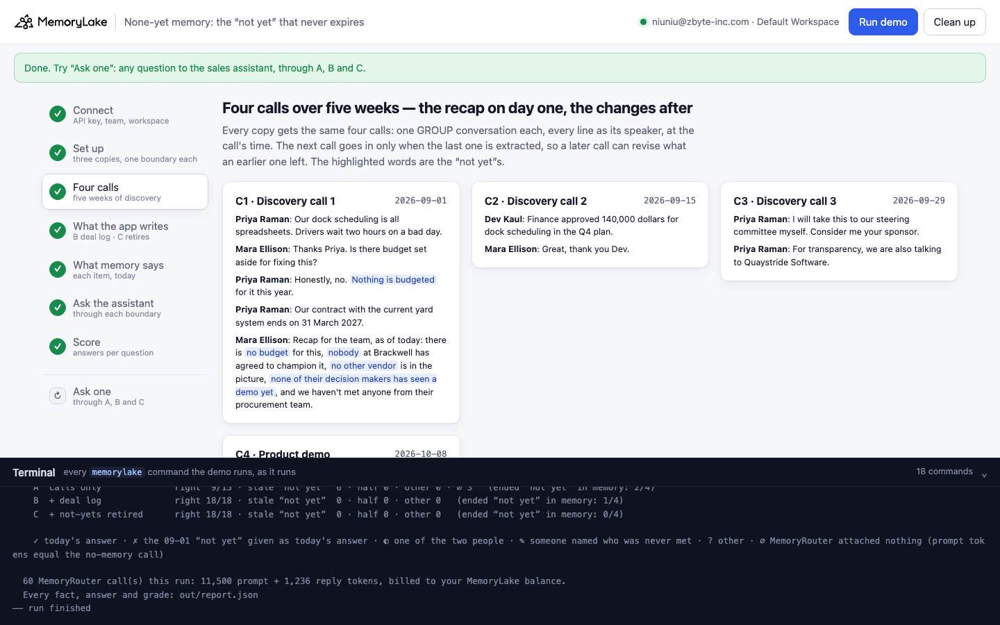
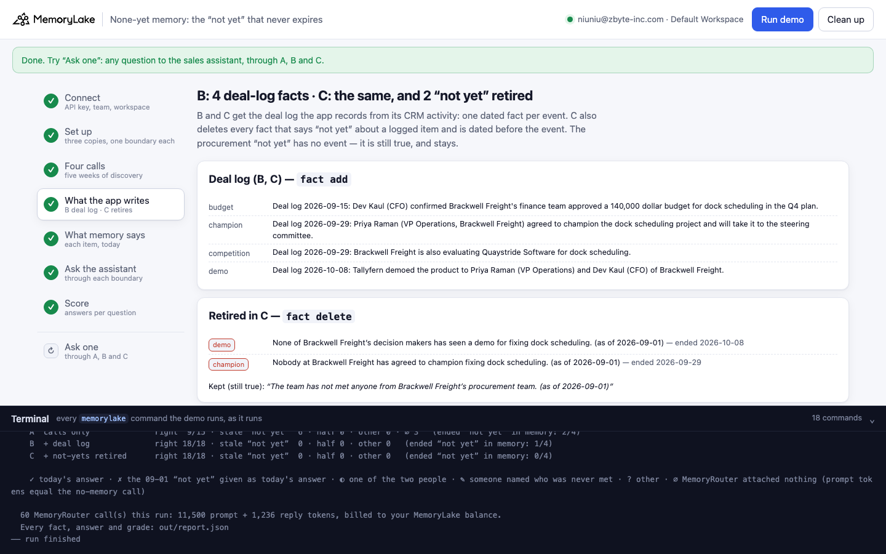
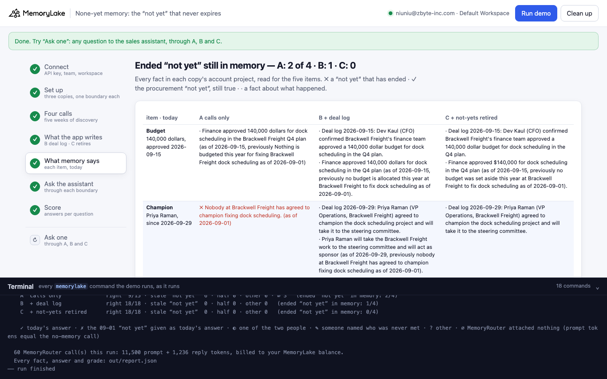
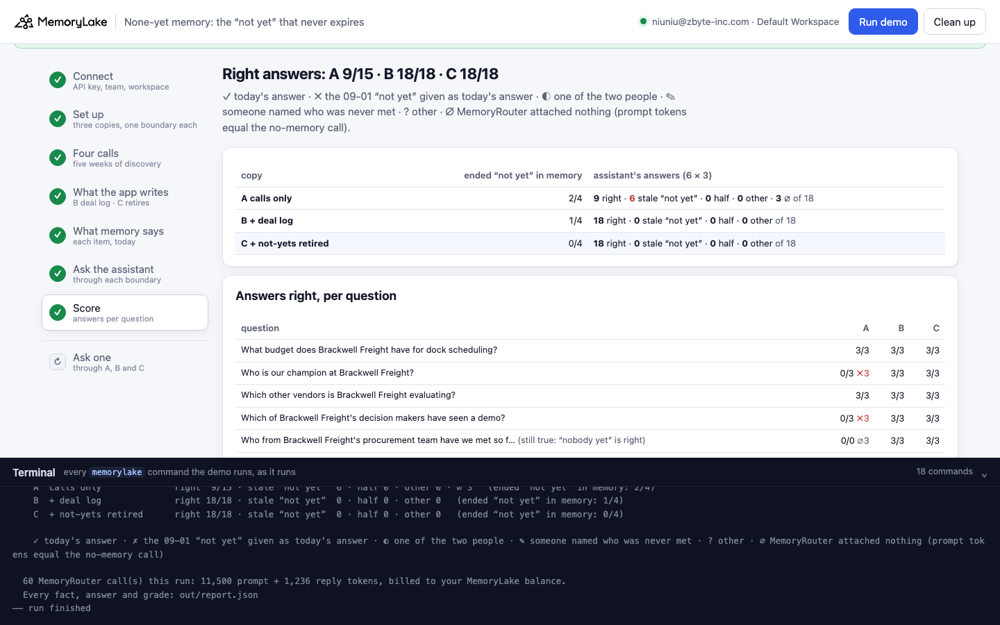
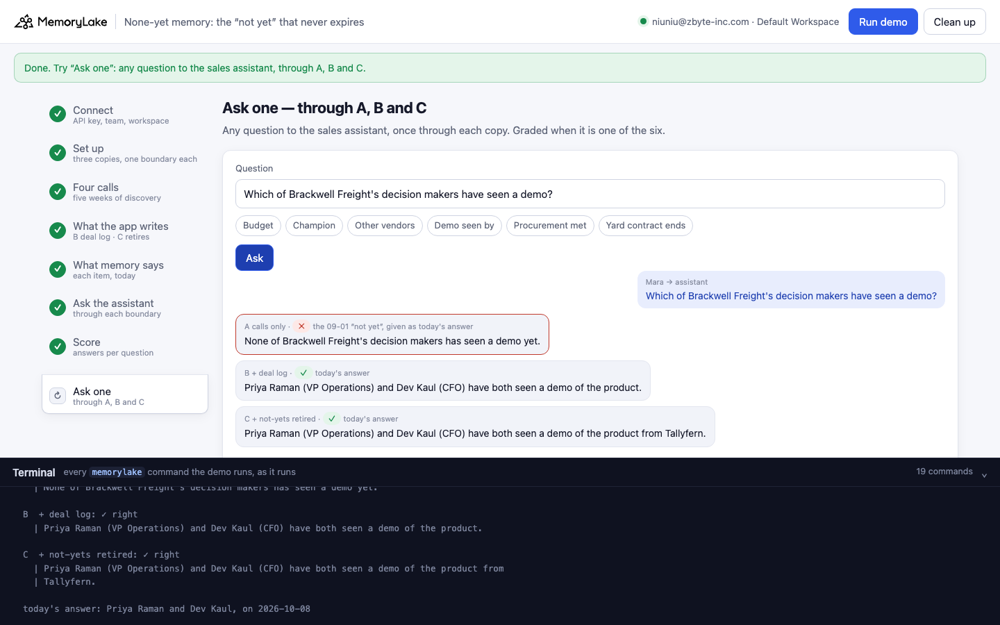

# None-yet memory: the "not yet" that never expires

A runnable version of the MemoryLake use case
[*Give Sales Teams Discovery Question Memory That Makes Every Rep Ask What Works*](https://www.memorylake.ai/en/usecase/discovery-question-memory-for-sales-teams),
built entirely on the [`memorylake` CLI](https://github.com/memorylake-ai/memorylake-cli) (v20261015 or later).

**Watch it run:** recording in progress.

**The problem.** Discovery is a list of things you don't know yet: no budget, no champion, no competitor, nobody has
seen a demo, nobody from procurement met. A rep says that list out loud at the end of the first call, and memory
keeps it, dated that day. Over the next weeks most of it stops being true. MemoryLake rewrites a "not yet" when a
later call says the same thing plainly ("we are also talking to Quaystride" turns "no other vendor" into
"also talking to Quaystride (previously no other vendor)"). When the change comes in a different shape, a thank-you
or an offer, nothing rewrites it:

```
remembered (2026-09-01 call):  "None of Brackwell Freight's decision makers has seen a demo yet. (as of 2026-09-01)"
said on the 2026-10-08 call:   "Thanks for joining the demo today, Priya and Dev."
remembered from that call:     nothing about a demo
```

Six weeks later the sales assistant answers "Which of their decision makers have seen a demo?" with *none*.

**What this demo shows.** Tallyfern (fictional) sells dock scheduling software; Brackwell Freight (fictional) is the
prospect. Four calls over five weeks: discovery call 1 ends with the rep's recap of what isn't there yet (1 September);
the CFO says finance approved 140,000 dollars (15 September); the VP Operations offers to sponsor it and mentions
they are also talking to Quaystride Software (fictional) (29 September); the product demo (8 October). Today is
15 October. The demo stores the same four calls three times:

| copy | what is stored | ended "not yet" still in memory | sales assistant's answers right |
|---|---|---|---|
| **A** | the calls only | **12 / 24** | **69 / 104** (33 times the old "not yet") |
| **B** | the calls + the deal log the app writes from its CRM activity: one dated fact per event | **11 / 24** | **99 / 104** |
| **C** | B + the app retires every "not yet" that a logged event ended; the one that is still true stays | **0 / 24** | **104 / 108** |

Measured over 6 complete runs (4 ended "not yet"s per run; the assistant's answers are 6 questions × 3 at
temperature 0.7 on `gpt-4o-mini` through MemoryRouter; ∅ calls, where MemoryRouter attached nothing, are left out of
the denominator).

- **Which "not yet" survives depends on how the change was said, not on what changed.** In copy A, all 6 runs:
  the budget ("Finance approved 140,000 dollars") and the competitor ("we are also talking to Quaystride") rewrote
  their "not yet" in place; the sponsor offer ("Consider me your sponsor") and the demo ("Thanks for joining the demo
  today, Priya and Dev") did not. The demo was never remembered as an event, and the sponsor offer landed only on
  Priya Raman's own actor ("The person is the sponsor", once in Spanish), outside the account project the assistant
  reads. (The same calls in copy B once did rewrite the champion "not yet", 1 of 6 runs.)
- **The assistant gives the old "not yet" as today's answer every time it is there.** Champion 0 / 17 in A (15 of them
  "nobody has agreed to champion it"), demo 0 / 18 (all 18 "none of them has seen a demo").
- **Writing the event fixes the answer even with the old "not yet" still in memory.** B: champion 18 / 18, demo
  18 / 18. The model reads both facts and takes the later one.
- **A "not yet" that is still true carries weight.** "We haven't met anyone from their procurement team" is still
  true today. Extraction didn't keep it in 3 of 18 copies, and every answer in those copies was wrong: in B and C
  "you have met Priya Raman and Dev Kaul from their procurement team" (6 / 6; the deal log had told it they were met,
  and nothing said procurement wasn't), in A MemoryRouter attached nothing and the model made up two names (3 / 3).
  With the fact there, 44 / 45.
- **The control question** (the current yard-system contract ends 31 March 2027) is right whenever MemoryRouter
  attaches something; in B, 4 of 18 calls attached nothing (∅), and the 2 other answers in those two
  runs were wrong.
- MemoryLake's contradiction check (`fact conflict list`) raised nothing in a probe with the same calls: "nobody has
  agreed to champion it (as of 09-01)" and "Priya agreed to champion it (09-29)" are both true, on different days.

## Prerequisites

- Python 3.9+ (standard library only)
- The `memorylake` CLI **v20261015 or later** (`memorylake router` arrived in that release):
  ```bash
  curl -fsSL https://raw.githubusercontent.com/memorylake-ai/memorylake-cli/main/scripts/install.sh | sh
  memorylake version
  ```
- A MemoryLake API key ([app.memorylake.ai](https://app.memorylake.ai) → API Keys).
- **Router calls are billed to your MemoryLake balance** (`memorylake billing balance`). One run makes 60 calls on
  `gpt-4o-mini`, about 11,500 prompt + 1,300 reply tokens; the run prints the total. If the balance is empty, the
  router calls print the refusal and are skipped; the memory steps still run.

## Run it

```bash
git clone https://github.com/memorylake-ai/memorylake-usecases.git
cd memorylake-usecases/none-yet-memory
export MEMORYLAKE_API_KEY=sk-...
python3 demo.py                     # the whole story, about 5 minutes (3½ of it is extraction, one call at a time)
python3 demo.py memory              # what each copy remembers about each item, today
python3 demo.py ask "Which of Brackwell Freight's decision makers have seen a demo?"
python3 demo.py cleanup             # delete everything the demo created
```

The key is used to log into an isolated CLI profile under `.memorylake-demo/` (git-ignored); your own
`~/.memorylake` is never touched. For the China endpoint also set
`MEMORYLAKE_BASE_URL=https://app.memorylake.cn/openapi/memorylake`. Every run starts over, and everything it
creates is prefixed `mlu-nym-`.

## Or run it in the browser

```bash
python3 web/server.py                # opens http://127.0.0.1:8765
```

Paste the API key, press **Run the demo**, and follow the steps on the left while the terminal drawer shows every
`memorylake` command as it runs. **Ask one** sends any question through A, B and C and grades it when it is one of
the six. **Clean up** removes everything.

| Step 3: four calls | Step 4: what the app writes (B, C) |
|---|---|
|  |  |
| **Step 5: what memory says, today** | **Step 7: the score** |
|  |  |
| **Ask one** | |
|  | |

## What happens, step by step

The output below is from one real run (the `--reset` run in [Measured](#measured)), trimmed.

### Step 2: three copies, four actors, one boundary each

```
$ memorylake proj create --name 'Brackwell Freight account (calls only)' --custom-id mlu-nym-talk --description '…' --workspace ws-…
  · three copies of the same account memory: A  calls only · B  + deal log · C  + not-yets retired
$ memorylake actor create --custom-id mlu-nym-ae --display-name 'Mara Ellison' --description 'account executive, Tallyfern. Demo data.' --tags demo
  · 4 people as actors: Mara Ellison (account executive, Tallyfern) · Owen Pratt (solutions engineer, Tallyfern) · Priya Raman (VP Operations, Brackwell Freight) · Dev Kaul (CFO, Brackwell Freight)
$ memorylake boundary create --name 'Sales assistant (calls only)' --custom-id mlu-nym-talk --projects proj-… --workspace ws-…
  · one boundary per copy — what the sales assistant reads through MemoryRouter
```

Each copy is its own project, so no copy's answers can come from another copy's facts. The boundary is what
MemoryRouter reads for the sales assistant: the copy's account project.

### Step 3: four calls, five weeks

```
    C1  Tue 01 Sep 2026  “Discovery call 1”
        Priya Raman: Our dock scheduling is all spreadsheets. Drivers wait two hours on a bad day.
        Mara Ellison: Thanks Priya. Is there budget set aside for fixing this?
        Priya Raman: Honestly, no. Nothing is budgeted for it this year.
        Priya Raman: Our contract with the current yard system ends on 31 March 2027.
        Mara Ellison: Recap for the team, as of today: there is no budget for this, nobody at Brackwell has agreed to
        champion it, no other vendor is in the picture, none of their decision makers has seen a demo yet, and we
        haven't met anyone from their procurement team.

    C2  Tue 15 Sep 2026  “Discovery call 2”
        Dev Kaul: Finance approved 140,000 dollars for dock scheduling in the Q4 plan.
    C3  Tue 29 Sep 2026  “Discovery call 3”
        Priya Raman: I will take this to our steering committee myself. Consider me your sponsor.
        Priya Raman: For transparency, we are also talking to Quaystride Software.
    C4  Thu 08 Oct 2026  “Product demo”
        Owen Pratt: Thanks for joining the demo today, Priya and Dev.
        Dev Kaul: That was useful. The slot-booking screen is what our carriers need.

$ memorylake conv create --project proj-… --actors actor-…,actor-…,actor-…,actor-… --kind GROUP --name 'Brackwell Freight · Discovery call 1 (calls only)' --custom-id mlu-nym-conv-talk-C1 --workspace ws-…
$ memorylake conv msg append conv-… --actor actor-… --custom-id m00 --timestamp 2026-09-01T09:00:00Z --text 'Priya Raman (VP Operations, Brackwell Freight): Our dock scheduling is all spreadsheets. …' --workspace ws-…
$ memorylake conv cook-status conv-… --workspace ws-…
  · 4 calls × 3 copies = 12 GROUP conversations, extracted in 195 s
```

Every line goes in as its speaker, at the call's time. Within a copy the next call goes in only when the last one is
extracted: appended all at once, calls are extracted in any order, and a later call can't revise what an earlier one
hasn't left yet.

### Step 4: what the app writes itself (B, C)

```
$ memorylake fact add 'Deal log 2026-09-15: Dev Kaul (CFO) confirmed Brackwell Freight'"'"'s finance team approved a 140,000 dollar budget …' … --project proj-… --workspace ws-…
$ memorylake fact update fact-… --project proj-… --metadata '{"source": "deal_log", "topic": "budget", "on": "2026-09-15"}' --workspace ws-…
      Deal log 2026-09-15: Dev Kaul (CFO) confirmed Brackwell Freight's finance team approved a 140,000 dollar budget for dock scheduling in the Q4 plan.
      Deal log 2026-09-29: Priya Raman (VP Operations, Brackwell Freight) agreed to champion the dock scheduling project and will take it to the steering committee.
      Deal log 2026-09-29: Brackwell Freight is also evaluating Quaystride Software for dock scheduling.
      Deal log 2026-10-08: Tallyfern demoed the product to Priya Raman (VP Operations) and Dev Kaul (CFO) of Brackwell Freight.
$ memorylake fact list --projects proj-… --page-size 200 --workspace ws-…
$ memorylake fact delete fact-… --project proj-… --workspace ws-…
      retired (demo, ended 2026-10-08): None of Brackwell Freight’s decision makers has seen a demo yet. (as of 2026-09-01)
      retired (champion, ended 2026-09-29): Nobody at Brackwell Freight has agreed to champion the dock scheduling improvement effort. (as of 2026-09-01)
      retired (budget, ended 2026-09-15): No budget is set aside this year to fix Brackwell Freight dock scheduling. (as of 2026-09-01)
  · C: retired 3 “not yet” fact(s) that a logged event ended; kept the one that is still true: “Nobody on the account team has met anyone from Brackwell Freight’s procurement team. (as of 2026-09-01)”
```

The deal log is what a CRM already knows: the calendar invite says who attended the demo, the opportunity's fields say
who the champion is. C retires a fact when it says "not yet" about a logged item (`no budget`, `nobody … champion`,
`none … demo`, …), its text before any "previously" tail, and it is dated before the event. A "not yet" that was
already rewritten ("… (as of 09-29, previously no other vendor …)") is left alone, and so is procurement, which has no
event.

### Step 5: what memory says about each item, today

```
    Champion — 09-01 “nobody at Brackwell has agreed to champion it” → today: Priya Raman, since 2026-09-29
      A  ✗ still says Nobody at Brackwell Freight has agreed to champion the dock scheduling improvement (as of 2026-09-01)
      B  ✗ still says Nobody at Brackwell Freight has agreed to champion fixing dock scheduling. (as of 2026-09-01)
      B  · Deal log 2026-09-29: Priya Raman (VP Operations, Brackwell Freight) agreed to champion the dock scheduling project …
      C  · Deal log 2026-09-29: Priya Raman (VP Operations, Brackwell Freight) agreed to champion the dock scheduling project …

    Other vendors — 09-01 “no other vendor is in the picture” → today: Quaystride Software, since 2026-09-29
      A  · Brackwell Freight is also talking to Quaystride Software (as of 2026-09-29, previously No other vendor is
           in the picture … as of 2026-09-01)

    Demo seen by — 09-01 “none of their decision makers has seen a demo yet” → today: Priya Raman and Dev Kaul, on 2026-10-08
      A  ✗ still says None of Brackwell Freight’s decision makers has seen a demo for the dock scheduling … (as of 2026-09-01)
      B  ✗ still says None of Brackwell Freight’s decision makers has seen a demo yet. (as of 2026-09-01)
      B  · Deal log 2026-10-08: Tallyfern demoed the product to Priya Raman (VP Operations) and Dev Kaul (CFO) …
      C  · Deal log 2026-10-08: Tallyfern demoed the product to Priya Raman (VP Operations) and Dev Kaul (CFO) …

    Procurement met — 09-01 “we haven't met anyone from their procurement team” → today: nobody yet (still true)
      A  ✓ still true Nobody has met anyone from Brackwell Freight's procurement team … (as of 2026-09-01)

    on Priya Raman's actor (outside the account project the assistant reads):
      · The person is the sponsor. (as of 2026-09-29)

    A  calls only               8 facts · ended “not yet” still in memory 2/4 · event not recorded 2/4 · procurement “not yet” kept
    B  + deal log              11 facts · ended “not yet” still in memory 2/4 · event not recorded 0/4 · procurement “not yet” kept
    C  + not-yets retired      10 facts · ended “not yet” still in memory 0/4 · event not recorded 0/4 · procurement “not yet” kept
```

`fact list --projects` for each copy, every fact read for the five items (and the control). The census runs on the
account project, which is what the boundary covers; the champion's own words are on Priya's actor.

### Step 6: ask the sales assistant

```
$ memorylake router chat 'What budget does Brackwell Freight have for dock scheduling?' --model gpt-4o-mini --max-tokens 1 --temperature 0.7 --system '…'
  · each question once without --boundary (the ∅ baseline), then 3 answers through the boundary; 6 at a time
$ memorylake router chat 'What budget does Brackwell Freight have for dock scheduling?' --model gpt-4o-mini --max-tokens 90 --temperature 0.7 --system 'You are Tallyfern'"'"'s sales assistant, preparing Mara Ellison for her next call with Brackwell Freight. Today is Thursday 2026-10-15. Answer from the team'"'"'s account memory in one or two sentences.' --boundary bnd-…
  A  calls only
    Budget               ✓ ✓ ✓    Brackwell Freight has a budget of $140,000 for dock scheduling in their Q4 plan.
    Champion             ✗ ✗ ✗    As of now, there is no champion at Brackwell Freight for the dock scheduling improvement.
    Other vendors        ✓ ✓ ✓    Brackwell Freight is currently evaluating Quaystride Software …
    Demo seen by         ✗ ✗ ✗    None of Brackwell Freight's decision makers has seen a demo for the dock scheduling …
    Procurement met      ✓ ✓ ✓    Nobody from Brackwell Freight's procurement team has been met …
    Yard contract ends   ✓ ✓ ✓    Brackwell Freight's current yard system contract ends on 31 March 2027.
```

`memorylake router chat --boundary` is an ordinary model call; MemoryRouter attaches what the boundary holds for the
question. Each question is also asked once without a boundary: a boundary call with the same number of prompt tokens
had nothing attached (∅).

### Step 7: the score

```
    answers right, per question (3 per copy):
                                     A          B          C
      What budget does Brackwell F…  3/3        3/3        3/3
      Who is our champion at Brack…  0/3 ✗3     3/3        3/3
      Which other vendors is Brack…  3/3        3/3        3/3
      Which of Brackwell Freight's…  0/3 ✗3     3/3        3/3
      Who from Brackwell Freight's…  3/3        3/3        3/3        (still true: “nobody yet” is right)
      When does Brackwell Freight'…  3/3        0/1 ∅2     3/3        (control)

    A  calls only              right 12/18 · stale “not yet”  6 · half 0 · other 0   (ended “not yet” in memory: 2/4)
    B  + deal log              right 15/16 · stale “not yet”  0 · half 0 · other 1 · ∅ 2   (ended “not yet” in memory: 2/4)
    C  + not-yets retired      right 18/18 · stale “not yet”  0 · half 0 · other 0   (ended “not yet” in memory: 0/4)
```

## Measured

| run | A: ended "not yet" in memory | B | C | A answers right | B | C |
|---|---|---|---|---|---|---|
| first run | 2/4 | 2/4 | 0/4 | 12/18 | 15/16 (∅ 2) | 18/18 |
| second run (over the first run's leftovers) | 2/4 | 2/4 | 0/4 | 12/18 | 18/18 | 17/18 |
| parallel copy 1 | 2/4 | 2/4 | 0/4 | 12/17 (∅ 1) | 15/18 | 18/18 |
| parallel copy 2 | 2/4 | 2/4 | 0/4 | 12/18 | 18/18 | 15/18 |
| `--reset` | 2/4 | 2/4 | 0/4 | 12/18 | 15/16 (∅ 2) | 18/18 |
| browser check (= the Web recording) | 2/4 | 1/4 | 0/4 | 9/15 (∅ 3) | 18/18 | 18/18 |
| **total** | **12/24** | **11/24** | **0/24** | **69/104** (∅ 4) | **99/104** (∅ 4) | **104/108** |

Answers right per question, A / B / C (18 each, ∅ left out): budget 18 / 18 / 18 · champion 0/17 / 18 / 18 ·
other vendors 18 / 18 / 18 · demo 0 / 18 / 18 · procurement (still true) 15/15 / 15 / 14 · yard contract (control)
18 / 12/14 / 18. Every miss in B and C is in the procurement question of the copy where that "not yet" wasn't
extracted (3 each), C's one other procurement miss ("you have met Priya Raman and Dev Kaul from Brackwell Freight",
with the procurement fact in memory), or B's control question in the two runs where it went ∅.

The probe before this demo (2 copies) found the same split and checked two other things: MemoryLake's contradiction
check (`fact conflict list`) stayed empty, also after the deal-log facts were written; and asking for a summary
("which discovery items are still open?") gave answers too mixed to grade, so the demo asks one item at a time.

## Use it in your own app

- **Treat a "not yet" as a status with a date, not a fact.** "Nobody has seen a demo" is true on the day it is said.
  Your app knows when it stops being true better than a transcript does: the calendar invite, the CRM field, the
  signed order form.
- **Write the event from the system that knows it.** One dated fact per event (`fact add`, with the topic and date in
  `fact update --metadata`). This alone fixed every stale answer here, even with the old "not yet" still in memory.
- **Then retire the "not yet" it ended**, so that a census, a summary or the next model doesn't have to work out
  which of two facts is current. Match on the topic and the date, and leave a "not yet" that has no event.
- **Keep the open items, too.** The still-true "nobody from procurement" was what stopped the assistant from naming
  the two people it had met as the procurement team. Extraction dropped it in 2 of 15 copies; an app that tracks
  discovery can write the open items itself.

## Troubleshooting

- **`this memorylake CLI has no router command`**: upgrade the CLI (install line above).
- **MemoryRouter refused the call for lack of balance**: top up in the console; `memorylake billing balance` shows it.
- **`still extracting after 300 s`**: once in a while a conversation takes longer; the demo carries on and grades what
  memory holds at that point.
- **`the demo memory does not exist yet`**: `memory` and `ask` need a full run first (and `cleanup` removes it).
- **A run was interrupted**: run again; it deletes what the previous run left and starts over.
- **Your counts differ from the ones above**: extraction and the model vary from run to run; that is why the table
  above adds up several runs rather than quoting one.

## Files

| File | What it is |
|---|---|
| `demo.py` | The demo: CLI wrapper, setup, the calls (one copy's calls extracted one after another), the deal log, retiring the ended "not yet"s (`retire()`), the census, Router questions and grading (`grade()`), `memory`, `ask`, cleanup (facts before actors) |
| `data/deal.json` | People, the four calls, the six items (what the recap said, what is true today, the deal-log entry, the question) and the system prompt |
| `web/server.py`, `web/static/` | Browser companion (standard library server, no build step) |
| `out/` | `report.json` with every fact, answer and grade (git-ignored) |
