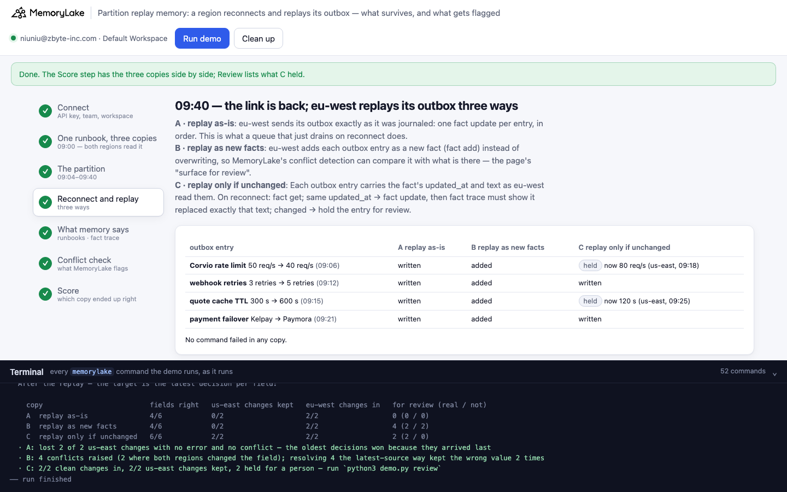
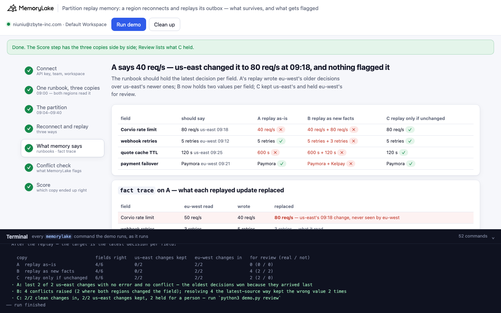
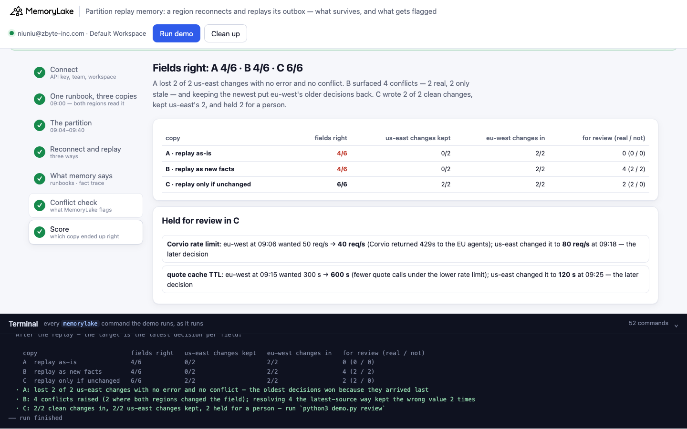

# Partition replay memory: a region reconnects, replays its outbox, and the oldest decisions win

A runnable version of the MemoryLake use case
[*Run Distributed Agent Fleets on Memory That Survives Network Partitions*](https://www.memorylake.ai/en/usecase/memory-for-distributed-agent-deployments),
built entirely on the [`memorylake` CLI](https://github.com/memorylake-ai/memorylake-cli) (v20261015 or later).

**Watch it run:** videos are being recorded.

**The problem.** A region loses its link to shared memory, keeps working, and journals its writes in a local outbox.
When the link comes back it replays the outbox. Meanwhile the connected regions changed some of the same settings —
and the region that was cut off never saw those changes. Two things go wrong, and neither raises an error:

- **Replay the outbox as it was journaled, and the newer changes vanish.** eu-west decided at 09:06 to lower a rate
  limit from 50 to 40; us-east raised it to 80 at 09:18. eu-west replays at 09:40, its `fact update` wins because it
  arrives last, and the runbook says 40. `fact update` takes no version or if-match, and it never runs conflict
  detection — so nothing is flagged.
- **Replay as new facts, and conflict detection surfaces it — then the obvious fix redoes the loss.** If eu-west adds
  each change as a new fact, MemoryLake flags every field with two values within seconds. But it also flags the fields
  only eu-west changed (stale base value vs new value — nothing for a person to decide), and resolving the way most
  pipelines would (*latest-source*: keep the newest fact) keeps eu-west's older decisions, because they are the newest
  to arrive.

What works: the outbox keeps what the region read — each fact's `updated_at` and text. On reconnect, write only if
the fact is unchanged (`fact get`, compare `updated_at`), check with `fact trace` that the write replaced exactly what
was read, and hold everything else for a person, with both decisions side by side.

**What this demo shows.** Tessane Freight (fictional) runs dispatch agents in us-east and eu-west on one shared runbook
memory: six facts (a carrier API rate limit, webhook retries, a quote cache TTL, a payment failover, the EU hub, the
on-call channel). At 09:00 both regions read it. From 09:04 to 09:40 eu-west is cut off:

| time | us-east (connected, writes to memory) | eu-west (cut off, journals to its outbox) |
|---|---|---|
| 09:06 | | rate limit 50 → **40** req/s (Corvio returned 429s to the EU agents) |
| 09:12 | | webhook retries 3 → **5** (the EU webhook endpoint kept flapping) |
| 09:15 | | quote cache 300 → **600** s (fewer calls under the lower limit) |
| 09:18 | rate limit → **80** req/s (Corvio confirmed the contract upgrade) | |
| 09:21 | | payment failover Kelpay → **Paymora** (Kelpay EU outage window) |
| 09:25 | quote cache → **120** s (quotes went stale in the fuel-price surge) | |

At 09:40 eu-west replays its outbox. The same replay runs three ways, each in its own copy of the runbook:

| | how eu-west replays each outbox entry |
|---|---|
| **A** replay as-is | `fact update <id> --text …` — what a queue that just drains on reconnect does |
| **B** replay as new facts | `fact add …`, so conflict detection compares it with what is there; then resolve the *latest-source* way |
| **C** replay only if unchanged | `fact get`: same `updated_at` as when read → `fact update`, then `fact trace` must show it replaced the text that was read; changed → hold for review |

The target is the latest decision per field: rate limit 80 (us-east, 09:18 beats eu-west's 09:06), retries 5, cache
120 (09:25 beats 09:15), failover Paymora, and the two untouched fields unchanged. The story times live in each
write's metadata; the writes themselves run a few seconds apart. No model calls: nothing is billed.

## Prerequisites

- **Python 3.9+** (standard library only).
- **The `memorylake` CLI, v20261015 or later** (`memorylake version`):
  ```bash
  curl -fsSL https://raw.githubusercontent.com/memorylake-ai/memorylake-cli/main/scripts/install.sh | sh
  ```
- **A MemoryLake API key**: sign up at [app.memorylake.ai](https://app.memorylake.ai), open **API Keys**, create one.
  Everything the demo uses (projects, facts, `fact trace`, conflict detection) is part of the free plan.

## Run it

```bash
git clone https://github.com/memorylake-ai/memorylake-usecases.git
cd memorylake-usecases/partition-replay-memory
export MEMORYLAKE_API_KEY=sk-...        # logs into an isolated profile under .memorylake-demo/, never touches ~/.memorylake
python3 demo.py                         # about 4 minutes (the replay takes a minute; then 150 s watching for conflicts)
python3 demo.py review                  # what copy C held for a person: both decisions, and which came later
python3 demo.py trace                   # what each replayed update replaced, in copies A and C
python3 demo.py outbox                  # eu-west's outbox vs what the runbook says now
python3 demo.py cleanup                 # deletes everything the demo created
```

China region: also `export MEMORYLAKE_BASE_URL=https://app.memorylake.cn/openapi/memorylake`. To use a specific
workspace: `export MEMORYLAKE_WORKSPACE=ws-…` (default: the team's default workspace). Without `MEMORYLAKE_API_KEY`
the demo uses your existing `memorylake auth login` session.

Every object the demo creates has a `custom_id` starting with `mlu-prp-`. Each run starts over: it deletes what a
previous run left behind first (`--reset` is accepted and does the same).

## Or run it in the browser

```bash
python3 web/server.py                   # opens http://127.0.0.1:8765
```

Paste the API key, press **Run demo**, and follow the steps: the three copies, the partition (both regions side by
side), the replay (live), what each runbook says with A's `fact trace`, the conflict check, and the score with what C
held for review. The terminal drawer at the bottom shows every `memorylake` command as it runs. The server is standard
library only and binds to localhost; the key stays in that process and in `.memorylake-demo/`.

| | |
|---|---|
|  |  |
|  | |

## What happens, step by step

Output excerpts below are from real runs (ids shortened).

### Step 2: one runbook, three copies

Three projects with the same name, "Tessane dispatch runbook" (only the `custom_id` says which is which), each with
the same six facts. Then both regions read it; eu-west keeps each fact's id, text and `updated_at`.

```
$ memorylake proj create --name 'Tessane dispatch runbook' --custom-id mlu-prp-runbook-a
$ memorylake fact add 'Tessane dispatch agents may call the Corvio carrier-rates API at most 50 requests per second.' 'Tessane dispatch agents retry a failed carrier webhook 3 times before paging on-call.' … --project proj-aef0…
…
  09:00 — both regions read the runbook. eu-west keeps what it read: each fact's id, text and updated_at.
$ memorylake fact list --projects proj-aef0… --page-size 200

    field               runbook says                     updated_at (copy A)
    Corvio rate limit   50 req/s                         08:48:35
    webhook retries     3 retries                        08:48:35
    …
```

### Step 3: the partition

us-east writes its two changes to all three copies, with the story time and reason in metadata. eu-west writes
nothing: its four changes go to `out/outbox.json`, each with the `updated_at` and text it read at 09:00.

```
$ memorylake fact update fact-5289… --text 'Tessane dispatch agents may call the Corvio carrier-rates API at most 80 requests per second.' --metadata '{"region": "us-east", "decided_at": "2026-10-19T09:18:00Z", "why": "Corvio confirmed the contract upgrade to the 80 req/s tier"}' --project proj-aef0…
    09:18  us-east  Corvio rate limit: → 80 req/s   (Corvio confirmed the contract upgrade to the 80 req/s tier)
    09:25  us-east  quote cache TTL: → 120 s   (quotes went stale during the fuel-price surge)

  eu-west cannot reach memory; its agents journal 4 changes in a local outbox (out/outbox.json), each with what it read at 09:00:
    09:06  eu-west  Corvio rate limit: 50 req/s → 40 req/s   (Corvio returned 429s to the EU agents)
    09:12  eu-west  webhook retries: 3 retries → 5 retries   (the EU carrier webhook endpoint kept flapping)
    09:15  eu-west  quote cache TTL: 300 s → 600 s   (fewer quote calls under the lower rate limit)
    09:21  eu-west  payment failover: Kelpay → Paymora   (Kelpay announced an EU outage window)
```

### Step 4: reconnect and replay, three ways

```
$ memorylake fact update fact-5289… --text '… at most 40 requests per second.' --metadata '{"region": "eu-west", "decided_at": "2026-10-19T09:06:00Z", …}' --project proj-aef0…
    A  Corvio rate limit   → 40 req/s   written
…
$ memorylake fact add 'Tessane dispatch agents may call the Corvio carrier-rates API at most 40 requests per second.' --project proj-f999…
    B  Corvio rate limit   → 40 req/s   added as a new fact
…
$ memorylake fact get fact-063f… --project proj-aef6…
    C  Corvio rate limit   HELD — updated_at 08:48:38 → 08:48:43: now 80 req/s (us-east, 09:18); eu-west wanted 40 req/s
$ memorylake fact get fact-3edf… --project proj-aef6…
$ memorylake fact update fact-3edf… --text 'Tessane dispatch agents retry a failed carrier webhook 5 times before paging on-call.' … --project proj-aef6…
$ memorylake fact trace fact-3edf… --project proj-aef6…
    C  webhook retries     → 5 retries  written; trace: it replaced exactly what eu-west read
…
  · A wrote 4, B added 4, C wrote 2 and held 2 — no command failed
```

B's adds are 15 seconds apart: back-to-back writes can push conflict detection back by minutes.

### Step 5: what each runbook says — and what `fact trace` shows

```
  The runbook should now say (latest decision wins):
    field               should say   from              A replay as-is            B as new facts            C if unchanged
    Corvio rate limit   80 req/s     us-east 09:18     40 req/s ✗                40 req/s + 80 req/s ✗     80 req/s ✓
    webhook retries     5 retries    eu-west 09:12     5 retries ✓               5 retries + 3 retries ✗   5 retries ✓
    quote cache TTL     120 s        us-east 09:25     600 s ✗                   600 s + 120 s ✗           120 s ✓
    payment failover    Paymora      eu-west 09:21     Paymora ✓                 Paymora + Kelpay ✗        Paymora ✓

  fact trace on A — what each replayed update replaced:
    field               eu-west read   wrote       replaced
    Corvio rate limit   50 req/s       40 req/s    80 req/s — us-east's 09:18 change, never seen by eu-west  ← BLIND
    webhook retries     3 retries      5 retries   3 retries — what it read
    quote cache TTL     300 s          600 s       120 s — us-east's 09:25 change, never seen by eu-west  ← BLIND
    payment failover    Kelpay         Paymora     Kelpay — what it read
  · A: 2 of 4 replayed updates overwrote a change made during the partition — every command succeeded: `fact update` takes no version or if-match
```

Each `UPDATE` in `fact trace` carries the text it replaced (`old_fact`). eu-west's outbox says what it read; where the
two differ, the replay overwrote a change it never saw. The trace shows it afterwards; nothing stopped it.

### Step 6: conflict detection

```
  · watching all three copies for 150 s after B's last write (detection usually lands in 10–110 s)
     10s after the last write — open conflicts: A 0 · B 3 · C 0
     27s after the last write — open conflicts: A 0 · B 4 · C 0
    …
  B: m2m · “Conflicting Corvio API rate limit” — Corvio rate limit  [both regions changed it]
      “Facts disagree on the maximum allowed request rate to the Corvio carrier-rates API for
       Tessane dispatch agents: one states 80 requests/second and another states 40 requests/second;
       both cannot be simultaneously true for a single-valued limit.”
  B: m2m · “Carrier webhook retry count mismatch” — webhook retries  [only eu-west changed it: nothing to review]
  …
  · A and C raise nothing: `fact update` never runs detection — A's overwrites are invisible to it

  B: resolving “Conflicting Corvio API rate limit” the latest-source way — keep the newest fact, forget the rest:
$ memorylake fact conflict resolve cfl-… --project proj-f999… --strategy keep_fact --keep-fact-id fact-…
  · kept 40 req/s (eu-west, decided 09:06), forgot 80 req/s — wrong: us-east decided 80 req/s at 09:18, later; eu-west's write is only the newest to arrive
```

### Step 7: the score

```
    copy                          fields right   us-east changes kept   eu-west changes in   for review (real / not)
    A  replay as-is               4/6            0/2                    2/2                  0 (0 / 0)
    B  replay as new facts        4/6            0/2                    2/2                  4 (2 / 2)
    C  replay only if unchanged   6/6            2/2                    2/2                  2 (2 / 0)
```

`python3 demo.py review` then shows what C held, with both decisions:

```
  Corvio rate limit
    eu-west  09:06  50 req/s → 40 req/s   (Corvio returned 429s to the EU agents)   — read before the partition
    us-east  09:18  → 80 req/s   — the runbook now says 80 req/s
    → us-east's change is the later decision
```

## Measured

7 runs: three terminal runs (the third with `--reset` over a previous run's data), three parallel copies of the demo
with their own `custom_id` prefix, and the browser run recorded for the Web video. Every number comes from the saved
reports (`out/runs/`).

| | A replay as-is | B replay as new facts | C replay only if unchanged |
|---|---|---|---|
| fields right | 4/6 in 7 of 7 runs | 4/6 in 7 of 7 (after resolving) | 6/6 in 7 of 7 |
| us-east changes kept | 0 of 14 | 0 of 14 | 14 of 14 |
| eu-west changes that only it made, applied | 14 of 14 | 14 of 14 | 14 of 14 |
| conflicts raised | 0 | 4 per run (28): 14 real, 14 only stale | 0 |
| sent to a person | 0 | 28 | 14 held, all real |

- **A overwrote both of us-east's changes in every run, with no error and no conflict.** The trace named the replaced
  value each time.
- **B's conflicts appeared 9–13 s after the last add** (the first ones); in the six terminal runs all four were there by the second check, at 26–30 s. Names and
  descriptions are written by a model and differ from run to run (“Failover gateway mismatch”, “Payment gateway
  failover target mismatch”, …); the field each one covers did not. Keeping the newest fact kept eu-west's value in
  28 of 28 resolutions — right for the 14 fields only eu-west changed, wrong for all 14 where us-east's later decision
  was forgotten.
- **C held exactly the two fields us-east had changed, in 7 of 7 runs**, and its `fact trace` check after each write
  found the write had replaced the text eu-west read every time (14 of 14). That check is for a write that slips in
  between `fact get` and `fact update`; it never fired here.

## Use it in your own agents

- **Journal what you read, not just what you want to write.** An outbox entry that only says "set X to 40" cannot
  tell, on replay, whether X still holds the value the decision was based on. Keep the fact's id, text and
  `updated_at` with it.
- **Replay conditionally.** `fact update` has no if-match. Do it in the client: `fact get`, compare `updated_at`, write
  only if unchanged. Then read `fact trace`: the newest `UPDATE` with your text must have `old_fact` equal to what you
  read; if not, someone wrote in between — put their value back or flag it.
- **Don't resolve by arrival time.** After a partition, the newest write to arrive is often the oldest decision.
  Store when a decision was made (here `decided_at` in metadata) and resolve on that, or send it to a person.
- **Conflict detection compares values, not histories.** It flags a stale replay of a field nobody else touched just
  as loudly as a real collision. Use it as a safety net under a conditional replay, not as the merge itself.
- **`fact update` never runs conflict detection.** Overwrites are invisible to it; only `fact trace` shows them.

## Troubleshooting

- **`no fact conflict command`** — the CLI is older than v20261015; reinstall with the `install.sh` line above.
- **Fewer than four conflicts in B** — detection runs after each write and usually lands in 10–30 s; on a busy account
  a check can land later than the 150 s window. `python3 demo.py` prints what it saw; the report says when each first
  appeared.
- **Leftovers after an interrupted run** — `python3 demo.py cleanup`.

## Files

| file | what it is |
|---|---|
| `demo.py` | the whole demo: CLI wrapper, the partition, the three replays, the trace audit, the conflict watch and resolution, cleanup |
| `data/story.json` | the runbook's six facts, us-east's two changes, eu-west's outbox, and the three ways to replay |
| `web/server.py`, `web/static/` | the browser companion (standard library server, no build step) |
| `out/report.json`, `out/outbox.json`, `out/held.json` | the last run's score, eu-west's outbox with what it read, and what C held (`cleanup` moves them to `out/runs/`) |
