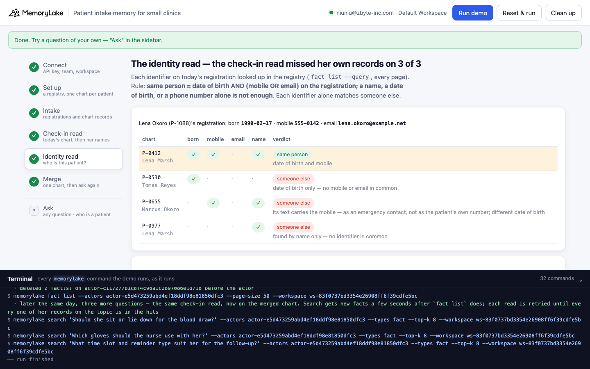
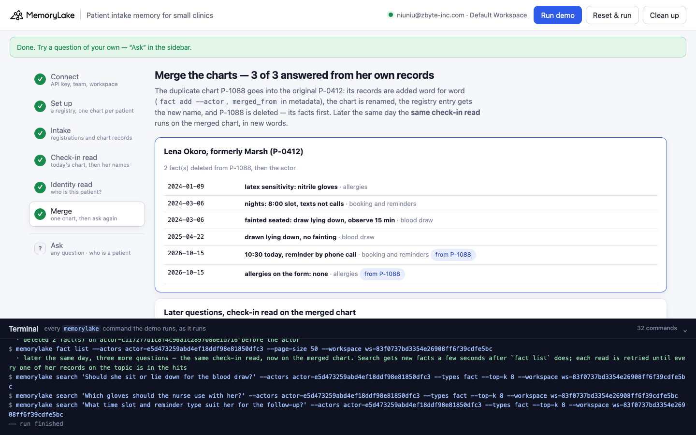

# Patient intake memory for small clinics

A runnable version of the MemoryLake use case
[*Give Small Clinics Patient Intake Memory That Captures Every Pattern and Preference*](https://www.memorylake.ai/en/usecase/patient-intake-memory-for-small-clinics),
built entirely on the [`memorylake` CLI](https://github.com/memorylake-ai/memorylake-cli).

**Watch it run:** [CLI, 2:59](https://github.com/memorylake-ai/memorylake-usecases/releases/download/patient-intake-memory-v1/patient-intake-memory-cli-demo.mp4) · [Web, 4:10](https://github.com/memorylake-ai/memorylake-usecases/releases/download/patient-intake-memory-v1/patient-intake-memory-web-demo.mp4)
([release](https://github.com/memorylake-ai/memorylake-usecases/releases/tag/patient-intake-memory-v1); GitHub serves them as downloads).

**The problem.** The page promises intake memory with "clinic-specific patterns" that front desk staff learn over time:
who faints at a blood draw, who reacts to latex, who can only come at 8:00. That memory belongs to a person. A front
desk files it under a chart number. When a patient changes her name and the front desk registers her as new, her
memory splits in two. The chart she is checked in under knows nothing about her. Reading every chart under her names
pulls in a different patient who has one of those names.

**What this demo shows.** Cedar Row Family Clinic (fictional) keeps one MemoryLake actor per patient chart, with every
intake form, nurse note and front desk note pinned word for word. It also keeps a front desk registry: one project, one
fact per registration. On October 15, Lena Okoro checks in for an annual physical with fasting labs. The front desk
registers her as a new patient, **P-1088**. Her intake form says *"Allergies listed on the form: none."*

She is not new. In 2024 and 2025 she came as **Lena Marsh, P-0412**. That chart says:

- she *"fainted during a seated blood draw … Draw lying down and observe 15 minutes after"*
- she has a *"latex sensitivity … Use nitrile gloves"*
- she *"works night shifts. Book the first slot of the day (8:00) and send text reminders, never phone calls"*

Three reads of the same question:

| read | how | what it gets for "anything to watch for when we draw her blood?" |
|---|---|---|
| **check-in read** | `search` the question in the chart she was checked in under (`--actors <P-1088>`) | *no blood draw record on this chart* |
| **name read** | every chart the registry finds for "Lena Okoro" or "Lena Marsh" (her form gives the previous surname) | 4 records from **3 different patients**: hers, a different Lena Marsh (born 1986: *"easy draw, seated"*), and Marcus Okoro, whose registration lists her as emergency contact |
| **identity read** | each identifier on today's registration looked up in the registry: **date of birth AND (mobile OR email)** | P-0412 is the same person; her two records: *draw lying down* |

Each identifier alone matches someone else, and the data has one of each: Tomas Reyes shares her date of birth, and
Marcus Okoro's registration carries her mobile number (as his emergency contact). The other Lena Marsh shares only
the name.

Step 6 then **merges the duplicate chart into the original**. P-1088's two records go onto P-0412 word for word, marked
`merged_from` in metadata. The chart is renamed *Lena Okoro, formerly Marsh (P-0412)*. Its registry entry gets the new
name, the P-1088 entry points at P-0412, and the P-1088 actor is deleted, its facts first. Later the same day, the
**same check-in read** on the merged chart answers three new questions from her own records, 3 of 3. The other three
charts have exactly as many records as before.

## What it uses

| MemoryLake feature | CLI | in this demo |
|---|---|---|
| actor-scoped memory | `actor create`, `fact add --actor`, `search --actors` | one chart per patient; the check-in read is scoped to one chart |
| project memory | `proj create`, `fact add --project` | the front desk registry, one fact per registration |
| exact-substring listing | `fact list --projects P --query <value>`, every page | looking up a date of birth, a mobile, an email, a name in the registry |
| metadata | `fact update --metadata` | each record's chart, source, author, date and topic; `merged_from`, `merged_into`, `aliases` after the merge |
| in-place edit | `fact update --text`, `actor update --display-name` | the registry entry and the chart get her new name |
| deletion | `fact delete --actor`, `actor delete` | the duplicate chart: facts first, then the actor |

No conversations, no extraction, no LLM step: every record is pinned word for word, so the demo runs the same way on a
free account every time.

## Prerequisites

- Python 3.9+ (standard library only)
- The `memorylake` CLI on your PATH:
  `curl -fsSL https://raw.githubusercontent.com/memorylake-ai/memorylake-cli/main/scripts/install.sh | sh`
- A MemoryLake API key. A free personal account at [app.memorylake.ai](https://app.memorylake.ai) is enough
  (open **API Keys**, create one).

## Run it

```bash
git clone https://github.com/memorylake-ai/memorylake-usecases.git
cd memorylake-usecases/patient-intake-memory
export MEMORYLAKE_API_KEY=sk-...           # China region: also export MEMORYLAKE_BASE_URL=https://app.memorylake.cn/openapi/memorylake
python3 demo.py
```

The first run takes about a minute and a half: one project, five actors and 18 facts with their metadata. A re-run
takes a bit less. Every run replays the morning of the visit. If an earlier run merged the charts, the merge is put
back first: the copies on P-0412 are deleted, and the registry entries and chart names return to what they said. The
P-1088 chart is created again. With the key set, the demo logs into an isolated CLI profile under
`./.memorylake-demo/` and never touches your own `~/.memorylake`. Everything it creates has a `custom_id` starting with
`mlu-pim-`.

Then ask a question of your own, or check which registrations are one patient:

```bash
python3 demo.py patient P-1088                                          # which registrations are this patient, identifier by identifier
python3 demo.py ask "Does she need nitrile gloves?" --topic allergy
python3 demo.py ask "Should she lie down for the blood draw?" --topic draw
python3 demo.py cleanup                                                 # deletes every chart (facts first), the registry and every fact on it
```

`ask` puts the reads side by side. After a run, the P-1088 chart is gone, so the check-in read shows what that chart
held this morning (the copies marked `merged_from P-1088`):

```
  “Should she lie down for the blood draw?” · topic blood draw
  the check-in chart P-1088 as it was this morning (merged into P-0412; its records are the copies marked merged_from P-1088):
      no blood draw record
  → the check-in read this morning: nothing on file
  the name read — 3 chart(s) the registry finds for her names, 4 blood draw record(s) from 3 patient(s):
      P-0412  2024-03-06  fainted seated: draw lying down, observe 15 min
      P-0655  2025-02-11  butterfly needle, right hand
      P-0412  2025-04-22  drawn lying down, no fainting
      P-0977  2025-05-12  easy draw, seated
  …
  → her own blood draw records (same person: P-0412):
      P-0412  2024-03-06  fainted seated: draw lying down, observe 15 min
      P-0412  2025-04-22  drawn lying down, no fainting
  the check-in read on the merged chart P-0412 — 2 blood draw record(s) in the top 6:
      #1   NN-0412  2024-03-06  fainted seated: draw lying down, observe 15 min
      #2   VN-0412  2025-04-22  drawn lying down, no fainting
```

## Or run it in the browser

```bash
python3 web/server.py                # opens http://127.0.0.1:8765
```

Paste the key, connect and run. The page drives the same functions as `demo.py` and streams every `memorylake` command
into a terminal drawer as it runs. You see the registry and today's chart, the check-in read with its hits, the name
read with records from three patients, the identity table, and the merged chart. **Ask** takes any question with a
topic, and has a "who is P-…?" button for every registration.




## What happens, step by step

### Steps 2–3: a registry and one chart per patient

```
    registry  Cedar Row - front desk registry               proj-…
    chart     Lena Marsh (P-0412)                          actor-…
    chart     Tomas Reyes (P-0530)                         actor-…
    chart     Marcus Okoro (P-0655)                        actor-…
    chart     Lena Marsh (P-0977)                          actor-…
    chart     Lena Okoro (P-1088)                          actor-…
```

Each registration is pinned on the project word for word, then `fact update --metadata` adds its fields. Each chart
record is pinned on its chart's actor:

```bash
memorylake fact add --project proj-… 'Registry P-0412 - Lena Marsh - DOB 1990-02-17 - mobile 555-0142 - email lena.marsh@example.net - …' …
memorylake fact add --actor actor-… 'Nurse note 2024-03-06 (Lena Marsh, P-0412): fainted during a seated blood draw, recovered in 5 minutes. Draw lying down and observe 15 minutes after.' …
memorylake fact update fact-… --actor actor-… --metadata '{"key": "pim:NN-0412", "record": "NN-0412", "patient": "P-0412", "source": "nurse", …, "topic": "draw", …}'
```

```
  the registry — 5 registrations:
    chart   name          born        mobile    email                     registered
    P-0977  Lena Marsh    1986-11-03  555-0199  lmarsh86@example.org      2023-08-14
    P-0412  Lena Marsh    1990-02-17  555-0142  lena.marsh@example.net    2024-01-09
    P-0655  Marcus Okoro  1987-06-30  555-0163  marcus.okoro@example.net  2025-02-11
    P-0530  Tomas Reyes   1990-02-17  555-0187  t.reyes@example.org       2025-03-02
    P-1088  Lena Okoro    1990-02-17  555-0142  lena.okoro@example.net    2026-10-15

  today, 2026-10-15: Lena Okoro (P-1088) checks in for an annual physical with fasting labs.
    FD-1088  front desk note  10:30 today, reminder by phone call
    IN-1088  intake form      allergies on the form: none
```

The identifiers are written into the registry entry's **text**. `fact list --query` matches the fact text only, not
its metadata.

### Step 4: the check-in read

```bash
memorylake search 'Anything to watch for when we draw her blood today?' --actors <P-1088's actor> --types fact --top-k 8
```

```
  Q1 · before the fasting draw · “Anything to watch for when we draw her blood today?”
  search in P-1088's chart · 2 hit(s):
      #1   IN-1088  intake form      allergy     Intake form 2026-10-15 (Lena Okoro, P-1088): new patient, annual phys…
      #2   FD-1088  front desk note  scheduling  Front desk note 2026-10-15 (Lena Okoro, P-1088): booked 10:30 today; …
  → check-in read: no blood draw record on this chart
```

Q2 (allergies) gets *"allergies on the form: none"*, and Q3 (booking) gets *"10:30 today, reminder by phone call"*. Her
form gives a previous surname, so the obvious repair is to read every chart the registry finds for either name:

```
  the registry finds 4 registration(s) for those names:
    P-0412  Lena Marsh    born 1990-02-17   matched “Lena Marsh”
    P-0655  Marcus Okoro  born 1987-06-30   matched “Lena Okoro”  (the name is in the text: emergency contact Lena Okoro 555-0142)
    P-0977  Lena Marsh    born 1986-11-03   matched “Lena Marsh”
    P-1088  Lena Okoro    born 1990-02-17   matched “Lena Okoro”

  Q1 · blood draw across those 4 charts:
      P-0412  Lena Marsh    2024-03-06  fainted seated: draw lying down, observe 15 min
      P-0655  Marcus Okoro  2025-02-11  butterfly needle, right hand
      P-0412  Lena Marsh    2025-04-22  drawn lying down, no fainting
      P-0977  Lena Marsh    2025-05-12  easy draw, seated
  → name read: 4 record(s) from 3 different patient(s) — which of them is her?
```

### Step 5: the identity read

Each identifier on today's registration is looked up in the registry (`fact list --query`, every page). The rule is
date of birth AND (mobile OR email):

```bash
memorylake fact list --projects proj-… --query 1990-02-17
memorylake fact list --projects proj-… --query 555-0142
memorylake fact list --projects proj-… --query lena.okoro@example.net
```

```
  Lena Okoro (P-1088)'s registration: born 1990-02-17 · mobile 555-0142 · email lena.okoro@example.net
    chart   name          born   mobile  email  name?  verdict
    P-0412  Lena Marsh    ✓      ✓       ·      ✓      SAME PERSON — date of birth and mobile
    P-0530  Tomas Reyes   ✓      ·       ·      ·      someone else — date of birth only — no mobile or email in common
    P-0655  Marcus Okoro  ·      ✓       ·      ✓      someone else — its text carries the mobile — as an emergency contact, not as the patient's own number; different date of birth
    P-0977  Lena Marsh    ·      ·       ·      ✓      someone else — found by name only — no identifier in common

  → same person: Lena Marsh (P-0412)
  …
  item  question                   check-in read (today’s chart)                her records
  --------------------------------------------------------------------------------------------
  Q1    before the fasting draw    nothing on file                              2   ✗ missed 2
  Q2    before the exam            allergies on the form: none                  2   ✗ missed 1
  Q3    booking the follow-up      10:30 today, reminder by phone call          2   ✗ missed 1

  → 3 of 3: what she told this clinic in 2024 and 2025 is on a chart under her old name
```

### Step 6: merge the charts

```bash
memorylake fact add --actor <P-0412's actor> 'Front desk note 2026-10-15 (Lena Okoro, P-1088): …' 'Intake form 2026-10-15 (Lena Okoro, P-1088): …'
memorylake fact update fact-… --actor <P-0412's actor> --metadata '{…, "merged_from": "P-1088", "source_actor": "actor-…", "source_fact": "fact-…"}'
memorylake actor update <P-0412's actor> --display-name 'Lena Okoro, formerly Marsh (P-0412)'
memorylake fact update <P-0412's registry fact> --project proj-… --text '… Also registered as P-1088 (Lena Okoro) on 2026-10-15; merged into P-0412.' --metadata '{…, "aliases": ["Lena Okoro", "P-1088"]}'
memorylake fact update <P-1088's registry fact> --project proj-… --metadata '{…, "merged_into": "P-0412"}'
memorylake actor delete <P-1088's actor>          # after deleting its two facts: actor delete does not take them with it
```

Then three new questions, asked in new words (`search` can answer a repeated question from its cache), go through the
same check-in read on the merged chart:

```
  Q4 · “Should she sit or lie down for the blood draw?”
      #1   NN-0412  2024-03-06  fainted seated: draw lying down, observe 15 min
      #2   VN-0412  2025-04-22  drawn lying down, no fainting
    → 2 of her 2 blood draw record(s) in the top 6  ✓

  Q5 · “Which gloves should the nurse use with her?”
      #1   IN-0412  2024-01-09  latex sensitivity: nitrile gloves
      #5   IN-1088  2026-10-15  allergies on the form: none
    → 2 of her 2 allergies record(s) in the top 6  ✓

  Q6 · “What time slot and reminder type suit her for the follow-up?”
      #1   FD-0412  2024-03-06  nights: 8:00 slot, texts not calls
      #5   FD-1088  2026-10-15  10:30 today, reminder by phone call
    → 2 of her 2 booking and reminders record(s) in the top 6  ✓

  → 3 of 3: on the merged chart, the check-in read finds what she told the clinic as Lena Marsh
  → the other charts: unchanged — P-0530 2 → 2, P-0655 2 → 2, P-0977 3 → 3
```

The merged chart keeps today's records too. *"Allergies listed on the form: none"* is still there, below the 2024
latex note. The merge puts both in front of the nurse. It does not decide which one is right.

## Measured

Five complete runs on a free account (a first run, `--reset`, two resumes, and a run from the web page), 75–120 s each:

- check-in read on today's chart: Q1 *nothing on file*, Q2 *allergies: none*, Q3 *10:30, phone call* — 5 of 5 runs
- name read: records from 3, 4 and 3 different patients for Q1–Q3 — 5 of 5
- identity read: P-0412 only — 5 of 5
- after the merge: all of her on-topic records in the hits, first try, for Q4–Q6 — 15 of 15; her 2024–2025 record ranked #1 every time and today's record below it; other charts unchanged — 5 of 5
- no search hit came from the cache — 0 of 30 reads

## Wiring it into your own clinic

- One actor per chart, and `fact add --actor` for every intake form, nurse note and front desk note. Put the date and
  the chart id in the text. Put the source, author and topic in metadata.
- Write the identifiers into the registry entry's text, not only its metadata: `fact list --query` matches text.
- Pick a rule with two independent identifiers. A date of birth alone, a phone number alone (an emergency contact
  field carries someone else's) or a name alone each match the wrong person here.
- Merge into the older chart, keep `merged_from` on every copied record and `merged_into` on the retired
  registration, and delete the duplicate actor's facts before the actor: `actor delete` leaves them readable and
  undeletable.

## If something goes wrong

- `the memorylake CLI is not on PATH` — install it (see Prerequisites) or set `MEMORYLAKE_BIN`.
- `not logged in` — export `MEMORYLAKE_API_KEY`, or run `memorylake auth login` first.
- A step stops with a network error — run `python3 demo.py` again; it picks up what exists. `--reset` starts over.
- Step 6 says `try 2` or more — search had not caught up with the new facts yet; the demo retries every 4 s.
- To start clean: `python3 demo.py cleanup`.

## Files

| file | what |
|---|---|
| `demo.py` | the demo: `run` (default), `ask`, `patient`, `cleanup` |
| `data/story.json` | the clinic, five registrations, 13 chart records, the questions and the rule |
| `web/server.py` | local web companion (standard library HTTP + server-sent events) |
| `web/static/` | the page (no build step) |
